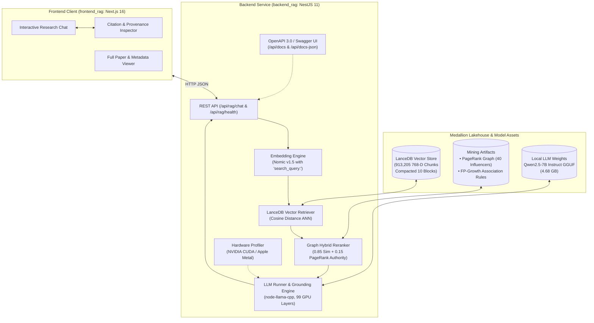

# Scientific Literature RAG System (TypeScript)

[](https://www.typescriptlang.org/)
[](https://nestjs.com/)
[](https://nextjs.org/)
[](https://lancedb.com/)
[](http://localhost:8000/api/docs)
[](https://developer.nvidia.com/cuda-toolkit)

An end-to-end, high-performance Retrieval-Augmented Generation (RAG) platform implemented in **TypeScript / NestJS 11**. The system is built over an optimized Medallion Lakehouse comprising **913,205 dense 768-dimensional embeddings** across AI, Machine Learning, Computer Vision, and NLP, accelerated locally via **`node-llama-cpp`** on GPU.

---

## 🏛️ System Architecture



---

## 📦 Repository Organization

| Directory / Package | Description | Technology Stack |
| :--- | :--- | :--- |
| **[`backend_rag/`](backend_rag/)** | Backend RAG service providing vector retrieval, mining-based reranking, local GPU LLM generation, and Swagger UI. | NestJS 11, `@lancedb/lancedb`, `@xenova/transformers`, `node-llama-cpp`, `@nestjs/swagger` |
| **[`frontend_rag/`](frontend_rag/)** | Modern web client for querying the RAG pipeline and exploring cited papers. | Next.js 16 (App Router), React 19, Tailwind CSS v4, TypeScript |
| **[`docs/`](docs/)** | Comprehensive architectural documentation, API specifications, and prompt contracts. | Markdown, Mermaid (`MD_CONVENTION.md`, `COMMIT_CONVENTION.md`) |
| **[`agents/rules/`](agents/rules/)** | Immutable documentation and commit standards (`MD_CONVENTION.md`, `COMMIT_CONVENTION.md`). | Markdown standard specifications |
| **[`data/`](data/)** | Local lakehouse junction / Cloudflare R2 bucket connection (`gold/lancedb`, `gold/mining`). | LanceDB, Parquet, JSON |
| **[`models/`](models/)** | Local quantized LLM weights (`qwen2.5-7b-instruct-q4_k_m.gguf`). | GGUF |

---

## 📚 Key Technical Highlights

1. **Hardware Acceleration (NVIDIA CUDA & Apple Metal)**:
   - Built-in automatic GPU detection via [`gpu.util.ts`](backend_rag/src/utils/gpu.util.ts) supporting Windows/Linux CUDA (`nvidia-smi`) and macOS Metal (`arm64`).
   - Live hardware tested with **99 GPU layers offloaded** to NVIDIA GeForce RTX 4060 Laptop GPU (8,188 MiB VRAM).
2. **Dense Vector Search (913,205 Chunks)**:
   - Ingested and indexed via `@lancedb/lancedb` in 10 compacted data blocks (7.875 GB lakehouse footprint) with sub-second ANN cosine search.
   - S3-compatible fallback for live Cloudflare R2 object storage.
3. **Strict Asymmetric Query Embedding**:
   - Uses `nomic-ai/nomic-embed-text-v1.5` via `@xenova/transformers`. Enforces `search_query: ` prefixing and L2 unit normalization.
4. **Graph-Mining Boosted Reranking**:
   - Incorporates PageRank co-authorship authority metrics (`graph_coauthorship.json`) and FP-Growth association rules (`association_rules.json`).
   - Blended ranking formula: $S_{\text{final}} = 0.85 \times S_{\text{sim}} + 0.15 \times A_{\text{author}}$.
5. **Zero-Hallucination Academic Grounding**:
   - Enforces strict system instructions requiring citations in the format `[Paper: {paper_id}]`.
   - Automated regex extraction of cited paper IDs returned alongside grounded chunks.
6. **Interactive OpenAPI 3.0 / Swagger UI**:
   - Fully documented interactive UI served at `/api/docs` and machine-parseable schema at `/api/docs-json`.

---

## ⚡ Quick Start

### 1. Prerequisites
- **Node.js**: v20+ (Node.js 22 LTS recommended)
- **C++ Build Tools / CMake**: Required for native bindings in `node-llama-cpp`
- **NVIDIA CUDA Toolkit** (Windows/Linux) or **Apple Silicon** (macOS)
- **Model File**: GGUF model located in `models/qwen2.5-7b-instruct-q4_k_m/qwen2.5-7b-instruct-q4_k_m.gguf` (4.68 GB)
- **Data Lakehouse**: Gold LanceDB store located in `data/gold/lancedb/scientific_papers_gold.lance`

### 2. Setup & Run Backend

```bash
cd backend_rag
npm install
npm run build
npm run start:prod
```
> The backend server starts at **`http://localhost:8000`**.

### 3. API Endpoints & Swagger Documentation
- **Interactive Swagger UI**: [http://localhost:8000/api/docs](http://localhost:8000/api/docs)
- **OpenAPI 3.0 Schema**: [http://localhost:8000/api/docs-json](http://localhost:8000/api/docs-json)
- **System & GPU Health**: [http://localhost:8000/api/rag/health](http://localhost:8000/api/rag/health)
- **RAG Chat**: `POST http://localhost:8000/api/rag/chat`

#### Example RAG Request:
```bash
curl -X POST http://localhost:8000/api/rag/chat \
  -H "Content-Type: application/json" \
  -d '{"query": "How does LoRA optimize large models?", "top_k": 5}'
```

---

## 📖 In-Depth Documentation

For detailed architecture diagrams, API specifications, and prompt contracts, refer to:
- **[`docs/SCIENTIFIC_RAG_BACKEND.md`](docs/SCIENTIFIC_RAG_BACKEND.md)**: Complete system design, sequence diagrams, and GPU telemetry benchmarks.
- **[`docs/API_SPECIFICATION.md`](docs/API_SPECIFICATION.md)**: Full REST & OpenAPI contract with schema definitions and response samples.
- **[`agents/rules/MD_CONVENTION.md`](agents/rules/MD_CONVENTION.md)**: 7-field header standard, ISO 8601 timestamps, and documentation governance.
- **[`agents/rules/COMMIT_CONVENTION.md`](agents/rules/COMMIT_CONVENTION.md)**: Conventional Commits with `Companion-Doc:` Git trailer standard.
- **[`docs/RAG.md`](docs/RAG.md)**: LanceDB schemas, Silver Parquet layout, and data mining specifications.
- **[`docs/prompt.md`](docs/prompt.md)**: System prompt and structured guidance catalog.

---

## 📄 License

This project is licensed under the [MIT License](LICENSE) (or academic research license as designated by UTH).
