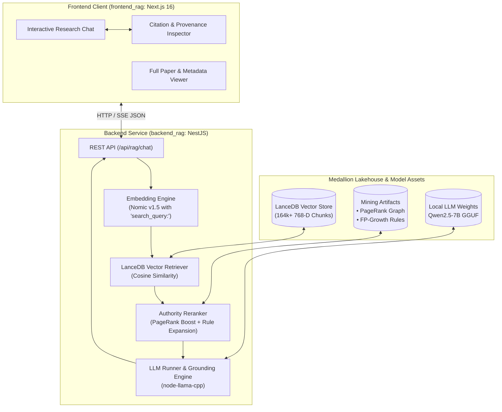

# Scientific Literature RAG System (TypeScript)

[](https://www.typescriptlang.org/)
[](https://nestjs.com/)
[](https://nextjs.org/)
[](https://lancedb.com/)
[](https://tailwindcss.com/)

An end-to-end, high-performance Retrieval-Augmented Generation (RAG) platform implemented entirely in **TypeScript / Node.js**. The system is built over a Medallion Lakehouse comprising **13,000+ scientific research papers** and **164,800+ dense 768-dimensional embeddings** across AI, Machine Learning, Computer Vision, and NLP.

---

## 🏛️ System Architecture



---

## 📦 Repository Organization

| Directory / Package | Description | Technology Stack |
| :--- | :--- | :--- |
| **[`backend_rag/`](file:///Users/quangmanh/Project/RAG_TS/backend_rag)** | Backend RAG service providing vector retrieval, mining-based reranking, and local LLM generation. | NestJS 11, `@lancedb/lancedb`, `@xenova/transformers`, `node-llama-cpp` |
| **[`frontend_rag/`](file:///Users/quangmanh/Project/RAG_TS/frontend_rag)** | Modern web client for querying the RAG pipeline and exploring cited papers. | Next.js 16 (App Router), React 19, Tailwind CSS v4, TypeScript |
| **[`docs/`](file:///Users/quangmanh/Project/RAG_TS/docs)** | Comprehensive architectural documentation, data schemas, and prompt specifications. | Markdown, Mermaid |
| **[`data/`](file:///Users/quangmanh/Project/RAG_TS/data)** | Symlink/Directory to Medallion lakehouse tiers (`raw/`, `silver/`, `gold/`). | LanceDB, Parquet, JSON |
| **[`model/`](file:///Users/quangmanh/Project/RAG_TS/model)** | Local quantized LLM weights (`qwen2.5-7b-instruct-q4_k_m.gguf`). | GGUF |

---

## 📚 Key Technical Highlights

1. **Strict Asymmetric Query Embedding**: Uses `nomic-ai/nomic-embed-text-v1.5` via `@xenova/transformers`. Enforces prefix `search_query:` on inputs to match pre-indexed document chunk representations.
2. **Dense Vector Search**: Powered by `@lancedb/lancedb` against 164,876 scientific chunks, optimized for sub-second Cosine search.
3. **Graph-Mining Boosted Reranking**: Incorporates PageRank co-authorship authority metrics (`graph_coauthorship.json`) and FP-Growth association rules (`association_rules.json`) to elevate seminal papers and discover co-occurring research topics.
4. **Zero-Hallucination Academic Grounding**: Enforces strict system instructions requiring citations in the format `[Paper: {paper_id}]`. Refuses to answer outside the retrieved context.
5. **Local Hardware Acceleration**: Runs local LLMs with Metal (Apple Silicon) or CUDA GPU offloading via `node-llama-cpp`.

---

## ⚡ Quick Start

### 1. Prerequisites
- **Node.js**: v20+ (Node.js 22 LTS recommended)
- **C++ Compiler & CMake**: Required for native bindings in `node-llama-cpp`
- **Model File**: GGUF model located in `model/` (e.g., `qwen2.5-7b-instruct-q4_k_m.gguf`)
- **Data Lakehouse**: Gold LanceDB store located in `data/gold/lancedb`

### 2. Setup & Run Backend

```bash
cd backend_rag
cp .env_example .env
npm install
npm run start:dev
```
> The backend server starts at `http://localhost:3001`.

### 3. Setup & Run Frontend

```bash
cd frontend_rag
npm install
npm run dev
```
> The frontend application starts at `http://localhost:3000`.

---

## 📖 In-Depth Documentation

For detailed design specifications, schemas, and prompt catalogs, refer to the [`docs/`](file:///Users/quangmanh/Project/RAG_TS/docs) directory:
- **[`docs/RAG.md`](file:///Users/quangmanh/Project/RAG_TS/docs/RAG.md)**: Full dataset architecture, LanceDB schemas, Silver Parquet layout, and data mining specifications.
- **[`docs/prompt.md`](file:///Users/quangmanh/Project/RAG_TS/docs/prompt.md)**: Step-by-step feature breakdown and structured prompt catalog for building each module.
- **[`docs/lesson_2.md`](file:///Users/quangmanh/Project/RAG_TS/docs/lesson_2.md)**: Engineering methodology, functional decomposition, and software contracts.

---

## 📄 License

This project is licensed under the [MIT License](LICENSE) (or proprietary academic use as configured by UTH).
