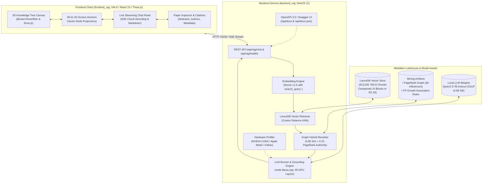

# Scientific Literature RAG System (TypeScript)

- **Motivation/Background**: Academic research produces thousands of machine learning and scientific publications weekly. This platform provides a low-latency, retrieval-augmented generation system featuring an interactive 3D procedural knowledge canopy and strict citation verification over 913,205 scientific paper embeddings.
- **Purpose**: Authoritative repository guide and quick start documentation detailing system architecture, prerequisites, and step-by-step instructions for running the NestJS backend and Vite 3D frontend on Windows (PowerShell) and Unix environments.
- **Overview Pipeline**: Ingested and indexed 913,205 paper vectors into LanceDB (local lakehouse or Cloudflare R2), augmented via graph co-authorship PageRank hybrid reranking, synthesized with local GPU-accelerated Qwen2.5-7B GGUF inference, and visualised in real-time with Three.js.
- **Detailed Plan**: §1 Architecture & Subsystems; §2 Repository Structure; §3 Technical Capabilities; §4 Windows Execution Guide (PowerShell); §5 API Endpoints & Swagger; §6 Automated Testing & >90% Coverage; §7 Windows Troubleshooting; §8 Documentation Index.
- **References**: `docs/SCIENTIFIC_RAG_BACKEND.md`, `docs/API_SPECIFICATION.md`, `docs/agent_logs/Vuong_DECISION_LOG.md`, `agents/rules/MD_CONVENTION.md`, `agents/rules/COMMIT_CONVENTION.md`.
- **Created**: 2026-10-14T17:05:00+07:00
- **Last Updated**: 2026-10-19T22:38:00+07:00

---

[](https://www.typescriptlang.org/)
[](https://nestjs.com/)
[](https://react.dev/)
[](https://vite.dev/)
[](https://threejs.org/)
[](https://lancedb.com/)
[](http://localhost:8000/api/docs)
[](https://developer.nvidia.com/cuda-toolkit)

An end-to-end, high-performance Retrieval-Augmented Generation (RAG) platform implemented in **TypeScript / NestJS 11** with an interactive **3D Knowledge Tree Frontend (Vite 6 / React 19 / Three.js)**. The system queries over an optimized Medallion Lakehouse comprising **913,205 dense 768-dimensional embeddings** across AI, Machine Learning, Computer Vision, and NLP, accelerated locally via **`node-llama-cpp`** on GPU.

---

## 🏛️ System Architecture



---

## 📦 Repository Organization

| Directory / Package                               | Description                                                                                                       | Technology Stack                                                                                   |
| :------------------------------------------------ | :---------------------------------------------------------------------------------------------------------------- | :------------------------------------------------------------------------------------------------- |
| **[`backend_rag/`](backend_rag/)**         | Backend RAG service providing vector retrieval, mining-based reranking, local GPU LLM generation, and Swagger UI. | NestJS 11, `@lancedb/lancedb`, `@xenova/transformers`, `node-llama-cpp`, `@nestjs/swagger` |
| **[`frontend_rag/`](frontend_rag/)**       | 3D Knowledge Tree interactive web client with spatial raycasting, SSE chat streaming, and citation inspection.    | Vite 6, React 19, Three.js, React Three Fiber, Tailwind CSS v4, TypeScript                         |
| **[`docs/`](docs/)**                       | Comprehensive architectural documentation, API specifications, and prompt contracts.                              | Markdown, Mermaid (`MD_CONVENTION.md`, `COMMIT_CONVENTION.md`)                                 |
| **[`docs/agent_logs/`](docs/agent_logs/)** | Decision audit trail and architectural records (`Vuong_DECISION_LOG.md`).                                       | Markdown standard specifications                                                                   |
| **[`agents/rules/`](agents/rules/)**       | Immutable documentation and commit standards (`MD_CONVENTION.md`, `COMMIT_CONVENTION.md`).                    | Markdown standard specifications                                                                   |
| **[`data/`](data/)**                       | Local lakehouse junction / Cloudflare R2 bucket connection (`gold/lancedb`, `gold/mining`).                   | LanceDB, Parquet, JSON                                                                             |
| **[`models/`](models/)**                   | Local quantized LLM weights (`qwen2.5-7b-instruct-q4_k_m.gguf`).                                                | GGUF                                                                                               |

---

## 📚 Key Technical Highlights

1. **Hardware Acceleration (NVIDIA CUDA, Vulkan & Apple Metal)**:
   - Built-in automatic GPU detection via [`gpu.util.ts`](backend_rag/src/utils/gpu.util.ts) supporting Windows/Linux CUDA (`nvidia-smi`) and macOS Metal (`arm64`).
   - Offloads up to **99 GPU layers** to NVIDIA RTX GPUs with automatic CPU fallback when GPU is absent.
2. **Dense Vector Search (913,205 Chunks)**:
   - Ingested and indexed via `@lancedb/lancedb` in 10 compacted data blocks with sub-second ANN cosine search.
   - Dual-mode support: local filesystem or Cloudflare R2 S3-compatible cloud lakehouse via `FORCE_REMOTE_LANCEDB=true`.
3. **Strict Asymmetric Query Embedding**:
   - Uses `nomic-ai/nomic-embed-text-v1.5` via `@xenova/transformers`. Enforces mandatory `search_query: ` prefixing and L2 unit normalization.
4. **Graph-Mining Boosted Reranking**:
   - Incorporates PageRank co-authorship authority metrics (`graph_coauthorship.json`) and FP-Growth association rules (`association_rules.json`).
   - Blended ranking formula: $S_{\text{final}} = 0.85 \times S_{\text{sim}} + 0.15 \times A_{\text{author}}$.
5. **Zero-Hallucination Academic Grounding**:
   - Enforces strict system instructions requiring citations in the format `[Paper: {paper_id}]`.
   - Automated regex extraction of cited paper IDs returned alongside grounded chunks.
6. **High-Performance 3D Visualization**:
   - 3D Knowledge Tree procedural canopy rendering in React Three Fiber with screen-space anchor projections, spatial grid raycasting, and GPU adaptive quality scaling.
7. **Strict Test Coverage (>90%)**:
   - Enforced automated thresholds across statements, lines, and functions in Vitest (`frontend_rag`) and Jest (`backend_rag`).

---

## 🪟 Windows Setup & Execution Guide (PowerShell)

Follow this complete step-by-step guide to run both the **Backend** and **Frontend** services natively on **Windows 10/11** using PowerShell.

### 1. Prerequisites on Windows

Ensure the following tools are installed on your Windows machine:

1. **Node.js**:
   - Version: **v20+** (v22 LTS recommended).
   - Installation via Winget:
     ```powershell
     winget install OpenJS.NodeJS.LTS
     ```
2. **C++ Build Tools & CMake** (Required for native bindings in `node-llama-cpp`):
   - Visual Studio Build Tools with "Desktop development with C++":
     ```powershell
     winget install Microsoft.VisualStudio.2022.BuildTools --override "--add Microsoft.VisualStudio.Workload.VCTools --includeRecommended"
     ```
   - CMake (v3.22+):
     ```powershell
     winget install Kitware.CMake
     ```
3. **GPU Drivers** (Optional, for hardware acceleration):
   - NVIDIA GPU: Install the latest [NVIDIA Game Ready / Studio Drivers](https://www.nvidia.com/Download/index.aspx) and [CUDA Toolkit 12.x](https://developer.nvidia.com/cuda-downloads).
   - If no dedicated GPU is available, the backend automatically uses multi-threaded CPU fallback.
4. **Git with Long Paths Enabled**:
   ```powershell
   git config --system core.longpaths true
   ```

---

### 2. Clone Repository & Initialize Submodules

Clone the repository and initialize the `frontend_rag` and `backend_rag` submodules:

```powershell
# Clone repository with all submodules
git clone --recurse-submodules https://github.com/Vuong-09/RAG_TS.git
cd RAG_TS

# If you already cloned the repo without --recurse-submodules:
git submodule update --init --recursive
```

Verify that you are on the correct active branches:

* **Root repository**: `vuong/scientific-rag-fullstack`
* **`backend_rag`**: `vuong/scientific-rag-backend`
* **`frontend_rag`**: `vuong/vite_3d`

```powershell
git branch
cd backend_rag; git branch; cd ..
cd frontend_rag; git branch; cd ..
```

---

### 3. Configure Environment Variables

The project uses a unified configuration setup. Create or verify `.env` in the root directory:

```powershell
# Copy the example configuration if needed
Copy-Item .env.example .env -ErrorAction SilentlyContinue
```

Key configuration options in `.env`:

```ini
# Storage & Vector Database Mode
FORCE_REMOTE_LANCEDB=true
LANCEDB_URI=s3://uth-scientific-lakehouse/gold/lancedb
LANCEDB_TABLE=scientific_papers_gold

# Cloudflare R2 Credentials (if FORCE_REMOTE_LANCEDB=true)
CLOUDFLARE_ACCOUNT_ID=your_cloudflare_account_id
R2_ACCESS_KEY_ID=your_r2_access_key_id
R2_SECRET_ACCESS_KEY=your_r2_secret_access_key
R2_BUCKET_NAME=uth-scientific-lakehouse
R2_ENDPOINT_URL=https://your_cloudflare_account_id.r2.cloudflarestorage.com

# Local Fallback (if FORCE_REMOTE_LANCEDB=false)
LANCEDB_PATH=../data/gold/lancedb

# LLM & GPU Settings
LLM_MODEL_PATH=models/qwen2.5-7b-instruct-q4_k_m/qwen2.5-7b-instruct-q4_k_m.gguf
GPU_LAYERS=99
CONTEXT_SIZE=8192

# Ports & URLs
GATEWAY_PORT=8000
FRONTEND_ORIGIN=http://localhost:3000
```

> [!NOTE]
> `backend_rag/src/app.module.ts` automatically searches both `./.env` and `../.env`, so configuring the root `.env` will provide values for the backend.

---

### 4. Running the Backend (`backend_rag`) on Windows

Open a new **PowerShell** window (Terminal 1):

```powershell
# 1. Navigate to the backend directory
cd "C:\path\to\RAG_TS\backend_rag"

# 2. Install dependencies
npm install

# 3. Build the NestJS application
npm run build

# 4. Start the backend server
# For development (hot-reload):
npm run start:dev

# Or for production:
npm run start:prod
```

#### Expected Backend Output:

```text
[Bootstrap] Scientific RAG Backend server listening on port 8000
[Bootstrap] Swagger UI Documentation: http://localhost:8000/api/docs
[Bootstrap] OpenAPI JSON Schema: http://localhost:8000/api/docs-json
[Bootstrap] Health endpoint: http://localhost:8000/api/rag/health
[Bootstrap] Chat endpoint: http://localhost:8000/api/rag/chat
```

Verify backend health in PowerShell:

```powershell
Invoke-RestMethod -Uri "http://localhost:8000/api/rag/health"
```

---

### 5. Running the Frontend (`frontend_rag`) on Windows

Open a second **PowerShell** window (Terminal 2):

```powershell
# 1. Navigate to the frontend directory
cd "C:\path\to\RAG_TS\frontend_rag"

# 2. Install dependencies
npm install
```

Choose one of two running modes:

#### Mode A: Live 3D Knowledge Tree (Connected to Backend on :8000)

Connects directly to the NestJS backend API with live SSE stream decoding, vector retrieval, and citation exploration:

```powershell
$env:VITE_USE_MOCK="false"
npm run dev
```

#### Mode B: Standalone Mock 3D Tree (Offline / No Backend Required)

Runs on a deterministic, procedural mock scientific world. Perfect for UI development, testing, and machines without GPU/lakehouse access:

```powershell
$env:VITE_USE_MOCK="true"
npm run dev
```

The Vite dev server will start at:
👉 **`http://localhost:3000`** (or `http://localhost:5173`)

Open this URL in Google Chrome, Microsoft Edge, or Firefox to explore the 3D procedural tree and chat interface.

---

## 🧪 Running Automated Tests on Windows

Both repositories maintain strict automated test suites with **>90% code coverage**:

### Backend Tests (Jest)

From `backend_rag/`:

```powershell
cd backend_rag

# Run all 10 test suites (41 unit and service tests)
npm test

# Run tests with Jest code coverage report
npm run test:cov
```

### Frontend Tests (Vitest)

From `frontend_rag/`:

```powershell
cd frontend_rag

# Run all 19 test suites (168 unit and component tests)
npm test

# Run tests with V8 coverage enforcement (>90% threshold)
npx vitest run --coverage
```

---

## 🛠️ Windows Troubleshooting & Tips

### 1. `node-llama-cpp` or Native Compilation Errors

* **Issue**: `error MSB8020: The build tools for v143 cannot be found` or CMake build errors during `npm install`.
* **Fix**: Ensure Visual Studio Build Tools are installed with the **Desktop development with C++** workload. Open "Visual Studio Installer", check "Desktop development with C++", and install. Alternatively, restart PowerShell after installation.

### 2. PowerShell Script Execution Policy

* **Issue**: `File ...\npm.ps1 cannot be loaded because running scripts is disabled on this system.`
* **Fix**: Enable script execution for your user session:
  ```powershell
  Set-ExecutionPolicy -Scope Process -ExecutionPolicy Bypass
  ```

### 3. Port Already in Use (8000 or 3000)

* **Issue**: `Error: listen EADDRINUSE: address already in use :::8000`.
* **Fix**: Find and kill the process holding the port:
  ```powershell
  Get-NetTCPConnection -LocalPort 8000 | Select-Object OwningProcess
  Stop-Process -Id <PID> -Force
  ```

### 4. Git Path Length Limit

* **Issue**: `Filename too long` during `git checkout` or `git submodule update`.
* **Fix**: Run PowerShell as Administrator and configure:
  ```powershell
  git config --system core.longpaths true
  ```

---

## 🌐 API Endpoints & Swagger Documentation

- **Interactive Swagger UI**: [http://localhost:8000/api/docs](http://localhost:8000/api/docs)
- **OpenAPI 3.0 Schema**: [http://localhost:8000/api/docs-json](http://localhost:8000/api/docs-json)
- **System & GPU Health**: `GET http://localhost:8000/api/rag/health`
- **RAG Chat & Retrieval**: `POST http://localhost:8000/api/rag/chat`
- **RAG Live Streaming**: `POST http://localhost:8000/api/rag/chat/stream`

#### Example RAG Request via PowerShell:

```powershell
$body = @{
    query = "How does LoRA optimize large models?"
    top_k = 5
} | ConvertTo-Json

Invoke-RestMethod -Uri "http://localhost:8000/api/rag/chat" `
    -Method Post `
    -ContentType "application/json" `
    -Body $body
```

---

## 📖 In-Depth Documentation

For detailed architecture diagrams, API specifications, and prompt contracts, refer to:

- **[`docs/SCIENTIFIC_RAG_BACKEND.md`](docs/SCIENTIFIC_RAG_BACKEND.md)**: Complete system design, sequence diagrams, and GPU telemetry benchmarks.
- **[`docs/API_SPECIFICATION.md`](docs/API_SPECIFICATION.md)**: Full REST & OpenAPI contract with schema definitions and response samples.
- **[`docs/agent_logs/Vuong_DECISION_LOG.md`](docs/agent_logs/Vuong_DECISION_LOG.md)**: Architecture Decision Records (ADRs D-001 through D-008).
- **[`agents/rules/MD_CONVENTION.md`](agents/rules/MD_CONVENTION.md)**: 7-field header standard, ISO 8601 timestamps, and documentation governance.
- **[`agents/rules/COMMIT_CONVENTION.md`](agents/rules/COMMIT_CONVENTION.md)**: Conventional Commits with `Companion-Doc:` Git trailer standard.
- **[`docs/RAG.md`](docs/RAG.md)**: LanceDB schemas, Silver Parquet layout, and data mining specifications.
- **[`docs/prompt.md`](docs/prompt.md)**: System prompt and structured guidance catalog.

---

## 📄 License

This project is licensed under the [MIT License](LICENSE) (or academic research license as designated by UTH).
