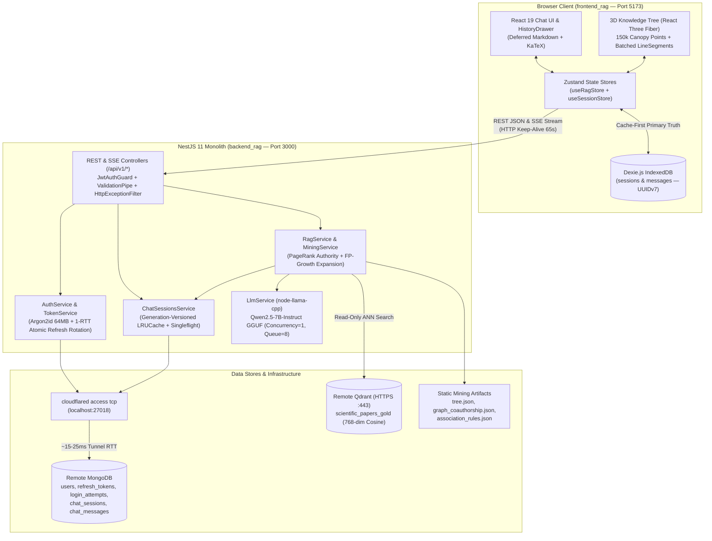
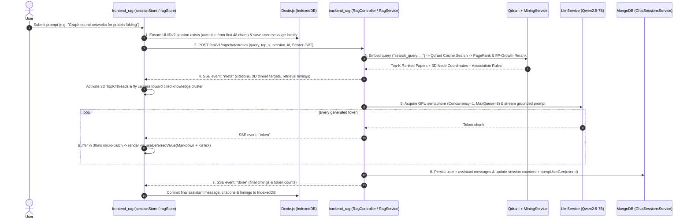

# ARCHITECTURE_OVERVIEW.md — Full-Stack System Topology & Data-Flow Architecture

- **Motivation/Background**: `RAG_TS` integrates an interactive 3D WebGL visual exploration engine (`frontend_rag`) with a scientific RAG backend (`backend_rag`), dual-layer persistence (client-side `Dexie.js` IndexedDB + remote MongoDB over Cloudflare Access), Qdrant vector search, PageRank/FP-Growth graph mining, and bounded local GGUF LLM inference. A unified architectural overview is essential for AI agents and engineers to understand how these subsystems interact end-to-end.
- **Purpose**: Document the end-to-end system topology, request lifecycles, data-store boundaries, and performance/resilience envelopes across `frontend_rag` and `backend_rag`.
- **Overview Pipeline**: Client UI & 3D Scene (`frontend_rag`) → Cache-First IndexedDB (`chatDb.ts`) → REST / SSE Gateway (`backend_rag` `/api/v1`) → In-Memory `LRUCache` & `Singleflight` → MongoDB (`localhost:27018`) + Qdrant (`scientific_papers_gold`) + Mining Reranker + GGUF LLM (`Qwen2.5-7B`).
- **Detailed Plan**: Section 1 presents the High-Level System Topology Diagram; Section 2 walks through the End-to-End Scientific RAG Query & Streaming Lifecycle; Section 3 explains the Dual-Persistence & Offline-First Architecture; Section 4 summarizes Certified Capacity & SLA Envelopes.
- **References**: [../AGENTS.md](../AGENTS.md), [INDEX.md](INDEX.md), [API_SPECIFICATION.md](API_SPECIFICATION.md), [SCIENTIFIC_RAG_BACKEND.md](SCIENTIFIC_RAG_BACKEND.md), [../backend_rag/AGENTS.md](../backend_rag/AGENTS.md), [../frontend_rag/AGENTS.md](../frontend_rag/AGENTS.md).
- **Created**: 2026-10-29T19:45:00+07:00
- **Last Updated**: 2026-10-29T19:45:00+07:00

[STATUS: ACTIVE]

---

## 1. High-Level System Topology

---

## 2. End-to-End Scientific RAG & Streaming Lifecycle

When a user submits a scientific question in [`ChatPanel.tsx`](../frontend_rag/src/components/chat/ChatPanel.tsx), the system executes a 7-stage pipeline across frontend and backend:

### Key Pipeline Guarantees
1. **Strict Grounding & Citations**: [`RagService`](../backend_rag/src/rag/rag.service.ts) injects retrieved abstracts with explicit `[Paper: <paper_id>]` markers and instructs the LLM never to fabricate ungrounded citations.
2. **Bounded GPU Queue Shedding (`D-015`, `D-016`)**: [`LlmService`](../backend_rag/src/llm/llm.service.ts) enforces `LLM_CONCURRENCY=1` and `LLM_MAX_QUEUE=8`. When more than 9 concurrent LLM requests arrive simultaneously, request #10 immediately receives `429 Too Many Requests` (`LLM_QUEUE_FULL`) in `< 5ms` rather than exhausting system RAM or hanging sockets.
3. **Zero Main-Thread Stutter (`D-005`)**: While SSE tokens stream at 30–60 tokens/sec, the `30ms` token batch buffer in [`ragStore.ts`](../frontend_rag/src/store/ragStore.ts) and `useDeferredValue` in [`Markdown.tsx`](../frontend_rag/src/components/chat/Markdown.tsx) decouple expensive Remark/KaTeX AST parsing from the 100+ FPS WebGL render loop.

---

## 3. Dual-Persistence & Offline-First Synchronization Model

`RAG_TS` uses a **Cache-First Dual-Persistence Architecture** (`D-017`, `D-021`) so that chat sessions work seamlessly across three operational modes:

| Operational Mode | Primary Storage | Server Sync Behavior |
| :--- | :--- | :--- |
| **Authenticated + Backend Online** | Client `Dexie.js` IndexedDB **+** Remote MongoDB (`chat_sessions`, `chat_messages`) | Local writes commit immediately to IndexedDB; background REST calls (`/api/v1/chat-sessions`) and `/rag/chat` persist to MongoDB using shared RFC 9562 **UUIDv7** IDs. |
| **Guest User (Unauthenticated)** | Client `Dexie.js` IndexedDB (`chatDb.ts`) | Full multi-turn session creation, auto-titling, history drawer navigation, and 2-step trash deletion work 100% locally in IndexedDB. |
| **Backend Offline / Tunnel Down** | Client `Dexie.js` IndexedDB (`chatDb.ts`) | UI displays the `Ngoại tuyến` (Offline) badge (`D-017`), disables new LLM generation, and keeps all past sessions, messages, citations, and math equations **100% viewable and navigable** from IndexedDB. |

---

## 4. Certified Production Performance & SLA Envelopes

Every layer of the stack has been empirically benchmarked and certified on branch `vuong/perf-benchmark`:

| Subsystem | Certified Metric / Capacity | Verification Evidence & Reference |
| :--- | :--- | :--- |
| **3D WebGL Render Loop (`frontend_rag`)** | **`100+ FPS`** (`0.8ms` median frame time, `1 draw call` tree, `1 draw call` Top-K threads) | `D-006` – `D-013`, [`frontend_rag/docs/perf-chat-report.md`](../frontend_rag/docs/perf-chat-report.md) |
| **Core Web Vitals (`frontend_rag`)** | **Lighthouse `97 / 100`** (`FCP = 0.9s`, `LCP = 1.0s < 2.5s`, `TBT = 40ms`, `CLS = 0.002`) | `D-014`, `D-018`, [`docs/REPORT.md`](REPORT.md) |
| **Stateless Fast API (`backend_rag`)** | **`1,600 CUs`** (`3,958.53 RPS`, `P95 = 379.5ms < 500ms`, `0.00%` error over 5-min soak) | `D-016`, [`docs/REPORT.md`](REPORT.md) |
| **Authenticated Read/Write API (`backend_rag` + MongoDB Tunnel)** | **`400 CUs` (`250 RPS`)** (`48,874` reqs over 3-min Rule L1 hold-out, `P50 = 29.79ms`, `P95 = 265.54ms < 500ms`, `P99 = 475.11ms < 1000ms`, `0.00%` error) | `D-019` – `D-021`, [`backend_rag/benchmark/BOTTLENECK_ANALYSIS_AND_OPTIMIZATION.md`](../backend_rag/benchmark/BOTTLENECK_ANALYSIS_AND_OPTIMIZATION.md) |
| **`Argon2id` (`64 MB`) Crypto Isolation (`backend_rag`)** | **`P50 = 2.62s`** under burst login with **`0.00%` Event Loop starvation** (`GET /auth/me` `P95 = 48.03ms`) | `D-020`, `D-022`, [`backend_rag/docs/AUTH_AND_SECURITY_ARCHITECTURE.md`](../backend_rag/docs/AUTH_AND_SECURITY_ARCHITECTURE.md) |
