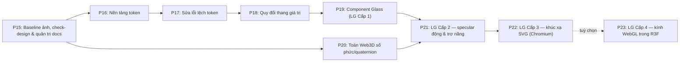

# FE3d_prompt_v2.md — Danh mục Prompt Nâng cấp Design System, Toán 3D & Liquid Glass cho Frontend "Cây Tri Thức Vector"

- **Motivation/Background**: Sau giai đoạn P1–P14 ([`prompt_fe_3d.md`](prompt_fe_3d.md)) và khoảng 20 commit prompt rời rạc không có spec, giao diện `frontend_rag` bị lệch chuẩn. Số đo trong [`FE_DESIGN_AUDIT.md`](FE_DESIGN_AUDIT.md): 8 mức bo góc, 5 mức blur, 11 mức độ trong, khoảng 14 cỡ chữ, 4 CSS variable không tồn tại, 2 hệ kính song song. Thầy nhận xét cần một quy chuẩn chung. Quy chuẩn đó đã được chốt trong [`FE_DESIGN_SYSTEM.md`](FE_DESIGN_SYSTEM.md).
- **Purpose**: Biến quy chuẩn thiết kế thành chuỗi prompt tuần tự P15–P23 có đặc tả, pseudocode, ràng buộc và kiểm chứng, để AI coding agent nâng cấp mạnh FE mà không phá hành vi, hiệu năng hay 6 bất biến hiện có.
- **Overview Pipeline**: Rà soát hiện trạng ([`FE_DESIGN_AUDIT.md`](FE_DESIGN_AUDIT.md)) → Chốt quy chuẩn ([`FE_DESIGN_SYSTEM.md`](FE_DESIGN_SYSTEM.md)) → Phân rã theo phương pháp Lesson 2 (Yêu cầu → Đặc tả → Pseudocode → Prompt có cấu trúc → Kiểm chứng → Quyết định), cùng khuôn với [`prompt_fe_3d.md`](prompt_fe_3d.md).
- **Detailed Plan**:
  - §Hướng dẫn dành cho AI: luật thực thi.
  - §1 Mục tiêu & chỉ số đo được.
  - §2 Baseline.
  - §3 Hợp đồng thiết kế (nguồn chân lý).
  - §Bản đồ chức năng.
  - P15: Baseline ảnh, công cụ kiểm tra & quản trị tài liệu.
  - P16: Nền tảng token.
  - P17: Sửa lỗi lệch token.
  - P18: Quy đổi thang giá trị.
  - P19: Component `Glass` (Liquid Glass Cấp 1).
  - P20: Toán Web3D bằng số phức/quaternion.
  - P21: Liquid Glass Cấp 2.
  - P22: Liquid Glass Cấp 3.
  - P23 (tuỳ chọn): Liquid Glass Cấp 4.
  - Phụ lục A: Quyết định cần người duyệt.
  - Phụ lục B: Lệnh kiểm chứng.
  - Bảng Checklist.
- **References**: [`FE_DESIGN_SYSTEM.md`](FE_DESIGN_SYSTEM.md), [`FE_DESIGN_AUDIT.md`](FE_DESIGN_AUDIT.md), [`prompt_fe_3d.md`](prompt_fe_3d.md), [`lesson_2.md`](lesson_2.md), [`frontend_rag/AGENTS.md`](../frontend_rag/AGENTS.md), [`frontend_rag/docs/trig-audit.md`](../frontend_rag/docs/trig-audit.md), [`frontend_rag/docs/perf-report.md`](../frontend_rag/docs/perf-report.md), [`agents/rules/MD_CONVENTION.md`](../agents/rules/MD_CONVENTION.md), [`agents/rules/COMMIT_CONVENTION.md`](../agents/rules/COMMIT_CONVENTION.md), [`agents/template/DECISION_LOG_TEMPLATE.md`](../agents/template/DECISION_LOG_TEMPLATE.md), Tailwind CSS 4.3, React 19, React Three Fiber 9, three.js 0.186, Playwright, Vitest.
- **Created**: 2026-10-29T23:05:00+07:00
- **Last Updated**: 2026-10-30T10:55:00+07:00

[STATUS: ACTIVE]

---

Tài liệu này theo đúng nguyên tắc và cấu trúc của [`lesson_2.md`](lesson_2.md) và [`prompt_fe_3d.md`](prompt_fe_3d.md):

- **Phân rã chức năng (Decomposition):** mỗi prompt là một thay đổi độc lập, đơn nhiệm, hoàn tác được (một PR/commit).
- **Quy trình chuẩn:** `Yêu cầu ➔ Đặc tả (Input/Output/Edge case) ➔ Pseudocode (Hợp đồng) ➔ Prompt có cấu trúc ➔ Kiểm chứng (Test, Ảnh, Hiệu năng) ➔ Quyết định`.
- **Cấu trúc prompt chuẩn:**
  - **Ngữ cảnh:** công nghệ, file liên quan, trạng thái trước prompt.
  - **Nhiệm vụ:** file, component, hàm cần tạo hoặc sửa.
  - **Ràng buộc:** giá trị lấy từ đâu, những gì không được đổi, ngân sách hiệu năng; thiếu dữ liệu thì dừng lại.
  - **Ví dụ / Pseudocode:** minh hoạ đầu vào → đầu ra.
  - **Output mong muốn:** code sạch + test + ảnh so sánh + số đo + danh sách giả định.

---

## 🤖 Hướng dẫn dành cho AI thực thi file này

Bạn (AI coding agent) làm việc trong `frontend_rag/`. Tuân thủ tuyệt đối:

1. **Làm tuần tự P15 → P22.** P23 là tuỳ chọn và chỉ làm khi người duyệt đồng ý (Phụ lục A). Không nhảy bước. Mỗi prompt là **một commit riêng** theo [`COMMIT_CONVENTION.md`](../agents/rules/COMMIT_CONVENTION.md), để hoàn tác được từng bước.
2. **Sau mỗi prompt, chạy toàn bộ mục "Kiểm chứng".** Chỉ sang prompt tiếp theo khi đạt. Không đạt thì sửa rồi chạy lại. Đã sửa 3 lần vẫn không đạt thì **dừng lại và báo người duyệt**, không ép cho qua.
3. **Nguồn chân lý duy nhất cho mọi giá trị thiết kế là [`FE_DESIGN_SYSTEM.md`](FE_DESIGN_SYSTEM.md)** (Mục 3 bên dưới). Không tự đặt màu, bo góc, blur, alpha, cỡ chữ, thời gian hay CSS variable mới. Thiếu thông tin hoặc hai tài liệu mâu thuẫn thì **DỪNG**, ghi vào `ASSUMPTIONS.md` dạng `[P<số>] <giả định> — <lý do>` và hỏi người. **Không đoán.**
4. **Giữ nguyên hành vi.** Không sửa logic store, API, SSE, Dexie hay cảnh 3D ngoài phạm vi của prompt. Toàn bộ unit test hiện có (202+) và 6 test E2E (`e2e/knowledge-tree.spec.ts`) phải tiếp tục pass.
5. **Tôn trọng 6 bất biến trong [`frontend_rag/AGENTS.md`](../frontend_rag/AGENTS.md) §2:**
   - ranh giới R3F (không có DOM trong `<Canvas>`);
   - stream Markdown qua buffer 30ms + `useDeferredValue`;
   - Offline-First Dexie;
   - ngân sách draw call/fill-rate;
   - Core Web Vitals (KaTeX CSS không nằm trong `index.css`);
   - chuỗi tiếng Việt dạng Unicode NFC.
6. **Mọi prompt có thay đổi hiển thị** phải chạy so sánh ảnh với baseline tạo ở P15 (`npm run test:visual`). Chênh lệch phải nằm trong ngưỡng ghi ở prompt đó. Baseline chỉ được cập nhật (`--update-snapshots`) **sau khi người duyệt xem ảnh diff**. Ghi lại điều này vào báo cáo chuyển đổi.
7. **Mọi prompt chạm vào cảnh 3D hoặc `backdrop-filter`** phải đo `npm run test:perf` trước và sau, cùng máy, cùng kịch bản, theo phương pháp trong [`trig-audit.md`](../frontend_rag/docs/trig-audit.md) §1.
8. **Cuối mỗi prompt**, làm đủ các việc sau:
   - Cập nhật `PROGRESS.md` (bảng như các mục P12–P14 cũ).
   - Ghi giả định vào `ASSUMPTIONS.md`.
   - Thêm một dòng vào `frontend_rag/docs/design-migration-report.md` (tạo ở P15).
   - Quyết định quan trọng (chấp nhận/hoàn tác một thay đổi, cập nhật baseline) ghi thành `D-0xx` trong [`Vuong_chat_logs.md`](AI_chat_log/Vuong_chat_logs.md) theo [`DECISION_LOG_TEMPLATE.md`](../agents/template/DECISION_LOG_TEMPLATE.md).
9. Không dùng `any`. Không dùng `dangerouslySetInnerHTML`. Không có giá trị thô trong component (Quy tắc vàng §0 của Design System).
10. Mọi file `.md` tạo mới hoặc sửa phải theo [`MD_CONVENTION.md`](../agents/rules/MD_CONVENTION.md): header 7 trường, `Last Updated` theo ISO 8601 `+07:00`, đường dẫn là link.

---

## 1. Mục tiêu & chỉ số đo được

| Chỉ số (đo bằng `npm run check:design` từ P15) | Hiện tại | Sau P18 | Sau P22 |
| :-- | :-: | :-: | :-: |
| Số mức bo góc khác nhau (px) | 8 | **4** + full | 4 + full |
| Số mức `backdrop-filter: blur` | 5 | **3** | 3 |
| Số mức alpha trắng | 11 | **6** | 6 |
| Số cỡ chữ khác nhau | ~14 | **7** (+ 2 giá trị `em` inline) | 7 |
| CSS variable được gọi nhưng không tồn tại | 4 | **0** (từ P17) | 0 |
| Màu Tailwind mặc định trong UI (trừ `PerfHUD.tsx`) | 15 | **0** (từ P17) | 0 |
| Hệ kính song song | 2 (`.glass`, `.liquid-*`) | 2 | **1** (`Glass`, từ P19) |
| `Math.sin/cos` ngoài các ngoại lệ có `// trig-ok:` | ~25 | ~25 | **0** (từ P20) |
| Cấp Liquid Glass | 1 (kính mờ) | 1 | **2** mọi nơi, **3** trên Chromium |
| Frame time median (M4, 150k, overview) | baseline P15 | ≤ +3% | ≤ ngân sách Phụ lục A (đề xuất +10%) |

---

## 2. Baseline

- **Commit xuất phát:** `frontend_rag@6d54674` (con trỏ submodule trong `RAG_TS@36ed7cc`).
- **Hiện trạng chi tiết:** [`FE_DESIGN_AUDIT.md`](FE_DESIGN_AUDIT.md) §3–§4.
- **Hạ tầng sẵn có:**
  - Vitest (`npm test`);
  - Playwright (`playwright.config.ts`, cổng 5198, mock, Chromium + Metal);
  - `npm run test:perf` (`scripts/perf-chat-benchmark.cjs`);
  - `npm run bench` (`src/utils/*.bench.ts`);
  - `?vectors=N`, `?nofx`, `?perf`.
- **ESLint hiện không có rule nào** (`eslint.config.mjs` chỉ khai báo `globalIgnores`). Vì vậy việc kiểm tra thiết kế ở P15 dùng script Node riêng, không dựa vào ESLint.

---

## 3. Hợp đồng thiết kế — NGUỒN CHÂN LÝ DUY NHẤT

**Mọi giá trị nằm trong [`FE_DESIGN_SYSTEM.md`](FE_DESIGN_SYSTEM.md).** Bảng dưới chỉ dẫn mục cần đọc cho từng prompt. Nếu tóm tắt ở đây lệch với Design System thì **Design System thắng**.

| Prompt | Mục cần đọc trong Design System |
| :-- | :-- |
| P15 | §0 Quy tắc vàng, §11 Kiểm soát |
| P16 | §1 Kiến trúc, §2.2, Phụ lục A |
| P17 | §2.2–§2.5, Phụ lục B.6 |
| P18 | §3, §4.2–§4.3, §5, §6, §7, Phụ lục B.1–B.5 |
| P19 | §4.1, §8, §10.4, Phụ lục A.4 |
| P20 | §9 (toàn bộ) |
| P21 | §10.1–§10.3, §10.5 (Cấp 2), §10.6 |
| P22 | §10.5 (Cấp 3), ngân sách hiệu năng |
| P23 | §10.5 (Cấp 4) |

**Tóm tắt nhanh để định hướng (không thay thế Design System):**

| Nhóm | Thang |
| :-- | :-- |
| Bo góc | `xs` 4 · `sm` 6 · `md` 10 (control) · `lg` 14 (bề mặt nổi) · `full` |
| Blur | `sm` 6 (nhãn 3D) · `md` 12 · `lg` 16 (panel) + `saturate(1.2)` |
| Vật liệu kính | Regular (`--glass-tint` α 0.24) · Strong (`--ui-surface-strong`) · Clear (`--glass-fill` α 0.04, không blur khi nằm trong kính) |
| Chữ | `micro` 10 · `caption` 11 · `xs` 12 · `control` 13 · `sm` 14 · `base` 16 · `display` 22 |
| Chuyển động | `press` 120 · `hover` 160 · `enter` 240 · `reveal` 480 · `scene` 1500 ms; `ease-standard`, `ease-spring`, `ease-scene` |
| Toán 3D | Quay bằng `src/utils/rotation.ts`; `sin/cos` chỉ dùng trong `makeRotor` hoặc ngoại lệ §9.4 |

---

## 🗺️ Bản đồ Chức năng (Feature Breakdown)



| Prompt | Module | Đổi hình ảnh? |
| :-- | :-- | :-- |
| P15 | Baseline ảnh, script `check-design`, báo cáo chuyển đổi, cập nhật INDEX/AGENTS | Không (không sửa `src/`) |
| P16 | Thêm token màu kính, `ink-faint`, thời gian, Liquid Glass (tắt) và class Tailwind mới | **Không** (0 pixel) |
| P17 | Sửa biến không tồn tại, màu Tailwind, `.glass` dùng token, bỏ CSS theme sáng | Rất nhỏ (HistoryDrawer, badge offline) |
| P18 | Quy đổi bo góc, blur, alpha, chữ, icon, khoảng cách, z-index, chuyển động; bật `--radius-*: initial` | Nhỏ (≤ 2px, ≤ 0.04 alpha) |
| P19 | `Glass` + cấu trúc `::before`/`::after`; bỏ kính chồng kính | Nhỏ (vùng kính lồng nhau) |
| P20 | Rotor/quaternion thay `sin/cos` theo §9.5 | Không (sai lệch < 1e-3), trừ chuỗi hạt ngẫu nhiên |
| P21 | Specular động theo con trỏ, chọn cấp kính, trợ năng | **Có** (nâng cấp) |
| P22 | Khúc xạ SVG cho cột Chat | **Có** (nâng cấp) |
| P23 | Kính WebGL (tuỳ chọn) | **Có** (nâng cấp) |

---

## 📝 PROMPT 15: Baseline ảnh, Công cụ kiểm tra thiết kế & Quản trị tài liệu

### 15.1 Đặc tả (Specification)

- **Input:** code tại `frontend_rag@6d54674`; [`FE_DESIGN_SYSTEM.md`](FE_DESIGN_SYSTEM.md) §0 và §11.
- **Output:**
  1. Bộ test ảnh `e2e/visual.spec.ts`, chụp 8 trạng thái giao diện làm baseline.
  2. Script `scripts/check-design.cjs` với 2 chế độ: `--report` (đếm, thoát 0) và `--strict` (thoát 1 nếu có vi phạm).
  3. `frontend_rag/docs/design-migration-report.md`: báo cáo chuyển đổi, mỗi prompt một dòng số đo.
  4. Cập nhật tài liệu điều hướng để mọi AI agent sau này đều tìm thấy Design System.
- **Ràng buộc:**
  - **Không sửa bất kỳ dòng nào trong `src/`.** Ngoại lệ duy nhất: thêm `data-testid` nếu cần để chụp ảnh (ghi ASSUMPTIONS).
  - Ảnh chụp phải **ổn định**: chạy 2 lần liên tiếp cho kết quả giống hệt. Canvas WebGL không xác định từng pixel nên **được che (mask)** trong ảnh UI. 3D được kiểm tra riêng ở P20.
  - Kết quả của script phải khớp số liệu trong [`FE_DESIGN_AUDIT.md`](FE_DESIGN_AUDIT.md) (sai lệch phải giải thích được).

### 15.2 Pseudocode (Hợp đồng xử lý)

```
# e2e/visual.spec.ts
APP = "/?vectors=8000&nofx"
before each: set localStorage settings.reduceMotion = true; viewport 1440×900
SHOTS = [
  "01-overview"        : mở app, chờ category-legend
  "02-chat-empty"      : mở cột chat
  "03-answer-done"     : hỏi câu mẫu, chờ data-visual-phase="done", ResultCard hiện
  "04-paper-verified"  : click chip verified → PaperPanel
  "05-settings"        : mở Cài đặt
  "06-history-drawer"  : mở HistoryDrawer
  "07-auth"            : trạng thái chưa đăng nhập (nếu mock không có → ghi ASSUMPTIONS, bỏ shot)
  "08-mobile-sheet"    : viewport 390×844, bottom sheet
]
for shot in SHOTS:
  expect(page).toHaveScreenshot(shot + ".png", { mask: [page.locator("canvas")], animations: "disabled", maxDiffPixelRatio: THRESHOLD })
THRESHOLD = env VISUAL_THRESHOLD ?? 0          # mỗi prompt đặt ngưỡng riêng khi chạy

# scripts/check-design.cjs
KNOWN_VARS = tên trong src/theme/applyCssVars.ts (mẫu "['--x'")
           ∪ khai báo "--x:" trong src/index.css (:root và @theme)
           ∪ /^--cat-\d+$/ ∪ /^--tw-/ ∪ biến cục bộ khai báo trong cùng rule CSS (vd --stem, --lift, --glow, --intro-delay)
EXEMPT_FILES = [**/*.test.*, src/components/world/overlay/PerfHUD.tsx]
RULES (file .tsx trong src/components):
  raw-color      : /#[0-9a-fA-F]{3,8}\b/ hoặc /rgba?\(/
  tw-palette     : /\b(bg|text|border|ring|from|to)-(white|black|(red|amber|gray|slate|neutral|zinc|indigo|green|emerald|yellow|blue|sky|cyan|rose|orange)-\d{2,3})/
  raw-arbitrary  : /\b(rounded|text|blur|backdrop-blur)-\[\d/
  retired-radius : /\brounded(-(xl|2xl|3xl))?(?![-\w])/            # chỉ bật ở --strict sau P18
  unknown-var    : mọi var(--x) với x ∉ KNOWN_VARS
  var-fallback   : var(--x, ...) — có fallback là dấu hiệu biến có thể không tồn tại
  trig-in-frame  : /Math\.(sin|cos)\(/ trong file có "useFrame" mà dòng không có "// trig-ok:"
RULES (src/index.css, ngoài khối :root và @theme):
  css-raw-radius : border-radius: <số>px
  css-raw-blur   : backdrop-filter: ... blur(<số>px)
  css-raw-size   : font-size: <số>(px|rem)
  css-raw-color  : rgba?\( | #hex
STATS (luôn in, kể cả khi --report): số giá trị khác nhau của radius / blur / alpha trắng / font-size
output: bảng theo rule (file:line) + JSON (--json)
exit 1 nếu --strict và có vi phạm thuộc các rule được bật cho bước hiện tại (--rules=a,b,c)
```

### 15.3 Prompt gửi AI

```markdown
### Ngữ cảnh:
`frontend_rag` (Vite 6 + React 19 + TypeScript 5 + Tailwind 4.3 + R3F 9). Playwright đã cấu hình trong `playwright.config.ts` (cổng 5198, VITE_USE_MOCK=true). E2E hiện có ở `e2e/knowledge-tree.spec.ts` (helper `openWorld`, `ask`, `askAndFinish`). Script Node đặt ở `scripts/*.cjs`. Quy chuẩn ở `../docs/FE_DESIGN_SYSTEM.md`.

### Nhiệm vụ:
1. Tạo `e2e/visual.spec.ts` đúng pseudocode 15.2. Dùng lại helper của `knowledge-tree.spec.ts` (tách ra `e2e/helpers.ts` nếu cần, không đổi hành vi test cũ).
2. Tạo `scripts/check-design.cjs` đúng pseudocode 15.2 (Node 22, không thêm dependency).
3. Thêm vào `package.json`:
   - `"check:design": "node scripts/check-design.cjs --report"`
   - `"check:design:strict": "node scripts/check-design.cjs --strict"`
   - `"test:visual": "playwright test e2e/visual.spec.ts"`
4. Tạo `docs/design-migration-report.md` (header 7 trường theo MD_CONVENTION). Gồm bảng: Prompt | Ngày | check-design (theo rule) | STATS | Visual diff | Frame time median | Quyết định. Điền dòng P15 (baseline).
5. Đo baseline hiệu năng bằng `npm run test:perf` (150k vector, overview) và ghi vào báo cáo.
6. Quản trị tài liệu:
   a. `../docs/INDEX.md` §4: thêm 3 dòng ACTIVE cho FE_DESIGN_SYSTEM.md, FE_DESIGN_AUDIT.md, FE3d_prompt_v2.md; §5: thêm prompt_fe_3d.md là ARCHIVED (ghi chú: phần UI được thay bằng FE_DESIGN_SYSTEM.md).
   b. `AGENTS.md` của frontend: thêm bất biến 7 "Design tokens — đọc FE_DESIGN_SYSTEM.md trước mọi thay đổi UI; chạy check:design" và bất biến 8 "Phép quay dùng src/utils/rotation.ts; sin/cos chỉ trong ngoại lệ có // trig-ok:"; thêm `npm run check:design` và `npm run test:visual` vào mục Verification Commands; xoá khối `<!-- BEGIN:nextjs-agent-rules --> … <!-- END -->` (dự án không dùng Next.js).
   c. `../AGENTS.md` (gốc): thêm một dòng vào bảng định tuyến: "UI tokens, glass, Liquid Glass, rotation math" → FE_DESIGN_SYSTEM.md.
   d. `PROGRESS.md`: bổ sung mục tóm tắt giai đoạn 2026-10-20 → 2026-10-28 (theo `git log`), rồi mục P15.

### Ràng buộc:
1. Không sửa `src/` (trừ `data-testid`, phải ghi ASSUMPTIONS).
2. Ảnh chụp: che `canvas`, `animations: "disabled"`, bật reduce motion, dùng font đã tải xong (`await page.evaluate(() => document.fonts.ready)`).
3. `test:visual` chạy 2 lần liên tiếp với `VISUAL_THRESHOLD=0` đều pass.
4. `check-design.cjs` không có false positive với: biến CSS cục bộ (`--stem`, `--lift`, `--glow`, `--intro-delay`); `color-mix(in_srgb,var(--accent)_12%,transparent)`; comment `// trig-ok:`.
5. Không thêm dependency mới vào `package.json`.
6. Mọi chuỗi tiếng Việt thêm vào code ở dạng NFC.

### Ví dụ:
- `text-[var(--ink-secondary,#cbd5e1)]` → 3 vi phạm: `unknown-var` (`--ink-secondary`), `var-fallback`, `raw-color` (`#cbd5e1`).
- `bg-[color-mix(in_srgb,var(--accent)_16%,transparent)]` → 0 vi phạm.
- `const breathe = 1 + 0.09 * Math.sin(t) // trig-ok: dao động vô hướng (trig-audit §3)` → 0 vi phạm.

### Output mong muốn:
1. Các file trên; ảnh baseline trong `e2e/visual.spec.ts-snapshots/`.
2. Kết quả `npm run check:design`: số liệu khớp FE_DESIGN_AUDIT.md (unknown-var: `--ink-secondary`, `--ui-hover`, `--ui-panel-bg`, `--ink-faint`; tw-palette ngoài PerfHUD: 15).
3. Báo cáo chuyển đổi có dòng P15; INDEX/AGENTS/PROGRESS đã cập nhật; ASSUMPTIONS ghi các giả định.
```

### 15.4 Quy trình kiểm chứng

- [ ] `git diff --stat -- src/` rỗng (hoặc chỉ có `data-testid` đã ghi ASSUMPTIONS).
- [ ] `npm run test:visual` pass **2 lần liên tiếp**.
- [ ] `npm run check:design` in đủ các rule; số liệu đối chiếu với audit, sai lệch có giải thích.
- [ ] `npx playwright test e2e/knowledge-tree.spec.ts` vẫn 6/6.
- [ ] Mọi link trong các file `.md` vừa sửa mở được.

---

## 📝 PROMPT 16: Nền tảng Token (không đổi hình ảnh)

### 16.1 Đặc tả (Specification)

- **Input:** [`FE_DESIGN_SYSTEM.md`](FE_DESIGN_SYSTEM.md) §1, §2.2, Phụ lục A.1–A.3.
- **Output:** token mới trong `tokens.ts`, `applyCssVars.ts`, `index.css`; hàm thuần `contrastRatio`; test.
- **Ràng buộc:**
  - **Không đổi một pixel nào** (`VISUAL_THRESHOLD=0`). Vì vậy prompt này **chưa**:
    - bật `--radius-*: initial` / `--blur-*: initial`, vì sẽ đổi `rounded-lg`, `rounded-md` đang dùng;
    - đổi `uiBorder`;
    - sửa component nào.
  - Chỉ **thêm** các tên mới, không trùng tên Tailwind đang được dùng: `text-micro`, `text-caption`, `text-control`, `text-display`, `ease-standard`, `ease-spring`, `ease-scene`, `--dur-*`, `--glass-*`, `--lg-*`, `--ink-faint`, `--shadow-panel`, `--glow-accent`.
  - Màu kính có alpha ở dạng `#rrggbbaa`, giống quy ước hiện có ([`ASSUMPTIONS.md`](../frontend_rag/ASSUMPTIONS.md) `[P1]`).

### 16.2 Pseudocode (Hợp đồng xử lý)

```
# src/theme/contrast.ts — hàm thuần, WCAG 2.x
function srgbToLinear(c):            # c ∈ [0,1]
    return c ≤ 0.04045 ? c/12.92 : ((c+0.055)/1.055)^2.4
function luminance(hex "#rrggbb"):
    r,g,b = channels/255 → srgbToLinear
    return 0.2126 r + 0.7152 g + 0.0722 b
function composite(fgHexWithAlpha, bgHex):   # trộn alpha lên nền để đo chữ trên kính
    return fg.rgb·a + bg.rgb·(1−a)
function contrastRatio(fg, bg):
    L1, L2 = max/min(luminance(fg), luminance(bg))
    return (L1 + 0.05) / (L2 + 0.05)
```

### 16.3 Prompt gửi AI

```markdown
### Ngữ cảnh:
Theme hiện tại: `src/theme/tokens.ts` (interface ThemeTokens, darkTheme), `src/theme/applyCssVars.ts` (bảng CSS_VARS), `src/index.css` (:root fallback + @theme font). Tailwind 4.3: biến trong @theme sinh class (vd `--text-caption` → `text-caption`) và được xuất ra :root khi có dùng. Đã kiểm tra: `--radius-*: initial` xoá thang mặc định — CHƯA làm ở prompt này.

### Nhiệm vụ:
1. `tokens.ts`: thêm `uiInkFaint`, `glassTint`, `glassFill`, `glassFillHover`, `glassHighlight`, `glassHighlightStrong`, `glassLowlight`, `glassStrokeStrong` (giá trị đúng Phụ lục A.1, mỗi key có comment một dòng). KHÔNG đổi `uiBorder`.
2. `applyCssVars.ts`: thêm cặp CSS var ↔ key theo Phụ lục A.2.
3. `index.css`:
   - :root thêm fallback màu mới, alias semantic (`--glass-stroke`, `--glass-saturate`, `--glass-edge`, `--glass-edge-strong`, `--shadow-panel`, `--glow-accent`), `--dur-*` và `--lg-*` (giá trị Cấp 1) theo Phụ lục A.3;
   - @theme thêm `--text-micro|caption|control|display` (+ line-height) và `--ease-standard|spring|scene`.
4. Tạo `src/theme/contrast.ts` theo pseudocode 16.2 và `src/theme/contrast.test.ts`.
5. Mở rộng `src/theme/tokens.test.ts`.

### Ràng buộc:
1. Không sửa component, không sửa class CSS đang có.
2. Không đổi giá trị token hiện có.
3. Tên CSS var đúng từng ký tự như Phụ lục A (script check-design dùng danh sách này).
4. Không `any`.

### Ví dụ:
- contrastRatio("#ffffff", "#000000") → 21.0 (±0.01)
- contrastRatio(darkTheme.uiInk, darkTheme.bg) ≥ 7
- contrastRatio(darkTheme.uiInkMuted, darkTheme.bg) ≥ 4.5
- contrastRatio(darkTheme.uiInkFaint, darkTheme.bg) ≥ 3 và < 4.5   (chỉ cho placeholder/disabled)
- composite("#ffffff0a", "#070614") ≈ "#110f1d"

### Output mong muốn:
1. Code + test.
2. `npm run test:visual` pass với VISUAL_THRESHOLD=0 (không đổi pixel).
3. `npm run check:design`: số vi phạm KHÔNG tăng so với P15.
4. Dòng P16 trong design-migration-report.md; PROGRESS.md; ASSUMPTIONS.md.
```

### 16.4 Quy trình kiểm chứng

- [ ] `npm run typecheck` 0 lỗi; `npm test -- --run src/theme` pass.
- [ ] `npm run test:visual` (ngưỡng 0) pass.
- [ ] `document.documentElement.style.getPropertyValue('--glass-tint')` trên trang = `#0c0a183d`.
- [ ] Build: class `text-caption`, `ease-standard` có trong CSS output khi được dùng (tạm thêm vào một file test hoặc kiểm tra bằng `@tailwindcss/node` như ở Design System Phụ lục A).

---

## 📝 PROMPT 17: Sửa lỗi lệch Token

### 17.1 Đặc tả (Specification)

- **Input:** kết quả `check:design` của P16; Design System §2.2–§2.5.
- **Output:** 0 vi phạm `unknown-var`, `var-fallback`, `tw-palette`, `raw-color` trong UI (trừ `PerfHUD.tsx`).
- **Ràng buộc:**
  - Chỉ đổi **màu**, chưa đụng bo góc, blur hay cỡ chữ.
  - `.glass` đổi `background` sang `var(--glass-tint)`, giá trị giữ nguyên.
  - `uiBorder`: `#ffffff1f` → `#ffffff24` (**cần người duyệt**, Phụ lục A #1). Nếu chưa duyệt thì giữ nguyên và ghi ASSUMPTIONS.
  - Xoá CSS chết của theme sáng (`[data-theme="light"] .glass`, `[data-theme="light"] .query-text`) và comment "light" trong `tokens.ts`.

### 17.2 Pseudocode (Hợp đồng xử lý)

```
MAP_VAR = {
  "var(--ink-secondary, …)" → "var(--ink-muted)",
  "var(--ui-hover, …)"      → "var(--glass-fill-hover)",
  "var(--ui-panel-bg, …)"   → "var(--ui-surface-strong)",
  "var(--ink-faint)"        → giữ (đã định nghĩa ở P16)
}
MAP_TW = {                      # tỷ lệ theo Design System §2.4
  bg-red-500/10  → bg-[color-mix(in_srgb,var(--danger)_12%,transparent)]
  bg-red-950/80  → bg-[color-mix(in_srgb,var(--danger)_16%,var(--ui-surface-strong))]   # nền hộp xác nhận xoá
  bg-red-800/60  → bg-[color-mix(in_srgb,var(--danger)_24%,transparent)]
  border-red-500/50 → border-[color-mix(in_srgb,var(--danger)_40%,transparent)]
  text-red-100|300|400 → text-[var(--danger)]  (chữ trên nền danger đậm: text-[var(--ink)])
  bg-amber-500/15 → bg-[color-mix(in_srgb,var(--warn)_16%,transparent)]
  border-amber-500/30 → border-[color-mix(in_srgb,var(--warn)_40%,transparent)]
  text-amber-300 → text-[var(--warn)]
  text-gray-200 → text-[var(--ink)];  text-gray-400 → text-[var(--ink-muted)]
  bg-gray-700/60 → bg-[var(--glass-fill-hover)]
  text-white trên --accent → text-[var(--accent-ink)];  text-white khác → text-[var(--ink)]
}
for each violation in check-design --json (rule ∈ {unknown-var, var-fallback, tw-palette, raw-color}):
    apply MAP; nếu không có mapping → DỪNG, ghi ASSUMPTIONS, hỏi người
```

### 17.3 Prompt gửi AI

```markdown
### Ngữ cảnh:
Sau P16 đã có token `--ink-faint`, `--glass-*`. Vi phạm hiện tập trung ở `src/components/chat/HistoryDrawer.tsx`, `src/components/chat/ChatPanel.tsx` và `.glass` trong `src/index.css`. `PerfHUD.tsx` được miễn (công cụ dev).

### Nhiệm vụ:
1. Thay biến không tồn tại và bỏ fallback theo MAP_VAR.
2. Thay màu Tailwind mặc định theo MAP_TW (HistoryDrawer: 11 chỗ, ChatPanel: 4 chỗ).
3. `.glass { background: var(--glass-tint) }`.
4. `uiBorder` → `#ffffff24` (chỉ khi Phụ lục A #1 đã duyệt).
5. Xoá CSS/comment theme sáng.

### Ràng buộc:
1. Không đổi bố cục, kích thước, bo góc, blur, cỡ chữ.
2. Mọi tỷ lệ `color-mix` thuộc {6, 12, 16, 24, 40, 55, 45, 70}%.
3. Trạng thái xác nhận xoá trong HistoryDrawer phải còn phân biệt rõ với hàng thường (nền danger, chữ đọc được). Kiểm tra bằng contrastRatio: chữ ≥ 4.5:1 trên nền đã trộn.
4. Không có mapping → DỪNG và hỏi.

### Ví dụ:
- `ChatPanel.tsx:39`: `'!bg-[var(--accent)] !text-white'` → `'!bg-[var(--accent)] !text-[var(--accent-ink)]'`
- `HistoryDrawer.tsx:40`: `bg-[var(--ui-panel-bg,rgba(18,20,28,0.96))]` → `bg-[var(--ui-surface-strong)]`

### Output mong muốn:
1. `npm run check:design:strict -- --rules=unknown-var,var-fallback,tw-palette,raw-color` thoát 0.
2. Ảnh diff: chỉ `06-history-drawer` và vùng badge offline trong `02/03` đổi; các ảnh khác ≤ 0.2% pixel (do `uiBorder`). Người duyệt xem diff rồi mới cập nhật baseline.
3. Test cũ pass; dòng P17 trong báo cáo; PROGRESS; ASSUMPTIONS.
```

### 17.4 Quy trình kiểm chứng

- [ ] `check:design:strict` với 4 rule màu thoát 0.
- [ ] `npm test -- --run` và 6 E2E pass.
- [ ] Ảnh diff đã được người duyệt; baseline đã cập nhật; ghi `D-0xx`.
- [ ] Mở HistoryDrawer → bấm xoá: hộp xác nhận vẫn nổi bật, chữ đọc được.

---

## 📝 PROMPT 18: Quy đổi Thang giá trị (bo góc, blur, alpha, chữ, icon, khoảng cách, lớp, chuyển động)

### 18.1 Đặc tả (Specification)

- **Input:** Design System §3–§7, Phụ lục B.1–B.5.
- **Output:** mọi giá trị nằm trên thang; `--radius-*: initial` và `--blur-*: initial` được bật; `check:design:strict` (đủ mọi rule trừ `trig-in-frame`) chạy trong `npm run lint`.
- **Ràng buộc:**
  - Theo đúng bảng quy đổi Phụ lục B. Giá trị không có trong bảng thì DỪNG và hỏi.
  - **Đổi tên** đuôi bubble `rounded-br-md` / `rounded-bl-md` → `-sm`, vì `md` nay là 10px.
  - Bật `--radius-*: initial` làm các class `rounded-xl/2xl/3xl` và `rounded` không hậu tố **lặng lẽ biến mất** (Tailwind không báo lỗi). Phải chuyển hết các class này **trước**, rồi xác nhận bằng `retired-radius`.
  - `--dur-scene` (1500ms) phải khớp `CHAT_SLIDE_S` trong `CameraDirector.tsx`, có test bảo vệ.
  - Prompt này **chưa** gỡ blur của phần tử kính lồng nhau (việc đó thuộc P19). Chỉ gộp giá trị 10px và 14px về 12px.

### 18.2 Pseudocode (Hợp đồng xử lý)

```
# Thứ tự bắt buộc (tránh class biến mất giữa chừng)
1. Tailwind class trong .tsx:
     rounded → rounded-xs | rounded-lg(8) → rounded-md | rounded-xl(12) → rounded-md
     rounded-2xl(16) → rounded-lg | rounded-br-md → rounded-br-sm | rounded-bl-md → rounded-bl-sm
     !rounded-xl (nút mở chat) → bỏ (dùng bo góc của .glass)
     text-[10px] → text-micro | text-[11px] → text-caption
     icon size: 10,13 → 12 | 15 → 14 (trong nút) hoặc 16 (TopBar) — theo §6.2
     gap-3.5/px-3.5 → 3 hoặc 4 | z-[1] → z-10
2. CSS trong index.css (ngoài :root/@theme):
     border-radius Npx → var(--radius-*)   (B.1)
     backdrop-filter blur(Npx) → blur(var(--blur-*)) [saturate(var(--glass-saturate)) với md/lg]   (B.2)
     rgba(255,255,255,α) → var(--glass-*)   (B.3)
     font-size → var(--text-*) (giữ em cho inline)   (B.4)
     transition/animation duration & easing → var(--dur-*) / var(--ease-*)   (B.5)
     font-weight 650 → 600
3. @theme: --radius-*: initial + xs/sm/md/lg/full;  --blur-*: initial + sm/md/lg
4. check-design --strict --rules=all-except-trig  → phải = 0
5. Thêm "&& npm run check:design:strict" vào script "lint"
```

### 18.3 Prompt gửi AI

```markdown
### Ngữ cảnh:
Sau P17 màu đã sạch. Còn giá trị thô ở bo góc, blur, alpha, cỡ chữ, thời gian trong `src/index.css` và class Tailwind trong `src/components/**`. Bảng quy đổi đầy đủ ở FE_DESIGN_SYSTEM.md Phụ lục B (có cột "Vị trí").

### Nhiệm vụ:
1. Quy đổi theo pseudocode 18.2, đúng thứ tự 1 → 5.
2. Export `CHAT_SLIDE_S` từ `CameraDirector.tsx` (hoặc chuyển vào `src/utils/animationConfig.ts`), viết test `src/theme/motionSync.test.ts` đọc `src/index.css` bằng `fs` và khẳng định `--dur-scene` = CHAT_SLIDE_S × 1000 ms.
3. Viết `src/theme/scale.test.ts`: đọc `index.css`, khẳng định @theme có đúng 5 bậc radius, 3 bậc blur, 4 cỡ chữ tuỳ biến, và không còn giá trị thô ngoài :root/@theme (gọi lại logic của check-design hoặc regex tương đương).

### Ràng buộc:
1. Không đổi bố cục (vị trí, kích thước khung) — chỉ đổi giá trị trên thang.
2. Không đổi hành vi animation ngoài thời lượng/easing đã quy đổi; `prefers-reduced-motion` và `data-reduce-motion` vẫn hoạt động.
3. Không đụng `src/components/world/**` trừ nhãn DOM overlay dùng class CSS.
4. Giá trị không có trong Phụ lục B → DỪNG, ghi ASSUMPTIONS, hỏi.

### Ví dụ:
- `.cite-tip { border-radius: 8px }` → `border-radius: var(--radius-sm)` (6px).
- `.liquid-cta-btn { backdrop-filter: blur(14px) }` → `blur(var(--blur-md)) saturate(var(--glass-saturate))`.
- `MessageBubble.tsx:46`: `rounded-2xl rounded-br-md` → `rounded-lg rounded-br-sm`.
- `.btn { transition: background 0.15s, …, transform 0.1s }` → `background var(--dur-hover) var(--ease-standard), …, transform var(--dur-press)`.

### Output mong muốn:
1. `npm run check:design:strict -- --rules=all-except-trig` thoát 0; STATS: radius 4 mức + full, blur 3, alpha trắng 6, cỡ chữ 7 (+2 em).
2. `npm run lint` gồm check-design.
3. Ảnh diff: mỗi ảnh ≤ 1.5% pixel; người duyệt xem rồi cập nhật baseline.
4. `npm run test:perf`: frame median trong ±3% so với P15.
5. Dòng P18 trong báo cáo; PROGRESS; ASSUMPTIONS.
```

### 18.4 Quy trình kiểm chứng

- [ ] `check:design:strict` (trừ trig) thoát 0; STATS đúng mục tiêu §1.
- [ ] `grep -rnE "rounded-(xl|2xl|3xl)|\brounded\b[^-]" src/components` không còn kết quả.
- [ ] `motionSync.test.ts`, `scale.test.ts` pass; toàn bộ test pass; 6 E2E pass.
- [ ] Ảnh diff đã duyệt; frame time trong ±3%.

---

## 📝 PROMPT 19: Component `Glass` & Cấu trúc lớp (Liquid Glass Cấp 1)

### 19.1 Đặc tả (Specification)

- **Input:** Design System §4.1, §8.3, §10.4, Phụ lục A.4.
- **Output:**
  - `src/components/ui/Glass.tsx` và CSS `.glass` viết lại theo cấu trúc `::before` (nền/khúc xạ) / `::after` (specular);
  - mọi bề mặt kính chuyển sang `Glass`;
  - `.liquid-*` bị xoá;
  - kính lồng nhau không còn `backdrop-filter`.
- **Ràng buộc:**
  - Bề mặt kính **không lồng nhau** phải giống hệt sau P18, ngưỡng ≤ 0.5% pixel.
  - Kính **lồng nhau** (Auth trong cột Chat, HistoryDrawer trong cột Chat, chip trong ChatPanel): `data-nested="true"`, không blur; nền dùng `--glass-fill` hoặc `--ui-surface-strong` theo §4.1.
  - `.glass` / `.glass-strong` giữ làm alias cho tới cuối prompt; cuối prompt không còn chỗ nào dùng trực tiếp `.liquid-*`.
  - `::after` ở Cấp 1 **vô hình** (`--lg-specular: 0`), không tốn chi phí blend đáng kể.

### 19.2 Pseudocode (Hợp đồng xử lý)

```
type Material = "regular" | "strong" | "clear"
type Shape    = "panel" | "control" | "chip"
RADIUS = { panel: "lg", control: "md", chip: "full" }

function Glass({ material="regular", shape="panel", nested=false, interactive=false, as="div", className, ...rest }):
    return <as class={cx("glass", interactive && "glass-interactive", className)}
               data-material={material} data-shape={shape} data-nested={nested} {...rest} />

CSS:
.glass                              → position:relative; isolation:isolate; radius theo data-shape; stroke; shadow-panel (trừ clear); glass-edge
.glass::before                      → nền theo data-material; backdrop-filter blur(--blur-lg|md) saturate (trừ nested)
.glass::after                       → specular (vô hình ở Cấp 1)
[data-material="strong"]::before    → var(--ui-surface-strong)
[data-material="clear"]::before     → var(--glass-fill)
[data-nested="true"]::before        → backdrop-filter: none
.glass-interactive:hover::before    → fill lên một bậc (§8.2)

Danh sách chuyển (đọc lại bằng grep "glass\|liquid-" trước khi làm):
  TopBar(header) regular/panel · AppShell: cột chat regular/panel, filter chip strong/chip, bottom sheet strong/panel
  SettingsPanel, CategoryLegend, PaperPanel, ResultCard: strong/panel
  ChatPanel nút mở chat: regular/control interactive
  HistoryDrawer: strong/panel nested
  AuthOverlay: emblem clear/control nested, input-wrap clear/control nested, CTA clear/control nested interactive
  ChatPanel liquid-badge-chip: clear/chip nested
```

### 19.3 Prompt gửi AI

```markdown
### Ngữ cảnh:
Sau P18 mọi giá trị đã trên thang. Hai hệ kính còn song song: `.glass`/`.glass-strong` và `.liquid-*` (src/index.css). Design System §10.4 cố định cấu trúc lớp để Liquid Glass Cấp 2–4 chỉ cần đổi token hoặc thêm filter.

### Nhiệm vụ:
1. Tạo `src/components/ui/Glass.tsx` (props như §8.3, forwardRef, `as` đa hình có type đúng) và `src/components/ui/Glass.test.tsx`.
2. Viết lại `.glass` theo Phụ lục A.4 + các selector `data-*` ở 19.2.
3. Chuyển toàn bộ danh sách 19.2 sang `<Glass …>`; xoá CSS `.liquid-*`.
4. Thêm vào `e2e/visual.spec.ts` một test đếm phần tử đang hiển thị có `backdrop-filter` ≠ none ở trạng thái 03-answer-done; ghi số trước/sau vào báo cáo.

### Ràng buộc:
1. Không đổi DOM hierarchy ngoài việc bọc/thay thẻ ngoài cùng; giữ nguyên `data-testid`, `aria-*`, `role`.
2. `backdrop-filter` chỉ ở `::before`, không nằm trên phần tử chính (Cấp 3 sẽ gắn `url(#…)` tại đây).
3. Kiểm tra caveat Phụ lục A.4: animation `fade-in`, `chat-slide-in/out`, `intro-*` (dùng opacity/transform) không làm `::before` mất nền kính. Nếu mất, chuyển animation sang phần tử bọc ngoài, KHÔNG bỏ blur.
4. Safari: giữ `-webkit-backdrop-filter`; người duyệt chụp tay 01/02/05 trên Safari (ghi vào báo cáo).
5. Không thêm dependency.

### Ví dụ:
- `<div className="glass glass-strong w-80 …" role="dialog">` → `<Glass material="strong" className="w-80 …" role="dialog">`
- `<div className="liquid-input-wrap">` → `<Glass material="clear" shape="control" nested className="flex items-center">`

### Output mong muốn:
1. Glass.test: data-attrs đúng; `as="header"` render thẻ header; ref trỏ đúng phần tử; `nested` → `data-nested="true"`.
2. Ảnh diff: ảnh không có kính lồng ≤ 0.5%; 02/03/06/07 đổi ở vùng lồng (người duyệt xem).
3. Số phần tử có backdrop-filter giảm (ít nhất bằng số control lồng trong Auth/History).
4. `npm run test:perf`: frame median không tệ hơn P18 quá 3%.
5. `grep -rn "liquid-" src` = 0; dòng P19 trong báo cáo; PROGRESS; ASSUMPTIONS; D-0xx cho việc bỏ blur lồng nhau.
```

### 19.4 Quy trình kiểm chứng

- [ ] Glass.test pass; toàn bộ test + 6 E2E pass.
- [ ] `grep -rn "liquid-" src` rỗng; `check:design:strict` vẫn 0.
- [ ] Ảnh diff đã duyệt (Chromium + ảnh Safari chụp tay).
- [ ] Số `backdrop-filter` giảm; frame time ±3%.

---

## 📝 PROMPT 20: Toán Web3D — Số phức & Quaternion thay cho sin/cos

### 20.1 Đặc tả (Specification)

- **Input:** Design System §9 (đặc biệt §9.5 "Hiện trạng các chỗ gọi lượng giác"); [`trig-audit.md`](../frontend_rag/docs/trig-audit.md); `src/utils/rotation.ts` (đã có test).
- **Output:**
  - Các chỗ đánh dấu **"Đổi"** ở §9.5 dùng rotor/quaternion.
  - Ngoại lệ có comment `// trig-ok: <lý do>`.
  - Rule `trig-in-frame` của check-design được bật strict.
  - Có số đo trước/sau.
- **Ràng buộc:**
  - Sai lệch vị trí **< 1e-3** đơn vị thế giới so với công thức cũ, kiểm bằng test có "oracle" là công thức cũ.
  - **Quyết định theo số đo:**
    - Nhóm A (chạy một lần lúc dựng cảnh): đổi để thống nhất, chấp nhận nếu không chậm hơn > 10% trong `npm run bench`.
    - Nhóm B/C (chạy lúc runtime, ví dụ `FeedCables`): chỉ chấp nhận nếu **không chậm hơn** (trong nhiễu ±3%).
    - Chậm hơn ngưỡng thì **hoàn tác chỗ đó**, gắn `// trig-ok: <số đo>`, ghi D-0xx.
  - Không đổi các ngoại lệ ở §9.4 (dao động `QueryFlight`/`GroundGrid`, shader, `bark()`, `tan(fov)`).
  - Không cấp phát trong `useFrame` (rotor ở module scope hoặc `useMemo`).

### 20.2 Pseudocode (Hợp đồng xử lý)

```
# Vòng N điểm (treeGeometry.tubeAlongPath)
step = makeRotor(2π / radial)          # trig duy nhất
re, im = 1, 0
for j in 0..radial:
    s, c = im, −re                     # đúng quy ước cũ s = sin a, c = −cos a
    ... dùng s, c ...
    re, im = re·step.re − im·step.im, re·step.im + im·step.re
# radial ≤ 64 → không cần chuẩn hoá; > 64 → stepRotation

# Vòng + xoắn (thân cây: cos(a + twist))
rowRotor = makeRotor(twist)            # mỗi hàng 1 lần
for j: (x, z) = mulRotor(ringRotor_j, rowRotor) · r

# Hướng từ dữ liệu (mockWorld: atan2 → cos/sin)
h = hypot(px, pz);  base = { re: px/h, im: pz/h }       # chính là e^{i·atan2}
dir = mulRotor(base, OFFSET_ROTOR)

# Điểm ngẫu nhiên đều trong hình tròn (FeedCables) — không trig, không sqrt
function randomInDisk(rng, out):
    repeat: x = 2·rng() − 1; y = 2·rng() − 1
    until x² + y² ≤ 1
    out = (x, y); return out

# Góc cố định (cameraPresets)
FOCUS_ROTOR = makeRotor(35°);  PITCH_ROTOR = makeRotor(30°)   # module scope
(rx, rz) = rotateComplex(hx, hz, FOCUS_ROTOR)
```

### 20.3 Prompt gửi AI

```markdown
### Ngữ cảnh:
`src/utils/rotation.ts` có `makeRotor`, `rotateComplex`, `mulRotor`, `stepRotation` (renorm mỗi 64 bước), `makeFixedStepper`, `advanceStepper`, `slerpQuat` + test. `docs/trig-audit.md` đã đo: thay sin bằng rotor cho dao động (QueryFlight, GroundGrid) không lợi → giữ. Bảng các chỗ cần đổi ở FE_DESIGN_SYSTEM.md §9.5.

### Nhiệm vụ:
1. Đổi các chỗ "Đổi" ở §9.5 theo pseudocode 20.2, ưu tiên: FeedCables.tsx (runtime) → feedCables.ts → cameraPresets.ts → treeGeometry.ts → Fireflies.tsx → mockWorld.ts.
2. Thêm `randomInDisk` vào `src/utils/rotation.ts` (hoặc `src/utils/sampling.ts`) + test.
3. Gắn `// trig-ok: <lý do ngắn + tham chiếu trig-audit>` cho mọi ngoại lệ §9.4 còn lại.
4. Thêm case vào `src/utils/trig.bench.ts`: vòng 16/32/64 điểm (cos/sin vs rotor), lấy mẫu đĩa (polar vs rejection) ×1000.
5. Đo frame time theo trig-audit §1 (600 frame, 150k, overview, 3–5 lần, median) trước/sau.
6. Thêm mục §7 "Chuyển sang rotor (P20)" vào `docs/trig-audit.md` với bảng số đo; bật `trig-in-frame` trong `check:design:strict`.

### Ràng buộc:
1. Test oracle: giữ công thức cũ TRONG FILE TEST để so: max |new − old| < 1e-3 (hình học kỳ vọng < 1e-9).
2. randomInDisk: thống kê 100.000 mẫu với rng seed cố định — mọi điểm trong đĩa; bán kính trung bình ≈ 2/3 (±0.01); 8 cung góc mỗi cung 12.5% (±1%).
3. Đổi randomInDisk làm thay đổi chuỗi rng → test nào so khớp giá trị cụ thể theo seed thì cập nhật kỳ vọng VÀ ghi ASSUMPTIONS (không được nới lỏng test).
4. Chỗ nào bench chậm hơn ngưỡng 20.1 → hoàn tác, `// trig-ok:` kèm số đo, ghi D-0xx.
5. Không chạm shader trừ khi có góc đồng nhất cho mọi đỉnh (→ `uniform vec2 uRotor`); nếu không có chỗ như vậy, ghi "không áp dụng".

### Ví dụ:
- `cameraPresets.ts:58–59` `hx*Math.cos(a) - hz*Math.sin(a)` → `rotateComplex(hx, hz, FOCUS_ROTOR)`; preset `focus` cho cùng `position` (sai lệch < 1e-9).
- `FeedCables.tsx:90` `Math.cos(a)*d, Math.sin(a)*d` với `a = rng()*2π, d = sqrt(rng())*R` → `randomInDisk(rng, tmp); tmp[0]*R, tmp[1]*R`.

### Output mong muốn:
1. Code + test oracle + test thống kê.
2. `check:design:strict` (đủ mọi rule) thoát 0.
3. Bảng bench + frame time trong trig-audit.md §7 và design-migration-report.md.
4. Ảnh 3D xác định (`?vectors=8000&nofx`, reduce motion, không che canvas, chỉ ảnh 01-overview): diff ≤ 0.5% ngoài vùng hạt cáp tri thức.
5. PROGRESS; ASSUMPTIONS; D-0xx cho từng chỗ giữ/hoàn tác.
```

### 20.4 Quy trình kiểm chứng

- [ ] `npm test -- --run src/utils` pass (oracle + thống kê + rotation cũ).
- [ ] `npm run bench`: không chỗ B/C nào chậm hơn; nhóm A trong ngưỡng.
- [ ] Frame time median ±3% so với P19.
- [ ] `grep -rnE "Math\.(sin|cos)\(" src --include=*.ts --include=*.tsx | grep -v "trig-ok\|test\|bench\|rotation.ts"` rỗng.

---

## 📝 PROMPT 21: Liquid Glass Cấp 2 — Specular động, Chọn cấp & Trợ năng

### 21.1 Đặc tả (Specification)

- **Input:** Design System §10.1–§10.3, §10.5 (Cấp 0–2), §10.6; `Glass` (P19); `rotation.ts` (P20).
- **Output:**
  - vệt sáng specular trên cạnh kính di chuyển theo con trỏ;
  - thiết lập "Hiệu ứng kính" trong Settings;
  - tự chọn cấp theo môi trường;
  - trợ năng.
- **Ràng buộc:**
  - **Hướng sáng là rotor (vector đơn vị)**, không lưu góc, không `atan2`. Nội suy mượt bằng nlerp (lerp rồi chuẩn hoá).
  - **Không re-render React** khi con trỏ di chuyển: ghi trực tiếp `--lg-light-x/y` lên `<html>`, tối đa 1 lần mỗi `requestAnimationFrame`, giống ràng buộc "không setState mỗi frame" của P9 cũ.
  - Reduce motion → hướng sáng cố định `(0, −1)`.
  - Cấp 0 → không phần tử nào có `backdrop-filter`.
  - Chi phí Cấp 2 ≤ +2% frame median so với Cấp 1.

### 21.2 Pseudocode (Hợp đồng xử lý)

```
type LgLevel = 0 | 1 | 2 | 3 | 4
type GlassSetting = "auto" | "off" | "frosted" | "liquid"      # off=0, frosted=1, liquid=max hỗ trợ

function detectLevel(env, setting): LgLevel          # hàm thuần, src/theme/liquidGlass.ts
    if setting == "off" or env.reducedTransparency: return 0
    if setting == "frosted": return 1
    max = env.chromium ? 3 : 2                       # Cấp 4 chỉ khi P23 bật
    if env.qualityMode == "low" or env.tier ≥ 2: max = min(max, 2)
    if env.contrastMore: max = min(max, 2)
    return max                                       # "auto" và "liquid" giống nhau tới khi có P23

function lightFromPointer(px, py, vw, vh): Rotor     # hướng từ tâm màn hình tới con trỏ
    dx = px − vw/2;  dy = py − vh/2;  h = hypot(dx, dy)
    return h < 1 ? {re: 0, im: −1} : {re: dx/h, im: dy/h}

function nlerp(a, b, t): Rotor
    re = a.re + (b.re − a.re)·t;  im = a.im + (b.im − a.im)·t;  h = hypot(re, im)
    return h < 1e-6 ? b : {re: re/h, im: im/h}

hook useLiquidLight():                               # gắn một lần ở AppShell
    target = current = {0, −1}
    on pointermove (passive): target = lightFromPointer(...); schedule()
    schedule(): nếu chưa có rAF → rAF(tick)
    tick(): current = nlerp(current, target, 0.25); write --lg-light-x/y (toFixed 3)
            nếu |current − target| > 1e-3 → schedule()
    if reduceMotion or level < 2: không gắn listener; write (0, −1)
```

### 21.3 Prompt gửi AI

```markdown
### Ngữ cảnh:
Sau P19 mọi bề mặt kính là `<Glass>` với `::after` specular vô hình (`--lg-specular: 0`). `uiStore.settings` có `quality`, `reduceMotion` và được lưu qua `src/utils/storage.ts`. AdaptiveQuality có tier 0–3.

### Nhiệm vụ:
1. `src/theme/liquidGlass.ts`: `detectLevel`, `lightFromPointer`, `nlerp`, `readEnv()` (matchMedia `prefers-reduced-transparency`, `prefers-contrast: more`; phát hiện Chromium qua `navigator.userAgentData?.brands`, có fallback) + `liquidGlass.test.ts`.
2. `src/theme/useLiquidLight.ts` theo pseudocode; gắn trong AppShell.
3. `uiStore.settings.glass: GlassSetting` (mặc định `"auto"`, migrate an toàn khi localStorage cũ không có key); SettingsPanel thêm nhóm "Hiệu ứng kính": Tự động / Đục / Mờ / Liquid.
4. Ghi `data-lg-level` lên `<html>` khi level đổi; CSS:
   - `[data-lg-level="0"] .glass::before` → nền `--ui-surface-strong`, `backdrop-filter: none`.
   - `[data-lg-level="2"], [data-lg-level="3"]` → `--lg-specular: 0.35; --lg-specular-size: 60%`.
   - `@media (prefers-contrast: more)` → viền `--glass-stroke-strong`, `--lg-dim: 0.35`.
5. E2E bổ sung trong `e2e/visual.spec.ts`: đổi thiết lập → `data-lg-level` đổi; Cấp 0 → 0 phần tử có backdrop-filter; reduce motion → `--lg-light-x/y` không đổi khi di chuột.

### Ràng buộc:
1. Không `setState`/re-render khi pointermove (kiểm bằng test: 1000 sự kiện pointermove → ≤ số frame rAF lần ghi CSS var, 0 lần render AppShell).
2. Specular chỉ trên `data-shape="panel"` và control `interactive`; KHÔNG trên nhãn 3D.
3. Chữ trên kính Clear: `contrastRatio(composite(nền thực tế giả định tối nhất/sáng nhất))` ≥ 4.5 — nếu không đạt → bật `--lg-dim` cho vật liệu clear.
4. Chuỗi tiếng Việt mới ở dạng NFC.

### Ví dụ:
- detectLevel({chromium:true, reducedTransparency:false, contrastMore:false, qualityMode:"auto", tier:0}, "auto") → 3
- detectLevel({…, chromium:false}, "auto") → 2
- detectLevel({…, tier:2}, "liquid") → 2
- detectLevel({…, reducedTransparency:true}, "liquid") → 0
- lightFromPointer(1440, 450, 1440, 900) → {re: 1, im: 0}

### Output mong muốn:
1. Code + test (unit + E2E).
2. Ảnh mới cho 01/02/05 ở Cấp 2 — người duyệt chấp nhận, lưu baseline riêng `*-lg2.png` (giữ baseline Cấp 1 cho chế độ "Mờ").
3. `npm run test:perf` Cấp 2 vs Cấp 1: ≤ +2%.
4. Dòng P21 trong báo cáo; PROGRESS; ASSUMPTIONS; D-0xx chọn cấp mặc định.
```

### 21.4 Quy trình kiểm chứng

- [ ] Unit + E2E pass; test "không re-render" pass.
- [ ] Settings đổi được 4 lựa chọn; reload vẫn giữ.
- [ ] Bật "Giảm chuyển động" của macOS → vệt sáng đứng yên.
- [ ] Bật "Giảm độ trong suốt" (nếu trình duyệt hỗ trợ media query) → Cấp 0.
- [ ] Frame time ≤ +2%.

---

## 📝 PROMPT 22: Liquid Glass Cấp 3 — Khúc xạ SVG (Chromium)

### 22.1 Đặc tả (Specification)

- **Input:** Design System §10.5 (Cấp 3), cấu trúc `::before` (P19), `detectLevel` (P21).
- **Output:**
  - bản đồ dịch chuyển (displacement map) sinh từ SDF của hình chữ nhật bo góc;
  - `<LiquidFilters/>` render `<svg>` ẩn chứa filter;
  - cột Chat có khúc xạ ở dải mép khi `data-lg-level="3"`.
- **Ràng buộc:**
  - **Chỉ 1 bề mặt khúc xạ lớn: cột Chat** (ngân sách §10.5). TopBar, panel khác và nhãn 3D không khúc xạ.
  - Chỉ Chromium. Trình duyệt khác giữ nguyên Cấp 2, không lỗi, không cảnh báo console.
  - Bản đồ sinh lại khi kích thước đổi (ResizeObserver, debounce 150ms), cache theo khoá `(w, h, r, bezel)`.
  - **Không ảnh hưởng LCP/FCP:** chỉ tạo filter sau lần vẽ đầu (`requestIdleCallback`, có fallback `setTimeout`).
  - `<svg>` là DOM **ngoài** `<Canvas>` (bất biến R3F).
  - Ngân sách hiệu năng: frame median ≤ ngân sách Phụ lục A #2 (đề xuất +10% so với Cấp 1). Vượt ngân sách thì **không bật mặc định**, chỉ để trong lựa chọn "Liquid", và ghi D-0xx.

### 22.2 Pseudocode (Hợp đồng xử lý)

```
# src/theme/refractionMap.ts — hàm thuần, trả Uint8ClampedArray RGBA (w × h)
function sdRoundRect(px, py, hw, hh, r):              # tâm ở (0,0); <0 bên trong
    qx = |px| − (hw − r);  qy = |py| − (hh − r)
    return hypot(max(qx,0), max(qy,0)) + min(max(qx,qy), 0) − r

function normalRoundRect(px, py, hw, hh, r):          # gradient giải tích của SDF
    qx = |px| − (hw − r);  qy = |py| − (hh − r)
    if qx > 0 and qy > 0: n = (qx, qy)/hypot(qx, qy)      # góc bo: pháp tuyến hướng tâm cung
    elif qx > qy:         n = (1, 0)
    else:                 n = (0, 1)
    return (sign(px)·n.x, sign(py)·n.y)

function buildRefractionMap(w, h, r, bezel):
    for each pixel (x, y):
        p = (x + 0.5 − w/2, y + 0.5 − h/2)
        d = −sdRoundRect(p, w/2, h/2, r)               # khoảng cách vào trong mép (≥ 0)
        if d ≥ bezel: dx = dy = 0
        else:
            t = 1 − d / bezel                          # 1 tại mép, 0 ở trong
            k = t²                                     # profile thấu kính lồi: mạnh dần ra mép
            (nx, ny) = normalRoundRect(p, …)
            dx = −nx·k;  dy = −ny·k                    # n hướng ra ngoài → lấy mẫu nền ở phía trong (phóng nhẹ ở mép)
        R = round(128 + 127·dx);  G = round(128 + 127·dy);  B = 128;  A = 255
    return data

<LiquidFilters/>: <svg width=0 height=0 aria-hidden style="position:absolute">
  <filter id="lg-refract-chat" x=0 y=0 width=100% height=100% color-interpolation-filters="sRGB">
    <feImage href={dataURL(map)} result="map" preserveAspectRatio="none"/>
    <feDisplacementMap in="SourceGraphic" in2="map" scale={refractionPx·2} xChannelSelector="R" yChannelSelector="G"/>
    [nếu --lg-chroma > 0: 3 nhánh displacement với scale ±chroma cho R/B + feColorMatrix tách kênh + feBlend]
  </filter>
</svg>

CSS: [data-lg-level="3"] .glass[data-refract="chat"]::before {
        backdrop-filter: url(#lg-refract-chat) blur(var(--blur-lg)) saturate(var(--glass-saturate)); }
```

### 22.3 Prompt gửi AI

```markdown
### Ngữ cảnh:
Sau P21: `detectLevel` trả 3 trên Chromium; `.glass::before` giữ backdrop-filter; token `--lg-refraction`, `--lg-bezel`, `--lg-chroma` đang = 0. Cột Chat là `<Glass>` trong `AppShell.tsx` (rộng 32vw, 340–520px, cao toàn màn).

### Nhiệm vụ:
1. `src/theme/refractionMap.ts` (sdRoundRect, normalRoundRect, buildRefractionMap, toDataURL qua OffscreenCanvas hoặc canvas 2D) + `refractionMap.test.ts`.
2. `src/components/ui/LiquidFilters.tsx`: render filter theo pseudocode; đọc `--lg-refraction|bezel|chroma` và `--radius-lg` bằng getComputedStyle một lần khi mount và khi level đổi; ResizeObserver trên phần tử `[data-refract="chat"]`.
3. Gắn `data-refract="chat"` vào `<Glass>` của cột Chat; mount `<LiquidFilters/>` ngoài `<Canvas>` trong AppShell.
4. CSS Cấp 3: `[data-lg-level="3"] { --lg-refraction: 18px; --lg-bezel: var(--radius-lg); --lg-chroma: 0.5px; }` (giá trị đề xuất từ §10.3 — nếu người duyệt muốn khác, đổi tại đây).
5. Đo hiệu năng Cấp 1 / 2 / 3 (cùng kịch bản) và ghi bảng vào báo cáo; nếu Cấp 3 vượt ngân sách → `detectLevel` chỉ trả 3 khi setting = "liquid" (không phải "auto").

### Ràng buộc:
1. Hàm sinh bản đồ là thuần, không DOM (test chạy trong vitest node/jsdom).
2. Không tạo lại bản đồ mỗi frame; chỉ khi khoá cache đổi.
3. Không có filter nào trên Safari/Firefox (kiểm bằng E2E WebKit nếu có, hoặc ghi ASSUMPTIONS + ảnh chụp tay).
4. Lighthouse (`docs/perf-report.md`): LCP/FCP không tệ hơn quá 5%.
5. Không vượt 1 bề mặt khúc xạ.

### Ví dụ:
- buildRefractionMap(100, 60, 14, 14): pixel tâm (50,30) → (128,128,128,255); pixel mép trái giữa (0,30) → R > 128 (feDisplacementMap lấy mẫu tại x + scale·(R/255 − 0.5), tức lấy nền từ phía trong → mép trông như được phóng), G ≈ 128; mép phải R < 128; đối xứng trái/phải: R(x) + R(w−1−x) ≈ 256.
- Góc bo: pixel (2,2) có cả R > 128 và G > 128, |dx| ≈ |dy|.

### Output mong muốn:
1. Code + test (tâm trung tính, dấu đúng ở 4 cạnh, đối xứng, góc bo theo đường chéo, kích thước mảng = w·h·4).
2. Bảng hiệu năng Cấp 1/2/3; quyết định bật mặc định hay không (D-0xx).
3. Ảnh Cấp 3 (02, 03) được người duyệt chấp nhận; baseline `*-lg3.png`.
4. Dòng P22 trong báo cáo; PROGRESS; ASSUMPTIONS.
```

### 22.4 Quy trình kiểm chứng

- [ ] `refractionMap.test.ts` pass; toàn bộ test + E2E pass.
- [ ] Chromium: mép cột Chat thấy nền 3D bị bẻ cong; Safari/Firefox: giống Cấp 2, console sạch.
- [ ] Resize cửa sổ: bản đồ cập nhật, không nháy, không rò bộ nhớ (DevTools → Memory: 10 lần resize không tăng tuyến tính).
- [ ] Frame time Cấp 3 trong ngân sách hoặc đã ghi quyết định; LCP/FCP ±5%.

---

## 📝 PROMPT 23 (tuỳ chọn): Liquid Glass Cấp 4 — Kính WebGL trong R3F

> **Chỉ làm khi người duyệt đồng ý** (Phụ lục A #4), và chỉ sau khi P22 đã có số đo. Mục tiêu: khúc xạ đúng nghĩa trên chính cảnh 3D cho **mọi trình duyệt có WebGL2**, có thể morph giữa các khối kính.

### 23.1 Đặc tả (Specification)

- **Input:** `PostFX.tsx` (EffectComposer), `refractionMap.ts` (dùng lại SDF), token `--lg-*`, `--radius-lg`, toạ độ màn hình của cột Chat.
- **Output:** một `Effect` hậu kỳ (postprocessing) `LiquidGlassEffect` khúc xạ cảnh 3D trong vùng hình chữ nhật bo góc của cột Chat. Khi Cấp 4 bật, `::before` của cột Chat chuyển sang `backdrop-filter: none` và chỉ giữ tint.
- **Ràng buộc:**
  - Thêm **tối đa 1 pass**. Không tạo thêm render target toàn màn hình nếu tận dụng được buffer của composer.
  - Tắt ở tier AdaptiveQuality ≥ 2 và khi `?nofx`.
  - Rect của panel truyền qua uniform, cập nhật bằng ResizeObserver, **không** đọc DOM mỗi frame.
  - Bất biến R3F: Effect nằm trong `<Canvas>`, panel DOM nằm ngoài.
  - Frame median ≤ ngân sách Phụ lục A #2.

### 23.2 Pseudocode (Hợp đồng xử lý)

```glsl
uniform vec4  uRect;      // x, y, w, h (pixel, gốc trái dưới)
uniform float uRadius, uBezel, uStrength, uChroma;
void mainImage(const in vec4 inputColor, const in vec2 uv, out vec4 outputColor) {
  vec2 p = uv * resolution - (uRect.xy + uRect.zw * 0.5);
  float d = -sdRoundRect(p, uRect.zw * 0.5, uRadius);           // cùng công thức với refractionMap.ts
  if (d < 0.0 || d > uBezel) { outputColor = inputColor; return; }
  float k = pow(1.0 - d / uBezel, 2.0);
  vec2 n = normalRoundRect(p, uRect.zw * 0.5, uRadius);
  vec2 off = -n * k * uStrength / resolution;
  outputColor = vec4(texture2D(inputBuffer, uv + off * (1.0 + uChroma)).r,
                     texture2D(inputBuffer, uv + off).g,
                     texture2D(inputBuffer, uv + off * (1.0 - uChroma)).b, 1.0);
}
```

### 23.3 Prompt gửi AI

```markdown
### Ngữ cảnh:
`src/components/world/PostFX.tsx` dùng `@react-three/postprocessing` (bloom). Bất biến draw call/fill-rate ở frontend_rag/AGENTS.md §2.4. SDF bo góc đã có trong `src/theme/refractionMap.ts` (P22).

### Nhiệm vụ:
1. `src/components/world/fx/LiquidGlassEffect.ts` (class Effect của `postprocessing`) + wrapper R3F; thêm vào PostFX sau bloom khi level = 4.
2. Store nhỏ (hoặc mở rộng uiStore) giữ rect cột Chat (pixel thiết bị, đã nhân dpr), cập nhật từ ResizeObserver ngoài Canvas.
3. `detectLevel`: trả 4 khi setting = "liquid", có WebGL2, tier ≤ 1, và người duyệt đã bật cờ `VITE_LG_WEBGL=true`.
4. Đo Cấp 3 vs Cấp 4 (Chromium) và Cấp 2 vs Cấp 4 (Safari).

### Ràng buộc:
1. Một pass; không đọc DOM trong `useFrame`; không `new` trong `useFrame`.
2. Giữ nguyên số draw call của cảnh (chỉ +1 pass hậu kỳ); ghi `renderer.info` trước/sau.
3. Hàm SDF trong GLSL và TS phải cho cùng kết quả (test: lấy mẫu 100 điểm, so với bản TS, sai lệch < 1e-4).
4. Vượt ngân sách → không bật mặc định; ghi D-0xx.

### Output mong muốn:
Code + test SDF; bảng hiệu năng; ảnh Cấp 4 được duyệt; PROGRESS; ASSUMPTIONS; D-0xx.
```

### 23.4 Quy trình kiểm chứng

- [ ] Test SDF TS ↔ GLSL (lấy mẫu qua render target nhỏ) sai lệch < 1e-4.
- [ ] Safari và Chromium đều thấy khúc xạ; `?nofx` và tier ≥ 2 tự tắt.
- [ ] Draw call +0 (chỉ thêm pass); frame time trong ngân sách.

---

## 📎 Phụ lục A: Quyết định cần người duyệt (trước khi chạy prompt tương ứng)

| # | Quyết định | Đề xuất | Ảnh hưởng tới | Trạng thái |
| :-: | :-- | :-- | :-- | :-: |
| 1 | Đổi `uiBorder` từ α 0.12 → 0.14 để gộp hai giá trị viền | Đồng ý (chênh không nhận ra bằng mắt) | P17 | [x] đồng ý 2026-10-30 |
| 2 | Ngân sách hiệu năng cho Liquid Glass (frame median so với Cấp 1, M4, 150k, overview) | Cấp 2 ≤ +2%; Cấp 3/4 ≤ +10% | P21–P23 | [x] theo đề xuất 2026-10-30 |
| 3 | Cấp mặc định của thiết lập "Tự động" | Cấp 2 mọi nơi, Cấp 3 trên Chromium nếu đạt #2 | P21–P22 | [x] theo đề xuất 2026-10-30 |
| 4 | Có làm Cấp 4 (kính WebGL) không | Quyết định sau khi có số đo P22 | P23 | [ ] |
| 5 | Ai duyệt ảnh diff và cập nhật baseline sau mỗi prompt | Trưởng nhóm FE (ghi tên vào báo cáo) | P17–P23 | [x] người dùng duyệt từng prompt (P17–P19) |

---

## 📎 Phụ lục B: Lệnh kiểm chứng tổng hợp (chạy trong `frontend_rag/`)

```bash
npm run typecheck                    # 0 lỗi
npm test -- --run                    # toàn bộ unit/component test
npx playwright test e2e/knowledge-tree.spec.ts   # 6 E2E hành vi
VISUAL_THRESHOLD=0 npm run test:visual           # ảnh giao diện (ngưỡng theo từng prompt)
npm run check:design                 # báo cáo vi phạm + STATS
npm run check:design:strict          # cổng chặn (bật dần rule theo prompt)
npm run bench                        # microbenchmark CPU (P20)
npm run test:perf                    # frame time + long task (P18–P23)
npm run build                        # bundle
```

---

## 🎯 Bảng Checklist Quyết Định & Dò Vết (Theo Lesson 2)

| Bước | Tiêu chí kiểm chứng | Trạng thái | Quyết định |
| :-- | :-- | :-: | :-: |
| **P15** | Ảnh baseline ổn định 2 lần; check-design khớp audit; INDEX/AGENTS/PROGRESS cập nhật; `src/` không đổi | [ ] | Chấp nhận / Sửa / Từ chối |
| **P16** | Token mới có đủ; contrastRatio đúng; **0 pixel** thay đổi | [ ] | Chấp nhận / Sửa / Từ chối |
| **P17** | 0 biến không tồn tại, 0 màu Tailwind mặc định trong UI; ảnh diff đã duyệt | [ ] | Chấp nhận / Sửa / Từ chối |
| **P18** | STATS đạt thang (radius 4+full, blur 3, alpha 6, chữ 7); check-design trong lint; `--dur-scene` khớp camera | [ ] | Chấp nhận / Sửa / Từ chối |
| **P19** | Một hệ `Glass`; không còn `.liquid-*`; không kính chồng kính; ảnh ≤ 0.5% ngoài vùng lồng | [ ] | Chấp nhận / Sửa / Từ chối |
| **P20** | Rotor thay sin/cos theo §9.5; oracle < 1e-3; không chỗ runtime nào chậm hơn; trig-ok cho ngoại lệ | [ ] | Chấp nhận / Sửa / Từ chối |
| **P21** | Specular theo con trỏ không re-render; 4 lựa chọn kính; trợ năng; ≤ +2% | [ ] | Chấp nhận / Sửa / Từ chối |
| **P22** | Khúc xạ cột Chat trên Chromium; fallback sạch; trong ngân sách hoặc đã quyết định | [ ] | Chấp nhận / Sửa / Từ chối |
| **P23** | (Tuỳ chọn) Kính WebGL đúng SDF, +1 pass, trong ngân sách | [ ] | Chấp nhận / Sửa / Từ chối |
