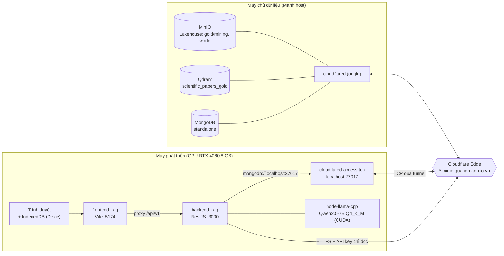
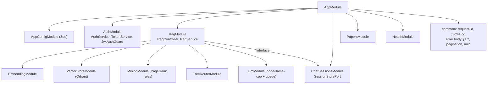
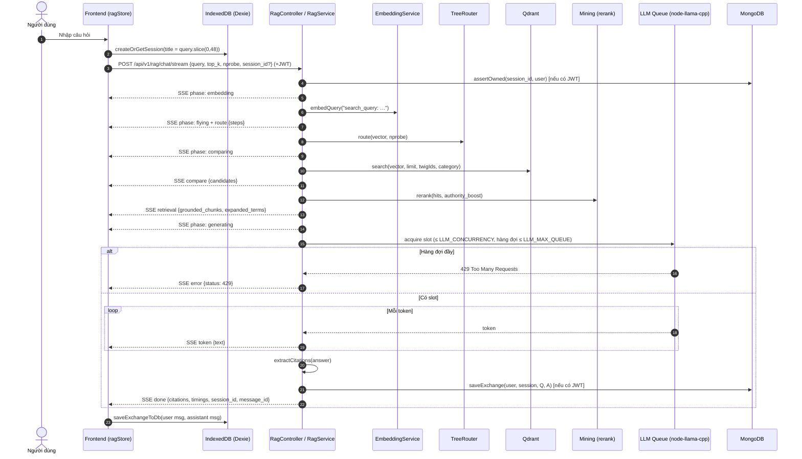
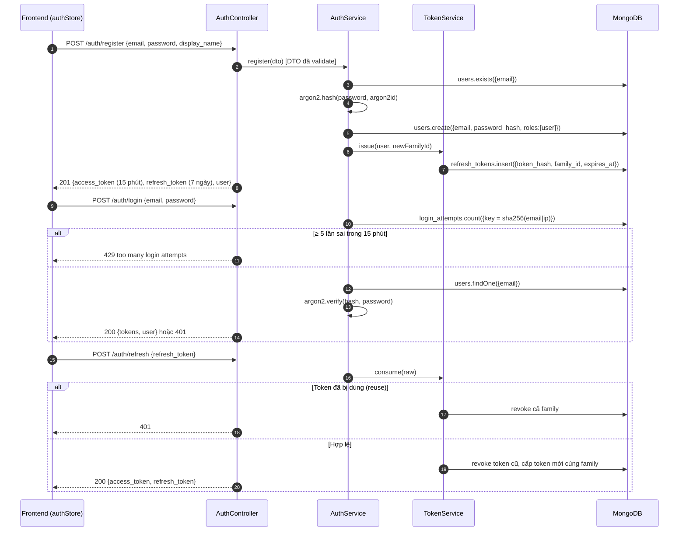
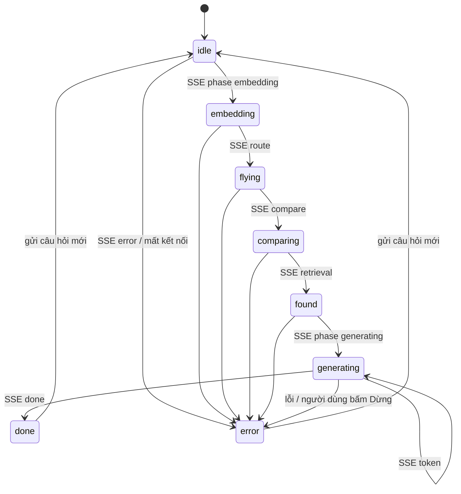
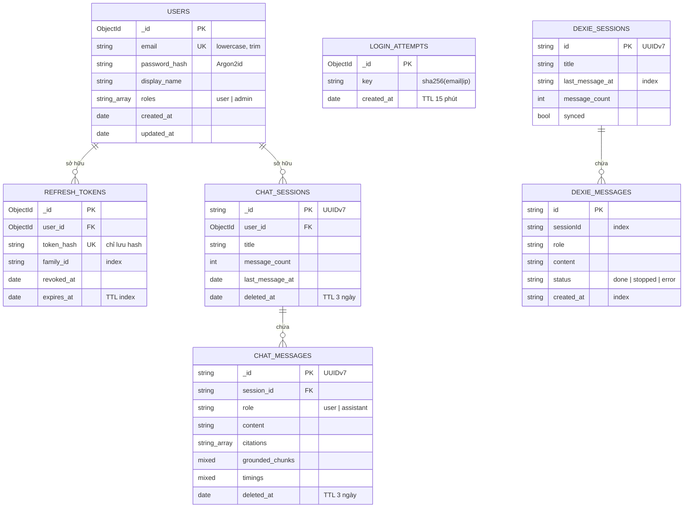
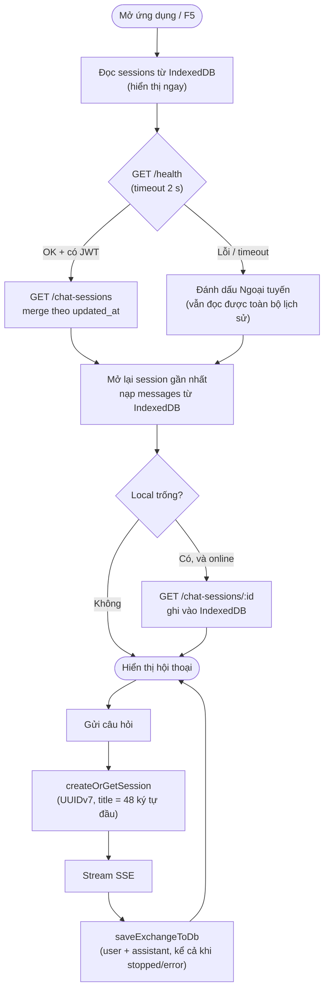

# BÁO CÁO ĐỒ ÁN — Hệ thống RAG Tài liệu Khoa học với Cây Tri Thức Vector 3D (TypeScript)

- **Môn học**: Lập trình TypeScript
- **Phạm vi**: Toàn bộ hệ thống (`backend_rag` NestJS + `frontend_rag` React/Vite), tập trung vào kỹ thuật.
- **Ngày cập nhật**: 2026-10-28

> [!NOTE]
> Bản nháp đầu tiên, được tổng hợp từ mã nguồn, kết quả benchmark và nhật ký quyết định trong repo. Các con số đều lấy từ các lần đo thực tế (xem §7).

---

## Mục lục

1. [Giới thiệu](#1-giới-thiệu)
2. [Công nghệ sử dụng (Tech Stack)](#2-công-nghệ-sử-dụng-tech-stack)
3. [Hạ tầng & Triển khai (Deployment)](#3-hạ-tầng--triển-khai-deployment)
4. [Kiến trúc hệ thống](#4-kiến-trúc-hệ-thống)
5. [Hợp đồng API](#5-hợp-đồng-api)
6. [Mô hình dữ liệu: DTO, Schema, Index](#6-mô-hình-dữ-liệu-dto-schema-index)
7. [Hiệu năng & Stress Test](#7-hiệu-năng--stress-test)
8. [Bảo mật](#8-bảo-mật)
9. [Lưu trữ hội thoại Offline-First](#9-lưu-trữ-hội-thoại-offline-first)
10. [Kiểm thử & Chất lượng mã](#10-kiểm-thử--chất-lượng-mã)
11. [Kết luận](#11-kết-luận)

---

## 1. Giới thiệu

Hệ thống cho phép người dùng đặt câu hỏi về tài liệu khoa học (AI, ML, CV, NLP) và nhận câu trả lời **có trích dẫn** `[Paper: id]` được kiểm chứng với ngữ cảnh truy xuất. Quy trình RAG:

1. **Embed** câu hỏi bằng `nomic-embed-text-v1.5` (768 chiều, tiền tố `search_query:`).
2. **Route** qua cây World 3D (centroid cấp 1/cấp 2, tham số `nprobe`).
3. **Search** vector trong Qdrant (`scientific_papers_gold`, cosine ANN).
4. **Rerank** kết hợp độ tương đồng và uy tín tác giả: $S = 0.85 \cdot S_{sim} + 0.15 \cdot A_{PageRank}$.
5. **Generate** câu trả lời bằng Qwen2.5‑7B‑Instruct (GGUF Q4_K_M) chạy cục bộ qua `node-llama-cpp` trên GPU, **stream từng token qua SSE**.
6. Frontend hiển thị song song **hoạt ảnh 3D** (quả cầu truy vấn bay theo cành cây tri thức) và khung chat.

Toàn bộ backend lẫn frontend được viết bằng **TypeScript ở chế độ `strict`**, có kiểu dùng chung cho hợp đồng FE ↔ BE.

---

## 2. Công nghệ sử dụng (Tech Stack)

### 2.1 Backend — `backend_rag`

| Nhóm | Công nghệ | Vai trò |
| :--- | :--- | :--- |
| Framework | **NestJS 11**, TypeScript 5.x (`strict`) | Module hóa, DI, Guard, Pipe, Interceptor |
| Validation | `class-validator`, `class-transformer` | Kiểm tra DTO theo decorator |
| Cấu hình | **Zod** (`env.schema.ts`) | Validate biến môi trường lúc khởi động, suy kiểu `AppConfig = z.infer<…>` |
| CSDL | **MongoDB** + Mongoose (`@nestjs/mongoose`) | Users, refresh tokens, login attempts, chat sessions/messages |
| Vector DB | **Qdrant** (`@qdrant/js-client-rest`) | Truy xuất chunk tài liệu (chỉ đọc) |
| Embedding | `@huggingface/transformers` | Nomic v1.5, chạy in-process |
| LLM | **`node-llama-cpp`** | Qwen2.5‑7B GGUF, tự chọn CUDA/Metal/CPU, hàng đợi có giới hạn |
| Auth | `argon2` (Argon2id), JWT | Băm mật khẩu, access/refresh token |
| Tài liệu API | `@nestjs/swagger` | OpenAPI 3 tại `/api/v1/docs` |
| Test | Jest, Supertest, `mongodb-memory-server` | Unit, integration, e2e |

### 2.2 Frontend — `frontend_rag`

| Nhóm | Công nghệ | Vai trò |
| :--- | :--- | :--- |
| UI | **React 19**, **Vite 6**, TypeScript | SPA, dev server cổng 5174 |
| 3D | **Three.js** + `@react-three/fiber`, `drei`, `postprocessing` | Cây tri thức, tán lá ~150k điểm vector, hiệu ứng truy vấn |
| State | **Zustand** | `ragStore`, `sessionStore`, `authStore`, `uiStore`, `worldStore` |
| Lưu trữ cục bộ | **Dexie.js** (IndexedDB) | Cache hội thoại offline-first |
| Hiển thị | `react-markdown`, `remark-math`, `rehype-katex` | Markdown + công thức toán |
| Style | Tailwind CSS v4 | |
| Test | Vitest, Testing Library, `fake-indexeddb`, Playwright | |

### 2.3 Công cụ đo lường

| Công cụ | Mục đích |
| :--- | :--- |
| **k6** | Stress / soak test HTTP & SSE |
| Python (pandas, matplotlib, seaborn), Jupyter | Phân tích kết quả k6, vẽ biểu đồ |
| Lighthouse (Chrome DevTools) | Web Vitals (FCP, LCP) |
| PerfHUD tự xây dựng | FPS trung bình / độ lệch chuẩn thời gian thực |

---

## 3. Hạ tầng & Triển khai (Deployment)

Các dịch vụ dữ liệu (**MinIO, Qdrant, MongoDB**) do **Mạnh** host trên máy chủ riêng và công bố ra ngoài qua **Cloudflare Tunnel** (`*.minio-quangmanh.io.vn`). Backend NestJS, mô hình LLM và frontend chạy cục bộ trên máy phát triển có GPU.



| Thành phần | Vị trí | Giao thức | Ghi chú |
| :--- | :--- | :--- | :--- |
| MinIO | Máy chủ (Mạnh) | S3 | Lưu artefact của pipeline: `gold/mining`, dữ liệu world |
| Qdrant | Máy chủ (Mạnh) | HTTPS qua tunnel | Key **chỉ đọc**; backend không bao giờ ghi vector |
| MongoDB | Máy chủ (Mạnh) | TCP qua `cloudflared access tcp` | Standalone (không replica set) ⇒ backend tự chuyển sang ghi tuần tự thay cho transaction |
| Backend + LLM | Máy phát triển | HTTP :3000 | LLM offload 99 layer lên GPU (~4.7 GB VRAM) |
| Frontend | Máy phát triển | HTTP :5174 | Vite proxy `/api/v1` → `:3000` |

**Vì sao MongoDB cần tunnel TCP còn Qdrant thì không?** Cloudflare Edge chỉ chuyển tiếp HTTP(S) theo mặc định. Qdrant có REST API nên đi thẳng qua HTTPS; MongoDB dùng wire protocol TCP thô, nên phía client phải chạy `cloudflared access tcp` để mở cổng cục bộ làm cầu nối.

---

## 4. Kiến trúc hệ thống

### 4.1 Module backend



TypeScript được dùng ở các điểm then chốt sau:

- **Ports & Adapters**: `RagService` phụ thuộc vào interface `SessionStorePort` ([`session-store.port.ts`](../backend_rag/src/chat-sessions/session-store.port.ts)) thay vì class cụ thể, nên khi test có thể thay bằng bản fake.
- **Cấu hình có kiểu**: `AppConfigService.get<K extends keyof AppConfig>(key)` trả về đúng kiểu của từng biến môi trường (generic có ràng buộc).
- **Thiếu biến môi trường thì dừng ngay**: [`main.ts`](../backend_rag/src/main.ts) gọi `parseEnv(process.env)` trước khi tạo app và in rõ tên biến bị thiếu hoặc sai.

### 4.2 Sequence — RAG streaming chat



### 4.3 Sequence — Đăng ký / Đăng nhập / Làm mới token



### 4.4 State diagram — Pha của pipeline (đồng bộ chat ↔ 3D)

Frontend giữ hai trạng thái: `phase` (sự kiện thật từ backend) và `visualPhase` (pha mà hoạt ảnh đang hiển thị). Chữ trả lời chỉ hiện khi `visualPhase` đã tới `generating`, để khung chat và hoạt ảnh 3D luôn khớp nhau.



Tin nhắn nạp lại từ lịch sử (đã ở trạng thái `done`/`stopped`/`error`) được hiển thị đầy đủ ngay, không qua các pha hoạt ảnh. Đây là bản sửa cho lỗi "treo ở *Đang gửi câu hỏi…*" khi tải lại trang.

---

## 5. Hợp đồng API

Tất cả route nằm dưới tiền tố `/api/v1`, có Swagger tại `/api/v1/docs` (JSON: `/api/v1/docs-json`).

| Nhóm | Method & Route | Auth | Mô tả |
| :--- | :--- | :---: | :--- |
| Auth | `POST /auth/register` | | Đăng ký, trả token |
| | `POST /auth/login` | | Đăng nhập (giới hạn 5 lần sai / 15 phút) |
| | `POST /auth/refresh` | | Xoay vòng refresh token |
| | `POST /auth/logout` | JWT | Thu hồi refresh token |
| | `GET /auth/me`, `PATCH /auth/me` | JWT | Xem / sửa hồ sơ |
| | `POST /auth/change-password` | JWT | Đổi mật khẩu, thu hồi mọi phiên |
| RAG | `POST /rag/chat` | tùy chọn | Trả JSON một lần |
| | `POST /rag/chat/stream` | tùy chọn | Stream SSE |
| Sessions | `GET /chat-sessions` | JWT | Phân trang bằng cursor, tìm theo `?q=` |
| | `GET /chat-sessions/:id` | JWT | Chi tiết + ≤ 200 tin nhắn mới nhất |
| | `PATCH /chat-sessions/:id` | JWT | Đổi tên |
| | `DELETE /chat-sessions/:id` | JWT | Xóa mềm (idempotent, 204) |
| Papers | `GET /papers/:paper_id` | | Metadata + chunk của paper |
| Health | `GET /health`, `/health/live`, `/health/ready` | | Trạng thái Mongo / Qdrant / LLM / World |

> Ghi chú: PR #9 bỏ `POST /chat-sessions`. Session được tạo **lười** (lazy) ở lượt hỏi đầu tiên, nên tổng số route giảm từ 18 xuống 17.

### 5.1 Giao thức SSE

Sự kiện stream được định nghĩa bằng **discriminated union** của TypeScript ([`types/rag.ts`](../frontend_rag/src/types/rag.ts)). Nhờ đó reducer phía FE xử lý đủ mọi loại sự kiện và TypeScript tự thu hẹp kiểu theo trường `type`:

```ts
export type RagStreamEvent =
  | { type: 'phase'; phase: StreamPhase }
  | { type: 'route'; steps: RouteStep[] }
  | { type: 'compare'; candidates: CompareCandidate[] }
  | { type: 'retrieval'; grounded_chunks: GroundedChunk[]; expanded_terms?: string[] }
  | { type: 'token'; text: string }
  | { type: 'done'; citations: string[]; timings: PipelineTimings; session_id?: string | null; message_id?: string | null }
  | { type: 'error'; message: string; status?: number };
```

### 5.2 Body lỗi chuẩn

Mọi lỗi trả về cùng một hình dạng và kèm `request_id` (cũng có trong header `X-Request-Id`) để đối chiếu với log JSON một dòng:

```json
{ "statusCode": 404, "error": "Not Found", "message": "Cannot GET /api/v1/nope", "request_id": "0199f0c2-…" }
```

---

## 6. Mô hình dữ liệu: DTO, Schema, Index

### 6.1 DTO & validation

DTO là class TypeScript gắn decorator. `ValidationPipe` kiểm tra request **trước khi** vào controller; cùng bộ decorator đó cũng sinh tài liệu Swagger. Ví dụ [`ChatRequestDto`](../backend_rag/src/rag/dto/chat-request.dto.ts):

```ts
export class ChatRequestDto {
  @Transform(trim) @MaxLength(2000) @IsString() @IsNotEmpty()
  query: string;

  @IsOptional() @Type(() => Number) @IsInt() @Min(1) @Max(20)
  top_k: number = 5;

  @IsOptional() @Type(() => Number) @IsInt() @Min(1) @Max(6)
  nprobe: number = 2;

  @IsOptional() @Matches(UUID_RE, { message: 'invalid session_id' })
  session_id?: string;
}
```

| DTO | Ràng buộc chính |
| :--- | :--- |
| `ChatRequestDto` | `query` 1–2000 ký tự (trim), `top_k` 1–20, `nprobe` 1–6, `category` theo regex, `session_id` UUID |
| `RegisterDto` / `LoginDto` | Email hợp lệ, mật khẩu ≥ 8 ký tự, `display_name` hợp lệ |
| `RenameSessionDto` | `title` 1–120 ký tự Unicode |
| `ListSessionsQueryDto` | `cursor` ≤ 512, `q` ≤ 120 (chống payload quá dài, ReDoS) |

**Biến môi trường** được validate bằng Zod, kiểu được suy ra thay vì khai báo tay:

```ts
export const envSchema = z.object({
  MONGO_URI: required('MONGO_URI'),
  JWT_ACCESS_SECRET: secret('JWT_ACCESS_SECRET'),   // ≥ 32 ký tự
  LLM_GPU: z.enum(['auto', 'cuda', 'metal', 'vulkan', 'false']).default('auto'),
  LLM_MAX_QUEUE: int(8, 0),
  LLM_CONCURRENCY: int(1, 1),
  // …
});
export type AppConfig = z.infer<typeof envSchema>;
```

### 6.2 ERD — MongoDB (server) và IndexedDB (client)



### 6.3 Index & quyết định thiết kế

| Collection | Index | Mục đích |
| :--- | :--- | :--- |
| `users` | `email` unique | Không cho đăng ký trùng (bắt lỗi `E11000` → 409) |
| `refresh_tokens` | `token_hash` unique, `family_id`, TTL `expires_at` | Tra cứu nhanh, thu hồi theo family, tự dọn khi hết hạn |
| `login_attempts` | `key`, TTL 15 phút | Cửa sổ trượt giới hạn đăng nhập sai, không cần cron |
| `chat_sessions` | `{user_id, deleted_at, last_message_at:-1, _id:-1}` | Phân trang cursor ổn định, đúng thứ tự |
| `chat_sessions` / `chat_messages` | TTL trên `deleted_at` (3 ngày) | Xóa mềm rồi Mongo tự xóa cứng |
| `chat_messages` | `{session_id, deleted_at, created_at, _id}` | Lấy tin nhắn của một session theo thời gian |

- **UUIDv7** cho session/message: sinh được ở cả client lẫn server, có thứ tự thời gian nên dùng tốt cho index và cursor. Frontend tự cài `uuidv7()` ([`utils/uuid.ts`](../frontend_rag/src/utils/uuid.ts)) khớp regex `UUID_RE` của backend.
- **Ghi tuần tự khi không có transaction**: MongoDB standalone không hỗ trợ transaction. `saveExchange` phát hiện lỗi (code 20) một lần rồi chuyển sang ghi tin nhắn trước, cập nhật đếm sau. Nếu hỏng giữa chừng thì cùng lắm còn sót tin nhắn mồ côi, không bao giờ có `message_count` vượt số tin nhắn thật.

---

## 7. Hiệu năng & Stress Test

### 7.1 Phương pháp

| Hạng mục | Chi tiết |
| :--- | :--- |
| Phần cứng | Laptop NVIDIA RTX 4060 (8 GB VRAM), Windows; backend, LLM và k6 chạy cùng một máy |
| Công cụ | k6 (script TypeScript), phân tích bằng Python/Jupyter (pandas, seaborn, matplotlib) |
| Hai loại tải | **Fast API** (`/health`, `/papers/:id`, I/O-bound) và **RAG chat** (`/rag/chat/stream`, GPU-bound) |
| SLA Fast API | P95 < 300 ms, tỉ lệ lỗi < 1 % |
| SLA RAG | Thời gian chờ tương tác (turnaround) ≤ 60 s phía client |
| Giao thức tìm ngưỡng | Bắt đầu ở mức VU ứng viên, chạy soak; nếu vi phạm SLA thì **giảm 20 %** rồi chạy lại, cho tới khi đạt và giữ được 5 phút liên tục |
| Cấu hình LLM | `LLM_CONCURRENCY` (số lượt sinh song song), `LLM_MAX_QUEUE` (hàng đợi tối đa, vượt thì 429), `LLM_TIMEOUT_MS = 60000` |

### 7.2 Kết quả Fast API

| Mức tải | Số request | Throughput | P95 | P99 | Lỗi | Kết luận |
| :--- | ---: | ---: | ---: | ---: | ---: | :--- |
| 100 VUs (ramp) | 37,215 | 371.8 req/s | 8.63 ms | 20.97 ms | 0 % | Dư sức |
| 2,500 VUs (1 phút) | 230,214 | 3,798.9 req/s | — | 65.77 ms | **99.59 %** | ❌ Vi phạm: cạn cổng ephemeral của Windows |
| **2,000 VUs (soak 5 phút)** | **735,420** | **2,451.3 req/s** | **368.1 ms** | **379.8 ms** | **0.00 %** | ✅ Ngưỡng bền vững |


Ở mức 2,500 VUs, P95 hiển thị 0 ms. Lý do là 99.6 % request thất bại ngay ở tầng socket (không có thời gian phản hồi hợp lệ), nên phân vị bị kéo về 0 ms. Đây là dấu hiệu của **lỗi phía hệ điều hành**, không phải backend phản hồi nhanh.

### 7.3 Kết quả RAG / LLM

| Chỉ số | Giá trị |
| :--- | :--- |
| Thời gian một câu trả lời (không tải) | ~8.1–11.8 s |
| Thời gian chờ tăng theo hàng đợi | ~8–10 s cho mỗi người xếp trước |
| VU tối đa đạt SLA tương tác (P95 < 15 s) | 1–2 VU với `LLM_CONCURRENCY=1` |
| Ngưỡng hàng đợi | 8–9 VU (`LLM_MAX_QUEUE=8`); vượt mức này trả **429 trong ~200 ms** (fail-fast) |
| Lỗi ngoài dự kiến | 0 |


**Thí nghiệm burst K=5**: gửi đồng loạt một loạt request vào hàng đợi. Các slot 7–9 nhận **HTTP 200** nhưng turnaround lên tới **79.2 s**, vượt SLA 60 s. Nguyên nhân là `LLM_TIMEOUT_MS` chỉ bắt đầu đếm **sau khi** request lấy được slot GPU: thời gian suy luận thực tế (~24.1 s) vẫn dưới timeout, nhưng thời gian chờ trong hàng đợi không được tính. Trên biểu đồ, các slot này được tô màu hổ phách `[200* SLA Breach]`.


### 7.4 Phân tích điểm nghẽn

| Hiện tượng | Nguyên nhân | Hướng xử lý |
| :--- | :--- | :--- |
| RAG chỉ phục vụ vài người dùng cùng lúc | **GPU-bound**: một GPU 8 GB, model 7B chiếm ~4.7 GB VRAM | Hàng đợi có giới hạn + 429 fail-fast, thay vì để request treo |
| Fast API chịu được hàng nghìn VU | **I/O-bound**, event loop Node.js không bị chặn | — |
| Throughput sụt / P95 tăng vọt quanh giây 20–25 và 47–49 | **V8 Full GC** (mark-sweep) khi old-space mở rộng, cộng với bảng socket của Windows đang tìm điểm cân bằng | Warm-up trước khi đo; có thể tăng `--max-old-space-size` |
| 2,500 VU thất bại hàng loạt | Cạn **cổng ephemeral** của Windows (k6 và server cùng máy) | Chạy k6 trên máy khác, keep-alive, mở rộng dải cổng |
| Turnaround > timeout nhưng vẫn 200 | Timeout chỉ đo thời gian suy luận, không đo thời gian chờ trong hàng đợi | Thêm timeout tổng tính từ lúc vào hàng đợi |

### 7.5 Hiệu năng Frontend

| Chỉ số (Lighthouse, 4G + CPU chậm 4×) | Trước | Sau | Cải thiện |
| :--- | ---: | ---: | ---: |
| **FCP** | 3,600 ms | **444 ms** | −87.7 % |
| **LCP** | 6,600 ms | **2,152 ms** | −67.4 % (đạt mức "Good" < 2.5 s) |

Các tối ưu chính:

1. **Web Vitals**: tải Google Fonts bất đồng bộ (`display=swap`), render sẵn khung loading trong `index.html`, tách CSS KaTeX khỏi critical CSS (giảm ~50 %), bỏ `sleep(400)` giả lập, tải trước `WorldCanvas` song song và dời việc dựng world sang `requestAnimationFrame`.
2. **Render chat khi stream**: `useDeferredValue` + gom token theo lô 30 ms, tránh parse lại cây Markdown/KaTeX ở mỗi token (frame median ~0.8 ms).
3. **3D**: gộp các luồng Top‑K thành **một** `LineSegments` dùng vertex color (một draw call); cắt frustum sớm trong vertex shader cho ~150k điểm tán lá; bật frustum culling; gộp thân và cành thành một mesh; giới hạn DPR và bỏ MSAA của composer để giảm tải fill-rate.
4. **PerfHUD**: hiển thị FPS tức thời / trung bình / độ lệch chuẩn. `PerfSampler` (nằm trong `<Canvas>`) được tách khỏi `PerfHUD` (DOM, nằm ngoài `<Canvas>`), vì reconciler của R3F không render được thẻ DOM. Benchmark ghi nhận **57.1 ± 1.2 FPS**, không có Long Task.

---

## 8. Bảo mật

| Cơ chế | Cài đặt |
| :--- | :--- |
| **Băm mật khẩu** | **Argon2id** (memory-hard, salt ngẫu nhiên 16 byte cho mỗi mật khẩu, so sánh thời gian hằng). Hai người cùng mật khẩu vẫn có hash khác nhau, nên rainbow table không dùng được |
| **Access token** | JWT, sống 15 phút |
| **Refresh token** | Chuỗi ngẫu nhiên, **chỉ lưu hash** trong DB, sống 7 ngày, **xoay vòng** mỗi lần dùng; phát hiện tái sử dụng thì **thu hồi cả family** |
| **Chống brute-force** | Đếm lần sai theo `sha256(email|ip)`; ≥ 5 lần trong 15 phút thì trả 429 (TTL index tự reset) |
| **Đổi mật khẩu** | Thu hồi mọi refresh token của người dùng |
| **Riêng tư trong log** | Chỉ ghi `email_hash` 16 ký tự, không bao giờ ghi email hay mật khẩu |
| **Phân quyền dữ liệu** | Mọi truy vấn session đều lọc theo `user_id`; truy cập session của người khác trả 404 (không lộ là session có tồn tại) |
| **Chống injection** | Tìm kiếm tiêu đề dùng `escapeRegex`; giới hạn độ dài `q`/`cursor` |
| **CORS** | Chỉ cho phép origin trong `CORS_ORIGINS` |
| **Qdrant** | Dùng API key **chỉ đọc** |
| **MongoDB** | Truy cập có xác thực. `authSource=admin` chỉ cho driver biết **nơi lưu thông tin đăng nhập**, không cấp quyền admin. Quyền thực tế do *role* quyết định; khi lên production nên thu hẹp về `readWrite` trên `rag_ts` (least privilege) |
| **Secrets** | Nằm trong `.env` (đã gitignore), được validate độ dài ≥ 32 ký tự lúc khởi động |

---

## 9. Lưu trữ hội thoại Offline-First

**Vấn đề**: PR #8 chỉ lưu lịch sử chat ở MongoDB. Frontend giữ tin nhắn trong bộ nhớ, nên khi tải lại trang hoặc khi backend ngừng hoạt động thì người dùng mất toàn bộ lịch sử.

**Giải pháp**: dùng IndexedDB (qua Dexie.js) làm nguồn dữ liệu chính ở client (**cache-first**), còn backend đóng vai trò đồng bộ nền.



| Tính năng | Mô tả |
| :--- | :--- |
| Sống sót khi backend chết | Đọc lại hội thoại, trích dẫn, grounded chunks, timings mà không cần mạng; header hiện huy hiệu `Ngoại tuyến` |
| Đa phiên | History Drawer, nút **+ Đoạn chat mới**, tiêu đề tự sinh từ câu hỏi đầu |
| Xóa an toàn | Thùng rác + xác nhận 2 bước (`Xóa?` / `Huỷ`); xóa local trước, gọi `DELETE` lên server ở nền |
| Phạm vi | Đã đăng nhập từ trước thì vẫn vào được khi offline (token lưu ở `localStorage`). **Đăng nhập mới** thì bắt buộc cần backend để xác minh Argon2id và ký JWT |

**Vì sao chọn IndexedDB thay vì `localStorage`?** `localStorage` giới hạn khoảng 5 MB và tuần tự hóa đồng bộ, làm chặn main thread. Câu trả lời LLM kèm grounded chunks khá lớn, nên IndexedDB (bất đồng bộ, có index) phù hợp hơn.

---

## 10. Kiểm thử & Chất lượng mã

| Phần | Công cụ | Phạm vi | Kết quả |
| :--- | :--- | :--- | :--- |
| Backend unit/integration | Jest + `mongodb-memory-server` (replica set và standalone) | Auth, LLM queue (429/504), RAG pipeline, chat sessions (PR #9: 32 kịch bản: phân quyền, cursor, ReDoS/NoSQL injection, TTL) | Pass |
| Backend e2e | Supertest | Luồng đầy đủ register → chat stream → sessions → refresh/logout; OpenAPI liệt kê đủ route | Pass |
| Frontend | Vitest + Testing Library + `fake-indexeddb` | Stores, SSE parser, components chat, HistoryDrawer (xóa 2 bước), offline persistence | **210/210 test, 26 file** |
| Kiểu | `tsc --noEmit` (strict) | Toàn bộ FE | 0 lỗi |
| Build | `tsc -b && vite build` | Production bundle | Thành công |
| Coverage | `@vitest/coverage-v8` | Ngưỡng lines/statements/functions ≥ 90 % | Cấu hình trong `vite.config.ts` |

Kỹ thuật test đáng chú ý:

- **Fake qua interface**: `SessionStorePort` và các service embedding/LLM được thay bằng bản fake trong e2e, nên test chạy được mà không cần GPU hay model thật.
- **MongoDB trong bộ nhớ**: chạy thật cả nhánh có transaction (replica set) lẫn nhánh ghi tuần tự (standalone).
- **IndexedDB giả**: `fake-indexeddb/auto` trong `src/test/setup.ts` cho phép test Dexie trong jsdom.

---

## 11. Kết luận

Hệ thống đã hoàn thiện luồng RAG có trích dẫn với streaming SSE và hoạt ảnh 3D đồng bộ, viết hoàn toàn bằng TypeScript strict ở cả hai phía. Hợp đồng FE ↔ BE được đảm bảo bằng DTO có validation và discriminated union cho sự kiện stream. Đo lường thực tế cho thấy:

- API thường đạt **2,000 VU bền vững trong 5 phút** (P95 368 ms, 0 % lỗi).
- Tầng LLM bị giới hạn bởi GPU. Hệ thống xử lý quá tải bằng hàng đợi có giới hạn và trả 429 sớm thay vì để request treo.
- Frontend đạt **LCP 2.15 s / FCP 444 ms** và ~57 FPS trong cảnh 3D.
- Lịch sử chat vẫn **đọc được khi backend ngừng hoạt động** nhờ IndexedDB.

---

### Phụ lục — Tài liệu tham chiếu trong repo

- Hướng dẫn chạy: [`README.md`](../README.md), [`docs/RUN_GUIDE.md`](RUN_GUIDE.md)
- Hợp đồng API: [`docs/API_DESIGN.md`](API_DESIGN.md)
- Benchmark: [`backend_rag/benchmark/`](../backend_rag/benchmark/) (script k6, notebook, `results/benchmark_report.html`)
- Nhật ký quyết định: [`docs/AI_chat_log/Vuong_chat_logs.md`](AI_chat_log/Vuong_chat_logs.md)
