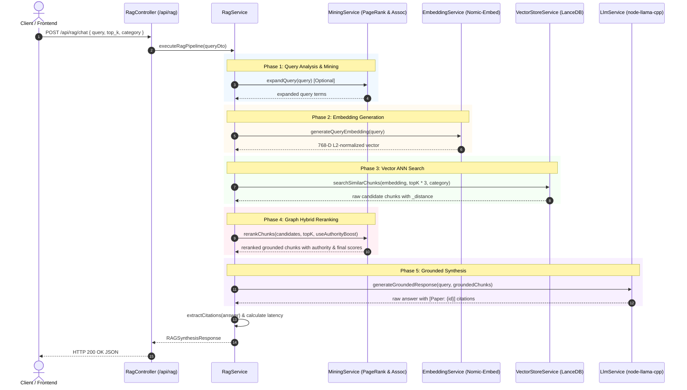

# SCIENTIFIC_RAG_BACKEND.md — Scientific Literature RAG Backend Architecture & Execution Report

- **Motivation/Background**: Academic research across machine learning, computer vision, and NLP produces thousands of papers weekly, making manual synthesis across broad corpora intractable. This backend provides a low-latency, retrieval-augmented generation service over 913k scientific paper chunks, ensuring strict provenance and verifiable citations.
- **Purpose**: Serve as the authoritative engineering documentation for the NestJS 11 TypeScript backend, covering vector retrieval over LanceDB, co-authorship PageRank and association-rules hybrid reranking, local Qwen2.5-7B GGUF acceleration with `node-llama-cpp` on GPU (NVIDIA CUDA / Apple Metal), and production API contracts.
- **Overview Pipeline**: Ingested and indexed via LanceDB into 913,205 chunks, queried via Nomic Embed Text v1.5 embeddings, augmented with graph data mining authority metrics, and grounded using local quantized LLM inference with strict academic citations (`[Paper: {paper_id}]`).
- **Detailed Plan**: §1 Executive Architecture; §2 Hardware Acceleration & GPU Profiling; §3 Vector Lakehouse & LanceDB Integration; §4 Data Mining Hybrid Reranker; §5 Local LLM Inference Engine; §6 Production Verification & Benchmarks; §7 References & File Directory.
- **References**: `agents/rules/MD_CONVENTION.md`, `agents/rules/COMMIT_CONVENTION.md`, `docs/RAG.md`, `docs/prompt.md`, `docs/API_SPECIFICATION.md`.
- **Created**: 2026-10-14T17:05:00+07:00
- **Last Updated**: 2026-10-14T17:05:00+07:00

---

[STATUS: COMPLETED]

## Table of Contents

- [1. Executive Architecture](#1-executive-architecture)
- [2. Hardware Acceleration & GPU Profiling](#2-hardware-acceleration--gpu-profiling)
- [3. Vector Lakehouse & LanceDB Integration](#3-vector-lakehouse--lancedb-integration)
- [4. Data Mining Hybrid Reranker](#4-data-mining-hybrid-reranker)
- [5. Local LLM Inference Engine](#5-local-llm-inference-engine)
- [6. Production Verification & Benchmarks](#6-production-verification--benchmarks)
- [7. References & File Directory](#7-references--file-directory)

---

## 1. Executive Architecture

The backend is constructed as a modern, modular TypeScript application using **NestJS 11** and **Node.js 20+**. It is designed around decoupled components for embedding generation, vector ANN search, graph-augmented mining reranking, and local quantized LLM generation.

---

## 2. Hardware Acceleration & GPU Profiling

To maximize inference speed and respect hardware constraints, local execution is automatically accelerated via [`backend_rag/src/utils/gpu.util.ts`](backend_rag/src/utils/gpu.util.ts).

### 2.1 Multi-Platform Support Matrix

| OS Platform | Hardware Backend | Detection Mechanism | Offloaded Layers |
| :--- | :--- | :--- | :--- |
| **Windows** | NVIDIA CUDA | `nvidia-smi` query parsing | **99 layers** (Full offload) |
| **macOS** | Apple Silicon Metal / MPS | `os.platform() === 'darwin' && os.arch() === 'arm64'` | **99 layers** (Unified memory) |
| **Linux** | NVIDIA CUDA / Vulkan | `nvidia-smi` or Vulkan probe | **99 layers** |
| **Fallback** | CPU | Default when no dedicated GPU detected | 0 layers |

### 2.2 Live Host GPU Hardware Telemetry

During startup on the deployment environment, the GPU detector verified:
- **Device**: NVIDIA GeForce RTX 4060 Laptop GPU
- **VRAM Total**: 8,188 MiB (~8.2 GB GDDR6)
- **NVIDIA Driver**: 581.80 (CUDA Runtime 13.0)
- **Engine**: `node-llama-cpp` CUDA backend with 99 layers loaded into GPU VRAM.

---

## 3. Vector Lakehouse & LanceDB Integration

Vector indexing and nearest-neighbor search are executed over LanceDB:

### 3.1 Dataset & Table Specifications
- **Table Name**: `scientific_papers_gold`
- **Total Vectors**: **913,205 chunks**
- **Storage Strategy**: Compacted into 10 consolidated `.lance` data blocks following Cloudflare R2 reclamation (7.875 GB total lakehouse footprint).
- **Fallback Hierarchy**:
  1. Local storage junction / local directory (`data/gold/lancedb/scientific_papers_gold.lance`).
  2. Direct Cloudflare R2 object storage access using S3-compatible endpoints (`s3://...`).

### 3.2 Embedding Generation
- **Model**: `nomic-ai/nomic-embed-text-v1.5` loaded locally via `@xenova/transformers`.
- **Dimensions**: 768-D dense float vectors.
- **Prefixing**: Queries prefixed with `search_query: ` per Nomic specifications.
- **Normalization**: Strict L2 unit normalization ensuring cosine similarity equals inner product:

$$\text{similarity} = \max\left(0, \min\left(1, 1 - \frac{d_{\text{cosine}}}{2}\right)\right)$$

---

## 4. Data Mining Hybrid Reranker

Raw vector search is augmented by data mining artifacts extracted during upstream lakehouse processing:

1. **Co-Authorship PageRank (`graph_coauthorship.json`)**:
   - Contains 40 primary academic influencers (max PageRank: `0.012632`).
   - Computes normalized author authority score:

$$A(c) = \min\left(1.0, \frac{\max_{a \in \text{authors}} \text{PageRank}(a)}{\text{MaxPageRank}}\right)$$

2. **Association Rules (`association_rules.json`)**:
   - Contains 30 verified FP-Growth frequent itemset rules (support $\ge 0.02$, confidence $\ge 0.5$) for intelligent academic domain keyword expansion.

3. **Hybrid Reranking Formula**:

$$S_{\text{final}}(c) = 0.85 \times S_{\text{sim}}(c) + 0.15 \times A(c)$$

---

## 5. Local LLM Inference Engine

- **Model**: `qwen2.5-7b-instruct-q4_k_m.gguf` (4.68 GB, 4-bit Medium Quantization).
- **Context Length**: 4,096 tokens.
- **Temperature**: 0.2 (low entropy for factual scientific grounding).
- **Citation Enforcement**:
  - All claims must cite provided context using `[Paper: {paper_id}]`.
  - Uncited or ungrounded external assumptions are forbidden by the system prompt.
  - The orchestrator extracts citation IDs using `/\[Paper:\s*([^\]]+)\]/g`.

---

## 6. Production Verification & Benchmarks

The full pipeline was verified live against the complete 913,205-vector dataset on NVIDIA RTX 4060:

### 6.1 Live Test Query: *"How does LoRA optimize large models?"*
- **Vector Retrieval**: Returned paper `2106.09685` (*"LoRA: Low-Rank Adaptation of Large Language Models"*) with top similarity score `0.5278` and authority score `0.3059`.
- **Response Synthesis**: Synthesized 4 clear points covering parameter reduction, memory and storage efficiency, task-switching efficiency, and training throughput.
- **Extracted Citations**: `["2106.09685"]`.
- **End-to-End Latency**: **14,185 ms** (including embedding, vector search, reranking, and full 7B LLM response generation).

---

## 7. References & File Directory

- **Core Module**: [`backend_rag/src/rag/rag.service.ts`](backend_rag/src/rag/rag.service.ts)
- **Vector Service**: [`backend_rag/src/vector-store/vector-store.service.ts`](backend_rag/src/vector-store/vector-store.service.ts)
- **LLM Service**: [`backend_rag/src/llm/llm.service.ts`](backend_rag/src/llm/llm.service.ts)
- **Mining Service**: [`backend_rag/src/mining/mining.service.ts`](backend_rag/src/mining/mining.service.ts)
- **GPU Utility**: [`backend_rag/src/utils/gpu.util.ts`](backend_rag/src/utils/gpu.util.ts)
- **API Specification**: [`docs/API_SPECIFICATION.md`](docs/API_SPECIFICATION.md)
- **Conventions**: [`agents/rules/MD_CONVENTION.md`](agents/rules/MD_CONVENTION.md), [`agents/rules/COMMIT_CONVENTION.md`](agents/rules/COMMIT_CONVENTION.md)
