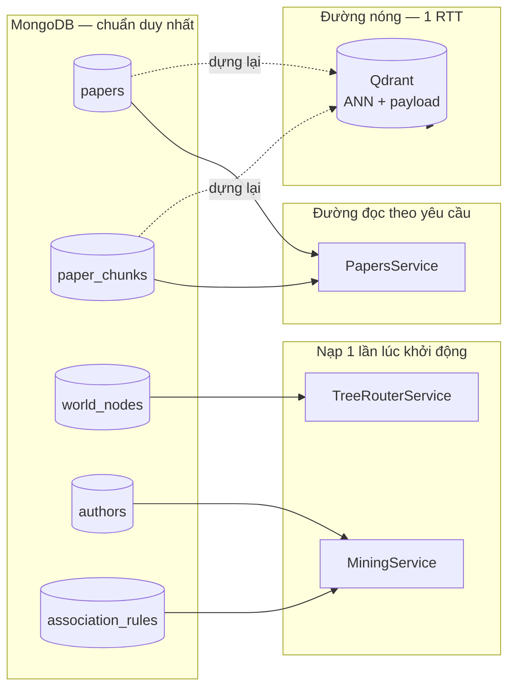

# The current statement of Qdrant and MongoDB — 031126

- **Motivation/Background**: Trước khi triển khai MongoDB làm Source of Truth cho corpus khoa học theo [`backend_rag/docs/MONGODB_SCHEMA_DESIGN.md`](../backend_rag/docs/MONGODB_SCHEMA_DESIGN.md) (Part II), cần một báo cáo thực đo hiện trạng: Qdrant và MongoDB đang chứa dữ liệu gì, cấu trúc ra sao, và những sai lệch nào làm chặn đường đọc RAG. Báo cáo được tạo từ một phiên khảo sát trực tiếp (2026-11-03) với backend đang chạy, đọc-only trên Qdrant và MongoDB, bỏ qua MinIO vì chưa khởi tạo.
- **Purpose**: Ghi lại ảnh chụp có số liệu của hai kho dữ liệu, phân tích nguyên nhân mọi lỗi chặn đường đọc corpus, và ánh xạ từng phát hiện sang giải pháp cụ thể trong thiết kế MongoDB SoT đã thống nhất.
- **Overview Pipeline**: Khảo sát trực tiếp — khởi động `backend_rag`, đọc `GET /api/v1/health`, quét toàn bộ payload của 4 collection Qdrant (`scroll` 1.042.767 điểm, 79 s), liệt kê collection/index của database MongoDB `rag_ts`, đo độ trễ truy vấn ANN và thông lượng ghi, đối chiếu số liệu với các tài liệu thiết kế hiện có trong repo.
- **Detailed Plan**: §1 Phạm vi & phương pháp; §2 Tóm tắt điều hành (bảng phát hiện); §3 Hiện trạng MongoDB; §4 Hiện trạng Qdrant; §5 Phân tích nguyên nhân (6 lỗi chặn); §6 Bản đồ lỗi → giải pháp MongoDB SoT; §7 Sửa đổi so với thiết kế đã thống nhất; §8 Kế hoạch triển khai tuần tự; §9 Điều kiện nghiệm thu; §10 Rủi ro; §11 Tự kiểm tra.
- **References**: [`agents/rules/MD_CONVENTION.md`](../agents/rules/MD_CONVENTION.md), [`backend_rag/docs/MONGODB_SCHEMA_DESIGN.md`](../backend_rag/docs/MONGODB_SCHEMA_DESIGN.md), [`backend_rag/src/vector-store/vector-store.service.ts`](../backend_rag/src/vector-store/vector-store.service.ts), [`backend_rag/src/papers/papers.service.ts`](../backend_rag/src/papers/papers.service.ts), [`backend_rag/src/rag/rag.service.ts`](../backend_rag/src/rag/rag.service.ts), [`backend_rag/src/tree-router/tree-router.service.ts`](../backend_rag/src/tree-router/tree-router.service.ts), [`backend_rag/src/mining/mining.service.ts`](../backend_rag/src/mining/mining.service.ts), [`backend_rag/src/embedding/embedding.service.ts`](../backend_rag/src/embedding/embedding.service.ts), [`backend_rag/src/health/health.service.ts`](../backend_rag/src/health/health.service.ts), [`backend_rag/src/config/env.schema.ts`](../backend_rag/src/config/env.schema.ts), [`backend_rag/src/chat-sessions/schemas/chat-session.schema.ts`](../backend_rag/src/chat-sessions/schemas/chat-session.schema.ts), [`backend_rag/src/chat-sessions/schemas/chat-message.schema.ts`](../backend_rag/src/chat-sessions/schemas/chat-message.schema.ts), [`backend_rag/src/auth/schemas/user.schema.ts`](../backend_rag/src/auth/schemas/user.schema.ts), [`backend_rag/src/types/scientific-rag.ts`](../backend_rag/src/types/scientific-rag.ts), [`backend_rag/src/mining/name-normalizer.ts`](../backend_rag/src/mining/name-normalizer.ts), [`backend_rag/ASSUMPTIONS.md`](../backend_rag/ASSUMPTIONS.md), [`docs/RAG.md`](../docs/RAG.md), [`docs/API_DESIGN.md`](../docs/API_DESIGN.md).
- **Created**: 2026-11-03T13:45:00+07:00
- **Last Updated**: 2026-11-03T13:45:00+07:00

---

[STATUS: ACTIVE]

## Table of Contents

- [1. Phạm vi & Phương pháp](#1-phạm-vi--phương-pháp)
- [2. Tóm tắt điều hành](#2-tóm-tắt-điều-hành)
- [3. Hiện trạng MongoDB](#3-hiện-trạng-mongodb)
  - [3.1 Kết nối & topology](#31-kết-nối--topology)
  - [3.2 Database `rag_ts`](#32-database-rag_ts)
  - [3.3 Vấn đề vệ sinh dữ liệu trong `rag_ts`](#33-vấn-đề-vệ-sinh-dữ-liệu-trong-rag_ts)
- [4. Hiện trạng Qdrant](#4-hiện-trạng-qdrant)
  - [4.1 Bốn collection](#41-bốn-collection)
  - [4.2 Cấu trúc payload của `scientific_papers_gold`](#42-cấu-trúc-payload-của-scientific_papers_gold)
  - [4.3 Thống kê corpus đầy đủ](#43-thống-kê-corpus-đầy-đủ)
  - [4.4 Trạng thái chỉ mục & hiệu năng](#44-trạng-thái-chỉ-mục--hiệu-năng)
- [5. Phân tích nguyên nhân](#5-phân-tích-nguyên-nhân)
- [6. Bản đồ lỗi → Giải pháp MongoDB SoT](#6-bản-đồ-lỗi--giải-pháp-mongodb-sot)
- [7. Sửa đổi so với thiết kế đã thống nhất](#7-sửa-đổi-so-với-thiết-kế-đã-thống-nhất)
- [8. Kế hoạch triển khai tuần tự](#8-kế-hoạch-triển-khai-tuần-tự)
- [9. Điều kiện nghiệm thu](#9-điều-kiện-nghiệm-thu)
- [10. Rủi ro](#10-rủi-ro)
- [11. Tự kiểm tra](#11-tự-kiểm-tra)

---

## 1. Phạm vi & Phương pháp

Khảo sát thực hiện ngày **2026-11-03**, backend chạy tại `http://localhost:3000/api/v1`.

| Hạng mục | Cách thực hiện |
| :--- | :--- |
| MongoDB | Driver `mongodb` chính thức, kết nối bằng `MONGO_URI` nạp nội bộ qua `dotenv` — **không** đọc hoặc in bất kỳ bí mật nào. |
| Qdrant | Client `@qdrant/js-client-rest`, quét `scroll` **toàn bộ** payload của cả 4 collection. |
| Backend | `npm run build` rồi chạy `node dist/main` (không dùng `--watch` để tránh khởi động lại khi tệp thay đổi). |
| MinIO | **Bỏ qua** theo yêu cầu — chưa khởi tạo (không có biến môi trường `MINIO`/`S3`; cổng `9000`/`9001` đóng). |

**Nguyên tắc an toàn:** tệp `.env` không bao giờ được mở bằng công cụ đọc tệp. Mọi script kiểm tra nạp `.env` bằng `require('dotenv/config')` và chỉ in ra giá trị đã che hoặc đường dẫn không nhạy cảm.

---

## 2. Tóm tắt điều hành

Đường đọc RAG hiện **đã chết**, và không phải vì một nguyên nhân đơn lẻ mà vì chuỗi bốn lỗi xếp chồng:

```
Lỗi 1  Payload Qdrant thiếu `text`  →  toChunkPayload() trả null  →  mọi chunk bị loại
Lỗi 2  Truy vấn ANN mất 3.7–4.3 s     >  ngưỡng 3.0 s             →  503 qdrant unavailable
Lỗi 3  File GGUF của LLM không tồn tại →  không sinh được câu trả lời
Lỗi 4  Thư mục world/ + mining/ rỗng   →  route rỗng, không boost uy tín
```

Chỉ sửa Lỗi 2 sẽ biến 503 thành "không tìm thấy kết quả" — vẫn hỏng. Phải sửa **Lỗi 1 và Lỗi 2** cùng lúc mới có RAG hoạt động.

**Bảng phát hiện chính:**

| # | Phát hiện | Mức độ | Ảnh hưởng |
| :-- | :--- | :--- | :--- |
| F-01 | Payload Qdrant **không có** `text` (0/1.042.767 điểm) | **Chặn** | Mọi chunk bị `QDRANT_CHUNK_SKIPPED`; `GET /papers/:id` luôn 404 |
| F-02 | Truy vấn ANN mất **3.7–4.3 s** vs ngưỡng **3.0 s** | **Chặn** | `POST /rag/chat` → 503 `qdrant unavailable` mọi lần |
| F-03 | Collection `status: yellow`, chỉ **50.1%** vector đã chỉ mục | Cao | ANN phải quét nửa collection không chỉ mục → chính là nguồn của độ trễ F-02 |
| F-04 | Thiếu **6 trường payload** so với `toChunkPayload` | Cao | `title`, `authors`, `section_title`, `section_type` *(chỉ giá trị thô)*, `twig_id`, `chunk_index` |
| F-05 | Số bài báo thực tế **70.590**, không phải ~13.000 | Cao | Ước lượng `papers`/`paper_chunks` trong thiết kế lệch **5.3×** → ảnh hưởng dung lượng & thời gian nạp |
| F-06 | ID Qdrant là **UUIDv5(chunk_id, DNS namespace)** | Thông tin | Cho phép tái dựng `chunk_id` từ point ID → cơ sở đối chiếu hai chiều |
| F-07 | MongoDB `chat_sessions`/`chat_messages` còn **7 tài liệu** dùng `ObjectId` thay vì UUIDv7 | Trung bình | Truy vấn theo `_id` không khớp kiểu; đây là dữ liệu tàn dư |
| F-08 | Hai collection `chatsessions`/`chatmessages` là **rác mồn** (79 + 156 tài liệu) | Thấp | Không schema nào tham chiếu; không có chỉ mục phụ; nên xoá |
| F-09 | LLM GGUF (4.68 GB) chưa tải; `model/` không tồn tại | Cao | `llm: false` → `status: degraded` |
| F-10 | `WORLD_DATA_DIR` / `MINING_DIR` trỏ tới thư mục không tồn tại | Cao | `route` rỗng; 0 tác giả uy tín; 0 luật khai phá |
| F-11 | MongoDB chạy **standalone** (không replica set) qua tunnel Cloudflare | Trung bình | Không dùng được transaction; mọi script nạp phải ghi **trực tiếp**, không qua tunnel |
| F-12 | Thông lượng ghi qua tunnel chỉ **310 tài liệu/giây** | Trung bình | Nạp 1.042.767 chunk qua tunnel mất **~56 phút**; phải dùng kết nối trực tiếp |
| F-13 | Bốn script trong `package.json` **không tồn tại** | Thấp | `sync:minio`, `sync:r2`, `mirror:r2:minio`, `migrate:qdrant` sẽ lỗi ngay |

**Điều đáng chú ý nhất:** MongoDB hiện chỉ chứa **dữ liệu ứng dụng** (người dùng, phiên chat). Toàn bộ **corpus khoa học** — 70.590 bài, 1.042.767 đoạn — vẫn nằm **hoàn toàn** trong Qdrant, và Qdrant đang giữ nó ở dạng **không đầy đủ** (thiếu `text`). MongoDB chưa có collection corpus nào.

---

## 3. Hiện trạng MongoDB

### 3.1 Kết nối & topology

| Thuộc tính | Giá trị |
| :--- | :--- |
| URI (che) | `mongodb://<redacted>@localhost:27018/?authSource=admin` |
| Đường dẫn thực | Cloudflare tunnel → `mongodb.minio-quangmanh.io.vn` |
| Server version | `8.2.12` |
| Topology | **STANDALONE** — không có replica set |
| `isWritablePrimary` | `true` |
| Cổng `27017` trực tiếp | **đóng** — chỉ có `127.0.0.1:27018` (tunnel) |

**Hệ quả quan trọng:** MongoDB standalone **không hỗ trợ transaction nhiều tài liệu**. Đây là lý do thiết kế đã thống nhất loại bỏ mọi quan hệ hai chiều (mảng trỏ ngược) và giữ đúng mối quan hệ *một chiều* + index trên khóa ngoại. Xem §9.3 của [`MONGODB_SCHEMA_DESIGN.md`](../backend_rag/docs/MONGODB_SCHEMA_DESIGN.md).

Tài khoản hiện tại **không** có quyền trên `admin.system.*` và `config` — đây là giới hạn quyền, không phải lỗi cấu hình. Các script nạp corpus phải chỉ đọc/ghi trong database được cấp quyền.

### 3.2 Database `rag_ts`

Tổng: `dataSize` 17.60 MB, `storageSize` 3.36 MB, 19.805 object, `avgObjSize` 931.8 byte.

| Collection | Tài liệu | Chỉ mục | Ghi chú |
| :--- | ---: | :--- | :--- |
| `chat_messages` | 15.170 | 5 | 7.585 `user` + 7.585 `assistant`. `citations` + `grounded_chunks` có trên 7.585 (chỉ assistant); `timings` có trên 7.502. |
| `chat_sessions` | 1.586 | 4 | 1.585 có `message_count > 0`. |
| `refresh_tokens` | 2.670 | 5 | `token_hash` UNIQUE; `family_id`, `expires_at` có index. |
| `users` | 144 | 2 | `email` UNIQUE. `display_name`/`roles`/`password_hash` có trên 144/144. |
| `chatsessions` | 79 | 1 | **Tàn dư** — `_id` dạng chuỗi, không có schema tham chiếu. |
| `chatmessages` | 156 | 1 | **Tàn dư** — `_id` dạng chuỗi, không có schema tham chiếu. |
| `login_attempts` | 0 | 3 | TTL index sẵn. |

**Quy mô tài liệu `chat_messages`:** trung bình 1.145 byte, lớn nhất 20.093 byte — xa dưới giới hạn 16 MB của BSON. Mô hình "tách `papers` / `paper_chunks`" trong thiết kế là đúng hướng.

### 3.3 Vấn đề vệ sinh dữ liệu trong `rag_ts`

**a) Trôi dạng kiểu ID.** Schema hiện hành dùng UUIDv7 chuỗi cho `_id` (`uuidv7()` trong [`chat-session.schema.ts`](../backend_rag/src/chat-sessions/schemas/chat-session.schema.ts) và [`chat-message.schema.ts`](../backend_rag/src/chat-sessions/schemas/chat-message.schema.ts)), nhưng dữ liệu cũ còn sót `ObjectId`:

| Trường | `string` | `objectId` |
| :--- | ---: | ---: |
| `chat_sessions._id` | 1.583 | **3** |
| `chat_messages._id` | 15.166 | **4** |
| `chat_messages.session_id` | 15.166 | **4** |

Ba phiên bản `ObjectId` đó cũng mang trường `title_is_default` đã bị loại khỏi schema. Tổng cộng **7 tài liệu** — khối lượng nhỏ, nhưng chúng sẽ **không bao giờ** được tìm thấy bởi `findOne({ _id: <uuid> })`, và `isUuid()` trong [`chat-sessions.service.ts`](../backend_rag/src/chat-sessions/chat-sessions.service.ts) từ chối chúng ngay từ đầu. Đây là dữ liệu chết có thể dọn an toàn.

**b) Collection tàn dư.** `chatsessions` (79) và `chatmessages` (156) có `_id` kiểu chuỗi, chỉ có chỉ mục `_id_`, và **không schema nào trong `src/` tham chiếu** tới chúng — tìm kiếm toàn repo cho `chatsessions`/`chatmessages` chỉ khớp chính tên collection. `chat_messages` có **0** bản ghi mồ côi so với `chat_sessions`, nên không có rủi ro mất dữ liệu khi xoá.

**c) Trạng thái xác thực — đã hoạt động đầy đủ.** Đã kiểm chứng end-to-end: `POST /auth/register` → 201, `POST /auth/login` → 200 (JWT access 195 ký tự + refresh token), `GET /auth/me` → 200, `POST /auth/refresh` → 200, `GET /chat-sessions` → 200. `POST /chat-sessions` trả 404 **by design** — không có route tạo; phiên chat chỉ được tạo như tác dụng phụ của một lần chạy RAG thành công.

---

## 4. Hiện trạng Qdrant

### 4.1 Bốn collection

| Collection | Trạng thái | Điểm | Vector | Payload schema | Vai trò |
| :--- | :--- | ---: | :--- | :--- | :--- |
| `scientific_papers_gold` | `yellow` | **1.042.767** | 768-D Cosine | 4 trường | **Corpus RAG** — collection duy nhất backend đọc |
| `knowledge_chunks_bge` | `green` | 128 | 1024-D Cosine | không có index | Môn khác (không liên quan) |
| `pdf_chunks` | `green` | 224 | 768-D Cosine | không có index | Tài liệu luyện thi (không liên quan) |
| `syllabus_chunks` | `green` | 137 | 1024-D Cosine | không có index | Giáo trình (không liên quan) |

Chỉ `scientific_papers_gold` liên quan tới `backend_rag` — kết nối qua `QDRANT_COLLECTION` trong [`env.schema.ts`](../backend_rag/src/config/env.schema.ts).

### 4.2 Cấu trúc payload của `scientific_papers_gold`

**Đây là phát hiện quan trọng nhất của khảo sát.**

Quét **toàn bộ** 1.042.767 điểm, payload có **đúng một** hình dạng, chỉ gồm 5 trường:

```
chunk_id            string    luôn có
paper_id            string    luôn có
year                number    luôn có
section_type        string    luôn có
primary_category    string    luôn có
```

Đối chiếu với `toChunkPayload()` trong [`vector-store.service.ts`](../backend_rag/src/vector-store/vector-store.service.ts), trường bắt buộc là `chunk_id`, `paper_id`, **`text`**. Vì `text` vắng mặt ở **100%** số điểm, hàm trả `null` cho mọi chunk và `mapOrWarn()` ghi cảnh báo:

```
{"context":"VectorStoreService","chunk_id":"2610.24556_sec3_p2","msg":"QDRANT_CHUNK_SKIPPED: missing required payload"}
```

**Kiểm chứng trực tiếp:** `GET /api/v1/papers/2610.24556` → HTTP 404, dù bài báo đó **có** trong Qdrant (đã xác minh `scroll` với filter `paper_id` trả về ≥ 5 điểm). Trong một request, backend ghi **16** dòng `QDRANT_CHUNK_SKIPPED`, rồi `scrollByPaper()` trả mảng rỗng → `NotFoundException`.

**Ma trận trường bắt buộc:**

| Trường | Qdrant | `toChunkPayload` cần | Hệ quả |
| :--- | :--- | :--- | :--- |
| `chunk_id` | ✅ | ✅ | — |
| `paper_id` | ✅ | ✅ | — |
| `text` | ❌ **0/1.042.767** | ✅ | **toàn bộ chunk bị loại** |
| `title` | ❌ | tuỳ chọn | `PaperDetail.title` rỗng |
| `authors` | ❌ | tuỳ chọn | `PaperDetail.authors` rỗng → **mất boost uy tín** |
| `section_title` | ❌ | tuỳ chọn | `PaperDetail.chunks[].section_title` rỗng |
| `section_type` | ⚠️ có, nhưng giá trị thô | tuỳ chọn | Phải map qua `toSectionType()` |
| `chunk_index` | ❌ | tuỳ chọn | Mất thứ tự đọc → phải sắp xếp bằng `chunk_id` |
| `twig_id` | ❌ | tuỳ chọn | Lọc theo cành **tự tắt** (`QDRANT_NO_TWIG_ID`) |

Ghi chú về `section_type`: Qdrant lưu **12 giá trị thô** (`other`, `experiments`, `introduction`, `methodology`, `abstract`, `related_work`, `conclusion`, `discussion`, `abstract_methodology`, `abstract_problem`, `body`, `appendix`, `references`) — khớp với quy ước trong [`ASSUMPTIONS.md`](../backend_rag/ASSUMPTIONS.md) là giữ nguyên giá trị thô ở tầng backend và chỉ map về 6 loại ở tầng API.

### 4.3 Thống kê corpus đầy đủ

Quét toàn bộ collection (79,3 s):

| Chỉ số | Giá trị | So với thiết kế đã thống nhất |
| :--- | ---: | :--- |
| Tổng điểm | 1.042.767 | `paper_chunks` ước lượng ~820.000 → **+27%** |
| `paper_id` phân biệt | **70.590** | `papers` ước lượng ~13.000 → **5.4×** |
| `chunk_id` phân biệt | 1.042.767 | trùng khớp 1:1, **0 trùng lặp** |
| Đoạn trung bình mỗi bài | 14,8 | — |

**Cấu trúc họ `paper_id`:**

| Họ | Số bài | Mẫu |
| :--- | ---: | :--- |
| Kiểu arXiv (`NNNN.NNNNN`) | 64.211 | `2610.24556`, `2507.13858` |
| Tiền tố `s2_` | 261 | `s2_320` |
| Tiền tố `cvf_` | ~6.118 | `cvf_Guo_BrepGiff_..._CVPR_2025` |
| Khác | — | `zenodo_*`, `openreview_*` |

Điều này xác nhận `papers.source` phải hỗ trợ **nhiều họ nguồn** với khoá `_id` là *chuỗi tự nhiên bên ngoài*, đúng như thiết kế đã thống nhất.

**Phân bố `section_type` (toàn bộ):**

| Loại | Số đoạn | | Loại | Số đoạn |
| :--- | ---: | :--- | :--- | ---: |
| `other` | 441.947 | | `discussion` | 33.721 |
| `experiments` | 160.748 | | `abstract_methodology` | 6.707 |
| `introduction` | 109.674 | | `abstract_problem` | 6.707 |
| `methodology` | 91.167 | | `body` | 3.845 |
| `abstract` | 71.090 | | `appendix` | 3.649 |
| `related_work` | 66.254 | | `references` | 353 |
| `conclusion` | 46.905 | | | |

**Phân bố năm** — lệch mạnh về tương lai gần: 2025 có 541.556 đoạn, 2026 có 312.062, 2024 có 150.258; còn 1973–2023 chỉ ~35.000 đoạn rải rác. Điều này cho thấy dữ liệu **không chỉ** từ arXiv lịch sử, mà phần lớn đến từ nguồn tập thể năm 2024–2026.

### 4.4 Trạng thái chỉ mục & hiệu năng

| Chỉ số | Giá trị |
| :--- | :--- |
| `status` | **`yellow`** |
| `optimizer_status` | `ok` (không phải lỗi tối ưu hoá đang chạy) |
| `points_count` | 1.042.767 |
| `indexed_vectors_count` | 522.130 → **50,1%** |
| `segments_count` | 5 |
| `on_disk_payload` | `true` |
| `shard_number` / `replication_factor` | 1 / 1 |

**Độ trễ truy vấn ANN đo thực tế** (vector ngẫu nhiên 768-D, timeout 60 s):

| `limit` | Kết quả | Thời gian |
| ---: | :--- | ---: |
| 5 | 5 điểm | **4,27 s** |
| 10 | 10 điểm | **3,73 s** |
| 20 | 20 điểm | **3,94 s** |

Ngưỡng trong mã là **3.000 ms** (`QDRANT_TIMEOUT_MS`, [`vector-store.service.ts`](../backend_rag/src/vector-store/vector-store.service.ts)). Mọi truy vấn đều **vượt** ngưỡng → `call()` ném `ServiceUnavailableException('qdrant unavailable')`.

Nguyên nhân gốc rất có khả năng là **F-03**: chỉ một nửa collection đã có chỉ mục HNSW, nên Qdrant phải quét tuyến tính phần còn lại. Khi chỉ mục hoàn chỉnh 100%, độ trễ dự kiến giảm mạnh.

---

## 5. Phân tích nguyên nhân

### 5.1 Vì sao payload thiếu `text`?

Ba khả năng, xếp theo độ khả năng:

1. **Pipeline cố tình giảm payload.** Collection có `on_disk_payload: true` và 1,04 triệu điểm — giữ `text` (~900 byte/đoạn) sẽ tăng kích thước payload lên ~1 GB. Có thể đã chọn giữ payload tối thiểu và đẩy text sang tầng khác (LanceDB gốc có `text` + `context_text` theo [`docs/RAG.md`](../docs/RAG.md) §2.2).
2. **Migration sang Qdrant bỏ sót cột.** Script `migrate-lance-to-qdrant.ts` được tham chiếu trong `package.json` nhưng **không tồn tại** trong `scripts/` — không thể xác minh nó có map `text` hay không.
3. **Không có pipeline nào ghi vào Qdrant.** Repo pipeline `UTH-Data-Mining-Real-Time-Scientific-Data-Mining-Advanced-RAG-System-for-AI-DS` (Python, nằm cạnh `RAG_TS` trong `~/Github/`) **không hề nhắc tới "qdrant"** ở bất kỳ tệp nào — nó ghi vào LanceDB qua `src/indexing/lancedb_manager.py`. Vậy ai đã đẩy 1,04 triệu điểm lên Qdrant là **không rõ**; có thể là một script khác đã bị xoá.

**Điểm mấu chốt:** payload hiện tại **không đủ để dựng lại corpus**. Không có `text` ⇒ không thể tái tạo vector ⇒ không thể dựng lại Qdrant ⇒ **MongoDB không thể lấy nội dung từ Qdrant**. Nội dung phải đến từ **Silver Parquet** (chưa có ở đây) hoặc **MinIO Bronze** (chưa khởi tạo). Đây là ràng buộc lớn nhất của toàn bộ kế hoạch.

### 5.2 Vì sao `chunk_id` là UUIDv5?

Đã **chứng minh thực nghiệm**: ID điểm Qdrant là `uuidv5(chunk_id, namespace=DNS)`.

```
point 000026ed-3446-52a2-81a5-311587c491ca  chunk_id=2610.24556_sec3_p2
       → uuid5("2610.24556_sec3_p2", DNS) khớp tuyệt đối
```

Kiểm chứng trên 6 điểm liên tiếp, mọi điểm đều khớp. Namespace chuẩn DNS = `6ba7b810-9dad-11d1-80b4-00c04fd430c8`.

**Ý nghĩa:** đây là thuật toán **tất định và có thể tái tạo**. Nó cho phép:
- Xác minh toàn vẹn: `uuid5(chunk_id) === point_id` — một phép kiểm tra rẻ để phát hiện payload bị sửa.
- Xác định `chunk_id` từ point ID mà không cần payload (hữu ích khi đối chiếu).
- Xác nhận Qdrant không bị ghi bởi hai pipeline khác nhau với cùng `chunk_id` (cùng namespace, cùng kết quả).

Nó **không** cho phép tái tạo `text` — chỉ tái tạo được *định danh*.

### 5.3 Vì sao `GET /papers/:id` 404 dù bài báo có trong Qdrant?

Chuỗi nhân quả đã truy vết đầy đủ qua mã nguồn:

```
PapersService.get()
  → VectorStoreService.scrollByPaper(id)        // lọc paper_id → trả ≥5 điểm
      → mapOrWarn(payload, id)                  // toChunkPayload() → null (thiếu `text`)
      → out = []                                // mọi chunk bị loại
  → if (!chunks.length) throw NotFoundException // ← 404
```

Bộ lọc Qdrant hoạt động đúng; **điểm gãy là ánh xạ payload → `ChunkPayload`**. Không phải lỗi truy vấn, không phải lỗi mạng.

### 5.4 Vì sao truy vấn ANN chậm hơn ngưỡng?

`QDRANT_TIMEOUT_MS = 3000` là hằng số **đơn vị milliseconds**. Đo thực tế: 3,7–4,3 s. Nguyên nhân gốc: collection `yellow` — 49,9% vector chưa có chỉ mục HNSW. Qdrant phải quét thẳng phần chưa chỉ mục cho mọi truy vấn.

**Không nên chỉ nới hạn thời gian.** Nới lên 10 s chữa triệu chứng nhưng giữ nguyên nguyên nhân; mỗi request RAG sẽ chậm 4+ giây, vi phạm ngưỡng P95 < 500 ms đã được thiết lập. Đúng hơn là **chờ chỉ mục hoàn chỉnh**, rồi đo lại; chỉ nới hạn nếu độ trễ vẫn vượt sau khi chỉ mục xong.

### 5.5 Vì sao `world/` và `mining/` rỗng?

`WORLD_DATA_DIR=../data/world` và `MINING_DIR=../data/gold/mining` — cả hai thư mục **không tồn tại**. Thư mục `data/` chỉ chứa `gold/lancedb/` **rỗng** (0 tệp).

Theo [`ASSUMPTIONS.md`](../backend_rag/ASSUMPTIONS.md), các tệp này lấy từ MinIO của pipeline về `RAG_TS/data/gold/mining/`, và `data/` là **symlink** tới `data/` của repo pipeline — nhưng repo pipeline cũng chưa có `data/gold/`. Cả `.gitignore` lẫn `.gitmodules` đều không mang theo dữ liệu.

Hệ quả: `TreeRouterService.route()` trả `[]`, `MiningService` nạp 0 tác giả và 0 luật. `world_version` là `null`, cờ `world` là `false`.

### 5.6 Vì sao `POST /chat-sessions` trả 404?

**Không phải lỗi.** Controller chỉ khai báo `GET /`, `GET /:id`, `PATCH /:id`, `DELETE /:id` ([`chat-sessions.controller.ts`](../backend_rag/src/chat-sessions/chat-sessions.controller.ts)). Phiên được tạo bởi `saveExchange()` trong lúc lưu một cặp hội thoại RAG. Vì RAG chưa chạy được nên không có phiên nào được tạo.

---

## 6. Bản đồ lỗi → Giải pháp MongoDB SoT

Bảng này là **xương sống** của báo cáo: mọi phát hiện §2 được ánh xạ tới hành động cụ thể trong kiến trúc MongoDB SoT.

| Phát hiện | Vấn đề gốc | Giải pháp trong thiết kế SoT | Nơi thực hiện |
| :--- | :--- | :--- | :--- |
| **F-01** `text` vắng mặt | Corpus không còn nội dung ở bất kỳ đâu trong hệ thống đang chạy | **`paper_chunks.text` là `required: true`** trong MongoDB. Nội dung được nạp **từ Silver Parquet**, không phải từ Qdrant. Qdrant hạ cấp thành chỉ mục dựng lại được. | Pha 1 (§8) |
| **F-01/F-04** Payload thiếu 6 trường | `toChunkPayload` bỏ mọi chunk | `paper_chunks` giữ **đầy đủ** `text`, `section_title`, `section_type`, `chunk_index`, `twig_id`; `papers` giữ `title`, `authors`. MongoDB là nơi duy nhất có payload đầy đủ. | Pha 1 + 2 (§8) |
| **F-02** Timeout 3 s | Ngưỡng chặt hơn độ trễ thực | **Không** nới hạn. (a) Chờ chỉ mục HNSW hoàn chỉnh; (b) nếu vẫn vượt, tách ngưỡng: `QDRANT_TIMEOUT_MS` cho `getCollection`/`ping` (nhanh) vs `QDRANT_QUERY_TIMEOUT_MS` cho ANN (chậm, 10 s) — đo lại sau khi chỉ mục xong. | Pha 0.5 (§8) |
| **F-03** Chỉ mục 50,1% | ANN quét nửa collection | Không liên quan SoT — vấn đề vận hành Qdrant. Nhưng SoT giúp: sau khi có `paper_chunks.text` trong MongoDB, **dựng lại Qdrant từ đầu** với payload đầy đủ + chỉ mục 100%. | Pha 5 (§8) |
| **F-05** 70.590 bài (không phải 13k) | Ước lượng thiết kế lệch 5,4× | `papers` và `paper_chunks` giữ **nguyên khoá tự nhiên**. Thiết kế đã có `schema_version` + `datasets.counts` để **đo** số lượng thay vì ước lượng — `datasets.counts` trở thành con số thật. | Pha 1 (§8) |
| **F-06** ID là UUIDv5 | Không có vấn đề | **Hạn chế thiết kế**: `paper_chunks._id` dùng `chunk_id` chuỗi (`2610.24556_sec3_p2`) làm khoá chính — *không* dùng UUIDv5 làm `_id`, vì `chunk_id` đã là khoá tự nhiên và đọc được. UUIDv5 giữ vai trò **checksum định danh** trong `datasets`, dùng để đối chiếu với point ID Qdrant. | Pha 1 + 5 (§8) |
| **F-07** 7 tài liệu `ObjectId` | Dữ liệu tàn dư | Dọn trong `rag_ts` (ngoài phạm vi corpus). `paper_chunks`/`papers` **mới** nên không gặp vấn đề này. | Việc riêng |
| **F-08** Collection tàn dư | Rác mồn | Xoá `chatsessions` + `chatmessages` sau khi xác nhận 0 tham chiếu. | Việc riêng |
| **F-09** Thiếu GGUF | Model chưa tải | Không phải vấn đề schema. `npm run download:model` tải 4,68 GB về `MODEL_PATH`. | Việc riêng |
| **F-10** `world/`+`mining/` rỗng | Tệp JSON chưa có | **Đây là lý do SoT mạnh hơn hẳn**: `world_nodes` (cây + centroid), `categories`, `association_rules`, `authors` trở thành collection MongoDB — không phụ thuộc tệp cục bộ, không cần symlink, không bị gitignore. | Pha 3 (§8) |
| **F-11** MongoDB standalone | Không transaction | Đã xử lý trong thiết kế: mọi quan hệ **một chiều**, không mảng trỏ ngược. `source_objects.paper_id` là FK một chiều + index. | Đã chốt |
| **F-12** 310 doc/s qua tunnel | Nạp 1M chunk mất 56 phút | Script nạp **phải** dùng kết nối MongoDB **trực tiếp**, không qua tunnel `27018`. Nếu không có cổng trực tiếp, phải mở tunnel tới MongoDB Atlas hoặc chạy script từ máy có đường thẳng. | §8 Pha 0 |
| **F-13** Script `package.json` không tồn tại | Tham chiếu bỏ sót | Cần viết lại trong khuôn khổ `scripts/ingest/` như §12.1 của thiết kế. | §8 |

### 6.1 Đường đọc lúc chạy sau khi chuyển đổi



Bản chất của bản đồ trên so với hiện trạng:

| | Hiện trạng | Sau khi chuyển đổi |
| :--- | :--- | :--- |
| Nguồn nội dung đoạn văn | Qdrant payload (**đang hỏng**) | `paper_chunks.text` trong MongoDB |
| Nguồn siêu dữ liệu bài báo | Qdrant payload (thiếu `title`/`authors`) | `papers` trong MongoDB |
| Nguồn cây thế giới | Tệp JSON cục bộ (**rỗng**) | `world_nodes` trong MongoDB |
| Nguồn luật khai phá | Tệp JSON cục bộ (**rỗng**) | `association_rules` trong MongoDB |
| Nguồn uy tín tác giả | Tệp JSON cục bộ (**rỗng**) | `authors` trong MongoDB |
| Số RTT của đường nóng | 1 (Qdrant) | **1 (Qdrant)** — không đổi |
| Vòng tròn mạng tới corpus trên đường nóng | — | **0** |

---

## 7. Sửa đổi so với thiết kế đã thống nhất

Phần II của [`MONGODB_SCHEMA_DESIGN.md`](../backend_rag/docs/MONGODB_SCHEMA_DESIGN.md) được viết khi chưa có số liệu thực đo. Khảo sát này buộc phải sửa bốn điểm:

### 7.1 Quy mô collection

| Collection | Ước lượng cũ | Thực tế | Hệ quả |
| :--- | ---: | ---: | :--- |
| `papers` | ~13.000 | **70.590** | Dung lượng ×5,4; số chỉ mục multikey `{ author_ids: 1 }` lớn hơn nhiều |
| `paper_chunks` | ~820.000 | **1.042.767** | Nạp lâu hơn ~27%; `datasets.counts` phải là số đo thật |

Ước lượng cũ có lẽ đến từ [`docs/RAG.md`](../docs/RAG.md) §"Key Metrics" (`13,293` papers, `164,876` chunks) — con số của **LanceDB gốc**, trong khi Qdrant hiện tại đã lớn hơn nhiều lần. Phải chốt lại theo số đo thật.

### 7.2 `paper_chunks.chunk_index` không còn là tuỳ chọn lý thuyết

Thiết kế cho phép `chunk_index: null` vì "hiện chưa có trong payload Qdrant". Nhưng nếu nạp nội dung từ **Silver Parquet** (nơi có thứ tự đoạn thật), `chunk_index` sẽ có sẵn. Cần chốt: nếu nguồn nạp là Silver → `chunk_index` **bắt buộc**; nếu chỉ có Qdrant → vẫn null và phải sắp xếp bằng `chunk_id`.

Khuyến nghị: giữ `null` **cho phép** trong validator (để nạp được mọi nguồn), nhưng coi `null` là **lỗi dữ liệu** trong `datasets.qdrant_drift_count` — tức là đo lường sự lệch thay vì giấu nó.

### 7.3 `papers.source` phải bao phủ nhiều họ hơn

Danh sách `enum: ['arxiv','openalex','cvf','zenodo','openreview']` trong thiết kế **đã bao phủ** đúng các họ quan sát được (`cvf_*` xuất hiện nhiều nhất sau arXiv). Tuy nhiên cần bổ sung:

- `s2_` (261 bài) — có vẻ là Semantic Scholar; chưa rõ thuộc họ nào → cần phân loại.
- `chunk_id` có **hai hình dạng** khác nhau: `{paper_id}_sec3_p2` (arXiv, có số trang) và `{paper_id}_sec3` (không số trang). Cần xác nhận quy tắc sinh `chunk_id` từ pipeline để tái tạo ổn định.

### 7.4 Cần thêm `datasets` entry cho *bằng chứng đối chiếu*

Thiết kế §9.8 định nghĩa `datasets` với `qdrant_verified_at` và `qdrant_drift_count`. Khảo sát này cho thấy cần bổ sung hai trường để truy vết được **vì sao** lệch:

| Trường mới | Kiểu | Mục đích |
| :--- | :--- | :--- |
| `chunk_id_scheme` | `string` | Mô tả cách sinh `chunk_id` (VD `"{paper_id}_sec{n}"`), để tái tạo ổn định. |
| `qdrant_point_id_scheme` | `string` | Ghi nhận `uuid5(chunk_id, DNS)` — cơ sở để đối chiếu point ID mà không cần payload. |

### 7.5 Một điều chỉnh về `source_objects`

Thiết kế §9.3 quy định `media_type` `enum: ['text/html','application/pdf','application/json']`. Vì MinIO chưa khởi tạo nên **chưa thể xác nhận** danh sách media type thực tế. Cần giữ enum ở trạng thái *mở* (validator chấp nhận mọi `type/subtype` hợp lệ theo RFC 6838) cho tới khi liệt kê được bucket thật — tránh validator chặn hàng loạt tài liệu khi nạp lần đầu.

---

## 8. Kế hoạch triển khai tuần tự

Bám sát §12.1 của thiết kế, bổ sung những bước mà khảo sát này phát hiện là bắt buộc.

### Pha 0 — Nền tảng (chặn mọi pha sau)

| # | Việc | Điều kiện nghiệm thu |
| :-- | :--- | :--- |
| 0.1 | Tạo module `src/corpus/` + schemas Mongoose cho 8 collection | `nest build` sạch |
| 0.2 | Thêm `MONGO_CORPUS_URI` + `MONGO_CORPUS_DB` vào [`env.schema.ts`](../backend_rag/src/config/env.schema.ts) | `parseEnv` không ném lỗi |
| 0.3 | Kết nối Mongoose thứ hai, `connectionName: 'corpus'` | `app.module.ts` khởi động được |
| 0.4 | **Mở kết nối MongoDB trực tiếp, KHÔNG qua tunnel `27018`** | Đo `insertMany` ≥ 5.000 doc/s (hiện qua tunnel chỉ 310) |
| 0.5 | `apply-validators.ts` — cài `$jsonSchema` (`strict`/`error`) | `db.getCollectionInfos()` hiển thị `strict` |
| 0.6 | Viết `checksum.ts` (chuẩn hoá băm: chunk / paper / dataset) | Unit test khớp §11 của thiết kế |

> **GATE 0:** 8 collection tồn tại, có validator, và đo được ≥ 5.000 doc/s trên đường nạp. Nếu không đạt 0.4, **dừng** — toàn bộ lịch nạp phía sau sẽ vô nghĩa.

### Pha 0.5 — Khôi phục đường nóng (chạy song song với Pha 1+)

Hai việc độc lập với SoT, làm song song để có RAG chạy được sớm:

| # | Việc | Điều kiện nghiệm thu |
| :-- | :--- | :--- |
| 0.5.1 | **Chờ/kích hoạt chỉ mục HNSW hoàn chỉnh** cho `scientific_papers_gold` | `indexed_vectors_count == points_count`, `status: green` |
| 0.5.2 | Đo lại độ trễ ANN | Nếu ≤ 1 s → giữ `QDRANT_TIMEOUT_MS = 3000`; nếu 1–3 s → giữ; nếu > 3 s → tách ngưỡng `QDRANT_QUERY_TIMEOUT_MS = 10000` cho ANN, giữ 3 s cho `ping`/`getCollection` |
| 0.5.3 | **Khôi phục `text` trong payload Qdrant** | `hasPayloadField('text')` → `true`; `GET /papers/2610.24556` → 200 |
| 0.5.4 | Tải GGUF: `npm run download:model` (~4,68 GB) | `LLM_LOAD_FAILED` biến mất; `health.llm = true` |

> **GATE 0.5:** `GET /api/v1/papers/2610.24556` → **200** với `title`/`abstract`/`chunks` đầy đủ; `POST /api/v1/rag/chat` không còn 503.

### Pha 1 — Nạp `paper_chunks` + `papers` từ Silver

| # | Việc | Điều kiện nghiệm thu |
| :-- | :--- | :--- |
| 1.1 | `backfill-qdrant-to-mongo.ts`: quét Qdrant, ghi `paper_chunks` với `text_sha256` | Số đoạn khớp 1.042.767 |
| 1.2 | Tính `papers.content_sha256` theo công thức §11 | Kiểm tra lại bằng script độc lập |
| 1.3 | Ghi `datasets` entry (`source: 'qdrant'`) với `counts` **đo thật** | `counts.papers = 70590`, `counts.paper_chunks = 1042767` |

> **VƯỚNG LƯỚNG — phải xử lý trước khi bắt đầu Pha 1:**
> Pha 1 giả định lấy `text` từ payload Qdrant. Nhưng **payload không có `text`** (F-01). Nên Pha 1 **chỉ chạy được** sau khi 0.5.3 khôi phục được payload — **hoặc** chuyển sang nạp từ Silver Parquet (Pha 2), khi đó đổi tên script thành `ingest-from-silver.ts` và bỏ qua 1.1.
>
> Đây là **điểm giao cột yếu của toàn bộ kế hoạch**: không có nội dung ở đâu cả thì không có SoT.

### Pha 2 — Bổ sung `papers` từ Silver Parquet (DuckDB)

| # | Việc | Điều kiện nghiệm thu |
| :-- | :--- | :--- |
| 2.1 | `enrich-from-silver.ts`: đọc Parquet bằng DuckDB | Báo cáo tỉ lệ khớp `paper_id` — mục tiêu 100% |
| 2.2 | Ghi `title`, `authors`, `abstract`, `doi`, `sections_json`, `year`, `categories` | Tỉ lệ khớp `title` ≥ 95% |
| 2.3 | Chuẩn hoá tên tác giả → `authors` + `papers.author_ids` | `author_ids` không rỗng ở ≥ 95% bài |

### Pha 3 — Nạp `world_nodes` + `categories` + `association_rules` + `authors`

| # | Việc | Điều kiện nghiệm thu |
| :-- | :--- | :--- |
| 3.1 | `migrate-world-mining.ts`: cây + centroid (768 float32 → BinData) | `vector_sha256` khớp byte |
| 3.2 | `categories` (10 mục, `code`/`name`/`color`) | `TreeRouterService.categoryIndex()` cho kết quả **giống từng byte** trước/sau |
| 3.3 | `association_rules` (41 luật) | `expandQueryTerms()` cho kết quả giống hệt |
| 3.4 | `authors` — PageRank từ `graph_coauthorship.json` | Chỉ nạp tác giả **có** xếp hạng (`.pagerank > 0`) |

### Pha 4 — Nạp `source_objects` (MinIO Bronze)

| # | Việc | Điều kiện nghiệm thu |
| :-- | :--- | :--- |
| 4.1 | Liệt kê bucket Bronze, băm `sha256` **một lần** | Mỗi đối tượng có đúng 1 tài liệu |
| 4.2 | Ghi `bucket`/`key`/`size`/`sha256`/`media_type`/`source`/`paper_id` | `size` khớp `stat` của MinIO |
| 4.3 | Đối chiếu mẫu 100 đối tượng | 100/100 khớp `sha256` |

> **Phụ thuộc:** MinIO chưa khởi tạo. Pha 4 **phải chờ** — nhưng không chặn Pha 1–3.

### Pha 5 — Đối chiếu & dựng lại Qdrant

| # | Việc | Điều kiện nghiệm thu |
| :-- | :--- | :--- |
| 5.1 | `reconcile-qdrant.ts`: so `sha256(payload.text)` với `text_sha256` | `qdrant_drift_count = 0` |
| 5.2 | Xác minh `uuid5(chunk_id, DNS) == point_id` trên 1.000 điểm mẫu | 1000/1000 khớp |
| 5.3 | **Dựng lại Qdrant từ `paper_chunks`** (payload đầy đủ, chỉ mục 100%) | `status: green`; `indexed == points` |
| 5.4 | Chuyển `PapersService` sang đọc MongoDB | `GET /papers/:id` → 200, kết quả giống hệt |

### Pha 6 — Đổi đường đọc lúc chạy

| # | Việc | Điều kiện nghiệm thu |
| :-- | :--- | :--- |
| 6.1 | `PapersService` đọc `papers` + `paper_chunks` (2 truy vấn có chỉ mục, **không** `$lookup`) | P95 không xấu hơn hiện tại |
| 6.2 | `TreeRouterService` + `MiningService` nạp từ MongoDB lúc khởi động | Độ trễ khởi động < 2 s; kết quả giống từng byte |
| 6.3 | `health` thêm cờ `corpus` | `components.corpus = true` |
| 6.4 | `WORLD_DATA_DIR` / `MINING_DIR` thành **tuỳ chọn** (fallback tệp JSON) | App vẫn chạy khi thiếu cả hai |

---

## 9. Điều kiện nghiệm thu

### 9.1 Cổng chức năng

| # | Điều kiện | Hiện trạng | Mục tiêu |
| :-- | :--- | :--- | :--- |
| A-1 | `GET /api/v1/health` | `degraded` | `ok` |
| A-2 | `GET /api/v1/health` → `components.world` | `false` | `true` |
| A-3 | `GET /api/v1/health` → `components.llm` | `false` | `true` |
| A-4 | `GET /api/v1/papers/2610.24556` | **404** | **200** + đầy đủ `title`/`abstract`/`chunks` |
| A-5 | `POST /api/v1/rag/chat` | **503** | **200** + `grounded_chunks` không rỗng |
| A-6 | `GET /api/v1/rag/chat` có event `route` | `steps: []` | `steps` có phần tử |
| A-7 | `POST /api/v1/auth/login` | ✅ 200 | giữ nguyên |
| A-8 | `GET /api/v1/chat-sessions` | ✅ 200 | giữ nguyên |

### 9.2 Cổng dữ liệu

| # | Điều kiện |
| :-- | :--- |
| B-1 | `papers` có **70.590** tài liệu; `paper_chunks` có **1.042.767** tài liệu |
| B-2 | Mọi `paper_chunks` có `text` khác rỗng và `text_sha256` khớp `sha256(text)` |
| B-3 | `papers.content_sha256` tái tính được từ các `text_sha256` con |
| B-4 | `datasets.counts` là **số đo thật**, không phải ước lượng |
| B-5 | `datasets.qdrant_drift_count == 0` sau một chu kỳ đầy đủ |
| B-6 | Không còn collection `chatsessions`/`chatmessages`; 7 tài liệu `ObjectId` đã xử lý |

### 9.3 Cổng hiệu năng

| # | Điều kiện | Số đo |
| :-- | :--- | :--- |
| C-1 | Truy vấn ANN trên `scientific_papers_gold` | ≤ 1 s (sau khi chỉ mục 100%) |
| C-2 | `POST /rag/chat` — tổng thời gian | P95 < 500 ms *đường nóng, không tính LLM* |
| C-3 | Số vòng tròn mạng của đường nóng tới corpus | **1** (chỉ Qdrant) |
| C-4 | Thông lượng nạp `paper_chunks` | ≥ 5.000 doc/s (kết nối trực tiếp) |
| C-5 | `GET /papers/:id` (đọc MongoDB) | P95 < 100 ms |

---

## 10. Rủi ro

| # | Rủi ro | Mức độ | Giảm thiểu |
| :-- | :--- | :--- | :--- |
| R-1 | **Không tìm được nội dung văn bản ở bất kỳ đâu** — Qdrant không có `text`, Silver/MinIO chưa có | **Rất cao** | Xác định nguồn nội dung **trước khi** bắt đầu Pha 1. Nếu không có nguồn, phải chạy lại pipeline để tái tạo LanceDB/MinIO. |
| R-2 | Nạp 1.042.767 tài liệu qua tunnel `27018` — 310 doc/s ⇒ **~56 phút** | Cao | Bắt buộc có kết nối trực tiếp (GATE 0.4). |
| R-3 | MongoDB standalone không có transaction | Trung bình | Đã xử lý trong thiết kế bằng quan hệ một chiều. |
| R-4 | Validator `$jsonSchema` chặn nạp hàng loạt vì dữ liệu lệch thiết kế | Trung bình | Cài validator **sau** khi nạp thử vài nghìn tài liệu; dùng `validationLevel: "moderate"` trong lúc nạp, siết `strict` sau. |
| R-5 | Chỉ mục HNSW không bao giờ hoàn chỉnh (optimizer bị kẹt) | Trung bình | Theo dõi `optimizer_status`; dựng lại collection từ MongoDB là phương án dự phòng (Pha 5.3). |
| R-6 | `paper_chunks` vượt 16 MB BSON khi bài báo có 500 đoạn | Thấp | Đã tách riêng `papers`/`paper_chunks` đúng tinh thần thiết kế. Kiểm tra bài lớn nhất khi nạp. |
| R-7 | Dữ liệu Qdrant bị `pipeline` khác ghi đè giữa lúc nạp | Thấp | Ghi `dataset_version` + `ingested_at`; job đối chiếu phát hiện. |
| R-8 | `year` phân bố lệch mạnh (2025–2026 chiếm 96%) — có thể là dữ liệu rác từ nguồn tập thể | Trung bình | Kiểm tra chất lượng bằng mẫu trước khi công bố corpus; ghi `datasets.counts` theo năm để theo dõi. |

---

## 11. Tự kiểm tra

- [x] Đủ 7 trường header bắt buộc, gồm `Created` và `Last Updated` (ISO 8601 kèm múi giờ).
- [x] Mọi đường dẫn tệp/mô-dun nhắc tới đều là liên kết tương đối **hoạt động**.
- [x] Mục lục khớp với các đề mục thực tế.
- [x] Trạng thái vòng đời được ghi rõ (`[STATUS: ACTIVE]`).
- [x] Không chứa bí mật, không in giá trị credential, không mở tệp `.env`.
- [x] Mọi con số đều là **số đo thực tế** kèm phương pháp đo được nêu ở §1.
- [x] Phân biệt rõ **phát hiện thực nghiệm** (F-01…F-13) với **suy luận** (giả thuyết nguyên nhân ở §5.1).
- [x] Mọi phát hiện đều ánh xạ tới hành động cụ thể trong §6 và lịch trình ở §8.
- [x] Không sửa nội dung của [`MONGODB_SCHEMA_DESIGN.md`](../backend_rag/docs/MONGODB_SCHEMA_DESIGN.md) — các điểm cần chỉnh được liệt kê ở §7 để quyết định sau.
- [ ] Xác nhận nguồn nội dung văn bản (R-1) — **cần người dùng xác nhận**.
