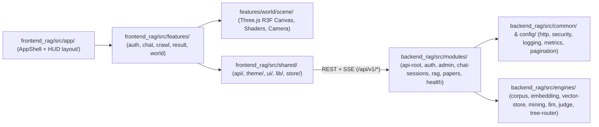

# Backend (`backend_rag`) & Frontend (`frontend_rag`) Directory Architecture Guide

- **Motivation/Background**: `RAG_TS` houses two specialized applications — a NestJS 11 + local LLM + Qdrant/MongoDB backend monolith ([`backend_rag/`](../../backend_rag/)) and a React 19 + Three.js (R3F) + Zustand + Dexie.js 3D Knowledge Tree frontend ([`frontend_rag/`](../../frontend_rag/)). As both sub-projects added clean ports-and-adapters engines, RBAC security, benchmarking harnesses, Liquid Glass design tokens, and visual regression tests, contributors need a single directory-by-directory map explaining what every folder does, why it is placed where it is, and which key files live inside it.
- **Purpose**: Document the meaning, architectural role, and key contents of every directory in `backend_rag` (BE) and `frontend_rag` (FE), complementing the per-directory `README.md` specifications (`49` BE + `62` FE).
- **Overview Pipeline**: Monorepo Directory Survey (`backend_rag/` + `frontend_rag/`) → Subsystem Architectural Classification (`modules/` vs. `engines/` vs. `common/` on BE; `app/` vs. `features/` vs. `shared/` on FE) → Per-Directory `README.md` + Barrel `index.ts` Indexing → Cross-Referenced Lookup Tables & End-to-End Request Mapping.
- **Detailed Plan**: Section 1 explains the BE and FE folder philosophy with a data-flow diagram; Section 2 documents every directory in `backend_rag/`; Section 3 documents every directory in `frontend_rag/`; Section 4 provides a task-to-directory quick-lookup matrix.
- **References**: [../../AGENTS.md](../../AGENTS.md), [../../backend_rag/AGENTS.md](../../backend_rag/AGENTS.md), [../../frontend_rag/AGENTS.md](../../frontend_rag/AGENTS.md), [../INDEX.md](../INDEX.md), [./ARCHITECTURE_OVERVIEW.md](./ARCHITECTURE_OVERVIEW.md), [../design/FE_DESIGN_SYSTEM.md](../design/FE_DESIGN_SYSTEM.md), [../../backend_rag/README.md](../../backend_rag/README.md), [../../frontend_rag/README.md](../../frontend_rag/README.md).
- **Created**: 2026-11-15T08:35:00+07:00
- **Last Updated**: 2026-11-17T17:49:00+07:00

[STATUS: ACTIVE]

---

## Table of Contents

- [1. High-Level Design Philosophy (BE vs. FE Topology)](#1-high-level-design-philosophy-be-vs-fe-topology)
- [2. Backend (`backend_rag/`) Complete Directory Guide](#2-backend-backend_rag-complete-directory-guide)
  - [2.1 Root-Level Directories (`backend_rag/*`)](#21-root-level-directories-backend_rag)
  - [2.2 Configuration & Cross-Cutting Infrastructure (`src/config/`, `src/common/`, `src/testing/`, `src/types/`)](#22-configuration--cross-cutting-infrastructure-srcconfig-srccommon-srctesting-srctypes)
  - [2.3 Core AI, Retrieval & Mining Engines (`src/engines/*`)](#23-core-ai-retrieval--mining-engines-srcengines)
  - [2.4 HTTP Feature Modules (`src/modules/*`)](#24-http-feature-modules-srcmodules)
- [3. Frontend (`frontend_rag/`) Complete Directory Guide](#3-frontend-frontend_rag-complete-directory-guide)
  - [3.1 Root-Level Directories (`frontend_rag/*`)](#31-root-level-directories-frontend_rag)
  - [3.2 Application Shell, Providers, Routing & HUD Layout (`src/app/*`)](#32-application-shell-providers-routing--hud-layout-srcapp)
  - [3.3 Feature Slices (`src/features/*`)](#33-feature-slices-srcfeatures)
  - [3.4 Shared Cross-Feature Layer (`src/shared/*`) & Cross-Cutting Test Suite (`src/test/`)](#34-shared-cross-feature-layer-srcshared--cross-cutting-test-suite-srctest)
- [4. End-to-End Task & Directory Quick Lookup](#4-end-to-end-task--directory-quick-lookup)

---

## 1. High-Level Design Philosophy (BE vs. FE Topology)

Both sub-repositories separate **transport/UI orchestration** from **domain compute** and **reusable infrastructure**:

- **Backend ([`backend_rag/`](../../backend_rag/)) — Modular Monolith + Ports & Adapters (`src/`)**:
  - [`src/modules/`](../../backend_rag/src/modules/) holds HTTP-facing business features (controllers, request/response DTOs, guards, MongoDB schemas). Every external `/api/v1/*` route originates here.
  - [`src/engines/`](../../backend_rag/src/engines/) holds heavy AI, database, and graph-mining providers behind ports (`CorpusPort`, `JudgePort`, `LLM_ENGINE`, `QDRANT_CLIENT`). Engines have **no HTTP controllers** and are injected into HTTP modules.
  - [`src/common/`](../../backend_rag/src/common/) + [`src/config/`](../../backend_rag/src/config/) hold cross-cutting NestJS infrastructure: validated environment config, JSON/XML negotiation, HATEOAS `_links`, global exception envelopes, Pino redacted logging, Prometheus `/metrics`, cursor pagination, Helmet/throttler security, and UUIDv7 helpers.
  - All `backend_rag/src/` packages export unified public barrels (`index.ts`) and every directory contains a self-contained [`README.md`](../../backend_rag/README.md) specification.
- **Frontend ([`frontend_rag/`](../../frontend_rag/)) — Feature-Sliced 3D WebGL App (`src/`)**:
  - [`src/app/`](../../frontend_rag/src/app/) assembles the root SPA shell ([`AppShell.tsx`](../../frontend_rag/src/app/AppShell.tsx)), global [`providers/`](../../frontend_rag/src/app/providers/), hash [`routers/`](../../frontend_rag/src/app/routers/), and floating Glass HUD widgets inside [`src/app/layout/`](../../frontend_rag/src/app/layout/).
  - [`src/features/`](../../frontend_rag/src/features/) isolates vertical domain slices (`auth`, `chat`, `crawl`, `result`, `world`) structured into clean `api/`, `components/`, `hooks/`, `pages/`, `store/`/`lib/` sublayers with barrel `index.ts` exports.
  - [`src/shared/`](../../frontend_rag/src/shared/) contains code shared across multiple features: HTTP/SSE client & mocks, design tokens & Liquid Glass theme system, complex/quaternion rotation math, UI glass/button/input primitives, and shared stores/types.

> [!TIP]
> **Self-Documenting Directory Tree (`112` `README.md` Specs)**: Every tracked directory across `backend_rag/` (`49` dirs) and `frontend_rag/` (`63` dirs) ships a local `README.md` containing a `MD_CONVENTION.md` 7-field header, `[STATUS: ACTIVE]` badge, subdirectory & symbol inventory table, business-flow steps + Mermaid diagram, I/O contract, architectural invariants, and verification command.



---

## 2. Backend (`backend_rag/`) Complete Directory Guide

### Full Backend Directory Tree

```text
backend_rag/
├── benchmark/                  # Production k6 load-testing suite, LLM eval sets & HTML/chart reports
│   ├── results/                # Stage A/B/C k6 JSON telemetry & PNG benchmark charts
│   │   └── v2/                 # Per-tier load-ladder & certified holdout telemetry (v2 suite)
│   └── v2/                     # Automated stepped SLA ladder runner, load driver & pool seeder
├── docker/                     # MongoDB container initialization scripts (non-root app user setup)
├── docs/                       # Subsystem specs (Auth, Logout, MongoDB, Chat Sessions, Caching)
├── scripts/                    # Operational CLIs (admin bootstrap, Qdrant test seeder, GGUF download, judge/eval runners)
├── src/                        # NestJS application TypeScript source
│   ├── common/                 # Shared cross-cutting infrastructure (no domain state)
│   │   ├── http/               # Error envelope filter, ValidationPipe setup, HATEOAS links, XML/JSON contract
│   │   ├── logging/            # Pino structured logger with secret/query redaction & per-request context
│   │   ├── metrics/            # Prometheus `/metrics` & `/api/v1/metrics` middleware + event-loop monitor
│   │   ├── pagination/         # Shared `limit`/`cursor`/`sort` query & cursor-encoding engine
│   │   ├── security/           # Helmet security headers, `trust proxy`, `escapeRegex`, `@RateLimit()` throttler
│   │   └── utils/              # RFC 9562 UUIDv7 generator/validator & Mongo duplicate-key error helpers
│   ├── config/                 # Joi/typed environment variable validation (`env.schema.ts`, `app-config.service.ts`)
│   ├── engines/                # Swappable retrieval, inference, corpus & mining providers (no controllers)
│   │   ├── corpus/             # Read-only MongoDB `rag_ts_corpus` chunk text hydrator (`CorpusService`)
│   │   ├── embedding/          # Nomic Embed Text v1.5 (768-dim) query vector encoder (`search_query:` prefix)
│   │   ├── judge/              # Laya NLI relevance & groundedness judge behind failure-safe `JudgePort`
│   │   ├── llm/                # `node-llama-cpp` GGUF inference engine, bounded queue (`429`), token splitter
│   │   ├── mining/             # Co-authorship PageRank authority & FP-Growth query-expansion engine
│   │   ├── tree-router/        # 3D Knowledge Tree topology & cluster centroid builder for FE canvas
│   │   └── vector-store/       # Read-only Qdrant vector search client (`scientific_papers_gold`)
│   ├── modules/                # HTTP REST & SSE feature modules
│   │   ├── admin/              # RBAC `admin` control panel (`decorators/`, `dto/`, `schemas/`)
│   │   ├── api-root/           # `GET /api/v1` HATEOAS hypermedia entrypoint controller
│   │   ├── auth/               # `Argon2id` auth, JWT `ver`, 1-RTT refresh rotation (`decorators/`, `dto/`, `guards/`, `schemas/`)
│   │   ├── chat-sessions/      # UUIDv7 chat CRUD, soft-delete, LRU cache & idempotency (`dto/`, `schemas/`)
│   │   ├── health/             # Readiness & dependency health checks (`dto/`)
│   │   ├── papers/             # Scientific paper metadata & citation detail lookups (`dto/`)
│   │   └── rag/                # RAG chat & SSE streaming orchestration (`dto/`, `pipeline/`, `transport/`)
│   ├── testing/                # Shared NestJS test-app & replica-set MongoDB harness helpers (`test-app.ts`)
│   └── types/                  # Shared ambient & domain TypeScript interfaces (`auth-user.ts`, `express.d.ts`, `scientific-rag.ts`)
└── test/                       # End-to-end Jest/Supertest suite (`flow.e2e-spec.ts`)
    └── support/                # In-memory Qdrant and fake LLM/embedding engines for deterministic E2E tests
```

### 2.1 Root-Level Directories (`backend_rag/*`)

| Directory | Meaning & Responsibility | Key Files |
| :--- | :--- | :--- |
| [`backend_rag/src/`](../../backend_rag/src/) | Application source root containing NestJS bootstrap, config, shared utilities, internal engines, and HTTP modules. | [`main.ts`](../../backend_rag/src/main.ts) (`UV_THREADPOOL_SIZE='4'`, keep-alive tuning), [`app.module.ts`](../../backend_rag/src/app.module.ts), [`app.setup.ts`](../../backend_rag/src/app.setup.ts) |
| [`backend_rag/docs/`](../../backend_rag/docs/) | Deep-dive technical specifications strictly scoping backend subsystems. | [`AUTH_AND_SECURITY_ARCHITECTURE.md`](../../backend_rag/docs/AUTH_AND_SECURITY_ARCHITECTURE.md), [`AUTH_LOGOUT_DESIGN.md`](../../backend_rag/docs/AUTH_LOGOUT_DESIGN.md), [`CHAT_SESSIONS_SPECIFICATION.md`](../../backend_rag/docs/CHAT_SESSIONS_SPECIFICATION.md), [`CHAT_SESSIONS_SPEC-TESTS.md`](../../backend_rag/docs/CHAT_SESSIONS_SPEC-TESTS.md), [`MONGODB_SCHEMA_DESIGN.md`](../../backend_rag/docs/MONGODB_SCHEMA_DESIGN.md), [`PERFORMANCE_AND_CACHING.md`](../../backend_rag/docs/PERFORMANCE_AND_CACHING.md) |
| [`backend_rag/scripts/`](../../backend_rag/scripts/) | Command-line automation for setup, privilege bootstrap, testing datasets, and Laya/Vector accuracy evaluation. | [`create-admin.ts`](../../backend_rag/scripts/create-admin.ts) (idempotent `npm run create:admin` CLI), [`seed-qdrant.ts`](../../backend_rag/scripts/seed-qdrant.ts) (refuses non-`_test` collections), [`download-model.ts`](../../backend_rag/scripts/download-model.ts) (fetches Qwen2.5-7B GGUF), [`serve-qwen-judge.mjs`](../../backend_rag/scripts/serve-qwen-judge.mjs), [`benchmark-laya-runner.mjs`](../../backend_rag/scripts/benchmark-laya-runner.mjs), [`benchmark-vector-runner.mjs`](../../backend_rag/scripts/benchmark-vector-runner.mjs) |
| [`backend_rag/docker/`](../../backend_rag/docker/) | Container initialization scripts for local/CI MongoDB instances. | [`mongo-init-app-user.js`](../../backend_rag/docker/mongo-init-app-user.js) (creates the least-privilege `readWrite` `rag_ts` account on initial startup) |
| [`backend_rag/benchmark/`](../../backend_rag/benchmark/) | SRE Rule L1 load-testing & Laya retrieval evaluation workspace (`250+ RPS` stress certification). | [`BOTTLENECK_ANALYSIS_AND_OPTIMIZATION.md`](../../backend_rag/benchmark/BOTTLENECK_ANALYSIS_AND_OPTIMIZATION.md), [`README.md`](../../backend_rag/benchmark/README.md), [`k6_prod_certified_holdout.ts`](../../backend_rag/benchmark/k6_prod_certified_holdout.ts), [`k6_prod_open_breakpoint.ts`](../../backend_rag/benchmark/k6_prod_open_breakpoint.ts), [`seed_prod_auth_data.js`](../../backend_rag/benchmark/seed_prod_auth_data.js) |
| [`backend_rag/benchmark/v2/`](../../backend_rag/benchmark/v2/) | Automated v2 stepped SLA ladder runner (`run_suite.mjs`) that steps load (`live`, `health`, `papers_hot`, `papers_cold`, `crud`, `crypto`, `journey`) and holds qualifying rates for 3×3 min. | [`load.ts`](../../backend_rag/benchmark/v2/load.ts), [`run_suite.mjs`](../../backend_rag/benchmark/v2/run_suite.mjs), [`seed.mjs`](../../backend_rag/benchmark/v2/seed.mjs) |
| `backend_rag/benchmark/results/` & `results/v2/` | Archival JSON summaries, process telemetry timelines, and Matplotlib PNG curves produced by v1 and v2 k6 suites. | [`prod_certified_holdout_summary.json`](../../backend_rag/benchmark/results/prod_certified_holdout_summary.json), [`certified_crud.json`](../../backend_rag/benchmark/results/v2/certified_crud.json), [`certified_crypto.json`](../../backend_rag/benchmark/results/v2/certified_crypto.json) |
| [`backend_rag/test/`](../../backend_rag/test/) | End-to-end integration test suite testing the wired NestJS application against `MongoMemoryReplSet` and API contract checks. | [`flow.e2e-spec.ts`](../../backend_rag/test/flow.e2e-spec.ts), [`jest-e2e.json`](../../backend_rag/test/jest-e2e.json), [`setup-env.ts`](../../backend_rag/test/setup-env.ts) |
| [`backend_rag/test/support/`](../../backend_rag/test/support/) | Lightweight in-memory fakes swapped into E2E DI containers so CI tests run fast without GPUs or live Qdrant servers. | [`fakes.ts`](../../backend_rag/test/support/fakes.ts) (`fakeEmbedding`, `FakeLlmEngine`, `inMemoryQdrant`) |

> [!NOTE]
> Unlisted generated/runtime folders in `backend_rag/` (`dist/`, `coverage/`, `logs/`, `node_modules/`) are gitignored build, test-coverage, log, and dependency outputs. All `49` non-result code/config/doc/test directories in `backend_rag/` include a local `README.md` spec, and all `34` `src/` directories expose a barrel `index.ts`.

---

### 2.2 Configuration & Cross-Cutting Infrastructure (`src/config/`, `src/common/`, `src/testing/`, `src/types/`)

| Directory | Meaning & Responsibility | Key Files |
| :--- | :--- | :--- |
| [`src/config/`](../../backend_rag/src/config/) | Validates startup `.env` variables and provides strongly typed config access across modules. | [`env.schema.ts`](../../backend_rag/src/config/env.schema.ts), [`app-config.service.ts`](../../backend_rag/src/config/app-config.service.ts), [`env.schema.spec.ts`](../../backend_rag/src/config/env.schema.spec.ts) |
| [`src/common/http/`](../../backend_rag/src/common/http/) | Standardizes API wire contracts: unified error JSON envelopes, strict DTO validation, HATEOAS `_links`, and JSON/XML negotiation. | [`http-exception.filter.ts`](../../backend_rag/src/common/http/http-exception.filter.ts), [`hateoas.ts`](../../backend_rag/src/common/http/hateoas.ts), [`http-contract.ts`](../../backend_rag/src/common/http/http-contract.ts), [`validation.ts`](../../backend_rag/src/common/http/validation.ts), [`xml.ts`](../../backend_rag/src/common/http/xml.ts) |
| [`src/common/logging/`](../../backend_rag/src/common/logging/) | Structured Pino request logging that automatically redacts sensitive headers/passwords/queries and binds per-request tracing fields. | [`logger.module.ts`](../../backend_rag/src/common/logging/logger.module.ts), [`request-context.ts`](../../backend_rag/src/common/logging/request-context.ts) |
| [`src/common/metrics/`](../../backend_rag/src/common/metrics/) | In-process Prometheus telemetry middleware tracking request histograms, active actors, SSE stream counts, and event-loop lag at `/metrics` and `/api/v1/metrics`. | [`prometheus-metrics.ts`](../../backend_rag/src/common/metrics/prometheus-metrics.ts), [`prometheus-metrics.spec.ts`](../../backend_rag/src/common/metrics/prometheus-metrics.spec.ts) |
| [`src/common/pagination/`](../../backend_rag/src/common/pagination/) | Implements the shared cursor, limit, and sorting grammar defined in [`docs/api/API_DESIGN.md`](../api/API_DESIGN.md). | [`pagination.ts`](../../backend_rag/src/common/pagination/pagination.ts), [`pagination.spec.ts`](../../backend_rag/src/common/pagination/pagination.spec.ts) |
| [`src/common/security/`](../../backend_rag/src/common/security/) | Global HTTP hardening: Helmet headers, `TRUST_PROXY_HOPS` handling, `@RateLimit()` throttler configuration, and `escapeRegex()` ReDoS protection. | [`security.ts`](../../backend_rag/src/common/security/security.ts), [`throttler.ts`](../../backend_rag/src/common/security/throttler.ts), [`sanitize.ts`](../../backend_rag/src/common/security/sanitize.ts) |
| [`src/common/utils/`](../../backend_rag/src/common/utils/) | Low-level pure helpers for time-ordered RFC 9562 UUIDv7 keys and MongoDB duplicate-key detection (`E11000`). | [`uuid.ts`](../../backend_rag/src/common/utils/uuid.ts), [`mongo-errors.ts`](../../backend_rag/src/common/utils/mongo-errors.ts) |
| [`src/testing/`](../../backend_rag/src/testing/) | Shared unit/integration bootstrap helpers (e.g., starting `MongoMemoryReplSet` and `seedUser()` helpers). | [`test-app.ts`](../../backend_rag/src/testing/test-app.ts) |
| [`src/types/`](../../backend_rag/src/types/) | Shared TypeScript interfaces and Express `Request` type augmentations used across both `modules/` and `engines/`. | [`auth-user.ts`](../../backend_rag/src/types/auth-user.ts), [`express.d.ts`](../../backend_rag/src/types/express.d.ts), [`scientific-rag.ts`](../../backend_rag/src/types/scientific-rag.ts) |

---

### 2.3 Core AI, Retrieval & Mining Engines (`src/engines/*`)

| Directory | Meaning & Responsibility | Key Files |
| :--- | :--- | :--- |
| [`src/engines/corpus/`](../../backend_rag/src/engines/corpus/) | Connects read-only to the `rag_ts_corpus` MongoDB database (`CORPUS_MONGO_URI`) to hydrate chunk text, section titles, and authors separated from Qdrant payloads. | [`corpus.module.ts`](../../backend_rag/src/engines/corpus/corpus.module.ts), [`corpus.service.ts`](../../backend_rag/src/engines/corpus/corpus.service.ts) |
| [`src/engines/embedding/`](../../backend_rag/src/engines/embedding/) | Generates 768-dimensional dense query vectors via Nomic Embed Text v1.5 with mandatory `search_query: ` prefixing. | [`embedding.module.ts`](../../backend_rag/src/engines/embedding/embedding.module.ts), [`embedding.service.ts`](../../backend_rag/src/engines/embedding/embedding.service.ts) |
| [`src/engines/vector-store/`](../../backend_rag/src/engines/vector-store/) | Read-only Qdrant vector database client querying `scientific_papers_gold` (never mutates or drops collections). | [`vector-store.module.ts`](../../backend_rag/src/engines/vector-store/vector-store.module.ts), [`vector-store.service.ts`](../../backend_rag/src/engines/vector-store/vector-store.service.ts) |
| [`src/engines/mining/`](../../backend_rag/src/engines/mining/) | Loads co-authorship PageRank authority scores and FP-Growth association rules to expand queries and re-score candidate papers. | [`mining.module.ts`](../../backend_rag/src/engines/mining/mining.module.ts), [`mining.service.ts`](../../backend_rag/src/engines/mining/mining.service.ts), [`name-normalizer.ts`](../../backend_rag/src/engines/mining/name-normalizer.ts) |
| [`src/engines/llm/`](../../backend_rag/src/engines/llm/) | Runs local GGUF models via `node-llama-cpp`, bounds concurrency via semaphore queue (returning `429` on overload), and parses reasoning vs. answer channels. | [`llm.module.ts`](../../backend_rag/src/engines/llm/llm.module.ts), [`llm.service.ts`](../../backend_rag/src/engines/llm/llm.service.ts), [`llm-engine.ts`](../../backend_rag/src/engines/llm/llm-engine.ts), [`llm-queue.ts`](../../backend_rag/src/engines/llm/llm-queue.ts), [`token-channel.ts`](../../backend_rag/src/engines/llm/token-channel.ts) |
| [`src/engines/judge/`](../../backend_rag/src/engines/judge/) | Evaluates chunk relevance and answer groundedness with `@receptron/laya`; gracefully returns `null` if disabled or overloaded so chat never fails. | [`judge.module.ts`](../../backend_rag/src/engines/judge/judge.module.ts), [`judge.service.ts`](../../backend_rag/src/engines/judge/judge.service.ts) |
| [`src/engines/tree-router/`](../../backend_rag/src/engines/tree-router/) | Builds and serves the 3D Knowledge Tree hierarchy, category clusters, and spatial metadata consumed by the frontend 3D scene (`GET /world/tree`). | [`tree-router.module.ts`](../../backend_rag/src/engines/tree-router/tree-router.module.ts), [`tree-router.service.ts`](../../backend_rag/src/engines/tree-router/tree-router.service.ts) |

---

### 2.4 HTTP Feature Modules (`src/modules/*`)

| Directory | Meaning & Responsibility | Subfolders & Key Files |
| :--- | :--- | :--- |
| [`src/modules/api-root/`](../../backend_rag/src/modules/api-root/) | Exposes `GET /api/v1` returning API metadata and HATEOAS `_links` for discoverable REST navigation. | [`api-root.controller.ts`](../../backend_rag/src/modules/api-root/api-root.controller.ts) |
| [`src/modules/auth/`](../../backend_rag/src/modules/auth/) | Full user authentication lifecycle: `Argon2id` registration/login/password changes, `token_version` (`ver`) invalidation, progressive login lockout, 1-RTT atomic refresh rotation with family reuse detection, and LRU user caches. | • **`decorators/`**: [`current-user.decorator.ts`](../../backend_rag/src/modules/auth/decorators/current-user.decorator.ts)<br>• **`dto/`**: [`auth.dto.ts`](../../backend_rag/src/modules/auth/dto/auth.dto.ts)<br>• **`guards/`**: [`jwt-auth.guard.ts`](../../backend_rag/src/modules/auth/guards/jwt-auth.guard.ts), [`roles.guard.ts`](../../backend_rag/src/modules/auth/guards/roles.guard.ts)<br>• **`schemas/`**: [`user.schema.ts`](../../backend_rag/src/modules/auth/schemas/user.schema.ts), [`refresh-token.schema.ts`](../../backend_rag/src/modules/auth/schemas/refresh-token.schema.ts), [`login-attempt.schema.ts`](../../backend_rag/src/modules/auth/schemas/login-attempt.schema.ts)<br>• **Core**: [`auth.controller.ts`](../../backend_rag/src/modules/auth/auth.controller.ts), [`users.controller.ts`](../../backend_rag/src/modules/auth/users.controller.ts), [`auth.service.ts`](../../backend_rag/src/modules/auth/auth.service.ts), [`token.service.ts`](../../backend_rag/src/modules/auth/token.service.ts), [`common-passwords.ts`](../../backend_rag/src/modules/auth/common-passwords.ts) |
| [`src/modules/admin/`](../../backend_rag/src/modules/admin/) | 13-route RBAC (`admin`-only) operational & user-governance surface with self-lockout/last-admin guards and an append-only audit trail. | • **`decorators/`**: [`audit-context.decorator.ts`](../../backend_rag/src/modules/admin/decorators/audit-context.decorator.ts)<br>• **`dto/`**: [`admin.dto.ts`](../../backend_rag/src/modules/admin/dto/admin.dto.ts)<br>• **`schemas/`**: [`admin-audit-log.schema.ts`](../../backend_rag/src/modules/admin/schemas/admin-audit-log.schema.ts)<br>• **Core**: [`admin.controller.ts`](../../backend_rag/src/modules/admin/admin.controller.ts), [`admin-identity.service.ts`](../../backend_rag/src/modules/admin/admin-identity.service.ts), [`admin-ops.service.ts`](../../backend_rag/src/modules/admin/admin-ops.service.ts), [`admin-audit.service.ts`](../../backend_rag/src/modules/admin/admin-audit.service.ts), [`assert-admin.ts`](../../backend_rag/src/modules/admin/assert-admin.ts) |
| [`src/modules/chat-sessions/`](../../backend_rag/src/modules/chat-sessions/) | Manages UUIDv7 chat sessions & messages with cursor pagination, regex search, soft-delete (`deleted_at: null`), generation-versioned LRU caches, Singleflight coalescing, and `Idempotency-Key` request locking. | • **`dto/`**: [`chat-session.dto.ts`](../../backend_rag/src/modules/chat-sessions/dto/chat-session.dto.ts)<br>• **`schemas/`**: [`chat-session.schema.ts`](../../backend_rag/src/modules/chat-sessions/schemas/chat-session.schema.ts), [`chat-message.schema.ts`](../../backend_rag/src/modules/chat-sessions/schemas/chat-message.schema.ts), [`chat-request.schema.ts`](../../backend_rag/src/modules/chat-sessions/schemas/chat-request.schema.ts)<br>• **Core**: [`chat-sessions.controller.ts`](../../backend_rag/src/modules/chat-sessions/chat-sessions.controller.ts), [`chat-sessions.service.ts`](../../backend_rag/src/modules/chat-sessions/chat-sessions.service.ts), [`chat-requests.service.ts`](../../backend_rag/src/modules/chat-sessions/chat-requests.service.ts), [`session-store.port.ts`](../../backend_rag/src/modules/chat-sessions/session-store.port.ts) |
| [`src/modules/rag/`](../../backend_rag/src/modules/rag/) | Orchestrates synchronous (`POST /rag/chat`) and streamed (`POST /rag/chat/stream`) scientific RAG: embedding + vector search + corpus hydration + mining + judge + grounded LLM generation. | • **`dto/`**: [`chat-request.dto.ts`](../../backend_rag/src/modules/rag/dto/chat-request.dto.ts), [`chat-response.dto.ts`](../../backend_rag/src/modules/rag/dto/chat-response.dto.ts)<br>• **`pipeline/`**: [`citations.ts`](../../backend_rag/src/modules/rag/pipeline/citations.ts), [`prompt-builder.ts`](../../backend_rag/src/modules/rag/pipeline/prompt-builder.ts), [`ranking.ts`](../../backend_rag/src/modules/rag/pipeline/ranking.ts), [`request-fingerprint.ts`](../../backend_rag/src/modules/rag/pipeline/request-fingerprint.ts)<br>• **`transport/`**: [`sse.ts`](../../backend_rag/src/modules/rag/transport/sse.ts) (Express `SseWriter` with keep-alive pings), [`client-slots.ts`](../../backend_rag/src/modules/rag/transport/client-slots.ts) (per-client concurrent stream caps)<br>• **Core**: [`rag.controller.ts`](../../backend_rag/src/modules/rag/rag.controller.ts), [`rag.service.ts`](../../backend_rag/src/modules/rag/rag.service.ts) |
| [`src/modules/papers/`](../../backend_rag/src/modules/papers/) | Serves scientific paper detail cards and citation metadata lookups from Qdrant/corpus stores (`GET /papers/:id`). | • **`dto/`**: [`paper-detail.dto.ts`](../../backend_rag/src/modules/papers/dto/paper-detail.dto.ts)<br>• **Core**: [`papers.controller.ts`](../../backend_rag/src/modules/papers/papers.controller.ts), [`papers.service.ts`](../../backend_rag/src/modules/papers/papers.service.ts) |
| [`src/modules/health/`](../../backend_rag/src/modules/health/) | Dependency readiness probe (`GET /api/v1/health`) reporting MongoDB, Qdrant, embedding, and LLM availability. | • **`dto/`**: [`health.dto.ts`](../../backend_rag/src/modules/health/dto/health.dto.ts)<br>• **Core**: [`health.controller.ts`](../../backend_rag/src/modules/health/health.controller.ts), [`health.service.ts`](../../backend_rag/src/modules/health/health.service.ts) |

---

## 3. Frontend (`frontend_rag/`) Complete Directory Guide

### Full Frontend Directory Tree

```text
frontend_rag/
├── dist/                       # Pre-built production Vite static bundle (JS chunks, CSS, KaTeX fonts)
├── docs/                       # Frontend state/streaming, Web Vitals, trig audit & design migration reports
│   ├── perf-shots/             # Captured WebGL performance comparison images
│   │   └── raw/                # Raw JSON frame-time & LongTask benchmark captures (P15–P22)
│   └── screenshots/            # Before/after light & dark UI verification screenshots
├── e2e/                        # Playwright E2E functional & screenshot regression tests
│   ├── _scratch/               # Isolated Playwright reproduction specs (look, signed-out, stripes)
│   └── visual.spec.ts-snapshots/ # Baseline PNG golden snapshots for `test:visual`
├── public/                     # Static assets copied verbatim to build root (`favicon.svg`)
├── scripts/                    # Tooling: design-token gate (`check-design.cjs`), headless captures & benchmarks
├── src/                        # React 19 + TypeScript + Three.js (R3F) source code
│   ├── app/                    # Application entrypoint shell, providers, hash router & viewport HUD
│   │   ├── layout/             # Floating HUD chrome (TopBar, ChatDock, SettingsPanel, CategoryLegend, etc.)
│   │   ├── providers/          # Global app providers wrapper (`AppProviders.tsx`: CSS vars, SVG filters, health)
│   │   └── routers/            # Lightweight hash-route resolver (`AppRouter.tsx`, `resolveAppRoute`)
│   ├── features/               # Vertical business & 3D feature slices (each exposing barrel `index.ts`)
│   │   ├── auth/               # Login/registration overlay, JWT store + `api/`, `components/`, `hooks/`, `pages/`
│   │   ├── chat/               # Scientific RAG chat (`api/`, `components/`, `db/`, `hooks/`, `lib/`, `pages/`, `store/`)
│   │   ├── crawl/              # Live paper ingestion (`api/`, `components/`, `hooks/`, `pages/`, SSE client, particle FX)
│   │   ├── result/             # Grounded paper inspector (`api/`, `components/`, `hooks/`, `lib/`, `pages/`, panels)
│   │   └── world/              # Procedural 3D Knowledge Tree (`api/`, `components/`, `hooks/`, `lib/`, `pages/`, `scene/`, `store/`)
│   │       ├── api/            # Binary/compact vector parser (`vectorParser.ts`) & RAG-to-3D event bridge
│   │       ├── components/     # Overlay camera preset bar (`CameraPresetBar.tsx`)
│   │       ├── hooks/          # Reactive camera-control hook (`useWorldCamera.ts`)
│   │       ├── lib/            # Pure spatial/tree/camera/canopy math & LOD utilities
│   │       ├── pages/          # Standalone 3D world canvas page wrapper (`WorldScenePage.tsx`)
│   │       ├── scene/          # Core `<Canvas>`, Lighting, PostFX Bloom, Sky Dome & CameraDirector
│   │       │   ├── canopy/     # 150k point-cloud `VectorCanopy`, GLSL shader & hover tooltips
│   │       │   ├── fx/         # GPU visual FX (TopK threads, QueryOrb flight, Fireflies, FeedCables, CrawlFX)
│   │       │   ├── ground/     # Translucent Glass `GroundGrid` & hanging `KnowledgeBlocks` crates
│   │       │   ├── overlay/    # HTML overlays coupled outside `<Canvas>` (`PerfHUD` FPS + camera tracker)
│   │       │   └── tree/       # Merged wooden `AncientTree` (`Trunk`, `Branches`, `Roots`, `SapFlow`, labels)
│   │       └── store/          # `worldStore.ts` (vectors, categories, filters) & `fxStore.ts` (animations)
│   ├── shared/                 # Cross-feature reusable modules (every sublayer exports `index.ts`)
│   │   ├── api/                # REST + SSE client, retry/HTTP helpers, stream parser & config
│   │   │   └── mock/           # Deterministic offline mock generators (`mockWorld`, `mockChat`, `mockCrawl`)
│   │   ├── hooks/              # Generic React hooks (`useIsMobile.ts`)
│   │   ├── lib/                # Pure utilities: complex/quaternion `rotation.ts`, `uuid.ts`, `rng.ts`, `perfProbe.ts`
│   │   ├── store/              # Global UI state (`uiStore.ts`: theme, drawers, camera mode, quality settings)
│   │   ├── theme/              # Light/dark tokens, Liquid Glass refraction maps, WCAG contrast checks & CSS var sync
│   │   ├── types/              # Shared TypeScript domain contracts (`rag.ts`, `world.ts`)
│   │   └── ui/                 # Reusable UI & Liquid Glass primitives (`Glass.tsx`, `LiquidShell.tsx`, `buttons.tsx`, `input.tsx`)
│   └── test/                   # Vitest setup, `featureModules.test.tsx`, cross-feature suites & microbenchmarks
└── test-results/               # Tracked/local Playwright visual diff artifacts & traces from visual test runs
```

> [!NOTE]
> Every sub-layer across `src/app/*`, `src/features/*/{api,components,hooks,pages}`, and `src/shared/*` is now populated with typed modules, unified barrel `index.ts` exports, and local per-directory `README.md` specifications. All duplicated `Chat*` copies previously left in non-chat features have been removed and covered by [`src/test/featureModules.test.tsx`](../../frontend_rag/src/test/featureModules.test.tsx).

### 3.1 Root-Level Directories (`frontend_rag/*`)

| Directory | Meaning & Responsibility | Key Files |
| :--- | :--- | :--- |
| [`frontend_rag/src/`](../../frontend_rag/src/) | All React 19, Tailwind CSS, TypeScript, and Three.js source files (`main.tsx`, `index.css`, `vite-env.d.ts`). | [`main.tsx`](../../frontend_rag/src/main.tsx), [`index.css`](../../frontend_rag/src/index.css) |
| [`frontend_rag/public/`](../../frontend_rag/public/) | Static files served directly at `/` without Vite bundling. | [`favicon.svg`](../../frontend_rag/public/favicon.svg) |
| [`frontend_rag/docs/`](../../frontend_rag/docs/) | Frontend architecture, state streaming, Web Vitals, shader trig audits, and design migration logs. | [`STATE_AND_STREAMING_ARCHITECTURE.md`](../../frontend_rag/docs/STATE_AND_STREAMING_ARCHITECTURE.md), [`design-migration-report.md`](../../frontend_rag/docs/design-migration-report.md), [`perf-chat-report.md`](../../frontend_rag/docs/perf-chat-report.md), [`perf-report.md`](../../frontend_rag/docs/perf-report.md), [`trig-audit.md`](../../frontend_rag/docs/trig-audit.md) |
| [`frontend_rag/docs/perf-shots/`](../../frontend_rag/docs/perf-shots/) & `raw/` | Visual captures and raw JSON frame-time/LongTask telemetry snapshots comparing P15–P22 optimization passes. | `perf-before.json`, `perf-after.json`, `cmp-light-overview.jpg` |
| [`frontend_rag/docs/screenshots/`](../../frontend_rag/docs/screenshots/) | Before/after overview & ground verification screenshots across dark and light modes. | `after-light-overview.png`, `after-dark-overview.png` |
| [`frontend_rag/e2e/`](../../frontend_rag/e2e/) | Playwright end-to-end integration tests (`auth.spec.ts`, `knowledge-tree.spec.ts`) and Liquid Glass visual regression tests (`visual.spec.ts`). | [`auth.spec.ts`](../../frontend_rag/e2e/auth.spec.ts), [`knowledge-tree.spec.ts`](../../frontend_rag/e2e/knowledge-tree.spec.ts), [`visual.spec.ts`](../../frontend_rag/e2e/visual.spec.ts), [`helpers.ts`](../../frontend_rag/e2e/helpers.ts) |
| `e2e/visual.spec.ts-snapshots/` & `e2e/_scratch/` | Baseline Chromium golden PNG snapshots compared by `npm run test:visual`, plus targeted scratch specs for glass/layout reproduction. | `01-overview-lg2-chromium-darwin.png`, [`look.spec.ts`](../../frontend_rag/e2e/_scratch/look.spec.ts) |
| [`frontend_rag/scripts/`](../../frontend_rag/scripts/) | Node & Python tooling enforcing design rules (`check-design.cjs --strict`), capturing headless high-quality UI screenshots, plotting palette matrices, and benchmarking FPS. | [`check-design.cjs`](../../frontend_rag/scripts/check-design.cjs), [`capture_ui.cjs`](../../frontend_rag/scripts/capture_ui.cjs), [`generate_comparison_plots.py`](../../frontend_rag/scripts/generate_comparison_plots.py), [`perf-measure.cjs`](../../frontend_rag/scripts/perf-measure.cjs), [`perf-chat-benchmark.cjs`](../../frontend_rag/scripts/perf-chat-benchmark.cjs), [`cable-shots.cjs`](../../frontend_rag/scripts/cable-shots.cjs) |
| [`frontend_rag/dist/`](../../frontend_rag/dist/) & [`test-results/`](../../frontend_rag/test-results/) | `dist/` stores the pre-built production bundle + bundled KaTeX font assets in Git; `test-results/` holds Playwright visual failure diffs (`actual`, `expected`, `diff`, `trace.zip`). | [`dist/index.html`](../../frontend_rag/dist/index.html) |

---

### 3.2 Application Shell, Providers, Routing & HUD Layout (`src/app/*`)

| Directory | Meaning & Responsibility | Key Files |
| :--- | :--- | :--- |
| [`src/app/`](../../frontend_rag/src/app/) | Top-level application bootstrap and layout composition: mounts the 3D `WorldCanvas` in parallel, handles auth modal gating, wires HUD docks, and re-exports app entrypoints via [`index.ts`](../../frontend_rag/src/app/index.ts). | [`App.tsx`](../../frontend_rag/src/app/App.tsx), [`AppShell.tsx`](../../frontend_rag/src/app/AppShell.tsx), [`index.ts`](../../frontend_rag/src/app/index.ts) |
| [`src/app/layout/`](../../frontend_rag/src/app/layout/) | Individual floating Glass HUD controls anchored to viewport edges without blocking the WebGL canvas. | [`TopBar.tsx`](../../frontend_rag/src/app/layout/TopBar.tsx) (brand + backend status + theme/settings), [`ChatDock.tsx`](../../frontend_rag/src/app/layout/ChatDock.tsx), [`BottomSheet.tsx`](../../frontend_rag/src/app/layout/BottomSheet.tsx) (mobile drawer), [`CategoryLegend.tsx`](../../frontend_rag/src/app/layout/CategoryLegend.tsx), [`FilterChip.tsx`](../../frontend_rag/src/app/layout/FilterChip.tsx), [`HealthBanner.tsx`](../../frontend_rag/src/app/layout/HealthBanner.tsx), [`SettingsPanel.tsx`](../../frontend_rag/src/app/layout/SettingsPanel.tsx), [`ThemeToggle.tsx`](../../frontend_rag/src/app/layout/ThemeToggle.tsx), [`WorldError.tsx`](../../frontend_rag/src/app/layout/WorldError.tsx), [`YearSlider.tsx`](../../frontend_rag/src/app/layout/YearSlider.tsx), [`introDelay.ts`](../../frontend_rag/src/app/layout/introDelay.ts) |
| [`src/app/providers/`](../../frontend_rag/src/app/providers/) | Global React context & lifecycle wrapper coordinating design-token CSS variable injection (`applyCssVars`), `<LiquidFilters />`, and backend readiness listeners. | [`AppProviders.tsx`](../../frontend_rag/src/app/providers/AppProviders.tsx), [`index.ts`](../../frontend_rag/src/app/providers/index.ts) |
| [`src/app/routers/`](../../frontend_rag/src/app/routers/) | Lightweight hash-based view switcher mapping `#auth`, `#chat`, `#crawl`, `#result`, and `#world` routes cleanly alongside the main `<AppShell />`. | [`AppRouter.tsx`](../../frontend_rag/src/app/routers/AppRouter.tsx) (`resolveAppRoute`), [`index.ts`](../../frontend_rag/src/app/routers/index.ts) |

---

### 3.3 Feature Slices (`src/features/*`)

#### Authentication, Chat, Crawl & Result Features (`src/features/{auth,chat,crawl,result}/*`)

| Directory | Meaning & Responsibility | Key Files |
| :--- | :--- | :--- |
| [`src/features/auth/`](../../frontend_rag/src/features/auth/) | JWT authentication UI and session state (`user`, access/refresh flow, guest/authenticated gating), organized into [`api/`](../../frontend_rag/src/features/auth/api/), [`components/`](../../frontend_rag/src/features/auth/components/), [`hooks/`](../../frontend_rag/src/features/auth/hooks/), and [`pages/`](../../frontend_rag/src/features/auth/pages/). | [`AuthOverlay.tsx`](../../frontend_rag/src/features/auth/AuthOverlay.tsx), [`authStore.ts`](../../frontend_rag/src/features/auth/authStore.ts), [`authApi.ts`](../../frontend_rag/src/features/auth/api/authApi.ts), [`AuthStatusBadge.tsx`](../../frontend_rag/src/features/auth/components/AuthStatusBadge.tsx), [`useAuth.ts`](../../frontend_rag/src/features/auth/hooks/useAuth.ts), [`AuthPage.tsx`](../../frontend_rag/src/features/auth/pages/AuthPage.tsx), [`index.ts`](../../frontend_rag/src/features/auth/index.ts) |
| [`src/features/chat/`](../../frontend_rag/src/features/chat/) (`api/`, `components/`, `db/`, `hooks/`, `lib/`, `pages/`, `store/`) | Complete multi-turn RAG chat workspace: REST session API wrappers (`chatApi.ts`), Glass chat UI, streaming Markdown/KaTeX renderer (`useDeferredValue`), offline-first `Dexie.js` schema (`chatDb.ts`), Remark citation AST mapper, workspace hook (`useChatWorkspace`), standalone page (`ChatPage`), and `ragStore`/`sessionStore` (`30ms` token batching). | [`chatApi.ts`](../../frontend_rag/src/features/chat/api/chatApi.ts), [`ChatPanel.tsx`](../../frontend_rag/src/features/chat/components/ChatPanel.tsx), [`CitationChip.tsx`](../../frontend_rag/src/features/chat/components/CitationChip.tsx), [`HistoryDrawer.tsx`](../../frontend_rag/src/features/chat/components/HistoryDrawer.tsx), [`chatDb.ts`](../../frontend_rag/src/features/chat/db/chatDb.ts), [`useChatWorkspace.ts`](../../frontend_rag/src/features/chat/hooks/useChatWorkspace.ts), [`remarkCitations.ts`](../../frontend_rag/src/features/chat/lib/remarkCitations.ts), [`ChatPage.tsx`](../../frontend_rag/src/features/chat/pages/ChatPage.tsx), [`ragStore.ts`](../../frontend_rag/src/features/chat/store/ragStore.ts), [`sessionStore.ts`](../../frontend_rag/src/features/chat/store/sessionStore.ts) |
| [`src/features/crawl/`](../../frontend_rag/src/features/crawl/) (`api/`, `components/`, `hooks/`, `pages/`) | Live data-ingestion HUD controls: typed SSE status/stream client, exponential-backoff reconnect (`crawlClient.ts`), `BatchAggregator`, compact metrics card, telemetry hook, dashboard page, and 3D particle bursts into tree roots. | [`CrawlSettings.tsx`](../../frontend_rag/src/features/crawl/CrawlSettings.tsx), [`crawlClient.ts`](../../frontend_rag/src/features/crawl/crawlClient.ts), [`crawlStore.ts`](../../frontend_rag/src/features/crawl/crawlStore.ts), [`crawlApi.ts`](../../frontend_rag/src/features/crawl/api/crawlApi.ts), [`CrawlMetricsRow.tsx`](../../frontend_rag/src/features/crawl/components/CrawlMetricsRow.tsx), [`useCrawlTelemetry.ts`](../../frontend_rag/src/features/crawl/hooks/useCrawlTelemetry.ts), [`CrawlDashboardPage.tsx`](../../frontend_rag/src/features/crawl/pages/CrawlDashboardPage.tsx) |
| [`src/features/result/`](../../frontend_rag/src/features/result/) (`api/`, `components/`, `hooks/`, `lib/`, `pages/`) | Right-side paper inspection drawer showing retrieved chunks, cosine/PageRank/hybrid scores, unverified citation warnings, REST detail/batch adapters, inspector hook, and page wrapper. | [`PaperPanel.tsx`](../../frontend_rag/src/features/result/PaperPanel.tsx), [`ScoreBars.tsx`](../../frontend_rag/src/features/result/ScoreBars.tsx), [`usePaper.ts`](../../frontend_rag/src/features/result/usePaper.ts), [`resultApi.ts`](../../frontend_rag/src/features/result/api/resultApi.ts), [`ResultSummaryHeader.tsx`](../../frontend_rag/src/features/result/components/ResultSummaryHeader.tsx), [`usePaperInspector.ts`](../../frontend_rag/src/features/result/hooks/usePaperInspector.ts), [`arxiv.ts`](../../frontend_rag/src/features/result/lib/arxiv.ts), [`ResultInspectorPage.tsx`](../../frontend_rag/src/features/result/pages/ResultInspectorPage.tsx) |

#### 3D Knowledge Tree Feature (`src/features/world/*`)

| Directory | Meaning & Responsibility | Key Files |
| :--- | :--- | :--- |
| [`src/features/world/`](../../frontend_rag/src/features/world/) | Feature entrypoint re-exporting world components, hooks, pages, lib math, scene canvas, and stores. | [`index.ts`](../../frontend_rag/src/features/world/index.ts), [`README.md`](../../frontend_rag/src/features/world/README.md) |
| [`src/features/world/api/`](../../frontend_rag/src/features/world/api/) | Decodes world tree/vector payloads into flat typed arrays and bridges RAG chat events (retrieved top-K papers, active route) into 3D visual animations. | [`vectorParser.ts`](../../frontend_rag/src/features/world/api/vectorParser.ts), [`worldBridge.ts`](../../frontend_rag/src/features/world/api/worldBridge.ts) |
| [`src/features/world/components/`](../../frontend_rag/src/features/world/components/) | 2D overlay camera preset controls coupled cleanly outside WebGL. | [`CameraPresetBar.tsx`](../../frontend_rag/src/features/world/components/CameraPresetBar.tsx) |
| [`src/features/world/hooks/`](../../frontend_rag/src/features/world/hooks/) | Reactive camera preset & reset hook syncing UI state with `CameraDirector`. | [`useWorldCamera.ts`](../../frontend_rag/src/features/world/hooks/useWorldCamera.ts) |
| [`src/features/world/pages/`](../../frontend_rag/src/features/world/pages/) | Fullscreen standalone 3D world canvas & overlay page wrapper. | [`WorldScenePage.tsx`](../../frontend_rag/src/features/world/pages/WorldScenePage.tsx) |
| [`src/features/world/lib/`](../../frontend_rag/src/features/world/lib/) | Pure deterministic 3D geometry, layout, camera preset rotors, sun elevation vector, flight splines, spatial grid hashing, and LOD math (tested independently in Vitest). | [`cameraPresets.ts`](../../frontend_rag/src/features/world/lib/cameraPresets.ts) (`overview` `-5°`/`-40°` default), [`treeGeometry.ts`](../../frontend_rag/src/features/world/lib/treeGeometry.ts), [`canopy.ts`](../../frontend_rag/src/features/world/lib/canopy.ts), [`groundLayout.ts`](../../frontend_rag/src/features/world/lib/groundLayout.ts), [`sun.ts`](../../frontend_rag/src/features/world/lib/sun.ts), [`flight.ts`](../../frontend_rag/src/features/world/lib/flight.ts), [`lod.ts`](../../frontend_rag/src/features/world/lib/lod.ts), [`spatialGrid.ts`](../../frontend_rag/src/features/world/lib/spatialGrid.ts) |
| [`src/features/world/store/`](../../frontend_rag/src/features/world/store/) | Stores loaded 3D paper vectors/categories/filters (`worldStore`) and real-time flight/highlight FX state (`fxStore`). | [`worldStore.ts`](../../frontend_rag/src/features/world/store/worldStore.ts), [`fxStore.ts`](../../frontend_rag/src/features/world/store/fxStore.ts) |
| [`src/features/world/scene/`](../../frontend_rag/src/features/world/scene/) | Core React Three Fiber `<Canvas>` host, Rayleigh sky + cumulus cloud dome, directional lighting, selective Bloom post-processing, camera controller, and adaptive quality scaler. | [`WorldCanvas.tsx`](../../frontend_rag/src/features/world/scene/WorldCanvas.tsx), [`CameraDirector.tsx`](../../frontend_rag/src/features/world/scene/CameraDirector.tsx) (`__rktCameraPose` + `[CAMERA POSE]` logger), [`SkyBackground.tsx`](../../frontend_rag/src/features/world/scene/SkyBackground.tsx), [`Lighting.tsx`](../../frontend_rag/src/features/world/scene/Lighting.tsx), [`PostFX.tsx`](../../frontend_rag/src/features/world/scene/PostFX.tsx), [`AdaptiveQuality.tsx`](../../frontend_rag/src/features/world/scene/AdaptiveQuality.tsx) |
| [`src/features/world/scene/canopy/`](../../frontend_rag/src/features/world/scene/canopy/) | Renders up to 150k scientific paper points as GPU flower/star particles with early frustum clipping shaders and hover tooltips. | [`VectorCanopy.tsx`](../../frontend_rag/src/features/world/scene/canopy/VectorCanopy.tsx), [`canopyShader.ts`](../../frontend_rag/src/features/world/scene/canopy/canopyShader.ts), [`VectorTooltip.tsx`](../../frontend_rag/src/features/world/scene/canopy/VectorTooltip.tsx) |
| [`src/features/world/scene/fx/`](../../frontend_rag/src/features/world/scene/fx/) | Real-time 3D visual effects tracing RAG queries from the query orb through branches to cited papers and animating live crawls. | [`QueryFlight.tsx`](../../frontend_rag/src/features/world/scene/fx/QueryFlight.tsx), [`QueryOrb.tsx`](../../frontend_rag/src/features/world/scene/fx/QueryOrb.tsx), [`TopKThreads.tsx`](../../frontend_rag/src/features/world/scene/fx/TopKThreads.tsx), [`CompareThreads.tsx`](../../frontend_rag/src/features/world/scene/fx/CompareThreads.tsx), [`FeedCables.tsx`](../../frontend_rag/src/features/world/scene/fx/FeedCables.tsx), [`Fireflies.tsx`](../../frontend_rag/src/features/world/scene/fx/Fireflies.tsx), [`CrawlEffects.tsx`](../../frontend_rag/src/features/world/scene/fx/CrawlEffects.tsx) |
| [`src/features/world/scene/ground/`](../../frontend_rag/src/features/world/scene/ground/) | Builds the white-seamed glass platform floor (`GroundGrid`) and translucent hanging category crates (`KnowledgeBlocks`) underneath the tree. | [`GroundGrid.tsx`](../../frontend_rag/src/features/world/scene/ground/GroundGrid.tsx), [`KnowledgeBlocks.tsx`](../../frontend_rag/src/features/world/scene/ground/KnowledgeBlocks.tsx) |
| [`src/features/world/scene/overlay/`](../../frontend_rag/src/features/world/scene/overlay/) | DOM HUD elements projected from 3D world positions or rendered cleanly outside `<Canvas>` (to honor the R3F reconciler boundary): FPS telemetry, quality tier toggles, and live `Copy Pose` camera coordinates. | [`PerfHUD.tsx`](../../frontend_rag/src/features/world/scene/overlay/PerfHUD.tsx), [`WorldOverlay.tsx`](../../frontend_rag/src/features/world/scene/overlay/WorldOverlay.tsx), [`CompareScoreLabel.tsx`](../../frontend_rag/src/features/world/scene/overlay/CompareScoreLabel.tsx), [`anchors.tsx`](../../frontend_rag/src/features/world/scene/overlay/anchors.tsx) |
| [`src/features/world/scene/tree/`](../../frontend_rag/src/features/world/scene/tree/) | Procedural wooden Knowledge Tree meshes: merged trunk, branches, roots, glowing sap veins, and category branch labels. | [`AncientTree.tsx`](../../frontend_rag/src/features/world/scene/tree/AncientTree.tsx), [`Branches.tsx`](../../frontend_rag/src/features/world/scene/tree/Branches.tsx), [`Trunk.tsx`](../../frontend_rag/src/features/world/scene/tree/Trunk.tsx), [`Roots.tsx`](../../frontend_rag/src/features/world/scene/tree/Roots.tsx), [`SapFlow.tsx`](../../frontend_rag/src/features/world/scene/tree/SapFlow.tsx), [`BranchLabels.tsx`](../../frontend_rag/src/features/world/scene/tree/BranchLabels.tsx) |

---

### 3.4 Shared Cross-Feature Layer (`src/shared/*`) & Cross-Cutting Test Suite (`src/test/`)

| Directory | Meaning & Responsibility | Key Files |
| :--- | :--- | :--- |
| [`src/shared/api/`](../../frontend_rag/src/shared/api/) | Centralized REST client (`client.ts`), retry/auth HTTP wrapper (`http.ts`), incremental SSE parser (`sseParser.ts`), and API endpoint configuration. | [`client.ts`](../../frontend_rag/src/shared/api/client.ts), [`http.ts`](../../frontend_rag/src/shared/api/http.ts), [`sseParser.ts`](../../frontend_rag/src/shared/api/sseParser.ts), [`config.ts`](../../frontend_rag/src/shared/api/config.ts) |
| [`src/shared/api/mock/`](../../frontend_rag/src/shared/api/mock/) | Full offline fallback generators mirroring backend schemas so the 3D tree, RAG chat, and crawler remain interactive when the backend is disconnected. | [`mockWorld.ts`](../../frontend_rag/src/shared/api/mock/mockWorld.ts), [`mockChat.ts`](../../frontend_rag/src/shared/api/mock/mockChat.ts), [`mockCrawl.ts`](../../frontend_rag/src/shared/api/mock/mockCrawl.ts) |
| [`src/shared/hooks/`](../../frontend_rag/src/shared/hooks/) | Generic viewport/UI React hooks reused across features. | [`useIsMobile.ts`](../../frontend_rag/src/shared/hooks/useIsMobile.ts) |
| [`src/shared/lib/`](../../frontend_rag/src/shared/lib/) | Pure cross-feature helpers: rotor/quaternion 3D rotation (`rotation.ts` avoiding per-frame trig), client RFC 9562 UUIDv7 generator (`uuid.ts`), seeded PRNG (`rng.ts`), storage & perf probes. | [`rotation.ts`](../../frontend_rag/src/shared/lib/rotation.ts), [`uuid.ts`](../../frontend_rag/src/shared/lib/uuid.ts), [`rng.ts`](../../frontend_rag/src/shared/lib/rng.ts), [`storage.ts`](../../frontend_rag/src/shared/lib/storage.ts), [`perfProbe.ts`](../../frontend_rag/src/shared/lib/perfProbe.ts) |
| [`src/shared/store/`](../../frontend_rag/src/shared/store/) | Global UI state store (`theme`, `cameraMode`, drawer collapse flags, `settings.quality`, year/category filters). | [`uiStore.ts`](../../frontend_rag/src/shared/store/uiStore.ts) |
| [`src/shared/theme/`](../../frontend_rag/src/shared/theme/) | Single source of truth for dark/light design tokens (`lightTheme`, `darkTheme`), CSS custom property injection, Liquid Glass SVG displacement maps, and WCAG contrast verification tests. | [`tokens.ts`](../../frontend_rag/src/shared/theme/tokens.ts), [`applyCssVars.ts`](../../frontend_rag/src/shared/theme/applyCssVars.ts), [`liquidGlass.ts`](../../frontend_rag/src/shared/theme/liquidGlass.ts), [`refractionMap.ts`](../../frontend_rag/src/shared/theme/refractionMap.ts), [`contrast.ts`](../../frontend_rag/src/shared/theme/contrast.ts), [`useTheme.ts`](../../frontend_rag/src/shared/theme/useTheme.ts) |
| [`src/shared/types/`](../../frontend_rag/src/shared/types/) | Shared TypeScript API and 3D scene contracts consumed across features. | [`rag.ts`](../../frontend_rag/src/shared/types/rag.ts), [`world.ts`](../../frontend_rag/src/shared/types/world.ts) |
| [`src/shared/ui/`](../../frontend_rag/src/shared/ui/) | Token-compliant Liquid Glass panel, bevel, specular highlight, SVG filter, button, and input primitives. | [`Glass.tsx`](../../frontend_rag/src/shared/ui/Glass.tsx), [`LiquidShell.tsx`](../../frontend_rag/src/shared/ui/LiquidShell.tsx), [`LiquidFilters.tsx`](../../frontend_rag/src/shared/ui/LiquidFilters.tsx), [`buttons.tsx`](../../frontend_rag/src/shared/ui/buttons.tsx) (`Button`, `IconButton`), [`input.tsx`](../../frontend_rag/src/shared/ui/input.tsx) (`Input`, `Textarea`), [`index.ts`](../../frontend_rag/src/shared/ui/index.ts) |
| [`src/test/`](../../frontend_rag/src/test/) | Vitest DOM/IndexedDB test bootstrap (`setup.ts`), cross-feature integration tests (`featureModules.test.tsx`), and rotation trig & perf microbenchmarks. | [`setup.ts`](../../frontend_rag/src/test/setup.ts), [`utils.test.ts`](../../frontend_rag/src/test/utils.test.ts), [`featureModules.test.tsx`](../../frontend_rag/src/test/featureModules.test.tsx), [`perf.test.ts`](../../frontend_rag/src/test/perf.test.ts), [`perf.bench.ts`](../../frontend_rag/src/test/perf.bench.ts), [`trig.bench.ts`](../../frontend_rag/src/test/trig.bench.ts) |

---

## 4. End-to-End Task & Directory Quick Lookup

| If you need to change or debug... | Check Backend Directory (`backend_rag/`) | Check Frontend Directory (`frontend_rag/`) |
| :--- | :--- | :--- |
| **Login, Register, JWT, `Argon2id` or Refresh Rotation** | [`src/modules/auth/`](../../backend_rag/src/modules/auth/) (`guards/`, `schemas/`) | [`src/features/auth/`](../../frontend_rag/src/features/auth/), [`src/shared/api/`](../../frontend_rag/src/shared/api/) |
| **Admin RBAC Governance & Audit Logs** | [`src/modules/admin/`](../../backend_rag/src/modules/admin/), [`scripts/create-admin.ts`](../../backend_rag/scripts/create-admin.ts) | *(Admin REST endpoints consumed cleanly by HTTP clients)* |
| **Chat History, Cursor Pagination, Offline Sync** | [`src/modules/chat-sessions/`](../../backend_rag/src/modules/chat-sessions/), [`src/common/pagination/`](../../backend_rag/src/common/pagination/) | [`src/features/chat/db/`](../../frontend_rag/src/features/chat/db/), [`src/features/chat/store/`](../../frontend_rag/src/features/chat/store/), [`src/features/chat/components/`](../../frontend_rag/src/features/chat/components/) |
| **RAG Search, Mining Boost, Laya Judge & SSE Streaming** | [`src/modules/rag/`](../../backend_rag/src/modules/rag/) (`pipeline/`, `transport/`), [`src/engines/`](../../backend_rag/src/engines/) (`embedding/`, `vector-store/`, `corpus/`, `mining/`, `judge/`, `llm/`) | [`src/features/chat/store/`](../../frontend_rag/src/features/chat/store/), [`src/shared/api/`](../../frontend_rag/src/shared/api/) (`sseParser.ts`), [`src/features/result/`](../../frontend_rag/src/features/result/) |
| **3D Knowledge Tree, Camera, Sky & Particle FX** | [`src/engines/tree-router/`](../../backend_rag/src/engines/tree-router/) | [`src/features/world/lib/`](../../frontend_rag/src/features/world/lib/), [`src/features/world/scene/`](../../frontend_rag/src/features/world/scene/) (`tree/`, `canopy/`, `ground/`, `fx/`, `overlay/`) |
| **Light/Dark Sky Colors & Liquid Glass Design Tokens** | *(N/A — UI-only)* | [`src/shared/theme/`](../../frontend_rag/src/shared/theme/), [`src/shared/ui/`](../../frontend_rag/src/shared/ui/), [`scripts/check-design.cjs`](../../frontend_rag/scripts/check-design.cjs) |
| **Observability, Metrics, Redacted Logs & Load Tests** | [`src/common/logging/`](../../backend_rag/src/common/logging/), [`src/common/metrics/`](../../backend_rag/src/common/metrics/), [`benchmark/`](../../backend_rag/benchmark/) (`v2/`) | [`src/features/world/scene/overlay/`](../../frontend_rag/src/features/world/scene/overlay/), [`scripts/perf-measure.cjs`](../../frontend_rag/scripts/perf-measure.cjs), [`e2e/`](../../frontend_rag/e2e/) |
