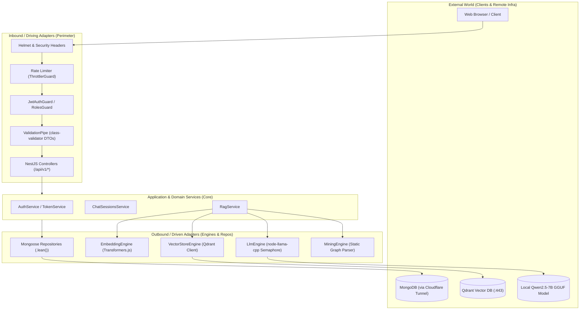
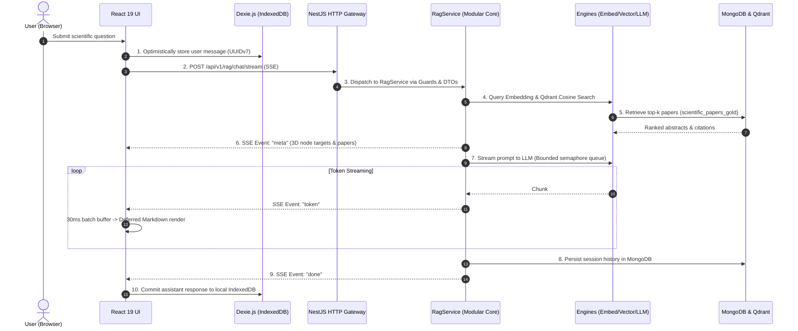

# SYSTEM_ARCHITECTURE_REPORT.md — Architectural Paradigm Classification & System Topology Report

- **Motivation/Background**: As `RAG_TS` evolved into a high-concurrency scientific RAG platform comprising an interactive 3D WebGL frontend (`frontend_rag`), a NestJS 11 backend (`backend_rag`), local GGUF inference, vector search, and dual-persistence engines, developers and stakeholders needed a formal architectural assessment classifying the system's structural paradigm (Monolith, Modular Monolith, Clean Architecture, or Microservices).
- **Purpose**: Provide a comprehensive, evidence-based architectural classification report analyzing the design patterns, layer boundaries, dependency rules, and trade-offs implemented across `RAG_TS`.
- **Overview Pipeline**: Source Code Inspection (`backend_rag/src/`, `frontend_rag/src/`) → Architectural Invariant Cross-Referencing (`AGENTS.md`, `ARCHITECTURE_OVERVIEW.md`) → Paradigm Comparison (Monolith vs. Modular Monolith vs. Clean Architecture vs. Microservices) → Formal Markdown Report Synthesis.
- **Detailed Plan**: §1 Executive Summary & Core Classification; §2 Backend Architecture Analysis (`backend_rag`); §3 Clean Architecture & Ports-and-Adapters Evaluation; §4 Frontend Architecture Analysis (`frontend_rag`); §5 End-to-End System Topology & Interaction Flow; §6 Architectural Paradigm Comparison Matrix; §7 Production Trade-Offs & Architectural Justification.
- **References**: [ARCHITECTURE_OVERVIEW.md](ARCHITECTURE_OVERVIEW.md), [SCIENTIFIC_RAG_BACKEND.md](SCIENTIFIC_RAG_BACKEND.md), [../../AGENTS.md](../../AGENTS.md), [../../backend_rag/AGENTS.md](../../backend_rag/AGENTS.md), [../../frontend_rag/AGENTS.md](../../frontend_rag/AGENTS.md), [../../agents/rules/MD_CONVENTION.md](../../agents/rules/MD_CONVENTION.md).
- **Created**: 2026-11-12T08:54:00+07:00
- **Last Updated**: 2026-11-12T08:54:00+07:00

[STATUS: ACTIVE]

---

## 1. Executive Summary & Core Classification

The `RAG_TS` workspace is structured as a **Full-Stack Monorepo** comprising two specialized application subsystems:

| Subsystem                             | Primary Paradigm                      | Secondary Pattern / Variant                               | Deployment Unit                        |
| :------------------------------------ | :------------------------------------ | :-------------------------------------------------------- | :------------------------------------- |
| **Backend (`backend_rag`)**   | **Modular Monolith**            | **Pragmatic Clean Architecture (Ports & Adapters)** | Single Node.js Process (Port 3000)     |
| **Frontend (`frontend_rag`)** | **Feature-Driven Architecture** | **Offline-First Dual-Persistence**                  | Single SPA / Static Bundle (Port 5174) |

### Key Classification Verdicts

1. **Is it a Monolith?**
   - **YES (Physically)**: `backend_rag` compiles and runs as a single deployable artifact and single runtime process on Node.js/NestJS. It avoids inter-process network hops, distributed transactions, or service-mesh overhead.
2. **Is it a Modular Monolith?**
   - **YES (Architecturally)**: This is the **authoritative classification** for `backend_rag`. Features are strictly partitioned into self-contained Bounded Contexts (`modules/`) and specialized Engine Providers (`engines/`), governed by explicit NestJS `@Module()` encapsulation and dependency injection.
3. **Is it Clean Architecture?**
   - **HYBRID / PRAGMATIC**: It adopts core Clean Architecture and Hexagonal (Ports & Adapters) principles at infrastructural boundaries (isolating LLM C++ bindings, Qdrant REST APIs, and HuggingFace models behind ports). However, it avoids dogmatic over-engineering (such as redundant pure POJO entity/use-case layers) to maximize I/O throughput (`.lean()`, `LRUCache`, `Singleflight`).
4. **Is it Microservices?**
   - **NO**: All backend capabilities share a single runtime memory space, single HTTP gateway, and single dependency graph. There are no distributed RPC/gRPC calls between internal modules.

---

## 2. Backend Architecture Analysis (`backend_rag`)

The backend codebase is organized under a strict three-tier module topology:

```
backend_rag/src/
├── modules/           # High-Level Feature Modules (HTTP Surface)
│   ├── auth/          # Authentication & Argon2id Crypto
│   ├── admin/         # RBAC Surface (admin/user) & Audit Logging
│   ├── chat-sessions/ # UUIDv7 Sessions & Message History
│   ├── rag/           # Hybrid RAG Orchestration & SSE Streaming
│   ├── papers/        # Paper Metadata & Citation Resolution
│   └── health/        # Readiness & Component Health Probes
├── engines/           # Domain Infrastructure Engines (Ports & Adapters)
│   ├── embedding/     # Nomic Embed Text v1.5 Model Adapter
│   ├── vector-store/  # Qdrant ANN Search Client Adapter
│   ├── llm/           # node-llama-cpp GGUF Inference Engine & Queue
│   ├── mining/        # Co-authorship PageRank & FP-Growth Rules
│   └── tree-router/   # 3D Topology & Centroid Routing
└── common/            # Shared Kernel (Cross-Cutting Concerns)
    ├── http/          # Global Exception Filters & Interceptors
    ├── security/      # Helmet, Sanitization, Throttler / Rate-Limiter
    ├── pagination/    # RFC 9562 UUIDv7 & Cursor Pagination
    ├── logging/       # Pino Structured Logger
    └── utils/         # Memory & Utility Primitives
```

### Characteristics of the Modular Monolith

1. **Strict Interface Boundaries**:
   - `src/modules/` expose public HTTP endpoints via NestJS Controllers (`@Controller('api/v1/...')`).
   - `src/engines/` contain **zero controllers**. They are internal domain engines that expose abstract services injected by feature modules. For instance, `RagService` depends on `VectorStoreService`, `LlmService`, and `MiningService` without knowing their underlying protocol details.
2. **Encapsulated Data Access**:
   - Each module owns its schemas and queries. `ChatSessionsModule` manages `chat_sessions` and `chat_messages`; `AuthModule` manages `users` and `refresh_tokens`. Cross-module communication occurs strictly via injected services, never by directly querying another module's raw database models.
3. **Single In-Memory Event Loop & Caching**:
   - The entire backend runs in a single Node.js event loop with shared memory caching (`LRUCache`), eliminating network latency between services while supporting generation-versioned cache invalidation (`userListGen`).

---

## 3. Clean Architecture & Ports-and-Adapters Evaluation

`backend_rag` implements Clean Architecture principles where they provide high leverage, while deliberately avoiding dogmatic patterns that penalize runtime latency.



### What Aligns with Clean Architecture

- **Inversion of Dependencies**: External infrastructure details (Qdrant REST connection, llama.cpp C++ bindings, Cloudflare TCP tunnels) reside on the outer rim (`engines/` and infrastructure). Core application logic (`RagService`) interacts with high-level service contracts.
- **Strict Perimeter Validation**: Inbound payloads never penetrate the domain without passing through class-transformer and class-validator DTO pipelines.
- **Layered Defense-in-Depth**: Controller level (Guard authentication + role authorization) followed by service-level invariant assertion (`assertAdmin`, `assertNotSelf`, `assertNotLastAdmin`).

### Pragmatic Divergences from Pure Clean Architecture

- **Direct ODM Integration**: Rather than mapping Mongoose documents to abstract POJO entities through multiple intermediate mappers on every request, services use `.lean()` queries directly. This avoids unnecessary garbage collection overhead and Mongoose hydration penalties, sustaining `250 RPS` with sub-300ms latency.
- **In-Memory Caching at Service Layer**: `LRUCache` instances are collocated with services (`AuthService`, `ChatSessionsService`) to bypass MongoDB network round-trips (~15–25ms over the Cloudflare tunnel) on hot read paths.

---

## 4. Frontend Architecture Analysis (`frontend_rag`)

The frontend application (`React 19 + TypeScript + Vite + Three.js`) is organized using **Feature-Driven Architecture** (inspired by Feature-Sliced Design):

```
frontend_rag/src/
├── app/               # Application Root, Shell & Global Layout
│   ├── layout/        # TopBar, ChatDock, CategoryLegend, SettingsPanel
│   └── AppShell.tsx   # Top-level viewport coordinator
├── features/          # Self-Contained Domain Features
│   ├── auth/          # Login / Register modals & session state
│   ├── chat/          # Chat messages, streaming, Markdown/KaTeX, history
│   │   ├── components/# MessageBubble, ChatInput, HistoryDrawer
│   │   ├── db/        # chatDb.ts (Dexie.js IndexedDB schema)
│   │   └── store/     # ragStore.ts & sessionStore.ts (Zustand)
│   ├── world/         # 3D Scene Graph (R3F, Canopy, Shaders, Lighting)
│   ├── result/        # Paper detail panels & citation cards
│   └── crawl/         # Pipeline crawler monitor stream
└── shared/            # Cross-Cutting Shared Kernel
    ├── theme/         # Design Tokens, Glass Materials, Theme Engine
    ├── ui/            # UI Primitives (Glass.tsx, LiquidShell.tsx)
    ├── api/           # HTTP Client & SSE Stream Parser
    └── lib/           # Math & 3D Rotor Rotations
```

### Key Frontend Architectural Patterns

1. **Offline-First Dual Persistence (`D-017`)**:
   - `chatDb.ts` (`Dexie.js` IndexedDB) serves as the **client-side primary ground truth**.
   - Session navigation and message history remain 100% functional and instantaneous even when `backend_rag` is offline.
2. **Decoupled 3D Render Loop**:
   - React Three Fiber (`<Canvas>`) maintains a strict separation from HTML DOM components.
   - Text rendering and Markdown AST parsing are isolated from the 3D animation loop via `30ms` micro-batched token buffers and React 19's `useDeferredValue`, preserving a stable 60–120 FPS render cadence.
3. **Tokenized Design System (`FE_DESIGN_SYSTEM.md`)**:
   - Strict design tokens govern all UI materials, glass refractions, light rotors, and typography scales without raw color values.

---

## 5. End-to-End System Topology & Interaction Flow



---

## 6. Architectural Paradigm Comparison Matrix

| Architectural Criterion             | Traditional Monolith        | Microservices Architecture      | Pure Clean Architecture        | **RAG_TS Architecture**                                     |
| :---------------------------------- | :-------------------------- | :------------------------------ | :----------------------------- | :---------------------------------------------------------------- |
| **Physical Deployment**       | Single process              | Multiple distributed processes  | Independent of deployment      | **Single process per tier (Monolith)**                      |
| **Module Boundaries**         | Often weak or circular      | Enforced via network protocols  | Enforced via pure interfaces   | **Strictly enforced via NestJS DI & Modules**               |
| **Domain Engine Isolation**   | Mixed with business logic   | Separate services per engine    | External adapters behind ports | **Isolated in `src/engines/` (Ports & Adapters)**         |
| **Inter-Module Latency**      | Memory speed (`~0ms`)     | Network speed (`5–50ms` RTT) | Memory speed (`~0ms`)        | **Memory speed + In-Memory LRU Cache**                      |
| **Data Persistence Strategy** | Single shared database      | Database-per-service            | Abstract repository interfaces | **Dual-Persistence (IndexedDB + Remote MongoDB)**           |
| **Refactoring Complexity**    | High risk of spaghetti code | High operational overhead       | High initial boilerplate       | **Balanced: High agility with strict module encapsulation** |
| **Infrastructure Overhead**   | Very Low                    | High (K8s, Consul, Istio)       | Low                            | **Low (Single Node runtime + Cloudflare Tunnel)**           |

---

## 7. Production Trade-Offs & Architectural Justification

### Why a Modular Monolith was Chosen over Microservices

1. **Zero Inter-Service Network Overhead**:
   - Scientific RAG requires chaining embedding computation, vector retrieval, graph mining, and LLM token generation. Splitting these into separate microservices would introduce serialization, network hops, and connection pool overhead on every token stream.
2. **Simplified SRE & Concurrency Management**:
   - Critical concurrency limits (such as `LLM_CONCURRENCY=1` and `LLM_MAX_QUEUE=8`) are managed directly in process memory using lightweight semaphores, shedding load with HTTP `429` in `< 5ms` without requiring distributed rate limiters or Redis clusters.
3. **High Development Velocity**:
   - Single repository with unified TypeScript 5.7 type-checking allows refactoring data contracts across engines, services, and controllers with instantaneous compiler verification.
4. **Future-Proof Scalability**:
   - Because domain engines (`engines/`) and feature modules (`modules/`) maintain strict decoupled boundaries, any individual engine (e.g. `LlmService` or `VectorStoreService`) can be extracted into an independent microservice in the future with zero changes to business logic.

---

## 8. Summary Conclusion

`RAG_TS` is an exemplar of a **Modern Modular Monolith with Ports & Adapters**:

- It achieves the **architectural hygiene and testability** of Clean Architecture.
- It retains the **simplicity, memory efficiency, and operational speed** of a Monolith.
- It pairs seamlessly with an **Offline-First, Feature-Driven Frontend** to provide sub-second responsiveness and zero-stutter 3D graphics.
