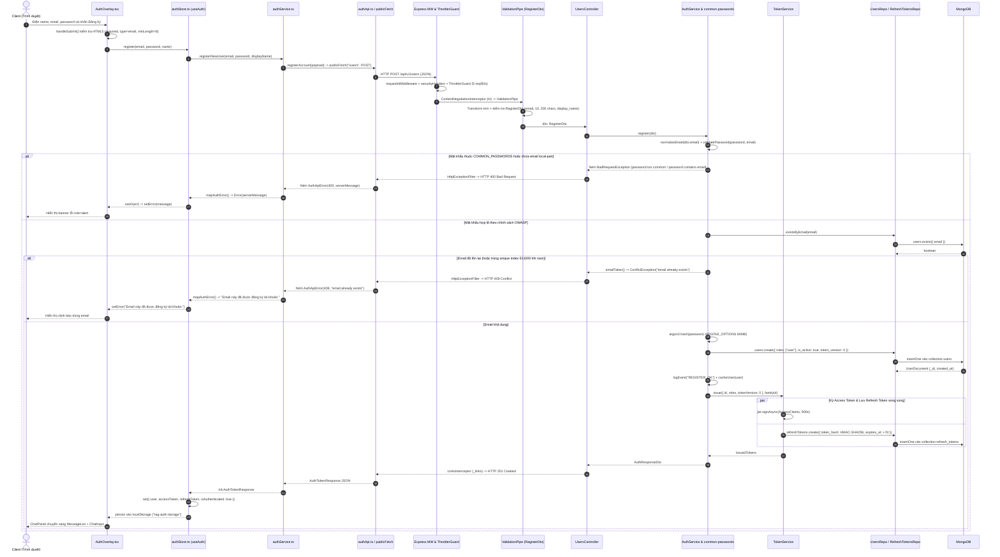

# Luồng 01 — Đăng ký Tài khoản & Kiểm định Chính sách Mật khẩu (POST /api/v1/users)

- **Motivation/Background**: Hệ thống `RAG_TS` tách biệt giao diện React (`frontend_rag`) và API NestJS 11 (`backend_rag`) với yêu cầu bảo mật chặt chẽ khi tự đăng ký tài khoản: chặn mật khẩu yếu/phổ biến, chống lạm dụng tài nguyên CPU của `Argon2id` qua rate limiting, xử lý xung đột email đồng thời và cấp phát cặp JWT + Refresh Token ngay trong một luồng thống nhất.
- **Purpose**: Đặc tả chi tiết luồng Request–Response đầu cuối (`end-to-end`) cho nghiệp vụ đăng ký tài khoản mới (`POST /api/v1/users`), từ thao tác người dùng trên `AuthOverlay` đến quá trình ghi nhận MongoDB và đồng bộ trạng thái phiên về trình duyệt.
- **Overview Pipeline**: Client (`AuthOverlay`) → Hook & Store (`useAuthSession` / `useAuth`) → Service & API (`authService` / `authApi` / `publicFetch`) → Express Middleware (`requestIdMiddleware`, `securityHeaders`, `PrometheusMetricsRegistry`, XML/JSON body) → `ThrottlerGuard` → `ContentNegotiationInterceptor` (In) & `ValidationPipe` → `UsersController.register` → `AuthService.register` (`validatePassword` + `Argon2id`) → `UsersRepository` & `TokenService` (`RefreshTokensRepository`) → MongoDB (`users`, `refresh_tokens`) → `LinksInterceptor` & `ContentNegotiationInterceptor` (Out) → `useAuth` (`localStorage`) & `ChatPanel`.
- **Detailed Plan**: Mục 1 tóm tắt kiến trúc và sơ đồ `flowchart`; Mục 2 trình bày `sequenceDiagram` gồm các nhánh lỗi `400` và `409`; Mục 3 phân rã 4 giai đoạn chi tiết kèm ví dụ HTTP Wire (`Request` và `201 Created`); Mục 4 tổng hợp các nhánh lỗi (`400`, `409`, `415`, `406`, `429`), cơ chế `HttpExceptionFilter` và các bất biến hệ thống.
- **References**: [agents/rules/MD_CONVENTION.md](../../../agents/rules/MD_CONVENTION.md), [docs/architecture/ARCHITECTURE_OVERVIEW.md](../ARCHITECTURE_OVERVIEW.md), [docs/api/API_DESIGN.md](../../api/API_DESIGN.md), [backend_rag/docs/AUTH_AND_SECURITY_ARCHITECTURE.md](../../../backend_rag/docs/AUTH_AND_SECURITY_ARCHITECTURE.md), [frontend_rag/src/features/auth/AuthOverlay.tsx](../../../frontend_rag/src/features/auth/AuthOverlay.tsx), [backend_rag/src/modules/auth/users.controller.ts](../../../backend_rag/src/modules/auth/users.controller.ts), [backend_rag/src/modules/auth/auth.service.ts](../../../backend_rag/src/modules/auth/auth.service.ts), [backend_rag/src/modules/auth/common-passwords.ts](../../../backend_rag/src/modules/auth/common-passwords.ts).
- **Created**: 2026-11-26T10:12:00+07:00
- **Last Updated**: 2026-11-26T12:00:00+07:00

[STATUS: ACTIVE]

---

## 1. Tổng quan Kiến trúc & Sơ đồ Luồng Đầu cuối

Luồng đăng ký tài khoản cho phép người dùng chưa xác thực (`!isAuthenticated`) chuyển từ màn hình đăng nhập sang chế độ đăng ký trong [ChatPanel.tsx](../../../frontend_rag/src/features/chat/components/ChatPanel.tsx#L110-L118) và gửi thông tin (`email`, `password`, `display_name`) tới `POST /api/v1/users`. Trên Backend, yêu cầu đi qua đầy đủ chuỗi 26 bước bảo vệ đa tầng trước khi `AuthService.register` kiểm định chính sách mật khẩu, băm mật khẩu bằng `Argon2id` trên `UV_THREADPOOL_SIZE=4`, tạo bản ghi `users` mặc định quyền `['user']` và phát hành cặp token (`access_token` JWT + `refresh_token` ngẫu nhiên lưu hash HMAC-SHA256 trong `refresh_tokens`).

```mermaid
flowchart TB
    subgraph FE_IN["Giai đoạn 1 — Frontend Chiều đi (Client -> HTTP Request)"]
        CLI_IN["1. Client (Người dùng nhập biểu mẫu Đăng ký)"]
        CMP_IN["2. FE Component (AuthOverlay.tsx: handleSubmit)"]
        HK_IN["3. FE Hook & Store (useAuthSession -> authStore.register)"]
        FSVC_IN["4. FE Service (authService.ts: registerNewUser)"]
        FAPI_IN["5. FE API (authApi.ts: registerAccount)"]
        HTTP_IN["6. FE HTTP Client (http.ts: publicFetch -> POST /api/v1/users)"]
        CLI_IN --> CMP_IN --> HK_IN --> FSVC_IN --> FAPI_IN --> HTTP_IN
    end

    subgraph BE_IN["Giai đoạn 2 — Backend Chiều vào (HTTP Request -> Database)"]
        NODE["7. BE Node.js HTTP Server (main.ts: UV_THREADPOOL_SIZE=4, keepAliveTimeout=65s)"]
        MW["8. BE NestJS/Express Middleware (app.setup.ts: requestId, helmet, metrics, XML/JSON, /api/v1)"]
        GRD["9. BE Guard (ThrottlerGuard + @RateLimit register 5 req/60s)"]
        INT_IN["10. BE Interceptor chiều vào (ContentNegotiation Accept 406 + LinksInterceptor metadata)"]
        PIP["11. BE Pipe (ValidationPipe whitelist/transform -> RegisterDto)"]
        CTL_IN["12. BE Controller (users.controller.ts: UsersController.register)"]
        BSVC_IN["13. BE Service (auth.service.ts: AuthService.register + validatePassword + Argon2id + TokenService.issue)"]
        REPO_IN["14. BE Repository (users.repository.ts + refresh-tokens.repository.ts)"]
        DB["15. Database (MongoDB: users & refresh_tokens)"]
        HTTP_IN -->|"HTTP POST /api/v1/users"| NODE --> MW --> GRD --> INT_IN --> PIP --> CTL_IN --> BSVC_IN --> REPO_IN --> DB
    end

    subgraph BE_OUT["Giai đoạn 3 — Backend Chiều về (Database -> HTTP Response)"]
        REPO_OUT["16. Database -> BE Repository (UserDocument & xác nhận insert RefreshToken)"]
        BSVC_OUT["17. BE Service (cacheUser 3 LRUCache, lọc password_hash -> AuthResponseDto)"]
        CTL_OUT["18. BE Controller (UsersController.register trả AuthResponseDto, status 201)"]
        INT_OUT["19. BE Interceptor chiều ra (LinksInterceptor +_links -> ContentNegotiation JSON/XML)"]
        EXP_OUT["20. BE NestJS/Express gửi response (HTTP 201, X-Request-Id, metrics finalize, HttpExceptionFilter)"]
        DB --> REPO_OUT --> BSVC_OUT --> CTL_OUT --> INT_OUT --> EXP_OUT
    end

    subgraph FE_OUT["Giai đoạn 4 — Frontend Chiều về (HTTP Response -> Client)"]
        HTTP_OUT["21. FE HTTP Client (publicFetch nhận Response HTTP 201 / 4xx)"]
        FAPI_OUT["22. FE API (authApi.ts: readJsonOrThrow -> AuthTokenResponse hoặc AuthApiError)"]
        FSVC_OUT["23. FE Service (authService.ts: trả AuthTokenResponse hoặc mapAuthError tiếng Việt)"]
        HK_OUT["24. FE Hook & Store (authStore set + persist localStorage -> useAuthSession)"]
        CMP_OUT["25. FE Component (AuthOverlay tắt loading -> ChatPanel mở MessageList & ChatInput)"]
        CLI_OUT["26. Client (Người dùng đã đăng nhập và sẵn sàng chat RAG)"]
        EXP_OUT -->|"HTTP 201 Created"| HTTP_OUT --> FAPI_OUT --> FSVC_OUT --> HK_OUT --> CMP_OUT --> CLI_OUT
    end
```



---

## 2. Biểu đồ Tuần tự (Sequence Diagram) — `POST /api/v1/users`

Biểu đồ dưới đây mô tả một kịch bản đăng ký cụ thể kèm hai nhánh rẽ quan trọng nhất tại tầng nghiệp vụ: từ chối mật khẩu vi phạm chính sách (`400 Bad Request`) và từ chối email đã tồn tại (`409 Conflict`).



---

## 3. Phân rã Chi tiết 4 Giai đoạn Request–Response

### Giai đoạn 1 — Chiều đi Frontend: Client → FE → HTTP Request

| Bước | Tầng (Layer) | File & Ký hiệu | Đầu vào (Input) | Xử lý Nghiệp vụ & Kỹ thuật | Đầu ra (Output) |
| :--- | :--- | :--- | :--- | :--- | :--- |
| 1 | Client | [ChatPanel.tsx](../../../frontend_rag/src/features/chat/components/ChatPanel.tsx#L110-L118) | Trạng thái `!isAuthenticated`, thao tác bấm `Đăng ký ngay` và submit biểu mẫu | Người dùng chuyển chế độ form sang Đăng ký trên trình duyệt, điền `name`, `email`, `password` và nhấn nút `Đăng ký`. | Sự kiện `onSubmit` kích hoạt trên form |
| 2 | FE — Component | [AuthOverlay.tsx](../../../frontend_rag/src/features/auth/AuthOverlay.tsx#L16-L36) | `FormEvent`, state cục bộ `(name, email, password)` | `handleSubmit` gọi `e.preventDefault()`, xóa `error`, bật `loading = true`, trình duyệt kiểm tra HTML5 constraint (`required`, `type="email"`, `maxLength={60}`, `minLength={8}` — lưu ý BE siết chặt `minLength = 10`), sau đó gọi `await register(email, password, name)`. | Lời gọi `register(email, password, name)` |
| 3 | FE — Hook (+ Store) | [useAuth.ts](../../../frontend_rag/src/features/auth/hooks/useAuth.ts#L4-L22) & [authStore.ts](../../../frontend_rag/src/features/auth/authStore.ts#L50-L58) | Selector `useAuth((s) => s.register)` | `useAuthSession` cung cấp action `register` tách UI khỏi chi tiết Zustand store; `authStore.register` nhận `(email, password, display_name)` và ủy quyền bất đồng bộ xuống tầng service. | Lời gọi `registerNewUser(email, password, display_name)` |
| 4 | FE — Service | [authService.ts](../../../frontend_rag/src/features/auth/services/authService.ts#L44-L50) | `(email, password, displayName)` | Đóng gói payload chuẩn snake_case `{ email, password, display_name: displayName }`, bọc lời gọi trong `try/catch` để ánh xạ mọi lỗi qua `mapAuthError` sang thông điệp tiếng Việt. | Lời gọi `registerAccount(payload)` |
| 5 | FE — API | [authApi.ts](../../../frontend_rag/src/features/auth/api/authApi.ts#L56-L63) | `RegisterPayload` | Định nghĩa endpoint `'/users'`, method `'POST'`, header `'Content-Type': 'application/json'`, tuần tự hóa `JSON.stringify(payload)` và giao cho `publicFetch`. | Yêu cầu tới `publicFetch('/users', init)` |
| 6 | FE — HTTP Client (gọi fetch) | [http.ts](../../../frontend_rag/src/shared/api/http.ts#L15-L17) & [config.ts](../../../frontend_rag/src/shared/api/config.ts#L1) | Path `'/users'`, `API_BASE` (`'/api/v1'`) | `publicFetch` ghép `API_BASE + path` và gọi `fetch('/api/v1/users', init)` trực tiếp (không đính kèm `Authorization` cũ và không kích hoạt cơ chế tự xoay token nếu gặp lỗi). | HTTP Request `POST /api/v1/users` gửi lên server |

#### Ví dụ HTTP Request (Wire Format)

```http
POST /api/v1/users HTTP/1.1
Host: localhost:5173
Content-Type: application/json
Accept: application/json

{
  "email": "Researcher@University.edu",
  "password": "correct-horse-battery",
  "display_name": "Minh Trần"
}
```

---

### Giai đoạn 2 — Chiều vào Backend: HTTP Request → BE → Database

| Bước | Tầng (Layer) | File & Ký hiệu | Đầu vào (Input) | Xử lý Nghiệp vụ & Kỹ thuật | Đầu ra (Output) |
| :--- | :--- | :--- | :--- | :--- | :--- |
| 7 | BE — Node.js HTTP Server | [main.ts](../../../backend_rag/src/main.ts#L1-L26) | `process.env`, socket TCP cổng `3000` | Đặt `UV_THREADPOOL_SIZE = '4'` ngay dòng đầu tiên để `Argon2id` chạy song song 4 luồng libuv không nghẽn event loop; kiểm tra env qua `parseEnv`; mở `http.Server` qua `app.listen(...)` với `keepAliveTimeout = 65_000` và `headersTimeout = 66_000`. | Kết nối HTTP đi vào ứng dụng NestJS/Express |
| 8 | BE — NestJS/Express Middleware | [app.setup.ts](../../../backend_rag/src/app.setup.ts#L47-L75), [request-context.ts](../../../backend_rag/src/common/logging/request-context.ts#L20-L32), [xml.ts](../../../backend_rag/src/common/http/xml.ts#L70-L105) | Raw Express `Request` | Cấu hình `trust proxy` theo `TRUST_PROXY_HOPS`; `requestIdMiddleware` sinh/đọc `X-Request-Id` (UUIDv7) + mở `AsyncLocalStorage`; `securityHeaders` (Helmet); `PrometheusMetricsRegistry.middleware` đo độ trễ; `unsupportedBody` (ném `415` nếu không phải JSON/XML); parse JSON/XML an toàn (chống XXE, giới hạn `100kb`); áp global prefix `/api/v1` và CORS. | `req.id`, `req.ip` chính xác và `req.body` dạng JS object |
| 9 | BE — Guard | [app.module.ts](../../../backend_rag/src/app.module.ts#L32-L46), [throttler.ts](../../../backend_rag/src/common/security/throttler.ts#L16-L46), [users.controller.ts](../../../backend_rag/src/modules/auth/users.controller.ts#L45) | `req.ip`, metadata `@RateLimit('register')` | `ThrottlerGuard` toàn cục áp hạn mức riêng cho route đăng ký: tối đa **`5` requests / `60_000ms`** theo IP để chống tạo tài khoản rác và chống vét cạn CPU `Argon2id`. Endpoint công khai nên không dùng `JwtAuthGuard`. | Cho phép đi tiếp hoặc ném `429 Too Many Requests` |
| 10 | BE — Interceptor chiều vào | [app.setup.ts](../../../backend_rag/src/app.setup.ts#L78-L81), [xml.ts](../../../backend_rag/src/common/http/xml.ts#L109-L118), [hateoas.ts](../../../backend_rag/src/common/http/hateoas.ts#L157-L166) | Header `Accept`, metadata `@WithLinks` | `ContentNegotiationInterceptor` kiểm tra `req.accepts(['application/json', 'application/xml', 'text/xml', 'text/event-stream'])` trước khi vào handler (ném `406` nếu không hợp lệ); `LinksInterceptor` đọc metadata `@WithLinks({ resource: accountLinks })` chuẩn bị cho chiều ra. | Request vượt qua tiền kiểm tra định dạng |
| 11 | BE — Pipe | [validation.ts](../../../backend_rag/src/common/http/validation.ts#L18-L26) & [auth.dto.ts](../../../backend_rag/src/modules/auth/dto/auth.dto.ts#L16-L34) | `req.body` | `ValidationPipe` (`whitelist: true`, `forbidNonWhitelisted: true`, `transform: true`) trim `email` và `display_name`, kiểm định `IsEmail`, `MaxLength(254)`, `password` từ `10..200` ký tự, `display_name` từ `1..60` ký tự. | Instance `RegisterDto` sạch hoặc `400 Bad Request` |
| 12 | BE — Controller | [users.controller.ts](../../../backend_rag/src/modules/auth/users.controller.ts#L43-L51) | `@Body() dto: RegisterDto` | `UsersController.register` tiếp nhận DTO hợp lệ từ `ValidationPipe` và gọi `this.auth.register(dto)`. | Ủy quyền `Promise<AuthResponseDto>` cho `AuthService` |
| 13 | BE — Service | [auth.service.ts](../../../backend_rag/src/modules/auth/auth.service.ts#L96-L116), [common-passwords.ts](../../../backend_rag/src/modules/auth/common-passwords.ts#L268-L290), [token.service.ts](../../../backend_rag/src/modules/auth/token.service.ts#L43-L78) | `RegisterDto` | Chuẩn hóa `email = normalizeEmail(dto.email)`; chạy `validatePassword(dto.password, email)` (chặn `COMMON_PASSWORDS` & local-part email); kiểm tra `existsByEmail(email)`; băm `argon2.hash` (`argon2id`, `64 MB`, `timeCost: 3`, `parallelism: 4`); khởi tạo user mới và gọi `TokenService.issue` ký JWT (`expiresIn: 900s`) + sinh raw refresh token `32 bytes` (`HMAC-SHA256`). | Dữ liệu tạo bản ghi `CreateUserRecord` & `RefreshToken` |
| 14 | BE — Repository | [users.repository.ts](../../../backend_rag/src/modules/auth/repositories/users.repository.ts#L20-L27) & [refresh-tokens.repository.ts](../../../backend_rag/src/modules/auth/repositories/refresh-tokens.repository.ts#L22-L24) | `CreateUserRecord`, bản ghi `RefreshToken` | `UsersRepository.existsByEmail` kiểm tra trùng email; `UsersRepository.create` ghi tài liệu `users` (`roles: ['user']`, `is_active: true`, `token_version: 0`; bắt race `E11000` chuyển `409`); `RefreshTokensRepository.create` chèn hash refresh token kèm `family_id` và `expires_at` (`+7 ngày`). | Lệnh ghi Mongoose gửi xuống MongoDB |
| 15 | Database | [user.schema.ts](../../../backend_rag/src/modules/auth/schemas/user.schema.ts#L5-L45) & [refresh-token.schema.ts](../../../backend_rag/src/modules/auth/schemas/refresh-token.schema.ts#L4-L27) | Query/Insert từ Mongoose qua Cloudflare TCP Tunnel | MongoDB thực thi kiểm tra unique index trên `users.email`, lưu bản ghi vào collection `users` và collection `refresh_tokens` (có TTL index `expires_at`). | Document mới được lưu bền vững trên đĩa |

---

### Giai đoạn 3 — Chiều về Backend: Database → BE → HTTP Response

| Bước | Tầng (Layer) | File & Ký hiệu | Đầu vào (Input) | Xử lý Nghiệp vụ & Kỹ thuật | Đầu ra (Output) |
| :--- | :--- | :--- | :--- | :--- | :--- |
| 16 | Database → BE — Repository | [users.repository.ts](../../../backend_rag/src/modules/auth/repositories/users.repository.ts#L25-L27) & [refresh-tokens.repository.ts](../../../backend_rag/src/modules/auth/repositories/refresh-tokens.repository.ts#L22-L24) | Kết quả insert từ MongoDB | MongoDB xác nhận ghi thành công; `UsersRepository.create` trả `UserDocument` (`_id`, `created_at`) và `RefreshTokensRepository.create` hoàn tất `Promise<void>` về service. | `UserDocument` + xác nhận ghi token |
| 17 | BE — Service | [auth.service.ts](../../../backend_rag/src/modules/auth/auth.service.ts#L114-L116) & [auth.utils.ts](../../../backend_rag/src/modules/auth/auth.utils.ts#L17-L25) | `user: UserDocument`, `IssuedTokens` | Ghi log `logEvent('REGISTER_OK', { user_id })` (không log email thô); làm ấm đồng thời `userCache`, `userByEmailCache` (`300s`) và `tokenVersionCache` (`5s`) qua `cacheUser(user)`; ánh xạ `UserDto` (loại bỏ `password_hash`, `token_version`, `is_active`) và đóng gói `respond()`. | `AuthResponseDto` sạch thông tin nhạy cảm |
| 18 | BE — Controller | [users.controller.ts](../../../backend_rag/src/modules/auth/users.controller.ts#L49-L51) | `Promise<AuthResponseDto>` | `UsersController.register` trả thẳng `AuthResponseDto` về pipeline NestJS với mã mặc định của `@Post()` là `201 Created`. | Payload `AuthResponseDto` truyền tới chuỗi Interceptor |
| 19 | BE — Interceptor chiều ra | [hateoas.ts](../../../backend_rag/src/common/http/hateoas.ts#L31-L38) & [xml.ts](../../../backend_rag/src/common/http/xml.ts#L119-L125) | `AuthResponseDto`, `req` | `LinksInterceptor` chạy trước ở chiều ra, gọi `addLinks` trên bản sao nông (`{ ...body }`) chèn `_links: accountLinks()` (`self`, `update`, `password`, `chat-sessions`, `token-rotations`, `token-revocations`). Sau đó `ContentNegotiationInterceptor` giữ JSON hoặc chuyển `toXml(body)` nếu client ưu tiên XML. | Response body hoàn chỉnh có `_links` |
| 20 | BE — NestJS/Express gửi response | [app.setup.ts](../../../backend_rag/src/app.setup.ts#L52-L63), [prometheus-metrics.ts](../../../backend_rag/src/common/metrics/prometheus-metrics.ts#L57-L76), [http-exception.filter.ts](../../../backend_rag/src/common/http/http-exception.filter.ts#L69-L97) | Body đã serialize (hoặc `HttpException` nếu lỗi) | Express gắn header `X-Request-Id`, security headers (Helmet), gửi HTTP `201 Created` (hoặc `HttpExceptionFilter` chuẩn hóa lỗi `400`/`409`/`429` kèm `request_id`); sự kiện `finish` kích hoạt `finalize()` ghi histogram Prometheus cho route `POST /api/v1/users`. | HTTP Response rời Backend về trình duyệt |

#### Ví dụ HTTP `201 Created` Response (Wire Format)

```http
HTTP/1.1 201 Created
Content-Type: application/json; charset=utf-8
X-Request-Id: 0195a2b4-7c8d-7000-8000-1a2b3c4d5e6f
X-Content-Type-Options: nosniff
X-Frame-Options: DENY

{
  "access_token": "eyJhbGciOiJIUzI1NiIsInR5cCI6IkpXVCJ9...",
  "token_type": "Bearer",
  "expires_in": 900,
  "refresh_token": "k9vN2xP8mQ4wR7tY1zA5cE3gJ6lM0pS2uV4yB8dF1hK",
  "user": {
    "id": "6745b1234567890abcdef123",
    "email": "researcher@university.edu",
    "display_name": "Minh Trần",
    "roles": ["user"],
    "created_at": "2026-11-26T03:12:00.000Z"
  },
  "_links": {
    "self": { "href": "/api/v1/users/me" },
    "update": { "href": "/api/v1/users/me", "method": "PATCH" },
    "password": { "href": "/api/v1/users/me/password", "method": "PUT" },
    "chat-sessions": { "href": "/api/v1/chat-sessions" },
    "token-rotations": { "href": "/api/v1/auth/token-rotations", "method": "POST" },
    "token-revocations": { "href": "/api/v1/auth/token-revocations", "method": "POST" }
  }
}
```

---

### Giai đoạn 4 — Chiều về Frontend: HTTP Response → FE → Client

| Bước | Tầng (Layer) | File & Ký hiệu | Đầu vào (Input) | Xử lý Nghiệp vụ & Kỹ thuật | Đầu ra (Output) |
| :--- | :--- | :--- | :--- | :--- | :--- |
| 21 | FE — HTTP Client (kiểm tra status & đọc body) | [http.ts](../../../frontend_rag/src/shared/api/http.ts#L15-L17) (`publicFetch`) | HTTP `Response` từ Backend | `publicFetch` giải quyết `Promise<Response>` và bàn giao nguyên trạng status (`201`, `400`, `409`, `429`) cùng stream body JSON về adapter API (không tự retry 401). | Đối tượng `res: Response` |
| 22 | FE — API (xử lý dữ liệu) | [authApi.ts](../../../frontend_rag/src/features/auth/api/authApi.ts#L30-L63) (`readJsonOrThrow`) | `res: Response` | Kiểm tra `res.ok`: nếu `201`, đọc JSON thành `AuthTokenResponse`; nếu `!res.ok`, parse `body?.message` và ném `AuthApiError(res.status, ..., serverMessage)`. | `AuthTokenResponse` hoặc ném `AuthApiError` |
| 23 | FE — Service | [authService.ts](../../../frontend_rag/src/features/auth/services/authService.ts#L20-L50) (`registerNewUser`, `mapAuthError`) | `AuthTokenResponse` hoặc `AuthApiError` | Nếu thành công, trả `AuthTokenResponse` về store. Nếu có lỗi, `mapAuthError` dịch mã `409`, `429`, `'password too short'`, `'invalid email'`, `'invalid display_name'` sang tiếng Việt hoặc giữ nguyên `serverMessage` (`'password too common'`, `'password contains email'`). | Dữ liệu phiên hợp lệ hoặc `Error` tiếng Việt |
| 24 | FE — Hook (cập nhật state) | [authStore.ts](../../../frontend_rag/src/features/auth/authStore.ts#L50-L92) & [useAuth.ts](../../../frontend_rag/src/features/auth/hooks/useAuth.ts#L4-L22) | `AuthTokenResponse` | `useAuth` gọi `set({ user: data.user, accessToken: data.access_token, refreshToken: data.refresh_token, isAuthenticated: true })` và middleware `persist` lưu vào `localStorage` (`'rag-auth-storage'`); selector trong `useAuthSession()` phát state mới tới các component đăng ký. | `isAuthenticated: true` và thông tin `user` mới nhất |
| 25 | FE — Component (hiển thị lại) | [AuthOverlay.tsx](../../../frontend_rag/src/features/auth/AuthOverlay.tsx#L29-L35) & [ChatPanel.tsx](../../../frontend_rag/src/features/chat/components/ChatPanel.tsx#L27-L118) | `isAuthenticated`, `user`, `error` | Khối `finally` tắt `loading = false`; nếu lỗi thì `AuthOverlay` render banner `role="alert"`; nếu thành công thì `ChatPanel` unmount `AuthOverlay`, render badge tên hiển thị, `<MessageList />`, `<ChatInput />` và kích hoạt `useEffect` gọi `initSessions()`. | Cây DOM React được cập nhật hoàn chỉnh |
| 26 | Client | [ChatPanel.tsx](../../../frontend_rag/src/features/chat/components/ChatPanel.tsx#L58-L118) | Giao diện sau re-render | Người dùng nhìn thấy khung chat đã đăng nhập (hoặc thông báo lỗi rõ ràng để sửa mật khẩu/email ngay trên biểu mẫu). | Phiên làm việc RAG sẵn sàng cho người dùng |

---

## 4. Các Nhánh Lỗi, Chuẩn Hóa Phản Hồi & Bất biến Hệ thống

### 4.1. Bảng Tổng hợp Các Nhánh Lỗi

| HTTP Status | Nguyên nhân & Điều kiện kích hoạt | Điểm phát sinh (Backend) | Thông điệp Server (`message`) | Xử lý tại Frontend (`mapAuthError`) |
| :--- | :--- | :--- | :--- | :--- |
| `400 Bad Request` | Field thừa (do `forbidNonWhitelisted`), sai định dạng `email`, `display_name` ngoài `1..60` ký tự, hoặc mật khẩu `< 10` / `> 200` ký tự | [validation.ts](../../../backend_rag/src/common/http/validation.ts#L18-L25) + [auth.dto.ts](../../../backend_rag/src/modules/auth/dto/auth.dto.ts#L16-L34) | `'invalid email'`, `'password too short'`, `'password too long'`, `'invalid display_name'`, v.v. | Dịch sang tiếng Việt cho `'password too short'` (`Mật khẩu phải có ít nhất 10 ký tự.`), `'invalid email'`, `'invalid display_name'`; các chuỗi khác hiển thị trực tiếp `serverMessage`. |
| `400 Bad Request` | Mật khẩu nằm trong danh sách 200 mật khẩu phổ biến (`COMMON_PASSWORDS`) hoặc chứa phần local-part của email (sau khi bỏ `.`, `-`, `_` và dài `>= 3` ký tự) | [common-passwords.ts](../../../backend_rag/src/modules/auth/common-passwords.ts#L268-L290) (`validatePassword`) | `'password too common'` hoặc `'password contains email'` | [authService.ts](../../../frontend_rag/src/features/auth/services/authService.ts#L25-L30) giữ nguyên `serverMessage` (`msg`) để `AuthOverlay` hiển thị tại banner `role="alert"`. |
| `409 Conflict` | Email (sau `normalizeEmail`) đã tồn tại trong MongoDB (`existsByEmail`) hoặc đụng unique index `E11000` khi gửi đồng thời | [auth.service.ts](../../../backend_rag/src/modules/auth/auth.service.ts#L99-L113) & [auth.service.ts](../../../backend_rag/src/modules/auth/auth.service.ts#L303-L306) | `'email already exists'` | `err.status === 409` → `'Email này đã được đăng ký tài khoản.'` |
| `429 Too Many Requests` | Vượt ngưỡng `5 requests / 60s` trên cùng một IP client tại `POST /api/v1/users` | [throttler.ts](../../../backend_rag/src/common/security/throttler.ts#L18) & [users.controller.ts](../../../backend_rag/src/modules/auth/users.controller.ts#L45) | `'ThrottlerException: Too Many Requests'` | `err.status === 429` → `'Quá nhiều lần thử đăng nhập. Vui lòng thử lại sau ít phút.'` |
| `415 Unsupported Media Type` | Request `POST` có body nhưng `Content-Type` không phải `application/json` hoặc XML | [xml.ts](../../../backend_rag/src/common/http/xml.ts#L70-L84) | `'content type must be application/json or application/xml'` | Trả về qua `AuthApiError` với `serverMessage` tương ứng. |
| `406 Not Acceptable` | Header `Accept` không chấp nhận `application/json` hoặc `application/xml` | [xml.ts](../../../backend_rag/src/common/http/xml.ts#L114-L118) | `'accept must allow application/json or application/xml'` | Trả về qua `AuthApiError` với `serverMessage` tương ứng. |

### 4.2. Phong bì Lỗi Thống nhất (`HttpExceptionFilter`)

Mọi ngoại lệ trong pipeline (kể cả lỗi phát sinh tại middleware thông qua `sendError` trong [app.setup.ts](../../../backend_rag/src/app.setup.ts#L62-L63)) đều được chuẩn hóa qua [http-exception.filter.ts](../../../backend_rag/src/common/http/http-exception.filter.ts#L16-L57) theo định dạng JSON (hoặc XML nếu client yêu cầu qua `Accept`):

```json
{
  "statusCode": 400,
  "error": "Bad Request",
  "message": "password too common",
  "request_id": "0195a2b4-7c8d-7000-8000-1a2b3c4d5e6f"
}
```

### 4.3. Các Bất biến Hệ thống & Lưu ý Kỹ thuật

1. **Tham số mật mã `Argon2id` bất biến (`D-021`, `D-022`)**: [ARGON2_OPTIONS](../../../backend_rag/src/modules/auth/auth.service.ts#L43-L48) cố định `memoryCost: 65536` (`64 MB`), `timeCost: 3`, `parallelism: 4`, đi kèm `UV_THREADPOOL_SIZE = 4` tại [main.ts](../../../backend_rag/src/main.ts#L1) để không làm nghẽn luồng sự kiện Node.js. Không được phép hạ các thông số này.
2. **Bảo vệ hai lớp trước CPU Exhaustion**: `RateLimit('register')` giới hạn `5 req / 60s / IP` kết hợp `validatePassword` chạy **trước** `argon2.hash`, giúp loại bỏ ngay mọi mật khẩu yếu/phổ biến với chi phí O(1) trước khi cấp phát 64 MB RAM cho Argon2id.
3. **Chính sách vai trò khi tự đăng ký**: [UsersController.register](../../../backend_rag/src/modules/auth/users.controller.ts#L42-L51) và [RegisterDto](../../../backend_rag/src/modules/auth/dto/auth.dto.ts#L16-L34) không nhận trường `roles`; `AuthService.register` luôn gán cứng `roles: ['user']`, `is_active: true`, `token_version: 0`.
4. **Chênh lệch kiểm tra độ dài tối thiểu FE vs BE**: [AuthOverlay.tsx](../../../frontend_rag/src/features/auth/AuthOverlay.tsx#L125-L134) hiện gắn gợi ý `≥ 8 ký tự` và `minLength={8}` dùng chung cho form Đăng nhập/Đăng ký, trong khi Backend ([common-passwords.ts](../../../backend_rag/src/modules/auth/common-passwords.ts#L242) và [RegisterDto](../../../backend_rag/src/modules/auth/dto/auth.dto.ts#L25)) bắt buộc tối thiểu `10` ký tự (`PASSWORD_MIN_LENGTH = 10`). Khi người dùng nhập 8–9 ký tự ở chế độ đăng ký, request vẫn đi tới Backend, nhận `400 Bad Request` (`'password too short'`) và được [mapAuthError](../../../frontend_rag/src/features/auth/services/authService.ts#L26) dịch thành `'Mật khẩu phải có ít nhất 10 ký tự.'`.
5. **Làm ấm Cache & Bảo mật Refresh Token**: Sau khi tạo user thành công, `cacheUser(user)` làm ấm đồng thời `userCache`, `userByEmailCache` (TTL 5 phút) và `tokenVersionCache` (TTL cố định 5 giây) để các request kế tiếp không phải đi qua tunnel MongoDB. Refresh token thô chỉ tồn tại trong response gửi về client; MongoDB chỉ lưu `HMAC-SHA256` (`JWT_REFRESH_SECRET`).
