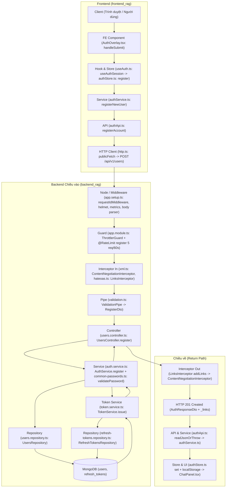
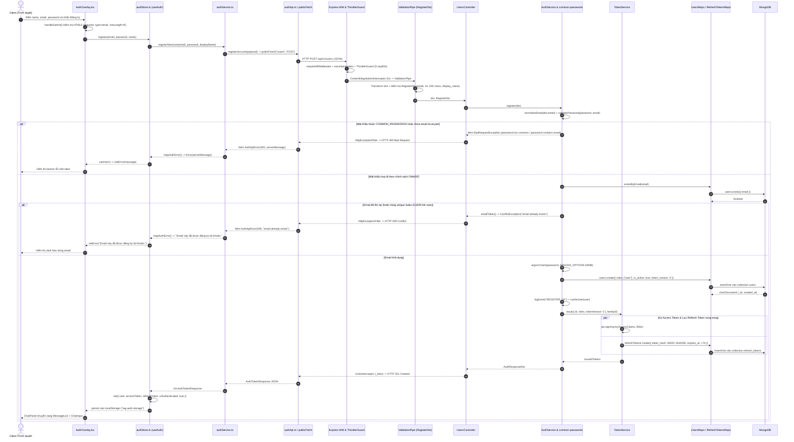

# Luồng 01 — Đăng ký Tài khoản & Kiểm định Chính sách Mật khẩu (POST /api/v1/users)

- **Motivation/Background**: Hệ thống `RAG_TS` tách biệt giao diện React (`frontend_rag`) và API NestJS 11 (`backend_rag`) với yêu cầu bảo mật chặt chẽ khi tự đăng ký tài khoản: chặn mật khẩu yếu/phổ biến, chống lạm dụng tài nguyên CPU của `Argon2id` qua rate limiting, xử lý xung đột email đồng thời và cấp phát cặp JWT + Refresh Token ngay trong một luồng thống nhất.
- **Purpose**: Đặc tả chi tiết luồng Request–Response đầu cuối (`end-to-end`) cho nghiệp vụ đăng ký tài khoản mới (`POST /api/v1/users`), từ thao tác người dùng trên `AuthOverlay` đến quá trình ghi nhận MongoDB và đồng bộ trạng thái phiên về trình duyệt.
- **Overview Pipeline**: Client (`AuthOverlay`) → Hook & Store (`useAuthSession` / `useAuth`) → Service & API (`authService` / `authApi` / `publicFetch`) → Express Middleware (`requestIdMiddleware`, `securityHeaders`, `PrometheusMetricsRegistry`, XML/JSON body) → `ThrottlerGuard` → `ContentNegotiationInterceptor` (In) & `ValidationPipe` → `UsersController.register` → `AuthService.register` (`validatePassword` + `Argon2id`) → `UsersRepository` & `TokenService` (`RefreshTokensRepository`) → MongoDB (`users`, `refresh_tokens`) → `LinksInterceptor` & `ContentNegotiationInterceptor` (Out) → `useAuth` (`localStorage`) & `ChatPanel`.
- **Detailed Plan**: Mục 1 tóm tắt kiến trúc và sơ đồ `flowchart`; Mục 2 trình bày `sequenceDiagram` gồm các nhánh lỗi `400` và `409`; Mục 3 phân rã 4 giai đoạn chi tiết kèm ví dụ HTTP Wire (`Request` và `201 Created`); Mục 4 tổng hợp các nhánh lỗi (`400`, `409`, `415`, `406`, `429`), cơ chế `HttpExceptionFilter` và các bất biến hệ thống.
- **References**: [agents/rules/MD_CONVENTION.md](../../../agents/rules/MD_CONVENTION.md), [docs/architecture/ARCHITECTURE_OVERVIEW.md](../ARCHITECTURE_OVERVIEW.md), [docs/api/API_DESIGN.md](../../api/API_DESIGN.md), [backend_rag/docs/AUTH_AND_SECURITY_ARCHITECTURE.md](../../../backend_rag/docs/AUTH_AND_SECURITY_ARCHITECTURE.md), [frontend_rag/src/features/auth/AuthOverlay.tsx](../../../frontend_rag/src/features/auth/AuthOverlay.tsx), [backend_rag/src/modules/auth/users.controller.ts](../../../backend_rag/src/modules/auth/users.controller.ts), [backend_rag/src/modules/auth/auth.service.ts](../../../backend_rag/src/modules/auth/auth.service.ts), [backend_rag/src/modules/auth/common-passwords.ts](../../../backend_rag/src/modules/auth/common-passwords.ts).
- **Created**: 2026-11-26T10:12:00+07:00
- **Last Updated**: 2026-11-26T10:12:00+07:00

[STATUS: ACTIVE]

---

## 1. Tổng quan Kiến trúc & Sơ đồ Luồng Đầu cuối

Luồng đăng ký tài khoản cho phép người dùng chưa xác thực (`!isAuthenticated`) chuyển từ màn hình đăng nhập sang chế độ đăng ký trong [ChatPanel.tsx](../../../frontend_rag/src/features/chat/components/ChatPanel.tsx#L110-L118) và gửi thông tin (`email`, `password`, `display_name`) tới `POST /api/v1/users`. Trên Backend, yêu cầu đi qua chuỗi bảo vệ đa tầng trước khi `AuthService.register` kiểm định chính sách mật khẩu, băm mật khẩu bằng `Argon2id` trên `UV_THREADPOOL_SIZE=4`, tạo bản ghi `users` mặc định quyền `['user']` và phát hành cặp token (`access_token` JWT + `refresh_token` ngẫu nhiên lưu hash HMAC-SHA256 trong `refresh_tokens`).



---

## 2. Biểu đồ Tuần tự (Sequence Diagram) — `POST /api/v1/users`

Biểu đồ dưới đây mô tả một kịch bản đăng ký cụ thể kèm hai nhánh rẽ quan trọng nhất tại tầng nghiệp vụ: từ chối mật khẩu vi phạm chính sách (`400 Bad Request`) và từ chối email đã tồn tại (`409 Conflict`).



---

## 3. Phân rã Chi tiết 4 Giai đoạn Request–Response

### Giai đoạn 1 — Chiều đi Frontend: Client → FE → HTTP Request

| Bước | Tầng (Layer) | File & Ký hiệu | Đầu vào (Input) | Xử lý Nghiệp vụ & Kỹ thuật | Đầu ra (Output) |
| :--- | :--- | :--- | :--- | :--- | :--- |
| 1 | Client / UI | [ChatPanel.tsx](../../../frontend_rag/src/features/chat/components/ChatPanel.tsx#L110-L118) | Trạng thái `isAuthenticated === false` từ `useAuthSession()` | Render `<AuthOverlay />` thay thế `MessageList` và `ChatInput` trong cột chat. | Component `AuthOverlay` được mount |
| 2 | FE Component | [AuthOverlay.tsx](../../../frontend_rag/src/features/auth/AuthOverlay.tsx#L16-L36) | Sự kiện click `Đăng ký ngay` (`switchMode(false)`) và submit form (`name`, `email`, `password`) | `e.preventDefault()`, xóa `error`, bật `loading = true`, áp dụng kiểm tra HTML5 (`required`, `type="email"`, `maxLength={60}`, `minLength={8}` — lưu ý BE siết chặt `minLength = 10`), gọi `await register(email, password, name)`. | Lời gọi `register(email, password, name)` |
| 3 | Hook | [useAuth.ts](../../../frontend_rag/src/features/auth/hooks/useAuth.ts#L4-L22) | Selector `useAuth((s) => s.register)` | Trích xuất action `register` từ Zustand store cho component UI mà không làm component phụ thuộc trực tiếp vào chi tiết store. | Hàm `register` |
| 4 | State Store | [authStore.ts](../../../frontend_rag/src/features/auth/authStore.ts#L50-L58) | `(email, password, display_name)` | Ủy quyền bất đồng bộ cho tầng service `registerNewUser(email, password, display_name)`. | `Promise<void>` chờ `AuthTokenResponse` |
| 5 | FE Service | [authService.ts](../../../frontend_rag/src/features/auth/services/authService.ts#L44-L50) | `(email, password, displayName)` | Gói payload chuẩn snake_case `{ email, password, display_name: displayName }` và gọi `registerAccount(...)`; bọc `try/catch` để ánh xạ lỗi qua `mapAuthError`. | Lời gọi `registerAccount(payload)` |
| 6 | FE API | [authApi.ts](../../../frontend_rag/src/features/auth/api/authApi.ts#L56-L63) | `RegisterPayload` | Gọi `publicFetch('/users', ...)` với `method: 'POST'`, header `Content-Type: application/json` và `JSON.stringify(payload)`. | `Promise<Response>` |
| 7 | HTTP Client | [http.ts](../../../frontend_rag/src/shared/api/http.ts#L15-L17) & [config.ts](../../../frontend_rag/src/shared/api/config.ts#L1) | Path `'/users'`, `API_BASE` (`'/api/v1'`) | Gọi `fetch('/api/v1/users', init)` qua `publicFetch` (không đính kèm `Authorization` và không kích hoạt logic tự xoay refresh token nếu nhận lỗi). | HTTP Request `POST /api/v1/users` rời trình duyệt |

#### Ví dụ HTTP Request (Wire Format)

```http
POST /api/v1/users HTTP/1.1
Host: localhost:5173
Content-Type: application/json
Accept: application/json

{
  "email": "Researcher@University.edu",
  "password": "correct-horse-battery",
  "display_name": "Minh Trần"
}
```

---

### Giai đoạn 2 — Chiều vào Backend: HTTP Request → BE → Repository → Database

| Bước | Tầng (Layer) | File & Ký hiệu | Đầu vào (Input) | Xử lý Nghiệp vụ & Kỹ thuật | Đầu ra (Output) |
| :--- | :--- | :--- | :--- | :--- | :--- |
| 8 | Bootstrap / Runtime | [main.ts](../../../backend_rag/src/main.ts#L1-L26) | `process.env` | Thiết lập `UV_THREADPOOL_SIZE = '4'` (bắt buộc để `Argon2id` chạy song song 4 luồng không nghẽn event loop), kiểm tra biến môi trường qua `parseEnv`, khởi tạo NestJS + Express với `keepAliveTimeout = 65_000`. | Process NestJS sẵn sàng nhận kết nối |
| 9 | Middleware (1) | [app.setup.ts](../../../backend_rag/src/app.setup.ts#L47-L61) & [request-context.ts](../../../backend_rag/src/common/logging/request-context.ts#L20-L32) | Express `Request` | Cấu hình `trust proxy` theo `TRUST_PROXY_HOPS`; `requestIdMiddleware` sinh hoặc xác thực `X-Request-Id` (UUIDv7) và mở `AsyncLocalStorage` context; `securityHeaders` (Helmet) gắn CSP/headers bảo mật; `PrometheusMetricsRegistry.middleware` bắt đầu đo thời gian và theo dõi actor. | `req.id` + `RequestContext` + metrics timer |
| 10 | Middleware (2) | [app.setup.ts](../../../backend_rag/src/app.setup.ts#L64-L75) & [xml.ts](../../../backend_rag/src/common/http/xml.ts#L70-L105) | Body stream & `Content-Type` | Kiểm tra `unsupportedBody(req)` (ném `415` nếu không phải JSON/XML); đọc text XML tối đa `100kb` và parse an toàn chống XXE nếu là XML, hoặc parse JSON qua Express; áp prefix toàn cục `/api/v1` và CORS. | `req.body` dạng object JavaScript |
| 11 | Guard | [app.module.ts](../../../backend_rag/src/app.module.ts#L32-L46) & [throttler.ts](../../../backend_rag/src/common/security/throttler.ts#L16-L46) | IP thực từ `req.ip`, metadata `@RateLimit('register')` | `ThrottlerGuard` toàn cục áp ngưỡng riêng cho route đăng ký: tối đa `5` requests / `60_000 ms` theo IP để chống tạo tài khoản hàng loạt và chống vét cạn CPU `Argon2id`. | Cho phép đi tiếp hoặc ném `429 Too Many Requests` |
| 12 | Interceptor (In) | [app.setup.ts](../../../backend_rag/src/app.setup.ts#L78-L81), [xml.ts](../../../backend_rag/src/common/http/xml.ts#L109-L118), [hateoas.ts](../../../backend_rag/src/common/http/hateoas.ts#L157-L166) | `Accept` header & Handler metadata | `ContentNegotiationInterceptor` kiểm tra `req.accepts(['application/json', 'application/xml', 'text/xml', 'text/event-stream'])` (ném `406` nếu không tương thích); `LinksInterceptor` đọc metadata `@WithLinks({ resource: accountLinks })`. | Request vượt qua tiền kiểm tra định dạng |
| 13 | Pipe | [validation.ts](../../../backend_rag/src/common/http/validation.ts#L18-L26) & [auth.dto.ts](../../../backend_rag/src/modules/auth/dto/auth.dto.ts#L16-L34) | `req.body` | `ValidationPipe` (`whitelist: true`, `forbidNonWhitelisted: true`, `transform: true`) thực thi `@Transform(trim)` cho `email` và `display_name`, kiểm tra `IsEmail`, `MaxLength(254)`, `password` từ `10..200` ký tự, `display_name` từ `1..60` ký tự. | Instance `RegisterDto` sạch hoặc `400 Bad Request` |
| 14 | Controller | [users.controller.ts](../../../backend_rag/src/modules/auth/users.controller.ts#L43-L51) | `@Body() dto: RegisterDto` | `UsersController.register` nhận DTO đã kiểm định và chuyển tiếp vào `this.auth.register(dto)`. Route không gắn `JwtAuthGuard` vì là endpoint công khai. | Gọi `AuthService.register(dto)` |
| 15 | BE Service (Policy & Hash) | [auth.service.ts](../../../backend_rag/src/modules/auth/auth.service.ts#L96-L105) & [common-passwords.ts](../../../backend_rag/src/modules/auth/common-passwords.ts#L268-L290) | `RegisterDto` | Chuẩn hóa `email = normalizeEmail(dto.email)` (`trim().toLowerCase()`); chạy `validatePassword(dto.password, email)` (chặn `COMMON_PASSWORDS`, độ dài `<10` hoặc `>200`, chứa local-part email đã bỏ `.-_`); kiểm tra `users.existsByEmail(email)`; băm mật khẩu bằng `argon2.hash` (`argon2id`, `memoryCost: 65536`, `timeCost: 3`, `parallelism: 4`). | `password_hash` an toàn |
| 16 | Repository & DB (User) | [users.repository.ts](../../../backend_rag/src/modules/auth/repositories/users.repository.ts#L20-L27) & [user.schema.ts](../../../backend_rag/src/modules/auth/schemas/user.schema.ts#L5-L45) | `CreateUserRecord` | `UsersRepository.existsByEmail` truy vấn `model.exists({ email })`. Nếu chưa có, `UsersRepository.create` ghi tài liệu mới vào collection `users` với `roles: ['user']`, `is_active: true`, `token_version: 0`. Nếu race condition đụng unique index `E11000`, `isDuplicateKey(e)` chuyển thành `409 Conflict`. | `UserDocument` (`_id`, `created_at`) |
| 17 | Token Service & DB (Refresh) | [token.service.ts](../../../backend_rag/src/modules/auth/token.service.ts#L43-L78) & [refresh-tokens.repository.ts](../../../backend_rag/src/modules/auth/repositories/refresh-tokens.repository.ts#L22-L24) | `AuthUser`, `familyId = randomUUID()` | `TokenService.issue` chạy song song (`Promise.all`) việc ký JWT access token (`HS256`, `expiresIn: 900s`, claims `{ sub, roles, ver: 0 }`) và sinh chuỗi ngẫu nhiên `32 bytes` `base64url` rồi lưu bản băm `HMAC-SHA256` (`hashRefresh`) vào collection `refresh_tokens` (kèm TTL index `expires_at` sau `7 ngày`). | `IssuedTokens` (`access_token`, `refresh_token`) |

---

### Giai đoạn 3 — Chiều về Backend: Database → Repository → Service → Controller → Interceptor → HTTP Response

| Bước | Tầng (Layer) | File & Ký hiệu | Đầu vào (Input) | Xử lý Nghiệp vụ & Kỹ thuật | Đầu ra (Output) |
| :--- | :--- | :--- | :--- | :--- | :--- |
| 18 | Database → Repository | [users.repository.ts](../../../backend_rag/src/modules/auth/repositories/users.repository.ts#L25-L27) & [refresh-tokens.repository.ts](../../../backend_rag/src/modules/auth/repositories/refresh-tokens.repository.ts#L22-L24) | Kết quả ghi từ MongoDB | Trả `UserDocument` vừa tạo và hoàn tất `Promise<void>` lưu `RefreshToken` về tầng service. | `UserDocument` + xác nhận ghi token |
| 19 | BE Service | [auth.service.ts](../../../backend_rag/src/modules/auth/auth.service.ts#L114-L116) & [auth.utils.ts](../../../backend_rag/src/modules/auth/auth.utils.ts#L17-L25) | `user`, `IssuedTokens` | Ghi nhận sự kiện `logEvent('REGISTER_OK', { user_id })` vào `AsyncLocalStorage` (không log email thô); làm ấm 3 cache `LRUCache` qua `cacheUser(user)` (`userCache`, `userByEmailCache`, `tokenVersionCache`); đóng gói `UserDto` (loại bỏ `password_hash`, `token_version`, `is_active`) cùng cặp token qua `respond()`. | `AuthResponseDto` |
| 20 | Controller | [users.controller.ts](../../../backend_rag/src/modules/auth/users.controller.ts#L49-L51) | `Promise<AuthResponseDto>` | Trả thẳng kết quả về pipeline NestJS với mã trạng thái mặc định của `@Post()` là `201 Created`. | Payload `AuthResponseDto` |
| 21 | Interceptor (Out) | [hateoas.ts](../../../backend_rag/src/common/http/hateoas.ts#L31-L38) & [xml.ts](../../../backend_rag/src/common/http/xml.ts#L119-L125) | `AuthResponseDto` | `LinksInterceptor` chạy trước ở chiều ra, gọi `addLinks` trên bản sao nông (`{ ...body }`) để chèn `_links: accountLinks()` (`self`, `update`, `password`, `chat-sessions`, `token-rotations`, `token-revocations`). Sau đó `ContentNegotiationInterceptor` giữ nguyên JSON nếu client không ưu tiên XML (hoặc chuyển sang XML qua `toXml`). | Response body hoàn chỉnh có `_links` |
| 22 | Middleware Out & HTTP | [app.setup.ts](../../../backend_rag/src/app.setup.ts#L52-L61) & [prometheus-metrics.ts](../../../backend_rag/src/common/metrics/prometheus-metrics.ts#L57-L76) | HTTP `201 Created` | Express gửi response kèm header `X-Request-Id`, security headers từ Helmet; sự kiện `finish` kích hoạt `finalize()` ghi nhận histogram độ trễ `POST /api/v1/users` với status `201`. | HTTP `201 Created` rời server |

#### Ví dụ HTTP `201 Created` Response (Wire Format)

```http
HTTP/1.1 201 Created
Content-Type: application/json; charset=utf-8
X-Request-Id: 0195a2b4-7c8d-7000-8000-1a2b3c4d5e6f
X-Content-Type-Options: nosniff
X-Frame-Options: DENY

{
  "access_token": "eyJhbGciOiJIUzI1NiIsInR5cCI6IkpXVCJ9...",
  "token_type": "Bearer",
  "expires_in": 900,
  "refresh_token": "k9vN2xP8mQ4wR7tY1zA5cE3gJ6lM0pS2uV4yB8dF1hK",
  "user": {
    "id": "6745b1234567890abcdef123",
    "email": "researcher@university.edu",
    "display_name": "Minh Trần",
    "roles": ["user"],
    "created_at": "2026-11-26T03:12:00.000Z"
  },
  "_links": {
    "self": { "href": "/api/v1/users/me" },
    "update": { "href": "/api/v1/users/me", "method": "PATCH" },
    "password": { "href": "/api/v1/users/me/password", "method": "PUT" },
    "chat-sessions": { "href": "/api/v1/chat-sessions" },
    "token-rotations": { "href": "/api/v1/auth/token-rotations", "method": "POST" },
    "token-revocations": { "href": "/api/v1/auth/token-revocations", "method": "POST" }
  }
}
```

---

### Giai đoạn 4 — Chiều về Frontend: HTTP Response → FE → Client

| Bước | Tầng (Layer) | File & Ký hiệu | Đầu vào (Input) | Xử lý Nghiệp vụ & Kỹ thuật | Đầu ra (Output) |
| :--- | :--- | :--- | :--- | :--- | :--- |
| 23 | HTTP Client & FE API | [authApi.ts](../../../frontend_rag/src/features/auth/api/authApi.ts#L30-L43) | `Response` từ `publicFetch` | `readJsonOrThrow<AuthTokenResponse>(res, '/users')`: nếu `res.ok` (`201`), parse JSON thành `AuthTokenResponse`. Nếu `!res.ok`, trích `body.message` và ném `AuthApiError(res.status, ..., serverMessage)`. | `AuthTokenResponse` hoặc ném `AuthApiError` |
| 24 | FE Service | [authService.ts](../../../frontend_rag/src/features/auth/services/authService.ts#L20-L50) | `AuthTokenResponse` hoặc `AuthApiError` | Nếu thành công, trả `AuthTokenResponse` lên store. Nếu có lỗi, `mapAuthError` dịch các mã `409`, `429`, `'password too short'`, `'invalid email'`, `'invalid display_name'` sang tiếng Việt hoặc giữ nguyên `serverMessage` (như `'password too common'`, `'password contains email'`). | Dữ liệu phiên hoặc `Error` có thông điệp thân thiện |
| 25 | State Store | [authStore.ts](../../../frontend_rag/src/features/auth/authStore.ts#L50-L58) & [authStore.ts](../../../frontend_rag/src/features/auth/authStore.ts#L84-L92) | `AuthTokenResponse` | `useAuth` gọi `set({ user: data.user, accessToken: data.access_token, refreshToken: data.refresh_token, isAuthenticated: true })`. Middleware `persist` tự động ghi state vào `localStorage` dưới key `'rag-auth-storage'`. | State xác thực cập nhật & lưu bền vững |
| 26 | FE Component & Client | [AuthOverlay.tsx](../../../frontend_rag/src/features/auth/AuthOverlay.tsx#L29-L35) & [ChatPanel.tsx](../../../frontend_rag/src/features/chat/components/ChatPanel.tsx#L27-L118) | `isAuthenticated === true`, `user` | `finally` đặt `loading = false` (nếu có lỗi, `catch` gán `setError(...)` để hiển thị banner `role="alert"`). Khi `isAuthenticated` chuyển `true`, `ChatPanel` unmount `AuthOverlay`, render badge tên hiển thị, `MessageList`, `ChatInput`, đồng thời `useEffect` kích hoạt `initSessions()` đồng bộ lịch sử chat. | Giao diện chat đã đăng nhập sẵn sàng |

---

## 4. Các Nhánh Lỗi, Chuẩn Hóa Phản Hồi & Bất biến Hệ thống

### 4.1. Bảng Tổng hợp Các Nhánh Lỗi

| HTTP Status | Nguyên nhân & Điều kiện kích hoạt | Điểm phát sinh (Backend) | Thông điệp Server (`message`) | Xử lý tại Frontend (`mapAuthError`) |
| :--- | :--- | :--- | :--- | :--- |
| `400 Bad Request` | Field thừa (do `forbidNonWhitelisted`), sai định dạng `email`, `display_name` ngoài `1..60` ký tự, hoặc mật khẩu `< 10` / `> 200` ký tự | [validation.ts](../../../backend_rag/src/common/http/validation.ts#L18-L25) + [auth.dto.ts](../../../backend_rag/src/modules/auth/dto/auth.dto.ts#L16-L34) | `'invalid email'`, `'password too short'`, `'password too long'`, `'invalid display_name'`, v.v. | Dịch sang tiếng Việt cho `'password too short'` (`Mật khẩu phải có ít nhất 10 ký tự.`), `'invalid email'`, `'invalid display_name'`; các chuỗi khác hiển thị trực tiếp `serverMessage`. |
| `400 Bad Request` | Mật khẩu nằm trong danh sách 200 mật khẩu phổ biến (`COMMON_PASSWORDS`) hoặc chứa phần local-part của email (sau khi bỏ `.`, `-`, `_` và dài `>= 3` ký tự) | [common-passwords.ts](../../../backend_rag/src/modules/auth/common-passwords.ts#L268-L290) (`validatePassword`) | `'password too common'` hoặc `'password contains email'` | [authService.ts](../../../frontend_rag/src/features/auth/services/authService.ts#L25-L30) giữ nguyên `serverMessage` (`msg`) để `AuthOverlay` hiển thị tại banner `role="alert"`. |
| `409 Conflict` | Email (sau `normalizeEmail`) đã tồn tại trong MongoDB (`existsByEmail`) hoặc đụng unique index `E11000` khi gửi đồng thời | [auth.service.ts](../../../backend_rag/src/modules/auth/auth.service.ts#L99-L113) & [auth.service.ts](../../../backend_rag/src/modules/auth/auth.service.ts#L303-L306) | `'email already exists'` | `err.status === 409` → `'Email này đã được đăng ký tài khoản.'` |
| `429 Too Many Requests` | Vượt ngưỡng `5 requests / 60s` trên cùng một IP client tại `POST /api/v1/users` | [throttler.ts](../../../backend_rag/src/common/security/throttler.ts#L18) & [users.controller.ts](../../../backend_rag/src/modules/auth/users.controller.ts#L45) | `'ThrottlerException: Too Many Requests'` | `err.status === 429` → `'Quá nhiều lần thử đăng nhập. Vui lòng thử lại sau ít phút.'` |
| `415 Unsupported Media Type` | Request `POST` có body nhưng `Content-Type` không phải `application/json` hoặc XML | [xml.ts](../../../backend_rag/src/common/http/xml.ts#L70-L84) | `'content type must be application/json or application/xml'` | Trả về qua `AuthApiError` với `serverMessage` tương ứng. |
| `406 Not Acceptable` | Header `Accept` không chấp nhận `application/json` hoặc `application/xml` | [xml.ts](../../../backend_rag/src/common/http/xml.ts#L114-L118) | `'accept must allow application/json or application/xml'` | Trả về qua `AuthApiError` với `serverMessage` tương ứng. |

### 4.2. Phong bì Lỗi Thống nhất (`HttpExceptionFilter`)

Mọi ngoại lệ trong pipeline (kể cả lỗi phát sinh tại middleware thông qua `sendError` trong [app.setup.ts](../../../backend_rag/src/app.setup.ts#L62-L63)) đều được chuẩn hóa qua [http-exception.filter.ts](../../../backend_rag/src/common/http/http-exception.filter.ts#L16-L57) theo định dạng JSON (hoặc XML nếu client yêu cầu qua `Accept`):

```json
{
  "statusCode": 400,
  "error": "Bad Request",
  "message": "password too common",
  "request_id": "0195a2b4-7c8d-7000-8000-1a2b3c4d5e6f"
}
```

### 4.3. Các Bất biến Hệ thống & Lưu ý Kỹ thuật

1. **Tham số mật mã `Argon2id` bất biến (`D-021`, `D-022`)**: [ARGON2_OPTIONS](../../../backend_rag/src/modules/auth/auth.service.ts#L43-L48) cố định `memoryCost: 65536` (`64 MB`), `timeCost: 3`, `parallelism: 4`, đi kèm `UV_THREADPOOL_SIZE = 4` tại [main.ts](../../../backend_rag/src/main.ts#L1) để không làm nghẽn luồng sự kiện Node.js. Không được phép hạ các thông số này.
2. **Bảo vệ hai lớp trước CPU Exhaustion**: `RateLimit('register')` giới hạn `5 req / 60s / IP` kết hợp `validatePassword` chạy **trước** `argon2.hash`, giúp loại bỏ ngay mọi mật khẩu yếu/phổ biến với chi phí O(1) trước khi cấp phát 64 MB RAM cho Argon2id.
3. **Chính sách vai trò khi tự đăng ký**: [UsersController.register](../../../backend_rag/src/modules/auth/users.controller.ts#L42-L51) và [RegisterDto](../../../backend_rag/src/modules/auth/dto/auth.dto.ts#L16-L34) không nhận trường `roles`; `AuthService.register` luôn gán cứng `roles: ['user']`, `is_active: true`, `token_version: 0`.
4. **Chênh lệch kiểm tra độ dài tối thiểu FE vs BE**: [AuthOverlay.tsx](../../../frontend_rag/src/features/auth/AuthOverlay.tsx#L125-L134) hiện gắn gợi ý `≥ 8 ký tự` và `minLength={8}` dùng chung cho form Đăng nhập/Đăng ký, trong khi Backend ([common-passwords.ts](../../../backend_rag/src/modules/auth/common-passwords.ts#L242) và [RegisterDto](../../../backend_rag/src/modules/auth/dto/auth.dto.ts#L25)) bắt buộc tối thiểu `10` ký tự (`PASSWORD_MIN_LENGTH = 10`). Khi người dùng nhập 8–9 ký tự ở chế độ đăng ký, request vẫn đi tới Backend, nhận `400 Bad Request` (`'password too short'`) và được [mapAuthError](../../../frontend_rag/src/features/auth/services/authService.ts#L26) dịch thành `'Mật khẩu phải có ít nhất 10 ký tự.'`.
5. **Làm ấm Cache & Bảo mật Refresh Token**: Sau khi tạo user thành công, `cacheUser(user)` làm ấm đồng thời `userCache`, `userByEmailCache` (TTL 5 phút) và `tokenVersionCache` (TTL cố định 5 giây) để các request kế tiếp không phải đi qua tunnel MongoDB. Refresh token thô chỉ tồn tại trong response gửi về client; MongoDB chỉ lưu `HMAC-SHA256` (`JWT_REFRESH_SECRET`).
