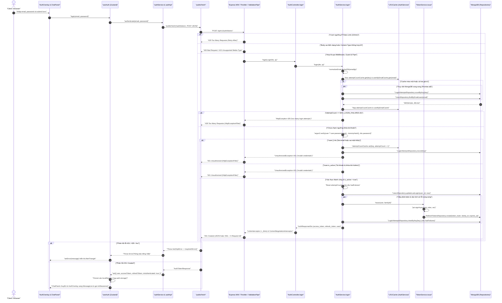

# Luồng 02 — Đăng nhập, Chống Brute-Force & Cấp phát Cặp Token (POST /api/v1/auth/tokens)

- **Motivation/Background**: Trong nền tảng `RAG_TS`, chức năng đăng nhập là cổng xác thực chính để chuyển đổi thông tin định danh (`email`, `password`) thành cặp Access Token (`JWT`) và Refresh Token lưu trữ trạng thái phiên trên trình duyệt; do MongoDB từ xa đi qua Cloudflare Access TCP tunnel (`~15–25ms` mỗi RTT) và mật khẩu dùng `Argon2id` tiêu tốn CPU, luồng này phải kết hợp song song hóa truy vấn cache-miss, bộ nhớ đệm `LRUCache`, chống brute-force hai tầng và cơ chế `dummyHash` chống rò rỉ thông tin qua thời gian phản hồi.
- **Purpose**: Đặc tả chi tiết luồng request-response đầu-cuối (end-to-end) của thao tác đăng nhập tại `POST /api/v1/auth/tokens`, ánh xạ từng bước xử lý qua toàn bộ các tầng Frontend và Backend cùng các bất biến bảo mật và kịch bản lỗi.
- **Overview Pipeline**: Client thao tác biểu mẫu trong `AuthOverlay` → `useAuthSession` / `useAuth` (`Zustand`) → `authService` → `authApi` / `publicFetch` → `HTTP POST /api/v1/auth/tokens` → Express Middleware (`trust proxy`, `requestId`, `helmet`, `metrics`, `XML/JSON`) → `ThrottlerGuard` (`@RateLimit('login')`) → `ValidationPipe` → `AuthController.login` → `AuthService.login` (`LRUCache` + `Promise.all` MongoDB + `Argon2id`/`dummyHash` + `TokenService.issue`) → `LinksInterceptor` & `ContentNegotiationInterceptor` → HTTP `201 Created` → `AuthApi` / `authStore` cập nhật `localStorage` và chuyển giao diện `ChatPanel`.
- **Detailed Plan**: §1 Kiến trúc Tổng thể qua các Tầng; §2 Biểu đồ Tuần tự End-to-End (Sequence Diagram); §3 Chi tiết 4 Giai đoạn Request–Response & Wire Examples; §4 Xử lý Lỗi & Các Bất biến Hệ thống (Error Paths & System Invariants).
- **References**: [AGENTS.md](../../../AGENTS.md), [MD_CONVENTION.md](../../../agents/rules/MD_CONVENTION.md), [AUTH_AND_SECURITY_ARCHITECTURE.md](../../../backend_rag/docs/AUTH_AND_SECURITY_ARCHITECTURE.md), [API_DESIGN.md](../../api/API_DESIGN.md), [AuthOverlay.tsx](../../../frontend_rag/src/features/auth/AuthOverlay.tsx), [auth.controller.ts](../../../backend_rag/src/modules/auth/auth.controller.ts), [auth.service.ts](../../../backend_rag/src/modules/auth/auth.service.ts), [token.service.ts](../../../backend_rag/src/modules/auth/token.service.ts).
- **Created**: 2026-11-26T10:12:00+07:00
- **Last Updated**: 2026-11-27T07:40:00+07:00

[STATUS: ACTIVE]

---

## 1. Kiến trúc Tổng thể qua các Tầng

Sơ đồ dưới đây ánh xạ đầy đủ **26 bước** trong pipeline chuẩn (`Client → FE [Component → Hook → Service → API → HTTP Client] → HTTP Request → BE [Node.js HTTP Server → Middleware → Guard → Interceptor In → Pipe → Controller → Service → Repository → Database] → BE Return [Repository → Service → Controller → Interceptor Out → NestJS/Express gửi response] → HTTP Response → FE Return [HTTP Client → API → Service → Hook → Component] → Client`) vào đúng các file mã nguồn thực tế cho endpoint `POST /api/v1/auth/tokens`.

```mermaid
flowchart TB
  subgraph FE_IN["Giai đoạn 1 — Frontend Chiều đi (Client -> HTTP Request)"]
    CLI_IN["1. Client (Người dùng nhập email, password)"]
    CMP_IN["2. FE Component (ChatPanel -> AuthOverlay.handleSubmit)"]
    HK_IN["3. FE Hook & Store (useAuthSession -> authStore.login)"]
    FSVC_IN["4. FE Service (authService.ts: authenticate)"]
    FAPI_IN["5. FE API (authApi.ts: loginWithPassword)"]
    HTTP_IN["6. FE HTTP Client (http.ts: publicFetch -> POST /api/v1/auth/tokens)"]
    CLI_IN --> CMP_IN --> HK_IN --> FSVC_IN --> FAPI_IN --> HTTP_IN
  end

  subgraph BE_IN["Giai đoạn 2 — Backend Chiều vào (HTTP Request -> Database)"]
    NODE["7. BE Node.js HTTP Server (main.ts: UV_THREADPOOL_SIZE=4, keepAliveTimeout=65s)"]
    MW["8. BE NestJS/Express Middleware (app.setup.ts: trust proxy, requestId, helmet, metrics, XML/JSON)"]
    GD["9. BE Guard (ThrottlerGuard + @RateLimit login 10 req/60s)"]
    INT_IN["10. BE Interceptor chiều vào (ContentNegotiation Accept 406 + LinksInterceptor metadata)"]
    PP["11. BE Pipe (ValidationPipe whitelist/transform -> LoginDto)"]
    CTL_IN["12. BE Controller (AuthController.login @Post tokens)"]
    BESVC_IN["13. BE Service (AuthService.login LRUCache, lockout, Argon2id/dummyHash & TokenService.issue)"]
    REPO_IN["14. BE Repository (LoginAttemptsRepository, UsersRepository, RefreshTokensRepository)"]
    DB["15. Database (MongoDB: login_attempts, users, refresh_tokens)"]
    HTTP_IN -->|"POST /api/v1/auth/tokens"| NODE --> MW --> GD --> INT_IN --> PP --> CTL_IN --> BESVC_IN --> REPO_IN --> DB
  end

  subgraph BE_OUT["Giai đoạn 3 — Backend Chiều về (Database -> HTTP Response)"]
    REPO_OUT["16. Database -> BE Repository (LeanUser, attemptCount, insert RefreshToken)"]
    BESVC_OUT["17. BE Service (cập nhật cache, lọc password_hash -> AuthResponseDto)"]
    CTL_OUT["18. BE Controller (AuthController.login trả AuthResponseDto status 201)"]
    INT_OUT["19. BE Interceptor chiều ra (LinksInterceptor +_links -> ContentNegotiation JSON/XML)"]
    EXP_OUT["20. BE NestJS/Express gửi response (HTTP 201 / HttpExceptionFilter + X-Request-Id + Metrics)"]
    DB --> REPO_OUT --> BESVC_OUT --> CTL_OUT --> INT_OUT --> EXP_OUT
  end

  subgraph FE_OUT["Giai đoạn 4 — Frontend Chiều về (HTTP Response -> Client)"]
    HTTP_OUT["21. FE HTTP Client (publicFetch nhận Response HTTP 201 / 401 / 429)"]
    FAPI_OUT["22. FE API (authApi.ts: readJsonOrThrow -> AuthTokenResponse hoặc AuthApiError)"]
    FSVC_OUT["23. FE Service (authService.ts: trả AuthTokenResponse hoặc mapAuthError tiếng Việt)"]
    HK_OUT["24. FE Hook & Store (authStore set + persist localStorage -> useAuthSession)"]
    CMP_OUT["25. FE Component (AuthOverlay tắt loading -> ChatPanel + MessageList + initSessions)"]
    CLI_OUT["26. Client (Người dùng đăng nhập thành công / thấy thông báo lỗi tiếng Việt)"]
    EXP_OUT -->|"HTTP 201 Created / 4xx"| HTTP_OUT --> FAPI_OUT --> FSVC_OUT --> HK_OUT --> CMP_OUT --> CLI_OUT
  end
```



---

## 2. Biểu đồ Tuần tự End-to-End (Sequence Diagram)

Biểu đồ tuần tự mô tả toàn bộ vòng đời một lần đăng nhập, bao gồm bước đọc song song `Promise.all` khi cache-miss, cơ chế xác thực `Argon2id` kết hợp `dummyHash` chống timing attack, ghi nhận lần thử thất bại hoặc cấp phát cặp token mới và cập nhật trạng thái phiên ở Frontend.



---

## 3. Chi tiết 4 Giai đoạn Request–Response & Wire Examples

### 3.1. Giai đoạn 1 — Chiều đi Frontend: Client → FE → HTTP Request

| Bước | Tầng (Layer) | File & Ký hiệu | Đầu vào (Input) | Xử lý Nghiệp vụ & Kỹ thuật | Đầu ra (Output) |
| :--- | :--- | :--- | :--- | :--- | :--- |
| 1 | Client | [`AuthOverlay.tsx`](../../../frontend_rag/src/features/auth/AuthOverlay.tsx#L78-L164) (`onSubmit`) | `email`, `password` | Nhập `email`, `password` trên `<AuthOverlay />` và bấm nút `Đăng nhập`. | Sự kiện `onSubmit` |
| 2 | FE — Component | [`AuthOverlay.tsx`](../../../frontend_rag/src/features/auth/AuthOverlay.tsx#L21-L36) (`handleSubmit()`) | `FormEvent`, state form | `preventDefault()`, xóa lỗi, bật `loading`, check HTML5 rồi gọi `login()`. | `login(email, password)` |
| 3 | FE — Hook (+ Store) | [`useAuth.ts`](../../../frontend_rag/src/features/auth/hooks/useAuth.ts#L4-L22) (`useAuthSession()`) | `(email, password)` | Lấy `useAuth.login()` qua selector, ủy quyền bất đồng bộ xuống service. | `authenticate(email, password)` |
| 4 | FE — Service | [`authService.ts`](../../../frontend_rag/src/features/auth/services/authService.ts#L36-L42) (`authenticate()`) | `email`, `password` | Bọc `loginWithPassword()` trong `try/catch` để dịch lỗi qua `mapAuthError()`. | `loginWithPassword(payload)` |
| 5 | FE — API | [`authApi.ts`](../../../frontend_rag/src/features/auth/api/authApi.ts#L46-L53) (`loginWithPassword()`) | `LoginPayload` | Cấu hình `POST '/auth/tokens'`, JSON body, gọi `publicFetch()` (không gắn Bearer). | `publicFetch('/auth/tokens', init)` |
| 6 | FE — HTTP Client (gọi fetch) | [`http.ts`](../../../frontend_rag/src/shared/api/http.ts#L15-L17) (`publicFetch()`) | `'/auth/tokens'`, `init` | Ghép `API_BASE` (`/api/v1`) và gọi `fetch('/api/v1/auth/tokens', init)`. | HTTP `POST /api/v1/auth/tokens` |

#### Wire Example — HTTP Request (`POST /api/v1/auth/tokens`)

```http
POST /api/v1/auth/tokens HTTP/1.1
Host: localhost:3000
Content-Type: application/json
Accept: application/json

{
  "email": "researcher@university.edu",
  "password": "correct horse battery"
}
```

---

### 3.2. Giai đoạn 2 — Chiều vào Backend: HTTP Request → BE → Database

| Bước | Tầng (Layer) | File & Ký hiệu | Đầu vào (Input) | Xử lý Nghiệp vụ & Kỹ thuật | Đầu ra (Output) |
| :--- | :--- | :--- | :--- | :--- | :--- |
| 7 | BE — Node.js HTTP Server | [`main.ts`](../../../backend_rag/src/main.ts#L1-L24) (`bootstrap()`) | Socket TCP `:3000` | Đặt `UV_THREADPOOL_SIZE=4` (cho `Argon2id`), mở Node HTTP server (`65s` keepAlive). | Raw HTTP Request |
| 8 | BE — NestJS/Express Middleware | [`app.setup.ts`](../../../backend_rag/src/app.setup.ts#L40-L75) (`configureApp()`) | Raw Request | `trust proxy`, `X-Request-Id` UUIDv7, Helmet, metrics, parse JSON/XML (`415`), `/api/v1`. | `req.ip`, `req.id`, `req.body` |
| 9 | BE — Guard | [`throttler.ts`](../../../backend_rag/src/common/security/throttler.ts#L16-L46) (`@RateLimit('login')`) | `req.ip` | `ThrottlerGuard` giới hạn `10 req / 60s` theo IP (vượt ngưỡng ném `429`). | Cho qua hoặc `429` |
| 10 | BE — Interceptor chiều vào | [`xml.ts`](../../../backend_rag/src/common/http/xml.ts#L109-L119) (`ContentNegotiationInterceptor.intercept()`) | Header `Accept` | Kiểm tra `Accept` hợp lệ (sai ném `406`); đọc metadata `@WithLinks`. | Cho vào Pipe |
| 11 | BE — Pipe | [`validation.ts`](../../../backend_rag/src/common/http/validation.ts#L18-L26) (`createValidationPipe()`) | `req.body` | Whitelist + trim `LoginDto`: kiểm tra `email` (`<= 254`) & `password` (`<= 200`). | `dto: LoginDto` |
| 12 | BE — Controller | [`auth.controller.ts`](../../../backend_rag/src/modules/auth/auth.controller.ts#L33-L41) (`AuthController.login()`) | `LoginDto`, `@Ip() ip` | Nhận request `@Post('tokens')` và chuyển `(dto, ip)` sang `AuthService`. | Gọi `AuthService.login()` |
| 13 | BE — Service | [`auth.service.ts`](../../../backend_rag/src/modules/auth/auth.service.ts#L119-L183) (`AuthService.login()`) | `dto: LoginDto`, `ip` | Tra `LRUCache` / `Promise.all`; check lockout (`>= 5` → `429`); chạy `argon2.verify` (`dummyHash()` nếu null); `TokenService.issue()`. | Yêu cầu DB đọc/ghi |
| 14 | BE — Repository | [`users.repository.ts`](../../../backend_rag/src/modules/auth/repositories/users.repository.ts#L29-L39) (`UsersRepository.findByEmailLean()`), [`refresh-tokens.repository.ts`](../../../backend_rag/src/modules/auth/repositories/refresh-tokens.repository.ts#L22-L24) (`RefreshTokensRepository.create()`) | `key`, `email`, `token_hash` | Chạy `Promise.all` (`countByKey`, `findByEmailLean`); sai ghi `login_attempts`; đúng `updateLastLogin` + lưu token hash. | Truy vấn Mongoose |
| 15 | Database | [`user.schema.ts`](../../../backend_rag/src/modules/auth/schemas/user.schema.ts#L5-L53) (`UserSchema`), [`refresh-token.schema.ts`](../../../backend_rag/src/modules/auth/schemas/refresh-token.schema.ts#L5-L30) (`RefreshTokenSchema`) | Query qua Tunnel | Đọc/ghi trên `users`, `login_attempts` (TTL `15m`) và `refresh_tokens` (TTL `7d`). | `.lean()` & xác nhận ghi |

---

### 3.3. Giai đoạn 3 — Chiều về Backend: Database → BE → HTTP Response

| Bước | Tầng (Layer) | File & Ký hiệu | Đầu vào (Input) | Xử lý Nghiệp vụ & Kỹ thuật | Đầu ra (Output) |
| :--- | :--- | :--- | :--- | :--- | :--- |
| 16 | Database → BE — Repository | [`users.repository.ts`](../../../backend_rag/src/modules/auth/repositories/users.repository.ts#L29-L39) (`UsersRepository.findByEmailLean()`) | Kết quả từ MongoDB | Trả `LeanUser`, `attemptCount` và xác nhận `updateLastLogin` / chèn `token_hash`. | Plain objects `.lean()` |
| 17 | BE — Service | [`auth.service.ts`](../../../backend_rag/src/modules/auth/auth.service.ts#L178-L183) (`AuthService.respond()`) | `LeanUser`, `IssuedTokens` | Làm ấm `userCache` & `tokenVersionCache` (`cacheUser()`), map `toUserDto()`, log `LOGIN_OK`. | `AuthResponseDto` |
| 18 | BE — Controller | [`auth.controller.ts`](../../../backend_rag/src/modules/auth/auth.controller.ts#L33-L41) (`AuthController.login()`) | `AuthResponseDto` | Trả trực tiếp `AuthResponseDto` với mã mặc định `201 Created`. | `AuthResponseDto` (`201`) |
| 19 | BE — Interceptor chiều ra | [`hateoas.ts`](../../../backend_rag/src/common/http/hateoas.ts#L157-L166) (`LinksInterceptor.intercept()`) | `AuthResponseDto` | Chèn `_links: accountLinks()` trên bản sao nông; serialize JSON hoặc XML (`toXml()`). | Body kèm `_links` |
| 20 | BE — NestJS/Express gửi response | [`http-exception.filter.ts`](../../../backend_rag/src/common/http/http-exception.filter.ts#L69-L97) (`HttpExceptionFilter.catch()`) | Body / `HttpException` | Gửi `201 Created` (hoặc chuẩn hóa lỗi `401`/`429`) + `X-Request-Id` + chốt metrics. | HTTP Response |

#### Wire Example — HTTP `201 Created` Response

```http
HTTP/1.1 201 Created
Content-Type: application/json; charset=utf-8
X-Request-Id: 019367a1-4b2e-7c00-9f12-8a4c2d1e0001

{
  "access_token": "eyJhbGciOiJIUzI1NiIsInR5cCI6IkpXVCJ9...",
  "token_type": "Bearer",
  "expires_in": 900,
  "refresh_token": "kJ8mP2vQ9xL4nR7wT1yB6cF3hN5sD0aZ8eG4uV2iX9o",
  "user": {
    "id": "67458a12c3f90b0012a4e801",
    "email": "researcher@university.edu",
    "display_name": "Minh Trần",
    "roles": ["user"],
    "created_at": "2026-11-01T08:30:00.000Z"
  },
  "_links": {
    "self": { "href": "/api/v1/users/me" },
    "update": { "href": "/api/v1/users/me", "method": "PATCH" },
    "password": { "href": "/api/v1/users/me/password", "method": "PUT" },
    "chat-sessions": { "href": "/api/v1/chat-sessions" },
    "token-rotations": { "href": "/api/v1/auth/token-rotations", "method": "POST" },
    "token-revocations": { "href": "/api/v1/auth/token-revocations", "method": "POST" }
  }
}
```

---

### 3.4. Giai đoạn 4 — Chiều về Frontend: HTTP Response → FE → Client

| Bước | Tầng (Layer) | File & Ký hiệu | Đầu vào (Input) | Xử lý Nghiệp vụ & Kỹ thuật | Đầu ra (Output) |
| :--- | :--- | :--- | :--- | :--- | :--- |
| 21 | FE — HTTP Client (kiểm tra status & đọc body) | [`http.ts`](../../../frontend_rag/src/shared/api/http.ts#L15-L17) (`publicFetch()`) | HTTP `Response` | Nhận `Response` nguyên trạng (`201`/`401`/`429`) trả về `authApi` (không auto-rotate). | `res: Response` |
| 22 | FE — API (xử lý dữ liệu) | [`authApi.ts`](../../../frontend_rag/src/features/auth/api/authApi.ts#L30-L53) (`readJsonOrThrow()`) | `res: Response` | Nếu `res.ok` đọc JSON `AuthTokenResponse`; ngược lại ném `AuthApiError`. | `AuthTokenResponse` / lỗi |
| 23 | FE — Service | [`authService.ts`](../../../frontend_rag/src/features/auth/services/authService.ts#L20-L42) (`mapAuthError()`) | Kết quả / lỗi | Trả `AuthTokenResponse`; nếu lỗi dịch `401`/`429` sang tiếng Việt và ném `Error`. | Phiên hợp lệ / `Error` |
| 24 | FE — Hook (cập nhật state) | [`authStore.ts`](../../../frontend_rag/src/features/auth/authStore.ts#L40-L93) (`useAuth.login()`) | `AuthTokenResponse` | Lưu `{ user, accessToken, refreshToken, isAuthenticated: true }` vào `localStorage`. | State đăng nhập mới |
| 25 | FE — Component (hiển thị lại) | [`ChatPanel.tsx`](../../../frontend_rag/src/features/chat/components/ChatPanel.tsx#L27-L118) (`<ChatPanel />`) | `isAuthenticated`, `error` | Tắt `loading`; hiện `AlertTriangle` nếu lỗi, hoặc mở chat + gọi `initSessions()`. | DOM cập nhật |
| 26 | Client | [`ChatPanel.tsx`](../../../frontend_rag/src/features/chat/components/ChatPanel.tsx#L58-L118) (`<ChatPanel />`) | UI sau re-render | Người dùng thấy phiên chat & lịch sử sẵn sàng (hoặc thông báo lỗi nhập lại). | Hoàn tất đăng nhập |

---

## 4. Xử lý Lỗi & Các Bất biến Hệ thống (Error Paths & System Invariants)

### 4.1. Bảng Tổng hợp các Đường Lỗi (Error Paths)

| Điều kiện kích hoạt | Lớp phát hiện | HTTP Status & Payload Backend | Ánh xạ & Hiển thị Frontend (`mapAuthError` / `AuthOverlay`) |
| :--- | :--- | :--- | :--- |
| `Content-Type` không phải JSON/XML (khi có body) | [`app.setup.ts`](../../../backend_rag/src/app.setup.ts#L64-L67), [`xml.ts`](../../../backend_rag/src/common/http/xml.ts#L70-L84) | `415 Unsupported Media Type` — `'content type must be application/json or application/xml'` | Ném `AuthApiError(415, ...)` → hiển thị `serverMessage` hoặc fallback |
| XML lỗi cú pháp / chứa `<!DOCTYPE` hoặc `<!ENTITY` | [`xml.ts`](../../../backend_rag/src/common/http/xml.ts#L48-L67) | `400 Bad Request` — `'invalid xml'` | Ném `AuthApiError(400, ...)` → hiển thị `serverMessage` |
| Trường `email` / `password` sai kiểu, thừa trường hoặc quá dài | [`validation.ts`](../../../backend_rag/src/common/http/validation.ts#L18-L25), [`auth.dto.ts`](../../../backend_rag/src/modules/auth/dto/auth.dto.ts#L36-L47) | `400 Bad Request` — `'invalid email'` hoặc `'invalid credentials'` | [`mapAuthError`](../../../frontend_rag/src/features/auth/services/authService.ts#L20-L34) map `'invalid email'` → `'Địa chỉ email không hợp lệ.'`, còn lại dùng `serverMessage` |
| Vượt ngưỡng IP Rate Limit (`> 10` request trong `60s`) | [`throttler.ts`](../../../backend_rag/src/common/security/throttler.ts#L19-L46), [`app.module.ts`](../../../backend_rag/src/app.module.ts#L46) | `429 Too Many Requests` (kèm header `Retry-After` được CORS expose) | `mapAuthError` (`status === 429`) → `'Quá nhiều lần thử đăng nhập. Vui lòng thử lại sau ít phút.'` |
| Sai mật khẩu quá ngưỡng khóa (`attemptCount >= 5` theo `sha256(email\|ip)` trong 15 phút) | [`auth.service.ts`](../../../backend_rag/src/modules/auth/auth.service.ts#L141-L150) | `429 Too Many Requests` — `'too many login attempts'` (log `LOGIN_FAILED`, `reason: 'rate_limited'`) | `mapAuthError` (`status === 429`) → `'Quá nhiều lần thử đăng nhập. Vui lòng thử lại sau ít phút.'` |
| Email không tồn tại hoặc sai mật khẩu (`!user \|\| !ok`) | [`auth.service.ts`](../../../backend_rag/src/modules/auth/auth.service.ts#L158-L163) | `401 Unauthorized` — `'invalid credentials'` (sau khi chạy xong `Argon2id` + ghi `login_attempts`) | `mapAuthError` (`status === 401`) → `'Email hoặc mật khẩu không chính xác.'` |
| Tài khoản bị khóa bởi quản trị viên (`user.is_active === false`) | [`auth.service.ts`](../../../backend_rag/src/modules/auth/auth.service.ts#L164-L170) | `401 Unauthorized` — `'invalid credentials'` (log `reason: 'account_disabled'`, ẩn lý do thực với client) | `mapAuthError` (`status === 401`) → `'Email hoặc mật khẩu không chính xác.'` |
| Client gửi `Accept` không tương thích JSON/XML/SSE | [`xml.ts`](../../../backend_rag/src/common/http/xml.ts#L114-L118) | `406 Not Acceptable` — `'accept must allow application/json or application/xml'` | Ném `AuthApiError(406, ...)` → hiển thị `serverMessage` |
| Lỗi hệ thống / DB mất kết nối không phải `HttpException` | [`http-exception.filter.ts`](../../../backend_rag/src/common/http/http-exception.filter.ts#L32-L50) | `500 Internal Server Error` — `'internal server error'` (che stack trace, gắn `res.err` cho log) | `AuthOverlay` hiển thị `'internal server error'` hoặc thông điệp fallback |

### 4.2. Các Bất biến Hệ thống Cần Bảo toàn (System Invariants)

1. **Chống Brute-Force Hai Tầng & Cấu hình `trust proxy`**:
   - Tầng 1 (`@RateLimit('login')` tại [`throttler.ts`](../../../backend_rag/src/common/security/throttler.ts#L19-L20)): giới hạn **`10` yêu cầu/phút/IP** nhằm chặn credential stuffing diện rộng.
   - Tầng 2 (`MAX_LOGIN_FAILURES = 5` tại [`auth.service.ts`](../../../backend_rag/src/modules/auth/auth.service.ts#L29), [`login-attempt.schema.ts`](../../../backend_rag/src/modules/auth/schemas/login-attempt.schema.ts#L4-L17)): khóa cặp `(email, ip)` được băm thành `sha256(\`${email}\|${ip}\`)` trong cửa sổ trượt **15 phút** (MongoDB TTL `LOGIN_WINDOW_SECONDS = 900` và `attemptCountCache` TTL `15 * 60 * 1000ms`).
   - Bất biến đi kèm: `TRUST_PROXY_HOPS` trong [`security.ts`](../../../backend_rag/src/common/security/security.ts#L46-L52) phải khớp chính xác số lượng reverse proxy thực tế; cấu hình sai cho phép giả mạo `X-Forwarded-For` để qua mặt cả hai tầng bảo vệ.
2. **Chống Dò Tìm Tài khoản qua Thời gian (`dummyHash` Anti-Timing Leak)**:
   - Tại [`auth.service.ts`](../../../backend_rag/src/modules/auth/auth.service.ts#L76-L94) và [`auth.service.ts`](../../../backend_rag/src/modules/auth/auth.service.ts#L152-L157), `argon2.verify` **luôn luôn** được thực thi kể cả khi `user === null`, sử dụng `this.dummyHash()` được sinh lười một lần với cùng cấu hình `ARGON2_OPTIONS` (`argon2id`, `memoryCost: 65536`, `timeCost: 3`, `parallelism: 4`).
   - Tài khoản bị khóa (`is_active: false`) cũng trả về đúng mã `401` với thông điệp `'invalid credentials'` giống hệt sai mật khẩu để không làm lộ trạng thái tồn tại của email.
3. **Thông số `Argon2id` & Threadpool (`UV_THREADPOOL_SIZE = 4`)**:
   - Thông số `ARGON2_OPTIONS` (`64 MB`, `timeCost: 3`, `parallelism: 4`) tại [`auth.service.ts`](../../../backend_rag/src/modules/auth/auth.service.ts#L43-L48) là bất biến bảo mật (`D-021`, `D-022`), kết hợp với `UV_THREADPOOL_SIZE = 4` đặt ở dòng 1 của [`main.ts`](../../../backend_rag/src/main.ts#L1) để tránh nghẽn event loop và các tác vụ I/O khác khi nhiều request đăng nhập chạy đồng thời.
4. **Chiến lược Bộ đệm `LRUCache` & Giảm RTT Cloudflare Tunnel**:
   - Bốn bộ đệm trong [`AuthService`](../../../backend_rag/src/modules/auth/auth.service.ts#L52-L74) đảm nhiệm các vai trò tách biệt:
     - `attemptCountCache` (`max: 10_000`, `ttl: 15m`, không gia hạn trượt): giữ bộ đếm thất bại theo `sha256(email|ip)`.
     - `userByEmailCache` (`max: 5_000`, `ttl: 300s`, `updateAgeOnGet: true`): phục vụ tra cứu nhanh theo `email` lúc đăng nhập.
     - `userCache` (`max: 5_000`, `ttl: 300s`, `updateAgeOnGet: true`): giữ `UserDto` cho `/users/me` và `refresh`.
     - `tokenVersionCache` (`max: 5_000`, `ttl: 5s`, cố ý **không** dùng `updateAgeOnGet`): giúp `JwtAuthGuard` kiểm tra `is_active` và `token_version` trong cửa sổ tối đa 5 giây mà không truy vấn MongoDB mỗi request, đồng thời được nạp trước ngay trong `AuthService.respond` ([`auth.service.ts`](../../../backend_rag/src/modules/auth/auth.service.ts#L314)) để các request ngay sau đăng nhập trúng cache.
   - Khi cache miss ở `login`, `Promise.all` gộp `countByKey` và `findByEmailLean` thành 1 RTT; sau khi xác thực thành công, `respond` và `clearByKey` cũng chạy song song qua `Promise.all`.
5. **Bảo mật Token & Không Lưu Raw Refresh Token ở DB**:
   - Access Token (`JWT`) có thời hạn `15` phút (`ACCESS_TTL_SECONDS = 900`) và mang claim `ver` đồng bộ với `users.token_version` ([`token.service.ts`](../../../backend_rag/src/modules/auth/token.service.ts#L54-L64)).
   - Refresh Token có thời hạn `7` ngày (`REFRESH_TTL_SECONDS = 604800`), sinh ngẫu nhiên 32 bytes `base64url` và chỉ lưu giá trị băm `HMAC-SHA256(raw, JWT_REFRESH_SECRET)` trong collection `refresh_tokens` ([`token.service.ts`](../../../backend_rag/src/modules/auth/token.service.ts#L43-L70)), kèm `family_id` (`UUIDv4`) để thu hồi dây chuyền nếu phát hiện tái sử dụng token.
6. **Chuẩn Hóa Lỗi Chung (`HttpExceptionFilter`) & Bảo vệ Log (`emailHash`)**:
   - Mọi lỗi HTTP đều đi qua [`HttpExceptionFilter`](../../../backend_rag/src/common/http/http-exception.filter.ts#L69-L97) trả về cấu trúc đồng nhất `{ statusCode, error, message, request_id }` (JSON hoặc XML theo `Accept`).
   - Địa chỉ email thô **không bao giờ** xuất hiện trong log sự kiện; [`emailHash`](../../../backend_rag/src/modules/auth/auth.utils.ts#L10-L15) cắt 16 ký tự hex đầu của `sha256(normalizeEmail(email))` khi ghi `LOGIN_FAILED`.
7. **Khác biệt Độ dài Mật khẩu Giữa Đăng nhập và Đăng ký ở FE/BE**:
   - Lưu ý thực tế trong mã nguồn: input mật khẩu ở [`AuthOverlay.tsx`](../../../frontend_rag/src/features/auth/AuthOverlay.tsx#L134) dùng chung `minLength={8}` trên trình duyệt, trong khi Backend [`LoginDto`](../../../backend_rag/src/modules/auth/dto/auth.dto.ts#L43-L46) không áp đặt độ dài tối thiểu khi đăng nhập (chỉ chặn `@MaxLength(200)`) nhằm vẫn cho phép tài khoản cũ đăng nhập và xử lý thống nhất qua `Argon2id`; chính sách tối thiểu 10 ký tự (`PASSWORD_MIN_LENGTH = 10` tại [`common-passwords.ts`](../../../backend_rag/src/modules/auth/common-passwords.ts#L242)) chỉ áp dụng khi đăng ký (`RegisterDto`) hoặc đổi mật khẩu (`ChangePasswordDto`).
