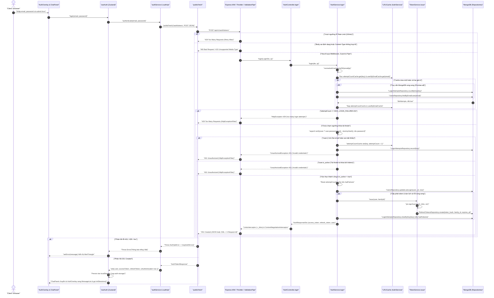

# Luồng 02 — Đăng nhập, Chống Brute-Force & Cấp phát Cặp Token (POST /api/v1/auth/tokens)

- **Motivation/Background**: Trong nền tảng `RAG_TS`, chức năng đăng nhập là cổng xác thực chính để chuyển đổi thông tin định danh (`email`, `password`) thành cặp Access Token (`JWT`) và Refresh Token lưu trữ trạng thái phiên trên trình duyệt; do MongoDB từ xa đi qua Cloudflare Access TCP tunnel (`~15–25ms` mỗi RTT) và mật khẩu dùng `Argon2id` tiêu tốn CPU, luồng này phải kết hợp song song hóa truy vấn cache-miss, bộ nhớ đệm `LRUCache`, chống brute-force hai tầng và cơ chế `dummyHash` chống rò rỉ thông tin qua thời gian phản hồi.
- **Purpose**: Đặc tả chi tiết luồng request-response đầu-cuối (end-to-end) của thao tác đăng nhập tại `POST /api/v1/auth/tokens`, ánh xạ từng bước xử lý qua toàn bộ các tầng Frontend và Backend cùng các bất biến bảo mật và kịch bản lỗi.
- **Overview Pipeline**: Client thao tác biểu mẫu trong `AuthOverlay` → `useAuthSession` / `useAuth` (`Zustand`) → `authService` → `authApi` / `publicFetch` → `HTTP POST /api/v1/auth/tokens` → Express Middleware (`trust proxy`, `requestId`, `helmet`, `metrics`, `XML/JSON`) → `ThrottlerGuard` (`@RateLimit('login')`) → `ValidationPipe` → `AuthController.login` → `AuthService.login` (`LRUCache` + `Promise.all` MongoDB + `Argon2id`/`dummyHash` + `TokenService.issue`) → `LinksInterceptor` & `ContentNegotiationInterceptor` → HTTP `201 Created` → `AuthApi` / `authStore` cập nhật `localStorage` và chuyển giao diện `ChatPanel`.
- **Detailed Plan**: §1 Kiến trúc Tổng thể qua các Tầng; §2 Biểu đồ Tuần tự End-to-End (Sequence Diagram); §3 Chi tiết 4 Giai đoạn Request–Response & Wire Examples; §4 Xử lý Lỗi & Các Bất biến Hệ thống (Error Paths & System Invariants).
- **References**: [AGENTS.md](../../../AGENTS.md), [MD_CONVENTION.md](../../../agents/rules/MD_CONVENTION.md), [AUTH_AND_SECURITY_ARCHITECTURE.md](../../../backend_rag/docs/AUTH_AND_SECURITY_ARCHITECTURE.md), [API_DESIGN.md](../../api/API_DESIGN.md), [AuthOverlay.tsx](../../../frontend_rag/src/features/auth/AuthOverlay.tsx), [auth.controller.ts](../../../backend_rag/src/modules/auth/auth.controller.ts), [auth.service.ts](../../../backend_rag/src/modules/auth/auth.service.ts), [token.service.ts](../../../backend_rag/src/modules/auth/token.service.ts).
- **Created**: 2026-11-26T10:12:00+07:00
- **Last Updated**: 2026-11-26T10:12:00+07:00

[STATUS: ACTIVE]

---

## 1. Kiến trúc Tổng thể qua các Tầng

Sơ đồ dưới đây ánh xạ từng tầng xử lý trong pipeline tổng thể vào đúng các module, file mã nguồn và ký hiệu thực tế của `frontend_rag` và `backend_rag` cho endpoint `POST /api/v1/auth/tokens`.

```mermaid
flowchart LR
  subgraph FE["Frontend (frontend_rag)"]
    direction TB
    UI["UI Component: ChatPanel & AuthOverlay"]
    HK["Hook: useAuthSession"]
    ST["Store: useAuth (Zustand + persist)"]
    FESVC["Service: authenticate & mapAuthError"]
    FEAPI["API & HTTP Client: loginWithPassword & publicFetch"]
    UI --> HK --> ST --> FESVC --> FEAPI
  end

  subgraph NET["HTTP Transport"]
    REQ["POST /api/v1/auth/tokens (JSON/XML)"]
  end

  subgraph BE["Backend (backend_rag)"]
    direction TB
    MW["Middleware Pipeline: trust proxy, requestIdMiddleware, securityHeaders, metrics, xmlBodyMiddleware"]
    GD["Guard: ThrottlerGuard + RateLimit login (10 req/60s)"]
    PP["Pipe: ValidationPipe (whitelist, forbidNonWhitelisted, transform)"]
    CTL["Controller: AuthController.login (@Post tokens)"]
    BESVC["Service: AuthService.login & TokenService.issue"]
    CACHE["In-Memory LRUCache: attemptCountCache, userByEmailCache, userCache, tokenVersionCache"]
    REPO["Repositories: LoginAttemptsRepository, UsersRepository, RefreshTokensRepository"]
    DB[("MongoDB Collections: login_attempts, users, refresh_tokens")]
    INT["Interceptors & Filter: LinksInterceptor (HATEOAS), ContentNegotiationInterceptor, HttpExceptionFilter"]

    MW --> GD --> PP --> CTL --> BESVC
    BESVC <--> CACHE
    BESVC --> REPO --> DB
    CTL --> INT
  end

  FEAPI --> REQ --> MW
  INT -->|"201 Created / 4xx"| FEAPI
```



---

## 2. Biểu đồ Tuần tự End-to-End (Sequence Diagram)

Biểu đồ tuần tự mô tả toàn bộ vòng đời một lần đăng nhập, bao gồm bước đọc song song `Promise.all` khi cache-miss, cơ chế xác thực `Argon2id` kết hợp `dummyHash` chống timing attack, ghi nhận lần thử thất bại hoặc cấp phát cặp token mới và cập nhật trạng thái phiên ở Frontend.



---

## 3. Chi tiết 4 Giai đoạn Request–Response & Wire Examples

### 3.1. Giai đoạn 1 — Chiều đi Frontend: Client → FE → HTTP Request

| Bước | Tầng (Layer) | File & Ký hiệu | Đầu vào (Input) | Xử lý Nghiệp vụ & Kỹ thuật | Đầu ra (Output) |
| :--- | :--- | :--- | :--- | :--- | :--- |
| 1.1 | UI Component | [`ChatPanel.tsx`](../../../frontend_rag/src/features/chat/components/ChatPanel.tsx#L14-L118) (`ChatPanel`) | `isAuthenticated = false` từ `useAuthSession()` | Kiểm tra điều kiện render: khi chưa đăng nhập, `ChatPanel` hiển thị [`AuthOverlay`](../../../frontend_rag/src/features/auth/AuthOverlay.tsx#L6) thay cho vùng hội thoại (`PipelineStatus`, `MessageList`, `ChatInput`). | Giao diện biểu mẫu đăng nhập `data-testid="chat-auth-panel"` |
| 1.2 | UI Component | [`AuthOverlay.tsx`](../../../frontend_rag/src/features/auth/AuthOverlay.tsx#L21-L36) (`AuthOverlay.handleSubmit`) | Sự kiện submit form (`email`, `password`, `isLogin = true`) | Gọi `e.preventDefault()`, xóa lỗi cũ (`setError('')`), bật trạng thái `loading = true` (vô hiệu hóa nút submit), kiểm tra HTML constraint (`required`, `type="email"`, `minLength={8}` ở [`AuthOverlay.tsx`](../../../frontend_rag/src/features/auth/AuthOverlay.tsx#L107-L139)) và gọi `await login(email, password)`. | Lời gọi bất đồng bộ tới Hook/Store `login(email, password)` |
| 1.3 | Hook | [`useAuth.ts`](../../../frontend_rag/src/features/auth/hooks/useAuth.ts#L4-L22) (`useAuthSession`) | Selector từ `useAuth` | Cung cấp hàm `login` gắn với action của Zustand store cho `AuthOverlay` mà không làm component đăng ký toàn bộ các trường state không cần thiết. | Tham chiếu tới `useAuth((s) => s.login)` |
| 1.4 | State Store | [`authStore.ts`](../../../frontend_rag/src/features/auth/authStore.ts#L40-L48) (`useAuth.login`) | `email: string`, `password: string` | Ủy quyền quá trình gọi mạng và chuẩn hóa lỗi cho `authenticate(email, password)` trong [`authService.ts`](../../../frontend_rag/src/features/auth/services/authService.ts#L36-L42). | Chuỗi `Promise<void>` chờ `AuthTokenResponse` |
| 1.5 | FE Service | [`authService.ts`](../../../frontend_rag/src/features/auth/services/authService.ts#L36-L42) (`authenticate`) | `email`, `password` | Bọc lời gọi `loginWithPassword({ email, password })` trong khối `try/catch`; nếu phát sinh lỗi sẽ đi qua `mapAuthError` để chuyển mã HTTP thành thông điệp tiếng Việt thân thiện. | Kết quả từ `loginWithPassword` hoặc `Error` đã dịch |
| 1.6 | FE API | [`authApi.ts`](../../../frontend_rag/src/features/auth/api/authApi.ts#L46-L53) (`loginWithPassword`) | `payload: LoginPayload` (`{ email, password }`) | Gọi `publicFetch('/auth/tokens', ...)` với method `POST`, header `Content-Type: application/json` và `JSON.stringify(payload)`. Cố ý dùng `publicFetch` thay vì `apiFetch` để không gắn `Bearer` token cũ hoặc kích hoạt tự động xoay vòng refresh token khi nhận `401`. | `Promise<Response>` gửi tới `readJsonOrThrow` |
| 1.7 | HTTP Client | [`http.ts`](../../../frontend_rag/src/shared/api/http.ts#L15-L17) (`publicFetch`) & [`config.ts`](../../../frontend_rag/src/shared/api/config.ts#L1) (`API_BASE`) | `path = '/auth/tokens'`, `RequestInit` | Ghép `API_BASE` (mặc định `/api/v1` từ `VITE_API_BASE`) với `/auth/tokens` và gọi `fetch('/api/v1/auth/tokens', init)`. | HTTP Request đi qua mạng/proxy tới `backend_rag` |

#### Wire Example — HTTP Request (`POST /api/v1/auth/tokens`)

```http
POST /api/v1/auth/tokens HTTP/1.1
Host: localhost:3000
Content-Type: application/json
Accept: application/json

{
  "email": "researcher@university.edu",
  "password": "correct horse battery"
}
```

---

### 3.2. Giai đoạn 2 — Chiều vào Backend: HTTP Request → BE → Repository → Database

| Bước | Tầng (Layer) | File & Ký hiệu | Đầu vào (Input) | Xử lý Nghiệp vụ & Kỹ thuật | Đầu ra (Output) |
| :--- | :--- | :--- | :--- | :--- | :--- |
| 2.1 | Runtime & Bootstrap | [`main.ts`](../../../backend_rag/src/main.ts#L1-L24) (`bootstrap`) & [`app.setup.ts`](../../../backend_rag/src/app.setup.ts#L40-L53) (`configureApp`) | Biến môi trường & HTTP socket | Thiết lập `UV_THREADPOOL_SIZE = '4'` ngay dòng đầu tiên cho các tác vụ `Argon2id` bất đồng bộ trên libuv threadpool; cấu hình `express.set('trust proxy', trustProxySetting(...))` để lấy đúng IP client cho rate limiter và brute-force key; chạy `requestIdMiddleware` (đọc hoặc sinh UUIDv7 `X-Request-Id` và mở `AsyncLocalStorage`) cùng `securityHeaders` (`helmet`). | `req.ip` chính xác, `req.id` UUIDv7, security headers gắn sẵn trên `res` |
| 2.2 | HTTP Pre-processing Middleware | [`app.setup.ts`](../../../backend_rag/src/app.setup.ts#L54-L75) & [`xml.ts`](../../../backend_rag/src/common/http/xml.ts#L70-L105) (`unsupportedBody`, `xmlBodyMiddleware`) | `Request` (headers + raw body) | Ghi nhận metrics HTTP (`PrometheusMetricsRegistry`), kiểm tra `Content-Type` qua `unsupportedBody(req)` (từ chối `415` nếu có body nhưng không phải JSON/XML), parse XML sang object nếu là `application/xml` hoặc `text/xml` (chặn XXE), áp dụng global prefix `/api/v1` và CORS (`exposedHeaders: ['X-Request-Id', 'Idempotent-Replayed', 'Retry-After']`). | `req.body` đã là JS object (JSON hoặc XML) |
| 2.3 | Guard (IP Rate Limit) | [`app.module.ts`](../../../backend_rag/src/app.module.ts#L32-L47) (`ThrottlerGuard`) & [`throttler.ts`](../../../backend_rag/src/common/security/throttler.ts#L16-L46) (`RATE_LIMITS.login`, `@RateLimit('login')`) | `req.ip`, metadata `@RateLimit('login')` | `ThrottlerGuard` toàn cục áp dụng bộ đếm theo IP với hạn mức riêng cho route đăng nhập: tối đa **`10` request / `60_000ms` (1 phút)**. Nếu vượt ngưỡng, ném `ThrottlerException` (`429`). | Cho phép đi tiếp vào Pipe hoặc ngắt bằng `429` |
| 2.4 | Pipe (Validation) | [`validation.ts`](../../../backend_rag/src/common/http/validation.ts#L18-L26) (`createValidationPipe`) & [`auth.dto.ts`](../../../backend_rag/src/modules/auth/dto/auth.dto.ts#L36-L47) (`LoginDto`) | `req.body` thô | `ValidationPipe` (`whitelist: true`, `forbidNonWhitelisted: true`, `transform: true`) loại bỏ/từ chối trường lạ, trim `email` qua `@Transform(trim)`, kiểm tra `email` là string `<= 254` ký tự (`'invalid email'`) và `password` là string `<= 200` ký tự (`'invalid credentials'`). | Thực thể `dto: LoginDto` sạch sẽ |
| 2.5 | Controller | [`auth.controller.ts`](../../../backend_rag/src/modules/auth/auth.controller.ts#L33-L41) (`AuthController.login`) | `@Body() dto: LoginDto`, `@Ip() ip: string` | Route `@Post('tokens')` gắn `@WithLinks({ resource: accountLinks })` và `@RateLimit('login')`, trích xuất IP đã qua `trust proxy` và chuyển tiếp sang `this.auth.login(dto, ip)`. | Ủy quyền `Promise<AuthResponseDto>` cho `AuthService` |
| 2.6 | Service (Key & Cache Lookup) | [`auth.service.ts`](../../../backend_rag/src/modules/auth/auth.service.ts#L119-L125) (`AuthService.login`) | `dto: LoginDto`, `ip: string` | Chuẩn hóa `email = normalizeEmail(dto.email)` (`trim().toLowerCase()`) và băm cặp định danh `key = sha256(\`${email}\|${ip}\`)`. Đọc đồng thời bộ đệm RAM `this.attemptCountCache.get(key)` và `this.userByEmailCache.get(email)`. | `attemptCount` (hoặc `undefined`) và `user` (hoặc `null`) |
| 2.7 | Service + Repository (Cache-Miss Read) | [`auth.service.ts`](../../../backend_rag/src/modules/auth/auth.service.ts#L126-L139), [`login-attempts.repository.ts`](../../../backend_rag/src/modules/auth/repositories/login-attempts.repository.ts#L15-L17), [`users.repository.ts`](../../../backend_rag/src/modules/auth/repositories/users.repository.ts#L29-L31) | `key`, `email` | Nếu thiếu `attemptCount` hoặc `user`, chạy song song `Promise.all([attempts.countByKey(key), users.findByEmailLean(email)])` để chỉ tốn **1 RTT** qua Cloudflare TCP tunnel tới MongoDB (`login_attempts.countDocuments({ key })` và `users.findOne({ email }).lean()`), sau đó nạp lại `attemptCountCache` và `userByEmailCache`. | `attemptCount: number`, `user: LeanUser \| null` |
| 2.8 | Service (Lockout & Argon2id Verify) | [`auth.service.ts`](../../../backend_rag/src/modules/auth/auth.service.ts#L141-L170) & [`login-attempts.repository.ts`](../../../backend_rag/src/modules/auth/repositories/login-attempts.repository.ts#L19-L21) | `attemptCount`, `user`, `dto.password` | 1) Nếu `attemptCount >= MAX_LOGIN_FAILURES` (`5`): ghi log `LOGIN_FAILED` (`reason: 'rate_limited'`) và ném `429`. 2) Luôn chạy `argon2.verify(user ? user.password_hash : await this.dummyHash(), dto.password)` để cân bằng thời gian xử lý. 3) Nếu `!user || !ok`: tăng `attemptCountCache`, gọi `attempts.record(key)` ghi document vào `login_attempts` (TTL `15` phút) và ném `401`. 4) Nếu `!user.is_active`: ghi log `account_disabled` và ném `401`. | Xác nhận tài khoản hợp lệ, đang hoạt động và đúng mật khẩu |
| 2.9 | Service + Repository (Token Minting & Write) | [`auth.service.ts`](../../../backend_rag/src/modules/auth/auth.service.ts#L172-L183), [`token.service.ts`](../../../backend_rag/src/modules/auth/token.service.ts#L43-L78), [`users.repository.ts`](../../../backend_rag/src/modules/auth/repositories/users.repository.ts#L37-L39), [`refresh-tokens.repository.ts`](../../../backend_rag/src/modules/auth/repositories/refresh-tokens.repository.ts#L22-L24) | `user: LeanUser`, `key`, `attemptCount` | Sinh `familyId = randomUUID()`; nếu `attemptCount > 0` đặt lại `attemptCountCache.set(key, 0)`. Cập nhật `users.updateLastLogin(user._id, now)`. Tiếp theo chạy song song `Promise.all` gồm: `respond(user, familyId)` (cập nhật `userCache` & `tokenVersionCache`, ký JWT access token `15m` chứa `{ sub, roles, ver }`, sinh raw refresh token 32 bytes `base64url` và lưu `HMAC-SHA256(raw)` vào `refresh_tokens` với `expires_at = now + 7 ngày`) và `attempts.clearByKey(key)` (nếu trước đó có lỗi). | `AuthResponseDto` và các bản ghi đã lưu tại MongoDB |

---

### 3.3. Giai đoạn 3 — Chiều về Backend: Database → Repository → Service → Controller → Interceptor → HTTP Response

| Bước | Tầng (Layer) | File & Ký hiệu | Đầu vào (Input) | Xử lý Nghiệp vụ & Kỹ thuật | Đầu ra (Output) |
| :--- | :--- | :--- | :--- | :--- | :--- |
| 3.1 | Database → Repository | [`users.repository.ts`](../../../backend_rag/src/modules/auth/repositories/users.repository.ts#L37-L39), [`refresh-tokens.repository.ts`](../../../backend_rag/src/modules/auth/repositories/refresh-tokens.repository.ts#L22-L24), [`login-attempts.repository.ts`](../../../backend_rag/src/modules/auth/repositories/login-attempts.repository.ts#L23-L25) | Kết quả ghi từ MongoDB (`users`, `refresh_tokens`, `login_attempts`) | MongoDB xác nhận ghi `last_login_at`, chèn document mới vào `refresh_tokens` (chỉ chứa `token_hash`, có TTL index `expires: 0` trên `expires_at`), và xóa các bản ghi lỗi trong `login_attempts` theo `key` nếu có. | `Promise<void>` hoàn tất từ các Repository |
| 3.2 | Token & Auth Service | [`token.service.ts`](../../../backend_rag/src/modules/auth/token.service.ts#L72-L77) (`TokenService.issue`) & [`auth.service.ts`](../../../backend_rag/src/modules/auth/auth.service.ts#L178-L183) (`AuthService.respond`, `login`) | `access_token`, raw `refresh_token`, `user: LeanUser` | Đóng gói `IssuedTokens` (`access_token`, `token_type: 'Bearer'`, `expires_in: 900`, `refresh_token`) kết hợp với `UserDto` (`id`, `email`, `display_name`, `roles`, `created_at` — loại bỏ `password_hash`). Gọi `logEvent('LOGIN_OK', { user_id })` gắn vào `RequestContext` của `pino`. | `AuthResponseDto` |
| 3.3 | Controller | [`auth.controller.ts`](../../../backend_rag/src/modules/auth/auth.controller.ts#L33-L41) (`AuthController.login`) | `AuthResponseDto` | Trả về trực tiếp `Promise<AuthResponseDto>` với HTTP status mặc định của `@Post` là `201 Created`. | Payload thô đi qua chuỗi Interceptor |
| 3.4 | Interceptor (HATEOAS) | [`hateoas.ts`](../../../backend_rag/src/common/http/hateoas.ts#L31-L38) (`accountLinks`), [`hateoas.ts`](../../../backend_rag/src/common/http/hateoas.ts#L133-L176) (`LinksInterceptor`, `addLinks`) | `AuthResponseDto`, metadata `@WithLinks({ resource: accountLinks })` | `LinksInterceptor` (chạy bên trong `ContentNegotiationInterceptor` theo thứ tự đăng ký ở [`app.setup.ts`](../../../backend_rag/src/app.setup.ts#L78-L81)) sao chép nông đối tượng trả về và chèn trường `_links` chứa `self`, `update`, `password`, `chat-sessions`, `token-rotations`, `token-revocations`. | Object phản hồi đã gắn `_links` |
| 3.5 | Interceptor (Content Negotiation) & Exception Filter | [`xml.ts`](../../../backend_rag/src/common/http/xml.ts#L109-L127) (`ContentNegotiationInterceptor`), [`http-exception.filter.ts`](../../../backend_rag/src/common/http/http-exception.filter.ts#L69-L97) (`HttpExceptionFilter`) | Object từ `LinksInterceptor` hoặc `HttpException` nếu lỗi | `ContentNegotiationInterceptor` kiểm tra header `Accept` (trả `406` nếu không chấp nhận JSON/XML/SSE); mặc định trả JSON, hoặc chuyển sang `application/xml` qua `toXml(body)` nếu client ưu tiên XML. Nếu có bất kỳ ngoại lệ nào được ném từ Guard/Pipe/Service, `HttpExceptionFilter` chuẩn hóa thành `{ statusCode, error, message, request_id }` (kèm `Allow` header nếu `405` và che chi tiết lỗi `500`). | HTTP Response `201 Created` (hoặc `4xx`/`5xx`) kèm `X-Request-Id` |

#### Wire Example — HTTP `201 Created` Response

```http
HTTP/1.1 201 Created
Content-Type: application/json; charset=utf-8
X-Request-Id: 019367a1-4b2e-7c00-9f12-8a4c2d1e0001

{
  "access_token": "eyJhbGciOiJIUzI1NiIsInR5cCI6IkpXVCJ9...",
  "token_type": "Bearer",
  "expires_in": 900,
  "refresh_token": "kJ8mP2vQ9xL4nR7wT1yB6cF3hN5sD0aZ8eG4uV2iX9o",
  "user": {
    "id": "67458a12c3f90b0012a4e801",
    "email": "researcher@university.edu",
    "display_name": "Minh Trần",
    "roles": ["user"],
    "created_at": "2026-11-01T08:30:00.000Z"
  },
  "_links": {
    "self": { "href": "/api/v1/users/me" },
    "update": { "href": "/api/v1/users/me", "method": "PATCH" },
    "password": { "href": "/api/v1/users/me/password", "method": "PUT" },
    "chat-sessions": { "href": "/api/v1/chat-sessions" },
    "token-rotations": { "href": "/api/v1/auth/token-rotations", "method": "POST" },
    "token-revocations": { "href": "/api/v1/auth/token-revocations", "method": "POST" }
  }
}
```

---

### 3.4. Giai đoạn 4 — Chiều về Frontend: HTTP Response → FE → Client

| Bước | Tầng (Layer) | File & Ký hiệu | Đầu vào (Input) | Xử lý Nghiệp vụ & Kỹ thuật | Đầu ra (Output) |
| :--- | :--- | :--- | :--- | :--- | :--- |
| 4.1 | HTTP Client → FE API | [`authApi.ts`](../../../frontend_rag/src/features/auth/api/authApi.ts#L30-L53) (`readJsonOrThrow`, `loginWithPassword`) | `res: Response` | Nếu `res.ok` (`201`): parse JSON và trả về `AuthTokenResponse` (`user`, `access_token`, `refresh_token`). Nếu `!res.ok`: cố gắng đọc `body?.message` (lấy phần tử đầu nếu là mảng) và ném `AuthApiError(res.status, ..., serverMessage)`. | `AuthTokenResponse` hoặc `AuthApiError` |
| 4.2 | FE Service | [`authService.ts`](../../../frontend_rag/src/features/auth/services/authService.ts#L20-L42) (`authenticate`, `mapAuthError`) | `AuthTokenResponse` hoặc `unknown` error | Nếu thành công: trả thẳng `AuthTokenResponse` về store. Nếu bắt lỗi: `mapAuthError` ánh xạ `401` → `'Email hoặc mật khẩu không chính xác.'`, `429` → `'Quá nhiều lần thử đăng nhập. Vui lòng thử lại sau ít phút.'` (hoặc ánh xạ `serverMessage` / `HttpError`), rồi ném `Error` mới. | `AuthTokenResponse` hoặc `Error` tiếng Việt |
| 4.3 | State Store | [`authStore.ts`](../../../frontend_rag/src/features/auth/authStore.ts#L40-L93) (`useAuth.login`, `persist`) | `data: AuthTokenResponse` | Khi thành công, cập nhật đồng bộ state `{ user: data.user, accessToken: data.access_token, refreshToken: data.refresh_token, isAuthenticated: true }`. Middleware `persist` của Zustand tự động tuần tự hóa 4 trường trong `partialize` xuống `localStorage` dưới key `'rag-auth-storage'`. | State phiên đăng nhập được lưu bền vững trên trình duyệt |
| 4.4 | Hook → UI Component | [`AuthOverlay.tsx`](../../../frontend_rag/src/features/auth/AuthOverlay.tsx#L25-L75), [`ChatPanel.tsx`](../../../frontend_rag/src/features/chat/components/ChatPanel.tsx#L27-L118) | State mới từ `useAuthSession()` | Nếu lỗi: `AuthOverlay` bắt ngoại lệ, gọi `setError(err.message)` để hiện banner `AlertTriangle` (`role="alert"`) và tắt `loading`. Nếu thành công: `isAuthenticated` chuyển thành `true`, `ChatPanel` tự động unmount `AuthOverlay`, render badge tên user + nút đăng xuất ở header, mở `<PipelineStatus />`, `<MessageList />`, `<ChatInput />` và chạy `useEffect` gọi `initSessions()` để đồng bộ lịch sử chat từ server về IndexedDB (`Dexie.js`). | Giao diện chuyển sang trạng thái đã xác thực và sẵn sàng hỏi đáp RAG |

---

## 4. Xử lý Lỗi & Các Bất biến Hệ thống (Error Paths & System Invariants)

### 4.1. Bảng Tổng hợp các Đường Lỗi (Error Paths)

| Điều kiện kích hoạt | Lớp phát hiện | HTTP Status & Payload Backend | Ánh xạ & Hiển thị Frontend (`mapAuthError` / `AuthOverlay`) |
| :--- | :--- | :--- | :--- |
| `Content-Type` không phải JSON/XML (khi có body) | [`app.setup.ts`](../../../backend_rag/src/app.setup.ts#L64-L67), [`xml.ts`](../../../backend_rag/src/common/http/xml.ts#L70-L84) | `415 Unsupported Media Type` — `'content type must be application/json or application/xml'` | Ném `AuthApiError(415, ...)` → hiển thị `serverMessage` hoặc fallback |
| XML lỗi cú pháp / chứa `<!DOCTYPE` hoặc `<!ENTITY` | [`xml.ts`](../../../backend_rag/src/common/http/xml.ts#L48-L67) | `400 Bad Request` — `'invalid xml'` | Ném `AuthApiError(400, ...)` → hiển thị `serverMessage` |
| Trường `email` / `password` sai kiểu, thừa trường hoặc quá dài | [`validation.ts`](../../../backend_rag/src/common/http/validation.ts#L18-L25), [`auth.dto.ts`](../../../backend_rag/src/modules/auth/dto/auth.dto.ts#L36-L47) | `400 Bad Request` — `'invalid email'` hoặc `'invalid credentials'` | [`mapAuthError`](../../../frontend_rag/src/features/auth/services/authService.ts#L20-L34) map `'invalid email'` → `'Địa chỉ email không hợp lệ.'`, còn lại dùng `serverMessage` |
| Vượt ngưỡng IP Rate Limit (`> 10` request trong `60s`) | [`throttler.ts`](../../../backend_rag/src/common/security/throttler.ts#L19-L46), [`app.module.ts`](../../../backend_rag/src/app.module.ts#L46) | `429 Too Many Requests` (kèm header `Retry-After` được CORS expose) | `mapAuthError` (`status === 429`) → `'Quá nhiều lần thử đăng nhập. Vui lòng thử lại sau ít phút.'` |
| Sai mật khẩu quá ngưỡng khóa (`attemptCount >= 5` theo `sha256(email\|ip)` trong 15 phút) | [`auth.service.ts`](../../../backend_rag/src/modules/auth/auth.service.ts#L141-L150) | `429 Too Many Requests` — `'too many login attempts'` (log `LOGIN_FAILED`, `reason: 'rate_limited'`) | `mapAuthError` (`status === 429`) → `'Quá nhiều lần thử đăng nhập. Vui lòng thử lại sau ít phút.'` |
| Email không tồn tại hoặc sai mật khẩu (`!user \|\| !ok`) | [`auth.service.ts`](../../../backend_rag/src/modules/auth/auth.service.ts#L158-L163) | `401 Unauthorized` — `'invalid credentials'` (sau khi chạy xong `Argon2id` + ghi `login_attempts`) | `mapAuthError` (`status === 401`) → `'Email hoặc mật khẩu không chính xác.'` |
| Tài khoản bị khóa bởi quản trị viên (`user.is_active === false`) | [`auth.service.ts`](../../../backend_rag/src/modules/auth/auth.service.ts#L164-L170) | `401 Unauthorized` — `'invalid credentials'` (log `reason: 'account_disabled'`, ẩn lý do thực với client) | `mapAuthError` (`status === 401`) → `'Email hoặc mật khẩu không chính xác.'` |
| Client gửi `Accept` không tương thích JSON/XML/SSE | [`xml.ts`](../../../backend_rag/src/common/http/xml.ts#L114-L118) | `406 Not Acceptable` — `'accept must allow application/json or application/xml'` | Ném `AuthApiError(406, ...)` → hiển thị `serverMessage` |
| Lỗi hệ thống / DB mất kết nối không phải `HttpException` | [`http-exception.filter.ts`](../../../backend_rag/src/common/http/http-exception.filter.ts#L32-L50) | `500 Internal Server Error` — `'internal server error'` (che stack trace, gắn `res.err` cho log) | `AuthOverlay` hiển thị `'internal server error'` hoặc thông điệp fallback |

### 4.2. Các Bất biến Hệ thống Cần Bảo toàn (System Invariants)

1. **Chống Brute-Force Hai Tầng & Cấu hình `trust proxy`**:
   - Tầng 1 (`@RateLimit('login')` tại [`throttler.ts`](../../../backend_rag/src/common/security/throttler.ts#L19-L20)): giới hạn **`10` yêu cầu/phút/IP** nhằm chặn credential stuffing diện rộng.
   - Tầng 2 (`MAX_LOGIN_FAILURES = 5` tại [`auth.service.ts`](../../../backend_rag/src/modules/auth/auth.service.ts#L29), [`login-attempt.schema.ts`](../../../backend_rag/src/modules/auth/schemas/login-attempt.schema.ts#L4-L17)): khóa cặp `(email, ip)` được băm thành `sha256(\`${email}\|${ip}\`)` trong cửa sổ trượt **15 phút** (MongoDB TTL `LOGIN_WINDOW_SECONDS = 900` và `attemptCountCache` TTL `15 * 60 * 1000ms`).
   - Bất biến đi kèm: `TRUST_PROXY_HOPS` trong [`security.ts`](../../../backend_rag/src/common/security/security.ts#L46-L52) phải khớp chính xác số lượng reverse proxy thực tế; cấu hình sai cho phép giả mạo `X-Forwarded-For` để qua mặt cả hai tầng bảo vệ.
2. **Chống Dò Tìm Tài khoản qua Thời gian (`dummyHash` Anti-Timing Leak)**:
   - Tại [`auth.service.ts`](../../../backend_rag/src/modules/auth/auth.service.ts#L76-L94) và [`auth.service.ts`](../../../backend_rag/src/modules/auth/auth.service.ts#L152-L157), `argon2.verify` **luôn luôn** được thực thi kể cả khi `user === null`, sử dụng `this.dummyHash()` được sinh lười một lần với cùng cấu hình `ARGON2_OPTIONS` (`argon2id`, `memoryCost: 65536`, `timeCost: 3`, `parallelism: 4`).
   - Tài khoản bị khóa (`is_active: false`) cũng trả về đúng mã `401` với thông điệp `'invalid credentials'` giống hệt sai mật khẩu để không làm lộ trạng thái tồn tại của email.
3. **Thông số `Argon2id` & Threadpool (`UV_THREADPOOL_SIZE = 4`)**:
   - Thông số `ARGON2_OPTIONS` (`64 MB`, `timeCost: 3`, `parallelism: 4`) tại [`auth.service.ts`](../../../backend_rag/src/modules/auth/auth.service.ts#L43-L48) là bất biến bảo mật (`D-021`, `D-022`), kết hợp với `UV_THREADPOOL_SIZE = 4` đặt ở dòng 1 của [`main.ts`](../../../backend_rag/src/main.ts#L1) để tránh nghẽn event loop và các tác vụ I/O khác khi nhiều request đăng nhập chạy đồng thời.
4. **Chiến lược Bộ đệm `LRUCache` & Giảm RTT Cloudflare Tunnel**:
   - Bốn bộ đệm trong [`AuthService`](../../../backend_rag/src/modules/auth/auth.service.ts#L52-L74) đảm nhiệm các vai trò tách biệt:
     - `attemptCountCache` (`max: 10_000`, `ttl: 15m`, không gia hạn trượt): giữ bộ đếm thất bại theo `sha256(email|ip)`.
     - `userByEmailCache` (`max: 5_000`, `ttl: 300s`, `updateAgeOnGet: true`): phục vụ tra cứu nhanh theo `email` lúc đăng nhập.
     - `userCache` (`max: 5_000`, `ttl: 300s`, `updateAgeOnGet: true`): giữ `UserDto` cho `/users/me` và `refresh`.
     - `tokenVersionCache` (`max: 5_000`, `ttl: 5s`, cố ý **không** dùng `updateAgeOnGet`): giúp `JwtAuthGuard` kiểm tra `is_active` và `token_version` trong cửa sổ tối đa 5 giây mà không truy vấn MongoDB mỗi request, đồng thời được nạp trước ngay trong `AuthService.respond` ([`auth.service.ts`](../../../backend_rag/src/modules/auth/auth.service.ts#L314)) để các request ngay sau đăng nhập trúng cache.
   - Khi cache miss ở `login`, `Promise.all` gộp `countByKey` và `findByEmailLean` thành 1 RTT; sau khi xác thực thành công, `respond` và `clearByKey` cũng chạy song song qua `Promise.all`.
5. **Bảo mật Token & Không Lưu Raw Refresh Token ở DB**:
   - Access Token (`JWT`) có thời hạn `15` phút (`ACCESS_TTL_SECONDS = 900`) và mang claim `ver` đồng bộ với `users.token_version` ([`token.service.ts`](../../../backend_rag/src/modules/auth/token.service.ts#L54-L64)).
   - Refresh Token có thời hạn `7` ngày (`REFRESH_TTL_SECONDS = 604800`), sinh ngẫu nhiên 32 bytes `base64url` và chỉ lưu giá trị băm `HMAC-SHA256(raw, JWT_REFRESH_SECRET)` trong collection `refresh_tokens` ([`token.service.ts`](../../../backend_rag/src/modules/auth/token.service.ts#L43-L70)), kèm `family_id` (`UUIDv4`) để thu hồi dây chuyền nếu phát hiện tái sử dụng token.
6. **Chuẩn Hóa Lỗi Chung (`HttpExceptionFilter`) & Bảo vệ Log (`emailHash`)**:
   - Mọi lỗi HTTP đều đi qua [`HttpExceptionFilter`](../../../backend_rag/src/common/http/http-exception.filter.ts#L69-L97) trả về cấu trúc đồng nhất `{ statusCode, error, message, request_id }` (JSON hoặc XML theo `Accept`).
   - Địa chỉ email thô **không bao giờ** xuất hiện trong log sự kiện; [`emailHash`](../../../backend_rag/src/modules/auth/auth.utils.ts#L10-L15) cắt 16 ký tự hex đầu của `sha256(normalizeEmail(email))` khi ghi `LOGIN_FAILED`.
7. **Khác biệt Độ dài Mật khẩu Giữa Đăng nhập và Đăng ký ở FE/BE**:
   - Lưu ý thực tế trong mã nguồn: input mật khẩu ở [`AuthOverlay.tsx`](../../../frontend_rag/src/features/auth/AuthOverlay.tsx#L134) dùng chung `minLength={8}` trên trình duyệt, trong khi Backend [`LoginDto`](../../../backend_rag/src/modules/auth/dto/auth.dto.ts#L43-L46) không áp đặt độ dài tối thiểu khi đăng nhập (chỉ chặn `@MaxLength(200)`) nhằm vẫn cho phép tài khoản cũ đăng nhập và xử lý thống nhất qua `Argon2id`; chính sách tối thiểu 10 ký tự (`PASSWORD_MIN_LENGTH = 10` tại [`common-passwords.ts`](../../../backend_rag/src/modules/auth/common-passwords.ts#L242)) chỉ áp dụng khi đăng ký (`RegisterDto`) hoặc đổi mật khẩu (`ChangePasswordDto`).
