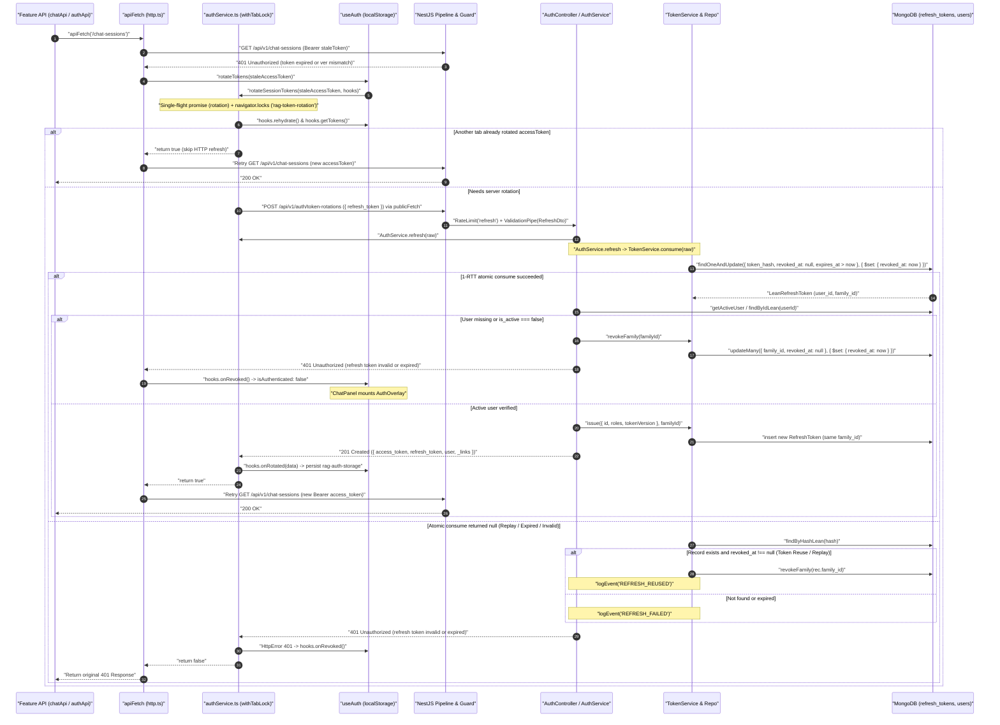

# Luồng 03 — Tự động Xoay vòng Refresh Token 1-RTT & Phát hiện Replay khi gặp 401 (POST /api/v1/auth/token-rotations)

- **Motivation/Background**: Access token (`JWT`) của `RAG_TS` có thời hạn ngắn (`15 phút` = `900s`) và mang claim `ver` gắn với `users.token_version` để thu hồi quyền truy cập tức thì khi Admin khóa tài khoản, đổi role hoặc người dùng đổi mật khẩu. Để giữ trải nghiệm liền mạch mà không buộc người dùng đăng nhập lại thủ công, hệ thống cần cơ chế tự động xoay vòng refresh token trong suốt khi bất kỳ request xác thực nào nhận `401 Unauthorized`, đồng thời chống race condition đa tab và phát hiện replay attack theo chuẩn 1-RTT atomic rotation (`D-021`).
- **Purpose**: Đặc tả chi tiết toàn bộ luồng end-to-end từ lúc `apiFetch` ở Frontend bẫy mã lỗi `401`, thực hiện khóa đa tab (`navigator.locks`) và single-flight rotation qua `POST /api/v1/auth/token-rotations`, xử lý 1-RTT atomic rotation và phát hiện replay (`revokeFamily`) tại NestJS + MongoDB, đến khi phát lại request gốc hoặc dọn phiên về `AuthOverlay`.
- **Overview Pipeline**: Protected API Call (`401`) → `apiFetch` intercept → `useAuth.rotateTokens` (`navigator.locks` + single-flight) → `POST /api/v1/auth/token-rotations` → Middleware & `ThrottlerGuard` (`30/min`) & `ValidationPipe` → `AuthController.refresh` → `AuthService.refresh` & `TokenService.consume` (`consumeActiveByHashLean` 1-RTT / `revokeFamily` on reuse) → `TokenService.issue` → `LinksInterceptor` & `ContentNegotiationInterceptor` → Zustand `useAuth` hydration & retry request gốc.
- **Detailed Plan**: Mục 1 tổng quan kiến trúc & hai sơ đồ Mermaid (Flowchart + Sequence); Mục 2 đặc tả Giai đoạn 0 (Trigger tại HTTP Client) và bảng chi tiết 4 Giai đoạn (`Giai đoạn 1..4`) kèm đường dẫn và số dòng đã xác minh; Mục 3 minh họa HTTP Wire Examples (Request, `201 Created`, `401 Unauthorized`, `429 Too Many Requests`); Mục 4 phân tích các nhánh lỗi và các bất biến hệ thống (System Invariants).
- **References**: `React 19`, `Zustand` (`persist` middleware), `Web Locks API` (`navigator.locks`), `NestJS 11`, `Mongoose` (`findOneAndUpdate`), `Node crypto` (`HMAC-SHA256`), `lru-cache`, `@nestjs/throttler`, `fast-xml-parser`, `agents/rules/MD_CONVENTION.md`, `AGENTS.md`.
- **Created**: 2026-11-26T10:12:00+07:00
- **Last Updated**: 2026-11-26T12:00:00+07:00

[STATUS: ACTIVE]

---

## 1. Tổng quan Kiến trúc & Sơ đồ Luồng

Cơ chế xoay vòng token của `RAG_TS` được kích hoạt **hoàn toàn trong suốt (transparent)** khi một thao tác người dùng qua API có xác thực (như tải danh sách phiên chat hoặc hồ sơ) nhận mã `401 Unauthorized` tại [`apiFetch`](../../../frontend_rag/src/shared/api/http.ts#L23-L34). Hai nguyên nhân phổ biến nhất dẫn đến `401` tại [`JwtAuthGuard`](../../../backend_rag/src/modules/auth/guards/jwt-auth.guard.ts#L22-L47) là:

1. **Access token hết hạn tự nhiên**: `TokenService.verifyAccess()` bắt `TokenExpiredError` sau `ACCESS_TTL_SECONDS` (`900s`) và ném `401` với message `token expired`.
2. **Account state / `token_version` thay đổi**: Quản trị viên thay đổi role (`updateRolesAndBumpVersion`), khóa tài khoản (`disableAndBumpVersion`) hoặc người dùng đổi mật khẩu (`revokeAllForUser`), làm tăng `users.token_version` hoặc đặt `is_active: false`. Khi cache `tokenVersionCache` (`5s` TTL không trượt) hết hạn hoặc bị xóa tường minh, `JwtAuthGuard` phát hiện `(user.token_version ?? 0) !== (claims.tokenVersion ?? 0)` hoặc `!user.is_active` và ném `401` với message `unauthorized`.

### 1.1 Sơ đồ Kiến trúc End-to-End 26 Bước (`flowchart TB`)

```mermaid
flowchart TB
    subgraph FE_IN["Giai đoạn 1 — Frontend Chiều đi (Trigger 401 -> HTTP Request Xoay vòng)"]
        CLI_IN["1. Client (Thao tác cần xác thực bị 401 token expired)"]
        CMP_IN["2. FE Component (ChatPanel / HistoryDrawer gọi action)"]
        HK_IN["3. FE Hook & Store (useChatPanelState -> useSessionStore -> useAuth.rotateTokens)"]
        FSVC_IN["4. FE Service (authService.ts: rotateSessionTokens + withTabLock navigator.locks)"]
        FAPI_IN["5. FE API (authApi.ts: refreshAuthTokens payload refresh_token)"]
        HTTP_IN["6. FE HTTP Client (apiFetch gặp 401 -> publicFetch POST /auth/token-rotations)"]
        CLI_IN --> CMP_IN --> HK_IN --> FSVC_IN --> FAPI_IN --> HTTP_IN
    end

    subgraph BE_IN["Giai đoạn 2 — Backend Chiều vào (HTTP Request -> Database)"]
        NODE["7. BE Node.js HTTP Server (main.ts: keepAliveTimeout=65s, headersTimeout=66s)"]
        MW["8. BE NestJS/Express Middleware (app.setup.ts: trust proxy, requestId, helmet, metrics, XML/JSON)"]
        GRD["9. BE Guard (ThrottlerGuard + @RateLimit refresh 30 req/60s)"]
        INT_IN["10. BE Interceptor chiều vào (ContentNegotiation Accept 406 + LinksInterceptor metadata)"]
        PIP["11. BE Pipe (ValidationPipe -> RefreshDto refresh_token)"]
        CTL_IN["12. BE Controller (AuthController.refresh @Post token-rotations)"]
        BSVC_IN["13. BE Service (AuthService.refresh + TokenService.consume HMAC-SHA256 & issue)"]
        REPO_IN["14. BE Repository (RefreshTokensRepository.consumeActiveByHashLean / create + UsersRepository)"]
        DB["15. Database (MongoDB: refresh_tokens 1-RTT findOneAndUpdate & users)"]
        HTTP_IN -->|"POST /api/v1/auth/token-rotations"| NODE --> MW --> GRD --> INT_IN --> PIP --> CTL_IN --> BSVC_IN --> REPO_IN --> DB
    end

    subgraph BE_OUT["Giai đoạn 3 — Backend Chiều về (Database -> HTTP Response)"]
        REPO_OUT["16. Database -> BE Repository (LeanRefreshToken, LeanUser, RefreshToken mới)"]
        BSVC_OUT["17. BE Service (Kiểm tra reuse/replay -> revokeFamily hoặc trả AuthResponseDto + cacheUser)"]
        CTL_OUT["18. BE Controller (AuthController.refresh trả AuthResponseDto status 201)"]
        INT_OUT["19. BE Interceptor chiều ra (LinksInterceptor +_links -> ContentNegotiation JSON/XML)"]
        EXP_OUT["20. BE NestJS/Express gửi response (HTTP 201 / 401 HttpExceptionFilter + X-Request-Id)"]
        DB --> REPO_OUT --> BSVC_OUT --> CTL_OUT --> INT_OUT --> EXP_OUT
    end

    subgraph FE_OUT["Giai đoạn 4 — Frontend Chiều về (HTTP Response -> Retry & Client)"]
        HTTP_OUT["21. FE HTTP Client (publicFetch đọc Response -> apiFetch replay request gốc khi rotated=true)"]
        FAPI_OUT["22. FE API (authApi.ts: readJsonOrThrow -> AuthTokenResponse hoặc AuthApiError 401)"]
        FSVC_OUT["23. FE Service (authService.ts: onRotated hoặc onRevoked nếu 401, giữ phiên nếu lỗi mạng)"]
        HK_OUT["24. FE Hook & Store (useAuth cập nhật localStorage rag-auth-storage & isAuthenticated)"]
        CMP_OUT["25. FE Component (ChatPanel giữ phiên & tải dữ liệu hoặc chuyển AuthOverlay khi 401)"]
        CLI_OUT["26. Client (Phiên làm việc nối tiếp liền mạch hoặc được yêu cầu đăng nhập lại)"]
        EXP_OUT -->|"HTTP 201 Created / 401"| HTTP_OUT --> FAPI_OUT --> FSVC_OUT --> HK_OUT --> CMP_OUT --> CLI_OUT
    end
```



### 1.2 Sơ đồ Tuần tự Chi tiết (`sequenceDiagram`)



---

## 2. Đặc tả Luồng Request–Response theo 4 Giai đoạn

### Giai đoạn 0 — Trigger: Bẫy lỗi `401` tại HTTP Client (`apiFetch`)

Mọi lời gọi API yêu cầu xác thực ở Frontend (ví dụ [`listRemoteSessions`](../../../frontend_rag/src/features/chat/api/chatApi.ts#L45-L50), [`fetchAllPages`](../../../frontend_rag/src/shared/api/http.ts#L37-L55), [`fetchCurrentUser`](../../../frontend_rag/src/features/auth/api/authApi.ts#L95-L98)) đều đi qua [`apiFetch`](../../../frontend_rag/src/shared/api/http.ts#L23-L34) thay vì `fetch` trực tiếp:

1. `apiFetch` đọc `accessToken` hiện tại từ `useAuth.getState().accessToken` ([`http.ts`](../../../frontend_rag/src/shared/api/http.ts#L29)) và gắn header `Authorization: Bearer ${token}` ([`http.ts`](../../../frontend_rag/src/shared/api/http.ts#L24-L28)).
2. Ở Backend, [`JwtAuthGuard.canActivate`](../../../backend_rag/src/modules/auth/guards/jwt-auth.guard.ts#L28-L46) trích xuất token bằng [`bearerToken`](../../../backend_rag/src/modules/auth/guards/jwt-auth.guard.ts#L12-L18), gọi [`TokenService.verifyAccess`](../../../backend_rag/src/modules/auth/token.service.ts#L81-L99) (trả `401` `'token expired'` nếu hết hạn), sau đó gọi [`AuthService.getActiveUser`](../../../backend_rag/src/modules/auth/auth.service.ts#L262-L270) (cache `5s`) để kiểm tra `user.is_active` và đối chiếu `(user.token_version ?? 0) === (claims.tokenVersion ?? 0)` ([`jwt-auth.guard.ts`](../../../backend_rag/src/modules/auth/guards/jwt-auth.guard.ts#L35-L39)).
3. Khi `apiFetch` nhận `res.status === 401` và có `token` ban đầu ([`http.ts`](../../../frontend_rag/src/shared/api/http.ts#L31)), nó kích hoạt `await useAuth.getState().rotateTokens(token)` ([`http.ts`](../../../frontend_rag/src/shared/api/http.ts#L32)) trước khi quyết định phát lại request hay trả về `401` gốc.

---

### Giai đoạn 1 — Chiều đi Frontend: Client → FE → HTTP Request

| Bước | Tầng (Layer) | File & Ký hiệu | Đầu vào (Input) | Xử lý Nghiệp vụ & Kỹ thuật | Đầu ra (Output) |
| :--- | :--- | :--- | :--- | :--- | :--- |
| 1 | Client | [`ChatPanel.tsx`](../../../frontend_rag/src/features/chat/components/ChatPanel.tsx#L27-L29) | Thao tác mở app, chuyển phiên hoặc xem hồ sơ khi access token đã hết hạn (`900s`) | Client kích hoạt một thao tác có xác thực trong khi `accessToken` trên `localStorage` đã quá hạn hoặc `token_version` vừa bị tăng trên server. | Sự kiện mount / click kích hoạt API bảo vệ |
| 2 | FE — Component | [`ChatPanel.tsx`](../../../frontend_rag/src/features/chat/components/ChatPanel.tsx#L27-L30) / [`HistoryDrawer.tsx`](../../../frontend_rag/src/features/chat/components/HistoryDrawer.tsx#L24-L45) | Mount hoặc sự kiện UI | Component gọi action tải phiên/tin nhắn (đi qua `apiFetch` và gặp phản hồi `401 Unauthorized`). | Lời gọi action đồng bộ từ Hook |
| 3 | FE — Hook (+ Store) | [`useAuth.ts`](../../../frontend_rag/src/features/auth/hooks/useAuth.ts#L11), [`authStore.ts`](../../../frontend_rag/src/features/auth/authStore.ts#L66-L82) (`useAuth.rotateTokens`) | `staleAccessToken: string` | Khi `apiFetch` bắt `res.status === 401`, kích hoạt `useAuth.getState().rotateTokens(token)` truyền 4 hooks (`rehydrate`, `getTokens`, `onRotated`, `onRevoked`) xuống service. | Lời gọi `rotateSessionTokens(staleAccessToken, hooks)` |
| 4 | FE — Service | [`authService.ts`](../../../frontend_rag/src/features/auth/services/authService.ts#L12-L18) & [`authService.ts`](../../../frontend_rag/src/features/auth/services/authService.ts#L64-L84) (`rotation`, `withTabLock`, `rotateSessionTokens`) | `staleAccessToken`, `hooks: TokenRotationHooks` | 1) Gom caller cùng tab vào promise single-flight `rotation`; 2) Khóa liên tab qua `navigator.locks.request('rag-token-rotation', ...)`; 3) Gọi `hooks.rehydrate()`: nếu tab khác đã xoay vòng xong (`accessToken !== staleAccessToken`) trả `true` ngay không gọi server; nếu thiếu `refreshToken` trả `false`. | `refreshToken` hợp lệ sẵn sàng gọi API xoay vòng |
| 5 | FE — API | [`authApi.ts`](../../../frontend_rag/src/features/auth/api/authApi.ts#L66-L73) (`refreshAuthTokens`) | `refreshToken: string` | Chuẩn bị endpoint `'/auth/token-rotations'`, `method: 'POST'`, header `Content-Type: application/json`, body `{ refresh_token: refreshToken }`, gọi `publicFetch` (không gắn `Authorization` cũ và không lặp `apiFetch`). | Yêu cầu tới `publicFetch('/auth/token-rotations', init)` |
| 6 | FE — HTTP Client (gọi fetch) | [`http.ts`](../../../frontend_rag/src/shared/api/http.ts#L15-L34) (`publicFetch`, `apiFetch`) & [`config.ts`](../../../frontend_rag/src/shared/api/config.ts#L1) | `path = '/auth/token-rotations'`, `API_BASE = '/api/v1'` | `publicFetch` gọi `fetch('/api/v1/auth/token-rotations', init)` phát request xoay vòng token trong suốt trên đường truyền. | HTTP Request `POST /api/v1/auth/token-rotations` |

---

### Giai đoạn 2 — Chiều vào Backend: HTTP Request → BE → Database

| Bước | Tầng (Layer) | File & Ký hiệu | Đầu vào (Input) | Xử lý Nghiệp vụ & Kỹ thuật | Đầu ra (Output) |
| :--- | :--- | :--- | :--- | :--- | :--- |
| 7 | BE — Node.js HTTP Server | [`main.ts`](../../../backend_rag/src/main.ts#L19-L24) (`bootstrap`) | HTTP socket cổng `3000` | Node `http.Server` giữ kết nối bền vững (`keepAliveTimeout = 65_000`, `headersTimeout = 66_000`) tiếp nhận request `POST /api/v1/auth/token-rotations`. | Request đi vào Express/NestJS |
| 8 | BE — NestJS/Express Middleware | [`app.setup.ts`](../../../backend_rag/src/app.setup.ts#L47-L75), [`request-context.ts`](../../../backend_rag/src/common/logging/request-context.ts#L20-L32), [`xml.ts`](../../../backend_rag/src/common/http/xml.ts#L70-L105) | Raw HTTP Request | Thiết lập `trust proxy`, gắn `X-Request-Id` (UUIDv7) + `AsyncLocalStorage`, `securityHeaders` (Helmet), `PrometheusMetricsRegistry.middleware`, kiểm tra `unsupportedBody` (`415`), parse JSON/XML an toàn (chặn XXE), áp prefix `/api/v1` và CORS. | `req.id`, `req.ip`, `req.body` chuẩn hóa |
| 9 | BE — Guard | [`app.module.ts`](../../../backend_rag/src/app.module.ts#L32-L46), [`throttler.ts`](../../../backend_rag/src/common/security/throttler.ts#L16-L46), [`auth.controller.ts`](../../../backend_rag/src/modules/auth/auth.controller.ts#L46) | `req.ip`, metadata `@RateLimit('refresh')` | `ThrottlerGuard` áp ngưỡng **`30` requests / `60_000ms`** trên mỗi IP. Route công khai không gắn `JwtAuthGuard` (vì access token đã hết hạn hoặc bị revoke). | Cho phép đi tiếp hoặc `429 Too Many Requests` |
| 10 | BE — Interceptor chiều vào | [`xml.ts`](../../../backend_rag/src/common/http/xml.ts#L109-L119) (`ContentNegotiationInterceptor`), [`hateoas.ts`](../../../backend_rag/src/common/http/hateoas.ts#L160-L166) (`LinksInterceptor`) | Header `Accept`, metadata `@WithLinks` | `ContentNegotiationInterceptor` kiểm tra `req.accepts(OFFERED)` (ném `406 NotAcceptableException` nếu không hỗ trợ); `LinksInterceptor` đọc spec `@WithLinks({ resource: accountLinks })`. | Request vượt qua tiền kiểm tra |
| 11 | BE — Pipe | [`validation.ts`](../../../backend_rag/src/common/http/validation.ts#L18-L26) (`createValidationPipe`), [`auth.dto.ts`](../../../backend_rag/src/modules/auth/dto/auth.dto.ts#L49-L54) (`RefreshDto`) | `req.body` | `ValidationPipe` (`whitelist: true`, `forbidNonWhitelisted: true`, `transform: true`) kiểm tra `refresh_token` là chuỗi `1..200` ký tự; từ chối field thừa với `400 Bad Request`. | `dto: RefreshDto` hợp lệ |
| 12 | BE — Controller | [`auth.controller.ts`](../../../backend_rag/src/modules/auth/auth.controller.ts#L44-L51) (`AuthController.refresh`) | `dto: RefreshDto` | Trích `dto.refresh_token` và gọi `this.auth.refresh(dto.refresh_token)`. | Ủy quyền `Promise<AuthResponseDto>` cho `AuthService` |
| 13 | BE — Service | [`auth.service.ts`](../../../backend_rag/src/modules/auth/auth.service.ts#L186-L213), [`token.service.ts`](../../../backend_rag/src/modules/auth/token.service.ts#L43-L138) (`hashRefresh`, `consume`, `issue`) | `raw: string` | Tính `hash = createHmac('sha256', JWT_REFRESH_SECRET).update(raw).digest('hex')`, gọi tiêu thụ nguyên tử. Nếu thành công (`r.ok`), kiểm tra `userCache` / `users.findByIdLean`, kiểm tra `is_active` (nếu khóa gọi `revokeFamily`), sau đó ký JWT mới (`ver: user.token_version ?? 0`, `expiresIn: 900s`) và sinh hash refresh token mới cùng `r.familyId`. Nếu atomic consume trả `null`, tra bản ghi gốc để phát hiện replay (`rec.revoked_at !== null`) và thu hồi toàn bộ `family_id`. | Chuỗi lệnh atomic update, tra cứu user & insert token |
| 14 | BE — Repository | [`refresh-tokens.repository.ts`](../../../backend_rag/src/modules/auth/repositories/refresh-tokens.repository.ts#L22-L62) (`consumeActiveByHashLean`, `findByHashLean`, `revokeFamily`, `create`), [`users.repository.ts`](../../../backend_rag/src/modules/auth/repositories/users.repository.ts#L33-L35) | `tokenHash`, `userId`, `familyId`, `now` | Thực thi **1-RTT atomic** `findOneAndUpdate({ token_hash, revoked_at: null, expires_at: { $gt: now } }, { $set: { revoked_at: now } }).lean()`; khi replay gọi `updateMany` thu hồi cả `family_id`; khi thành công gọi `UsersRepository.findByIdLean` và `RefreshTokensRepository.create`. | Truy vấn Mongoose qua Cloudflare TCP Tunnel |
| 15 | Database | [`refresh-token.schema.ts`](../../../backend_rag/src/modules/auth/schemas/refresh-token.schema.ts#L4-L27) & [`user.schema.ts`](../../../backend_rag/src/modules/auth/schemas/user.schema.ts#L5-L45) | Lệnh đọc/ghi từ Mongoose | MongoDB thực thi cập nhật nguyên tử trên `refresh_tokens` (chỉ tối đa 1 request đồng thời thắng), đọc `users` và lưu document `refresh_tokens` mới (TTL 7 ngày). | Document `.lean()` trước/sau cập nhật |

---

### Giai đoạn 3 — Chiều về Backend: Database → BE → HTTP Response

| Bước | Tầng (Layer) | File & Ký hiệu | Đầu vào (Input) | Xử lý Nghiệp vụ & Kỹ thuật | Đầu ra (Output) |
| :--- | :--- | :--- | :--- | :--- | :--- |
| 16 | Database → BE — Repository | [`refresh-tokens.repository.ts`](../../../backend_rag/src/modules/auth/repositories/refresh-tokens.repository.ts#L30-L62) & [`users.repository.ts`](../../../backend_rag/src/modules/auth/repositories/users.repository.ts#L33-L35) | Kết quả từ MongoDB | Trả về `LeanRefreshToken` (hoặc `null` để phân loại `'invalid'` / `'expired'` / `'reused'` / `'race'`), `LeanUser \| null`, và xác nhận chèn token mới. | Kết quả `.lean()` về `TokenService` / `AuthService` |
| 17 | BE — Service | [`auth.service.ts`](../../../backend_rag/src/modules/auth/auth.service.ts#L186-L213) & [`token.service.ts`](../../../backend_rag/src/modules/auth/token.service.ts#L53-L78) | `ConsumeResult`, `user`, `IssuedTokens` | Nếu `!r.ok` hoặc `!user.is_active`: ghi `logEvent('REFRESH_REUSED' / 'REFRESH_FAILED')` và ném `401 UnauthorizedException('refresh token invalid or expired')`. Nếu hợp lệ: log `REFRESH_OK`, cập nhật `userCache` & `tokenVersionCache` qua `respond()` và đóng gói `AuthResponseDto` (loại `password_hash`). | `AuthResponseDto` hoặc `UnauthorizedException` `401` |
| 18 | BE — Controller | [`auth.controller.ts`](../../../backend_rag/src/modules/auth/auth.controller.ts#L44-L51) (`AuthController.refresh`) | `Promise<AuthResponseDto>` | Trả về `AuthResponseDto` với HTTP status mặc định của `@Post` là `201 Created`. | Payload đi qua Interceptor chiều ra |
| 19 | BE — Interceptor chiều ra | [`hateoas.ts`](../../../backend_rag/src/common/http/hateoas.ts#L133-L177) (`LinksInterceptor`) & [`xml.ts`](../../../backend_rag/src/common/http/xml.ts#L119-L127) (`ContentNegotiationInterceptor`) | `AuthResponseDto` | `LinksInterceptor` sao chép nông object và gắn `_links: accountLinks()`; `ContentNegotiationInterceptor` giữ JSON hoặc chuyển `application/xml` qua `toXml(body)`. | Response body hoàn chỉnh có `_links` |
| 20 | BE — NestJS/Express gửi response | [`app.setup.ts`](../../../backend_rag/src/app.setup.ts#L52-L63), [`prometheus-metrics.ts`](../../../backend_rag/src/common/metrics/prometheus-metrics.ts#L57-L76), [`http-exception.filter.ts`](../../../backend_rag/src/common/http/http-exception.filter.ts#L69-L97) | Body `201` hoặc `HttpException` (`401`/`429`) | Express gửi HTTP `201 Created` kèm `X-Request-Id`, hoặc `HttpExceptionFilter` chuẩn hóa ngoại lệ `401`/`429` thành `{ statusCode, error, message, request_id }`; sự kiện `finish` ghi histogram metrics. | HTTP Response rời server |

---

### Giai đoạn 4 — Chiều về Frontend: HTTP Response → FE → Client

| Bước | Tầng (Layer) | File & Ký hiệu | Đầu vào (Input) | Xử lý Nghiệp vụ & Kỹ thuật | Đầu ra (Output) |
| :--- | :--- | :--- | :--- | :--- | :--- |
| 21 | FE — HTTP Client (kiểm tra status & đọc body) | [`http.ts`](../../../frontend_rag/src/shared/api/http.ts#L15-L34) (`publicFetch`, `apiFetch`) | `Response` từ `POST /auth/token-rotations` | `publicFetch` trả `Response` về `authApi`; sau khi xoay vòng kết thúc, `apiFetch` nhận kết quả `rotated: boolean` (`http.ts#L32-L33`) để **tự động gửi lại request gốc** với `accessToken` mới nếu `rotated === true` (hoặc trả nguyên `401` gốc nếu `false`). | `Response` xoay vòng và replay request gốc |
| 22 | FE — API (xử lý dữ liệu) | [`authApi.ts`](../../../frontend_rag/src/features/auth/api/authApi.ts#L30-L43) (`readJsonOrThrow`) | `Response` từ `refreshAuthTokens` | Nếu `res.ok` (`201`): parse JSON thành `AuthTokenResponse`. Nếu `!res.ok` (`401`, `429`): đọc `body.message` và ném `AuthApiError(res.status, ...)`. | `AuthTokenResponse` hoặc `AuthApiError` |
| 23 | FE — Service | [`authService.ts`](../../../frontend_rag/src/features/auth/services/authService.ts#L70-L82) (`rotateSessionTokens`) | `AuthTokenResponse` hoặc lỗi | **Thành công**: gọi `hooks.onRotated(data)` và trả `true`. **Lỗi**: chỉ khi `err instanceof HttpError && err.status === 401` mới gọi `hooks.onRevoked()` xóa phiên; nếu là lỗi mạng/`429`/`5xx`, giữ nguyên phiên cục bộ (Offline-First) và trả `false`. | Boolean `true` / `false` & cập nhật hooks |
| 24 | FE — Hook (cập nhật state) | [`authStore.ts`](../../../frontend_rag/src/features/auth/authStore.ts#L73-L81) & [`useAuth.ts`](../../../frontend_rag/src/features/auth/hooks/useAuth.ts#L4-L22) | Callbacks `onRotated` / `onRevoked` | `onRotated` ghi đè `{ user, accessToken, refreshToken, isAuthenticated: true }` vào Zustand và persist `localStorage` (`'rag-auth-storage'`); `onRevoked` đặt `isAuthenticated: false`. | State `useAuthSession()` được cập nhật |
| 25 | FE — Component (hiển thị lại) | [`ChatPanel.tsx`](../../../frontend_rag/src/features/chat/components/ChatPanel.tsx#L27-L118) & [`AuthOverlay.tsx`](../../../frontend_rag/src/features/auth/AuthOverlay.tsx#L6-L37) | `isAuthenticated`, dữ liệu từ request retry | Nếu xoay vòng thành công: request gốc trả `200 OK`, UI hiển thị dữ liệu bình thường không gián đoạn. Nếu bị thu hồi (`isAuthenticated: false`): `ChatPanel` unmount khung chat và hiển thị lại `AuthOverlay`. | UI đồng bộ dữ liệu hoặc màn hình đăng nhập lại |
| 26 | Client | [`ChatPanel.tsx`](../../../frontend_rag/src/features/chat/components/ChatPanel.tsx#L58-L118) | Giao diện sau re-render | Người dùng tiếp tục làm việc liền mạch mà không phải đăng nhập lại thủ công (hoặc thấy yêu cầu đăng nhập lại nếu refresh token đã hết hạn/bị replay). | Trải nghiệm người dùng nhất quán và an toàn |

---

## 3. Ví dụ HTTP Wire (Request / Response)

### 3.1 Request xoay vòng Refresh Token (JSON)

```http
POST /api/v1/auth/token-rotations HTTP/1.1
Host: localhost:3000
Content-Type: application/json
Accept: application/json

{
  "refresh_token": "8kQ9xP2mN7vL4rT1wZ6yB3cF5hJ8nK0pQ2sV4xY7zA1c"
}
```

### 3.2 Response thành công (`201 Created`)

```http
HTTP/1.1 201 Created
Content-Type: application/json; charset=utf-8
X-Request-Id: 019a1c42-8b3e-7f10-9c2a-4d5e6f708192

{
  "access_token": "eyJhbGciOiJIUzI1NiIsInR5cCI6IkpXVCJ9...",
  "token_type": "Bearer",
  "expires_in": 900,
  "refresh_token": "pL3mR9tV2xZ6bN8kQ1wY4cF7hJ0nM5pS8vX2zB4dG7jK",
  "user": {
    "id": "6745a1b2c3d4e5f60718293a",
    "email": "researcher@example.com",
    "display_name": "Minh Nguyen",
    "roles": ["user"],
    "created_at": "2026-11-01T08:30:00.000Z"
  },
  "_links": {
    "self": { "href": "/api/v1/users/me" },
    "update": { "href": "/api/v1/users/me", "method": "PATCH" },
    "password": { "href": "/api/v1/users/me/password", "method": "PUT" },
    "chat-sessions": { "href": "/api/v1/chat-sessions" },
    "token-rotations": { "href": "/api/v1/auth/token-rotations", "method": "POST" },
    "token-revocations": { "href": "/api/v1/auth/token-revocations", "method": "POST" }
  }
}
```

> **Ghi chú Content Negotiation**: Nếu client gửi `Accept: application/xml`, [`ContentNegotiationInterceptor`](../../../backend_rag/src/common/http/xml.ts#L109-L127) trả về `Content-Type: application/xml` với payload được bọc trong thẻ `<response>...</response>`.

### 3.3 Response khi phát hiện Replay / Token hết hạn / User bị khóa (`401 Unauthorized`)

```http
HTTP/1.1 401 Unauthorized
Content-Type: application/json; charset=utf-8
X-Request-Id: 019a1c42-9c10-7a44-812f-9a0b1c2d3e4f

{
  "statusCode": 401,
  "error": "Unauthorized",
  "message": "refresh token invalid or expired",
  "request_id": "019a1c42-9c10-7a44-812f-9a0b1c2d3e4f"
}
```

### 3.4 Response khi vượt giới hạn tần suất (`429 Too Many Requests`)

```http
HTTP/1.1 429 Too Many Requests
Content-Type: application/json; charset=utf-8
Retry-After: 60
X-Request-Id: 019a1c42-a118-7d21-b440-112233445566

{
  "statusCode": 429,
  "error": "Too Many Requests",
  "message": "ThrottlerException: Too Many Requests",
  "request_id": "019a1c42-a118-7d21-b440-112233445566"
}
```

---

## 4. Nhánh lỗi & Các Bất biến Hệ thống (Error Paths & System Invariants)

1. **Băm HMAC-SHA256 trước khi lưu & tra cứu (`hashRefresh`)**:
   - Giá trị `refresh_token` thô (`32 bytes` `base64url`) chỉ tồn tại ở client và trên đường truyền TLS; MongoDB chỉ lưu `token_hash` được băm bằng `HMAC-SHA256` với khóa bí mật `JWT_REFRESH_SECRET` ([`token.service.ts`](../../../backend_rag/src/modules/auth/token.service.ts#L43-L47), [`refresh-token.schema.ts`](../../../backend_rag/src/modules/auth/schemas/refresh-token.schema.ts#L4-L14)). Nếu cơ sở dữ liệu bị rò rỉ, kẻ tấn công không thể dùng `token_hash` để gọi `POST /api/v1/auth/token-rotations`.
2. **1-RTT Atomic Rotation chống Race Condition (`D-021`)**:
   - [`RefreshTokensRepository.consumeActiveByHashLean`](../../../backend_rag/src/modules/auth/repositories/refresh-tokens.repository.ts#L30-L40) gộp kiểm tra điều kiện (`token_hash`, `revoked_at: null`, `expires_at > now`) và đánh dấu thu hồi (`$set: { revoked_at: now }`) trong **một lệnh `findOneAndUpdate` duy nhất** (`1 RTT` qua Cloudflare tunnel). Hai request dùng cùng một `refresh_token` gửi tới đồng thời sẽ chỉ có đúng một request nhận được document trước khi cập nhật; request còn lại nhận `null`.
3. **Phát hiện Reuse / Replay Attack & Thu hồi toàn bộ `family_id`**:
   - Khi `consumeActiveByHashLean` trả `null`, [`TokenService.consume`](../../../backend_rag/src/modules/auth/token.service.ts#L117-L125) kiểm tra bản ghi gốc qua `findByHashLean`. Nếu `rec.revoked_at` khác `null`, điều đó chứng tỏ token đã từng bị tiêu thụ trước đó (nguy cơ rò rỉ hoặc replay). Hệ thống lập tức gọi [`revokeFamily(rec.family_id)`](../../../backend_rag/src/modules/auth/token.service.ts#L136-L138) để vô hiệu hóa mọi token còn sống cùng `family_id`, ghi sự kiện `REFRESH_REUSED` và trả `401` (`refresh token invalid or expired`). Do đó endpoint này **cố ý không idempotent**.
4. **Cơ chế `token_version` (`ver` claim) & Cache `5s` (`tokenVersionCache`)**:
   - Mọi access token đều nhúng `ver: user.token_version ?? 0` ([`token.service.ts`](../../../backend_rag/src/modules/auth/token.service.ts#L54-L58)). [`JwtAuthGuard`](../../../backend_rag/src/modules/auth/guards/jwt-auth.guard.ts#L35-L39) kiểm tra trạng thái tài khoản qua [`AuthService.getActiveUser`](../../../backend_rag/src/modules/auth/auth.service.ts#L262-L270), sử dụng `tokenVersionCache` có `ttl: 5_000` (không bật `updateAgeOnGet` để đảm bảo cửa sổ trễ tối đa đúng `5 giây` bất kể tần suất request, theo ghi chú tại [`auth.service.ts`](../../../backend_rag/src/modules/auth/auth.service.ts#L31-L37) và [`auth.service.ts`](../../../backend_rag/src/modules/auth/auth.service.ts#L66-L74)).
   - Các thao tác nhạy cảm (`changePassword` qua `revokeAllForUser`, hoặc Admin đổi role / khóa tài khoản) tăng `token_version` trong MongoDB và gọi `invalidateUserCaches` / xóa `tokenVersionCache` để JWT cũ lập tức nhận `401`, kích hoạt luồng xoay vòng (hoặc đá văng nếu refresh token cũng đã bị thu hồi hoặc `is_active === false`).
5. **Phân biệt Lỗi Mạng vs. Lỗi `401` ở Frontend (Offline-First Resilience)**:
   - Tại [`authService.ts`](../../../frontend_rag/src/features/auth/services/authService.ts#L74-L78), `hooks.onRevoked()` **chỉ** được gọi khi `err instanceof HttpError && err.status === 401` (refresh token không hợp lệ, hết hạn, bị replay hoặc user bị vô hiệu hóa). Khi `isAuthenticated` chuyển về `false`, [`ChatPanel`](../../../frontend_rag/src/features/chat/components/ChatPanel.tsx#L110-L118) gỡ giao diện chat và hiển thị [`AuthOverlay`](../../../frontend_rag/src/features/auth/AuthOverlay.tsx#L6-L37).
   - Ngược lại, nếu mất mạng, backend ngoại tuyến hoặc gặp `429` / `5xx`, `rotateSessionTokens` trả `false` nhưng **giữ nguyên** `user`, `accessToken`, `refreshToken`, `isAuthenticated: true` trong Zustand & `localStorage` để người dùng không bị đăng xuất oan và vẫn xem được lịch sử chat IndexedDB (`Dexie.js`).
6. **Chống lạm dụng bằng Rate Limiting (`@RateLimit('refresh')`)**:
   - Endpoint `POST /api/v1/auth/token-rotations` được bảo vệ bởi [`ThrottlerGuard`](../../../backend_rag/src/app.module.ts#L46) với giới hạn riêng `RATE_LIMITS.refresh = { limit: 30, ttl: 60_000 }` ([`throttler.ts`](../../../backend_rag/src/common/security/throttler.ts#L22)). Kết hợp cùng `withTabLock` (`navigator.locks` `'rag-token-rotation'`) và biến single-flight `rotation` ở Frontend, các tab/component gọi API song song khi access token hết hạn sẽ không tạo bão request làm cạn ngân sách `30 req/phút` hay tự gây lỗi reuse token family.
