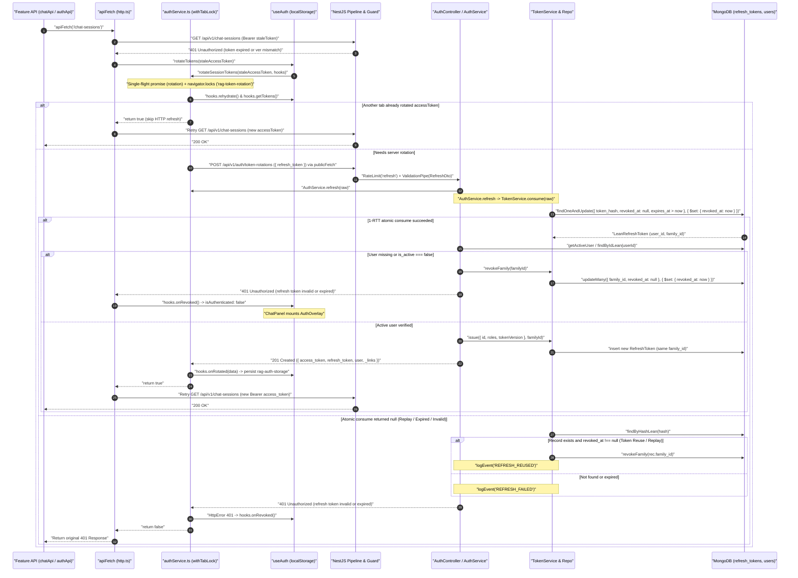

# Luồng 03 — Tự động Xoay vòng Refresh Token 1-RTT & Phát hiện Replay khi gặp 401 (POST /api/v1/auth/token-rotations)

- **Motivation/Background**: Access token (`JWT`) của `RAG_TS` có thời hạn ngắn (`15 phút` = `900s`) và mang claim `ver` gắn với `users.token_version` để thu hồi quyền truy cập tức thì khi Admin khóa tài khoản, đổi role hoặc người dùng đổi mật khẩu. Để giữ trải nghiệm liền mạch mà không buộc người dùng đăng nhập lại thủ công, hệ thống cần cơ chế tự động xoay vòng refresh token trong suốt khi bất kỳ request xác thực nào nhận `401 Unauthorized`, đồng thời chống race condition đa tab và phát hiện replay attack theo chuẩn 1-RTT atomic rotation (`D-021`).
- **Purpose**: Đặc tả chi tiết toàn bộ luồng end-to-end từ lúc `apiFetch` ở Frontend bẫy mã lỗi `401`, thực hiện khóa đa tab (`navigator.locks`) và single-flight rotation qua `POST /api/v1/auth/token-rotations`, xử lý 1-RTT atomic rotation và phát hiện replay (`revokeFamily`) tại NestJS + MongoDB, đến khi phát lại request gốc hoặc dọn phiên về `AuthOverlay`.
- **Overview Pipeline**: Protected API Call (`401`) → `apiFetch` intercept → `useAuth.rotateTokens` (`navigator.locks` + single-flight) → `POST /api/v1/auth/token-rotations` → Middleware & `ThrottlerGuard` (`30/min`) & `ValidationPipe` → `AuthController.refresh` → `AuthService.refresh` & `TokenService.consume` (`consumeActiveByHashLean` 1-RTT / `revokeFamily` on reuse) → `TokenService.issue` → `LinksInterceptor` & `ContentNegotiationInterceptor` → Zustand `useAuth` hydration & retry request gốc.
- **Detailed Plan**: Mục 1 tổng quan kiến trúc & hai sơ đồ Mermaid (Flowchart + Sequence); Mục 2 đặc tả Giai đoạn 0 (Trigger tại HTTP Client) và bảng chi tiết 4 Giai đoạn (`Giai đoạn 1..4`) kèm đường dẫn và số dòng đã xác minh; Mục 3 minh họa HTTP Wire Examples (Request, `201 Created`, `401 Unauthorized`, `429 Too Many Requests`); Mục 4 phân tích các nhánh lỗi và các bất biến hệ thống (System Invariants).
- **References**: `React 19`, `Zustand` (`persist` middleware), `Web Locks API` (`navigator.locks`), `NestJS 11`, `Mongoose` (`findOneAndUpdate`), `Node crypto` (`HMAC-SHA256`), `lru-cache`, `@nestjs/throttler`, `fast-xml-parser`, `agents/rules/MD_CONVENTION.md`, `AGENTS.md`.
- **Created**: 2026-11-26T10:12:00+07:00
- **Last Updated**: 2026-11-26T10:12:00+07:00

[STATUS: ACTIVE]

---

## 1. Tổng quan Kiến trúc & Sơ đồ Luồng

Cơ chế xoay vòng token của `RAG_TS` được kích hoạt **hoàn toàn trong suốt (transparent)** ở tầng HTTP Client mỗi khi một API có xác thực (như tải danh sách phiên chat, tin nhắn hoặc hồ sơ người dùng) bị Backend từ chối với mã `401 Unauthorized`. Hai nguyên nhân phổ biến nhất dẫn đến `401` tại [`JwtAuthGuard`](../../../backend_rag/src/modules/auth/guards/jwt-auth.guard.ts#L22-L47) là:

1. **Access token hết hạn tự nhiên**: `TokenService.verifyAccess()` bắt `TokenExpiredError` sau `ACCESS_TTL_SECONDS` (`900s`) và ném `401` với message `token expired`.
2. **Account state / `token_version` thay đổi**: Quản trị viên thay đổi role (`updateRolesAndBumpVersion`), khóa tài khoản (`disableAndBumpVersion`) hoặc người dùng đổi mật khẩu (`revokeAllForUser`), làm tăng `users.token_version` hoặc đặt `is_active: false`. Khi cache `tokenVersionCache` (`5s` TTL không trượt) hết hạn hoặc bị xóa tường minh, `JwtAuthGuard` phát hiện `(user.token_version ?? 0) !== (claims.tokenVersion ?? 0)` hoặc `!user.is_active` và ném `401` với message `unauthorized`.

### 1.1 Sơ đồ Kiến trúc End-to-End (`flowchart LR`)

```mermaid
flowchart LR
    subgraph FE["Frontend (React 19 + Zustand)"]
        Call["Protected Call (chatApi / fetchCurrentUser)"]
        ApiFetch["apiFetch (shared/api/http.ts)"]
        Store["useAuth.rotateTokens (authStore.ts)"]
        Lock["rotateSessionTokens + withTabLock (navigator.locks)"]
        PubFetch["refreshAuthTokens via publicFetch"]
        Overlay["ChatPanel -> AuthOverlay (isAuthenticated: false)"]
    end

    subgraph BE["Backend Pipeline (NestJS 11)"]
        JwtGuard["JwtAuthGuard (401 Expired or ver mismatch)"]
        Mid["Express Middleware (requestId, helmet, xml)"]
        Throttle["ThrottlerGuard (@RateLimit refresh 30/min)"]
        Pipe["ValidationPipe (RefreshDto)"]
        Ctrl["AuthController.refresh (POST /auth/token-rotations)"]
        AuthSvc["AuthService.refresh"]
        TokenSvc["TokenService.consume & issue (HMAC-SHA256)"]
        Int["LinksInterceptor + ContentNegotiationInterceptor"]
    end

    subgraph DB["MongoDB (via Cloudflare Tunnel)"]
        RT[("refresh_tokens (1-RTT findOneAndUpdate)")]
        Users[("users (is_active, token_version)")]
    end

    Call -->|"Bearer accessToken"| ApiFetch
    ApiFetch -->|"Initial request"| JwtGuard
    JwtGuard -->|"401 Unauthorized"| ApiFetch
    ApiFetch -->|"res.status === 401"| Store
    Store --> Lock
    Lock -->|"Rehydrate + check staleAccessToken"| PubFetch
    PubFetch -->|"POST /api/v1/auth/token-rotations"| Mid
    Mid --> Throttle --> Pipe --> Ctrl --> AuthSvc
    AuthSvc --> TokenSvc
    TokenSvc -->|"consumeActiveByHashLean"| RT
    AuthSvc -->|"getActiveUser / findByIdLean"| Users
    TokenSvc -->|"issue new JWT + new refresh_token"| RT
    AuthSvc --> Int
    Int -->|"201 Created (new pair + _links)"| PubFetch
    PubFetch -->|"onRotated (update Zustand + localStorage)"| ApiFetch
    ApiFetch -->|"Retry original request with new Bearer"| Call
    Int -->|"401 (reused / expired / user_gone)"| PubFetch
    PubFetch -->|"onRevoked -> clear session"| Overlay
```



### 1.2 Sơ đồ Tuần tự Chi tiết (`sequenceDiagram`)



---

## 2. Đặc tả Luồng Request–Response theo 4 Giai đoạn

### Giai đoạn 0 — Trigger: Bẫy lỗi `401` tại HTTP Client (`apiFetch`)

Mọi lời gọi API yêu cầu xác thực ở Frontend (ví dụ [`listRemoteSessions`](../../../frontend_rag/src/features/chat/api/chatApi.ts#L45-L50), [`fetchAllPages`](../../../frontend_rag/src/shared/api/http.ts#L37-L55), [`fetchCurrentUser`](../../../frontend_rag/src/features/auth/api/authApi.ts#L95-L98)) đều đi qua [`apiFetch`](../../../frontend_rag/src/shared/api/http.ts#L23-L34) thay vì `fetch` trực tiếp:

1. `apiFetch` đọc `accessToken` hiện tại từ `useAuth.getState().accessToken` ([`http.ts`](../../../frontend_rag/src/shared/api/http.ts#L29)) và gắn header `Authorization: Bearer ${token}` ([`http.ts`](../../../frontend_rag/src/shared/api/http.ts#L24-L28)).
2. Ở Backend, [`JwtAuthGuard.canActivate`](../../../backend_rag/src/modules/auth/guards/jwt-auth.guard.ts#L28-L46) trích xuất token bằng [`bearerToken`](../../../backend_rag/src/modules/auth/guards/jwt-auth.guard.ts#L12-L18), gọi [`TokenService.verifyAccess`](../../../backend_rag/src/modules/auth/token.service.ts#L81-L99) (trả `401` `'token expired'` nếu hết hạn), sau đó gọi [`AuthService.getActiveUser`](../../../backend_rag/src/modules/auth/auth.service.ts#L262-L270) (cache `5s`) để kiểm tra `user.is_active` và đối chiếu `(user.token_version ?? 0) === (claims.tokenVersion ?? 0)` ([`jwt-auth.guard.ts`](../../../backend_rag/src/modules/auth/guards/jwt-auth.guard.ts#L35-L39)).
3. Khi `apiFetch` nhận `res.status === 401` và có `token` ban đầu ([`http.ts`](../../../frontend_rag/src/shared/api/http.ts#L31)), nó kích hoạt `await useAuth.getState().rotateTokens(token)` ([`http.ts`](../../../frontend_rag/src/shared/api/http.ts#L32)) trước khi quyết định phát lại request hay trả về `401` gốc.

---

### Giai đoạn 1 — Frontend Orchestration, Cross-Tab Lock & Single-Flight Request

| Bước | Tầng (Layer) | File & Ký hiệu | Đầu vào (Input) | Xử lý Nghiệp vụ & Kỹ thuật | Đầu ra (Output) |
| :--- | :--- | :--- | :--- | :--- | :--- |
| 1.1 | HTTP Client | [`http.ts`](../../../frontend_rag/src/shared/api/http.ts#L23-L34) (`apiFetch`) | `res.status === 401`, `token: string` | Kiểm tra `res.status !== 401 \|\| !token`; nếu đúng điều kiện `401` với token đã gửi, tạm giữ `res` gốc và gọi `useAuth.getState().rotateTokens(token)` (lưu ý chỉ retry tối đa 1 lần để tránh vòng lặp vô hạn). | `Promise<boolean>` (`rotated`) |
| 1.2 | State Store | [`authStore.ts`](../../../frontend_rag/src/features/auth/authStore.ts#L66-L82) (`useAuth.rotateTokens`) | `staleAccessToken: string` | Ủy quyền cho [`rotateSessionTokens`](../../../frontend_rag/src/features/auth/services/authService.ts#L64-L84) kèm 4 hooks điều khiển store: `rehydrate` (`useAuth.persist?.rehydrate()`), `getTokens`, `onRotated` (cập nhật `user`, `accessToken`, `refreshToken`, `isAuthenticated: true`), và `onRevoked` (xóa trắng session, `isAuthenticated: false`). | `Promise<boolean>` |
| 1.3 | Auth Service (Single-Flight & Lock) | [`authService.ts`](../../../frontend_rag/src/features/auth/services/authService.ts#L12-L18), [`authService.ts`](../../../frontend_rag/src/features/auth/services/authService.ts#L64-L84) (`rotation`, `withTabLock`, `rotateSessionTokens`) | `staleAccessToken`, `hooks: TokenRotationHooks` | 1) Gán `rotation ??= withTabLock(...)` để gom mọi caller song song **trong cùng tab** vào một Promise duy nhất (single-flight), và dọn `rotation = null` trong `.finally()`. 2) `withTabLock` dùng `navigator.locks.request('rag-token-rotation', run)` để tuần tự hóa **giữa các tab** cùng origin (fallback chạy trực tiếp nếu môi trường test/browser không có `navigator.locks`). | Chỉ 1 luồng chạy vào critical section tại một thời điểm |
| 1.4 | Auth Service (Rehydrate & Pre-check) | [`authService.ts`](../../../frontend_rag/src/features/auth/services/authService.ts#L66-L69) | Trạng thái `localStorage` `'rag-auth-storage'` | Gọi `await hooks.rehydrate()` để đồng bộ state mới nhất từ `localStorage` (do tab khác có thể vừa xoay vòng xong). Nếu `accessToken && accessToken !== staleAccessToken`, trả `true` ngay lập tức mà **không** gửi `refresh_token` cũ lên server (tránh false-positive reuse). Nếu `!refreshToken`, trả `false`. | `true` (skip HTTP), `false` (abort), hoặc `refreshToken` hợp lệ để xoay vòng |
| 1.5 | Auth API Adapter | [`authApi.ts`](../../../frontend_rag/src/features/auth/api/authApi.ts#L66-L73) (`refreshAuthTokens`) | `refreshToken: string` | Gọi `publicFetch('/auth/token-rotations', { method: 'POST', headers: { 'Content-Type': 'application/json' }, body: JSON.stringify({ refresh_token: refreshToken }) })`. Dùng [`publicFetch`](../../../frontend_rag/src/shared/api/http.ts#L15-L17) (ghép [`API_BASE`](../../../frontend_rag/src/shared/api/config.ts#L1) = `/api/v1`) để **không** đính kèm `Authorization` cũ và **không** lặp `apiFetch` khi endpoint này trả `401`. | HTTP `POST /api/v1/auth/token-rotations` gửi tới Backend |

---

### Giai đoạn 2 — Backend HTTP Pipeline, Rate Limit, Validation & Controller

| Bước | Tầng (Layer) | File & Ký hiệu | Đầu vào (Input) | Xử lý Nghiệp vụ & Kỹ thuật | Đầu ra (Output) |
| :--- | :--- | :--- | :--- | :--- | :--- |
| 2.1 | Express Middleware Pipeline | [`app.setup.ts`](../../../backend_rag/src/app.setup.ts#L47-L75) (`configureApp`), [`request-context.ts`](../../../backend_rag/src/common/logging/request-context.ts#L20-L32), [`security.ts`](../../../backend_rag/src/common/security/security.ts#L11-L52), [`xml.ts`](../../../backend_rag/src/common/http/xml.ts#L70-L105) | Raw HTTP Request | Chạy tuần tự: 1) `express.set('trust proxy', trustProxySetting(...))` để đọc đúng IP client cho rate limiter; 2) `requestIdMiddleware` gán/echo `X-Request-Id` (UUIDv7) và mở `AsyncLocalStorage` context; 3) `securityHeaders(isProduction)` (Helmet CSP/frameguard/noSniff); 4) `metrics.middleware` (Prometheus); 5) `unsupportedBody` (chặn `415` nếu không phải JSON/XML); 6) `textBody` + `xmlBodyMiddleware` (parse XML an toàn nếu `Content-Type` là XML, chặn `<!DOCTYPE`/`<!ENTITY` XXE); 7) Global prefix `api/v1` và CORS. | `req.id`, `req.body` (object), security headers sẵn sàng |
| 2.2 | Global Guard (Rate Limit) | [`app.module.ts`](../../../backend_rag/src/app.module.ts#L32-L46), [`throttler.ts`](../../../backend_rag/src/common/security/throttler.ts#L16-L46), [`auth.controller.ts`](../../../backend_rag/src/modules/auth/auth.controller.ts#L46) | Client IP + Route metadata `@RateLimit('refresh')` | `ThrottlerGuard` (đăng ký global qua `APP_GUARD`) đọc cấu hình ghi đè của route `refresh`: tối đa **`30` requests / `60_000ms` (1 phút)** trên mỗi IP (`RATE_LIMITS.refresh`). Nếu vượt ngưỡng, ném `ThrottlerException` (`429 Too Many Requests`). | Cho phép đi tiếp hoặc `429` qua [`HttpExceptionFilter`](../../../backend_rag/src/common/http/http-exception.filter.ts#L69-L97) |
| 2.3 | Request Interceptor (Pre-handler) | [`xml.ts`](../../../backend_rag/src/common/http/xml.ts#L109-L119) (`ContentNegotiationInterceptor`) | Header `Accept` | Kiểm tra `req.accepts(['application/json', 'application/xml', 'text/xml', 'text/event-stream'])`. Nếu client gửi `Accept` không tương thích (vd `text/csv`), ném `406 NotAcceptableException`. | Cho phép đi tiếp tới Pipe & Handler |
| 2.4 | Validation Pipe | [`validation.ts`](../../../backend_rag/src/common/http/validation.ts#L18-L26) (`createValidationPipe`), [`auth.dto.ts`](../../../backend_rag/src/modules/auth/dto/auth.dto.ts#L49-L54) (`RefreshDto`) | `req.body` | `ValidationPipe` (`whitelist: true`, `forbidNonWhitelisted: true`, `transform: true`) kiểm tra `RefreshDto`: `refresh_token` phải là chuỗi có độ dài `1..200` ký tự; mọi field thừa sẽ bị từ chối với `400 Bad Request` theo [`firstValidationMessage`](../../../backend_rag/src/common/http/validation.ts#L8-L16). | `dto: RefreshDto` hợp lệ |
| 2.5 | Controller | [`auth.controller.ts`](../../../backend_rag/src/modules/auth/auth.controller.ts#L44-L51) (`AuthController.refresh`) | `dto: RefreshDto` | Route công khai (không gắn `JwtAuthGuard`, vì access token đã hết hạn hoặc bị vô hiệu), gắn `@WithLinks({ resource: accountLinks })` để bổ sung `_links` ở bước trả về. Gọi `this.auth.refresh(dto.refresh_token)`. | `Promise<AuthResponseDto>` |

---

### Giai đoạn 3 — Backend Domain Logic: 1-RTT Atomic Rotation, Replay Detection & Persistence

| Bước | Tầng (Layer) | File & Ký hiệu | Đầu vào (Input) | Xử lý Nghiệp vụ & Kỹ thuật | Đầu ra (Output) |
| :--- | :--- | :--- | :--- | :--- | :--- |
| 3.1 | Token Service (Hash & Atomic Consume) | [`token.service.ts`](../../../backend_rag/src/modules/auth/token.service.ts#L43-L47), [`token.service.ts`](../../../backend_rag/src/modules/auth/token.service.ts#L106-L116) (`hashRefresh`, `consume`) | `raw: string` | Tính `hash = createHmac('sha256', JWT_REFRESH_SECRET).update(raw).digest('hex')` (DB bị lộ cũng không thể replay nếu thiếu `JWT_REFRESH_SECRET`). Ghi nhận `now = new Date()` và gọi `consumeActiveByHashLean(hash, now)`. | `hash: string` |
| 3.2 | Refresh Token Repository (1-RTT DB) | [`refresh-tokens.repository.ts`](../../../backend_rag/src/modules/auth/repositories/refresh-tokens.repository.ts#L30-L40) (`consumeActiveByHashLean`), [`refresh-token.schema.ts`](../../../backend_rag/src/modules/auth/schemas/refresh-token.schema.ts#L9-L27) | `tokenHash`, `now` | Thực thi **1-RTT atomic `findOneAndUpdate`**: lọc `{ token_hash: tokenHash, revoked_at: null, expires_at: { $gt: now } }` và đặt `{ $set: { revoked_at: now } }` với `.lean()`. Chỉ tối đa 1 request đồng thời thắng được cập nhật nguyên tử này (`D-021`). | `LeanRefreshToken` (nếu thắng) hoặc `null` |
| 3.3 | Token Service (Replay & Failure Branch) | [`token.service.ts`](../../../backend_rag/src/modules/auth/token.service.ts#L117-L125), [`refresh-tokens.repository.ts`](../../../backend_rag/src/modules/auth/repositories/refresh-tokens.repository.ts#L42-L62) (`findByHashLean`, `revokeFamily`) | `won === null` | Khi atomic update trả `null`, truy vấn `findByHashLean(hash)` để phân loại lý do: 1) Không có bản ghi → `{ ok: false, reason: 'invalid' }`; 2) `expires_at <= now` → `{ ok: false, reason: 'expired' }`; 3) `revoked_at` đã có giá trị → **Phát hiện Reuse / Replay**, gọi ngay `revokeFamily(rec.family_id)` (`updateMany({ family_id, revoked_at: null }, { $set: { revoked_at: now } })`) để hủy toàn bộ cây phiên và trả `{ ok: false, reason: 'reused' }`; 4) Khác → `'race'`. | `ConsumeResult` (`ok: true` hoặc `ok: false`) |
| 3.4 | Auth Service (Result & User Verification) | [`auth.service.ts`](../../../backend_rag/src/modules/auth/auth.service.ts#L186-L202), [`users.repository.ts`](../../../backend_rag/src/modules/auth/repositories/users.repository.ts#L33-L35) | `ConsumeResult` | Nếu `!r.ok`: ghi log `logEvent(r.reason === 'reused' ? 'REFRESH_REUSED' : 'REFRESH_FAILED', { reason: r.reason })` và ném `401 UnauthorizedException('refresh token invalid or expired')`. Nếu `r.ok`: kiểm tra `userCache.get(r.userId)`; nếu có dùng `getActiveUser(r.userId)` (TTL `5s`), không có thì truy vấn `users.findByIdLean(r.userId)`. Nếu `!user \|\| !user.is_active`, gọi `tokens.revokeFamily(r.familyId)`, log `REFRESH_FAILED` (`user_gone`) và ném `401`. | `user: LeanUser` còn hoạt động hoặc `401` |
| 3.5 | Token Service (Issue New Pair) | [`auth.service.ts`](../../../backend_rag/src/modules/auth/auth.service.ts#L203-L213), [`token.service.ts`](../../../backend_rag/src/modules/auth/token.service.ts#L53-L78) (`issue`) | `user`, `r.familyId` | Log `REFRESH_OK` (`user_id`). Gọi `tokens.issue(...)` giữ nguyên `r.familyId`: 1) Ký JWT access token mới (`sub`, `roles`, `ver: user.token_version ?? 0`, `expiresIn: 900s`); 2) Sinh `raw = randomBytes(32).toString('base64url')` và lưu hash mới qua `refreshTokens.create(...)` (`expires_at = now + 7 ngày`) song song bằng `Promise.all`. Nếu chưa có `cachedUser`, `AuthService.respond` còn nạp `userCache` (`300s`) và `tokenVersionCache` (`5s`). | `AuthResponseDto` (`access_token`, `token_type: 'Bearer'`, `expires_in: 900`, `refresh_token`, `user`) |

---

### Giai đoạn 4 — Response Serialization, Store Hydration, Request Retry & UI Reconciliation

| Bước | Tầng (Layer) | File & Ký hiệu | Đầu vào (Input) | Xử lý Nghiệp vụ & Kỹ thuật | Đầu ra (Output) |
| :--- | :--- | :--- | :--- | :--- | :--- |
| 4.1 | Backend Interceptors | [`hateoas.ts`](../../../backend_rag/src/common/http/hateoas.ts#L31-L38), [`hateoas.ts`](../../../backend_rag/src/common/http/hateoas.ts#L133-L177) (`LinksInterceptor`), [`xml.ts`](../../../backend_rag/src/common/http/xml.ts#L119-L125) (`ContentNegotiationInterceptor`) | `AuthResponseDto` | Do `ContentNegotiationInterceptor` bọc ngoài `LinksInterceptor` ([`app.setup.ts`](../../../backend_rag/src/app.setup.ts#L78-L81)), `LinksInterceptor` chạy trước: gọi `addLinks` gắn `_links: accountLinks()` (gồm `self`, `update`, `password`, `chat-sessions`, `token-rotations`, `token-revocations`). Sau đó `ContentNegotiationInterceptor` giữ JSON mặc định hoặc chuyển thành XML (`toXml`, `application/xml`) nếu `Accept` ưu tiên XML. HTTP status mặc định của `@Post` là `201 Created`. | HTTP `201 Created` (JSON hoặc XML) kèm `X-Request-Id` |
| 4.2 | FE API Parser | [`authApi.ts`](../../../frontend_rag/src/features/auth/api/authApi.ts#L30-L43) (`readJsonOrThrow`) | `Response` | Nếu `res.ok`, parse JSON thành `AuthTokenResponse`. Nếu `!res.ok` (như `401` hoặc `429`), đọc `body.message` và ném `AuthApiError` (kế thừa `HttpError` với `status` nguyên bản). | `AuthTokenResponse` hoặc ném `AuthApiError` |
| 4.3 | FE Auth Service & Store | [`authService.ts`](../../../frontend_rag/src/features/auth/services/authService.ts#L70-L82), [`authStore.ts`](../../../frontend_rag/src/features/auth/authStore.ts#L73-L81) | `AuthTokenResponse` hoặc `Error` | **Nhánh thành công**: gọi `hooks.onRotated(data)` ghi đè `{ user, accessToken, refreshToken, isAuthenticated: true }` vào Zustand và persist xuống `localStorage` (`rag-auth-storage`), trả `true`. **Nhánh lỗi**: nếu `err instanceof HttpError && err.status === 401`, gọi `hooks.onRevoked()` xóa sạch `user`, `accessToken`, `refreshToken`, đặt `isAuthenticated: false`; nếu là lỗi mạng (`TypeError` / timeout) hoặc `429`/`5xx`, **không** gọi `onRevoked()` để bảo toàn phiên. Trả `false`. | `true` hoặc `false` về cho `apiFetch` |
| 4.4 | FE HTTP Client Retry & UI Sync | [`http.ts`](../../../frontend_rag/src/shared/api/http.ts#L32-L33), [`ChatPanel.tsx`](../../../frontend_rag/src/features/chat/components/ChatPanel.tsx#L27-L29), [`ChatPanel.tsx`](../../../frontend_rag/src/features/chat/components/ChatPanel.tsx#L110-L118) | `rotated: boolean` | Nếu `rotated === true`, `apiFetch` gọi lại `send(useAuth.getState().accessToken)` để thực thi lại request gốc với access token mới và trả `200 OK` cho caller (`chatApi` / `authApi`) hoàn toàn trong suốt. Nếu `rotated === false` và `onRevoked()` đã đặt `isAuthenticated: false`, [`ChatPanel`](../../../frontend_rag/src/features/chat/components/ChatPanel.tsx#L110-L118) tự động chuyển từ `MessageList` + `ChatInput` sang [`AuthOverlay`](../../../frontend_rag/src/features/auth/AuthOverlay.tsx#L6-L37) yêu cầu đăng nhập lại (và `useEffect` kích hoạt `initSessions()`). | Request gốc thành công (`200 OK`) hoặc UI quay về `AuthOverlay` |

---

## 3. Ví dụ HTTP Wire (Request / Response)

### 3.1 Request xoay vòng Refresh Token (JSON)

```http
POST /api/v1/auth/token-rotations HTTP/1.1
Host: localhost:3000
Content-Type: application/json
Accept: application/json

{
  "refresh_token": "8kQ9xP2mN7vL4rT1wZ6yB3cF5hJ8nK0pQ2sV4xY7zA1c"
}
```

### 3.2 Response thành công (`201 Created`)

```http
HTTP/1.1 201 Created
Content-Type: application/json; charset=utf-8
X-Request-Id: 019a1c42-8b3e-7f10-9c2a-4d5e6f708192

{
  "access_token": "eyJhbGciOiJIUzI1NiIsInR5cCI6IkpXVCJ9...",
  "token_type": "Bearer",
  "expires_in": 900,
  "refresh_token": "pL3mR9tV2xZ6bN8kQ1wY4cF7hJ0nM5pS8vX2zB4dG7jK",
  "user": {
    "id": "6745a1b2c3d4e5f60718293a",
    "email": "researcher@example.com",
    "display_name": "Minh Nguyen",
    "roles": ["user"],
    "created_at": "2026-11-01T08:30:00.000Z"
  },
  "_links": {
    "self": { "href": "/api/v1/users/me" },
    "update": { "href": "/api/v1/users/me", "method": "PATCH" },
    "password": { "href": "/api/v1/users/me/password", "method": "PUT" },
    "chat-sessions": { "href": "/api/v1/chat-sessions" },
    "token-rotations": { "href": "/api/v1/auth/token-rotations", "method": "POST" },
    "token-revocations": { "href": "/api/v1/auth/token-revocations", "method": "POST" }
  }
}
```

> **Ghi chú Content Negotiation**: Nếu client gửi `Accept: application/xml`, [`ContentNegotiationInterceptor`](../../../backend_rag/src/common/http/xml.ts#L109-L127) trả về `Content-Type: application/xml` với payload được bọc trong thẻ `<response>...</response>`.

### 3.3 Response khi phát hiện Replay / Token hết hạn / User bị khóa (`401 Unauthorized`)

```http
HTTP/1.1 401 Unauthorized
Content-Type: application/json; charset=utf-8
X-Request-Id: 019a1c42-9c10-7a44-812f-9a0b1c2d3e4f

{
  "statusCode": 401,
  "error": "Unauthorized",
  "message": "refresh token invalid or expired",
  "request_id": "019a1c42-9c10-7a44-812f-9a0b1c2d3e4f"
}
```

### 3.4 Response khi vượt giới hạn tần suất (`429 Too Many Requests`)

```http
HTTP/1.1 429 Too Many Requests
Content-Type: application/json; charset=utf-8
Retry-After: 60
X-Request-Id: 019a1c42-a118-7d21-b440-112233445566

{
  "statusCode": 429,
  "error": "Too Many Requests",
  "message": "ThrottlerException: Too Many Requests",
  "request_id": "019a1c42-a118-7d21-b440-112233445566"
}
```

---

## 4. Nhánh lỗi & Các Bất biến Hệ thống (Error Paths & System Invariants)

1. **Băm HMAC-SHA256 trước khi lưu & tra cứu (`hashRefresh`)**:
   - Giá trị `refresh_token` thô (`32 bytes` `base64url`) chỉ tồn tại ở client và trên đường truyền TLS; MongoDB chỉ lưu `token_hash` được băm bằng `HMAC-SHA256` với khóa bí mật `JWT_REFRESH_SECRET` ([`token.service.ts`](../../../backend_rag/src/modules/auth/token.service.ts#L43-L47), [`refresh-token.schema.ts`](../../../backend_rag/src/modules/auth/schemas/refresh-token.schema.ts#L4-L14)). Nếu cơ sở dữ liệu bị rò rỉ, kẻ tấn công không thể dùng `token_hash` để gọi `POST /api/v1/auth/token-rotations`.
2. **1-RTT Atomic Rotation chống Race Condition (`D-021`)**:
   - [`RefreshTokensRepository.consumeActiveByHashLean`](../../../backend_rag/src/modules/auth/repositories/refresh-tokens.repository.ts#L30-L40) gộp kiểm tra điều kiện (`token_hash`, `revoked_at: null`, `expires_at > now`) và đánh dấu thu hồi (`$set: { revoked_at: now }`) trong **một lệnh `findOneAndUpdate` duy nhất** (`1 RTT` qua Cloudflare tunnel). Hai request dùng cùng một `refresh_token` gửi tới đồng thời sẽ chỉ có đúng một request nhận được document trước khi cập nhật; request còn lại nhận `null`.
3. **Phát hiện Reuse / Replay Attack & Thu hồi toàn bộ `family_id`**:
   - Khi `consumeActiveByHashLean` trả `null`, [`TokenService.consume`](../../../backend_rag/src/modules/auth/token.service.ts#L117-L125) kiểm tra bản ghi gốc qua `findByHashLean`. Nếu `rec.revoked_at` khác `null`, điều đó chứng tỏ token đã từng bị tiêu thụ trước đó (nguy cơ rò rỉ hoặc replay). Hệ thống lập tức gọi [`revokeFamily(rec.family_id)`](../../../backend_rag/src/modules/auth/token.service.ts#L136-L138) để vô hiệu hóa mọi token còn sống cùng `family_id`, ghi sự kiện `REFRESH_REUSED` và trả `401` (`refresh token invalid or expired`). Do đó endpoint này **cố ý không idempotent**.
4. **Cơ chế `token_version` (`ver` claim) & Cache `5s` (`tokenVersionCache`)**:
   - Mọi access token đều nhúng `ver: user.token_version ?? 0` ([`token.service.ts`](../../../backend_rag/src/modules/auth/token.service.ts#L54-L58)). [`JwtAuthGuard`](../../../backend_rag/src/modules/auth/guards/jwt-auth.guard.ts#L35-L39) kiểm tra trạng thái tài khoản qua [`AuthService.getActiveUser`](../../../backend_rag/src/modules/auth/auth.service.ts#L262-L270), sử dụng `tokenVersionCache` có `ttl: 5_000` (không bật `updateAgeOnGet` để đảm bảo cửa sổ trễ tối đa đúng `5 giây` bất kể tần suất request, theo ghi chú tại [`auth.service.ts`](../../../backend_rag/src/modules/auth/auth.service.ts#L31-L37) và [`auth.service.ts`](../../../backend_rag/src/modules/auth/auth.service.ts#L66-L74)).
   - Các thao tác nhạy cảm (`changePassword` qua `revokeAllForUser`, hoặc Admin đổi role / khóa tài khoản) tăng `token_version` trong MongoDB và gọi `invalidateUserCaches` / xóa `tokenVersionCache` để JWT cũ lập tức nhận `401`, kích hoạt luồng xoay vòng (hoặc đá văng nếu refresh token cũng đã bị thu hồi hoặc `is_active === false`).
5. **Phân biệt Lỗi Mạng vs. Lỗi `401` ở Frontend (Offline-First Resilience)**:
   - Tại [`authService.ts`](../../../frontend_rag/src/features/auth/services/authService.ts#L74-L78), `hooks.onRevoked()` **chỉ** được gọi khi `err instanceof HttpError && err.status === 401` (refresh token không hợp lệ, hết hạn, bị replay hoặc user bị vô hiệu hóa). Khi `isAuthenticated` chuyển về `false`, [`ChatPanel`](../../../frontend_rag/src/features/chat/components/ChatPanel.tsx#L110-L118) gỡ giao diện chat và hiển thị [`AuthOverlay`](../../../frontend_rag/src/features/auth/AuthOverlay.tsx#L6-L37).
   - Ngược lại, nếu mất mạng, backend ngoại tuyến hoặc gặp `429` / `5xx`, `rotateSessionTokens` trả `false` nhưng **giữ nguyên** `user`, `accessToken`, `refreshToken`, `isAuthenticated: true` trong Zustand & `localStorage` để người dùng không bị đăng xuất oan và vẫn xem được lịch sử chat IndexedDB (`Dexie.js`).
6. **Chống lạm dụng bằng Rate Limiting (`@RateLimit('refresh')`)**:
   - Endpoint `POST /api/v1/auth/token-rotations` được bảo vệ bởi [`ThrottlerGuard`](../../../backend_rag/src/app.module.ts#L46) với giới hạn riêng `RATE_LIMITS.refresh = { limit: 30, ttl: 60_000 }` ([`throttler.ts`](../../../backend_rag/src/common/security/throttler.ts#L22)). Kết hợp cùng `withTabLock` (`navigator.locks` `'rag-token-rotation'`) và biến single-flight `rotation` ở Frontend, các tab/component gọi API song song khi access token hết hạn sẽ không tạo bão request làm cạn ngân sách `30 req/phút` hay tự gây lỗi reuse token family.
