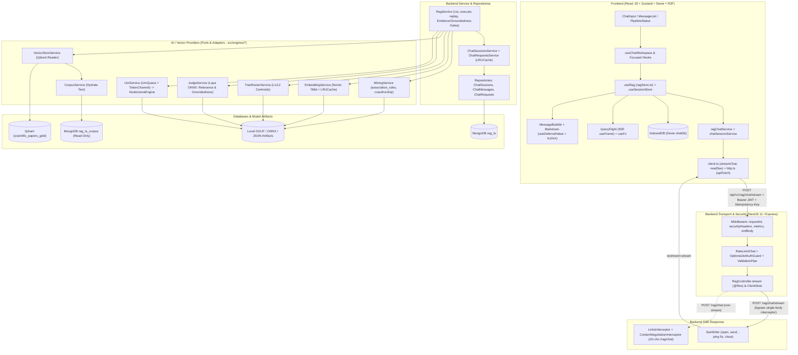
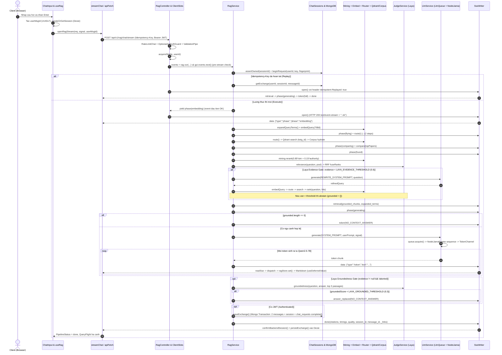

# Luồng 04 — Hỏi đáp Khoa học RAG & Streaming LLM qua SSE (POST /api/v1/rag/chat/stream)

- **Motivation/Background**: Tài liệu hóa chi tiết luồng request-response đầu-cuối (end-to-end) cho tính năng lõi của `RAG_TS` — hỏi đáp khoa học dựa trên ngữ cảnh bài báo (`Retrieval-Augmented Generation`) kết hợp truyền phát token theo thời gian thực qua `SSE` (`POST /api/v1/rag/chat/stream`) và đối chiếu với biến thể đồng bộ (`POST /api/v1/rag/chat`). Tài liệu giúp đội ngũ phát triển nắm rõ cách tầng `Service` điều phối song song `Repositories` (MongoDB) và các `AI/Vector Engines` (Qdrant, Nomic Embedding, Laya Judge, Qwen2.5-7B qua `node-llama-cpp`), cũng như cơ chế đồng bộ giao diện chat (`Markdown` + `KaTeX`) với thế giới 3D `R3F`.
- **Purpose**: Cung cấp bản đặc tả kiến trúc và bảng truy vết từng bước (Frontend → HTTP → Backend → AI Engines & Databases → SSE Stream → Frontend) dựa trên mã nguồn thực tế, kèm sơ đồ Mermaid, định dạng gói tin SSE, xử lý lỗi và các bất biến hệ thống.
- **Overview Pipeline**: Đọc đối chiếu trực tiếp mã nguồn Frontend (`frontend_rag/src/features/chat/*`, `shared/api/*`, `features/world/*`) và Backend (`backend_rag/src/modules/rag/*`, `modules/chat-sessions/*`, `engines/*`, `common/*`) để lập sơ đồ kiến trúc, sơ đồ tuần tự, bảng 4 giai đoạn và ma trận lỗi/bất biến.
- **Detailed Plan**: §1 Vị trí của AI Engines & Vector Store trong Kiến trúc 5 Tầng; §2 Sơ đồ Kiến trúc & Luồng Dữ liệu Toàn trình; §3 Sơ đồ Tuần tự (Sequence Diagram) Streaming & Evidence Gate; §4 Diễn giải Chi tiết 4 Giai đoạn Request-Response; §5 Đối chiếu SSE Stream vs JSON/XML đồng bộ & Định dạng Wire Events; §6 Xử lý Lỗi, Hủy luồng & Các Bất biến Hệ thống.
- **References**: NestJS 11, Express, React 19, Zustand, Dexie.js, React Three Fiber (`R3F`), `react-markdown`, `remark-math`, `rehype-katex`, `Qdrant` (`@qdrant/js-client-rest`), MongoDB/Mongoose, `@huggingface/transformers`, `@receptron/laya`, `node-llama-cpp`, [`agents/rules/MD_CONVENTION.md`](../../../agents/rules/MD_CONVENTION.md).
- **Created**: 2026-11-26T10:12:00+07:00
- **Last Updated**: 2026-11-26T10:12:00+07:00

[STATUS: ACTIVE]

---

## 1. Vị trí của AI Engines & Vector Store trong Kiến trúc 5 Tầng

Trong sơ đồ kiến trúc chuẩn của hệ thống (`Client/UI → FE Hook/Store → FE Service/API → BE Transport/Guard/Controller → Service → Repository → Database`), các thành phần AI và tìm kiếm vector **không** nằm trong tầng `Controller` hay tách thành một microservice HTTP độc lập ở pha suy luận, mà được đóng gói theo mẫu **Ports & Adapters** tại tầng hạ tầng nội bộ (`src/engines/*`) và được điều phối trực tiếp bởi **`RagService`** ở tầng nghiệp vụ (`Service Layer`):

1. **Tầng Service (`RagService`) là nhạc trưởng kép (Dual Orchestrator)**:
   - Một nhánh gọi qua **`SESSION_STORE` (`SessionStorePort`)** → [`ChatSessionsService`](../../../backend_rag/src/modules/chat-sessions/chat-sessions.service.ts#L76-L420) & [`ChatRequestsService`](../../../backend_rag/src/modules/chat-sessions/chat-requests.service.ts#L17-L85) → tầng **`Repositories`** ([`ChatSessionsRepository`](../../../backend_rag/src/modules/chat-sessions/repositories/chat-sessions.repository.ts#L27-L120), [`ChatMessagesRepository`](../../../backend_rag/src/modules/chat-sessions/repositories/chat-messages.repository.ts#L23-L70), [`ChatRequestsRepository`](../../../backend_rag/src/modules/chat-sessions/repositories/chat-requests.repository.ts#L15-L70)) → **MongoDB (`rag_ts`)** để kiểm tra quyền sở hữu session, khóa `Idempotency-Key` và lưu cặp hỏi-đáp trong transaction.
   - Nhánh còn lại gọi tới **6 AI/Vector Engines** qua các `Ports` trừu tượng (tiêm qua DI trong [`RagModule`](../../../backend_rag/src/modules/rag/rag.module.ts#L12-L25)):
     - [`MiningService`](../../../backend_rag/src/engines/mining/mining.service.ts#L160-L208): mở rộng từ khóa truy vấn từ luật kết hợp (`association_rules.json`) và rerank theo độ uy tín tác giả (`graph_coauthorship.json`).
     - `EMBEDDING_PORT` → [`EmbeddingService`](../../../backend_rag/src/engines/embedding/embedding.service.ts#L34-L117): vector hóa câu hỏi (`768` chiều) qua `@huggingface/transformers` (`nomic-ai/nomic-embed-text-v1.5`) kèm `LRUCache`.
     - [`TreeRouterService`](../../../backend_rag/src/engines/tree-router/tree-router.service.ts#L174-L251): định tuyến 2 tầng (nhánh `depth 1` → cành `depth 2`) trên chỉ mục centroid nạp từ `WORLD_DATA_DIR`.
     - `VECTOR_STORE_PORT` → [`VectorStoreService`](../../../backend_rag/src/engines/vector-store/vector-store.service.ts#L101-L277): truy vấn vector đọc-chỉ (`read-only`) tới **Qdrant** (`scientific_papers_gold`), sau đó gọi `CORPUS_PORT` → [`CorpusService`](../../../backend_rag/src/engines/corpus/corpus.service.ts#L59-L173) để hydrate nội dung chunk từ **MongoDB (`rag_ts_corpus`)**.
     - `JUDGE_PORT` (tùy chọn `@Optional()`) → [`JudgeService`](../../../backend_rag/src/engines/judge/judge.service.ts#L64-L183): chạy model **Laya** (`@receptron/laya` qua ONNX Runtime) với hàng đợi tuần tự để chấm điểm `relevance` (RRF rerank + Evidence Gate) và `groundedness` (Groundedness Gate).
     - `LLM_PORT` → [`LlmService`](../../../backend_rag/src/engines/llm/llm.service.ts#L48-L155) + `LLM_ENGINE` → [`NodeLlamaEngine`](../../../backend_rag/src/engines/llm/llm-engine.ts#L38-L85): kiểm soát đồng thời qua [`LlmQueue`](../../../backend_rag/src/engines/llm/llm-queue.ts#L28-L84) (`LLM_CONCURRENCY=1`, `LLM_MAX_QUEUE=8`), đẩy token bất đồng bộ qua [`TokenChannel`](../../../backend_rag/src/engines/llm/token-channel.ts#L5-L46) từ `node-llama-cpp` (Qwen2.5-7B GGUF).

2. **Bypass Post-Interceptor cho SSE (`SseWriter`)**:
   - Endpoint `POST /api/v1/rag/chat/stream` dùng `@Res() res: Response` (không dùng `@Res({ passthrough: true })` như `POST /api/v1/rag/chat`) và tự quản lý socket HTTP qua [`SseWriter`](../../../backend_rag/src/modules/rag/transport/sse.ts#L8-L43). Nhờ vậy, khi gói event đầu tiên được `flushHeaders()`, luồng stream bỏ qua hai post-Interceptor toàn cục là [`LinksInterceptor`](../../../backend_rag/src/common/http/hateoas.ts#L157-L177) và [`ContentNegotiationInterceptor`](../../../backend_rag/src/common/http/xml.ts#L109-L127) (vốn chỉ biến đổi single JSON/XML body), đồng thời vẫn tự gắn `_links` vào payload của event `done`.

---

## 2. Sơ đồ Kiến trúc & Luồng Dữ liệu Toàn trình



---

## 3. Sơ đồ Tuần tự (Sequence Diagram) Streaming & Evidence Gate



---

## 4. Diễn giải Chi tiết 4 Giai đoạn Request-Response

### 4.1. Giai đoạn 1 — Chiều đi Frontend: Client → FE → HTTP Request

| Bước | Tầng (Layer) | File & Ký hiệu | Đầu vào (Input) | Xử lý Nghiệp vụ & Kỹ thuật | Đầu ra (Output) |
| :--- | :--- | :--- | :--- | :--- | :--- |
| **1** | **UI Component** | [`ChatInput.tsx`](../../../frontend_rag/src/features/chat/components/ChatInput.tsx#L5-L55) (`ChatInput.submit`), [`MessageList.tsx`](../../../frontend_rag/src/features/chat/components/MessageList.tsx#L41-L44) | Chuỗi người dùng nhập hoặc click câu hỏi mẫu (`SAMPLES`). | Trim kiểm tra rỗng (`!value.trim()`), gọi `void send(value)` khi nhấn `Enter` (không giữ `Shift`, không `isComposing`) hoặc submit form; reset chiều cao `<textarea>`. | Gọi action `send(text)` qua hook. |
| **2** | **FE Hook** | [`useChatWorkspace.ts`](../../../frontend_rag/src/features/chat/hooks/useChatWorkspace.ts#L82-L87) (`useChatInputState`), [`useChatWorkspace.ts`](../../../frontend_rag/src/features/chat/hooks/useChatWorkspace.ts#L90-L94) (`useMessageListState`) | Selector tới `useRag`. | Đóng gói các selector tập trung (`phase`, `send`, `stop` / `messages`, `send`) giúp component UI tách biệt khỏi chi tiết store Zustand. | Trả về `send(text)` cho UI. |
| **3** | **FE Store (State & Local Session)** | [`ragStore.ts`](../../../frontend_rag/src/features/chat/store/ragStore.ts#L139-L169) (`useRag.send`), [`sessionStore.ts`](../../../frontend_rag/src/features/chat/store/sessionStore.ts#L164-L172) (`createOrGetSession`), [`chatSessionService.ts`](../../../frontend_rag/src/features/chat/services/chatSessionService.ts#L81-L102) | `text: string`, `useUi.getState().settings`. | 1. Hủy luồng cũ đang chạy nếu có (`cancelRun`) và tạo `AbortController` mới.<br>2. Sinh `userMsgId` và `assistantMsgId` bằng `uuidv7()`, tăng `runId`.<br>3. Đẩy ngay bubble `user` (`done`) và bubble `assistant` (`streaming`) vào Zustand `messages`.<br>4. Gọi `createOrGetSession(query)`: nếu chưa có `currentSessionId`, tạo session cục bộ trong `Dexie` (`synced: false`, `id: uuidv7()`). | `sessionId`, `userMsgId` (được dùng làm `Idempotency-Key`). |
| **4** | **FE Service** | [`ragChatService.ts`](../../../frontend_rag/src/features/chat/services/ragChatService.ts#L11-L43) (`buildRagRequest`, `openRagStream`) | `query`, `sessionId`, `settings`, `ctrl.signal`, `userMsgId`. | `buildRagRequest` kiểm tra `chatDb.sessions.get(sessionId)`: chỉ đính kèm `session_id` vào JSON body nếu `session?.synced === true` (tránh gửi local UUIDv7 chưa tồn tại trên MongoDB gây `404`). `openRagStream` gọi `streamChat`; nếu bật `MOCK_WORLD` mà không `USE_MOCK`, bọc qua `bridgeStream` để ánh xạ paper thật lên vector mock 3D. | `RagRequest` DTO + luồng `AsyncIterable<RagStreamEvent>`. |
| **5** | **FE API Wrapper & HTTP Client** | [`chatApi.ts`](../../../frontend_rag/src/features/chat/api/chatApi.ts#L36), [`client.ts`](../../../frontend_rag/src/shared/api/client.ts#L186-L222) (`streamChat`), [`http.ts`](../../../frontend_rag/src/shared/api/http.ts#L23-L34) (`apiFetch`) | `RagRequest`, `AbortSignal`, `idempotencyKey = userMsgId`. | `streamChat` thiết lập vòng lặp auto-resume (cửa sổ `180_000ms`), gọi `apiFetch('/rag/chat/stream', { method: 'POST', headers: { 'Content-Type': 'application/json', Accept: 'text/event-stream', 'Idempotency-Key': idempotencyKey }, body: JSON.stringify(req), signal })`. `apiFetch` gắn `Authorization: Bearer <accessToken>`; nếu gặp `401` sẽ tự `rotateTokens()` một lần rồi gửi lại. | HTTP Request gửi tới `API_BASE + '/rag/chat/stream'`. |

---

### 4.2. Giai đoạn 2 — Chiều vào Backend: HTTP Request → BE → Repositories & AI Engines → Databases

| Bước | Tầng (Layer) | File & Ký hiệu | Đầu vào (Input) | Xử lý Nghiệp vụ & Kỹ thuật | Đầu ra (Output) |
| :--- | :--- | :--- | :--- | :--- | :--- |
| **6** | **Express Middleware** | [`app.setup.ts`](../../../backend_rag/src/app.setup.ts#L47-L75), [`xml.ts`](../../../backend_rag/src/common/http/xml.ts#L70-L105) | Raw HTTP Request (`POST /api/v1/rag/chat/stream`). | Thiết lập `trust proxy` (`TRUST_PROXY_HOPS`), gắn `requestIdMiddleware` (`X-Request-Id`), `securityHeaders`, `PrometheusMetricsRegistry.middleware`, kiểm tra `unsupportedBody` (`415` nếu không phải JSON/XML), parse XML an toàn (chống XXE nếu gửi XML), bật CORS expose header `Idempotent-Replayed` & `Retry-After`. | `req` đã có `request_id` và parsed body. |
| **7** | **Pre-Interceptor (`ContentNegotiation`)** | [`xml.ts`](../../../backend_rag/src/common/http/xml.ts#L109-L119) (`ContentNegotiationInterceptor`) | Header `Accept: text/event-stream`. | Kiểm tra `req.accepts(OFFERED)` gồm `application/json`, `application/xml`, `text/xml`, `text/event-stream`. Nếu client đòi media type không hỗ trợ → ném `406 Not Acceptable`. | Cho phép đi tiếp vào Guards. |
| **8** | **Rate Limiter Guard** | [`throttler.ts`](../../../backend_rag/src/common/security/throttler.ts#L53-L63) (`RateLimitChat`) | `req.ip`, `req.headers.authorization`. | Áp dụng giới hạn theo IP trước khi verify JWT: **`20 req/60s`** nếu có header `Authorization`, hoặc **`10 req/60s`** nếu ẩn danh (`ragChatAnonymous`). Vượt ngưỡng → `429 Too Many Requests`. | Cho qua hoặc ném `429`. |
| **9** | **Auth Guard** | [`jwt-auth.guard.ts`](../../../backend_rag/src/modules/auth/guards/jwt-auth.guard.ts#L51-L74) (`OptionalJwtAuthGuard`) | Header `Authorization: Bearer <token>`. | - Không có token → cho phép ẩn danh (`req.user = undefined`).<br>- Có token sai định dạng, hết hạn, tài khoản bị khóa (`!user.is_active`), hoặc `token_version` lệch (`ver` claim bị revoke) → ném `401 Unauthorized`.<br>- Hợp lệ → gắn `req.user = { id, roles, email }`. | `AuthUser | undefined`. |
| **10** | **Validation Pipe** | [`validation.ts`](../../../backend_rag/src/common/http/validation.ts#L18-L26) (`createValidationPipe`), [`chat-request.dto.ts`](../../../backend_rag/src/modules/rag/dto/chat-request.dto.ts#L21-L75) (`ChatRequestDto`) | Request body JSON/XML. | `whitelist: true`, `forbidNonWhitelisted: true`, `transform: true`. Trim `query` (`1..2000` ký tự), ép kiểu `top_k` (`1..20`, mặc định `5`), `nprobe` (`1..6`, mặc định `2`), kiểm tra regex `category` (`CATEGORY_RE`), boolean `use_authority_boost` (`true`) & `expand_query` (`false`), UUID `session_id`. Sai → `400 Bad Request`. | `ChatRequestDto` hợp lệ. |
| **11** | **Controller & Concurrency Slot** | [`rag.controller.ts`](../../../backend_rag/src/modules/rag/rag.controller.ts#L145-L171) (`RagController.stream`), [`client-slots.ts`](../../../backend_rag/src/modules/rag/transport/client-slots.ts#L14-L36) (`ClientSlots`), [`sse.ts`](../../../backend_rag/src/modules/rag/transport/sse.ts#L49-L61) (`abortOnClientClose`) | `dto`, `user`, `Idempotency-Key`, `req`, `res`. | 1. Validate `Idempotency-Key` phải là UUID (`parseIdempotencyKey` → `400` nếu sai).<br>2. `acquireSlot(req.ip, user?.id)`: tối đa **`2` luồng/user** và **`3` luồng/IP** đang chạy; vượt → `429 too many concurrent requests`.<br>3. Đăng ký `abortOnClientClose(res, 'CHAT_STREAM_ABORTED')` tạo `AbortController` lắng nghe sự kiện `close` trên socket.<br>4. Gọi `events = this.rag.run(...)` và `await events.next()` **trước khi mở SSE headers**: nếu fail ở khâu check session, idempotency lock, embedding hay retrieval trước event đầu tiên, Controller nhả slot và ném `HttpException` để `HttpExceptionFilter` trả JSON/XML HTTP chuẩn. | `IteratorResult<PipelineEvent>` đầu tiên hoặc `HttpException`. |
| **12** | **Service Entry: Ownership & Idempotency** | [`rag.service.ts`](../../../backend_rag/src/modules/rag/rag.service.ts#L76-L150) (`RagService.run`, `replay`), [`request-fingerprint.ts`](../../../backend_rag/src/modules/rag/pipeline/request-fingerprint.ts#L5-L19), [`chat-sessions.service.ts`](../../../backend_rag/src/modules/chat-sessions/chat-sessions.service.ts#L256-L290), [`chat-requests.service.ts`](../../../backend_rag/src/modules/chat-sessions/chat-requests.service.ts#L20-L68) | `dto`, `user`, `idempotencyKey`. | - Nếu có `user` + `dto.session_id`: `assertOwned(sessionId, user.id)` → query `chat_sessions` (`deleted_at: null`, `user_id`), không thấy trả `404 session not found`.<br>- Nếu có `user` + `key`: gọi `beginRequest(user.id, key, sha256(req))` chèn bản ghi `status: 'in_progress'` (`locked_until = now + 5m`) vào collection `chat_requests` (`_id = "${userId}:${key}"`).<br>  - Nếu trùng `_id` và khác `fingerprint` → `409 request key reused`.<br>  - Nếu `status === 'in_progress'` và lock chưa hết hạn → `409 request already in progress`.<br>  - Nếu `status === 'completed'` → chuyển sang nhánh `replay()` đọc `getExchange()` từ MongoDB, set `result.replayed = true`, yield `retrieval` → `phase(generating)` → `token` → `done` và kết thúc. | Bắt đầu `execute()` hoặc `replay()`. |
| **13a** | **AI Engine 1: Query Expansion & Embedding** | [`rag.service.ts`](../../../backend_rag/src/modules/rag/rag.service.ts#L170-L180), [`mining.service.ts`](../../../backend_rag/src/engines/mining/mining.service.ts#L103-L116), [`embedding.service.ts`](../../../backend_rag/src/engines/embedding/embedding.service.ts#L54-L78) | `req.query`, `req.expand_query`. | Phát `phase('embedding')` (event đầu tiên khiến Controller mở SSE). Nếu `expand_query: true`, `MiningService.expandQueryTerms` khớp token từ `association_rules.json` (tối đa `5` thuật ngữ). Chuẩn hóa khoảng trắng và gọi `EmbeddingService.embedQuery("search_query: " + text)` qua `@huggingface/transformers` (cache `LRUCache` 500 mục, TTL `10m`) tạo vector `768` chiều. | `q: number[768]`, `expanded: string[]`, `timings.embed_ms`. |
| **13b** | **AI Engine 2: Two-Level Tree Router** | [`rag.service.ts`](../../../backend_rag/src/modules/rag/rag.service.ts#L181-L185), [`tree-router.service.ts`](../../../backend_rag/src/engines/tree-router/tree-router.service.ts#L142-L170) | `q`, `req.nprobe` (`1..6`). | Phát `phase('flying')`. Chuẩn hóa L2 query vector, tính tích vô hướng cosine với mọi centroid tầng 1 (`l1`), chọn top `nprobe` nhánh; tiếp tục chấm điểm các cành con tầng 2 (`l2`) thuộc các nhánh đã chọn và giữ top `nprobe` `twig_id`. Phát event `route`. | `steps: RouteStep[]` (`depth 1, 2`), `twigIds`, `timings.route_ms`. |
| **13c** | **Vector Store + Corpus Hydration** | [`rag.service.ts`](../../../backend_rag/src/modules/rag/rag.service.ts#L186-L190), [`vector-store.service.ts`](../../../backend_rag/src/engines/vector-store/vector-store.service.ts#L139-L165), [`corpus.service.ts`](../../../backend_rag/src/engines/corpus/corpus.service.ts#L92-L149) | `q`, `twigIds`, `req.category`, `limit = max(40, top_k * 8)`. | Phát `phase('comparing')`. `VectorStoreService.search` gọi Qdrant `query()` trên collection `scientific_papers_gold` với bộ lọc có cấu trúc (`primary_category` + `twig_id in twigIds`, timeout `15s`, tự retry 1 lần nếu stale keep-alive socket). Tiếp đó `CorpusService.hydrate` đọc song song (`Promise.all`, `maxTimeMS: 5000`) từ MongoDB `rag_ts_corpus` (`paper_chunks` và `papers`) để điền `text`, `section_title`, `title`, `authors`. Phát event `compare` (`topPapers`). | `hits: ScoredChunk[]`, `timings.search_ms`. |
| **13d** | **Mining Rerank & Laya Relevance RRF** | [`rag.service.ts`](../../../backend_rag/src/modules/rag/rag.service.ts#L192-L195), [`rag.service.ts`](../../../backend_rag/src/modules/rag/rag.service.ts#L355-L387), [`mining.service.ts`](../../../backend_rag/src/engines/mining/mining.service.ts#L130-L157), [`ranking.ts`](../../../backend_rag/src/modules/rag/pipeline/ranking.ts#L9-L61), [`judge.service.ts`](../../../backend_rag/src/engines/judge/judge.service.ts#L76-L87) | `question`, `hits`, `req.use_authority_boost`, `req.top_k`. | Phát `phase('found')`. `MiningService.rerank` tính điểm `0.85 * sim + 0.15 * authority` (chuẩn hóa PageRank đồng tác giả). Nếu `JudgeService.enabled` (`LAYA_MODEL_DIR` được cấu hình), Laya chấm `relevance` trên `pool` có kích thước `min(20, max(10, top_k * 2))` và trộn thứ hạng bằng Reciprocal Rank Fusion (`fuseRanks`, `RRF_K = 60`), cắt lấy `top_k` chunk. | `judged: { chunks, evidence }`, `timings.rerank_ms`. |
| **13e** | **AI Gate 1: Laya Evidence Gate (Self-Correction)** | [`rag.service.ts`](../../../backend_rag/src/modules/rag/rag.service.ts#L196-L210), [`rag.service.ts`](../../../backend_rag/src/modules/rag/rag.service.ts#L296-L321), [`rag.service.ts`](../../../backend_rag/src/modules/rag/rag.service.ts#L390-L418), [`prompt-builder.ts`](../../../backend_rag/src/modules/rag/pipeline/prompt-builder.ts#L16-L27) | `judged`, `question`, `LAYA_EVIDENCE_THRESHOLD` (`0.6`). | Nếu `evidence !== null && evidence < 0.6`: gọi `refine()` dùng LLM (`REWRITE_SYSTEM_PROMPT`) viết lại truy vấn khoa học bằng tiếng Anh (`cleanRewrite`), chạy lại vòng `embedQuery` → `route` → `search` → `rank(question, hits)`. Nếu kết quả mới tốt hơn thì nhận; nếu vẫn `< 0.6` thì kích hoạt **Abstain** (`chunks = []`, `abstained = true`). Phát event `retrieval(grounded_chunks, expanded_terms)`. | `grounded: GroundedChunk[]`, `refinedQuery`, `abstained`, `timings.refine_ms`. |
| **13f** | **AI Engine 3: LLM Queue & Qwen2.5-7B Streaming** | [`rag.service.ts`](../../../backend_rag/src/modules/rag/rag.service.ts#L212-L215), [`rag.service.ts`](../../../backend_rag/src/modules/rag/rag.service.ts#L324-L343), [`llm.service.ts`](../../../backend_rag/src/engines/llm/llm.service.ts#L94-L154), [`llm-queue.ts`](../../../backend_rag/src/engines/llm/llm-queue.ts#L46-L83), [`llm-engine.ts`](../../../backend_rag/src/engines/llm/llm-engine.ts#L61-L84), [`token-channel.ts`](../../../backend_rag/src/engines/llm/token-channel.ts#L5-L46) | `grounded`, `question`, `signal`. | Phát `phase('generating')`. Nếu `grounded.length === 0`, yield ngay `NO_CONTEXT_ANSWER` mà không gọi LLM. Ngược lại, `buildUserPrompt` ghép `citation_tag` (`[Paper: id]`) + đoạn trích; `LlmService.generate` lấy slot từ `LlmQueue` (`LLM_CONCURRENCY=1`, `LLM_MAX_QUEUE=8`), đặt timer `LLM_TIMEOUT_MS` (`60_000ms`), gọi `NodeLlamaEngine.generate` (`LlamaChatSession.prompt` với `temperature: 0.2`, `maxTokens: 1024`, `stopOnAbortSignal: true`). Callback `onTextChunk` đẩy từng token vào `TokenChannel`, generator yield từng `event` `token`. | Chuỗi token stream + `answer`, `timings.llm_ms`. |
| **13g** | **AI Gate 2: Laya Groundedness Gate & Citations** | [`rag.service.ts`](../../../backend_rag/src/modules/rag/rag.service.ts#L218-L252), [`judge.service.ts`](../../../backend_rag/src/engines/judge/judge.service.ts#L89-L103), [`citations.ts`](../../../backend_rag/src/modules/rag/pipeline/citations.ts#L8-L17) | `question`, `answer`, `grounded.slice(0, 3)`, `LAYA_GROUNDED_THRESHOLD` (`0.3`). | Nếu `evidence !== null && grounded.length && !signal.aborted`: Laya chấm `groundedness` trên tối đa `3` đoạn (`GROUNDED_PASSAGES = 3`, cắt ngắn `900`/`1100` ký tự cho cửa sổ `512` token). Nếu `groundedScore < 0.3` → gán `abstained = true`, thay thế `answer = NO_CONTEXT_ANSWER` và yield event `answer_replaced`. Tiếp theo `extractCitations(answer)` trích xuất các `[Paper: id]` theo thứ tự xuất hiện. | `quality`, `citations: string[]`, `timings.grounded_ms`. |
| **13h** | **Repository & MongoDB Transaction Persist** | [`rag.service.ts`](../../../backend_rag/src/modules/rag/rag.service.ts#L254-L270), [`chat-sessions.service.ts`](../../../backend_rag/src/modules/chat-sessions/chat-sessions.service.ts#L298-L409), [`chat-sessions.repository.ts`](../../../backend_rag/src/modules/chat-sessions/repositories/chat-sessions.repository.ts#L115-L140), [`chat-messages.repository.ts`](../../../backend_rag/src/modules/chat-sessions/repositories/chat-messages.repository.ts#L62-L70), [`chat-requests.repository.ts`](../../../backend_rag/src/modules/chat-sessions/repositories/chat-requests.repository.ts#L52-L69) | `user.id`, `sessionId`, `question`, `answer`, `requestKey`. | Chỉ chạy khi có `user` và (`!signal.aborted \|\| answer.length > 0`). `saveExchange` gọi `invalidate(userId, sessionId)` (tăng `userGen` trong `ChatSessionsService` & xóa `sessionDetailCache`), mở `MongoDB ClientSession.withTransaction` (tự fallback tuần tự nếu MongoDB standalone):<br>1. `insertExchange` chèn 2 document `user` và `assistant` (PK **UUIDv7**) vào `chat_messages`.<br>2. Nếu `sessionId` có sẵn → `incrementExchange` (`$inc: { message_count: 2 }`); nếu null → `createInSession` tạo session mới (PK **UUIDv7**).<br>3. Nếu có `requestKey` → `requests.complete` chuyển `chat_requests` sang `status: 'completed'` gắn `session_id` & `message_id`. | `saved: { session_id, user_message_id, assistant_message_id }`. |

---

### 4.3. Giai đoạn 3 — Chiều về Backend: Streams/Engines → Controller → SseWriter → HTTP SSE Stream

| Bước | Tầng (Layer) | File & Ký hiệu | Đầu vào (Input) | Xử lý Nghiệp vụ & Kỹ thuật | Đầu ra (Output) |
| :--- | :--- | :--- | :--- | :--- | :--- |
| **14** | **Service Finalize** | [`rag.service.ts`](../../../backend_rag/src/modules/rag/rag.service.ts#L271-L292) (`execute`), [`rag.service.ts`](../../../backend_rag/src/modules/rag/rag.service.ts#L104-L111) (`finally`) | `saved`, `citations`, `timings`, `quality`. | Cập nhật `timings.total_ms`, điền đầy đủ `PipelineResult` vào tham chiếu `result`, và yield event cuối `{ type: 'done', citations, timings, quality?, session_id, message_id }`. Trong khối `finally` của `run()`, nếu chưa có `result.message_id` (lỗi hoặc bị abort trước khi lưu), gọi `releaseRequest(user.id, key)` để giải phóng khóa idempotency. | Event `done` cuối cùng. |
| **15** | **Controller SSE Loop & HATEOAS** | [`rag.controller.ts`](../../../backend_rag/src/modules/rag/rag.controller.ts#L172-L209), [`hateoas.ts`](../../../backend_rag/src/common/http/hateoas.ts#L53-L68) (`chatLinks`) | `events: AsyncGenerator<PipelineEvent>`, `result`, `res`. | 1. Nếu `result.replayed`, set header `Idempotent-Replayed: true`.<br>2. Gọi `sse.open()`.<br>3. Lặp `events.next()`: mỗi event được gửi ngay qua `sse.send(...)`; riêng event `done` được bổ sung `_links: chatLinks(r.value)` (`session`, `messages`, `papers`).<br>4. Nếu lỗi xảy ra **sau** khi `sse.open()` đã chạy: bắt exception và gửi `{ type: 'error', message, status }` thay cho `done`.<br>5. Trong `finally`: gọi `events.return(undefined)` (kích hoạt `finally` giải phóng lock/sequence), `release()` slot của `ClientSlots`, và `sse.close()`. | Chuỗi SSE frames trên HTTP response; giải phóng toàn bộ tài nguyên. |
| **16** | **SSE Transport Writer** | [`sse.ts`](../../../backend_rag/src/modules/rag/transport/sse.ts#L8-L43) (`SseWriter`) | `RagStreamEvent`. | - `open()`: ghi HTTP `200`, `Content-Type: text/event-stream; charset=utf-8`, `Cache-Control: no-cache, no-transform`, `Connection: keep-alive`, `X-Accel-Buffering: no`, `socket?.setNoDelay(true)`, `flushHeaders()`, gửi comment `: ok\n\n` và đặt `setInterval` gửi `: ping\n\n` mỗi `5_000ms` giữ kết nối qua proxy/Cloudflare.<br>- `send()`: tuần tự hóa `data: ${JSON.stringify(event)}\n\n`.<br>- `close()`: `clearInterval(ping)` và gọi `res.end()`. | Byte stream chuẩn `text/event-stream`. |
| **17** | **Đối chiếu Non-Stream (`POST /rag/chat`)** | [`rag.controller.ts`](../../../backend_rag/src/modules/rag/rag.controller.ts#L86-L139), [`hateoas.ts`](../../../backend_rag/src/common/http/hateoas.ts#L157-L177), [`xml.ts`](../../../backend_rag/src/common/http/xml.ts#L109-L127) | `RagController.chat` với `@Res({ passthrough: true })`. | Không dùng `SseWriter`: tiêu thụ hết vòng lặp `for await (const _ of events)` để chờ `result` hoàn tất, trả về object `ChatResponseDto` thuần. Nhờ `passthrough: true`, response đi qua **`LinksInterceptor`** (gắn `_links` từ `@WithLinks({ resource: chatLinks })`) và **`ContentNegotiationInterceptor`** (trả JSON hoặc chuyển sang XML nếu `Accept: application/xml`). | Single HTTP `200` JSON/XML response. |

---

### 4.4. Giai đoạn 4 — Chiều về Frontend: SSE Stream → FE → Client

| Bước | Tầng (Layer) | File & Ký hiệu | Đầu vào (Input) | Xử lý Nghiệp vụ & Kỹ thuật | Đầu ra (Output) |
| :--- | :--- | :--- | :--- | :--- | :--- |
| **18** | **SSE Parser & Auto-Resume** | [`client.ts`](../../../frontend_rag/src/shared/api/client.ts#L204-L328) (`streamChat`, `readSse`), [`sseParser.ts`](../../../frontend_rag/src/shared/api/sseParser.ts#L2-L34) (`SseBuffer`, `parseSseBlock`) | `res.body: ReadableStream<Uint8Array>`. | `readSse` đọc từng chunk UTF-8 bằng `TextDecoder({ stream: true })`, tách khối theo `\n\n` qua `SseBuffer`, bỏ qua comment (`: ok`, `: ping`), `JSON.parse` từng dòng `data:`.<br>**Auto-Resume (`180s`)**: nếu rớt mạng giữa chừng khi đã đăng nhập (`resumable === true`), `streamChat` chờ `3_000ms` (`RESUME_DELAY_MS`) rồi gửi lại đúng `POST /rag/chat/stream` kèm `Idempotency-Key` cũ (tối đa `180_000ms` `RESUME_WINDOW_MS`). Khi BE trả `409 request already in progress` hoặc `429`, tiếp tục đợi `Retry-After` đến khi BE lưu xong và replay; nếu quá hạn mà đã nhận một phần text, `giveUp()` tự phát `done` cục bộ giữ lại câu trả lời đã stream. | Luồng `RagStreamEvent` sạch và bền bỉ trước rớt mạng. |
| **19** | **FE Store Reducer & Micro-Batch** | [`ragStore.ts`](../../../frontend_rag/src/features/chat/store/ragStore.ts#L79-L105) (`dispatch`), [`ragStore.ts`](../../../frontend_rag/src/features/chat/store/ragStore.ts#L170-L195), [`pipeline.ts`](../../../frontend_rag/src/features/chat/store/pipeline.ts#L53-L94) (`reduceEvent`) | `runId`, `ev: RagStreamEvent`. | 1. `reduceEvent` kiểm tra chuyển pha hợp lệ (`isValidTransition`: `idle -> embedding -> flying -> comparing -> found -> generating -> done`) và tổng hợp dữ liệu (`route`, `compare`, `grounded_chunks`, `answer += token`, `answer_replaced`, `checkCitations`).<br>2. Với `token` hoặc `answer_replaced`, `dispatch` gộp cập nhật `phase`, `current` và `messages[].content` vào **một lần `set()` duy nhất** để loại bỏ double-render mỗi token.<br>3. Khi nhận `ev.type === 'done'` có `ev.session_id`, gọi `confirmBackendSession(localId, ev.session_id)`. | State `useRag` đồng bộ tức thì. |
| **20** | **Dexie ID Migration & Local Persist** | [`sessionStore.ts`](../../../frontend_rag/src/features/chat/store/sessionStore.ts#L174-L194), [`chatSessionService.ts`](../../../frontend_rag/src/features/chat/services/chatSessionService.ts#L105-L141) (`reconcileBackendSession`), [`chatSessionService.ts`](../../../frontend_rag/src/features/chat/services/chatSessionService.ts#L180-L227) (`saveExchangeLocally`) | `localId`, `backendId`, `userMsg`, `assistantMsg`. | - Nếu session tạo ở bước 3 có `localId !== backendId`: `reconcileBackendSession` di chuyển tin nhắn sang `backendId`, xóa session tạm, đánh dấu `synced: true` và đồng bộ tiêu đề lên `PATCH /chat-sessions/:id` ở chế độ nền.<br>- Trong khối `finally` của `send()`, `persistExchange` gọi `saveExchangeLocally` (`chatDb.messages.bulkPut`) bảo toàn thứ tự thời gian đơn điệu (`assistantTime >= userTime + 1ms`) và cập nhật `message_count` (luôn hoạt động ngay cả khi offline/stopped/error). | IndexedDB (`Dexie`) luôn khớp ground truth backend & khả dụng offline (`D-017`). |
| **21** | **UI Rendering & Concurrent Math** | [`PipelineStatus.tsx`](../../../frontend_rag/src/features/chat/components/PipelineStatus.tsx#L16-L49), [`MessageBubble.tsx`](../../../frontend_rag/src/features/chat/components/MessageBubble.tsx#L20-L128), [`Markdown.tsx`](../../../frontend_rag/src/features/chat/components/Markdown.tsx#L25-L58) | `visualPhase`, `message`, `checks`, `timings`. | - `AssistantBubble` ẩn text khi `visualPhase < 'generating'` (hiển thị typing indicator theo pha 3D), sau đó bật hiệu ứng typewriter `useReveal` (`45ms` + `React.startTransition`).<br>- `Markdown` (`React.memo`) bọc nội dung bằng **`useDeferredValue(text)`** trong lúc `streaming` (`D-005`), chuẩn hóa công thức `\[...\]` / `\(...\)` (`normalizeDisplayMath`) và render AST (`remarkGfm`, `remarkMath`, `remarkCitations`, `rehypeKatex`) thành HTML + `CitationChip` (`verified` / `unverified` / `pending`). Nhờ `useDeferredValue`, việc parse KaTeX không bao giờ làm khựng luồng 60 FPS của Canvas 3D. | Bong bóng chat hiển thị mượt, chip trích dẫn xác minh & tổng thời gian `total_ms`. |
| **22** | **3D Tree Flight Sync** | [`QueryFlight.tsx`](../../../frontend_rag/src/features/world/scene/fx/QueryFlight.tsx#L161-L445), [`fxStore.ts`](../../../frontend_rag/src/features/world/store/fxStore.ts#L50-L73) | `useRag.visualPhase`, `current.route`, `current.compare`, `current.grounded_chunks`. | `QueryFlight` chạy trong R3F `useFrame` (dùng refs, không set React state mỗi frame): khi đủ dữ liệu (`stageData`) và quả cầu hoàn tất quãng bay/dừng của giai đoạn hiện tại, gọi `useRag.getState().advanceVisual()` để đẩy `visualPhase` lên một nấc (không vượt quá `phase` thực tế từ SSE), đồng thời cập nhật `useFx` (`branchMarks`, `routeLabels`, `overlay`, `topK`) để làm sáng nhánh cây và các hạt bài báo trúng đích. | Hiệu ứng 3D trên cây tri thức đồng bộ nhịp nhàng với tiến độ RAG; hỗ trợ nút `Bỏ qua animation` (`skipAnimation()`). |

---

## 5. Đối chiếu SSE Stream vs JSON/XML đồng bộ & Định dạng Wire Events

### 5.1. Bảng so sánh hai endpoint RAG

| Tiêu chí | `POST /api/v1/rag/chat/stream` (Streaming SSE) | `POST /api/v1/rag/chat` (Đồng bộ JSON/XML) |
| :--- | :--- | :--- |
| **Controller Handler** | [`RagController.stream`](../../../backend_rag/src/modules/rag/rag.controller.ts#L145-L210) với `@Res() res` | [`RagController.chat`](../../../backend_rag/src/modules/rag/rag.controller.ts#L86-L139) với `@Res({ passthrough: true })` |
| **Media Type trả về** | `text/event-stream; charset=utf-8` | `application/json` hoặc `application/xml` (qua [`ContentNegotiationInterceptor`](../../../backend_rag/src/common/http/xml.ts#L109-L127)) |
| **HATEOAS `_links`** | Gắn trực tiếp vào payload của event `done` (`{ ...r.value, _links: chatLinks(r.value) }`) | Tự động gắn qua decorator `@WithLinks({ resource: chatLinks })` + [`LinksInterceptor`](../../../backend_rag/src/common/http/hateoas.ts#L157-L177) |
| **Xử lý lỗi giữa chừng** | Lỗi trước event đầu tiên → HTTP status chuẩn (`HttpExceptionFilter`); lỗi sau `sse.open()` → phát SSE event `{ type: 'error', message, status }` | Mọi lỗi trong toàn bộ pipeline đều ném `HttpException` và qua `HttpExceptionFilter` (HTTP `400`/`401`/`404`/`409`/`429`/`499`/`503`/`504`) |
| **Keep-Alive Proxy** | Gửi `: ok\n\n` ngay khi mở và `: ping\n\n` mỗi `5_000ms` (`PING_INTERVAL_MS`) | Đợi đến khi pipeline hoàn tất mới trả HTTP body |

### 5.2. Ví dụ các khung dữ liệu SSE thực tế trên đường truyền (Wire Format)

```text
: ok

data: {"type":"phase","phase":"embedding"}

data: {"type":"phase","phase":"flying"}

data: {"type":"route","steps":[{"depth":1,"candidates":[{"node_id":10,"score":0.7421}],"chosen":[10,14]},{"depth":2,"candidates":[{"node_id":102,"score":0.8104}],"chosen":[102,108]}]}

data: {"type":"phase","phase":"comparing"}

data: {"type":"compare","candidates":[{"paper_id":"2106.09685","score":0.8412}]}

data: {"type":"phase","phase":"found"}

data: {"type":"retrieval","grounded_chunks":[{"chunk_id":"2106.09685#0","paper_id":"2106.09685","title":"LoRA: Low-Rank Adaptation of Large Language Models","section_title":"Method","section_type":"method","text":"...","similarity_score":0.8412,"authority_score":0.62,"final_score":0.808,"relevance_score":0.912,"citation_tag":"[Paper: 2106.09685]"}],"expanded_terms":["low rank adaptation"]}

data: {"type":"phase","phase":"generating"}

data: {"type":"token","text":"LoRA freezes the pre-trained model weights"}

: ping

data: {"type":"token","text":" and injects trainable rank decomposition matrices [Paper: 2106.09685]."}

data: {"type":"done","citations":["2106.09685"],"timings":{"embed_ms":18,"route_ms":2,"search_ms":41,"rerank_ms":380,"llm_ms":1950,"grounded_ms":140,"total_ms":2540},"quality":{"evidence_score":0.912,"refined_query":null,"grounded_score":0.885,"abstained":false},"session_id":"019367a1-8c20-7000-8000-000000000001","message_id":"019367a1-9614-7000-8000-000000000002","_links":{"session":{"href":"/api/v1/chat-sessions/019367a1-8c20-7000-8000-000000000001"},"messages":{"href":"/api/v1/chat-sessions/019367a1-8c20-7000-8000-000000000001/messages"},"papers":{"href":"/api/v1/papers?ids=2106.09685"}}}
```

> Lưu ý các event đặc biệt:
> - **Groundedness Gate fail**: trước `done`, server gửi `data: {"type":"answer_replaced","answer":"The provided literature does not contain sufficient details regarding this question."}\n\n`.
> - **Lỗi sau khi đã mở stream**: thay cho `done`, server gửi `data: {"type":"error","message":"llm timeout","status":504}\n\n`.

---

## 6. Xử lý Lỗi, Hủy luồng & Các Bất biến Hệ thống

### 6.1. Ma trận Lỗi Tiền Stream vs Giữa Stream

| Mã / Tình huống | Nguồn phát sinh | Điểm bắt & Cơ chế phản hồi |
| :--- | :--- | :--- |
| **`400 Bad Request`** | [`ValidationPipe`](../../../backend_rag/src/common/http/validation.ts#L18-L26), `parseIdempotencyKey` ([`rag.controller.ts`](../../../backend_rag/src/modules/rag/rag.controller.ts#L48-L52)), `CATEGORY_RE` | Lỗi trước khi mở stream → `HttpExceptionFilter` trả JSON/XML chuẩn §1.2 kèm `request_id`. |
| **`401 Unauthorized`** | [`OptionalJwtAuthGuard`](../../../backend_rag/src/modules/auth/guards/jwt-auth.guard.ts#L51-L74) | Token sai định dạng, hết hạn, user bị vô hiệu hóa hoặc lệch `token_version` → HTTP `401`. FE (`apiFetch`) tự động thử `rotateTokens()` 1 lần trước khi báo lỗi. |
| **`404 Not Found`** | [`ChatSessionsService.assertOwned`](../../../backend_rag/src/modules/chat-sessions/chat-sessions.service.ts#L288-L290) | `session_id` không tồn tại, đã soft-delete (`deleted_at != null`) hoặc thuộc user khác (không bao giờ lộ `403`). |
| **`409 Conflict`** | [`ChatRequestsService.begin`](../../../backend_rag/src/modules/chat-sessions/chat-requests.service.ts#L43-L63) | Cùng `Idempotency-Key` nhưng khác body (`request key reused`) hoặc yêu cầu trước đó vẫn đang chạy (`request already in progress`). Client auto-resume ở FE sẽ chờ `3s` và thử lại khi nhận `409 request already in progress`. |
| **`406` / `415`** | [`xml.ts`](../../../backend_rag/src/common/http/xml.ts#L70-L119) | `415` khi gửi `Content-Type` không phải JSON/XML; `406` khi header `Accept` không chấp nhận JSON, XML hoặc `text/event-stream`. |
| **`429 Too Many Requests`** | [`RateLimitChat`](../../../backend_rag/src/common/security/throttler.ts#L53-L63), [`ClientSlots`](../../../backend_rag/src/modules/rag/transport/client-slots.ts#L14-L36), [`LlmQueue`](../../../backend_rag/src/engines/llm/llm-queue.ts#L52-L53) | - Vượt rate limit IP (`20/min` có JWT, `10/min` ẩn danh) hoặc vượt `ClientSlots` (`2` luồng/user, `3` luồng/IP) → HTTP `429` **trước** khi mở SSE.<br>- Hàng đợi LLM đầy (`LLM_CONCURRENCY=1`, `LLM_MAX_QUEUE=8`) → `QueueFullError` chuyển thành event `error` (`status: 429`, `llm queue is full`) nếu stream đã mở. |
| **`503 Service Unavailable`** | [`EmbeddingService`](../../../backend_rag/src/engines/embedding/embedding.service.ts#L61-L68), [`VectorStoreService`](../../../backend_rag/src/engines/vector-store/vector-store.service.ts#L272), [`CorpusService`](../../../backend_rag/src/engines/corpus/corpus.service.ts#L147), [`LlmService`](../../../backend_rag/src/engines/llm/llm.service.ts#L99-L143) | Model embedding/LLM chưa nạp xong hoặc Qdrant (`15s` timeout) / `rag_ts_corpus` (`5s` timeout) gián đoạn → HTTP `503` (nếu xảy ra ở `embedding` trước khi mở stream) hoặc SSE `error` (`status: 503`). |
| **`504 Gateway Timeout`** | [`LlmService.generate`](../../../backend_rag/src/engines/llm/llm.service.ts#L115-L145) | Quá thời gian sinh `LLM_TIMEOUT_MS` (mặc định `60_000ms`): timer abort `NodeLlamaEngine`, gửi SSE `error` (`status: 504`, `llm timeout`). |
| **Client Abort (`499` / Quiet End)** | [`abortOnClientClose`](../../../backend_rag/src/modules/rag/transport/sse.ts#L49-L61), [`LlmQueue`](../../../backend_rag/src/engines/llm/llm-queue.ts#L57-L62), [`ragStore.stop`](../../../frontend_rag/src/features/chat/store/ragStore.ts#L198-L212) | Khi user nhấn nút **Dừng** hoặc đóng tab, socket `close` kích hoạt `ctrl.abort()`. `LlmQueue` rút ngay waiter khỏi hàng đợi; `NodeLlamaEngine` dừng sinh qua `stopOnAbortSignal: true`; `RagController` ghi log `CHAT_STREAM_ABORTED`, chạy `events.return(undefined)` và nhả `ClientSlots`. |

### 6.2. Các Bất biến Hệ thống Liên quan (System Invariants)

1. **`D-004` — Read-Only Qdrant & Auto HTTPS**: [`VectorStoreService`](../../../backend_rag/src/engines/vector-store/vector-store.service.ts#L101-L165) chỉ sử dụng `query`, `scroll`, `getCollection` trên `scientific_papers_gold`, không bao giờ ghi hay thay đổi collection từ `backend_rag`.
2. **`D-005` — Non-Blocking Streaming Markdown**: [`Markdown.tsx`](../../../frontend_rag/src/features/chat/components/Markdown.tsx#L33-L35) dùng `useDeferredValue(text)` kết hợp `startTransition` trong `useReveal` và batch state một lần trong [`ragStore.ts`](../../../frontend_rag/src/features/chat/store/ragStore.ts#L89-L97) để ngăn KaTeX/Markdown AST làm đóng băng luồng render 3D `60 FPS`.
3. **`D-050` — Idempotent Chat qua `Idempotency-Key` & `chat_requests`**: Kết hợp khóa `userMsgId` (UUIDv7 từ FE), fingerprint SHA-256 của body và cập nhật nguyên tử trong MongoDB transaction (`saveExchange`), đảm bảo auto-resume khi rớt mạng không bao giờ sinh câu trả lời trùng lặp hay lưu đúp tin nhắn.
4. **`D-055` — Chống cạn kiệt hàng đợi LLM theo Client**: [`ClientSlots`](../../../backend_rag/src/modules/rag/transport/client-slots.ts#L5-L35) giới hạn tối đa `2` luồng đồng thời mỗi user và `3` luồng mỗi IP trước khi chạm tới `LlmQueue` (`1` slot chạy + `8` slot chờ).
5. **`D-058` — Tách văn bản gốc sang `rag_ts_corpus` Read-Only**: Qdrant chỉ lưu vector và metadata lọc (`twig_id`, `primary_category`, `paper_id`, `chunk_id`); toàn bộ nội dung text được [`CorpusService`](../../../backend_rag/src/engines/corpus/corpus.service.ts#L59-L149) hydrate theo lô (`$in`) qua kết nối riêng `CORPUS_MONGO_URI` chỉ-đọc.
6. **`D-059` — Laya Quality Gates & Fail-Open Judge**: [`JudgeService`](../../../backend_rag/src/engines/judge/judge.service.ts#L54-L173) dùng hàng đợi tuần tự (`MAX_PENDING = 8`, timeout `LAYA_TIMEOUT_MS = 30_000ms`), luôn trả `null` khi quá tải hoặc tắt thay vì làm sập luồng chat; khi bật, thực thi đủ 3 bước: RRF fused rerank (`RRF_K = 60`), Evidence Gate (viết lại truy vấn 1 lần nếu `< 0.6`, abstain nếu vẫn thiếu), và Groundedness Gate (thay bằng `NO_CONTEXT_ANSWER` qua `answer_replaced` nếu `< 0.3`).
