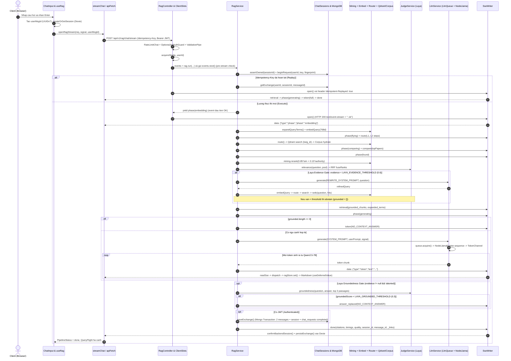

# Luồng 04 — Hỏi đáp Khoa học RAG & Streaming LLM qua SSE (POST /api/v1/rag/chat/stream)

- **Motivation/Background**: Tài liệu hóa chi tiết luồng request-response đầu-cuối (end-to-end) cho tính năng lõi của `RAG_TS` — hỏi đáp khoa học dựa trên ngữ cảnh bài báo (`Retrieval-Augmented Generation`) kết hợp truyền phát token theo thời gian thực qua `SSE` (`POST /api/v1/rag/chat/stream`) và đối chiếu với biến thể đồng bộ (`POST /api/v1/rag/chat`). Tài liệu giúp đội ngũ phát triển nắm rõ cách tầng `Service` điều phối song song `Repositories` (MongoDB) và các `AI/Vector Engines` (Qdrant, Nomic Embedding, Laya Judge, Qwen2.5-7B qua `node-llama-cpp`), cũng như cơ chế đồng bộ giao diện chat (`Markdown` + `KaTeX`) với thế giới 3D `R3F`.
- **Purpose**: Cung cấp bản đặc tả kiến trúc và bảng truy vết từng bước (Frontend → HTTP → Backend → AI Engines & Databases → SSE Stream → Frontend) dựa trên mã nguồn thực tế, kèm sơ đồ Mermaid, định dạng gói tin SSE, xử lý lỗi và các bất biến hệ thống.
- **Overview Pipeline**: Đọc đối chiếu trực tiếp mã nguồn Frontend (`frontend_rag/src/features/chat/*`, `shared/api/*`, `features/world/*`) và Backend (`backend_rag/src/modules/rag/*`, `modules/chat-sessions/*`, `engines/*`, `common/*`) để lập sơ đồ kiến trúc, sơ đồ tuần tự, bảng 4 giai đoạn và ma trận lỗi/bất biến.
- **Detailed Plan**: §1 Vị trí của AI Engines & Vector Store trong Kiến trúc 5 Tầng; §2 Sơ đồ Kiến trúc & Luồng Dữ liệu Toàn trình; §3 Sơ đồ Tuần tự (Sequence Diagram) Streaming & Evidence Gate; §4 Diễn giải Chi tiết 4 Giai đoạn Request-Response; §5 Đối chiếu SSE Stream vs JSON/XML đồng bộ & Định dạng Wire Events; §6 Xử lý Lỗi, Hủy luồng & Các Bất biến Hệ thống.
- **References**: NestJS 11, Express, React 19, Zustand, Dexie.js, React Three Fiber (`R3F`), `react-markdown`, `remark-math`, `rehype-katex`, `Qdrant` (`@qdrant/js-client-rest`), MongoDB/Mongoose, `@huggingface/transformers`, `@receptron/laya`, `node-llama-cpp`, [`agents/rules/MD_CONVENTION.md`](../../../agents/rules/MD_CONVENTION.md).
- **Created**: 2026-11-26T10:12:00+07:00
- **Last Updated**: 2026-11-27T07:40:00+07:00

[STATUS: ACTIVE]

---

## 1. Vị trí của AI Engines & Vector Store trong Kiến trúc 5 Tầng

Trong sơ đồ kiến trúc chuẩn của hệ thống (`Client/UI → FE Hook/Store → FE Service/API → BE Transport/Guard/Controller → Service → Repository → Database`), các thành phần AI và tìm kiếm vector **không** nằm trong tầng `Controller` hay tách thành một microservice HTTP độc lập ở pha suy luận, mà được đóng gói theo mẫu **Ports & Adapters** tại tầng hạ tầng nội bộ (`src/engines/*`) và được điều phối trực tiếp bởi **`RagService`** ở tầng nghiệp vụ (`Service Layer`):

1. **Tầng Service (`RagService`) là nhạc trưởng kép (Dual Orchestrator)**:
   - Một nhánh gọi qua **`SESSION_STORE` (`SessionStorePort`)** → [`ChatSessionsService`](../../../backend_rag/src/modules/chat-sessions/chat-sessions.service.ts#L76-L420) & [`ChatRequestsService`](../../../backend_rag/src/modules/chat-sessions/chat-requests.service.ts#L17-L85) → tầng **`Repositories`** ([`ChatSessionsRepository`](../../../backend_rag/src/modules/chat-sessions/repositories/chat-sessions.repository.ts#L27-L120), [`ChatMessagesRepository`](../../../backend_rag/src/modules/chat-sessions/repositories/chat-messages.repository.ts#L23-L70), [`ChatRequestsRepository`](../../../backend_rag/src/modules/chat-sessions/repositories/chat-requests.repository.ts#L15-L70)) → **MongoDB (`rag_ts`)** để kiểm tra quyền sở hữu session, khóa `Idempotency-Key` và lưu cặp hỏi-đáp trong transaction.
   - Nhánh còn lại gọi tới **6 AI/Vector Engines** qua các `Ports` trừu tượng (tiêm qua DI trong [`RagModule`](../../../backend_rag/src/modules/rag/rag.module.ts#L12-L25)):
     - [`MiningService`](../../../backend_rag/src/engines/mining/mining.service.ts#L160-L208): mở rộng từ khóa truy vấn từ luật kết hợp (`association_rules.json`) và rerank theo độ uy tín tác giả (`graph_coauthorship.json`).
     - `EMBEDDING_PORT` → [`EmbeddingService`](../../../backend_rag/src/engines/embedding/embedding.service.ts#L34-L117): vector hóa câu hỏi (`768` chiều) qua `@huggingface/transformers` (`nomic-ai/nomic-embed-text-v1.5`) kèm `LRUCache`.
     - [`TreeRouterService`](../../../backend_rag/src/engines/tree-router/tree-router.service.ts#L174-L251): định tuyến 2 tầng (nhánh `depth 1` → cành `depth 2`) trên chỉ mục centroid nạp từ `WORLD_DATA_DIR`.
     - `VECTOR_STORE_PORT` → [`VectorStoreService`](../../../backend_rag/src/engines/vector-store/vector-store.service.ts#L101-L277): truy vấn vector đọc-chỉ (`read-only`) tới **Qdrant** (`scientific_papers_gold`), sau đó gọi `CORPUS_PORT` → [`CorpusService`](../../../backend_rag/src/engines/corpus/corpus.service.ts#L59-L173) để hydrate nội dung chunk từ **MongoDB (`rag_ts_corpus`)**.
     - `JUDGE_PORT` (tùy chọn `@Optional()`) → [`JudgeService`](../../../backend_rag/src/engines/judge/judge.service.ts#L64-L183): chạy model **Laya** (`@receptron/laya` qua ONNX Runtime) với hàng đợi tuần tự để chấm điểm `relevance` (RRF rerank + Evidence Gate) và `groundedness` (Groundedness Gate).
     - `LLM_PORT` → [`LlmService`](../../../backend_rag/src/engines/llm/llm.service.ts#L48-L155) + `LLM_ENGINE` → [`NodeLlamaEngine`](../../../backend_rag/src/engines/llm/llm-engine.ts#L38-L85): kiểm soát đồng thời qua [`LlmQueue`](../../../backend_rag/src/engines/llm/llm-queue.ts#L28-L84) (`LLM_CONCURRENCY=1`, `LLM_MAX_QUEUE=8`), đẩy token bất đồng bộ qua [`TokenChannel`](../../../backend_rag/src/engines/llm/token-channel.ts#L5-L46) từ `node-llama-cpp` (Qwen2.5-7B GGUF).

2. **Bypass Post-Interceptor cho SSE (`SseWriter`)**:
   - Endpoint `POST /api/v1/rag/chat/stream` dùng `@Res() res: Response` (không dùng `@Res({ passthrough: true })` như `POST /api/v1/rag/chat`) và tự quản lý socket HTTP qua [`SseWriter`](../../../backend_rag/src/modules/rag/transport/sse.ts#L8-L43). Nhờ vậy, khi gói event đầu tiên được `flushHeaders()`, luồng stream bỏ qua hai post-Interceptor toàn cục là [`LinksInterceptor`](../../../backend_rag/src/common/http/hateoas.ts#L157-L177) và [`ContentNegotiationInterceptor`](../../../backend_rag/src/common/http/xml.ts#L109-L127) (vốn chỉ biến đổi single JSON/XML body), đồng thời vẫn tự gắn `_links` vào payload của event `done`.

---

## 2. Sơ đồ Kiến Trúc & Luồng Dữ liệu Toàn trình (Chuẩn 26 Bước)

```mermaid
flowchart TB
    subgraph FE_IN["Giai đoạn 1 — Frontend Chiều đi (Client -> HTTP Request)"]
        CLI_IN["1. Client (Người dùng nhập câu hỏi / bấm SAMPLES)"]
        CMP_IN["2. FE Component (ChatInput.tsx / MessageList.tsx)"]
        HK_IN["3. FE Hook & Store (useChatInputState -> ragStore.send + sessionStore)"]
        FSVC_IN["4. FE Service (ragChatService.buildRagRequest & chatSessionService)"]
        FAPI_IN["5. FE API (chatApi.streamChat -> client.ts streamChat)"]
        HTTP_IN["6. FE HTTP Client (http.ts: apiFetch POST /api/v1/rag/chat/stream)"]
        CLI_IN --> CMP_IN --> HK_IN --> FSVC_IN --> FAPI_IN --> HTTP_IN
    end

    subgraph BE_IN["Giai đoạn 2 — Backend Chiều vào (HTTP Request -> Repositories & AI Engines -> Database)"]
        NODE["7. BE Node.js HTTP Server (main.ts: keepAliveTimeout=65s, socket.setNoDelay)"]
        MW["8. BE NestJS/Express Middleware (app.setup.ts: requestId, helmet, metrics, XML/JSON)"]
        GRD["9. BE Guard (RateLimitChat 20/10 req/min -> OptionalJwtAuthGuard)"]
        INT_IN["10. BE Interceptor chiều vào (ContentNegotiation Accept 406 + LinksInterceptor metadata)"]
        PIP["11. BE Pipe (ValidationPipe -> ChatRequestDto)"]
        CTL_IN["12. BE Controller (RagController.stream / chat + ClientSlots + abortOnClientClose)"]
        RAGSVC["13. BE Service (RagService: Ownership, Idempotency + 6 AI/Vector Engines)"]
        REPO_IN["14. BE Repository (ChatSessionsRepo, ChatMessagesRepo, ChatRequestsRepo)"]
        ENG_IN["14b. AI & Vector Engines (Mining, Embed, TreeRouter, VectorStore, Corpus, Laya, Qwen2.5-7B)"]
        DB["15. Database (MongoDB rag_ts, Qdrant scientific_papers_gold, rag_ts_corpus, GGUF/ONNX)"]
        HTTP_IN -->|"POST /api/v1/rag/chat/stream + Bearer + Idempotency-Key"| NODE --> MW --> GRD --> INT_IN --> PIP --> CTL_IN --> RAGSVC
        RAGSVC --> REPO_IN --> DB
        RAGSVC --> ENG_IN --> DB
    end

    subgraph BE_OUT["Giai đoạn 3 — Backend Chiều về (Database -> HTTP SSE / Response)"]
        REPO_OUT["16. Database -> BE Repository & AI Engines (tokens, grounded chunks, saved IDs)"]
        BSVC_OUT["17. BE Service (yield PipelineEvent / timings / total_ms / releaseRequest on abort)"]
        CTL_OUT["18. BE Controller (RagController stream loop gắn _links trên done hoặc RagController.chat)"]
        INT_OUT["19. BE Interceptor chiều ra (LinksInterceptor + ContentNegotiation cho /rag/chat; SseWriter cho /stream)"]
        EXP_OUT["20. BE NestJS/Express gửi response (SseWriter text/event-stream + :ping 5s hoặc HTTP 200)"]
        DB --> REPO_OUT --> BSVC_OUT --> CTL_OUT --> INT_OUT --> EXP_OUT
    end

    subgraph FE_OUT["Giai đoạn 4 — Frontend Chiều về (HTTP SSE -> Client)"]
        HTTP_OUT["21. FE HTTP Client (apiFetch nhận ReadableStream / 401 retry)"]
        FAPI_OUT["22. FE API (readSse + SseBuffer + auto-resume 180s -> RagStreamEvent)"]
        FSVC_OUT["23. FE Service (reconcileBackendSession + saveExchangeLocally Dexie.js)"]
        HK_OUT["24. FE Hook & Store (ragStore.dispatch + sessionStore + useChatWorkspace selectors)"]
        CMP_OUT["25. FE Component (Markdown useDeferredValue KaTeX + PipelineStatus + 3D QueryFlight)"]
        CLI_OUT["26. Client (Người dùng đọc câu trả lời streaming mượt 60 FPS & trích dẫn verified)"]
        EXP_OUT -->|"text/event-stream (hoặc JSON/XML)"| HTTP_OUT --> FAPI_OUT --> FSVC_OUT --> HK_OUT --> CMP_OUT --> CLI_OUT
    end
```



---

## 3. Sơ đồ Tuần tự (Sequence Diagram) Streaming & Evidence Gate



---

## 4. Diễn giải Chi tiết 4 Giai đoạn Request-Response

### 4.1. Giai đoạn 1 — Chiều đi Frontend: Client → FE → HTTP Request

| Bước | Tầng (Layer) | File & Ký hiệu | Đầu vào (Input) | Xử lý Nghiệp vụ & Kỹ thuật | Đầu ra (Output) |
| :--- | :--- | :--- | :--- | :--- | :--- |
| **1** | **Client** | [`ChatInput.tsx`](../../../frontend_rag/src/features/chat/components/ChatInput.tsx#L19-L44) (`onKeyDown()`) | Câu hỏi / click `SAMPLES` | Nhập câu hỏi vào ô chat rồi nhấn `Enter` hoặc nút Gửi. | Sự kiện `onSubmit` |
| **2** | **FE — Component** | [`ChatInput.tsx`](../../../frontend_rag/src/features/chat/components/ChatInput.tsx#L5-L55) (`submit()`) | Text trên `<textarea>` | Trim kiểm tra khác rỗng, reset chiều cao ô nhập rồi gọi `send(value)`. | `send(text)` |
| **3** | **FE — Hook (+ Store)** | [`ragStore.ts`](../../../frontend_rag/src/features/chat/store/ragStore.ts#L139-L169) (`useRag.send()`) | `text`, `settings` | `cancelRun()` luồng cũ, sinh UUIDv7 `userMsgId`, tạo session cục bộ Dexie. | `sessionId`, `userMsgId` |
| **4** | **FE — Service** | [`ragChatService.ts`](../../../frontend_rag/src/features/chat/services/ragChatService.ts#L11-L43) (`buildRagRequest()`) | `query`, `sessionId`, `signal` | Chỉ gắn `session_id` nếu `session.synced === true`; gọi `openRagStream()`. | `RagRequest` DTO |
| **5** | **FE — API** | [`client.ts`](../../../frontend_rag/src/shared/api/client.ts#L186-L222) (`streamChat()`) | `RagRequest`, `idempotencyKey` | `POST '/rag/chat/stream'`, header `Idempotency-Key`, vòng lặp reconnect `180s`. | `apiFetch('/rag/chat/stream')` |
| **6** | **FE — HTTP Client (gọi fetch)** | [`http.ts`](../../../frontend_rag/src/shared/api/http.ts#L23-L34) (`apiFetch()`) | Path, `accessToken` | Ghép `API_BASE` (`/api/v1`), gắn `Bearer` (nếu có) và gọi `fetch()`. | HTTP `POST /rag/chat/stream` |

---

### 4.2. Giai đoạn 2 — Chiều vào Backend: HTTP Request → BE → Repositories & AI Engines → Databases

| Bước | Tầng (Layer) | File & Ký hiệu | Đầu vào (Input) | Xử lý Nghiệp vụ & Kỹ thuật | Đầu ra (Output) |
| :--- | :--- | :--- | :--- | :--- | :--- |
| **7** | **BE — Node.js HTTP Server** | [`main.ts`](../../../backend_rag/src/main.ts#L1-L26) (`bootstrap()`) | Socket TCP `:3000` | Đặt `UV_THREADPOOL_SIZE=4` và giữ kết nối stream (`65s` keepAlive). | Raw HTTP Request |
| **8** | **BE — NestJS/Express Middleware** | [`app.setup.ts`](../../../backend_rag/src/app.setup.ts#L47-L75) (`configureApp()`) | Raw Request | `X-Request-Id`, Helmet, SSE metrics, parse JSON/XML (`415`), CORS `Idempotent-Replayed`. | `req.id`, `req.body` |
| **9** | **BE — Guard** | [`throttler.ts`](../../../backend_rag/src/common/security/throttler.ts#L53-L63) (`RateLimitChat()`), [`jwt-auth.guard.ts`](../../../backend_rag/src/modules/auth/guards/jwt-auth.guard.ts#L51-L74) (`OptionalJwtAuthGuard.canActivate()`) | `req.ip`, `Authorization` | Rate limit `20` (JWT) / `10` (ẩn danh) req/60s; check `ver` claim (`401` nếu lệch). | `AuthUser \| undefined` |
| **10** | **BE — Interceptor chiều vào** | [`xml.ts`](../../../backend_rag/src/common/http/xml.ts#L109-L119) (`ContentNegotiationInterceptor.intercept()`) | Header `Accept` | Kiểm tra `Accept` gồm `text/event-stream` / JSON / XML (sai ném `406`). | Cho vào Pipe |
| **11** | **BE — Pipe** | [`chat-request.dto.ts`](../../../backend_rag/src/modules/rag/dto/chat-request.dto.ts#L21-L75) (`ChatRequestDto`) | `req.body` | `createValidationPipe()` trim `query` (`1..2000`), ép `top_k`, `nprobe`, UUID `session_id`. | `ChatRequestDto` sạch |
| **12** | **BE — Controller** | [`rag.controller.ts`](../../../backend_rag/src/modules/rag/rag.controller.ts#L145-L171) (`RagController.stream()`) | `dto`, `Idempotency-Key` | Check `ClientSlots` (`2`/user, `3`/IP), gắn `abortOnClientClose`, gọi `events.next()` trước SSE. | Event đầu tiên |
| **13** | **BE — Service (Điều phối kép)** | [`rag.service.ts`](../../../backend_rag/src/modules/rag/rag.service.ts#L76-L150) (`RagService.run()`) | `dto`, `user`, `key` | Check `assertOwned()` (`404`); khóa idempotency `begin()` (`replay` / `409`); chạy 6 engines. | Gọi Engines & Repos |
| **13a** | **BE — Service → Engine 1 (Mining & Embed)** | [`mining.service.ts`](../../../backend_rag/src/engines/mining/mining.service.ts#L103-L116) (`MiningService.expandQueryTerms()`), [`embedding.service.ts`](../../../backend_rag/src/engines/embedding/embedding.service.ts#L54-L78) (`EmbeddingService.embedQuery()`) | `query` | Mở rộng `<= 5` thuật ngữ và vector hóa `768d` bằng Nomic v1.5 (`LRUCache`). | `q: number[768]` |
| **13b** | **BE — Service → Engine 2 (TreeRouter)** | [`tree-router.service.ts`](../../../backend_rag/src/engines/tree-router/tree-router.service.ts#L142-L170) (`TreeRouterService.route()`) | `q`, `nprobe` | Chọn top `nprobe` nhánh centroid 2 tầng L1 → L2, phát event `route`. | `twigIds` |
| **13c** | **BE — Service → Engine 3 & 4 (Qdrant + Corpus)** | [`vector-store.service.ts`](../../../backend_rag/src/engines/vector-store/vector-store.service.ts#L139-L165) (`VectorStoreService.search()`), [`corpus.service.ts`](../../../backend_rag/src/engines/corpus/corpus.service.ts#L92-L149) (`CorpusService.hydrate()`) | `q`, `twigIds`, `top_k` | Search vector Qdrant theo `twig_id` rồi hydrate text từ `rag_ts_corpus` (`Promise.all`). | `hits: ScoredChunk[]` |
| **13d** | **BE — Service → Engine 5 (Rerank + Evidence Gate)** | [`judge.service.ts`](../../../backend_rag/src/engines/judge/judge.service.ts#L76-L87) (`JudgeService.relevance()`) | `question`, `hits` | Laya chấm relevance + RRF `fuseRanks()`; nếu `< 0.6` gọi `refine()` viết lại 1 lần. | `grounded_chunks` |
| **13e** | **BE — Service → Engine 6 (LLM & Groundedness Gate)** | [`llm-engine.ts`](../../../backend_rag/src/engines/llm/llm-engine.ts#L61-L84) (`NodeLlamaEngine.generate()`), [`judge.service.ts`](../../../backend_rag/src/engines/judge/judge.service.ts#L89-L103) (`JudgeService.groundedness()`) | `grounded`, `question` | `Qwen2.5-7B` qua `LlmQueue` (`1` slot) stream token; Laya chấm `< 0.3` → thay bằng fallback. | `answer`, `citations` |
| **14** | **BE — Repository** | [`chat-sessions.repository.ts`](../../../backend_rag/src/modules/chat-sessions/repositories/chat-sessions.repository.ts#L115-L140) (`ChatSessionsRepository.incrementExchange()`), [`chat-requests.repository.ts`](../../../backend_rag/src/modules/chat-sessions/repositories/chat-requests.repository.ts#L52-L69) (`ChatRequestsRepository.markCompleted()`) | `user.id`, `sessionId`, `answer` | Mongo transaction chèn 2 `chat_messages` (`UUIDv7`), tăng `message_count` và `markCompleted()`. | Transaction Mongoose |
| **15** | **Database** | [`chat-session.schema.ts`](../../../backend_rag/src/modules/chat-sessions/schemas/chat-session.schema.ts#L5-L45) (`ChatSessionSchema`), [`vector-store.service.ts`](../../../backend_rag/src/engines/vector-store/vector-store.service.ts#L101-L165) (`VectorStoreService.search()`) | Lệnh đọc/ghi từ BE | MongoDB `rag_ts` lưu lịch sử; Qdrant & `rag_ts_corpus` đọc-chỉ; Local GGUF/ONNX suy luận. | Dữ liệu lưu & vector |

---

### 4.3. Giai đoạn 3 — Chiều về Backend: Database → BE → HTTP SSE Stream / Response

| Bước | Tầng (Layer) | File & Ký hiệu | Đầu vào (Input) | Xử lý Nghiệp vụ & Kỹ thuật | Đầu ra (Output) |
| :--- | :--- | :--- | :--- | :--- | :--- |
| **16** | **Database → BE — Repository** | [`chat-sessions.repository.ts`](../../../backend_rag/src/modules/chat-sessions/repositories/chat-sessions.repository.ts#L115-L140) (`ChatSessionsRepository.incrementExchange()`) | Kết quả DB & LLM | Commit transaction trả `session_id`, `message_id` và khép luồng `TokenChannel`. | Saved IDs & events |
| **17** | **BE — Service** | [`rag.service.ts`](../../../backend_rag/src/modules/rag/rag.service.ts#L271-L292) (`RagService.execute()`) | `saved`, `citations`, `timings` | Tính `total_ms`, `invalidate()` cache, yield `done` (hoặc `release()` khóa nếu hủy). | Event `done` |
| **18** | **BE — Controller** | [`rag.controller.ts`](../../../backend_rag/src/modules/rag/rag.controller.ts#L172-L209) (`RagController.stream()`) | `AsyncGenerator`, `res` | Lặp `events.next()`, gắn `_links` vào event `done`, cuối cùng nhả `ClientSlots`. | Event SSE / `ChatResponseDto` |
| **19** | **BE — Interceptor chiều ra** | [`hateoas.ts`](../../../backend_rag/src/common/http/hateoas.ts#L157-L177) (`LinksInterceptor.intercept()`) | `ChatResponseDto` / SSE | `/rag/chat` qua `LinksInterceptor` + XML/JSON; `/stream` dùng `@Res()` nên bypass. | Payload chuẩn hóa |
| **20** | **BE — NestJS/Express gửi response** | [`sse.ts`](../../../backend_rag/src/modules/rag/transport/sse.ts#L8-L43) (`SseWriter.open()`) | `RagStreamEvent` | `SseWriter` mở `text/event-stream`, `: ping` mỗi `5s`, đẩy `data: {...}`, đóng socket. | HTTP SSE Stream |

---

### 4.4. Giai đoạn 4 — Chiều về Frontend: HTTP SSE Stream → FE → Client

| Bước | Tầng (Layer) | File & Ký hiệu | Đầu vào (Input) | Xử lý Nghiệp vụ & Kỹ thuật | Đầu ra (Output) |
| :--- | :--- | :--- | :--- | :--- | :--- |
| **21** | **FE — HTTP Client (kiểm tra status & đọc body)** | [`http.ts`](../../../frontend_rag/src/shared/api/http.ts#L23-L34) (`apiFetch()`) | `Response` từ Backend | Auto-rotate 1 lần nếu `401`; chờ `Retry-After` nếu `409`/`429`, đọc `res.body`. | `ReadableStream` UTF-8 |
| **22** | **FE — API (xử lý dữ liệu)** | [`sseParser.ts`](../../../frontend_rag/src/shared/api/sseParser.ts#L2-L34) (`SseBuffer`) | `ReadableStream` | `readSse()` tách khối `\n\n`, bỏ `: ping`, parse JSON; tự reconnect `<= 180s` nếu rớt. | `AsyncGenerator<RagStreamEvent>` |
| **23** | **FE — Service** | [`chatSessionService.ts`](../../../frontend_rag/src/features/chat/services/chatSessionService.ts#L105-L227) (`saveExchangeLocally()`) | `localId`, `backendId`, messages | `reconcileBackendSession()` đồng bộ ID + `PATCH` tiêu đề; lưu cặp Q&A vào `Dexie` (`chatDb`). | IndexedDB nhất quán |
| **24** | **FE — Hook (cập nhật state)** | [`ragStore.ts`](../../../frontend_rag/src/features/chat/store/ragStore.ts#L79-L195) (`useRag.dispatch()`) | `RagStreamEvent` | `reduceEvent()` chuyển pha state machine, gộp state trong 1 `set()`, phát tới hooks. | State `useRag` mới |
| **25** | **FE — Component (hiển thị lại)** | [`Markdown.tsx`](../../../frontend_rag/src/features/chat/components/Markdown.tsx#L25-L58) (`<Markdown />`), [`QueryFlight.tsx`](../../../frontend_rag/src/features/world/scene/fx/QueryFlight.tsx#L161-L445) (`<QueryFlight />`) | `visualPhase`, `content` | `<Markdown />` dùng `useDeferredValue` render KaTeX + chip; `<QueryFlight />` chạy R3F `60 FPS`. | DOM + Canvas 3D `60 FPS` |
| **26** | **Client** | [`MessageBubble.tsx`](../../../frontend_rag/src/features/chat/components/MessageBubble.tsx#L65-L128) (`<AssistantBubble />`) | UI sau re-render | Đọc câu trả lời streaming, công thức Toán và bấm `<CitationChip />` kiểm chứng. | Phiên RAG hoàn chỉnh |

---

## 5. Đối chiếu SSE Stream vs JSON/XML đồng bộ & Định dạng Wire Events

### 5.1. Bảng so sánh hai endpoint RAG

| Tiêu chí | `POST /api/v1/rag/chat/stream` (Streaming SSE) | `POST /api/v1/rag/chat` (Đồng bộ JSON/XML) |
| :--- | :--- | :--- |
| **Controller Handler** | [`RagController.stream`](../../../backend_rag/src/modules/rag/rag.controller.ts#L145-L210) với `@Res() res` | [`RagController.chat`](../../../backend_rag/src/modules/rag/rag.controller.ts#L86-L139) với `@Res({ passthrough: true })` |
| **Media Type trả về** | `text/event-stream; charset=utf-8` | `application/json` hoặc `application/xml` (qua [`ContentNegotiationInterceptor`](../../../backend_rag/src/common/http/xml.ts#L109-L127)) |
| **HATEOAS `_links`** | Gắn trực tiếp vào payload của event `done` (`{ ...r.value, _links: chatLinks(r.value) }`) | Tự động gắn qua decorator `@WithLinks({ resource: chatLinks })` + [`LinksInterceptor`](../../../backend_rag/src/common/http/hateoas.ts#L157-L177) |
| **Xử lý lỗi giữa chừng** | Lỗi trước event đầu tiên → HTTP status chuẩn (`HttpExceptionFilter`); lỗi sau `sse.open()` → phát SSE event `{ type: 'error', message, status }` | Mọi lỗi trong toàn bộ pipeline đều ném `HttpException` và qua `HttpExceptionFilter` (HTTP `400`/`401`/`404`/`409`/`429`/`499`/`503`/`504`) |
| **Keep-Alive Proxy** | Gửi `: ok\n\n` ngay khi mở và `: ping\n\n` mỗi `5_000ms` (`PING_INTERVAL_MS`) | Đợi đến khi pipeline hoàn tất mới trả HTTP body |

### 5.2. Ví dụ các khung dữ liệu SSE thực tế trên đường truyền (Wire Format)

```text
: ok

data: {"type":"phase","phase":"embedding"}

data: {"type":"phase","phase":"flying"}

data: {"type":"route","steps":[{"depth":1,"candidates":[{"node_id":10,"score":0.7421}],"chosen":[10,14]},{"depth":2,"candidates":[{"node_id":102,"score":0.8104}],"chosen":[102,108]}]}

data: {"type":"phase","phase":"comparing"}

data: {"type":"compare","candidates":[{"paper_id":"2106.09685","score":0.8412}]}

data: {"type":"phase","phase":"found"}

data: {"type":"retrieval","grounded_chunks":[{"chunk_id":"2106.09685#0","paper_id":"2106.09685","title":"LoRA: Low-Rank Adaptation of Large Language Models","section_title":"Method","section_type":"method","text":"...","similarity_score":0.8412,"authority_score":0.62,"final_score":0.808,"relevance_score":0.912,"citation_tag":"[Paper: 2106.09685]"}],"expanded_terms":["low rank adaptation"]}

data: {"type":"phase","phase":"generating"}

data: {"type":"token","text":"LoRA freezes the pre-trained model weights"}

: ping

data: {"type":"token","text":" and injects trainable rank decomposition matrices [Paper: 2106.09685]."}

data: {"type":"done","citations":["2106.09685"],"timings":{"embed_ms":18,"route_ms":2,"search_ms":41,"rerank_ms":380,"llm_ms":1950,"grounded_ms":140,"total_ms":2540},"quality":{"evidence_score":0.912,"refined_query":null,"grounded_score":0.885,"abstained":false},"session_id":"019367a1-8c20-7000-8000-000000000001","message_id":"019367a1-9614-7000-8000-000000000002","_links":{"session":{"href":"/api/v1/chat-sessions/019367a1-8c20-7000-8000-000000000001"},"messages":{"href":"/api/v1/chat-sessions/019367a1-8c20-7000-8000-000000000001/messages"},"papers":{"href":"/api/v1/papers?ids=2106.09685"}}}
```

> Lưu ý các event đặc biệt:
> - **Groundedness Gate fail**: trước `done`, server gửi `data: {"type":"answer_replaced","answer":"The provided literature does not contain sufficient details regarding this question."}\n\n`.
> - **Lỗi sau khi đã mở stream**: thay cho `done`, server gửi `data: {"type":"error","message":"llm timeout","status":504}\n\n`.

---

## 6. Xử lý Lỗi, Hủy luồng & Các Bất biến Hệ thống

### 6.1. Ma trận Lỗi Tiền Stream vs Giữa Stream

| Mã / Tình huống | Nguồn phát sinh | Điểm bắt & Cơ chế phản hồi |
| :--- | :--- | :--- |
| **`400 Bad Request`** | [`ValidationPipe`](../../../backend_rag/src/common/http/validation.ts#L18-L26), `parseIdempotencyKey` ([`rag.controller.ts`](../../../backend_rag/src/modules/rag/rag.controller.ts#L48-L52)), `CATEGORY_RE` | Lỗi trước khi mở stream → `HttpExceptionFilter` trả JSON/XML chuẩn §1.2 kèm `request_id`. |
| **`401 Unauthorized`** | [`OptionalJwtAuthGuard`](../../../backend_rag/src/modules/auth/guards/jwt-auth.guard.ts#L51-L74) | Token sai định dạng, hết hạn, user bị vô hiệu hóa hoặc lệch `token_version` → HTTP `401`. FE (`apiFetch`) tự động thử `rotateTokens()` 1 lần trước khi báo lỗi. |
| **`404 Not Found`** | [`ChatSessionsService.assertOwned`](../../../backend_rag/src/modules/chat-sessions/chat-sessions.service.ts#L288-L290) | `session_id` không tồn tại, đã soft-delete (`deleted_at != null`) hoặc thuộc user khác (không bao giờ lộ `403`). |
| **`409 Conflict`** | [`ChatRequestsService.begin`](../../../backend_rag/src/modules/chat-sessions/chat-requests.service.ts#L43-L63) | Cùng `Idempotency-Key` nhưng khác body (`request key reused`) hoặc yêu cầu trước đó vẫn đang chạy (`request already in progress`). Client auto-resume ở FE sẽ chờ `3s` và thử lại khi nhận `409 request already in progress`. |
| **`406` / `415`** | [`xml.ts`](../../../backend_rag/src/common/http/xml.ts#L70-L119) | `415` khi gửi `Content-Type` không phải JSON/XML; `406` khi header `Accept` không chấp nhận JSON, XML hoặc `text/event-stream`. |
| **`429 Too Many Requests`** | [`RateLimitChat`](../../../backend_rag/src/common/security/throttler.ts#L53-L63), [`ClientSlots`](../../../backend_rag/src/modules/rag/transport/client-slots.ts#L14-L36), [`LlmQueue`](../../../backend_rag/src/engines/llm/llm-queue.ts#L52-L53) | - Vượt rate limit IP (`20/min` có JWT, `10/min` ẩn danh) hoặc vượt `ClientSlots` (`2` luồng/user, `3` luồng/IP) → HTTP `429` **trước** khi mở SSE.<br>- Hàng đợi LLM đầy (`LLM_CONCURRENCY=1`, `LLM_MAX_QUEUE=8`) → `QueueFullError` chuyển thành event `error` (`status: 429`, `llm queue is full`) nếu stream đã mở. |
| **`503 Service Unavailable`** | [`EmbeddingService`](../../../backend_rag/src/engines/embedding/embedding.service.ts#L61-L68), [`VectorStoreService`](../../../backend_rag/src/engines/vector-store/vector-store.service.ts#L272), [`CorpusService`](../../../backend_rag/src/engines/corpus/corpus.service.ts#L147), [`LlmService`](../../../backend_rag/src/engines/llm/llm.service.ts#L99-L143) | Model embedding/LLM chưa nạp xong hoặc Qdrant (`15s` timeout) / `rag_ts_corpus` (`5s` timeout) gián đoạn → HTTP `503` (nếu xảy ra ở `embedding` trước khi mở stream) hoặc SSE `error` (`status: 503`). |
| **`504 Gateway Timeout`** | [`LlmService.generate`](../../../backend_rag/src/engines/llm/llm.service.ts#L115-L145) | Quá thời gian sinh `LLM_TIMEOUT_MS` (mặc định `60_000ms`): timer abort `NodeLlamaEngine`, gửi SSE `error` (`status: 504`, `llm timeout`). |
| **Client Abort (`499` / Quiet End)** | [`abortOnClientClose`](../../../backend_rag/src/modules/rag/transport/sse.ts#L49-L61), [`LlmQueue`](../../../backend_rag/src/engines/llm/llm-queue.ts#L57-L62), [`ragStore.stop`](../../../frontend_rag/src/features/chat/store/ragStore.ts#L198-L212) | Khi user nhấn nút **Dừng** hoặc đóng tab, socket `close` kích hoạt `ctrl.abort()`. `LlmQueue` rút ngay waiter khỏi hàng đợi; `NodeLlamaEngine` dừng sinh qua `stopOnAbortSignal: true`; `RagController` ghi log `CHAT_STREAM_ABORTED`, chạy `events.return(undefined)` và nhả `ClientSlots`. |

### 6.2. Các Bất biến Hệ thống Liên quan (System Invariants)

1. **`D-004` — Read-Only Qdrant & Auto HTTPS**: [`VectorStoreService`](../../../backend_rag/src/engines/vector-store/vector-store.service.ts#L101-L165) chỉ sử dụng `query`, `scroll`, `getCollection` trên `scientific_papers_gold`, không bao giờ ghi hay thay đổi collection từ `backend_rag`.
2. **`D-005` — Non-Blocking Streaming Markdown**: [`Markdown.tsx`](../../../frontend_rag/src/features/chat/components/Markdown.tsx#L33-L35) dùng `useDeferredValue(text)` kết hợp `startTransition` trong `useReveal` và batch state một lần trong [`ragStore.ts`](../../../frontend_rag/src/features/chat/store/ragStore.ts#L89-L97) để ngăn KaTeX/Markdown AST làm đóng băng luồng render 3D `60 FPS`.
3. **`D-050` — Idempotent Chat qua `Idempotency-Key` & `chat_requests`**: Kết hợp khóa `userMsgId` (UUIDv7 từ FE), fingerprint SHA-256 của body và cập nhật nguyên tử trong MongoDB transaction (`saveExchange`), đảm bảo auto-resume khi rớt mạng không bao giờ sinh câu trả lời trùng lặp hay lưu đúp tin nhắn.
4. **`D-055` — Chống cạn kiệt hàng đợi LLM theo Client**: [`ClientSlots`](../../../backend_rag/src/modules/rag/transport/client-slots.ts#L5-L35) giới hạn tối đa `2` luồng đồng thời mỗi user và `3` luồng mỗi IP trước khi chạm tới `LlmQueue` (`1` slot chạy + `8` slot chờ).
5. **`D-058` — Tách văn bản gốc sang `rag_ts_corpus` Read-Only**: Qdrant chỉ lưu vector và metadata lọc (`twig_id`, `primary_category`, `paper_id`, `chunk_id`); toàn bộ nội dung text được [`CorpusService`](../../../backend_rag/src/engines/corpus/corpus.service.ts#L59-L149) hydrate theo lô (`$in`) qua kết nối riêng `CORPUS_MONGO_URI` chỉ-đọc.
6. **`D-059` — Laya Quality Gates & Fail-Open Judge**: [`JudgeService`](../../../backend_rag/src/engines/judge/judge.service.ts#L54-L173) dùng hàng đợi tuần tự (`MAX_PENDING = 8`, timeout `LAYA_TIMEOUT_MS = 30_000ms`), luôn trả `null` khi quá tải hoặc tắt thay vì làm sập luồng chat; khi bật, thực thi đủ 3 bước: RRF fused rerank (`RRF_K = 60`), Evidence Gate (viết lại truy vấn 1 lần nếu `< 0.6`, abstain nếu vẫn thiếu), và Groundedness Gate (thay bằng `NO_CONTEXT_ANSWER` qua `answer_replaced` nếu `< 0.3`).
