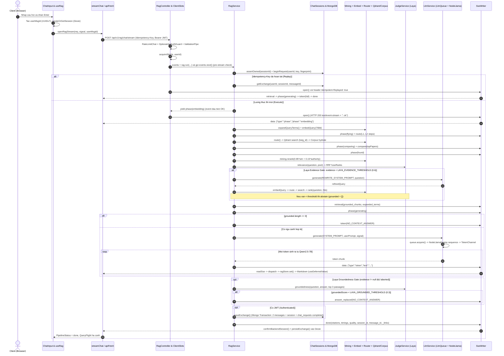

# Luồng 04 — Hỏi đáp Khoa học RAG & Streaming LLM qua SSE (POST /api/v1/rag/chat/stream)

- **Motivation/Background**: Tài liệu hóa chi tiết luồng request-response đầu-cuối (end-to-end) cho tính năng lõi của `RAG_TS` — hỏi đáp khoa học dựa trên ngữ cảnh bài báo (`Retrieval-Augmented Generation`) kết hợp truyền phát token theo thời gian thực qua `SSE` (`POST /api/v1/rag/chat/stream`) và đối chiếu với biến thể đồng bộ (`POST /api/v1/rag/chat`). Tài liệu giúp đội ngũ phát triển nắm rõ cách tầng `Service` điều phối song song `Repositories` (MongoDB) và các `AI/Vector Engines` (Qdrant, Nomic Embedding, Laya Judge, Qwen2.5-7B qua `node-llama-cpp`), cũng như cơ chế đồng bộ giao diện chat (`Markdown` + `KaTeX`) với thế giới 3D `R3F`.
- **Purpose**: Cung cấp bản đặc tả kiến trúc và bảng truy vết từng bước (Frontend → HTTP → Backend → AI Engines & Databases → SSE Stream → Frontend) dựa trên mã nguồn thực tế, kèm sơ đồ Mermaid, định dạng gói tin SSE, xử lý lỗi và các bất biến hệ thống.
- **Overview Pipeline**: Đọc đối chiếu trực tiếp mã nguồn Frontend (`frontend_rag/src/features/chat/*`, `shared/api/*`, `features/world/*`) và Backend (`backend_rag/src/modules/rag/*`, `modules/chat-sessions/*`, `engines/*`, `common/*`) để lập sơ đồ kiến trúc, sơ đồ tuần tự, bảng 4 giai đoạn và ma trận lỗi/bất biến.
- **Detailed Plan**: §1 Vị trí của AI Engines & Vector Store trong Kiến trúc 5 Tầng; §2 Sơ đồ Kiến trúc & Luồng Dữ liệu Toàn trình; §3 Sơ đồ Tuần tự (Sequence Diagram) Streaming & Evidence Gate; §4 Diễn giải Chi tiết 4 Giai đoạn Request-Response; §5 Đối chiếu SSE Stream vs JSON/XML đồng bộ & Định dạng Wire Events; §6 Xử lý Lỗi, Hủy luồng & Các Bất biến Hệ thống.
- **References**: NestJS 11, Express, React 19, Zustand, Dexie.js, React Three Fiber (`R3F`), `react-markdown`, `remark-math`, `rehype-katex`, `Qdrant` (`@qdrant/js-client-rest`), MongoDB/Mongoose, `@huggingface/transformers`, `@receptron/laya`, `node-llama-cpp`, [`agents/rules/MD_CONVENTION.md`](../../../agents/rules/MD_CONVENTION.md).
- **Created**: 2026-11-26T10:12:00+07:00
- **Last Updated**: 2026-11-26T12:00:00+07:00

[STATUS: ACTIVE]

---

## 1. Vị trí của AI Engines & Vector Store trong Kiến trúc 5 Tầng

Trong sơ đồ kiến trúc chuẩn của hệ thống (`Client/UI → FE Hook/Store → FE Service/API → BE Transport/Guard/Controller → Service → Repository → Database`), các thành phần AI và tìm kiếm vector **không** nằm trong tầng `Controller` hay tách thành một microservice HTTP độc lập ở pha suy luận, mà được đóng gói theo mẫu **Ports & Adapters** tại tầng hạ tầng nội bộ (`src/engines/*`) và được điều phối trực tiếp bởi **`RagService`** ở tầng nghiệp vụ (`Service Layer`):

1. **Tầng Service (`RagService`) là nhạc trưởng kép (Dual Orchestrator)**:
   - Một nhánh gọi qua **`SESSION_STORE` (`SessionStorePort`)** → [`ChatSessionsService`](../../../backend_rag/src/modules/chat-sessions/chat-sessions.service.ts#L76-L420) & [`ChatRequestsService`](../../../backend_rag/src/modules/chat-sessions/chat-requests.service.ts#L17-L85) → tầng **`Repositories`** ([`ChatSessionsRepository`](../../../backend_rag/src/modules/chat-sessions/repositories/chat-sessions.repository.ts#L27-L120), [`ChatMessagesRepository`](../../../backend_rag/src/modules/chat-sessions/repositories/chat-messages.repository.ts#L23-L70), [`ChatRequestsRepository`](../../../backend_rag/src/modules/chat-sessions/repositories/chat-requests.repository.ts#L15-L70)) → **MongoDB (`rag_ts`)** để kiểm tra quyền sở hữu session, khóa `Idempotency-Key` và lưu cặp hỏi-đáp trong transaction.
   - Nhánh còn lại gọi tới **6 AI/Vector Engines** qua các `Ports` trừu tượng (tiêm qua DI trong [`RagModule`](../../../backend_rag/src/modules/rag/rag.module.ts#L12-L25)):
     - [`MiningService`](../../../backend_rag/src/engines/mining/mining.service.ts#L160-L208): mở rộng từ khóa truy vấn từ luật kết hợp (`association_rules.json`) và rerank theo độ uy tín tác giả (`graph_coauthorship.json`).
     - `EMBEDDING_PORT` → [`EmbeddingService`](../../../backend_rag/src/engines/embedding/embedding.service.ts#L34-L117): vector hóa câu hỏi (`768` chiều) qua `@huggingface/transformers` (`nomic-ai/nomic-embed-text-v1.5`) kèm `LRUCache`.
     - [`TreeRouterService`](../../../backend_rag/src/engines/tree-router/tree-router.service.ts#L174-L251): định tuyến 2 tầng (nhánh `depth 1` → cành `depth 2`) trên chỉ mục centroid nạp từ `WORLD_DATA_DIR`.
     - `VECTOR_STORE_PORT` → [`VectorStoreService`](../../../backend_rag/src/engines/vector-store/vector-store.service.ts#L101-L277): truy vấn vector đọc-chỉ (`read-only`) tới **Qdrant** (`scientific_papers_gold`), sau đó gọi `CORPUS_PORT` → [`CorpusService`](../../../backend_rag/src/engines/corpus/corpus.service.ts#L59-L173) để hydrate nội dung chunk từ **MongoDB (`rag_ts_corpus`)**.
     - `JUDGE_PORT` (tùy chọn `@Optional()`) → [`JudgeService`](../../../backend_rag/src/engines/judge/judge.service.ts#L64-L183): chạy model **Laya** (`@receptron/laya` qua ONNX Runtime) với hàng đợi tuần tự để chấm điểm `relevance` (RRF rerank + Evidence Gate) và `groundedness` (Groundedness Gate).
     - `LLM_PORT` → [`LlmService`](../../../backend_rag/src/engines/llm/llm.service.ts#L48-L155) + `LLM_ENGINE` → [`NodeLlamaEngine`](../../../backend_rag/src/engines/llm/llm-engine.ts#L38-L85): kiểm soát đồng thời qua [`LlmQueue`](../../../backend_rag/src/engines/llm/llm-queue.ts#L28-L84) (`LLM_CONCURRENCY=1`, `LLM_MAX_QUEUE=8`), đẩy token bất đồng bộ qua [`TokenChannel`](../../../backend_rag/src/engines/llm/token-channel.ts#L5-L46) từ `node-llama-cpp` (Qwen2.5-7B GGUF).

2. **Bypass Post-Interceptor cho SSE (`SseWriter`)**:
   - Endpoint `POST /api/v1/rag/chat/stream` dùng `@Res() res: Response` (không dùng `@Res({ passthrough: true })` như `POST /api/v1/rag/chat`) và tự quản lý socket HTTP qua [`SseWriter`](../../../backend_rag/src/modules/rag/transport/sse.ts#L8-L43). Nhờ vậy, khi gói event đầu tiên được `flushHeaders()`, luồng stream bỏ qua hai post-Interceptor toàn cục là [`LinksInterceptor`](../../../backend_rag/src/common/http/hateoas.ts#L157-L177) và [`ContentNegotiationInterceptor`](../../../backend_rag/src/common/http/xml.ts#L109-L127) (vốn chỉ biến đổi single JSON/XML body), đồng thời vẫn tự gắn `_links` vào payload của event `done`.

---

## 2. Sơ đồ Kiến Trúc & Luồng Dữ liệu Toàn trình (Chuẩn 26 Bước)

```mermaid
flowchart TB
    subgraph FE_IN["Giai đoạn 1 — Frontend Chiều đi (Client -> HTTP Request)"]
        CLI_IN["1. Client (Người dùng nhập câu hỏi / bấm SAMPLES)"]
        CMP_IN["2. FE Component (ChatInput.tsx / MessageList.tsx)"]
        HK_IN["3. FE Hook & Store (useChatInputState -> ragStore.send + sessionStore)"]
        FSVC_IN["4. FE Service (ragChatService.buildRagRequest & chatSessionService)"]
        FAPI_IN["5. FE API (chatApi.streamChat -> client.ts streamChat)"]
        HTTP_IN["6. FE HTTP Client (http.ts: apiFetch POST /api/v1/rag/chat/stream)"]
        CLI_IN --> CMP_IN --> HK_IN --> FSVC_IN --> FAPI_IN --> HTTP_IN
    end

    subgraph BE_IN["Giai đoạn 2 — Backend Chiều vào (HTTP Request -> Repositories & AI Engines -> Database)"]
        NODE["7. BE Node.js HTTP Server (main.ts: keepAliveTimeout=65s, socket.setNoDelay)"]
        MW["8. BE NestJS/Express Middleware (app.setup.ts: requestId, helmet, metrics, XML/JSON)"]
        GRD["9. BE Guard (RateLimitChat 20/10 req/min -> OptionalJwtAuthGuard)"]
        INT_IN["10. BE Interceptor chiều vào (ContentNegotiation Accept 406 + LinksInterceptor metadata)"]
        PIP["11. BE Pipe (ValidationPipe -> ChatRequestDto)"]
        CTL_IN["12. BE Controller (RagController.stream / chat + ClientSlots + abortOnClientClose)"]
        RAGSVC["13. BE Service (RagService: Ownership, Idempotency + 6 AI/Vector Engines)"]
        REPO_IN["14. BE Repository (ChatSessionsRepo, ChatMessagesRepo, ChatRequestsRepo)"]
        ENG_IN["14b. AI & Vector Engines (Mining, Embed, TreeRouter, VectorStore, Corpus, Laya, Qwen2.5-7B)"]
        DB["15. Database (MongoDB rag_ts, Qdrant scientific_papers_gold, rag_ts_corpus, GGUF/ONNX)"]
        HTTP_IN -->|"POST /api/v1/rag/chat/stream + Bearer + Idempotency-Key"| NODE --> MW --> GRD --> INT_IN --> PIP --> CTL_IN --> RAGSVC
        RAGSVC --> REPO_IN --> DB
        RAGSVC --> ENG_IN --> DB
    end

    subgraph BE_OUT["Giai đoạn 3 — Backend Chiều về (Database -> HTTP SSE / Response)"]
        REPO_OUT["16. Database -> BE Repository & AI Engines (tokens, grounded chunks, saved IDs)"]
        BSVC_OUT["17. BE Service (yield PipelineEvent / timings / total_ms / releaseRequest on abort)"]
        CTL_OUT["18. BE Controller (RagController stream loop gắn _links trên done hoặc RagController.chat)"]
        INT_OUT["19. BE Interceptor chiều ra (LinksInterceptor + ContentNegotiation cho /rag/chat; SseWriter cho /stream)"]
        EXP_OUT["20. BE NestJS/Express gửi response (SseWriter text/event-stream + :ping 5s hoặc HTTP 200)"]
        DB --> REPO_OUT --> BSVC_OUT --> CTL_OUT --> INT_OUT --> EXP_OUT
    end

    subgraph FE_OUT["Giai đoạn 4 — Frontend Chiều về (HTTP SSE -> Client)"]
        HTTP_OUT["21. FE HTTP Client (apiFetch nhận ReadableStream / 401 retry)"]
        FAPI_OUT["22. FE API (readSse + SseBuffer + auto-resume 180s -> RagStreamEvent)"]
        FSVC_OUT["23. FE Service (reconcileBackendSession + saveExchangeLocally Dexie.js)"]
        HK_OUT["24. FE Hook & Store (ragStore.dispatch + sessionStore + useChatWorkspace selectors)"]
        CMP_OUT["25. FE Component (Markdown useDeferredValue KaTeX + PipelineStatus + 3D QueryFlight)"]
        CLI_OUT["26. Client (Người dùng đọc câu trả lời streaming mượt 60 FPS & trích dẫn verified)"]
        EXP_OUT -->|"text/event-stream (hoặc JSON/XML)"| HTTP_OUT --> FAPI_OUT --> FSVC_OUT --> HK_OUT --> CMP_OUT --> CLI_OUT
    end
```



---

## 3. Sơ đồ Tuần tự (Sequence Diagram) Streaming & Evidence Gate



---

## 4. Diễn giải Chi tiết 4 Giai đoạn Request-Response

### 4.1. Giai đoạn 1 — Chiều đi Frontend: Client → FE → HTTP Request

| Bước | Tầng (Layer) | File & Ký hiệu | Đầu vào (Input) | Xử lý Nghiệp vụ & Kỹ thuật | Đầu ra (Output) |
| :--- | :--- | :--- | :--- | :--- | :--- |
| **1** | **Client** | [`ChatInput.tsx`](../../../frontend_rag/src/features/chat/components/ChatInput.tsx#L1-L55), [`MessageList.tsx`](../../../frontend_rag/src/features/chat/components/MessageList.tsx#L41-L44) | Người dùng gõ câu hỏi khoa học hoặc bấm một câu hỏi mẫu (`SAMPLES`) | Nhập nội dung và nhấn `Enter` (không giữ `Shift`, không `isComposing`) hoặc nhấn nút Gửi trên trình duyệt. | Sự kiện submit / click từ trình duyệt |
| **2** | **FE — Component** | [`ChatInput.tsx`](../../../frontend_rag/src/features/chat/components/ChatInput.tsx#L5-L55) (`ChatInput.submit`) | Chuỗi nhập liệu trên `<textarea>` | Trim kiểm tra rỗng (`!value.trim()`), reset chiều cao ô nhập và gọi `void send(value)` lấy từ hook. | Lời gọi `send(text)` |
| **3** | **FE — Hook (+ Store)** | [`useChatWorkspace.ts`](../../../frontend_rag/src/features/chat/hooks/useChatWorkspace.ts#L82-L94) (`useChatInputState`, `useMessageListState`), [`ragStore.ts`](../../../frontend_rag/src/features/chat/store/ragStore.ts#L139-L169) (`useRag.send`), [`sessionStore.ts`](../../../frontend_rag/src/features/chat/store/sessionStore.ts#L164-L172) | Selector tới `useRag`, `text`, `useUi.getState().settings` | Hook cô lập selector tránh re-render dư thừa; `ragStore.send` hủy luồng cũ (`cancelRun`), tạo `AbortController`, sinh `userMsgId` & `assistantMsgId` (`uuidv7()`), đẩy bubble tạm lên UI và gọi `createOrGetSession(query)` tạo session cục bộ trên Dexie nếu chưa có. | `sessionId`, `userMsgId` (làm `Idempotency-Key`) |
| **4** | **FE — Service** | [`ragChatService.ts`](../../../frontend_rag/src/features/chat/services/ragChatService.ts#L11-L43) (`buildRagRequest`, `openRagStream`), [`chatSessionService.ts`](../../../frontend_rag/src/features/chat/services/chatSessionService.ts#L81-L102) | `query`, `sessionId`, `settings`, `signal`, `userMsgId` | `buildRagRequest` kiểm tra `chatDb.sessions.get(sessionId)`: **chỉ gắn `session_id` nếu `session?.synced === true`** (tránh gửi local UUIDv7 lên MongoDB gây `404`). `openRagStream` gọi `streamChat` (hoặc bọc `bridgeStream` khi `MOCK_WORLD && !USE_MOCK`). | `RagRequest` DTO sạch + yêu cầu mở stream |
| **5** | **FE — API** | [`chatApi.ts`](../../../frontend_rag/src/features/chat/api/chatApi.ts#L36) (`streamChat`), [`client.ts`](../../../frontend_rag/src/shared/api/client.ts#L186-L222) (`streamChat`) | `RagRequest`, `AbortSignal`, `idempotencyKey` | Chuẩn bị endpoint `'/rag/chat/stream'`, method `'POST'`, headers `Content-Type: application/json`, `Accept: text/event-stream`, `'Idempotency-Key': userMsgId`, `JSON.stringify(req)`, và cấu hình vòng lặp auto-resume `180_000ms` (`RESUME_WINDOW_MS`). | Lời gọi tới `apiFetch('/rag/chat/stream', init)` |
| **6** | **FE — HTTP Client (gọi fetch)** | [`http.ts`](../../../frontend_rag/src/shared/api/http.ts#L23-L34) (`apiFetch`) & [`config.ts`](../../../frontend_rag/src/shared/api/config.ts#L1) | `path = '/rag/chat/stream'`, `accessToken` (nếu có) | `apiFetch` ghép `API_BASE` (`/api/v1`), gắn header `Authorization: Bearer <token>` (nếu đã đăng nhập), rồi gọi `fetch('/api/v1/rag/chat/stream', init)`. | HTTP Request `POST /api/v1/rag/chat/stream` rời trình duyệt |

---

### 4.2. Giai đoạn 2 — Chiều vào Backend: HTTP Request → BE → Repositories & AI Engines → Databases

| Bước | Tầng (Layer) | File & Ký hiệu | Đầu vào (Input) | Xử lý Nghiệp vụ & Kỹ thuật | Đầu ra (Output) |
| :--- | :--- | :--- | :--- | :--- | :--- |
| **7** | **BE — Node.js HTTP Server** | [`main.ts`](../../../backend_rag/src/main.ts#L1-L26) (`bootstrap`) | HTTP socket cổng `3000` | Cấu hình `UV_THREADPOOL_SIZE = '4'` và mở Node `http.Server` (`keepAliveTimeout = 65_000`, `headersTimeout = 66_000`) tiếp nhận kết nối POST stream dài hơi. | Kết nối HTTP đi vào ứng dụng NestJS/Express |
| **8** | **BE — NestJS/Express Middleware** | [`app.setup.ts`](../../../backend_rag/src/app.setup.ts#L47-L75), [`xml.ts`](../../../backend_rag/src/common/http/xml.ts#L70-L105) | Raw HTTP Request (`POST /api/v1/rag/chat/stream`) | Thiết lập `trust proxy`, gắn `requestIdMiddleware` (`X-Request-Id`), `securityHeaders`, `PrometheusMetricsRegistry.middleware` (đếm `rag_sse_active_streams`), `unsupportedBody` (`415`), parse XML/JSON an toàn (chống XXE), global prefix `/api/v1` và CORS expose `Idempotent-Replayed`, `Retry-After`. | `req` đã có `request_id` và `req.body` object |
| **9** | **BE — Guard** | [`throttler.ts`](../../../backend_rag/src/common/security/throttler.ts#L53-L63) (`RateLimitChat`) & [`jwt-auth.guard.ts`](../../../backend_rag/src/modules/auth/guards/jwt-auth.guard.ts#L51-L74) (`OptionalJwtAuthGuard`) | `req.ip`, `Authorization` | `RateLimitChat` áp ngưỡng **`20 req/60s`** (có JWT) hoặc **`10 req/60s`** (ẩn danh). Tiếp đó `OptionalJwtAuthGuard` cho phép ẩn danh (`req.user = undefined`), hoặc kiểm tra chữ ký JWT + `is_active` + `token_version` (`ver` claim) — sai/hết hạn ném `401`. | `AuthUser \| undefined` hoặc `401`/`429` |
| **10** | **BE — Interceptor chiều vào** | [`xml.ts`](../../../backend_rag/src/common/http/xml.ts#L109-L119) (`ContentNegotiationInterceptor`) & [`hateoas.ts`](../../../backend_rag/src/common/http/hateoas.ts#L157-L166) (`LinksInterceptor`) | Header `Accept: text/event-stream`, `@WithLinks` | `ContentNegotiationInterceptor` kiểm tra `req.accepts(OFFERED)` gồm `application/json`, `application/xml`, `text/xml`, `text/event-stream` (không khớp ném `406`); `LinksInterceptor` đọc metadata route (`/rag/chat` gắn `@WithLinks`). | Request vượt qua tiền kiểm tra media type |
| **11** | **BE — Pipe** | [`validation.ts`](../../../backend_rag/src/common/http/validation.ts#L18-L26) (`createValidationPipe`), [`chat-request.dto.ts`](../../../backend_rag/src/modules/rag/dto/chat-request.dto.ts#L21-L75) (`ChatRequestDto`) | `req.body` JSON/XML | `ValidationPipe` (`whitelist: true`, `forbidNonWhitelisted: true`, `transform: true`) trim `query` (`1..2000`), ép kiểu `top_k` (`1..20`), `nprobe` (`1..6`), kiểm tra `CATEGORY_RE` và UUID `session_id`; sai ném `400 Bad Request`. | `ChatRequestDto` hợp lệ |
| **12** | **BE — Controller** | [`rag.controller.ts`](../../../backend_rag/src/modules/rag/rag.controller.ts#L145-L171) (`RagController.stream`), [`client-slots.ts`](../../../backend_rag/src/modules/rag/transport/client-slots.ts#L14-L36), [`sse.ts`](../../../backend_rag/src/modules/rag/transport/sse.ts#L49-L61) | `dto`, `user`, `Idempotency-Key`, `req`, `res` | Kiểm tra `Idempotency-Key` dạng UUID (`400` nếu sai); lấy slot `acquireSlot(ip, userId)` (tối đa `2` luồng/user, `3` luồng/IP → `429`); gắn `abortOnClientClose(res)`; gọi `events = this.rag.run(...)` và `await events.next()` **trước khi mở SSE headers**. | `IteratorResult<PipelineEvent>` đầu tiên |
| **13** | **BE — Service (Điều phối kép)** | [`rag.service.ts`](../../../backend_rag/src/modules/rag/rag.service.ts#L76-L150), [`chat-sessions.service.ts`](../../../backend_rag/src/modules/chat-sessions/chat-sessions.service.ts#L256-L290), [`chat-requests.service.ts`](../../../backend_rag/src/modules/chat-sessions/chat-requests.service.ts#L20-L68) | `dto`, `user`, `idempotencyKey` | Kiểm tra `assertOwned(sessionId, user.id)` (`404` nếu không sở hữu); khóa idempotency qua `beginRequest` (replay nếu `'completed'`, `409` nếu `'in_progress'` hoặc khác `fingerprint`); sau đó điều phối **6 AI Engines** (`13a..13e`) song song với **Repositories**. | Lời gọi các AI Engines & Repositories |
| **13a** | **BE — Service → Engine 1 (Mining & Embed)** | [`mining.service.ts`](../../../backend_rag/src/engines/mining/mining.service.ts#L103-L116), [`embedding.service.ts`](../../../backend_rag/src/engines/embedding/embedding.service.ts#L54-L78) | `req.query`, `req.expand_query` | Phát `phase('embedding')`; mở rộng tới `5` thuật ngữ qua `association_rules.json`; vector hóa `"search_query: " + text` qua Nomic v1.5 (`768` chiều, `LRUCache` 500 mục `10m`). | `q: number[768]`, `expanded: string[]` |
| **13b** | **BE — Service → Engine 2 (TreeRouter)** | [`tree-router.service.ts`](../../../backend_rag/src/engines/tree-router/tree-router.service.ts#L142-L170) | `q`, `req.nprobe` (`1..6`) | Phát `phase('flying')`; chọn top `nprobe` nhánh L1 rồi L2 trên chỉ mục centroid và phát event `route`. | `steps: RouteStep[]`, `twigIds` |
| **13c** | **BE — Service → Engine 3 & 4 (Qdrant + Corpus)** | [`vector-store.service.ts`](../../../backend_rag/src/engines/vector-store/vector-store.service.ts#L139-L165), [`corpus.service.ts`](../../../backend_rag/src/engines/corpus/corpus.service.ts#L92-L149) | `q`, `twigIds`, `category`, `top_k` | Phát `phase('comparing')`; tìm vector trên Qdrant theo filter (`primary_category`, `twig_id`); hydrate văn bản chunk từ `rag_ts_corpus` qua `Promise.all`; phát event `compare`. | `hits: ScoredChunk[]` |
| **13d** | **BE — Service → Engine 5 (Mining Rerank + Laya Evidence Gate)** | [`mining.service.ts`](../../../backend_rag/src/engines/mining/mining.service.ts#L130-L157), [`ranking.ts`](../../../backend_rag/src/modules/rag/pipeline/ranking.ts#L9-L61), [`judge.service.ts`](../../../backend_rag/src/engines/judge/judge.service.ts#L76-L87), [`rag.service.ts`](../../../backend_rag/src/modules/rag/rag.service.ts#L192-L210) | `question`, `hits`, `LAYA_EVIDENCE_THRESHOLD` (`0.6`) | Phát `phase('found')`; trộn `0.85 * sim + 0.15 * authority`; Laya ONNX chấm `relevance` + RRF (`RRF_K = 60`). Nếu `evidence < 0.6`, gọi LLM viết lại truy vấn 1 lần (`refine`); nếu vẫn thiếu thì abstain (`grounded = []`). Phát `retrieval`. | `grounded: GroundedChunk[]`, `abstained` |
| **13e** | **BE — Service → Engine 6 (LlmQueue, Qwen2.5-7B & Groundedness Gate)** | [`llm.service.ts`](../../../backend_rag/src/engines/llm/llm.service.ts#L94-L154), [`llm-queue.ts`](../../../backend_rag/src/engines/llm/llm-queue.ts#L46-L83), [`llm-engine.ts`](../../../backend_rag/src/engines/llm/llm-engine.ts#L61-L84), [`token-channel.ts`](../../../backend_rag/src/engines/llm/token-channel.ts#L5-L46), [`judge.service.ts`](../../../backend_rag/src/engines/judge/judge.service.ts#L89-L103) | `grounded`, `question`, `signal` | Phát `phase('generating')`. Đẩy token từ `NodeLlamaEngine` (`Qwen2.5-7B`, `LLM_CONCURRENCY=1`, `timeout 60s`) qua `TokenChannel` ra event `token`. Sau khi xong, nếu có `evidence` thì Laya chấm `groundedness` trên top `3` đoạn; nếu `< 0.3` phát `answer_replaced` (`NO_CONTEXT_ANSWER`). | `answer`, `citations`, `quality` |
| **14** | **BE — Repository** | [`chat-sessions.repository.ts`](../../../backend_rag/src/modules/chat-sessions/repositories/chat-sessions.repository.ts#L115-L140), [`chat-messages.repository.ts`](../../../backend_rag/src/modules/chat-sessions/repositories/chat-messages.repository.ts#L62-L70), [`chat-requests.repository.ts`](../../../backend_rag/src/modules/chat-sessions/repositories/chat-requests.repository.ts#L52-L69) | `user.id`, `sessionId`, `question`, `answer`, `requestKey` | Khi đã đăng nhập, [`saveExchange`](../../../backend_rag/src/modules/chat-sessions/chat-sessions.service.ts#L298-L409) mở `ClientSession.withTransaction` chèn 2 `chat_messages` (`UUIDv7`), tăng `message_count` hoặc tạo `chat_sessions` mới (`UUIDv7`), và đánh dấu `chat_requests.status = 'completed'`. | Truy vấn transaction Mongoose & Qdrant/ONNX |
| **15** | **Database** | [`chat-session.schema.ts`](../../../backend_rag/src/modules/chat-sessions/schemas/chat-session.schema.ts#L5-L45), [`chat-message.schema.ts`](../../../backend_rag/src/modules/chat-sessions/schemas/chat-message.schema.ts#L5-L54), [`vector-store.service.ts`](../../../backend_rag/src/engines/vector-store/vector-store.service.ts#L101-L165), [`corpus.service.ts`](../../../backend_rag/src/engines/corpus/corpus.service.ts#L59-L149) | Lệnh đọc/ghi từ Repositories & AI Engines | **MongoDB `rag_ts`** lưu `chat_sessions`, `chat_messages`, `chat_requests`; **Qdrant `scientific_papers_gold`** trả vector points (read-only); **MongoDB `rag_ts_corpus`** trả text chunks (read-only); **Local Disk/GPU** nạp GGUF Qwen2.5-7B, Nomic ONNX & Laya ONNX. | Dữ liệu lưu bền vững & kết quả vector/token |

---

### 4.3. Giai đoạn 3 — Chiều về Backend: Database → BE → HTTP SSE Stream / Response

| Bước | Tầng (Layer) | File & Ký hiệu | Đầu vào (Input) | Xử lý Nghiệp vụ & Kỹ thuật | Đầu ra (Output) |
| :--- | :--- | :--- | :--- | :--- | :--- |
| **16** | **Database → BE — Repository** | [`chat-sessions.repository.ts`](../../../backend_rag/src/modules/chat-sessions/repositories/chat-sessions.repository.ts#L115-L140), [`vector-store.service.ts`](../../../backend_rag/src/engines/vector-store/vector-store.service.ts#L139-L165), [`llm-engine.ts`](../../../backend_rag/src/engines/llm/llm-engine.ts#L61-L84) | Kết quả từ MongoDB, Qdrant, `rag_ts_corpus` & LLM | Hoàn tất commit transaction (`saved: { session_id, user_message_id, assistant_message_id }`) và khép luồng token từ `TokenChannel` cùng điểm đánh giá Laya về `RagService`. | ID lưu trữ + luồng sự kiện hoàn tất |
| **17** | **BE — Service** | [`rag.service.ts`](../../../backend_rag/src/modules/rag/rag.service.ts#L104-L111) (`finally`), [`rag.service.ts`](../../../backend_rag/src/modules/rag/rag.service.ts#L271-L292) (`execute`) | `saved`, `citations`, `timings`, `quality` | Cập nhật `timings.total_ms`, làm mới cache `ChatSessionsService.invalidate(userId, sessionId)`, yield event cuối `done` (nếu abort/lỗi trước khi lưu thì `finally` gọi `releaseRequest` nhả khóa `chat_requests`). | Event `{ type: 'done', citations, timings, quality?, session_id, message_id }` |
| **18** | **BE — Controller** | [`rag.controller.ts`](../../../backend_rag/src/modules/rag/rag.controller.ts#L172-L209) (`RagController.stream`), [`rag.controller.ts`](../../../backend_rag/src/modules/rag/rag.controller.ts#L86-L139) (`RagController.chat`) | `events: AsyncGenerator`, `result`, `res` | Trên `/rag/chat/stream`: gắn `Idempotent-Replayed: true` nếu replay, lặp `events.next()`, gắn `_links: chatLinks(r.value)` trực tiếp vào event `done`, bắt lỗi giữa stream thành `{ type: 'error' }`, cuối cùng `events.return(undefined)` và nhả `ClientSlots`. Trên `/rag/chat` (non-stream): đợi xong và trả object `ChatResponseDto`. | Sự kiện SSE sẵn sàng ghi ra socket hoặc `ChatResponseDto` |
| **19** | **BE — Interceptor chiều ra** | [`hateoas.ts`](../../../backend_rag/src/common/http/hateoas.ts#L53-L68) (`chatLinks`), [`hateoas.ts`](../../../backend_rag/src/common/http/hateoas.ts#L157-L177) (`LinksInterceptor`), [`xml.ts`](../../../backend_rag/src/common/http/xml.ts#L109-L127) (`ContentNegotiationInterceptor`) | `ChatResponseDto` (non-stream) hoặc bypass cho `@Res()` SSE | Với **`POST /rag/chat`** (`@Res({ passthrough: true })`): `LinksInterceptor` gắn `_links` rồi `ContentNegotiationInterceptor` serialize JSON/XML. Với **`POST /rag/chat/stream`**: do `@Res()` quản lý stream trực tiếp, hai post-interceptor đơn body được bypass và `_links` được Controller gắn trực tiếp trên event `done`. | Payload chuẩn hóa theo từng chế độ vận chuyển |
| **20** | **BE — NestJS/Express gửi response** | [`sse.ts`](../../../backend_rag/src/modules/rag/transport/sse.ts#L8-L43) (`SseWriter`), [`http-exception.filter.ts`](../../../backend_rag/src/common/http/http-exception.filter.ts#L69-L97), [`prometheus-metrics.ts`](../../../backend_rag/src/common/metrics/prometheus-metrics.ts#L57-L76) | `RagStreamEvent` hoặc `HttpException` | `SseWriter.open()` ghi HTTP `200`, `Content-Type: text/event-stream`, `socket.setNoDelay(true)`, `flushHeaders()`, gửi `: ok\n\n` và `: ping\n\n` mỗi `5_000ms`, đẩy từng `data: {...}\n\n`, cuối cùng `res.end()`. Lỗi trước event đầu tiên được `HttpExceptionFilter` trả HTTP chuẩn; khi kết thúc socket, Prometheus giảm `rag_sse_active_streams` và ghi histogram. | HTTP SSE Stream (`text/event-stream`) rời server |

---

### 4.4. Giai đoạn 4 — Chiều về Frontend: HTTP SSE Stream → FE → Client

| Bước | Tầng (Layer) | File & Ký hiệu | Đầu vào (Input) | Xử lý Nghiệp vụ & Kỹ thuật | Đầu ra (Output) |
| :--- | :--- | :--- | :--- | :--- | :--- |
| **21** | **FE — HTTP Client (kiểm tra status & đọc body)** | [`http.ts`](../../../frontend_rag/src/shared/api/http.ts#L23-L34) (`apiFetch`) & [`client.ts`](../../../frontend_rag/src/shared/api/client.ts#L213-L254) | `Response` từ Backend | `apiFetch` tự xoay refresh token một lần nếu gặp `401`. Sau đó `streamChat` kiểm tra `res.ok` (`409 request already in progress` / `429` kích hoạt đợi `Retry-After` nếu đang auto-resume) và đọc `res.body: ReadableStream<Uint8Array>`. | Stream byte UTF-8 sạch để giải mã SSE |
| **22** | **FE — API (xử lý dữ liệu)** | [`client.ts`](../../../frontend_rag/src/shared/api/client.ts#L258-L328) (`streamChat`, `readSse`, `giveUp`) & [`sseParser.ts`](../../../frontend_rag/src/shared/api/sseParser.ts#L2-L34) | `ReadableStream<Uint8Array>` | `readSse` giải mã `TextDecoder({ stream: true })`, tách khối `\n\n` qua `SseBuffer`, bỏ qua `: ok` / `: ping`, parse JSON thành `RagStreamEvent`. Nếu rớt mạng giữa stream khi đã đăng nhập, `streamChat` tự động reconnect tối đa `180_000ms` dùng lại `Idempotency-Key` cũ (`409`/`replay`). | Chuỗi sự kiện `AsyncGenerator<RagStreamEvent>` |
| **23** | **FE — Service** | [`ragChatService.ts`](../../../frontend_rag/src/features/chat/services/ragChatService.ts#L19-L43), [`chatSessionService.ts`](../../../frontend_rag/src/features/chat/services/chatSessionService.ts#L105-L227) (`reconcileBackendSession`, `saveExchangeLocally`) | `localId`, `backendId`, `userMsg`, `assistantMsg` | 1) Khi có `ev.session_id !== localId`, `reconcileBackendSession` di chuyển tin nhắn từ local UUIDv7 sang `backendId`, xóa session tạm và đồng bộ tiêu đề nền qua `PATCH /chat-sessions/:id`. 2) Khi stream kết thúc/dừng/lỗi (`finally`), `saveExchangeLocally` ghi cặp tin nhắn vào IndexedDB (`chatDb.messages.bulkPut`) giữ thứ tự đơn điệu (`assistantTime >= userTime + 1ms`). | IndexedDB (`Dexie`) nhất quán với Backend & sẵn sàng offline (`D-017`) |
| **24** | **FE — Hook (cập nhật state)** | [`ragStore.ts`](../../../frontend_rag/src/features/chat/store/ragStore.ts#L79-L195) (`dispatch`), [`pipeline.ts`](../../../frontend_rag/src/features/chat/store/pipeline.ts#L53-L94), [`sessionStore.ts`](../../../frontend_rag/src/features/chat/store/sessionStore.ts#L174-L194), [`useChatWorkspace.ts`](../../../frontend_rag/src/features/chat/hooks/useChatWorkspace.ts#L82-L108) | `runId`, `RagStreamEvent` | `reduceEvent` kiểm tra máy trạng thái pha (`idle -> embedding -> flying -> comparing -> found -> generating -> done`); `dispatch` gộp cập nhật `phase`, `current` và `messages[].content` vào **một lệnh `set()` duy nhất**; `useChatWorkspace` phát state tới các UI component đăng ký. | State `useRag` & `useSessionStore` đồng bộ tức thì |
| **25** | **FE — Component (hiển thị lại)** | [`PipelineStatus.tsx`](../../../frontend_rag/src/features/chat/components/PipelineStatus.tsx#L16-L49), [`MessageBubble.tsx`](../../../frontend_rag/src/features/chat/components/MessageBubble.tsx#L20-L128), [`Markdown.tsx`](../../../frontend_rag/src/features/chat/components/Markdown.tsx#L25-L58), [`QueryFlight.tsx`](../../../frontend_rag/src/features/world/scene/fx/QueryFlight.tsx#L161-L445) | `visualPhase`, `message`, `checks`, `current` | `Markdown` bọc nội dung streaming bằng **`useDeferredValue(text)`** (`D-005`) và `useReveal` (`startTransition`) để render KaTeX + `CitationChip` (`verified`/`unverified`/`pending`) không nghẽn WebGL. `QueryFlight` (`useFrame`) cập nhật `useFx` làm sáng nhánh cây 3D và gọi `advanceVisual()` khi quả cầu hoàn tất quãng bay. | DOM bong bóng chat + Canvas 3D `60 FPS` đồng bộ |
| **26** | **Client** | [`MessageBubble.tsx`](../../../frontend_rag/src/features/chat/components/MessageBubble.tsx#L20-L128) | Giao diện sau re-render | Người dùng đọc câu trả lời streaming theo thời gian thực, thấy công thức Toán/LaTeX, tổng thời gian `total_ms` và có thể bấm vào từng `CitationChip` để kiểm chứng bài báo gốc. | Phiên hỏi đáp khoa học khép kín hoàn chỉnh |

---

## 5. Đối chiếu SSE Stream vs JSON/XML đồng bộ & Định dạng Wire Events

### 5.1. Bảng so sánh hai endpoint RAG

| Tiêu chí | `POST /api/v1/rag/chat/stream` (Streaming SSE) | `POST /api/v1/rag/chat` (Đồng bộ JSON/XML) |
| :--- | :--- | :--- |
| **Controller Handler** | [`RagController.stream`](../../../backend_rag/src/modules/rag/rag.controller.ts#L145-L210) với `@Res() res` | [`RagController.chat`](../../../backend_rag/src/modules/rag/rag.controller.ts#L86-L139) với `@Res({ passthrough: true })` |
| **Media Type trả về** | `text/event-stream; charset=utf-8` | `application/json` hoặc `application/xml` (qua [`ContentNegotiationInterceptor`](../../../backend_rag/src/common/http/xml.ts#L109-L127)) |
| **HATEOAS `_links`** | Gắn trực tiếp vào payload của event `done` (`{ ...r.value, _links: chatLinks(r.value) }`) | Tự động gắn qua decorator `@WithLinks({ resource: chatLinks })` + [`LinksInterceptor`](../../../backend_rag/src/common/http/hateoas.ts#L157-L177) |
| **Xử lý lỗi giữa chừng** | Lỗi trước event đầu tiên → HTTP status chuẩn (`HttpExceptionFilter`); lỗi sau `sse.open()` → phát SSE event `{ type: 'error', message, status }` | Mọi lỗi trong toàn bộ pipeline đều ném `HttpException` và qua `HttpExceptionFilter` (HTTP `400`/`401`/`404`/`409`/`429`/`499`/`503`/`504`) |
| **Keep-Alive Proxy** | Gửi `: ok\n\n` ngay khi mở và `: ping\n\n` mỗi `5_000ms` (`PING_INTERVAL_MS`) | Đợi đến khi pipeline hoàn tất mới trả HTTP body |

### 5.2. Ví dụ các khung dữ liệu SSE thực tế trên đường truyền (Wire Format)

```text
: ok

data: {"type":"phase","phase":"embedding"}

data: {"type":"phase","phase":"flying"}

data: {"type":"route","steps":[{"depth":1,"candidates":[{"node_id":10,"score":0.7421}],"chosen":[10,14]},{"depth":2,"candidates":[{"node_id":102,"score":0.8104}],"chosen":[102,108]}]}

data: {"type":"phase","phase":"comparing"}

data: {"type":"compare","candidates":[{"paper_id":"2106.09685","score":0.8412}]}

data: {"type":"phase","phase":"found"}

data: {"type":"retrieval","grounded_chunks":[{"chunk_id":"2106.09685#0","paper_id":"2106.09685","title":"LoRA: Low-Rank Adaptation of Large Language Models","section_title":"Method","section_type":"method","text":"...","similarity_score":0.8412,"authority_score":0.62,"final_score":0.808,"relevance_score":0.912,"citation_tag":"[Paper: 2106.09685]"}],"expanded_terms":["low rank adaptation"]}

data: {"type":"phase","phase":"generating"}

data: {"type":"token","text":"LoRA freezes the pre-trained model weights"}

: ping

data: {"type":"token","text":" and injects trainable rank decomposition matrices [Paper: 2106.09685]."}

data: {"type":"done","citations":["2106.09685"],"timings":{"embed_ms":18,"route_ms":2,"search_ms":41,"rerank_ms":380,"llm_ms":1950,"grounded_ms":140,"total_ms":2540},"quality":{"evidence_score":0.912,"refined_query":null,"grounded_score":0.885,"abstained":false},"session_id":"019367a1-8c20-7000-8000-000000000001","message_id":"019367a1-9614-7000-8000-000000000002","_links":{"session":{"href":"/api/v1/chat-sessions/019367a1-8c20-7000-8000-000000000001"},"messages":{"href":"/api/v1/chat-sessions/019367a1-8c20-7000-8000-000000000001/messages"},"papers":{"href":"/api/v1/papers?ids=2106.09685"}}}
```

> Lưu ý các event đặc biệt:
> - **Groundedness Gate fail**: trước `done`, server gửi `data: {"type":"answer_replaced","answer":"The provided literature does not contain sufficient details regarding this question."}\n\n`.
> - **Lỗi sau khi đã mở stream**: thay cho `done`, server gửi `data: {"type":"error","message":"llm timeout","status":504}\n\n`.

---

## 6. Xử lý Lỗi, Hủy luồng & Các Bất biến Hệ thống

### 6.1. Ma trận Lỗi Tiền Stream vs Giữa Stream

| Mã / Tình huống | Nguồn phát sinh | Điểm bắt & Cơ chế phản hồi |
| :--- | :--- | :--- |
| **`400 Bad Request`** | [`ValidationPipe`](../../../backend_rag/src/common/http/validation.ts#L18-L26), `parseIdempotencyKey` ([`rag.controller.ts`](../../../backend_rag/src/modules/rag/rag.controller.ts#L48-L52)), `CATEGORY_RE` | Lỗi trước khi mở stream → `HttpExceptionFilter` trả JSON/XML chuẩn §1.2 kèm `request_id`. |
| **`401 Unauthorized`** | [`OptionalJwtAuthGuard`](../../../backend_rag/src/modules/auth/guards/jwt-auth.guard.ts#L51-L74) | Token sai định dạng, hết hạn, user bị vô hiệu hóa hoặc lệch `token_version` → HTTP `401`. FE (`apiFetch`) tự động thử `rotateTokens()` 1 lần trước khi báo lỗi. |
| **`404 Not Found`** | [`ChatSessionsService.assertOwned`](../../../backend_rag/src/modules/chat-sessions/chat-sessions.service.ts#L288-L290) | `session_id` không tồn tại, đã soft-delete (`deleted_at != null`) hoặc thuộc user khác (không bao giờ lộ `403`). |
| **`409 Conflict`** | [`ChatRequestsService.begin`](../../../backend_rag/src/modules/chat-sessions/chat-requests.service.ts#L43-L63) | Cùng `Idempotency-Key` nhưng khác body (`request key reused`) hoặc yêu cầu trước đó vẫn đang chạy (`request already in progress`). Client auto-resume ở FE sẽ chờ `3s` và thử lại khi nhận `409 request already in progress`. |
| **`406` / `415`** | [`xml.ts`](../../../backend_rag/src/common/http/xml.ts#L70-L119) | `415` khi gửi `Content-Type` không phải JSON/XML; `406` khi header `Accept` không chấp nhận JSON, XML hoặc `text/event-stream`. |
| **`429 Too Many Requests`** | [`RateLimitChat`](../../../backend_rag/src/common/security/throttler.ts#L53-L63), [`ClientSlots`](../../../backend_rag/src/modules/rag/transport/client-slots.ts#L14-L36), [`LlmQueue`](../../../backend_rag/src/engines/llm/llm-queue.ts#L52-L53) | - Vượt rate limit IP (`20/min` có JWT, `10/min` ẩn danh) hoặc vượt `ClientSlots` (`2` luồng/user, `3` luồng/IP) → HTTP `429` **trước** khi mở SSE.<br>- Hàng đợi LLM đầy (`LLM_CONCURRENCY=1`, `LLM_MAX_QUEUE=8`) → `QueueFullError` chuyển thành event `error` (`status: 429`, `llm queue is full`) nếu stream đã mở. |
| **`503 Service Unavailable`** | [`EmbeddingService`](../../../backend_rag/src/engines/embedding/embedding.service.ts#L61-L68), [`VectorStoreService`](../../../backend_rag/src/engines/vector-store/vector-store.service.ts#L272), [`CorpusService`](../../../backend_rag/src/engines/corpus/corpus.service.ts#L147), [`LlmService`](../../../backend_rag/src/engines/llm/llm.service.ts#L99-L143) | Model embedding/LLM chưa nạp xong hoặc Qdrant (`15s` timeout) / `rag_ts_corpus` (`5s` timeout) gián đoạn → HTTP `503` (nếu xảy ra ở `embedding` trước khi mở stream) hoặc SSE `error` (`status: 503`). |
| **`504 Gateway Timeout`** | [`LlmService.generate`](../../../backend_rag/src/engines/llm/llm.service.ts#L115-L145) | Quá thời gian sinh `LLM_TIMEOUT_MS` (mặc định `60_000ms`): timer abort `NodeLlamaEngine`, gửi SSE `error` (`status: 504`, `llm timeout`). |
| **Client Abort (`499` / Quiet End)** | [`abortOnClientClose`](../../../backend_rag/src/modules/rag/transport/sse.ts#L49-L61), [`LlmQueue`](../../../backend_rag/src/engines/llm/llm-queue.ts#L57-L62), [`ragStore.stop`](../../../frontend_rag/src/features/chat/store/ragStore.ts#L198-L212) | Khi user nhấn nút **Dừng** hoặc đóng tab, socket `close` kích hoạt `ctrl.abort()`. `LlmQueue` rút ngay waiter khỏi hàng đợi; `NodeLlamaEngine` dừng sinh qua `stopOnAbortSignal: true`; `RagController` ghi log `CHAT_STREAM_ABORTED`, chạy `events.return(undefined)` và nhả `ClientSlots`. |

### 6.2. Các Bất biến Hệ thống Liên quan (System Invariants)

1. **`D-004` — Read-Only Qdrant & Auto HTTPS**: [`VectorStoreService`](../../../backend_rag/src/engines/vector-store/vector-store.service.ts#L101-L165) chỉ sử dụng `query`, `scroll`, `getCollection` trên `scientific_papers_gold`, không bao giờ ghi hay thay đổi collection từ `backend_rag`.
2. **`D-005` — Non-Blocking Streaming Markdown**: [`Markdown.tsx`](../../../frontend_rag/src/features/chat/components/Markdown.tsx#L33-L35) dùng `useDeferredValue(text)` kết hợp `startTransition` trong `useReveal` và batch state một lần trong [`ragStore.ts`](../../../frontend_rag/src/features/chat/store/ragStore.ts#L89-L97) để ngăn KaTeX/Markdown AST làm đóng băng luồng render 3D `60 FPS`.
3. **`D-050` — Idempotent Chat qua `Idempotency-Key` & `chat_requests`**: Kết hợp khóa `userMsgId` (UUIDv7 từ FE), fingerprint SHA-256 của body và cập nhật nguyên tử trong MongoDB transaction (`saveExchange`), đảm bảo auto-resume khi rớt mạng không bao giờ sinh câu trả lời trùng lặp hay lưu đúp tin nhắn.
4. **`D-055` — Chống cạn kiệt hàng đợi LLM theo Client**: [`ClientSlots`](../../../backend_rag/src/modules/rag/transport/client-slots.ts#L5-L35) giới hạn tối đa `2` luồng đồng thời mỗi user và `3` luồng mỗi IP trước khi chạm tới `LlmQueue` (`1` slot chạy + `8` slot chờ).
5. **`D-058` — Tách văn bản gốc sang `rag_ts_corpus` Read-Only**: Qdrant chỉ lưu vector và metadata lọc (`twig_id`, `primary_category`, `paper_id`, `chunk_id`); toàn bộ nội dung text được [`CorpusService`](../../../backend_rag/src/engines/corpus/corpus.service.ts#L59-L149) hydrate theo lô (`$in`) qua kết nối riêng `CORPUS_MONGO_URI` chỉ-đọc.
6. **`D-059` — Laya Quality Gates & Fail-Open Judge**: [`JudgeService`](../../../backend_rag/src/engines/judge/judge.service.ts#L54-L173) dùng hàng đợi tuần tự (`MAX_PENDING = 8`, timeout `LAYA_TIMEOUT_MS = 30_000ms`), luôn trả `null` khi quá tải hoặc tắt thay vì làm sập luồng chat; khi bật, thực thi đủ 3 bước: RRF fused rerank (`RRF_K = 60`), Evidence Gate (viết lại truy vấn 1 lần nếu `< 0.6`, abstain nếu vẫn thiếu), và Groundedness Gate (thay bằng `NO_CONTEXT_ANSWER` qua `answer_replaced` nếu `< 0.3`).
