# Luồng 07 — Đối chiếu Trích dẫn & Tra cứu Bài báo Khoa học (GET /api/v1/papers/:paper_id & ?ids=...)

- **Motivation/Background**: Trong giao diện 3D `RAG_TS`, người dùng có thể bấm vào chip trích dẫn `[Paper: id]` trong câu trả lời LLM, chọn trực tiếp một điểm vector trên tán cây 3D, hoặc kích hoạt thẻ kết quả / top-K để đối chiếu nội dung bài báo gốc. Hệ thống cần một luồng tra cứu chi tiết bài báo (`metadata`, `abstract`, toàn bộ `chunks` theo đúng thứ tự đọc) có độ trễ thấp, gom nhiều yêu cầu đồng thời (`Batch Coalescing`), giữ nguyên phân tách lưu trữ vector (`Qdrant`) và văn bản gốc (`rag_ts_corpus`), đồng thời hiển thị rõ ba trạng thái xác minh (`grounded`, `browse`, `unverified`).
- **Purpose**: Đặc tả chi tiết toàn bộ luồng Request–Response đầu cuối cho các thao tác đối chiếu trích dẫn và tra cứu bài báo qua hai endpoint `GET /api/v1/papers/:paper_id` và `GET /api/v1/papers?ids=...`, từ tương tác UI Frontend đến tầng lưu trữ Backend và ngược lại.
- **Overview Pipeline**: Tương tác trên UI (`CitationChip` / `VectorCanopy` / `TopKBadges` / `ResultCard`) cập nhật `useUi.focusPaper` → `usePaperPanel` / `usePaper` đối chiếu ngữ cảnh (`grounded` / `browse` / `unverified`) và gọi `resultService.loadPaperDetail` → `client.getPaper` gom lô `10ms` (`PAPER_BATCH_MAX = 20`) + `paperCache` → Backend `PapersController` & `PapersService` (`LRUCache` 10 phút) → `VectorStoreService.scrollByPaper` (Qdrant) + `CorpusService.hydrate` (MongoDB `rag_ts_corpus` read-only) + `orderChunks` + `TreeRouterService.categoryIndex` → `LinksInterceptor` (HATEOAS `_links`) & `ContentNegotiationInterceptor` (JSON/XML) → Trả về `PaperPanel` / `ResultCard`.
- **Detailed Plan**: Mục 1 tổng quan kiến trúc luồng và 2 sơ đồ Mermaid (`flowchart` & `sequenceDiagram`); Mục 2 phân rã chi tiết 4 giai đoạn Request–Response kèm bảng ánh xạ file và ví dụ HTTP wire; Mục 3 liệt kê đầy đủ nhánh lỗi, bất biến hệ thống (`D-004`, `D-058`, `PAPER_BATCH_MAX`, rate limit, URL encoding, cache) và 3 trạng thái xác minh trên UI.
- **References**: [AGENTS.md](../../../AGENTS.md), [MD_CONVENTION.md](../../../agents/rules/MD_CONVENTION.md), [API_DESIGN.md](../../api/API_DESIGN.md), [API_SPECIFICATION.md](../../api/API_SPECIFICATION.md), [PapersModule README](../../../backend_rag/src/modules/papers/README.md).
- **Created**: 2026-11-26T10:12:00+07:00
- **Last Updated**: 2026-11-26T10:12:00+07:00

[STATUS: ACTIVE]

---

## Mục lục

- [1. Kiến trúc Luồng Tổng thể (Overview & Diagrams)](#1-kiến-trúc-luồng-tổng-thể-overview--diagrams)
  - [1.1. Sơ đồ Kiến trúc Request–Response (Flowchart)](#11-sơ-đồ-kiến-trúc-requestresponse-flowchart)
  - [1.2. Sơ đồ Tuần tự Đối chiếu Trích dẫn & Coalescing (Sequence Diagram)](#12-sơ-đồ-tuần-tự-đối-chiếu-trích-dẫn--coalescing-sequence-diagram)
- [2. Phân rã 4 Giai đoạn Request–Response & Wire Examples](#2-phân-rã-4-giai-đoạn-requestresponse--wire-examples)
  - [2.1. Giai đoạn 1 — Chiều đi Frontend: Client → FE → HTTP Request](#21-giai-đoạn-1--chiều-đi-frontend-client--fe--http-request)
  - [2.2. Giai đoạn 2 — Chiều vào Backend: HTTP Request → BE → VectorStore/Corpus → Databases](#22-giai-đoạn-2--chiều-vào-backend-http-request--be--vectorstorecorpus--databases)
  - [2.3. Giai đoạn 3 — Chiều về Backend: Databases → Engines → Service → Controller → Interceptor → HTTP Response](#23-giai-đoạn-3--chiều-về-backend-databases--engines--service--controller--interceptor--http-response)
  - [2.4. Giai đoạn 4 — Chiều về Frontend: HTTP Response → FE → Client](#24-giai-đoạn-4--chiều-về-frontend-http-response--fe--client)
  - [2.5. Ví dụ HTTP Request & Response (Wire Examples)](#25-ví-dụ-http-request--response-wire-examples)
- [3. Nhánh lỗi, Bất biến Hệ thống & Trạng thái Xác minh UI](#3-nhánh-lỗi-bất-biến-hệ-thống--trạng-thái-xác-minh-ui)
  - [3.1. Ma trận Lỗi & Cơ chế Xử lý](#31-ma-trận-lỗi--cơ-chế-xử-lý)
  - [3.2. Các Bất biến Hệ thống (System Invariants)](#32-các-bất-biến-hệ-thống-system-invariants)
  - [3.3. Ba Trạng thái Xác minh trên UI (grounded / browse / unverified)](#33-ba-trạng-thái-xác-minh-trên-ui-grounded--browse--unverified)

---

## 1. Kiến trúc Luồng Tổng thể (Overview & Diagrams)

Luồng 07 phục vụ hai tình huống chính trên Frontend:
1. **Tra cứu đơn lẻ theo ngữ cảnh**: Người dùng bấm vào chip `[Paper: id]` ([`CitationChip`](../../../frontend_rag/src/features/chat/components/CitationChip.tsx#L17-L43)), điểm vector 3D ([`VectorCanopy`](../../../frontend_rag/src/features/world/scene/canopy/VectorCanopy.tsx#L257-L266)), huy hiệu top-K ([`TopKBadges`](../../../frontend_rag/src/features/result/TopKBadges.tsx#L6-L31)) hoặc nút xem chi tiết trên [`ResultCard`](../../../frontend_rag/src/features/result/ResultCard.tsx#L49-L51).
2. **Gom lô tự động (Batch Coalescing) & Gọi lô chủ động**: Khi nhiều component cùng yêu cầu metadata bài báo trong cùng cửa sổ `10ms`, [`getPaper`](../../../frontend_rag/src/shared/api/client.ts#L145-L168) gom tối đa `20` ID vào một request `GET /api/v1/papers?ids=...` duy nhất; hoặc caller gọi thẳng [`loadPapersBatch`](../../../frontend_rag/src/features/result/services/resultService.ts#L14-L16).

### 1.1. Sơ đồ Kiến trúc Request–Response (Flowchart)

```mermaid
flowchart LR
    subgraph FE["Frontend React + Zustand"]
        UI_TRIG["CitationChip / VectorCanopy / TopKBadges / ResultCard"]
        STORE["useUi.focusPaper and focusContext"]
        HOOK["usePaperPanel / useResultCard / usePaper"]
        SVC_FE["resultService.loadPaperDetail and inspectPaperContext"]
        API_FE["resultApi.fetchPaperDetail / fetchPapersBatch"]
        CLIENT["client.getPaper: paperCache + 10ms Batch Coalescer"]
        HTTP["apiFetch: Bearer Token + 401 Rotate"]
    end

    subgraph BE["Backend NestJS 11 Pipeline"]
        MW["requestIdMiddleware + securityHeaders + metrics"]
        GUARD["ThrottlerGuard: papersBatch 30/min or default 120/min"]
        PIPE["ValidationPipe + parseIds max 20"]
        CTRL["PapersController: GET :paper_id or ?ids=..."]
        SVC_BE["PapersService: LRUCache max 1000 TTL 10m"]
        ENG_VS["VectorStoreService.scrollByPaper"]
        ENG_CP["CorpusService.hydrate"]
        ENG_TR["TreeRouterService.categoryIndex"]
        INT["LinksInterceptor + ContentNegotiationInterceptor"]
    end

    subgraph DB["Read-Only Data Stores"]
        QD["Qdrant: scientific_papers_gold"]
        MG["MongoDB: rag_ts_corpus paper_chunks and papers"]
    end

    UI_TRIG --> STORE
    STORE --> HOOK
    HOOK --> SVC_FE
    SVC_FE --> API_FE
    API_FE --> CLIENT
    CLIENT --> HTTP
    HTTP -->|"GET /api/v1/papers/id or ?ids="| MW
    MW --> GUARD
    GUARD --> PIPE
    PIPE --> CTRL
    CTRL --> SVC_BE
    SVC_BE -->|"Cache miss"| ENG_VS
    ENG_VS -->|"scroll filter paper_id"| QD
    QD -->|"ChunkPayload or ChunkRef"| ENG_VS
    ENG_VS -->|"hydrate refs without text"| ENG_CP
    ENG_CP -->|"find $in chunkIds and paperIds"| MG
    MG -->|"ChunkContent"| ENG_CP
    ENG_CP --> ENG_VS
    ENG_VS -->|"ChunkPayload list"| SVC_BE
    SVC_BE -->|"orderChunks + buildPaperDetail"| ENG_TR
    ENG_TR -->|"category_index"| SVC_BE
    SVC_BE -->|"PaperDetail or PaperBatch"| CTRL
    CTRL --> INT
    INT -->|"JSON/XML + _links"| HTTP
    HTTP --> CLIENT
    CLIENT --> HOOK
    HOOK -->|"PaperPanel + ChunkList"| UI_TRIG
```



### 1.2. Sơ đồ Tuần tự Đối chiếu Trích dẫn & Coalescing (Sequence Diagram)

```mermaid
sequenceDiagram
    actor U as "User"
    participant Chip as "CitationChip / Markdown"
    participant UI as "useUi Store"
    participant Panel as "PaperPanel & usePaperPanel"
    participant Client as "client.ts (paperCache & 10ms Queue)"
    participant Ctrl as "PapersController & Guard/Pipe"
    participant Svc as "PapersService (LRUCache 10m)"
    participant VS as "VectorStoreService (Qdrant)"
    participant CP as "CorpusService (rag_ts_corpus)"

    U->>Chip: "Click [Paper: 2106.09685] hoac vector 3D"
    Chip->>UI: "focusPaper(paperId, { context })"
    UI->>UI: "resolveResultCase -> kind; cap nhat panelPaperId va focusContext"
    UI-->>Panel: "Mo PaperPanel & mount PaperPanelBody(paperId)"
    Panel->>Panel: "inspectPaperContext(paperId, focusContext)"
    Panel->>Client: "usePaper -> loadPaperDetail -> getPaper(paperId)"

    alt "paperCache HIT tren Frontend"
        Client-->>Panel: "Tra ngay Promise PaperDetail tu paperCache"
    else "paperCache MISS"
        Client->>Client: "Day vao pendingPapers, doi cua so 10ms"
        alt "1 paper trong hang doi (batch.length == 1)"
            Client->>Ctrl: "GET /api/v1/papers/openalex%3AW2594538354"
        else "Nhieu paper (batch.length 2..20)"
            Client->>Ctrl: "GET /api/v1/papers?ids=id1,id2,..."
        end

        Ctrl->>Ctrl: "ThrottlerGuard + ValidationPipe + parseIds(max 20)"
        Ctrl->>Svc: "get(paperId) hoac getMany(ids)"

        alt "LRUCache HIT tren Backend"
            Svc-->>Ctrl: "Tra ngay PaperDetail tu LRUCache"
        else "LRUCache MISS"
            Svc->>VS: "scrollByPaper(id) filter paper_id, limit<=256, max 500"
            VS->>VS: "Qdrant scroll + retryStaleSocket (timeout 15s)"
            opt "Point khong chua san field text (toChunkRef)"
                VS->>CP: "hydrate(refs) -> find paper_chunks and papers (timeout 5s)"
                CP-->>VS: "Map ChunkContent (text, title, authors)"
            end
            VS-->>Svc: "ChunkPayload[]"

            alt "chunks.length == 0"
                Svc-->>Ctrl: "Throw NotFoundException('paper not found')"
                Ctrl-->>Client: "404 Not Found (don) hoac not_found[] (batch)"
                Client->>Client: "Xoa paperId khoi paperCache (p.catch)"
                Client-->>Panel: "HttpError(404) -> status='error'"
                Note over Panel: "Neu kind=='unverified': hien canh bao UNVERIFIED_WARNING kem loi 404"
            else "chunks.length > 0"
                Svc->>Svc: "orderChunks (abstract truoc, chunk_index/natural) + categoryIndex"
                Svc->>Svc: "Luu PaperDetail vao LRUCache (TTL 10m)"
                Svc-->>Ctrl: "PaperDetailDto / PaperBatchDto"
                Ctrl-->>Client: "200 OK JSON/XML + HATEOAS _links (ban sao addLinks)"
                Client-->>Panel: "PaperDetail -> status='ready'"
                Panel->>Panel: "Render Abstract, ChunkList (to mau doan grounded) & arXiv link"
            end
        end
    end
```

---

## 2. Phân rã 4 Giai đoạn Request–Response & Wire Examples

### 2.1. Giai đoạn 1 — Chiều đi Frontend: Client → FE → HTTP Request

| Bước | Tầng (Layer) | File & Ký hiệu | Đầu vào (Input) | Xử lý Nghiệp vụ & Kỹ thuật | Đầu ra (Output) |
| :--- | :--- | :--- | :--- | :--- | :--- |
| **1.1** | UI Trigger (Chat / 3D / Result) | [`Markdown.tsx#L37-L43`](../../../frontend_rag/src/features/chat/components/Markdown.tsx#L37-L43), [`CitationChip.tsx#L17-L43`](../../../frontend_rag/src/features/chat/components/CitationChip.tsx#L17-L43), [`VectorCanopy.tsx#L257-L266`](../../../frontend_rag/src/features/world/scene/canopy/VectorCanopy.tsx#L257-L266), [`TopKBadges.tsx#L6-L31`](../../../frontend_rag/src/features/result/TopKBadges.tsx#L6-L31), [`ResultCard.tsx#L49-L51`](../../../frontend_rag/src/features/result/ResultCard.tsx#L49-L51) | Sự kiện `onClick` trên chip `[Paper: id]`, click raycast điểm vector 3D, click badge hạng top-K, hoặc nút "Xem chi tiết". | Xác định `paperId` và ngữ cảnh `FocusContext` (`citationChecks`, `grounded_chunks` của message hiện tại hoặc phiên RAG hiện tại). Riêng `ResultCard` gọi `openPanel(paperId)` khi điểm vector đã được focus sẵn (ví dụ từ [`QueryFlight.tsx#L294-L298`](../../../frontend_rag/src/features/world/scene/fx/QueryFlight.tsx#L294-L298) với `openPanel: false`). | Lệnh gọi `useUi.getState().focusPaper(paperId, { context })` hoặc `openPanel(paperId)`. |
| **1.2** | UI State Store | [`uiStore.ts#L169-L189`](../../../frontend_rag/src/shared/store/uiStore.ts#L169-L189) | `paperId: string`, `opts?: { openPanel?: boolean; context?: FocusContext \| null }`. | Gọi [`resolveResultCase`](../../../frontend_rag/src/features/result/lib/resultCase.ts#L6-L14) để xác định `kind` (`grounded` \| `browse` \| `unverified`). Tìm chỉ số vector `index` trong `vectorIndexByPaperId`. Nếu `kind !== 'unverified'` và có tọa độ vector, bật `cameraMode: 'focus'` + `cameraTarget` để camera bay tới điểm đó; nếu `unverified`, giữ nguyên `focusedPaperId: null` và vẫn mở `panelPaperId` để hiển thị cảnh báo. | Cập nhật state `panelPaperId`, `focusedPaperId`, `focusContext`, và tùy chọn `cameraMode`/`cameraTarget`. |
| **1.3** | Custom Hook & Context Inspection | [`usePaperInspector.ts#L10-L65`](../../../frontend_rag/src/features/result/hooks/usePaperInspector.ts#L10-L65), [`usePaper.ts#L8-L23`](../../../frontend_rag/src/features/result/usePaper.ts#L8-L23) | `panelPaperId` (từ `PaperPanel`) hoặc `focusedPaperId` (từ `ResultCard`), `focusContext`. | `usePaperPanel` / `useResultCard` gọi `useMemo(() => inspectPaperContext(paperId, focusContext))` để tách danh sách `grounded` chunks, nhóm `grouped` theo `final_score` cao nhất, tính `arxivUrl` và `kind`. Song song đó, `usePaper(paperId)` khởi tạo trạng thái `{ status: 'loading' }` trong `useEffect` và gọi `loadPaperDetail(paperId)`. | Trạng thái async `PaperState` (`loading`) và `PaperContextView` cho `PaperPanel` / `ResultCard`. |
| **1.4** | FE Service & Result Helpers | [`resultService.ts#L9-L35`](../../../frontend_rag/src/features/result/services/resultService.ts#L9-L35), [`resultCase.ts#L6-L35`](../../../frontend_rag/src/features/result/lib/resultCase.ts#L6-L35), [`arxiv.ts#L4-L11`](../../../frontend_rag/src/features/result/lib/arxiv.ts#L4-L11) | `paperId: string` (hoặc `paperIds: readonly string[]` cho batch), `focusContext`. | `loadPaperDetail` ủy quyền cho `resultApi.fetchPaperDetail`; `loadPapersBatch` gọi `resultApi.fetchPapersBatch` (tối đa 20 IDs). `toArxivUrl` kiểm tra regex `^(\d{4})\.(\d{4,5})(v\d+)?$` và tháng `01..12` để dựng link `https://arxiv.org/abs/<id>` nếu hợp lệ. | Promise `PaperDetail` hoặc `PaperDetail[]` + `PaperContextView`. |
| **1.5** | FE API Adapter | [`resultApi.ts#L7-L23`](../../../frontend_rag/src/features/result/api/resultApi.ts#L7-L23) | `paperId` (đơn lẻ) hoặc `paperIds` (lô). | `fetchPaperDetail(paperId)` gọi `getPaper(paperId)`. `fetchPapersBatch(paperIds)` cắt tối đa `paperIds.slice(0, 20)`, mã hóa từng phần tử bằng `encodeURIComponent(id)`, ghép bằng `,` và gọi thẳng `apiFetch('/papers?ids=...')`. | Chuỗi request đơn qua `client.getPaper` hoặc batch request trực tiếp. |
| **1.6** | Batch Coalescer & Cache | [`client.ts#L98-L168`](../../../frontend_rag/src/shared/api/client.ts#L98-L168) | `paperId: string`. | Kiểm tra `paperCache.get(paperId)`: nếu hit trả ngay `Promise<PaperDetail>` đã lưu (kể cả đang in-flight). Nếu miss và không ở `USE_MOCK`, gọi `loadPaper(paperId)`: đẩy `{ id, resolve, reject }` vào `pendingPapers`; phần tử đầu tiên đặt `setTimeout(..., 10ms)` (`PAPER_BATCH_WINDOW_MS`). Khi hết `10ms`, cắt hàng đợi thành từng khúc tối đa `PAPER_BATCH_MAX = 20` và chạy `fetchPaperBatch(batch)`: nếu `batch.length === 1` gọi `GET /papers/${encodeURIComponent(id)}`; nếu `>= 2` gọi `GET /papers?ids=${encoded}`. | URL tương đối `/papers/:paper_id` hoặc `/papers?ids=...` chuyển cho `getJson` → `apiFetch`. |
| **1.7** | HTTP Client (Auth & Retry) | [`client.ts#L60-L64`](../../../frontend_rag/src/shared/api/client.ts#L60-L64), [`http.ts#L23-L34`](../../../frontend_rag/src/shared/api/http.ts#L23-L34) | `path` (`/papers/...`), `useAuth.getState().accessToken`. | `apiFetch` gắn prefix `API_BASE` (`/api/v1`) và header `Authorization: Bearer <token>` nếu đã đăng nhập (endpoint `/papers` là public, không bắt buộc token nhưng vẫn đi qua `apiFetch`). Nếu nhận `401` khi có token, gọi `rotateTokens(token)` một lần và gửi lại request. | HTTP `GET` request gửi tới NestJS Backend. |

### 2.2. Giai đoạn 2 — Chiều vào Backend: HTTP Request → BE → VectorStore/Corpus → Databases

| Bước | Tầng (Layer) | File & Ký hiệu | Đầu vào (Input) | Xử lý Nghiệp vụ & Kỹ thuật | Đầu ra (Output) |
| :--- | :--- | :--- | :--- | :--- | :--- |
| **2.1** | Express & Global Middleware | [`app.setup.ts#L40-L71`](../../../backend_rag/src/app.setup.ts#L40-L71), [`request-context.ts#L20-L32`](../../../backend_rag/src/common/logging/request-context.ts#L20-L32) | HTTP `GET /api/v1/papers/...`. | Cấu hình `trust proxy` (`D-054`), `requestIdMiddleware` đọc/sinh UUIDv7 `X-Request-Id` và mở `AsyncLocalStorage`, áp dụng `securityHeaders` (Helmet), `metrics.middleware` (Prometheus), `app.setGlobalPrefix('api/v1')` và CORS. | Request context gắn `req.id` đi tiếp vào NestJS pipeline. |
| **2.2** | Rate Limiting Guard | [`app.module.ts#L32-L47`](../../../backend_rag/src/app.module.ts#L32-L47), [`throttler.ts#L30-L46`](../../../backend_rag/src/common/security/throttler.ts#L30-L46), [`papers.controller.ts#L25`](../../../backend_rag/src/modules/papers/papers.controller.ts#L25) | Client IP (sau `trust proxy`) + route handler metadata. | `ThrottlerGuard` (đăng ký `APP_GUARD` toàn cục với bucket `default`) kiểm tra hạn mức IP: `GET /papers/:paper_id` dùng ngưỡng mặc định `120 req/phút`, còn `GET /papers?ids=...` có `@RateLimit('papersBatch')` siết xuống **`30 req/phút`** vì 1 lệnh batch có thể fan-out tới 20 lượt scroll Qdrant. | Cho phép đi tiếp hoặc ném `429 Too Many Requests`. |
| **2.3** | Validation Pipe & Query Parsing | [`validation.ts#L18-L26`](../../../backend_rag/src/common/http/validation.ts#L18-L26), [`pagination.ts#L304-L334`](../../../backend_rag/src/common/pagination/pagination.ts#L304-L334) | Route params `:paper_id` hoặc query `?ids=...`. | `ValidationPipe` (`whitelist: true`, `forbidNonWhitelisted: true`, `transform: true`) kiểm tra `BatchIdsQueryDto` (`ids` là string, tối đa `4096` ký tự). Trong `getMany`, [`parseIds(q.ids, PAPER_BATCH_MAX)`](../../../backend_rag/src/common/pagination/pagination.ts#L304-L314) tách dấu `,`, `trim()`, khử trùng lặp bằng `Set`, và từ chối (`400 Bad Request: 'invalid ids'`) nếu rỗng, vượt `20` ID, hoặc có ID rỗng. Với `:paper_id`, Express đã URL-decode (ví dụ `openalex%3AW2594538354` → `openalex:W2594538354`). | `paperId: string` hoặc `ids: string[]` (1..20 phần tử). |
| **2.4** | Controller & Service Cache Lookup | [`papers.controller.ts#L19-L45`](../../../backend_rag/src/modules/papers/papers.controller.ts#L19-L45), [`papers.service.ts#L66-L108`](../../../backend_rag/src/modules/papers/papers.service.ts#L66-L108) | `paperId` hoặc `ids[]`. | `PapersService.get(paperId)` chuẩn hóa `id = paperId.trim()`; nếu rỗng hoặc dài hơn `PAPER_ID_MAX` (`200`), ném ngay `404 'paper not found'`. Kiểm tra `this.cache.get(id)` (`LRUCache`, `max: 1000`, `ttl: 10 phút`). `getMany(ids)` chạy `Promise.all(ids.map(id => this.get(id)...))` song song. | Cache hit trả ngay `PaperDetail`; cache miss gọi `VectorStoreService.scrollByPaper(id)`. |
| **2.5** | Qdrant Vector Store Scroll | [`vector-store.service.ts#L167-L188`](../../../backend_rag/src/engines/vector-store/vector-store.service.ts#L167-L188), [`vector-store.service.ts#L249-L276`](../../../backend_rag/src/engines/vector-store/vector-store.service.ts#L249-L276) | `id: string`. | Gọi `client.scroll(collection, { filter: { must: [{ key: 'paper_id', match: { value: paperId } }] }, limit: Math.min(256, 500 - out.length), with_payload: true, with_vector: false })` lặp theo `next_page_offset` tới tối đa `MAX_CHUNKS_PER_PAPER = 500`. Mọi lệnh Qdrant được bọc trong `this.call(...)` với deadline `15s` (`QDRANT_TIMEOUT_MS`) và `retryStaleSocket` (thử lại 1 lần khi socket keep-alive đóng đột ngột). | Danh sách Qdrant points (`payload`, không tải vector số thực). |
| **2.6** | Corpus Hydration (Read-Only MongoDB) | [`vector-store.service.ts#L87-L93`](../../../backend_rag/src/engines/vector-store/vector-store.service.ts#L87-L93), [`vector-store.service.ts#L210-L226`](../../../backend_rag/src/engines/vector-store/vector-store.service.ts#L210-L226), [`corpus.service.ts#L92-L149`](../../../backend_rag/src/engines/corpus/corpus.service.ts#L92-L149) | Các Qdrant points của một trang scroll. | `contentOf(page.points)` lọc các point chưa có `text` trực tiếp trên Qdrant bằng `toChunkRef(p.payload)` → gọi `corpus.hydrate(refs)`. `CorpusService` kết nối read-only tới DB `rag_ts_corpus` (`readPreference: 'secondaryPreferred'`, `maxTimeMS: 5000`) và chạy song song `Promise.all` trên hai collection `paper_chunks` (`_id: { $in: chunkIds }`) và `papers` (`_id: { $in: paperIds }`). | `Map<chunk_id, ChunkContent>` chứa `text`, `section_title`, `section_type`, `chunk_index`, `title`, `authors`. |

### 2.3. Giai đoạn 3 — Chiều về Backend: Databases → Engines → Service → Controller → Interceptor → HTTP Response

| Bước | Tầng (Layer) | File & Ký hiệu | Đầu vào (Input) | Xử lý Nghiệp vụ & Kỹ thuật | Đầu ra (Output) |
| :--- | :--- | :--- | :--- | :--- | :--- |
| **3.1** | Merge & Payload Validation | [`vector-store.service.ts#L56-L84`](../../../backend_rag/src/engines/vector-store/vector-store.service.ts#L56-L84), [`vector-store.service.ts#L219-L242`](../../../backend_rag/src/engines/vector-store/vector-store.service.ts#L219-L242) | Qdrant `payload` + `Map<string, ChunkContent>`. | `merge(p.payload, contents)` trộn `ChunkContent` vào `payload`. `mapOrWarn` gọi `toChunkPayload`: kiểm tra đủ `chunk_id`, `paper_id`, `text` dạng `string`; nếu thiếu ghi log warning `QDRANT_CHUNK_SKIPPED` và bỏ qua chunk hỏng. | `ChunkPayload[]` đã đầy đủ text và metadata. |
| **3.2** | Sắp xếp Chunk & Ánh xạ Danh mục | [`papers.service.ts#L26-L62`](../../../backend_rag/src/modules/papers/papers.service.ts#L26-L62), [`tree-router.service.ts#L243-L254`](../../../backend_rag/src/engines/tree-router/tree-router.service.ts#L243-L254), [`scientific-rag.ts#L149-L169`](../../../backend_rag/src/types/scientific-rag.ts#L149-L169) | `chunks: ChunkPayload[]`. | Nếu `chunks.length === 0`, `PapersService.get` ném `NotFoundException('paper not found')`. Ngược lại, `orderChunks` đặt các đoạn `abstract` lên đầu, phần còn lại sắp tăng dần theo `chunk_index` (nếu mọi chunk đều có số thứ tự) hoặc so sánh tự nhiên `Intl.Collator('en', { numeric: true })` trên `chunk_id` (`_sec2` trước `_sec10`). `buildPaperDetail` tra `TreeRouterService.categoryIndex(head.primary_category)` (mã lạ ánh xạ về `'other'` hoặc `-1`), chuẩn hóa `section_type` qua `toSectionType`, tính `has_fulltext`, lưu kết quả vào `LRUCache` (`10 phút`). | `PaperDetail` hoàn chỉnh (được cache trên `PapersService`). |
| **3.3** | Batch Aggregation | [`papers.service.ts#L93-L108`](../../../backend_rag/src/modules/papers/papers.service.ts#L93-L108), [`paper-detail.dto.ts#L25-L42`](../../../backend_rag/src/modules/papers/dto/paper-detail.dto.ts#L25-L42) | Mảng kết quả từ `Promise.all` trong `getMany`. | Với từng ID: nếu `this.get(id)` ném `NotFoundException`, bắt lỗi và trả chính `id` chuỗi đó để gom vào `not_found[]`; mọi lỗi khác (như `503 qdrant unavailable` hoặc `503 corpus unavailable`) được ném tiếp để fail toàn bộ batch. | `PaperDetailDto` (đơn lẻ) hoặc `PaperBatchDto { items, not_found }` (batch). |
| **3.4** | HATEOAS & Content Negotiation Interceptors | [`hateoas.ts#L48-L50`](../../../backend_rag/src/common/http/hateoas.ts#L48-L50), [`hateoas.ts#L133-L177`](../../../backend_rag/src/common/http/hateoas.ts#L133-L177), [`xml.ts#L109-L127`](../../../backend_rag/src/common/http/xml.ts#L109-L127) | Body trả về từ `PapersController`, `req.accepts(...)`. | `LinksInterceptor` chạy trước khi serialize: `addLinks` **tạo bản sao nông** (`{ ...body }`, bảo vệ object chia sẻ trong `LRUCache`), gắn `_links.self` (đơn lẻ dùng `paperLinks(p.paper_id)` có `encodeURIComponent(id)`; batch gắn `_links.self` cho từng phần tử trong `items[]` và `_links.self` cho cả batch). Tiếp theo `ContentNegotiationInterceptor` kiểm tra `Accept` (trả `406` nếu không chấp nhận JSON/XML, chuyển sang `application/xml` qua `toXml` nếu client ưu tiên XML). | HTTP `200 OK` JSON hoặc XML kèm header `X-Request-Id`. |
| **3.5** | Exception Formatting Filter | [`http-exception.filter.ts#L69-L97`](../../../backend_rag/src/common/http/http-exception.filter.ts#L69-L97) | `HttpException` (`400`, `404`, `429`, `503`) hoặc lỗi hệ thống. | Chuẩn hóa lỗi về cấu trúc `{ statusCode, error, message, request_id }` (JSON hoặc XML theo `Accept` header) mà không rò rỉ stack trace. | HTTP error response chuẩn hóa. |

### 2.4. Giai đoạn 4 — Chiều về Frontend: HTTP Response → FE → Client

| Bước | Tầng (Layer) | File & Ký hiệu | Đầu vào (Input) | Xử lý Nghiệp vụ & Kỹ thuật | Đầu ra (Output) |
| :--- | :--- | :--- | :--- | :--- | :--- |
| **4.1** | Coalescer Fan-out & Cache Eviction | [`client.ts#L110-L168`](../../../frontend_rag/src/shared/api/client.ts#L110-L168), [`resultApi.ts#L12-L23`](../../../frontend_rag/src/features/result/api/resultApi.ts#L12-L23) | JSON response `PaperDetail` hoặc `{ items, not_found }` hoặc HTTP error status. | Với `fetchPaperBatch`: nếu `batch.length === 1`, resolve trực tiếp `PaperDetail`; nếu nhiều ID, lập `Map` theo `paper_id` và giải quyết từng `PendingPaper` tương ứng — bài nào không nằm trong `items` sẽ bị `reject(new HttpError(404, ...))`. Trong `getPaper`, `p.catch(() => paperCache.delete(paperId))` bảo đảm **mọi request lỗi (404, 503, mạng) đều bị xóa khỏi `paperCache`** để lần bấm lại có thể thử mới. | Resolve `PaperDetail` hoặc reject `HttpError`. |
| **4.2** | React Hook State Update | [`usePaper.ts#L10-L22`](../../../frontend_rag/src/features/result/usePaper.ts#L10-L22) | `PaperDetail` hoặc `Error`. | Biến cờ `alive` chống race condition nếu người dùng đổi nhanh sang bài khác trong lúc đang tải: chỉ gọi `setState` khi `alive === true` và kiểm tra `state?.id === paperId`. | `PaperState`: `{ status: 'ready', paper }` hoặc `{ status: 'error', message }`. |
| **4.3** | Render Chi tiết & Đối chiếu Trích dẫn | [`PaperPanel.tsx#L21-L145`](../../../frontend_rag/src/features/result/PaperPanel.tsx#L21-L145), [`ChunkList.tsx#L17-L45`](../../../frontend_rag/src/features/result/ChunkList.tsx#L17-L45), [`ResultCard.tsx#L11-L55`](../../../frontend_rag/src/features/result/ResultCard.tsx#L11-L55) | `PaperState`, `kind`, `grounded`, `arxivUrl`. | `PaperPanel` hiển thị banner trạng thái (`grounded` / `browse` / `unverified`), tiêu đề, tác giả, nhãn `full text` / số đoạn, link `arXiv` ngoài (nếu có), phần `Abstract` (render Markdown + KaTeX) và `ChunkList`. Trong `ChunkList`, các đoạn nằm trong `grounded` được tô band `used-band`, gắn nhãn "Đã dùng cho câu trả lời" và hiển thị `ScoreBars` (`similarity_score`, `authority_score`, `final_score`). `PaperPanel` giữ focus trap bàn phím (`Tab` / `Shift+Tab`) và đóng khi bấm `Escape`. | Giao diện đối chiếu hoàn chỉnh cho người dùng. |

### 2.5. Ví dụ HTTP Request & Response (Wire Examples)

#### A. Tra cứu đơn lẻ (`GET /api/v1/papers/:paper_id` với ID có dấu `:`)

**HTTP Request:**
```http
GET /api/v1/papers/openalex%3AW2594538354 HTTP/1.1
Host: localhost:3000
Accept: application/json
X-Request-Id: 019a2f40-1b2c-7d3e-8f4a-000000000001
```

**HTTP Response (`200 OK`):**
```http
HTTP/1.1 200 OK
Content-Type: application/json; charset=utf-8
X-Request-Id: 019a2f40-1b2c-7d3e-8f4a-000000000001

{
  "paper_id": "openalex:W2594538354",
  "title": "Hierarchical Vector Routing for Scientific Corpora",
  "authors": ["A. Researcher", "B. Scientist"],
  "category_index": 7,
  "primary_category": "q-bio.NC",
  "year": 2024,
  "abstract": "We propose a two-level k-means routing tree...",
  "has_fulltext": false,
  "chunks": [
    {
      "chunk_id": "openalex:W2594538354_abs",
      "section_title": "Abstract",
      "section_type": "abstract",
      "text": "We propose a two-level k-means routing tree..."
    }
  ],
  "_links": {
    "self": {
      "href": "/api/v1/papers/openalex%3AW2594538354"
    }
  }
}
```

**HTTP Response (`404 Not Found` khi không tồn tại trong Qdrant hoặc độ dài `> 200`):**
```http
HTTP/1.1 404 Not Found
Content-Type: application/json; charset=utf-8
X-Request-Id: 019a2f40-1b2c-7d3e-8f4a-000000000002

{
  "statusCode": 404,
  "error": "Not Found",
  "message": "paper not found",
  "request_id": "019a2f40-1b2c-7d3e-8f4a-000000000002"
}
```

#### B. Tra cứu theo lô gom 10ms (`GET /api/v1/papers?ids=...`)

**HTTP Request:**
```http
GET /api/v1/papers?ids=2106.09685,openalex%3AW2594538354,9999.99999 HTTP/1.1
Host: localhost:3000
Accept: application/json
```

**HTTP Response (`200 OK` — báo cáo `not_found[]` thay vì đánh sập cả lô):**
```http
HTTP/1.1 200 OK
Content-Type: application/json; charset=utf-8

{
  "items": [
    {
      "paper_id": "2106.09685",
      "title": "LoRA: Low-Rank Adaptation of Large Language Models",
      "authors": ["Edward J. Hu", "Yelong Shen"],
      "category_index": 0,
      "primary_category": "cs.CL",
      "year": 2021,
      "abstract": "An important paradigm of natural language processing...",
      "has_fulltext": true,
      "chunks": [
        {
          "chunk_id": "2106.09685_abs",
          "section_title": "Abstract",
          "section_type": "abstract",
          "text": "An important paradigm of natural language processing..."
        },
        {
          "chunk_id": "2106.09685_sec2",
          "section_title": "Method",
          "section_type": "method",
          "text": "We constrain the update of a pre-trained weight matrix..."
        }
      ],
      "_links": {
        "self": {
          "href": "/api/v1/papers/2106.09685"
        }
      }
    },
    {
      "paper_id": "openalex:W2594538354",
      "title": "Hierarchical Vector Routing for Scientific Corpora",
      "authors": ["A. Researcher", "B. Scientist"],
      "category_index": 7,
      "primary_category": "q-bio.NC",
      "year": 2024,
      "abstract": "We propose a two-level k-means routing tree...",
      "has_fulltext": false,
      "chunks": [
        {
          "chunk_id": "openalex:W2594538354_abs",
          "section_title": "Abstract",
          "section_type": "abstract",
          "text": "We propose a two-level k-means routing tree..."
        }
      ],
      "_links": {
        "self": {
          "href": "/api/v1/papers/openalex%3AW2594538354"
        }
      }
    }
  ],
  "not_found": ["9999.99999"],
  "_links": {
    "self": {
      "href": "/api/v1/papers?ids=2106.09685,openalex%3AW2594538354,9999.99999"
    }
  }
}
```

---

## 3. Nhánh lỗi, Bất biến Hệ thống & Trạng thái Xác minh UI

### 3.1. Ma trận Lỗi & Cơ chế Xử lý

| Tình huống / Điều kiện Lỗi | Mã HTTP & Thông điệp | Nguồn phát sinh | Hành vi Frontend / Backend |
| :--- | :--- | :--- | :--- |
| `paper_id` rỗng, chỉ có khoảng trắng, `> 200` ký tự (`PAPER_ID_MAX`), hoặc không có chunk nào trong Qdrant | `404 Not Found` (`"paper not found"`) | [`PapersService.get`](../../../backend_rag/src/modules/papers/papers.service.ts#L77-L84) | Ở endpoint đơn lẻ, trả `404`. FE xóa key khỏi `paperCache` và `PaperPanel` hiển thị thông báo `"Không tải được metadata của bài này"`. |
| Một hoặc vài ID không tồn tại trong lời gọi batch `?ids=...` | `200 OK` (liệt kê trong `not_found[]`) | [`PapersService.getMany`](../../../backend_rag/src/modules/papers/papers.service.ts#L93-L108) | BE không đánh rớt các bài hợp lệ khác. FE [`fetchPaperBatch`](../../../frontend_rag/src/shared/api/client.ts#L119-L123) biến phần tử thiếu thành `HttpError(404)` riêng cho caller tương ứng. |
| Thiếu `?ids`, chuỗi `ids` rỗng, vượt quá `20` ID duy nhất, hoặc `ids.length > 4096` | `400 Bad Request` (`"invalid ids"`) | [`BatchIdsQueryDto`](../../../backend_rag/src/common/pagination/pagination.ts#L329-L334) & [`parseIds`](../../../backend_rag/src/common/pagination/pagination.ts#L304-L314) | Bị chặn ngay ở tầng `ValidationPipe` / `Controller` trước khi chạm tới Qdrant. |
| Vượt hạn mức gọi batch (`> 30 req/phút` theo IP) hoặc đơn lẻ (`> 120 req/phút`) | `429 Too Many Requests` | [`ThrottlerGuard`](../../../backend_rag/src/app.module.ts#L46) & [`RATE_LIMITS.papersBatch`](../../../backend_rag/src/common/security/throttler.ts#L30) | Bảo vệ Qdrant trước fan-out (mỗi request batch tối đa 20 Qdrant scrolls). |
| Qdrant mất kết nối, hết `15s` timeout (`QDRANT_TIMEOUT_MS`), hoặc retry socket vẫn lỗi | `503 Service Unavailable` (`"qdrant unavailable"`) | [`VectorStoreService.call`](../../../backend_rag/src/engines/vector-store/vector-store.service.ts#L260-L276) | Trong `getMany`, lỗi không phải `NotFoundException` được ném tiếp để fail cả batch (`503`), không cache trên BE hay FE. |
| MongoDB `rag_ts_corpus` quá `5s` (`CORPUS_TIMEOUT_MS`) hoặc mất kết nối khi `hydrate` | `503 Service Unavailable` (`"corpus unavailable"`) | [`CorpusService.hydrate`](../../../backend_rag/src/engines/corpus/corpus.service.ts#L145-L148) | Tương tự Qdrant outage: fail toàn bộ request/batch và không ghi vào `LRUCache`. |
| Header `Accept` không cho phép `application/json` hay `application/xml` | `406 Not Acceptable` | [`ContentNegotiationInterceptor`](../../../backend_rag/src/common/http/xml.ts#L114-L118) | Chặn sớm trước khi vào handler. |
| Real Backend kết hợp `MOCK_WORLD=true` khi hover điểm vector giả | Fallback cục bộ (`mockPaperDetail`) | [`client.ts#L159-L161`](../../../frontend_rag/src/shared/api/client.ts#L159-L161) | Nếu `MOCK_WORLD` bật và BE trả `404`, FE thử tìm trong `getMockContext()` trước khi ném `404`. |

### 3.2. Các Bất biến Hệ thống (System Invariants)

1. **Read-Only Qdrant (`D-004`)**: [`VectorStoreService`](../../../backend_rag/src/engines/vector-store/vector-store.service.ts#L95-L188) chỉ đọc từ collection `scientific_papers_gold` bằng bộ lọc có cấu trúc `{ must: [{ key: 'paper_id', match: { value: paperId } }] }`, giới hạn tối đa `MAX_CHUNKS_PER_PAPER = 500` chunk/bài, timeout `15000ms`, kèm `retryStaleSocket` (1 lần retry cho kết nối keep-alive bị đóng bởi proxy/Qdrant với mã `UND_ERR_SOCKET`, `ECONNRESET`, `EPIPE`, `UND_ERR_CLOSED`). Không bao giờ ghi hay sửa collection từ `backend_rag`.
2. **Read-Only `rag_ts_corpus` (`D-058`)**: [`CorpusService`](../../../backend_rag/src/engines/corpus/corpus.service.ts#L57-L172) mở kết nối Mongoose tách biệt qua `CORPUS_MONGO_URI` tới database `rag_ts_corpus` với `readPreference: 'secondaryPreferred'` và `CORPUS_TIMEOUT_MS = 5000`. Khi khởi động, `checkRoles` cảnh báo log `CORPUS_OVERPRIVILEGED` nếu tài khoản có quyền `root`, `dbOwner` hoặc `userAdminAnyDatabase`.
3. **Giới hạn Batch & Chống Fan-out (`PAPER_BATCH_MAX = 20`)**: Không có endpoint liệt kê toàn bộ papers (`ids` là bắt buộc). Cả Frontend ([`client.ts#L102`](../../../frontend_rag/src/shared/api/client.ts#L102), [`resultApi.ts#L14`](../../../frontend_rag/src/features/result/api/resultApi.ts#L14)) và Backend ([`papers.service.ts#L16`](../../../backend_rag/src/modules/papers/papers.service.ts#L16), [`parseIds`](../../../backend_rag/src/common/pagination/pagination.ts#L304-L314)) đều cưỡng chế trần `20` IDs mỗi batch, kết hợp `@RateLimit('papersBatch')` (`30 req/phút` theo client IP chuẩn `TRUST_PROXY_HOPS` `D-054`).
4. **URL Encoding cho DOI & OpenAlex ID**: Các mã bài báo có chứa `.` hoặc `:` (ví dụ `2106.09685` hoặc `openalex:W2594538354`) luôn được FE mã hóa bằng `encodeURIComponent(id)` trước khi ghép path (`openalex%3AW2594538354`) hoặc query string, và HATEOAS [`paperLinks`](../../../backend_rag/src/common/http/hateoas.ts#L48-L50) cũng xuất link `_links.self` đã `encodeURIComponent`.
5. **Caching An toàn hai tầng (`LRUCache` 10 phút + `paperCache`)**:
   - Backend [`PapersService`](../../../backend_rag/src/modules/papers/papers.service.ts#L67-L70) dùng `LRUCache<string, PaperDetail>` (`max: 1000`, `ttl: 10 * 60 * 1000`). [`addLinks`](../../../backend_rag/src/common/http/hateoas.ts#L133-L154) luôn tạo object mới khi gắn `_links` để không làm biến đổi object dùng chung trong cache.
   - Frontend [`client.ts#L98-L168`](../../../frontend_rag/src/shared/api/client.ts#L98-L168) dùng `paperCache` (`Map<string, Promise<PaperDetail>>`) để khử trùng lặp request đồng thời và gom các lệnh gọi trong `10ms`; bất kỳ `Promise` nào reject đều bị `paperCache.delete(paperId)` ngay lập tức.

### 3.3. Ba Trạng thái Xác minh trên UI (`grounded` / `browse` / `unverified`)

Hàm [`resolveResultCase`](../../../frontend_rag/src/features/result/lib/resultCase.ts#L6-L14) đánh giá bài báo đang kiểm tra dựa trên `FocusContext` (`citationChecks` và `grounded_chunks` của câu trả lời gắn liền với nó):

| Trạng thái (`ResultCase`) | Điều kiện Xác định | Hành vi Camera & 3D (`uiStore.focusPaper`) | Hiển thị trên `CitationChip`, `ResultCard` & `PaperPanel` |
| :--- | :--- | :--- | :--- |
| **`grounded`** | `groundedChunks.some(c => c.paper_id === paperId)` | `canFly = true` (nếu có tọa độ vector): camera bay tới điểm vector (`cameraMode: 'focus'`) và mở `ResultCard` / `PaperPanel`. | `CitationChip` mang `data-status="verified"`. `PaperPanel` hiện banner xanh `USED_NOTE` (`"Đã dùng cho câu trả lời · N đoạn"`), tô sáng các đoạn được dùng trong `ChunkList` kèm `ScoreBars` (`similarity`, `authority`, `final`). |
| **`unverified`** | Không nằm trong `groundedChunks`, nhưng có trong `citationChecks` với `status === 'unverified'` (LLM tự bịa hoặc trích dẫn ngoài ngữ cảnh truy xuất) | `canFly = false` (`focusedPaperId = null`): **không bay camera 3D**, vẫn mở `PaperPanel` (`panelPaperId = paperId`). | `CitationChip` gắn `data-status="unverified"` + tooltip `UNVERIFIED_TIP`. `PaperPanel` hiện hộp cảnh báo vàng `UNVERIFIED_WARNING` (`"LLM trích dẫn một bài không có trong ngữ cảnh đã truy xuất"`). Nếu ID là bịa đặt không có trong Qdrant, kết hợp thêm lỗi `404` ở phần tải metadata. |
| **`browse`** | Không thuộc hai trường hợp trên (ví dụ click tự do một điểm vector trên cây 3D khi chưa có/ngoài câu trả lời) | `canFly = true` (nếu có tọa độ vector): camera bay tới điểm vector và mở panel/card. | `ResultCard` và `PaperPanel` hiện ghi chú trung tính `BROWSE_NOTE` (`"Không được dùng cho câu trả lời này"`), hiển thị đầy đủ Abstract và toàn bộ các đoạn đọc từ Backend. |
