# Luồng 07 — Đối chiếu Trích dẫn & Tra cứu Bài báo Khoa học (GET /api/v1/papers/:paper_id & ?ids=...)

- **Motivation/Background**: Trong giao diện 3D `RAG_TS`, người dùng có thể bấm vào chip trích dẫn `[Paper: id]` trong câu trả lời LLM, chọn trực tiếp một điểm vector trên tán cây 3D, hoặc kích hoạt thẻ kết quả / top-K để đối chiếu nội dung bài báo gốc. Hệ thống cần một luồng tra cứu chi tiết bài báo (`metadata`, `abstract`, toàn bộ `chunks` theo đúng thứ tự đọc) có độ trễ thấp, gom nhiều yêu cầu đồng thời (`Batch Coalescing`), giữ nguyên phân tách lưu trữ vector (`Qdrant`) và văn bản gốc (`rag_ts_corpus`), đồng thời hiển thị rõ ba trạng thái xác minh (`grounded`, `browse`, `unverified`).
- **Purpose**: Đặc tả chi tiết toàn bộ luồng Request–Response đầu cuối cho các thao tác đối chiếu trích dẫn và tra cứu bài báo qua hai endpoint `GET /api/v1/papers/:paper_id` và `GET /api/v1/papers?ids=...`, từ tương tác UI Frontend đến tầng lưu trữ Backend và ngược lại.
- **Overview Pipeline**: Tương tác trên UI (`CitationChip` / `VectorCanopy` / `TopKBadges` / `ResultCard`) cập nhật `useUi.focusPaper` → `usePaperPanel` / `usePaper` đối chiếu ngữ cảnh (`grounded` / `browse` / `unverified`) và gọi `resultService.loadPaperDetail` → `client.getPaper` gom lô `10ms` (`PAPER_BATCH_MAX = 20`) + `paperCache` → Backend `PapersController` & `PapersService` (`LRUCache` 10 phút) → `VectorStoreService.scrollByPaper` (Qdrant) + `CorpusService.hydrate` (MongoDB `rag_ts_corpus` read-only) + `orderChunks` + `TreeRouterService.categoryIndex` → `LinksInterceptor` (HATEOAS `_links`) & `ContentNegotiationInterceptor` (JSON/XML) → Trả về `PaperPanel` / `ResultCard`.
- **Detailed Plan**: Mục 1 tổng quan kiến trúc luồng và 2 sơ đồ Mermaid (`flowchart` & `sequenceDiagram`); Mục 2 phân rã chi tiết 4 giai đoạn Request–Response kèm bảng ánh xạ file và ví dụ HTTP wire; Mục 3 liệt kê đầy đủ nhánh lỗi, bất biến hệ thống (`D-004`, `D-058`, `PAPER_BATCH_MAX`, rate limit, URL encoding, cache) và 3 trạng thái xác minh trên UI.
- **References**: [AGENTS.md](../../../AGENTS.md), [MD_CONVENTION.md](../../../agents/rules/MD_CONVENTION.md), [API_DESIGN.md](../../api/API_DESIGN.md), [API_SPECIFICATION.md](../../api/API_SPECIFICATION.md), [PapersModule README](../../../backend_rag/src/modules/papers/README.md).
- **Created**: 2026-11-26T10:12:00+07:00
- **Last Updated**: 2026-11-27T07:40:00+07:00

[STATUS: ACTIVE]

---

## Mục lục

- [1. Kiến trúc Luồng Tổng thể (Overview & Diagrams)](#1-kiến-trúc-luồng-tổng-thể-overview--diagrams)
  - [1.1. Sơ đồ Kiến trúc Request–Response (Flowchart)](#11-sơ-đồ-kiến-trúc-requestresponse-flowchart)
  - [1.2. Sơ đồ Tuần tự Đối chiếu Trích dẫn & Coalescing (Sequence Diagram)](#12-sơ-đồ-tuần-tự-đối-chiếu-trích-dẫn--coalescing-sequence-diagram)
- [2. Phân rã 4 Giai đoạn Request–Response & Wire Examples](#2-phân-rã-4-giai-đoạn-requestresponse--wire-examples)
  - [2.1. Giai đoạn 1 — Chiều đi Frontend: Client → FE → HTTP Request](#21-giai-đoạn-1--chiều-đi-frontend-client--fe--http-request)
  - [2.2. Giai đoạn 2 — Chiều vào Backend: HTTP Request → BE → VectorStore/Corpus → Databases](#22-giai-đoạn-2--chiều-vào-backend-http-request--be--vectorstorecorpus--databases)
  - [2.3. Giai đoạn 3 — Chiều về Backend: Databases → Engines → Service → Controller → Interceptor → HTTP Response](#23-giai-đoạn-3--chiều-về-backend-databases--engines--service--controller--interceptor--http-response)
  - [2.4. Giai đoạn 4 — Chiều về Frontend: HTTP Response → FE → Client](#24-giai-đoạn-4--chiều-về-frontend-http-response--fe--client)
  - [2.5. Ví dụ HTTP Request & Response (Wire Examples)](#25-ví-dụ-http-request--response-wire-examples)
- [3. Nhánh lỗi, Bất biến Hệ thống & Trạng thái Xác minh UI](#3-nhánh-lỗi-bất-biến-hệ-thống--trạng-thái-xác-minh-ui)
  - [3.1. Ma trận Lỗi & Cơ chế Xử lý](#31-ma-trận-lỗi--cơ-chế-xử-lý)
  - [3.2. Các Bất biến Hệ thống (System Invariants)](#32-các-bất-biến-hệ-thống-system-invariants)
  - [3.3. Ba Trạng thái Xác minh trên UI (grounded / browse / unverified)](#33-ba-trạng-thái-xác-minh-trên-ui-grounded--browse--unverified)

---

## 1. Kiến trúc Luồng Tổng thể (Overview & Diagrams)

Luồng 07 phục vụ hai tình huống chính trên Frontend:
1. **Tra cứu đơn lẻ theo ngữ cảnh**: Người dùng bấm vào chip `[Paper: id]` ([`CitationChip`](../../../frontend_rag/src/features/chat/components/CitationChip.tsx#L17-L43)), điểm vector 3D ([`VectorCanopy`](../../../frontend_rag/src/features/world/scene/canopy/VectorCanopy.tsx#L257-L266)), huy hiệu top-K ([`TopKBadges`](../../../frontend_rag/src/features/result/TopKBadges.tsx#L6-L31)) hoặc nút xem chi tiết trên [`ResultCard`](../../../frontend_rag/src/features/result/ResultCard.tsx#L49-L51).
2. **Gom lô tự động (Batch Coalescing) & Gọi lô chủ động**: Khi nhiều component cùng yêu cầu metadata bài báo trong cùng cửa sổ `10ms`, [`getPaper`](../../../frontend_rag/src/shared/api/client.ts#L145-L168) gom tối đa `20` ID vào một request `GET /api/v1/papers?ids=...` duy nhất; hoặc caller gọi thẳng [`loadPapersBatch`](../../../frontend_rag/src/features/result/services/resultService.ts#L14-L16).

### 1.1. Sơ đồ Kiến trúc Request–Response Chuẩn 26 Bước (Flowchart)

```mermaid
flowchart TB
    subgraph FE_IN["Giai đoạn 1 — Frontend Chiều đi (Client -> HTTP Request)"]
        CLI_IN["1. Client (Click chip [Paper: id], vector 3D, TopKBadge hoac ResultCard)"]
        UI_IN["2. FE Component (CitationChip / VectorCanopy / TopKBadges / ResultCard)"]
        HK_IN["3. FE Hook & Store (uiStore.focusPaper -> usePaperPanel / usePaper)"]
        SVC_IN["4. FE Service (resultService: loadPaperDetail / loadPapersBatch & inspectPaperContext)"]
        API_IN["5. FE API (resultApi + client.getPaper: paperCache + 10ms Batch Coalescer <= 20 IDs)"]
        HTTP_IN["6. FE HTTP Client (http.ts: apiFetch GET /papers/:paper_id or ?ids=...)"]
        CLI_IN --> UI_IN --> HK_IN --> SVC_IN --> API_IN --> HTTP_IN
    end

    subgraph BE_IN["Giai đoạn 2 — Backend Chiều vào (HTTP Request -> Database)"]
        NODE["7. BE Node.js HTTP Server (main.ts: keepAliveTimeout=65s, headersTimeout=66s)"]
        MW["8. BE NestJS/Express Middleware (app.setup.ts: trust proxy, requestId, helmet, metrics)"]
        GUARD["9. BE Guard (ThrottlerGuard: papersBatch 30/min hoac default 120/min)"]
        INT_IN["10. BE Interceptor chiều vào (ContentNegotiation Accept 406 + LinksInterceptor metadata)"]
        PIPE["11. BE Pipe (ValidationPipe BatchIdsQueryDto + parseIds max 20)"]
        CTRL_IN["12. BE Controller (PapersController: GET :paper_id or GET ?ids=...)"]
        SVC_BE_IN["13. BE Service (PapersService: trim, LRUCache 10m miss, Promise.all getMany)"]
        REPO_IN["14. BE Repository [Vector & Corpus Adapters] (VectorStoreService.scrollByPaper -> CorpusService.hydrate)"]
        DB["15. Database (Qdrant scientific_papers_gold & MongoDB rag_ts_corpus read-only)"]
        HTTP_IN -->|"GET /api/v1/papers/:id or ?ids="| NODE --> MW --> GUARD --> INT_IN --> PIPE --> CTRL_IN --> SVC_BE_IN --> REPO_IN --> DB
    end

    subgraph BE_OUT["Giai đoạn 3 — Backend Chiều về (Database -> HTTP Response)"]
        REPO_OUT["16. Database -> BE Repository [Vector & Corpus] (ChunkPayload[] sau merge & retryStaleSocket)"]
        SVC_BE_OUT["17. BE Service (orderChunks, categoryIndex, buildPaperDetail, not_found[], LRUCache.set)"]
        CTRL_OUT["18. BE Controller (PapersController tra PaperDetailDto / PaperBatchDto 200)"]
        INT_OUT["19. BE Interceptor chiều ra (LinksInterceptor +_links ban sao nong -> ContentNegotiation JSON/XML)"]
        EXP_OUT["20. BE NestJS/Express gửi response (HTTP 200 OK / HttpExceptionFilter + X-Request-Id)"]
        DB --> REPO_OUT --> SVC_BE_OUT --> CTRL_OUT --> INT_OUT --> EXP_OUT
    end

    subgraph FE_OUT["Giai đoạn 4 — Frontend Chiều về (HTTP Response -> Client)"]
        HTTP_OUT["21. FE HTTP Client (apiFetch kiem tra 401/res.ok & doc body JSON)"]
        API_OUT["22. FE API (client.ts fetchPaperBatch fan-out Map & paperCache.delete neu loi)"]
        SVC_OUT["23. FE Service (resultService.inspectPaperContext phan loai grounded/browse/unverified + toArxivUrl)"]
        HK_OUT["24. FE Hook (usePaper alive-guard state ready/error + usePaperPanel useMemo)"]
        UI_OUT["25. FE Component (PaperPanel / ChunkList to mau used-band / ResultCard)"]
        CLI_OUT["26. Client (Nguoi dung doi chieu trich dan va doan van goc hoan chinh)"]
        EXP_OUT -->|"HTTP 200 OK / 404"| HTTP_OUT --> API_OUT --> SVC_OUT --> HK_OUT --> UI_OUT --> CLI_OUT
    end
```



### 1.2. Sơ đồ Tuần tự Đối chiếu Trích dẫn & Coalescing (Sequence Diagram)

```mermaid
sequenceDiagram
    actor U as "User"
    participant Chip as "CitationChip / Markdown"
    participant UI as "useUi Store"
    participant Panel as "PaperPanel & usePaperPanel"
    participant Client as "client.ts (paperCache & 10ms Queue)"
    participant Ctrl as "PapersController & Guard/Pipe"
    participant Svc as "PapersService (LRUCache 10m)"
    participant VS as "VectorStoreService (Qdrant)"
    participant CP as "CorpusService (rag_ts_corpus)"

    U->>Chip: "Click [Paper: 2106.09685] hoac vector 3D"
    Chip->>UI: "focusPaper(paperId, { context })"
    UI->>UI: "resolveResultCase -> kind; cap nhat panelPaperId va focusContext"
    UI-->>Panel: "Mo PaperPanel & mount PaperPanelBody(paperId)"
    Panel->>Panel: "inspectPaperContext(paperId, focusContext)"
    Panel->>Client: "usePaper -> loadPaperDetail -> getPaper(paperId)"

    alt "paperCache HIT tren Frontend"
        Client-->>Panel: "Tra ngay Promise PaperDetail tu paperCache"
    else "paperCache MISS"
        Client->>Client: "Day vao pendingPapers, doi cua so 10ms"
        alt "1 paper trong hang doi (batch.length == 1)"
            Client->>Ctrl: "GET /api/v1/papers/openalex%3AW2594538354"
        else "Nhieu paper (batch.length 2..20)"
            Client->>Ctrl: "GET /api/v1/papers?ids=id1,id2,..."
        end

        Ctrl->>Ctrl: "ThrottlerGuard + ValidationPipe + parseIds(max 20)"
        Ctrl->>Svc: "get(paperId) hoac getMany(ids)"

        alt "LRUCache HIT tren Backend"
            Svc-->>Ctrl: "Tra ngay PaperDetail tu LRUCache"
        else "LRUCache MISS"
            Svc->>VS: "scrollByPaper(id) filter paper_id, limit<=256, max 500"
            VS->>VS: "Qdrant scroll + retryStaleSocket (timeout 15s)"
            opt "Point khong chua san field text (toChunkRef)"
                VS->>CP: "hydrate(refs) -> find paper_chunks and papers (timeout 5s)"
                CP-->>VS: "Map ChunkContent (text, title, authors)"
            end
            VS-->>Svc: "ChunkPayload[]"

            alt "chunks.length == 0"
                Svc-->>Ctrl: "Throw NotFoundException('paper not found')"
                Ctrl-->>Client: "404 Not Found (don) hoac not_found[] (batch)"
                Client->>Client: "Xoa paperId khoi paperCache (p.catch)"
                Client-->>Panel: "HttpError(404) -> status='error'"
                Note over Panel: "Neu kind=='unverified': hien canh bao UNVERIFIED_WARNING kem loi 404"
            else "chunks.length > 0"
                Svc->>Svc: "orderChunks (abstract truoc, chunk_index/natural) + categoryIndex"
                Svc->>Svc: "Luu PaperDetail vao LRUCache (TTL 10m)"
                Svc-->>Ctrl: "PaperDetailDto / PaperBatchDto"
                Ctrl-->>Client: "200 OK JSON/XML + HATEOAS _links (ban sao addLinks)"
                Client-->>Panel: "PaperDetail -> status='ready'"
                Panel->>Panel: "Render Abstract, ChunkList (to mau doan grounded) & arXiv link"
            end
        end
    end
```

---

## 2. Phân rã 4 Giai đoạn Request–Response & Wire Examples

### 2.1. Giai đoạn 1 — Chiều đi Frontend: Client → FE → HTTP Request

| Bước | Tầng (Layer) | File & Ký hiệu | Đầu vào (Input) | Xử lý Nghiệp vụ & Kỹ thuật | Đầu ra (Output) |
| :--- | :--- | :--- | :--- | :--- | :--- |
| **1** | Client | [`CitationChip.tsx`](../../../frontend_rag/src/features/chat/components/CitationChip.tsx#L17-L43) (`<CitationChip />`) | Click `[Paper: id]` / điểm 3D | Bấm chip trích dẫn, điểm vector 3D (`VectorCanopy`), TopK badge hoặc `ResultCard`. | Sự kiện `onClick` |
| **2** | FE — Component | [`CitationChip.tsx`](../../../frontend_rag/src/features/chat/components/CitationChip.tsx#L17-L43) (`onClick`) | `paperId`, `FocusContext` | Gọi `focusPaper(paperId, { context })`; khi `panelPaperId` đổi, `<PaperPanel />` mount. | Gọi action Store |
| **3** | FE — Hook (+ Store) | [`usePaper.ts`](../../../frontend_rag/src/features/result/usePaper.ts#L8-L23) (`usePaper()`) | `panelPaperId`, `focusContext` | `usePaperPanel()` chạy `inspectPaperContext()`; `usePaper()` gọi `loadPaperDetail()`. | `loadPaperDetail(paperId)` |
| **4** | FE — Service | [`resultService.ts`](../../../frontend_rag/src/features/result/services/resultService.ts#L9-L35) (`loadPaperDetail()`) | `paperId` / `paperIds` | Ủy quyền tải bài báo qua `resultApi` và phân loại `grounded`/`browse`/`unverified`. | `fetchPaperDetail()` |
| **5** | FE — API | [`client.ts`](../../../frontend_rag/src/shared/api/client.ts#L98-L168) (`getPaper()`) | `paperId` / `paperIds` | Tra `paperCache`, gom lô `10ms` (`<= 20` ID), dựng `/papers/:id` (`encodeURIComponent`) hoặc `?ids=`. | Path `/papers/...` |
| **6** | FE — HTTP Client (gọi fetch) | [`http.ts`](../../../frontend_rag/src/shared/api/http.ts#L23-L34) (`apiFetch()`) | `path`, `AbortSignal` | Ghép `API_BASE` (`/api/v1`), gắn `Bearer` (nếu có) và gọi `fetch()`. | HTTP `GET /papers/...` |

### 2.2. Giai đoạn 2 — Chiều vào Backend: HTTP Request → BE → Database

| Bước | Tầng (Layer) | File & Ký hiệu | Đầu vào (Input) | Xử lý Nghiệp vụ & Kỹ thuật | Đầu ra (Output) |
| :--- | :--- | :--- | :--- | :--- | :--- |
| **7** | BE — Node.js HTTP Server | [`main.ts`](../../../backend_rag/src/main.ts#L1-L26) (`bootstrap()`) | Socket TCP `:3000` | Node `http.Server` (`keepAliveTimeout=65s`) nhận GET request vào Express. | Raw HTTP Request |
| **8** | BE — NestJS/Express Middleware | [`app.setup.ts`](../../../backend_rag/src/app.setup.ts#L40-L75) (`configureApp()`) | `GET /api/v1/papers/...` | `trust proxy`, `X-Request-Id` UUIDv7, Helmet, metrics, prefix `/api/v1`, CORS. | `req.id` |
| **9** | BE — Guard | [`throttler.ts`](../../../backend_rag/src/common/security/throttler.ts#L30-L46) (`RATE_LIMITS.papersBatch`) | `req.ip` | `120 req/60s` cho đơn lẻ và `30 req/60s` cho batch `?ids=`; công khai không `JwtAuthGuard`. | Cho qua hoặc `429` |
| **10** | BE — Interceptor chiều vào | [`xml.ts`](../../../backend_rag/src/common/http/xml.ts#L109-L119) (`ContentNegotiationInterceptor.intercept()`) | Header `Accept` | Kiểm tra `Accept` hợp lệ (`406` nếu sai); đọc metadata `@WithLinks` (`paperLinks`). | Cho vào Pipe |
| **11** | BE — Pipe | [`pagination.ts`](../../../backend_rag/src/common/pagination/pagination.ts#L304-L334) (`BatchIdsQueryDto`) | `:paper_id` / `?ids=` | `createValidationPipe()` kiểm tra `ids <= 4096` ký tự; URI decode `:paper_id`. | Tham số sạch |
| **12** | BE — Controller | [`papers.controller.ts`](../../../backend_rag/src/modules/papers/papers.controller.ts#L19-L45) (`PapersController.get()`) | `paperId` / `q.ids` | `get()` tải 1 bài; `getMany()` gọi `parseIds()` (`<= 20` ID, rỗng → `400`). | Gọi `PapersService` |
| **13** | BE — Service | [`papers.service.ts`](../../../backend_rag/src/modules/papers/papers.service.ts#L66-L108) (`PapersService.get()`) | `paperId` / `ids[]` | Check `<= 200` ký tự; tra `LRUCache` (`10m`), miss thì gọi `scrollByPaper()` / `Promise.all`. | Cache Hit / gọi Adapter |
| **14** | BE — Repository (Vector & Corpus Adapters) | [`vector-store.service.ts`](../../../backend_rag/src/engines/vector-store/vector-store.service.ts#L167-L226) (`VectorStoreService.scrollByPaper()`), [`corpus.service.ts`](../../../backend_rag/src/engines/corpus/corpus.service.ts#L92-L149) (`CorpusService.hydrate()`) | `id: string` | `scrollByPaper()` lấy `<= 500` chunks Qdrant (`15s`, retry socket); `hydrate()` lấy text (`5s`). | Lệnh đọc Qdrant & Corpus |
| **15** | Database | [`vector-store.service.ts`](../../../backend_rag/src/engines/vector-store/vector-store.service.ts#L101-L165) (`QdrantClient`), [`corpus.service.ts`](../../../backend_rag/src/engines/corpus/corpus.service.ts#L59-L91) (`CorpusService`) | `paper_id`, `$in` IDs | Qdrant (`scientific_papers_gold`) & MongoDB `rag_ts_corpus` đọc-chỉ (`secondaryPreferred`). | Points & Documents |

### 2.3. Giai đoạn 3 — Chiều về Backend: Database → BE → HTTP Response

| Bước | Tầng (Layer) | File & Ký hiệu | Đầu vào (Input) | Xử lý Nghiệp vụ & Kỹ thuật | Đầu ra (Output) |
| :--- | :--- | :--- | :--- | :--- | :--- |
| **16** | Database → BE — Repository (Vector & Corpus Adapters) | [`vector-store.service.ts`](../../../backend_rag/src/engines/vector-store/vector-store.service.ts#L56-L84) (`merge()`) | Qdrant + `ChunkContent` | `merge()` trộn văn bản từ `rag_ts_corpus`, `toChunkPayload()` lọc chunk thiếu trường. | `ChunkPayload[]` |
| **17** | BE — Service | [`papers.service.ts`](../../../backend_rag/src/modules/papers/papers.service.ts#L26-L108) (`orderChunks()`) | `chunks[]` | Rỗng → `404` (hoặc đưa vào `not_found[]`); `orderChunks()` + `buildPaperDetail()`, lưu `LRUCache`. | `PaperDetailDto` / `PaperBatchDto` |
| **18** | BE — Controller | [`papers.controller.ts`](../../../backend_rag/src/modules/papers/papers.controller.ts#L19-L45) (`PapersController.getMany()`) | DTO kết quả | Trả thẳng `PaperDetailDto` hoặc `PaperBatchDto` với `200 OK`. | DTO (`200 OK`) |
| **19** | BE — Interceptor chiều ra | [`hateoas.ts`](../../../backend_rag/src/common/http/hateoas.ts#L133-L154) (`addLinks()`) | Body DTO | Sao nông giữ sạch `LRUCache`, gắn `_links.self` (`encodeURIComponent`) + JSON/XML. | Body kèm `_links` |
| **20** | BE — NestJS/Express gửi response | [`http-exception.filter.ts`](../../../backend_rag/src/common/http/http-exception.filter.ts#L69-L97) (`HttpExceptionFilter.catch()`) | Body `200` / lỗi | Gửi `200 OK` (hoặc `400`/`404`/`429`/`503`) + `X-Request-Id` + chốt metrics. | HTTP Response |

### 2.4. Giai đoạn 4 — Chiều về Frontend: HTTP Response → FE → Client

| Bước | Tầng (Layer) | File & Ký hiệu | Đầu vào (Input) | Xử lý Nghiệp vụ & Kỹ thuật | Đầu ra (Output) |
| :--- | :--- | :--- | :--- | :--- | :--- |
| **21** | FE — HTTP Client (kiểm tra status & đọc body) | [`client.ts`](../../../frontend_rag/src/shared/api/client.ts#L60-L64) (`getJson()`) | `Response` từ Backend | `apiFetch()` xoay `401`; `getJson()` check `res.ok` (ném `HttpError`) và parse JSON. | JSON `PaperDetail` / batch |
| **22** | FE — API (xử lý dữ liệu) | [`client.ts`](../../../frontend_rag/src/shared/api/client.ts#L110-L168) (`fetchPaperBatch()`) | Kết quả `getJson()` | Map theo `paper_id` giải quyết lô `10ms` (`not_found` → `404`); `paperCache.delete` nếu lỗi. | `Promise<PaperDetail>` |
| **23** | FE — Service | [`resultService.ts`](../../../frontend_rag/src/features/result/services/resultService.ts#L9-L35) (`inspectPaperContext()`) | `PaperDetail`, `focusContext` | Phân loại `grounded` / `browse` / `unverified`, gom chunks và dựng URL `toArxivUrl()`. | `PaperDetail` + ngữ cảnh |
| **24** | FE — Hook (cập nhật state) | [`usePaper.ts`](../../../frontend_rag/src/features/result/usePaper.ts#L10-L22) (`usePaper()`) | `PaperDetail` / `Error` | Kiểm tra cờ `alive` chống race khi đổi bài nhanh, cập nhật `{ status: 'ready' \| 'error' }`. | `PaperState` mới |
| **25** | FE — Component (hiển thị lại) | [`PaperPanel.tsx`](../../../frontend_rag/src/features/result/PaperPanel.tsx#L15-L145) (`<PaperPanel />`), [`ChunkList.tsx`](../../../frontend_rag/src/features/result/ChunkList.tsx#L17-L45) (`<ChunkList />`) | `PaperState`, `kind` | Hiện banner trạng thái, `Abstract`, link arXiv và tô sáng đoạn `used-band` + `ScoreBars`. | DOM panel cập nhật |
| **26** | Client | [`PaperPanel.tsx`](../../../frontend_rag/src/features/result/PaperPanel.tsx#L21-L145) (`<PaperPanelBody />`) | UI sau re-render | Đối chiếu đoạn văn gốc từ Qdrant/`rag_ts_corpus` và phát hiện trích dẫn `unverified`. | Kiểm chứng hoàn tất |

### 2.5. Ví dụ HTTP Request & Response (Wire Examples)

#### A. Tra cứu đơn lẻ (`GET /api/v1/papers/:paper_id` với ID có dấu `:`)

**HTTP Request:**
```http
GET /api/v1/papers/openalex%3AW2594538354 HTTP/1.1
Host: localhost:3000
Accept: application/json
X-Request-Id: 019a2f40-1b2c-7d3e-8f4a-000000000001
```

**HTTP Response (`200 OK`):**
```http
HTTP/1.1 200 OK
Content-Type: application/json; charset=utf-8
X-Request-Id: 019a2f40-1b2c-7d3e-8f4a-000000000001

{
  "paper_id": "openalex:W2594538354",
  "title": "Hierarchical Vector Routing for Scientific Corpora",
  "authors": ["A. Researcher", "B. Scientist"],
  "category_index": 7,
  "primary_category": "q-bio.NC",
  "year": 2024,
  "abstract": "We propose a two-level k-means routing tree...",
  "has_fulltext": false,
  "chunks": [
    {
      "chunk_id": "openalex:W2594538354_abs",
      "section_title": "Abstract",
      "section_type": "abstract",
      "text": "We propose a two-level k-means routing tree..."
    }
  ],
  "_links": {
    "self": {
      "href": "/api/v1/papers/openalex%3AW2594538354"
    }
  }
}
```

**HTTP Response (`404 Not Found` khi không tồn tại trong Qdrant hoặc độ dài `> 200`):**
```http
HTTP/1.1 404 Not Found
Content-Type: application/json; charset=utf-8
X-Request-Id: 019a2f40-1b2c-7d3e-8f4a-000000000002

{
  "statusCode": 404,
  "error": "Not Found",
  "message": "paper not found",
  "request_id": "019a2f40-1b2c-7d3e-8f4a-000000000002"
}
```

#### B. Tra cứu theo lô gom 10ms (`GET /api/v1/papers?ids=...`)

**HTTP Request:**
```http
GET /api/v1/papers?ids=2106.09685,openalex%3AW2594538354,9999.99999 HTTP/1.1
Host: localhost:3000
Accept: application/json
```

**HTTP Response (`200 OK` — báo cáo `not_found[]` thay vì đánh sập cả lô):**
```http
HTTP/1.1 200 OK
Content-Type: application/json; charset=utf-8

{
  "items": [
    {
      "paper_id": "2106.09685",
      "title": "LoRA: Low-Rank Adaptation of Large Language Models",
      "authors": ["Edward J. Hu", "Yelong Shen"],
      "category_index": 0,
      "primary_category": "cs.CL",
      "year": 2021,
      "abstract": "An important paradigm of natural language processing...",
      "has_fulltext": true,
      "chunks": [
        {
          "chunk_id": "2106.09685_abs",
          "section_title": "Abstract",
          "section_type": "abstract",
          "text": "An important paradigm of natural language processing..."
        },
        {
          "chunk_id": "2106.09685_sec2",
          "section_title": "Method",
          "section_type": "method",
          "text": "We constrain the update of a pre-trained weight matrix..."
        }
      ],
      "_links": {
        "self": {
          "href": "/api/v1/papers/2106.09685"
        }
      }
    },
    {
      "paper_id": "openalex:W2594538354",
      "title": "Hierarchical Vector Routing for Scientific Corpora",
      "authors": ["A. Researcher", "B. Scientist"],
      "category_index": 7,
      "primary_category": "q-bio.NC",
      "year": 2024,
      "abstract": "We propose a two-level k-means routing tree...",
      "has_fulltext": false,
      "chunks": [
        {
          "chunk_id": "openalex:W2594538354_abs",
          "section_title": "Abstract",
          "section_type": "abstract",
          "text": "We propose a two-level k-means routing tree..."
        }
      ],
      "_links": {
        "self": {
          "href": "/api/v1/papers/openalex%3AW2594538354"
        }
      }
    }
  ],
  "not_found": ["9999.99999"],
  "_links": {
    "self": {
      "href": "/api/v1/papers?ids=2106.09685,openalex%3AW2594538354,9999.99999"
    }
  }
}
```

---

## 3. Nhánh lỗi, Bất biến Hệ thống & Trạng thái Xác minh UI

### 3.1. Ma trận Lỗi & Cơ chế Xử lý

| Tình huống / Điều kiện Lỗi | Mã HTTP & Thông điệp | Nguồn phát sinh | Hành vi Frontend / Backend |
| :--- | :--- | :--- | :--- |
| `paper_id` rỗng, chỉ có khoảng trắng, `> 200` ký tự (`PAPER_ID_MAX`), hoặc không có chunk nào trong Qdrant | `404 Not Found` (`"paper not found"`) | [`PapersService.get`](../../../backend_rag/src/modules/papers/papers.service.ts#L77-L84) | Ở endpoint đơn lẻ, trả `404`. FE xóa key khỏi `paperCache` và `PaperPanel` hiển thị thông báo `"Không tải được metadata của bài này"`. |
| Một hoặc vài ID không tồn tại trong lời gọi batch `?ids=...` | `200 OK` (liệt kê trong `not_found[]`) | [`PapersService.getMany`](../../../backend_rag/src/modules/papers/papers.service.ts#L93-L108) | BE không đánh rớt các bài hợp lệ khác. FE [`fetchPaperBatch`](../../../frontend_rag/src/shared/api/client.ts#L119-L123) biến phần tử thiếu thành `HttpError(404)` riêng cho caller tương ứng. |
| Thiếu `?ids`, chuỗi `ids` rỗng, vượt quá `20` ID duy nhất, hoặc `ids.length > 4096` | `400 Bad Request` (`"invalid ids"`) | [`BatchIdsQueryDto`](../../../backend_rag/src/common/pagination/pagination.ts#L329-L334) & [`parseIds`](../../../backend_rag/src/common/pagination/pagination.ts#L304-L314) | Bị chặn ngay ở tầng `ValidationPipe` / `Controller` trước khi chạm tới Qdrant. |
| Vượt hạn mức gọi batch (`> 30 req/phút` theo IP) hoặc đơn lẻ (`> 120 req/phút`) | `429 Too Many Requests` | [`ThrottlerGuard`](../../../backend_rag/src/app.module.ts#L46) & [`RATE_LIMITS.papersBatch`](../../../backend_rag/src/common/security/throttler.ts#L30) | Bảo vệ Qdrant trước fan-out (mỗi request batch tối đa 20 Qdrant scrolls). |
| Qdrant mất kết nối, hết `15s` timeout (`QDRANT_TIMEOUT_MS`), hoặc retry socket vẫn lỗi | `503 Service Unavailable` (`"qdrant unavailable"`) | [`VectorStoreService.call`](../../../backend_rag/src/engines/vector-store/vector-store.service.ts#L260-L276) | Trong `getMany`, lỗi không phải `NotFoundException` được ném tiếp để fail cả batch (`503`), không cache trên BE hay FE. |
| MongoDB `rag_ts_corpus` quá `5s` (`CORPUS_TIMEOUT_MS`) hoặc mất kết nối khi `hydrate` | `503 Service Unavailable` (`"corpus unavailable"`) | [`CorpusService.hydrate`](../../../backend_rag/src/engines/corpus/corpus.service.ts#L145-L148) | Tương tự Qdrant outage: fail toàn bộ request/batch và không ghi vào `LRUCache`. |
| Header `Accept` không cho phép `application/json` hay `application/xml` | `406 Not Acceptable` | [`ContentNegotiationInterceptor`](../../../backend_rag/src/common/http/xml.ts#L114-L118) | Chặn sớm trước khi vào handler. |
| Real Backend kết hợp `MOCK_WORLD=true` khi hover điểm vector giả | Fallback cục bộ (`mockPaperDetail`) | [`client.ts#L159-L161`](../../../frontend_rag/src/shared/api/client.ts#L159-L161) | Nếu `MOCK_WORLD` bật và BE trả `404`, FE thử tìm trong `getMockContext()` trước khi ném `404`. |

### 3.2. Các Bất biến Hệ thống (System Invariants)

1. **Read-Only Qdrant (`D-004`)**: [`VectorStoreService`](../../../backend_rag/src/engines/vector-store/vector-store.service.ts#L95-L188) chỉ đọc từ collection `scientific_papers_gold` bằng bộ lọc có cấu trúc `{ must: [{ key: 'paper_id', match: { value: paperId } }] }`, giới hạn tối đa `MAX_CHUNKS_PER_PAPER = 500` chunk/bài, timeout `15000ms`, kèm `retryStaleSocket` (1 lần retry cho kết nối keep-alive bị đóng bởi proxy/Qdrant với mã `UND_ERR_SOCKET`, `ECONNRESET`, `EPIPE`, `UND_ERR_CLOSED`). Không bao giờ ghi hay sửa collection từ `backend_rag`.
2. **Read-Only `rag_ts_corpus` (`D-058`)**: [`CorpusService`](../../../backend_rag/src/engines/corpus/corpus.service.ts#L57-L172) mở kết nối Mongoose tách biệt qua `CORPUS_MONGO_URI` tới database `rag_ts_corpus` với `readPreference: 'secondaryPreferred'` và `CORPUS_TIMEOUT_MS = 5000`. Khi khởi động, `checkRoles` cảnh báo log `CORPUS_OVERPRIVILEGED` nếu tài khoản có quyền `root`, `dbOwner` hoặc `userAdminAnyDatabase`.
3. **Giới hạn Batch & Chống Fan-out (`PAPER_BATCH_MAX = 20`)**: Không có endpoint liệt kê toàn bộ papers (`ids` là bắt buộc). Cả Frontend ([`client.ts#L102`](../../../frontend_rag/src/shared/api/client.ts#L102), [`resultApi.ts#L14`](../../../frontend_rag/src/features/result/api/resultApi.ts#L14)) và Backend ([`papers.service.ts#L16`](../../../backend_rag/src/modules/papers/papers.service.ts#L16), [`parseIds`](../../../backend_rag/src/common/pagination/pagination.ts#L304-L314)) đều cưỡng chế trần `20` IDs mỗi batch, kết hợp `@RateLimit('papersBatch')` (`30 req/phút` theo client IP chuẩn `TRUST_PROXY_HOPS` `D-054`).
4. **URL Encoding cho DOI & OpenAlex ID**: Các mã bài báo có chứa `.` hoặc `:` (ví dụ `2106.09685` hoặc `openalex:W2594538354`) luôn được FE mã hóa bằng `encodeURIComponent(id)` trước khi ghép path (`openalex%3AW2594538354`) hoặc query string, và HATEOAS [`paperLinks`](../../../backend_rag/src/common/http/hateoas.ts#L48-L50) cũng xuất link `_links.self` đã `encodeURIComponent`.
5. **Caching An toàn hai tầng (`LRUCache` 10 phút + `paperCache`)**:
   - Backend [`PapersService`](../../../backend_rag/src/modules/papers/papers.service.ts#L67-L70) dùng `LRUCache<string, PaperDetail>` (`max: 1000`, `ttl: 10 * 60 * 1000`). [`addLinks`](../../../backend_rag/src/common/http/hateoas.ts#L133-L154) luôn tạo object mới khi gắn `_links` để không làm biến đổi object dùng chung trong cache.
   - Frontend [`client.ts#L98-L168`](../../../frontend_rag/src/shared/api/client.ts#L98-L168) dùng `paperCache` (`Map<string, Promise<PaperDetail>>`) để khử trùng lặp request đồng thời và gom các lệnh gọi trong `10ms`; bất kỳ `Promise` nào reject đều bị `paperCache.delete(paperId)` ngay lập tức.

### 3.3. Ba Trạng thái Xác minh trên UI (`grounded` / `browse` / `unverified`)

Hàm [`resolveResultCase`](../../../frontend_rag/src/features/result/lib/resultCase.ts#L6-L14) đánh giá bài báo đang kiểm tra dựa trên `FocusContext` (`citationChecks` và `grounded_chunks` của câu trả lời gắn liền với nó):

| Trạng thái (`ResultCase`) | Điều kiện Xác định | Hành vi Camera & 3D (`uiStore.focusPaper`) | Hiển thị trên `CitationChip`, `ResultCard` & `PaperPanel` |
| :--- | :--- | :--- | :--- |
| **`grounded`** | `groundedChunks.some(c => c.paper_id === paperId)` | `canFly = true` (nếu có tọa độ vector): camera bay tới điểm vector (`cameraMode: 'focus'`) và mở `ResultCard` / `PaperPanel`. | `CitationChip` mang `data-status="verified"`. `PaperPanel` hiện banner xanh `USED_NOTE` (`"Đã dùng cho câu trả lời · N đoạn"`), tô sáng các đoạn được dùng trong `ChunkList` kèm `ScoreBars` (`similarity`, `authority`, `final`). |
| **`unverified`** | Không nằm trong `groundedChunks`, nhưng có trong `citationChecks` với `status === 'unverified'` (LLM tự bịa hoặc trích dẫn ngoài ngữ cảnh truy xuất) | `canFly = false` (`focusedPaperId = null`): **không bay camera 3D**, vẫn mở `PaperPanel` (`panelPaperId = paperId`). | `CitationChip` gắn `data-status="unverified"` + tooltip `UNVERIFIED_TIP`. `PaperPanel` hiện hộp cảnh báo vàng `UNVERIFIED_WARNING` (`"LLM trích dẫn một bài không có trong ngữ cảnh đã truy xuất"`). Nếu ID là bịa đặt không có trong Qdrant, kết hợp thêm lỗi `404` ở phần tải metadata. |
| **`browse`** | Không thuộc hai trường hợp trên (ví dụ click tự do một điểm vector trên cây 3D khi chưa có/ngoài câu trả lời) | `canFly = true` (nếu có tọa độ vector): camera bay tới điểm vector và mở panel/card. | `ResultCard` và `PaperPanel` hiện ghi chú trung tính `BROWSE_NOTE` (`"Không được dùng cho câu trả lời này"`), hiển thị đầy đủ Abstract và toàn bộ các đoạn đọc từ Backend. |
