# Mục Lục 7 Luồng Request–Response End-to-End (`docs/architecture/flows/`)

- **Motivation/Background**: Sau khi chuẩn hóa kiến trúc theo [quyết định D-063](../../AI_chat_log/Vuong_chat_logs.md) (tách tầng `Repository` ở Backend và `Component → Hook → Service → API → HTTP Client` ở Frontend), nhóm phát triển cần bộ tài liệu phân rã chi tiết 7 luồng nghiệp vụ trọng yếu khép kín phục vụ bảo vệ đồ án trước giảng viên hướng dẫn.
- **Purpose**: Cung cấp điểm truy cập trung tâm, sơ đồ tổng quan kiến trúc 5+ tầng và ma trận đối chiếu nhanh cho toàn bộ 7 tài liệu đặc tả luồng từ `01` đến `07`.
- **Overview Pipeline**: Lập kế hoạch tại [plan_7_request_response_flows.md](../../prompts/plan_7_request_response_flows.md) → Sinh song song 7 file đặc tả `01`–`07` bám sát mã nguồn thực tế → Tổng hợp chỉ mục tại đây và đăng ký vào [docs/INDEX.md](../../INDEX.md).
- **Detailed Plan**: §1 Tổng quan Kiến trúc Request–Response Toàn hệ thống (`flowchart TB`); §2 Danh mục 7 Luồng Trọng yếu & Liên kết Chi tiết; §3 Bảng Đối chiếu Đặc tính Kỹ thuật & Bất biến; §4 Quy ước & Kiểm chứng.
- **References**: [AGENTS.md](../../../AGENTS.md), [backend_rag/AGENTS.md](../../../backend_rag/AGENTS.md), [frontend_rag/AGENTS.md](../../../frontend_rag/AGENTS.md), [ARCHITECTURE_OVERVIEW.md](../ARCHITECTURE_OVERVIEW.md), [API_DESIGN.md](../../api/API_DESIGN.md), [plan_7_request_response_flows.md](../../prompts/plan_7_request_response_flows.md).
- **Created**: 2026-10-29T10:15:00+07:00
- **Last Updated**: 2026-11-26T18:50:00+07:00

[STATUS: ACTIVE]

---

## 1. Tổng Quan Kiến Trúc Request–Response Toàn Hệ Thống (Chuẩn 26 Bước)

Tất cả 7 luồng nghiệp vụ trong `RAG_TS` cùng vận hành trên xương sống 26 bước nhất quán dưới đây theo đúng chuẩn:
`Client → FE (Component → Hook → Service → API → HTTP Client gọi fetch) → HTTP Request → BE (Node.js HTTP Server → NestJS/Express Middleware → Guard → Interceptor chiều vào → Pipe → Controller → Service → Repository [+ AI Engines] → Database) → BE Return (Repository → Service → Controller → Interceptor chiều ra → NestJS/Express gửi response) → HTTP Response → FE Return (HTTP Client kiểm tra status & đọc body → API xử lý dữ liệu → Service → Hook cập nhật state → Component hiển thị lại) → Client`.

```mermaid
flowchart TB
    CLI_IN["1. Client (Người dùng / Trình duyệt)"] -->|"Tương tác UI"| CMP_IN["2. FE Component (React 19)"]
    CMP_IN -->|"Gọi action / selector"| HK_IN["3. FE Hook & Zustand Store"]
    HK_IN -->|"Nghiệp vụ & Offline-First"| FSVC_IN["4. FE Service (features/*/services/*.ts)"]
    FSVC_IN -->|"Endpoint, Method & Payload"| FAPI_IN["5. FE API (*Api.ts / client.ts)"]
    FAPI_IN -->|"fetch / SSE / Batch"| HTTP_IN["6. FE HTTP Client (publicFetch / apiFetch / fetchAllPages)"]
    HTTP_IN -->|"HTTP Request"| NODE["7. BE Node.js HTTP Server (main.ts: keepAliveTimeout 65s, UV_THREADPOOL_SIZE=4)"]
    NODE --> MW["8. BE NestJS/Express Middleware (app.setup.ts: requestId, helmet, metrics, XML/JSON, /api/v1)"]
    MW --> GRD["9. BE Guard (ThrottlerGuard + JwtAuthGuard / OptionalJwtAuthGuard)"]
    GRD --> INT_IN["10. BE Interceptor chiều vào (ContentNegotiation Accept 406 + LinksInterceptor metadata)"]
    INT_IN --> PIP["11. BE Pipe (ValidationPipe whitelist/transform -> DTO)"]
    PIP --> CTL_IN["12. BE Controller (Users / Auth / Rag / ChatSessions / Papers)"]
    CTL_IN --> BSVC_IN["13. BE Service (Business, LRUCache, Argon2id, Dual Orchestrator)"]
    BSVC_IN -->|"Truy vấn .lean() / Transaction"| REPO_IN["14. BE Repository (repositories/*.repository.ts)"]
    BSVC_IN -->|"Điều phối AI (Luồng 04, 07)"| ENG_IN["14b. AI & Vector Engines (Mining / Embed / TreeRouter / VectorStore / Corpus / Laya / LLM)"]
    REPO_IN --> DB["15. Database (MongoDB rag_ts / Qdrant / rag_ts_corpus / Local GGUF & ONNX)"]
    ENG_IN --> DB
    DB -->|"16. Kết quả .lean() / vectors / tokens"| REPO_OUT["16. Database -> BE Repository (+ Engines)"]
    REPO_OUT --> BSVC_OUT["17. BE Service (Lọc field nhạy cảm, cache update/invalidate, DTO)"]
    BSVC_OUT --> CTL_OUT["18. BE Controller (DTO / 201 / 204 / SseWriter stream)"]
    CTL_OUT --> INT_OUT["19. BE Interceptor chiều ra (LinksInterceptor _links + ContentNegotiation JSON/XML)"]
    INT_OUT --> EXPRESS_OUT["20. BE NestJS/Express gửi response (Headers, X-Request-Id, Metrics, HttpExceptionFilter)"]
    EXPRESS_OUT -->|"HTTP Response / SSE"| HTTP_OUT["21. FE HTTP Client (Kiểm tra status, 401 auto-rotate, đọc body/stream)"]
    HTTP_OUT --> FAPI_OUT["22. FE API (Parse JSON / SSE / PaperBatch hoặc ném HttpError)"]
    FAPI_OUT --> FSVC_OUT["23. FE Service (Map lỗi tiếng Việt, Dexie LWW/persist, phân loại trích dẫn)"]
    FSVC_OUT --> HK_OUT["24. FE Hook & Zustand Store (Cập nhật state)"]
    HK_OUT --> CMP_OUT["25. FE Component (Re-render UI / Deferred KaTeX + 3D)"]
    CMP_OUT -->|"Phản hồi trực quan"| CLI_OUT["26. Client (Giao diện cập nhật hoàn chỉnh)"]
```

### 1.1. Nghiệp Vụ Thực Tế Của Tầng `FE Service` (`features/*/services/*.ts`)

Nhằm làm rõ câu hỏi *"Service ở Frontend có xử lý nghiệp vụ gì hay chỉ gọi API thuần?"*, bảng dưới đây tóm tắt các nghiệp vụ thực tế mà tầng `FE Service` đang gánh trước khi gọi `FE API` (chiều đi) và sau khi nhận dữ liệu từ `FE API` (chiều về):

| Luồng | FE Service & File | Nghiệp vụ Chiều đi (`Hook → Service → API`) | Nghiệp vụ Chiều về (`API → Service → Hook`) |
| :--- | :--- | :--- | :--- |
| **01 & 02** | [`authService.ts`](../../../frontend_rag/src/features/auth/services/authService.ts#L20-L50) (`authenticate()`, `registerNewUser()`, `mapAuthError()`) | Chuẩn hóa payload (`display_name` snake_case) và bọc thực thi đăng ký / đăng nhập. | `mapAuthError` dịch mã lỗi `401`, `409`, `429` và validation backend sang thông báo tiếng Việt thân thiện. |
| **03** | [`authService.ts`](../../../frontend_rag/src/features/auth/services/authService.ts#L12-L84) (`rotateSessionTokens()`, `withTabLock()`, `rotation`) | `withTabLock` (`navigator.locks`) + single-flight `rotation` + rehydrate `localStorage` để bỏ qua HTTP refresh nếu tab khác đã xoay vòng xong. | Phân biệt `HttpError 401` (gọi `onRevoked` xóa phiên) với lỗi mạng/`429`/`5xx` (giữ phiên cục bộ để không mất truy cập offline). |
| **04** | [`ragChatService.ts`](../../../frontend_rag/src/features/chat/services/ragChatService.ts#L11-L43) (`buildRagRequest()`, `openRagStream()`) & [`chatSessionService.ts`](../../../frontend_rag/src/features/chat/services/chatSessionService.ts#L81-L227) (`createLocalSession()`, `reconcileBackendSession()`, `saveExchangeLocally()`) | Kiểm tra `chatDb.sessions` (`session.synced === true`) để quyết định có gửi `session_id` lên BE; gắn `bridgeStream` nếu bật `MOCK_WORLD`. | Di trú ID phiên local `UUIDv7` sang `backendId` (`reconcileBackendSession`), bảo toàn thứ tự thời gian tin nhắn và lưu vào IndexedDB (`saveExchangeLocally`). |
| **05** | [`chatSessionService.ts`](../../../frontend_rag/src/features/chat/services/chatSessionService.ts#L33-L78) (`syncRemoteSessions()`, `loadSessionMessages()`, `listLocalSessions()`) | Kiểm tra `Dexie` Cache-First cho `loadSessionMessages`, quản lý `AbortSignal.timeout(4000)` cho đồng bộ nền. | Hợp nhất danh sách phiên từ BE vào `RagChatDB` theo quy tắc Last-Write-Wins (`updated_at`), chuyển đổi `citations` sang `citationChecks`. |
| **06** | [`chatSessionService.ts`](../../../frontend_rag/src/features/chat/services/chatSessionService.ts#L105-L160) (`deleteSessionLocallyAndRemotely()`, `reconcileBackendSession()`) | Xóa `chatDb.messages` & `chatDb.sessions` trước (0ms Offline-First) rồi mới quyết định gọi `DELETE` / `PATCH` nền theo `hasToken && !isOffline`. | Chốt hoàn tất đồng bộ nền (*fire-and-forget* kèm `console.warn`) mà không rollback trạng thái cục bộ khi rớt mạng. |
| **07** | [`resultService.ts`](../../../frontend_rag/src/features/result/services/resultService.ts#L9-L35) (`loadPaperDetail()`, `loadPapersBatch()`, `inspectPaperContext()`) | Ủy quyền tải đơn/lô qua `resultApi` và kiểm định ngữ cảnh trích dẫn (`inspectPaperContext`) trước/sau khi gọi mạng. | Phân loại 3 trạng thái `grounded` / `browse` / `unverified`, gom chunk theo điểm `final_score` và chuẩn hóa URL arXiv (`toArxivUrl`). |

---

## 2. Danh Mục 7 Luồng Trọng Yếu

| Luồng | Tài liệu Đặc tả | Endpoint Chính | Điểm Bắt đầu ở FE | Lớp Xử lý Chính ở BE |
| :---: | :--- | :--- | :--- | :--- |
| **01** | [`01_user_registration_flow.md`](01_user_registration_flow.md) | `POST /api/v1/users` | `AuthOverlay` (`useAuthSession`) | `UsersController` → `AuthService.register` (`common-passwords` + `Argon2id`) |
| **02** | [`02_auth_login_flow.md`](02_auth_login_flow.md) | `POST /api/v1/auth/tokens` | `AuthOverlay` (`useAuthSession`) | `AuthController.login` → `AuthService.login` (`DUMMY_HASH` + lockout + `LRUCache`) |
| **03** | [`03_auth_token_rotation_flow.md`](03_auth_token_rotation_flow.md) | `POST /api/v1/auth/token-rotations` | `apiFetch` gặp `401` (`withTabLock`) | `AuthController.refresh` → `TokenService.consume` (1-RTT atomic + replay revoke) |
| **04** | [`04_rag_llm_streaming_flow.md`](04_rag_llm_streaming_flow.md) | `POST /api/v1/rag/chat/stream` *(và `/rag/chat`)* | `ChatInput` (`useChatInputState`) | `RagController.stream` → `RagService` + 6 Engines (`SseWriter`) |
| **05** | [`05_chat_history_sync_flow.md`](05_chat_history_sync_flow.md) | `GET /api/v1/chat-sessions` & `/:id/messages` | `ChatPanel` / `HistoryDrawer` | `ChatSessionsController` → `ChatSessionsService` (`listCache`, `Singleflight`) |
| **06** | [`06_chat_session_mutation_flow.md`](06_chat_session_mutation_flow.md) | `DELETE` & `PATCH /api/v1/chat-sessions/:id` | `HistoryDrawer` / `confirmBackendSession` | `ChatSessionsController` → `ChatSessionsService` (`bumpUserGen` `O(1)`, TTL 3d) |
| **07** | [`07_paper_citation_inspection_flow.md`](07_paper_citation_inspection_flow.md) | `GET /api/v1/papers/:paper_id` & `?ids=...` | `CitationChip` / `PaperPanel` / `ResultCard` | `PapersController` → `PapersService` → `VectorStore` (Qdrant) + `CorpusService` |

---

## 3. Ma Trận So Sánh Nhanh (Dành Cho Bảo Vệ Đồ Án)

| Tiêu chí | 01 Register | 02 Login | 03 Refresh `401` | 04 RAG/LLM SSE | 05 History Sync | 06 Mutate Session | 07 Paper Inspect |
| :--- | :---: | :---: | :---: | :---: | :---: | :---: | :---: |
| **HTTP Verb / Transport** | `POST` | `POST` | `POST` | `POST` (SSE / JSON) | `GET` | `DELETE` / `PATCH` | `GET` |
| **Auth Guard** | Public | Public | Public (cần refresh token) | `OptionalJwtAuthGuard` | `JwtAuthGuard` | `JwtAuthGuard` | Public |
| **Rate Limit** | `5 / 60s` | `10 / 60s` | `30 / 60s` | `20` (auth) / `10` (anon) | `120 / 60s` | `120 / 60s` | `30 / 60s` (batch) |
| **FE Offline / Coalescing** | `publicFetch` | `publicFetch` | `navigator.locks` | Dexie first + `180s` resume | Dexie Cache-First | Dexie purge first | `10ms` coalescer (`<=20`) |
| **BE Caching** | Warm cache | `LRUCache` (4 maps) | `tokenVersionCache` | `LRUCache` + `bumpUserGen` | `listCache` + `Singleflight` | `bumpUserGen` `O(1)` | `PapersService.cache` (10m) |
| **Tầng Hạ tầng Đích** | MongoDB | MongoDB | MongoDB | MongoDB + Qdrant + Laya + LLM | MongoDB | MongoDB | Qdrant + `rag_ts_corpus` |

---

## 4. Quy Ước & Tài Liệu Kế Hoạch

- Mọi tài liệu trong thư mục này đều được biên soạn theo khuôn mẫu tại [plan_7_request_response_flows.md](../../prompts/plan_7_request_response_flows.md) và chuẩn [MD_CONVENTION.md](../../../agents/rules/MD_CONVENTION.md).
- Để đối chiếu thêm luồng quản trị chỉ có ở Backend (`AdminModule` RBAC `admin`/`user`, không có UI Frontend), xem [`backend_rag/src/modules/admin/admin.controller.ts`](../../../backend_rag/src/modules/admin/admin.controller.ts) và [`docs/prompts/prompt_security.md`](../../prompts/prompt_security.md).
