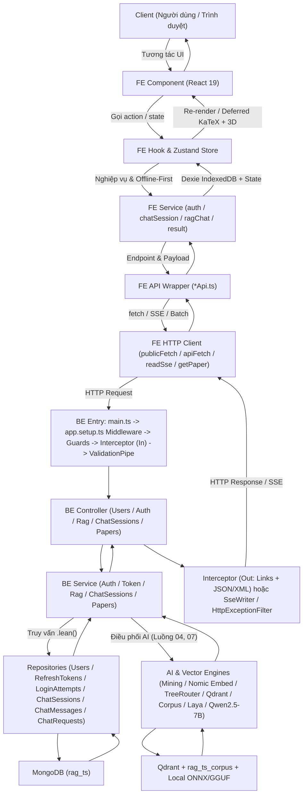

# Mục Lục 7 Luồng Request–Response End-to-End (`docs/architecture/flows/`)

- **Motivation/Background**: Sau khi chuẩn hóa kiến trúc theo [quyết định D-063](../../AI_chat_log/Vuong_chat_logs.md) (tách tầng `Repository` ở Backend và `Component → Hook → Service → API → HTTP Client` ở Frontend), nhóm phát triển cần bộ tài liệu phân rã chi tiết 7 luồng nghiệp vụ trọng yếu khép kín phục vụ bảo vệ đồ án trước giảng viên hướng dẫn.
- **Purpose**: Cung cấp điểm truy cập trung tâm, sơ đồ tổng quan kiến trúc 5+ tầng và ma trận đối chiếu nhanh cho toàn bộ 7 tài liệu đặc tả luồng từ `01` đến `07`.
- **Overview Pipeline**: Lập kế hoạch tại [plan_7_request_response_flows.md](../../prompts/plan_7_request_response_flows.md) → Sinh song song 7 file đặc tả `01`–`07` bám sát mã nguồn thực tế → Tổng hợp chỉ mục tại đây và đăng ký vào [docs/INDEX.md](../../INDEX.md).
- **Detailed Plan**: §1 Tổng quan Kiến trúc Request–Response Toàn hệ thống (`flowchart TB`); §2 Danh mục 7 Luồng Trọng yếu & Liên kết Chi tiết; §3 Bảng Đối chiếu Đặc tính Kỹ thuật & Bất biến; §4 Quy ước & Kiểm chứng.
- **References**: [AGENTS.md](../../../AGENTS.md), [backend_rag/AGENTS.md](../../../backend_rag/AGENTS.md), [frontend_rag/AGENTS.md](../../../frontend_rag/AGENTS.md), [ARCHITECTURE_OVERVIEW.md](../ARCHITECTURE_OVERVIEW.md), [API_DESIGN.md](../../api/API_DESIGN.md), [plan_7_request_response_flows.md](../../prompts/plan_7_request_response_flows.md).
- **Created**: 2026-11-26T10:15:00+07:00
- **Last Updated**: 2026-11-26T10:15:00+07:00

[STATUS: ACTIVE]

---

## 1. Tổng Quan Kiến Trúc Request–Response Toàn Hệ Thống

Tất cả 7 luồng nghiệp vụ trong `RAG_TS` cùng vận hành trên xương sống phân tầng nhất quán dưới đây. Riêng tầng hạ tầng Backend tách rõ **Repositories** (MongoDB `rag_ts`) và **AI & Vector Engines** (`src/engines/*`, đứng ngang hàng với `Repository` dưới sự điều phối của `Service`):

---

## 2. Danh Mục 7 Luồng Trọng Yếu

| Luồng | Tài liệu Đặc tả | Endpoint Chính | Điểm Bắt đầu ở FE | Lớp Xử lý Chính ở BE |
| :---: | :--- | :--- | :--- | :--- |
| **01** | [`01_user_registration_flow.md`](01_user_registration_flow.md) | `POST /api/v1/users` | `AuthOverlay` (`useAuthSession`) | `UsersController` → `AuthService.register` (`common-passwords` + `Argon2id`) |
| **02** | [`02_auth_login_flow.md`](02_auth_login_flow.md) | `POST /api/v1/auth/tokens` | `AuthOverlay` (`useAuthSession`) | `AuthController.login` → `AuthService.login` (`DUMMY_HASH` + lockout + `LRUCache`) |
| **03** | [`03_auth_token_rotation_flow.md`](03_auth_token_rotation_flow.md) | `POST /api/v1/auth/token-rotations` | `apiFetch` gặp `401` (`withTabLock`) | `AuthController.refresh` → `TokenService.consume` (1-RTT atomic + replay revoke) |
| **04** | [`04_rag_llm_streaming_flow.md`](04_rag_llm_streaming_flow.md) | `POST /api/v1/rag/chat/stream` *(và `/rag/chat`)* | `ChatInput` (`useChatInputState`) | `RagController.stream` → `RagService` + 6 Engines (`SseWriter`) |
| **05** | [`05_chat_history_sync_flow.md`](05_chat_history_sync_flow.md) | `GET /api/v1/chat-sessions` & `/:id/messages` | `ChatPanel` / `HistoryDrawer` | `ChatSessionsController` → `ChatSessionsService` (`listCache`, `Singleflight`) |
| **06** | [`06_chat_session_mutation_flow.md`](06_chat_session_mutation_flow.md) | `DELETE` & `PATCH /api/v1/chat-sessions/:id` | `HistoryDrawer` / `confirmBackendSession` | `ChatSessionsController` → `ChatSessionsService` (`bumpUserGen` `O(1)`, TTL 3d) |
| **07** | [`07_paper_citation_inspection_flow.md`](07_paper_citation_inspection_flow.md) | `GET /api/v1/papers/:paper_id` & `?ids=...` | `CitationChip` / `PaperPanel` / `ResultCard` | `PapersController` → `PapersService` → `VectorStore` (Qdrant) + `CorpusService` |

---

## 3. Ma Trận So Sánh Nhanh (Dành Cho Bảo Vệ Đồ Án)

| Tiêu chí | 01 Register | 02 Login | 03 Refresh `401` | 04 RAG/LLM SSE | 05 History Sync | 06 Mutate Session | 07 Paper Inspect |
| :--- | :---: | :---: | :---: | :---: | :---: | :---: | :---: |
| **HTTP Verb / Transport** | `POST` | `POST` | `POST` | `POST` (SSE / JSON) | `GET` | `DELETE` / `PATCH` | `GET` |
| **Auth Guard** | Public | Public | Public (cần refresh token) | `OptionalJwtAuthGuard` | `JwtAuthGuard` | `JwtAuthGuard` | Public |
| **Rate Limit** | `5 / 60s` | `10 / 60s` | `30 / 60s` | `20` (auth) / `10` (anon) | `120 / 60s` | `120 / 60s` | `30 / 60s` (batch) |
| **FE Offline / Coalescing** | `publicFetch` | `publicFetch` | `navigator.locks` | Dexie first + `180s` resume | Dexie Cache-First | Dexie purge first | `10ms` coalescer (`<=20`) |
| **BE Caching** | Warm cache | `LRUCache` (4 maps) | `tokenVersionCache` | `LRUCache` + `bumpUserGen` | `listCache` + `Singleflight` | `bumpUserGen` `O(1)` | `PapersService.cache` (10m) |
| **Tầng Hạ tầng Đích** | MongoDB | MongoDB | MongoDB | MongoDB + Qdrant + Laya + LLM | MongoDB | MongoDB | Qdrant + `rag_ts_corpus` |

---

## 4. Quy Ước & Tài Liệu Kế Hoạch

- Mọi tài liệu trong thư mục này đều được biên soạn theo khuôn mẫu tại [plan_7_request_response_flows.md](../../prompts/plan_7_request_response_flows.md) và chuẩn [MD_CONVENTION.md](../../../agents/rules/MD_CONVENTION.md).
- Để đối chiếu thêm luồng quản trị chỉ có ở Backend (`AdminModule` RBAC `admin`/`user`, không có UI Frontend), xem [`backend_rag/src/modules/admin/admin.controller.ts`](../../../backend_rag/src/modules/admin/admin.controller.ts) và [`docs/prompts/prompt_security.md`](../../prompts/prompt_security.md).
