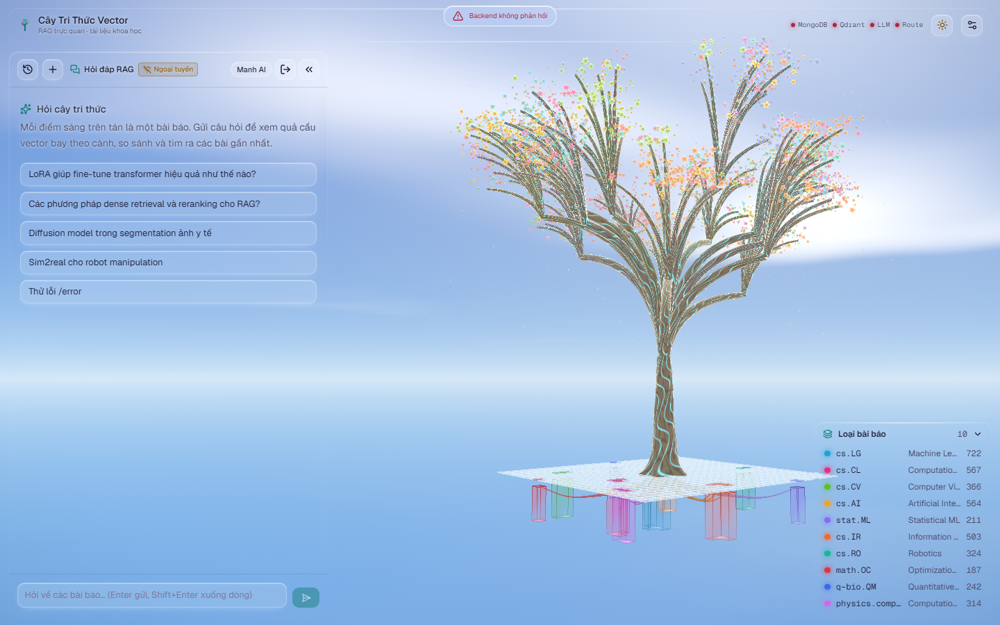

# Baseline Light Mode: Sun & Horizon Review

- **Motivation/Background**: The user requested that the camera composition showing the full tree, hanging crates, canopy, horizon line, cumulus clouds, and upper-right sun glow become the website's **default** `overview` position, accompanied by a live camera pose tracker for easy fine-tuning and max-quality (Tier 0) captures.
- **Purpose**: Present the calibrated default `overview` baseline screenshot for inspection alongside instructions for the live camera movement tracker.
- **Overview Pipeline**: Default Camera Recalibration (`overview`: `-5°` pitch, `-40°` yaw, `target: [0, 48, 0]`) → Live Pose Tracker (`PerfHUD` + Console) → Max Quality Lock (`quality: 'high'`, Tier 0) → 7-Second Settle Capture (1440x900) → Review Presentation.
- **Detailed Plan**: Section 1 presents the full-resolution preview; Section 2 details the default `overview` camera & lighting parameters; Section 3 documents how to use the live camera tracker to copy a custom pose.
- **References**: [../assets/baseline_sun_horizon_preview.png](../assets/baseline_sun_horizon_preview.png), [../../frontend_rag/src/features/world/lib/cameraPresets.ts](../../frontend_rag/src/features/world/lib/cameraPresets.ts), [../../frontend_rag/src/features/world/scene/CameraDirector.tsx](../../frontend_rag/src/features/world/scene/CameraDirector.tsx), [../../frontend_rag/src/features/world/scene/overlay/PerfHUD.tsx](../../frontend_rag/src/features/world/scene/overlay/PerfHUD.tsx).
- **Created**: 2026-11-14T21:42:00+07:00
- **Last Updated**: 2026-11-14T22:06:00+07:00

[STATUS: ACTIVE]

---

## 1. Full-Resolution Screenshot Preview

The screenshot below was captured at the website's **new default `overview` camera preset** with max quality (`quality: 'high'`, Tier 0) locked:

> [!NOTE]
> Permanent repository path: [../assets/baseline_sun_horizon_preview.png](../assets/baseline_sun_horizon_preview.png)

---

## 2. Configuration & Default `overview` Camera Parameters

- **Settings Lock**:
  - `quality`: `'high'` (locked at Tier 0 without adaptive downgrade in `PerfHUD` / `capture_ui.cjs`).
- **Default Website Camera (`getPreset('overview')`)**:
  - **Pitch / Yaw**: `OVERVIEW_PITCH = -5°`, `OVERVIEW_YAW = -40°`, distance `d = 228`.
  - **Runtime Pose (`1440×900`)**: `position: [-146, 28.1, 174]`, `target: [0, 48, 0]`.
  - **Framing**:
    - **Sun & Corona**: Upper-right behind the right canopy branches.
    - **Clouds & Horizon**: Horizon haze intersects behind the mid-trunk, with cumulus clouds sweeping behind the upper canopy.
    - **Foreground & Ground**: White-seamed glass platform and hanging translucent category crates visible below the trunk.
    - **UI Panels**: Full TopBar, Left Drawer, and Category Legend rendered in Light Mode Glass.

---

## 3. Live Camera Movement Tracker

To inspect or adjust the view in the browser (`http://127.0.0.1:5174/`) and paste exact coordinates:
1. Drag / orbit / zoom anywhere in the 3D canvas.
2. When you stop dragging (`controlend`), [CameraDirector.tsx](../../frontend_rag/src/features/world/scene/CameraDirector.tsx#L102-L107) logs `[CAMERA POSE] position: [...], target: [...]` to DevTools Console and updates `globalThis.__rktCameraPose`.
3. In the bottom-right telemetry box ([PerfHUD.tsx](../../frontend_rag/src/features/world/scene/overlay/PerfHUD.tsx#L248-L273)), view `Cam Pos:` / `Cam Tgt:` live or click **`Copy Pose`** to copy `position: [...], target: [...]` to the clipboard.
