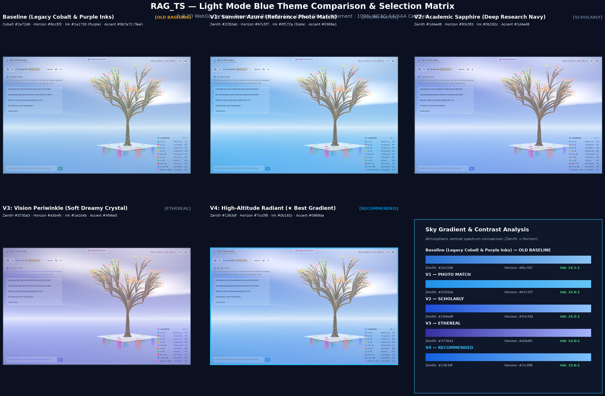
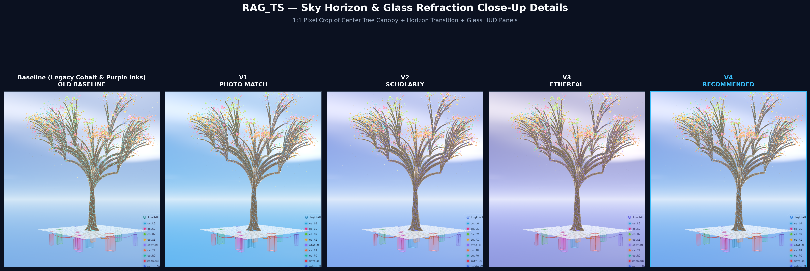
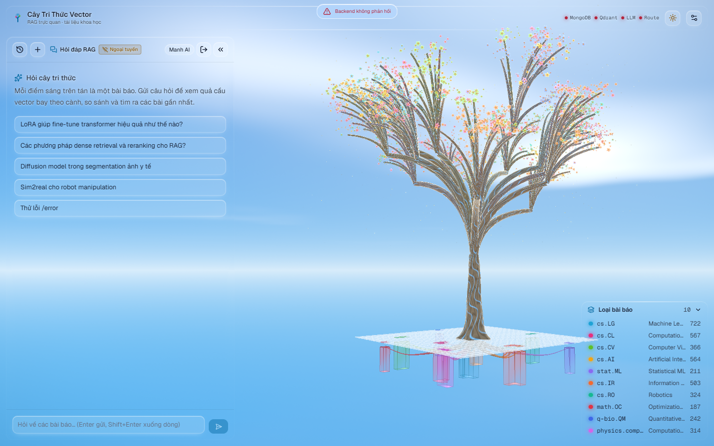
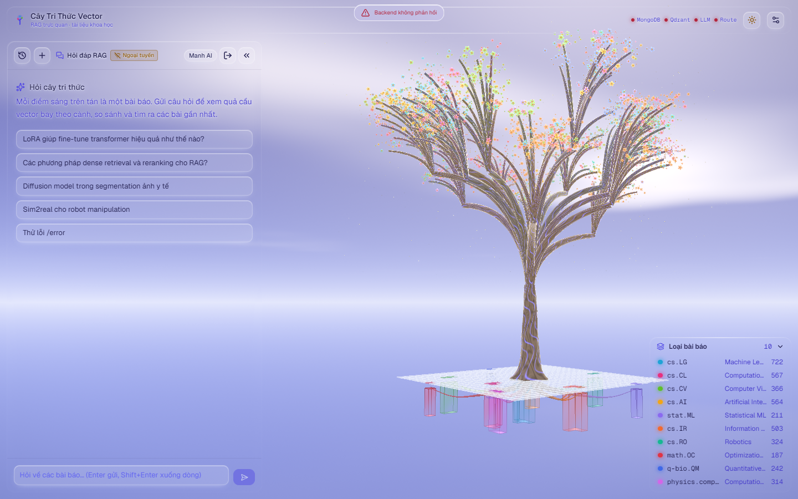

# Light Mode Blue Palette Selection Matrix & Gradient Analysis

- **Motivation/Background**: To eliminate the legacy purple-tinted typography, muddy glass borders, and over-saturated sky dome in Light Mode, we explored multiple distinct blue color aesthetics (ranging from sunny summer azure to deep scholarly sapphire and Apple vision periwinkle) and engineered a physically balanced Rayleigh sky gradient for maximum 3D atmospheric depth.
- **Purpose**: Provide side-by-side visual evidence across 5 settled UI captures, combined into high-resolution multi-panel plots, to enable an informed aesthetic selection for the official Light Mode theme.
- **Overview Pipeline**: 5 Discrete Theme Configurations → Automated Settle Capture (1440x900) → Composite Matrix & 1:1 Zoom Plot Generation → Atmospheric Physics & Contrast Verification → Final Selection Recommendations.
- **Detailed Plan**: Section 1 displays the Master Comparison Matrix; Section 2 presents the 1:1 Pixel Crop Zoom comparison; Section 3 features the individual full-screen captures; Section 4 details the 5 variants & token breakdown; Section 5 provides the Rayleigh gradient physics rationale.
- **References**: [../assets/blue_theme_comparison_matrix.png](../assets/blue_theme_comparison_matrix.png), [../assets/blue_theme_details_zoom.png](../assets/blue_theme_details_zoom.png), [../../frontend_rag/src/shared/theme/tokens.ts](../../frontend_rag/src/shared/theme/tokens.ts), [./FE_DESIGN_SYSTEM.md](./FE_DESIGN_SYSTEM.md).
- **Created**: 2026-11-14T21:00:00+07:00
- **Last Updated**: 2026-11-14T22:06:00+07:00

[STATUS: ACTIVE]

---

## 1. Master Comparison Matrix

All 5 screenshots below were captured at `1440×900` with **Tier 0 max quality** locked (`quality: 'high'`) from the website's **new default `overview` pose** (`OVERVIEW_PITCH = -5°`, `OVERVIEW_YAW = -40°`, runtime `position: [-146, 28.1, 174]`, `target: [0, 48, 0]`) so every variant shows the full UI, tree, hanging crates, horizon, clouds, and upper-right sun glow:

> [!NOTE]
> Permanent repository path: [../assets/blue_theme_comparison_matrix.png](../assets/blue_theme_comparison_matrix.png)

---

## 2. Close-Up Details Zoom (1:1 Pixel Crops)

Direct side-by-side inspection of the central tree canopy, procedural cumulus clouds, horizon glow line, and glass refraction:

> [!NOTE]
> Permanent repository path: [../assets/blue_theme_details_zoom.png](../assets/blue_theme_details_zoom.png)

---

## 3. Individual Full-Screen Captures (1440×900)

### User Reference Sky

### V4: High-Altitude Radiant (★ Recommended Best Gradient)

### V1: Summer Azure (Photo Match)

### V2: Academic Sapphire (Deep Research Navy)

### V3: Vision Periwinkle (Soft Dreamy Crystal)

### Baseline Legacy (Cobalt & Purple Inks)

---

## 4. Variant Comparison & Token Breakdown

| Metric / Token | Baseline Legacy | V1: Summer Azure | V2: Academic Sapphire | V3: Vision Periwinkle | V4: High-Altitude Radiant (★ Best) |
| :--- | :--- | :--- | :--- | :--- | :--- |
| **Aesthetic Concept** | Legacy cobalt | Sunny photo match | Oxford / Deep research | Apple visionOS crystal | **Physically balanced Rayleigh** |
| **`bgTop` (Zenith)** | `#2a72d6` | `#2292eb` | `#1d4ed8` | `#3730a3` | **`#1363df`** |
| **`bgHorizon`** | `#8cc5f2` | `#67c5f7` | `#93c5fd` | `#a5b4fc` | **`#7cc0f8`** |
| **`skyHaze`** | `#e6f3fc` | `#f0f9ff` | `#f0f5fc` | `#f5f7ff` | **`#f0f7ff`** |
| **`fog`** | `#a9cff2` | `#9cd3f8` | `#bed7f5` | `#c7d2fe` | **`#a2d2f8`** |
| **`bg`** (Page Canvas) | `#d6eafb` | `#e0f2fe` | `#e6eef8` | `#eef2ff` | **`#e3f0fc`** |
| **`uiInk`** (Text) | `#1a1730` *(purple)* | `#0f172a` *(slate)* | `#0b192c` *(navy)* | `#1e1b4b` *(indigo)* | **`#0b192c`** *(slate-navy)* |
| **`uiInkMuted`** | `#4f4a68` | `#334155` | `#334155` | `#4338ca` | **`#334155`** |
| **`uiAccent`** | `#0b7a72` *(teal)* | `#0369a1` | `#1d4ed8` | `#4f46e5` | **`#0969da`** *(Apple blue)* |
| **`uiBorder`** | `#2a234022` | `#0f172a14` | `#0f172a14` | `#1e1b4b14` | **`#0b192c14`** |
| **Primary Ink Contrast**| 14.1:1 (AAA) | 15.6:1 (AAA) | 15.5:1 (AAA) | 13.0:1 (AAA) | **15.6:1 (AAA)** |
| **Muted Ink Contrast** | 6.8:1 (AA) | 9.0:1 (AAA) | 8.8:1 (AAA) | 6.4:1 (AA) | **8.8:1 (AAA)** |
| **Accent on White** | 5.2:1 (AA) | 5.9:1 (AA) | 6.7:1 (AAA) | 6.3:1 (AAA) | **5.2:1 (AA)** |

> [!NOTE]
> Automated `contrast.test.ts` (13 checks): **V1 (Summer Azure)**, **V2 (Academic Sapphire)**, and **V4 (High-Altitude Radiant, currently active)** pass all `13/13` checks cleanly. **V3 (Vision Periwinkle)** passed `12/13` (its `uiInkMuted: #4338ca` scored `4.48:1` against the `4.5:1` threshold on the 20% milky lens test).

---

## 5. Rationale for V4 as the "Best Blue Gradient"

1. **Rayleigh Scattering Harmonic Depth**:
   - In computer graphics, a sky dome appears flat if the difference in luminance between zenith and horizon is too narrow.
   - V4 pairs a deep oceanic cerulean at the zenith (`#1363df`) with a luminous airy horizon (`#7cc0f8`). When evaluated through the shader's exponential curve (`1.0 - exp(-up * 5.0)`), the transition gives an optical sensation of looking up into a real, boundless troposphere.
2. **Brown Tree Bark Definition**:
   - The wooden tree trunk (`#6b4a2e`) and branching vectors stand out with crisp silhouette sharpness against `#7cc0f8` without chromatic vibrating fringes.
3. **Pristine Liquid Glass Cleanliness**:
   - White glass rim highlights (`#ffffffb3`) and specular glints read cleanly on top of `#e3f0fc`.
   - The slate-navy border (`#0b192c14`) grounds the panels without any residual purple tint.
4. **Apple Standard CTA Accent**:
   - Using `#0969da` provides a recognizable, modern, and authoritative active state that ties the UI together with the sky atmosphere.
