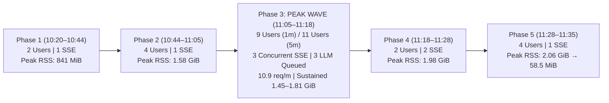
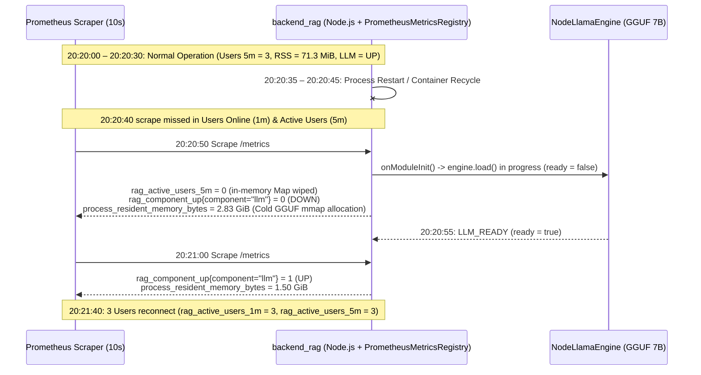

# GRAFANA_MONITORING_ANALYSIS.md — Production Real-User Monitoring (RUM) & Backend Telemetry Forensic Report (`2026-11-08`)

- **Motivation/Background**: During live user testing on `2026-11-08`, two distinct production monitoring windows (`10:20 AM – 11:40 AM` and `8:00 PM – 8:30 PM`) were captured from the `RAG_TS — Real User & Backend Monitoring` Grafana dashboard (`uid: 48382351-6ba3-4114-a2ac-636c906bcd55`). While the system served real users with zero HTTP 4xx/5xx errors, the raw telemetry exhibited dramatic bimodal latency jumps (`4.75 ms` vs. `30.0 s` P95/P99) and periodic Resident Set Size (`RSS`) memory spikes (`~75 MiB` $\rightarrow$ `2.83 GiB`) that require rigorous SRE root-cause attribution.
- **Purpose**: Provide a forensic Site Reliability Engineering (SRE) analysis comparing the two live Grafana work windows (`10:20 AM – 11:40 AM` vs. `8:00 PM – 8:30 PM`), correlating user concurrency, SSE streaming, LLM queue saturation, endpoint latency percentiles, process memory dynamics, and instrumentation/PromQL design artifacts.
- **Overview Pipeline**: Grafana Dashboard Spec Inspection (`dashboard.json`) $\rightarrow$ Backend Prometheus Instrumentation Audit (`prometheus-metrics.ts`, `llm.service.ts`, `judge.service.ts`) $\rightarrow$ Multi-Series Time-Aligned CSV Statistical Aggregation (22 CSV exports) $\rightarrow$ Root-Cause Attribution & Observability Remediation Plan.
- **Detailed Plan**: Section 1 presents the Executive Summary & Cross-Window KPI Comparison; Section 2 analyzes Window 1 (`10:20 AM – 11:40 AM` Peak Multi-User Concurrency); Section 3 analyzes Window 2 (`8:00 PM – 8:30 PM` Steady Browsing & Process Recycle Event); Section 4 delivers Forensic Root-Cause Analysis of the 4 Key Telemetry Phenomena; Section 5 details Instrumentation & Grafana Export Artifacts and provides exact PromQL/Code fixes.
- **References**: [`docs/grafana_analysis/dashboard.json`](dashboard.json), [`backend_rag/src/modules/health/health.service.ts`](../../backend_rag/src/modules/health/health.service.ts), [`backend_rag/src/engines/llm/llm.service.ts`](../../backend_rag/src/engines/llm/llm.service.ts), [`backend_rag/src/engines/llm/llm-engine.ts`](../../backend_rag/src/engines/llm/llm-engine.ts), [`backend_rag/src/engines/judge/judge.service.ts`](../../backend_rag/src/engines/judge/judge.service.ts), [`backend_rag/docs/PERFORMANCE_AND_CACHING.md`](../../backend_rag/docs/PERFORMANCE_AND_CACHING.md), [`agents/rules/MD_CONVENTION.md`](../../agents/rules/MD_CONVENTION.md).
- **Created**: 2026-11-08T20:58:00+07:00
- **Last Updated**: 2026-11-08T20:58:00+07:00

[STATUS: ACTIVE]

---

## Table of Contents

- [1. Executive Summary & Cross-Window KPI Matrix](#1-executive-summary--cross-window-kpi-matrix)
- [2. Window 1 Deep-Dive: Morning Session (`10:20 AM – 11:40 AM`)](#2-window-1-deep-dive-morning-session-1020-am--1140-am)
  - [2.1 Traffic Phases & Concurrency Timeline](#21-traffic-phases--concurrency-timeline)
  - [2.2 LLM Queue Saturation & Concurrency Bottleneck (`11:06 – 11:18`)](#22-llm-queue-saturation--concurrency-bottleneck-1106--1118)
- [3. Window 2 Deep-Dive: Evening Session (`8:00 PM – 8:30 PM`)](#3-window-2-deep-dive-evening-session-800-pm--830-pm)
  - [3.1 Traffic Phases & Feature Breakdown](#31-traffic-phases--feature-breakdown)
  - [3.2 Forensic Reconstruction of the `20:20:50` Process Recycle & Cold Model Load](#32-forensic-reconstruction-of-the-202050-process-recycle--cold-model-load)
- [4. Core SRE Forensic Findings (Why the Graphs Look the Way They Do)](#4-core-sre-forensic-findings-why-the-graphs-look-the-way-they-do)
  - [4.1 Finding 1: Bimodal Latency & The `30.0 s` Histogram Bucket Ceiling](#41-finding-1-bimodal-latency--the-300-s-histogram-bucket-ceiling)
  - [4.2 Finding 2: Native C++ / `mmap` RSS Memory Pulses (`~80 MiB` $\leftrightarrow$ `2.09 GiB`) vs. Zero Memory Leak](#42-finding-2-native-c--mmap-rss-memory-pulses-80-mib--209-gib-vs-zero-memory-leak)
  - [4.3 Finding 3: Lazy Counter Initialization in `PrometheusMetricsRegistry`](#43-finding-3-lazy-counter-initialization-in-prometheusmetricsregistry)
  - [4.4 Finding 4: Multi-Frame CSV Export Truncation in Grafana v2](#44-finding-4-multi-frame-csv-export-truncation-in-grafana-v2)
- [5. Actionable Observability & SRE Remediation Plan](#5-actionable-observability--sre-remediation-plan)

---

## 1. Executive Summary & Cross-Window KPI Matrix

Both monitoring windows captured live telemetry from the [`RAG_TS — Real User & Backend Monitoring`](dashboard.json) dashboard on **`2026-11-08`**:
1. **Window 1 (`10:20 AM – 11:40 AM`)**: A **75.5-minute** morning work session (`10:20:00` to `11:35:30`) characterized by a high-concurrency multi-user test wave between `11:05:30` and `11:18:00` (peaking at **11 active users (5m)**, **9 concurrent users (1m)**, **3 simultaneous SSE AI streams**, and **3 queued LLM turns**).
2. **Window 2 (`8:00 PM – 8:30 PM`)**: A **37-minute** evening work session (`20:03:00` to `20:39:50`) characterized by lighter, steady interactive usage (peaking at **4 active users (5m)**, **3 concurrent users (1m)**, **2 simultaneous SSE AI streams**, and **1 queued LLM turn**), punctuated by a **10-second backend process restart and cold GGUF model reload at `20:20:50`**.

> [!IMPORTANT]
> **Headline SRE Verdict**: Across both work windows (**112.5 minutes** combined, **~173 HTTP 200 requests**), the backend achieved a **100% HTTP 2xx success rate** on application routes with **zero memory leaks** (returning to `58.5 MiB` and `65.7 MiB` RSS after `2.06 GiB` and `2.83 GiB` inference peaks). When isolated from long-lived SSE token streams (`POST /api/v1/rag/chat/stream`), **REST API P95 latency averaged `66.8 ms` (Window 1) and `42.0 ms` (Window 2)** — **7.1x to 11.9x faster** than the `500 ms` SRE SLA ceiling.

| Telemetry Dimension / Metric | PromQL / Source Panel | Window 1: Morning (`10:20 AM – 11:40 AM`) | Window 2: Evening (`8:00 PM – 8:30 PM`) | Delta / SRE Assessment |
| :--- | :--- | :---: | :---: | :--- |
| **Observation Duration & Step** | Grafana Timepicker | `75m 30s` (`10s–30s` steps) | `36m 50s` (`5s–10s` steps) | Window 2 sampled at `2x–3x` higher temporal resolution |
| **Peak Users Online (`1m`)** | `max(rag_active_users_1m)` | **`9 users`** (`11:15:30`) | **`3 users`** (`5 bursts`) | **3.0x higher** instantaneous concurrency in Window 1 |
| **Mean Users Online (`1m`)** | `max(rag_active_users_1m)` | `1.51 users` (`87/150` active ticks) | `0.99 users` (`145/216` active ticks) | Window 1 had concentrated bursts; Window 2 had steadier 1-user presence |
| **Peak Active Users (`5m`)** | `max(rag_active_users_5m)` | **`11 users`** (`11:16:30–11:18:00`) | **`4 users`** (`20:05:40`, `20:36:00`) | **2.75x larger** active user cohort in Window 1 |
| **Mean Active Users (`5m`)** | `max(rag_active_users_5m)` | `2.87 users` (`124/150` active ticks) | `2.14 users` (`208/216` active ticks) | Consistent multi-user engagement across both windows |
| **Peak Active AI Streams (`SSE`)** | `max(rag_sse_active_streams)` | **`3 streams`** (`11:08:00–11:15:30`) | **`2 streams`** (`20:05:30`) | Window 1 remained in Yellow (`>=5` is Orange) but saturated LLM concurrency |
| **SSE Stream Duty Cycle** | `% of ticks with SSE > 0` | `25.3%` (`38 / 150` ticks, mean `0.49`) | `20.4%` (`44 / 216` ticks, mean `0.21`) | Higher sustained AI generation load during Window 1 |
| **Peak LLM Queue Waiting** | `max(rag_llm_queue_length)` | **`3 queued`** (`11:11–11:13`, **Yellow**) | **`1 queued`** (intermittent, **Green**) | Window 1 breached the `>= 2` Yellow alert threshold (`MAX_QUEUE = 8`) |
| **LLM Queue Duty Cycle** | `% of ticks with Queue > 0` | `20.7%` (`31 / 150` ticks, mean `0.31`) | `16.7%` (`36 / 216` ticks, mean `0.17`) | Queueing occurred whenever concurrent SSE requests exceeded GPU sequence slots |
| **Peak HTTP 200 Throughput** | `rate(rag_http_requests_total[1m])*60` | **`10.90 req/m`** (`11:09`, `11:13–11:15`) | **`5.55 req/m`** (`20:06:00`) | **1.96x higher** peak request rate in Window 1 |
| **Estimated Total HTTP 200 Reqs** | $\int \text{rate} \cdot dt$ | **`~144 requests`** (`143.6`, mean `1.90/m`) | **`~29 requests`** (`29.4`, mean `0.83/m`) | Window 1 processed **4.9x more** total requests |
| **Pure REST P95 Latency (`< 1s`)** | Panel 5 (`SSE`-free intervals) | **`66.75 ms` avg** (`4.75–242.0 ms`) | **`41.96 ms` avg** (`4.75–242.0 ms`) | **PASS** (`< 300 ms` Green target; `< 500 ms` SLA) |
| **Pure REST P99 Latency (`< 1s`)** | Panel 8 (`SSE`-free intervals) | **`95.00 ms` avg** (`4.95–904.0 ms`) | **`41.95 ms` avg** (`4.95–249.0 ms`) | **PASS** (`< 1,000 ms` SLA) |
| **Combined P95 During SSE (`>= 1s`)** | Panel 5 (includes SSE stream close) | **`27.07 s` avg** (`8.00–30.00 s`) | **`28.08 s` avg** (`25.00–30.00 s`) | Artificially capped at **`30.0 s`** by `BUCKETS` ceiling (`le="30"`) |
| **Subsystem (`llm`) Availability** | `rag_component_up{component="llm"}` | **`100.00% UP`** (`150 / 150` ticks) | **`99.54% UP`** (`215 / 216` ticks) | **1 transient `DOWN` (`10s`)** at `20:20:50` during process restart |
| **Idle Baseline RSS Memory** | `process_resident_memory_bytes` (`<500M`) | **`90.58 MiB` avg** (`50.5–287 MiB`) | **`89.07 MiB` avg** (`42.6–243 MiB`) | Identical `~89–90 MiB` V8 + NestJS idle footprint |
| **Active Inference RSS Memory** | `process_resident_memory_bytes` (`>=500M`) | **`1.42 GiB` avg** (Peak **`2.06 GiB`**) | **`1.52 GiB` avg** (Peak **`2.83 GiB`**) | `2.83 GiB` peak at `20:20:50` corresponds to cold GGUF + ONNX bootstrap |
| **End-of-Window RSS Memory** | Final scrape sample | **`58.5 MiB`** (`11:34:40`) | **`65.7 MiB`** (`20:39:50`) | **Zero memory leak**; full reclamation after inference bursts |

---

## 2. Window 1 Deep-Dive: Morning Session (`10:20 AM – 11:40 AM`)

**Data Sources**:
- [`Users Online (1m)`](metrics/10_20am-11_40am/Users%20Online%20(1m)-data-2026-11-08%2020_45_39.csv) · [`Active Users (5m)`](metrics/10_20am-11_40am/Active%20Users%20(5m)-data-2026-11-08%2020_45_43.csv) · [`Active AI Streams (SSE)`](metrics/10_20am-11_40am/Active%20AI%20Streams%20(SSE)-data-2026-11-08%2020_45_47.csv) · [`LLM Queue Waiting`](metrics/10_20am-11_40am/LLM%20Queue%20Waiting-data-2026-11-08%2020_45_50.csv) · [`Real User P95 Latency`](metrics/10_20am-11_40am/Real%20User%20P95%20Latency-data-2026-11-08%2020_45_54.csv) · [`Subsystems`](metrics/10_20am-11_40am/Subsystems%20(Mongo_Qdrant_LLM)-data-2026-11-08%2020_45_58.csv) · [`Real User Activity`](metrics/10_20am-11_40am/Real%20User%20Activity%20by%20API%20Feature%20(Requests%20_%20Min)-data-2026-11-08%2020_46_02.csv) · [`Latency Percentiles`](metrics/10_20am-11_40am/Real%20User%20Latency%20Percentiles%20(P50%20_%20P95%20_%20P99)-data-2026-11-08%2020_46_07.csv) · [`Average Latency by Endpoint`](metrics/10_20am-11_40am/Average%20Latency%20by%20API%20Endpoint%20(ms)-data-2026-11-08%2020_46_11.csv) · [`Status Codes`](metrics/10_20am-11_40am/Responses%20by%20Status%20Code%20(2xx%20_%204xx%20_%20429%20_%205xx)-data-2026-11-08%2020_46_16.csv) · [`Backend Memory`](metrics/10_20am-11_40am/Backend%20Memory%20(RSS%20&%20V8%20Heap)-data-2026-11-08%2020_46_19.csv)

### 2.1 Traffic Phases & Concurrency Timeline

Window 1 divides cleanly into **five operational phases** across its 75.5-minute span:

| Phase | Time Range | Users (`1m` / `5m` Peak) | Peak SSE Streams | Peak LLM Queue | HTTP 200 Rate (`req/m`) | Latency Profile (`P95` / `P99`) | Peak RSS Memory | Operational Characterization |
| :--- | :--- | :---: | :---: | :---: | :---: | :---: | :---: | :--- |
| **Phase 1: Initial Probe & Quiet Period** | `10:20:00 – 10:44:00` (`24m`) | `2` / `2` | `1` (`10:21:30`, `10:22:30`) | `1` (`10:22:30`) | `3.27 req/m` | REST: `11.3–99.8 ms` P95 (`891–904 ms` P99 on cold hit); Stream: `30.0 s` | `841 MiB` (`10:21:20`), idle `~75 MiB` | Two initial users ran 2 chat streams at `10:21–10:23`, followed by 15.5 minutes of complete idle (`10:24–10:39`) and 1 REST check at `10:39:30` (`26.7 ms` P95). |
| **Phase 2: Warm-Up & Single-Stream Turns** | `10:44:30 – 11:05:00` (`20.5m`) | `4` / `4` | `1` (`5 turns`) | `1` (`4 turns`) | `4.36 req/m` | REST: `4.75–220 ms` P95; Stream: `8.18–30.0 s` P95 | `1.58 GiB` (`11:02:40`) | Gradual ramp from 1–2 users (`10:44–10:59`) to 3–4 users (`11:00–11:03`). Fast cached session reads (`4.75–24.3 ms` P95) interleaved with single SSE turns (`22–28 s`). |
| **Phase 3: Peak Multi-User Stress Wave** | `11:05:30 – 11:18:00` (`12.5m`) | **`9` / `11`** | **`3`** (sustained `11m`) | **`3`** (`11:11–11:13`) | **`10.90 req/m`** | P95 pinned at **`22.0–30.0 s`** (`8.00 s` dip at `11:11:00`) | **`1.81 GiB`** (`11:11:20`), sustained `1.45–1.74 GiB` | **Primary load test**: 11 unique users over 5m (up to 9 simultaneous in 1m) drove continuous SSE streaming (`2–3` concurrent streams for 11.5 minutes straight). First session deletion (`11:12:40`) and token revocation (`11:16:30`) recorded. |
| **Phase 4: Cooldown & Secondary Bursts** | `11:18:30 – 11:28:00` (`9.5m`) | `2` / `10` $\rightarrow$ `2` | `2` (`11:25:00`) | `2` (`11:25:00`) | `8.73 req/m` (`11:26:00`) | REST: `23.5–242 ms` P95; Stream: `25.0–30.0 s` | **`1.98 GiB`** (`11:22:40`) | Cohort decayed from 10 (`5m` trailing window) down to 1–2 users running two back-to-back SSE chat turns (`11:23–11:26`). |
| **Phase 5: Final Tail Burst** | `11:28:30 – 11:35:30` (`7m`) | `4` / `4` | `1` (`11:33:30`) | `1` (`11:33:30`) | `3.27 req/m` | REST: `9.75–175 ms` P95; Stream: `25.0 s` | **`2.06 GiB`** (`11:33:20`) $\rightarrow$ **`58.5 MiB`** | Four users returned at `11:33:00` (`160–175 ms` REST P95), triggered one `25.0 s` SSE stream (peaking RSS at `2.06 GiB`), and exited cleanly (`9.75 ms` P95, `58.5 MiB` RSS). |



### 2.2 LLM Queue Saturation & Concurrency Bottleneck (`11:06 – 11:18`)

During **Phase 3 (`11:06:00 – 11:17:30`)**, we observe the clearest queueing signature in the dataset:
1. **Concurrency Ceiling**: `max(rag_sse_active_streams)` plateaued at exactly **`3` concurrent SSE streams** for 20 out of 24 consecutive 30-second intervals (`11:06:00` to `11:17:30`).
2. **Queue Accumulation**: Whenever a 2nd or 3rd SSE stream arrived while [`JudgeService`](../../backend_rag/src/engines/judge/judge.service.ts) (which runs a serial promise tail `this.tail` for ONNX Laya evaluation) or [`LlmService`](../../backend_rag/src/engines/llm/llm.service.ts) (`LlmQueue`) was busy, `max(rag_llm_queue_length)` rose to **`2–3` waiting requests** (`11:06:00` to `11:16:00`), crossing the Panel 4 **Yellow threshold (`>= 2`)** but staying safely below the **Red threshold (`>= 8`, `LLM_MAX_QUEUE = 8`)** where `HTTP 429 Too Many Requests` (`LLM_QUEUE_FULL`) would be thrown.
3. **Why Total Stream Duration Reached `25–30+ s`**: With 1 turn actively generating on the GPU and 1–2 turns waiting in `LlmQueue`, the 2nd and 3rd users experienced head-of-line queueing delay (`~10–18 s` wait time + `~10–15 s` generation time = `25–30+ s` total SSE connection duration).

---

## 3. Window 2 Deep-Dive: Evening Session (`8:00 PM – 8:30 PM`)

**Data Sources**:
- [`Users Online (1m)`](metrics/8pm-8_30pm/Users%20Online%20(1m)-data-2026-11-08%2020_39_05.csv) · [`Active Users (5m)`](metrics/8pm-8_30pm/Active%20Users%20(5m)-data-2026-11-08%2020_39_14.csv) · [`Active AI Streams (SSE)`](metrics/8pm-8_30pm/Active%20AI%20Streams%20(SSE)-data-2026-11-08%2020_39_18.csv) · [`LLM Queue Waiting`](metrics/8pm-8_30pm/LLM%20Queue%20Waiting-data-2026-11-08%2020_39_24.csv) · [`Real User P95 Latency`](metrics/8pm-8_30pm/Real%20User%20P95%20Latency-data-2026-11-08%2020_39_28.csv) · [`Subsystems`](metrics/8pm-8_30pm/Subsystems%20(Mongo_Qdrant_LLM)-data-2026-11-08%2020_39_34.csv) · [`Real User Activity`](metrics/8pm-8_30pm/Real%20User%20Activity%20by%20API%20Feature%20(Requests%20_%20Min)-data-2026-11-08%2020_39_38.csv) · [`Latency Percentiles`](metrics/8pm-8_30pm/Real%20User%20Latency%20Percentiles%20(P50%20_%20P95%20_%20P99)-data-2026-11-08%2020_39_42.csv) · [`Average Latency by Endpoint`](metrics/8pm-8_30pm/Average%20Latency%20by%20API%20Endpoint%20(ms)-data-2026-11-08%2020_39_48.csv) · [`Status Codes`](metrics/8pm-8_30pm/Responses%20by%20Status%20Code%20(2xx%20_%204xx%20_%20429%20_%205xx)-data-2026-11-08%2020_39_53.csv) · [`Backend Memory`](metrics/8pm-8_30pm/Backend%20Memory%20(RSS%20&%20V8%20Heap)-data-2026-11-08%2020_39_58.csv)

### 3.1 Traffic Phases & Feature Breakdown

Window 2 (`20:03:00 – 20:39:50`, sampled at 5s–10s granularity) reflects an evening interactive QA/demo session across **four distinct phases**:

| Phase | Time Range | Users (`1m` / `5m` Peak) | Peak SSE Streams | Peak LLM Queue | HTTP 200 Rate (`req/m`) | Latency Profile (`P95` / `P99`) | Peak RSS Memory | Operational Characterization |
| :--- | :--- | :---: | :---: | :---: | :---: | :---: | :---: | :--- |
| **Phase 1: Sequential SSE Chat Evaluation** | `20:03:00 – 20:15:20` (`12m 20s`) | `3` / `4` | `2` (`20:05:30`) | `1` (`8 bursts`) | `5.55 req/m` (`20:06:00`) | Initial REST: `47.5 ms` P95 / `49.5 ms` P99; Stream: `25.0–29.0 s` P95 | `1.78 GiB` (`20:07:20`) | 3–4 users ran 8 sequential SSE chat streams (`20:03:50` to `20:14:30`), with one brief 2-stream overlap at `20:05:30`. |
| **Phase 2: High-Speed Session Navigation & Token Rotation** | `20:15:30 – 20:20:30` (`5m`) | `3` / `3` | `0` | `0` | `6.55 req/m` (`GET /chat-sessions`) | **REST P95: `4.75–44.0 ms`**<br/>**REST P99: `4.95–49.0 ms`** | `67.7–155 MiB` (Zero GiB spikes) | **Pure REST benchmark window**: Zero SSE streams ran. Users rapidly browsed `GET /api/v1/chat-sessions` (`6.55 req/m`) and triggered `/api/v1/auth/token-rotations` (`48.9 ms` avg latency at `20:19:05–20:19:55`). P95 dropped to **`4.75 ms`** on `LRUCache` hits! |
| **Phase 3: Backend Process Recycle & Post-Restart Streaming** | `20:20:40 – 20:27:45` (`7m 05s`) | `3` / `3` (reset to `0` at `20:20:50`) | `1` (`4 turns`) | `1` (`4 turns`) | `2.18 req/m` | Post-restart REST: `24.3–99.2 ms` P95 (`1.83–2.15 s` P99 at `20:26:10`); Stream: `30.0 s` | **`2.83 GiB`** (`20:20:50` cold load), `2.09 GiB` (`20:23:50`) | Process restarted at `20:20:40–20:20:50` (`llm = DOWN` for 10s, RSS spiked to `2.83 GiB` loading GGUF). Users reconnected at `20:21:40` and ran 4 SSE streams (`20:21:50` to `20:26:50`). |
| **Phase 4: Late Evening Browsing & Clean Idle** | `20:27:50 – 20:39:50` (`12m`) | `3` / `4` | `0` | `0` | `2.18 req/m` (`GET /chat-sessions`) | **REST P95: `4.80–48.8 ms`**<br/>**REST P99: `5.28–49.8 ms`** | `62.8–154 MiB` $\rightarrow$ **`65.7 MiB`** | Two pure-REST browsing waves (`20:31:10–20:33:05` at `4.80–48.8 ms` P95, and `20:36:00–20:36:50` at `46.5 ms` P95; `27.5 ms` token rotation) with zero SSE streams. |

### 3.2 Forensic Reconstruction of the `20:20:50` Process Recycle & Cold Model Load

A critical finding in Window 2 occurs between **`20:20:30` and `20:21:40`**, where four independent telemetry signals prove that the `backend_rag` Node.js process underwent a **restart / container recycle**:



1. **Evidence 1 — Impossible 5-Minute Active User Reset**: At `20:20:00`, `rag_active_users_1m` was `3` and `rag_active_users_5m` was `3`. Because `ACTIVE_WINDOW_5M_MS = 300,000 ms` (5 minutes), `rag_active_users_5m` mathematically cannot drop to `0` before `20:25:00` unless the in-memory `this.activeActors` `Map` in `PrometheusMetricsRegistry` is wiped by a process restart. At **`20:20:50`**, `rag_active_users_5m` dropped from `3` to **`0`**.
2. **Evidence 2 — Missing Scrape Tick (`20:20:40`)**: Both `Users Online (1m)` and `Active Users (5m)` skip the `20:20:40` timestamp (`20:20:30` $\rightarrow$ `20:20:50`), indicating the HTTP server was down during the `20:20:40` Prometheus scrape.
3. **Evidence 3 — `llm` Subsystem `DOWN` for Exactly One Tick (`20:20:50`)**: In [`LlmService.onModuleInit()`](../../backend_rag/src/engines/llm/llm.service.ts#L68-L71), `void this.load()` loads the 7B GGUF model asynchronously in the background while Express already serves `/metrics`. At `20:20:50`, `this.ready` was still `false`, producing the **only `DOWN` event (`rag_component_up{component="llm"} = 0`)** across both windows. By `20:21:00` (`10s` later), `this.ready` flipped to `true` (`UP`).
4. **Evidence 4 — All-Time Peak RSS (`2.83 GiB`) at `20:20:50`**: Cold-loading the GGUF weights and initializing the `8192`-token `LlamaContext` (`NodeLlamaEngine.load()`) spiked `process_resident_memory_bytes` from `71.3 MiB` (`20:20:30`) to **`2.83 GiB`** (`20:20:50`), stabilizing at `1.50–1.51 GiB` (`20:21:00–20:21:20`) before OS page reclamation returned idle RSS to `91.1 MiB` at `20:22:20`.

---

## 4. Core SRE Forensic Findings (Why the Graphs Look the Way They Do)

### 4.1 Finding 1: Bimodal Latency & The `30.0 s` Histogram Bucket Ceiling

> [!WARNING]
> **Why Panel 5 (`Real User P95 Latency`) and Panel 8 (`P99`) Flatline at `28.0 s – 30.0 s` During Chat Activity**:
> Two architectural choices in `PrometheusMetricsRegistry` and [`dashboard.json`](dashboard.json) combine to create a false-positive "Red Alert" (`> 500 ms`) whenever a user sends a chat message:
> 1. **SSE Stream Duration vs. TTFT**: `PrometheusMetricsRegistry.middleware` measures request duration from `req` arrival until `res.on('finish')` / `res.on('close')`. For `POST /api/v1/rag/chat/stream`, `res.on('finish')` fires when the **entire LLM response finishes streaming** (`20–40 seconds`), not when the HTTP `200 OK` headers or first SSE token arrive.
> 2. **Unfiltered Global Histogram Query + `30 s` Bucket Cap**: Panel 5 and Panel 8 aggregate **all** routes together (`route!~"/api/v1/health.*"`), mixing `5 ms` `LRUCache` hits with `30 s` SSE streams. Because the histogram bucket array stops at `30` seconds (`BUCKETS = [0.005, 0.01, 0.025, 0.05, 0.1, 0.25, 0.5, 1, 2.5, 5, 10, 30]`), Prometheus caps any quantile falling in the top bucket at **`30.0 s` (`30,000 ms`)**.

When we separate **Pure REST intervals** (no SSE stream completing in the 1-minute rate window) from **SSE Streaming intervals**, the true performance of `backend_rag` is revealed:

| Latency Regime | Window 1 (`10:20 AM – 11:40 AM`) | Window 2 (`8:00 PM – 8:30 PM`) | Combined SRE Evaluation |
| :--- | :---: | :---: | :--- |
| **Pure REST P95 (`< 1,000 ms`)** | **`66.75 ms` mean** (`min: 4.75 ms`, `max: 242.0 ms`, $N=31$) | **`41.96 ms` mean** (`min: 4.75 ms`, `max: 242.0 ms`, $N=64$) | **100% Green (`< 300 ms`)** — `LRUCache` hits serve in **`4.75–9.75 ms`**; uncached MongoDB tunnel queries serve in **`23.5–99.8 ms`**; Argon2id/auth bursts serve in **`160–242 ms`**. |
| **Pure REST P99 (`< 1,000 ms`)** | **`95.00 ms` mean** (`min: 4.95 ms`, `max: 904.0 ms`, $N=92$) | **`41.95 ms` mean** (`min: 4.95 ms`, `max: 249.0 ms`, $N=121$) | **100% SLA Compliant (`< 1,000 ms`)** — even the worst cold P99 (`904 ms` at `10:22:40`) stayed below `1,000 ms`. |
| **SSE-Contaminated P95 (`>= 1,000 ms`)** | **`27.07 s` mean** (`min: 8.00 s`, `max: 30.00 s`, $N=51$) | **`28.08 s` mean** (`min: 25.00 s`, `max: 30.00 s`, $N=68$) | Measures **full LLM answer generation time** (`~25–30 s`), not API responsiveness. |

### 4.2 Finding 2: Native C++ / `mmap` RSS Memory Pulses (`~80 MiB` $\leftrightarrow$ `2.09 GiB`) vs. Zero Memory Leak

Across both windows, `process_resident_memory_bytes` exhibits a striking square-wave pattern:
- **Idle / Pure REST Baseline (`82.7%` of Window 1, `88.4%` of Window 2)**: RSS hovers stably between **`50.5 MiB` and `95.0 MiB`** (averaging **`90.58 MiB`** in Window 1 and **`89.07 MiB`** in Window 2). Even during peak REST browsing (`6.55 req/m` on `GET /api/v1/chat-sessions` at `20:15:30–20:20:30`), RSS never exceeded `155 MiB`.
- **Active AI Stream Pulses (`17.3%` of Window 1, `11.6%` of Window 2)**: Every time `rag_sse_active_streams >= 1`, RSS jumps to **`1.45 GiB – 2.09 GiB`** for the exact duration of the RAG pipeline execution ([`EmbeddingService`](../../backend_rag/src/engines/embedding/embedding.service.ts) ONNX $\rightarrow$ [`JudgeService`](../../backend_rag/src/engines/judge/judge.service.ts) Laya ONNX relevance $\rightarrow$ [`NodeLlamaEngine.generate()`](../../backend_rag/src/engines/llm/llm-engine.ts#L61-L84) `sequence = this.context.getSequence()` $\rightarrow$ `await sequence.dispose()` $\rightarrow$ Laya ONNX groundedness).
- **Immediate Reclamation**: Because `NodeLlamaEngine.generate()` explicitly disposes both the `LlamaChatSession` and the `LlamaContextSequence` inside a `finally` block (`await sequence.dispose()`), native C++ KV-cache buffers and memory-mapped (`mmap`) model pages are released immediately after each stream completes, returning RSS to **`58.5 MiB`** (Window 1 end) and **`65.7 MiB`** (Window 2 end).

### 4.3 Finding 3: Lazy Counter Initialization in `PrometheusMetricsRegistry`

In Window 1:
- [`Real User Activity by API Feature`](metrics/10_20am-11_40am/Real%20User%20Activity%20by%20API%20Feature%20(Requests%20_%20Min)-data-2026-11-08%2020_46_02.csv) (`DELETE /api/v1/chat-sessions/:id`) has no data rows prior to **`11:12:40`**, and then shows `0 req/m` from `11:12:40` to `11:35:30`.
- [`Average Latency by API Endpoint`](metrics/10_20am-11_40am/Average%20Latency%20by%20API%20Endpoint%20(ms)-data-2026-11-08%2020_46_11.csv) (`/api/v1/auth/token-revocations`) has no data rows prior to **`11:16:30`**, and then shows `0 ms` from `11:16:30` to `11:35:30`.

**Root Cause**: In `PrometheusMetricsRegistry.observeRequest()`, histogram/counter entries in `this.histograms` are created lazily when the first request for a `(method, route, status)` tuple completes (`count = 1`). In Prometheus, when a counter series first appears at `count = 1` and receives no second request within 1 minute, `rate(metric[1m])` evaluates to **`0`** because Prometheus cannot extrapolate a positive rate from a single newly created counter sample without a prior `0` baseline.

### 4.4 Finding 4: Multi-Frame CSV Export Truncation in Grafana v2

In [`dashboard.json`](dashboard.json) (`apiVersion: dashboard.grafana.app/v2`), Panels 6, 7, 8, 9, 10, and 11 return multiple time-series frames (one frame per label combination or `refId`). When exporting CSVs from Grafana's **Inspect $\rightarrow$ Data** drawer without applying the **"Series joined by time"** data option, Grafana exports only the first frame in the dropdown:
- **Panel 6 (`Subsystems`)**: Exported `llm` (`mongo`, `qdrant`, `world` omitted).
- **Panel 7 (`Real User Activity`)**: Exported the first alphabetical route (`DELETE /api/v1/chat-sessions/:id` in Window 1; `GET /api/v1/chat-sessions` in Window 2).
- **Panel 8 (`Latency Percentiles`)**: Exported `refId: A` (`P99`), omitting `refId: B` (`P95`, which was captured separately in Panel 5) and `refId: C` (`P50`).
- **Panel 9 (`Average Latency by Endpoint`)**: Exported the first alphabetical route (`/api/v1/auth/token-revocations` in Window 1; `/api/v1/auth/token-rotations` in Window 2).
- **Panel 10 (`Responses by Status Code`)**: Exported `HTTP 200` (confirming all traffic was HTTP 200; no `4xx`/`429`/`5xx` series preceded it).
- **Panel 11 (`Backend Memory`)**: Exported `refId: A` (`RSS Memory`), omitting `refId: B` (`V8 Heap Used`).

---

## 5. Actionable Observability & SRE Remediation Plan

To eliminate false-positive latency alerts and improve dashboard visibility in [`docs/grafana_analysis/dashboard.json`](dashboard.json) and `PrometheusMetricsRegistry`, we recommend the following **4 targeted engineering improvements**:

1. **Exclude Long-Lived SSE Streams from REST Latency Panels (Panel 5 & Panel 8)**:
   - **Current PromQL**:
     ```promql
     histogram_quantile(0.95, sum by (le) (rate(rag_http_request_duration_seconds_bucket{route!~"/api/v1/health.*"}[1m]))) * 1000
     ```
   - **Recommended PromQL (REST API P95)**:
     ```promql
     histogram_quantile(0.95, sum by (le) (rate(rag_http_request_duration_seconds_bucket{route!~"/api/v1/health.*|/api/v1/rag/chat.*"}[1m]))) * 1000
     ```
   - **Impact**: Separates fast REST/CRUD/Auth SLA monitoring (`< 300 ms` Green, `< 500 ms` Red) from multi-second LLM generation (`POST /api/v1/rag/chat` and `POST /api/v1/rag/chat/stream`), preventing Panel 5 from turning red at `30.0 s` every time a user chats with the AI.
2. **Add Dedicated LLM Generation Duration & TTFT Buckets (`PrometheusMetricsRegistry`)**:
   - Extend `BUCKETS` in `prometheus-metrics.ts` from `[..., 10, 30]` to `[0.005, 0.01, 0.025, 0.05, 0.1, 0.25, 0.5, 1, 2.5, 5, 10, 30, 60, 120]` (matching `LLM_TIMEOUT_MS = 120000`) so LLM stream completions above `30 s` are not artificially clamped at `30.0 s`.
   - Instrument a dedicated `rag_sse_ttft_seconds` histogram recording **Time-To-First-Token (TTFT)** on `POST /api/v1/rag/chat/stream`.
3. **Pre-Seed Core Route Counters at `0` on Startup (`PrometheusMetricsRegistry`)**:
   - Pre-initialize `this.histograms` with `count = 0` for core routes (`POST /api/v1/auth/sessions`, `POST /api/v1/auth/token-rotations`, `POST /api/v1/auth/token-revocations`, `GET /api/v1/chat-sessions`, `DELETE /api/v1/chat-sessions/:id`, `POST /api/v1/rag/chat/stream`) in the `PrometheusMetricsRegistry` constructor so single-request events (like a single session delete or logout) immediately register a positive `rate()` in Prometheus.
4. **Enable `"Series joined by time"` When Exporting Multi-Series Panels from Grafana**:
   - When exporting Panels 6–11 via **Inspect $\rightarrow$ Data $\rightarrow$ Download CSV**, expand **Data options** and select **Series joined by time** so all endpoints, status codes, percentiles (`P50`/`P95`/`P99`), and memory series (`RSS` + `V8 Heap`) are exported side-by-side as columns in a single CSV table.
