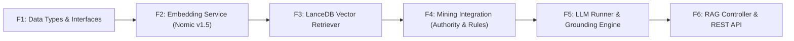

# prompt.md — Phase-1 LanceDB Prototype Prompt Catalog (Archived)

- **Motivation/Background**: Early Phase-1 prompt decomposition written before ackend_rag standardized on Qdrant (scientific_papers_gold), MongoDB (users, chat_sessions), and the 3-Stage SRE caching layer.
- **Purpose**: Historical archive of the initial F1-F6 prompt templates. Must NOT be used by AI agents for current code changes because it references LanceDB instead of Qdrant.
- **Overview Pipeline**: F1 Types -> F2 Nomic v1.5 Embedding -> F3 LanceDB (Superseded by Qdrant) -> F4 Mining Service -> F5 Local LLM -> F6 Controller.
- **Detailed Plan**: Retains the original F1-F6 specification and prompt blocks for historical traceability.
- **References**: [../AGENTS.md](../AGENTS.md), [INDEX.md](INDEX.md), [ARCHITECTURE_OVERVIEW.md](ARCHITECTURE_OVERVIEW.md), [../backend_rag/AGENTS.md](../backend_rag/AGENTS.md).
- **Created**: 2026-10-16T10:00:00+07:00
- **Last Updated**: 2026-10-29T19:47:00+07:00

[STATUS: ARCHIVED]

> [!WARNING]
> **Archived Prototype Prompt**: This document references an early LanceDB prototype and /api/rag/chat routes that have been superseded by Qdrant and /api/v1/*. AI agents must read [ackend_rag/AGENTS.md](../backend_rag/AGENTS.md) and [docs/ARCHITECTURE_OVERVIEW.md](ARCHITECTURE_OVERVIEW.md) instead.

---

# Kế hoạch & Danh mục Prompt Phát triển Hệ thống RAG bằng TypeScript/NestJS

Tài liệu này được biên soạn theo nguyên tắc và cấu trúc từ [`docs/lesson_2.md`](lesson_2.md):
- **Phân rã chức năng (Decomposition)**: Chia nhỏ bài toán tổng thể thành từng chức năng độc lập, đơn nhiệm.
- **Quy trình chuẩn**: `Yêu cầu ➔ Đặc tả (Input/Output/Edge case) ➔ Pseudocode (Hợp đồng) ➔ Prompt có cấu trúc ➔ Kiểm chứng (Test, Verification)`.
- **Cấu trúc Prompt chuẩn**: 
  - **Ngữ cảnh**: Công nghệ, môi trường runtime (Node.js 22, NestJS, TypeScript, LanceDB).
  - **Nhiệm vụ**: Tên hàm, class, module cần triển khai.
  - **Ràng buộc**: Type, xử lý lỗi, validation, quy tắc dữ liệu không suy diễn bừa bãi.
  - **Ví dụ / Pseudocode**: Minh họa luồng thực thi.
  - **Output mong muốn**: Code sạch + unit test + danh sách giả định.

---

## 🗺️ Bản đồ Chức năng Hệ thống (Feature Breakdown)

Hệ thống RAG Backend (`backend_rag`) được phân rã thành **6 module chức năng tuần tự**:



1. **Chức năng 1 (F1)**: Khai báo Types, DTOs & Interfaces chuẩn toàn hệ thống (`src/types/scientific-rag.ts`).
2. **Chức năng 2 (F2)**: Service tạo Query Vector Embedding với Nomic v1.5 (`EmbeddingService`) - Xử lý tiền tố bắt buộc `search_query:`.
3. **Chức năng 3 (F3)**: LanceDB Vector Store Service (`VectorStoreService`) - Kết nối `scientific_papers_gold.lance`, ANN search theo Cosine metric.
4. **Chức năng 4 (F4)**: Data Mining & Reranker Service (`MiningService`) - Đọc PageRank (`graph_coauthorship.json`) để boost rank và FP-Growth (`association_rules.json`) để mở rộng query.
5. **Chức năng 5 (F5)**: LLM Service & Grounding Engine (`LlmService` & `RagService`) - Load Qwen2.5-7B, ráp Grounding prompt chặt chẽ, kiểm soát trích dẫn `[Paper: {paper_id}]`.
6. **Chức năng 6 (F6)**: API Controller & DTO Validation (`RagController`, `QueryDto`) - Endpoint REST POST `/api/rag/chat`, đo latency, format response chuẩn.

---

## 📝 PROMPT 1: Khai báo Data Types & Interfaces Toàn Hệ Thống

### 1.1 Đặc tả (Specification)
- **Input**: Không (file khai báo định nghĩa kiểu).
- **Output**: File `src/types/scientific-rag.ts` export đầy đủ các interface và type alias đại diện cho tất cả thực thể trong lakehouse (LanceDB chunk, Parquet paper, PageRank influencer, Association rule, Grounded chunk, RAG request/response).
- **Ràng buộc**:
  - Không chứa logic thực thi hay import thư viện nặng (chỉ dùng pure TypeScript types).
  - Đúng chuẩn field từ `docs/RAG.md` (bao gồm `chunk_id`, `paper_id`, `context_text`, `_distance`, v.v.).
  - Sử dụng Union types cho `section_type` (`"abstract" | "introduction" | "method" | "experiment" | "discussion" | "other"`).

### 1.2 Prompt gửi AI
```markdown
### Ngữ cảnh:
Dự án NestJS / TypeScript 5.7 chạy trên Node.js 22. Hệ thống RAG tài liệu khoa học UTH với LanceDB và Data Mining artifacts.

### Nhiệm vụ:
Tạo file `src/types/scientific-rag.ts` định nghĩa toàn bộ data models, interfaces và types chuẩn cho hệ thống RAG theo tài liệu đặc tả `docs/RAG.md`.

### Ràng buộc:
1. Định nghĩa đầy đủ 8 interfaces sau:
   - `ScientificChunk`: Đại diện cho 1 row trong LanceDB table `scientific_papers_gold`.
   - `PaperSection`: Định nghĩa section phân cấp trong full-text paper.
   - `ScientificPaperSilver`: Định nghĩa metadata đầy đủ từ tầng Parquet Silver.
   - `GraphInfluencer`: Cấu trúc influencer PageRank từ file `graph_coauthorship.json`.
   - `AssociationRule`: Cấu trúc luật FP-Growth từ `association_rules.json`.
   - `RAGSearchRequest`: Request tìm kiếm retrieval.
   - `GroundedChunkResult`: Chunk sau khi chấm điểm hybrid (vector + authority boost) kèm `citation_tag`.
   - `RAGSynthesisResponse`: Payload trả lời hoàn chỉnh của hệ thống RAG (gồm answer, citations, grounded_chunks, latency_ms).
2. Dùng kiểu dữ liệu chặt chẽ (strict typing): `section_type` là union type cụ thể, không dùng `any`.
3. Chỉ khai báo type/interface thuần, không viết code logic runtime.

### Ví dụ / Cấu trúc mẫu:
- `citation_tag` có dạng template string: `[Paper: ${string}]`.
- `_distance` là thuộc tính optional `number`.

### Output mong muốn:
Mã nguồn hoàn chỉnh của file `src/types/scientific-rag.ts` kèm comment giải thích vai trò của từng interface.
```

### 1.3 Quy trình kiểm chứng (Verification)
- [ ] Chạy `npx tsc --noEmit` không báo bất kỳ lỗi type nào.
- [ ] Đối chiếu tên field khớp 100% với schema bảng `docs/RAG.md#7-complete-typescript-type-definitions`.

---

## 📝 PROMPT 2: Service Tạo Query Embedding (Nomic v1.5 Protocol)

### 2.1 Đặc tả (Specification)
- **Input**: Chuỗi truy vấn của người dùng `query: string`.
- **Output**: Mảng số thực 768 chiều `number[]` chuẩn hóa $L_2$.
- **Ràng buộc**:
  - **Bắt buộc tiền tố**: Tự động ghép tiền tố `search_query: ` vào đầu câu trước khi nhúng (quy tắc asymmetric prefix của Nomic v1.5).
  - Sử dụng thư viện `@xenova/transformers` (chạy ONNX in-process không cần python) hoặc gọi qua endpoint Ollama/Sidecar được cấu hình trong `.env`.
  - Validate: Nếu `query` rỗng hoặc chỉ chứa khoảng trắng ➔ throw `BadRequestException`.
  - Singleton pipeline: Chỉ load model ONNX một lần khi khởi tạo Service (`onModuleInit`).

### 2.2 Pseudocode (Hợp đồng xử lý)
```
function generateQueryEmbedding(query: string):
    if query.trim() == "" then
        throw BadRequestException("Query cannot be empty")
    
    formattedText = "search_query: " + query.trim()
    output = embedderPipeline(formattedText, pooling="mean", normalize=true)
    vector = Array.from(output.data)
    
    assert length(vector) == 768
    return vector
```

### 2.3 Prompt gửi AI
```markdown
### Ngữ cảnh:
NestJS 11, TypeScript 5.7. Model embedding sử dụng: `nomic-ai/nomic-embed-text-v1.5` sinh vector 768 chiều. Thư viện khuyến nghị: `@xenova/transformers`.

### Nhiệm vụ:
Viết `EmbeddingService` nằm trong module `src/embedding/embedding.service.ts` chịu trách nhiệm sinh vector nhúng cho query của người dùng.

### Ràng buộc:
1. Triển khai lifecycle hook `OnModuleInit` của NestJS để load model `Xenova/nomic-embed-text-v1.5` một lần duy nhất lúc khởi động app.
2. Phương thức `generateEmbedding(query: string): Promise<number[]>`:
   - Validate chuỗi đầu vào: nếu rỗng ném ngoại lệ `BadRequestException`.
   - BẮT BUỘC chèn prefix `search_query: ` vào trước văn bản trước khi đưa vào pipeline.
   - Thiết lập pooling `"mean"` và `normalize: true` ($L_2$ normalized).
   - Kiểm tra kết quả trả về mảng đúng 768 phần tử.
3. Bắt lỗi (try/catch) cẩn thận, log lỗi bằng NestJS `Logger`.

### Ví dụ:
- Input: `"transformer self attention mechanism"`
- Output: `[0.0234, -0.0451, ..., 0.0112]` (array 768 float32 numbers, norm = 1.0)

### Output mong muốn:
1. File `src/embedding/embedding.service.ts`.
2. File unit test `src/embedding/embedding.service.spec.ts` kiểm tra:
   - Xử lý khi query rỗng (ném lỗi).
   - Đảm bảo prefix `search_query: ` được áp dụng đúng.
   - Vector trả về đúng 768 chiều.
```

### 2.4 Quy trình kiểm chứng
- [ ] Chạy `npm test -- src/embedding/embedding.service.spec.ts` ➔ Pass 100%.
- [ ] Kiểm tra vector đầu ra có độ dài = 768 và tổng bình phương các phần tử $\approx 1.0$.

---

## 📝 PROMPT 3: LanceDB Vector Store Service (ANN Retrieval)

### 3.1 Đặc tả (Specification)
- **Input**: `queryVector: number[]` (768 chiều), `topK: number = 5`, `category?: string`.
- **Output**: Mảng các `ScientificChunk[]` kèm thuộc tính khoảng cách `_distance`.
- **Ràng buộc**:
  - Kết nối bảng LanceDB tại đường dẫn cấu hình (mặc định trỏ tới `../data/gold/lancedb` hoặc qua biến `LANCEDB_PATH`).
  - Tên bảng: `scientific_papers_gold`.
  - Metric tìm kiếm: `cosine`.
  - Chỉ `select` các trường cần thiết (`chunk_id`, `paper_id`, `title`, `authors`, `primary_category`, `section_title`, `section_type`, `text`, `context_text`, `word_count`) để tối ưu RAM.
  - Xử lý filter theo `primary_category` nếu tham số này được cung cấp.

### 3.2 Pseudocode (Hợp đồng xử lý)
```
function searchSimilarChunks(vector, topK, category):
    assert length(vector) == 768
    table = getTable("scientific_papers_gold")
    builder = table.search(vector).metricType("cosine").limit(topK)
    if category is not null:
        builder = builder.where("primary_category = '" + sanitize(category) + "'")
    builder = builder.select([...required_columns])
    results = await builder.toArray()
    return results
```

### 3.3 Prompt gửi AI
```markdown
### Ngữ cảnh:
NestJS 11, TypeScript 5.7, package `@lancedb/lancedb`. Dữ liệu LanceDB nằm tại `data/gold/lancedb/scientific_papers_gold.lance`.

### Nhiệm vụ:
Tạo `VectorStoreService` tại `src/vector-store/vector-store.service.ts` để kết nối và truy vấn bảng vector `scientific_papers_gold`.

### Ràng buộc:
1. Đọc đường dẫn database từ `@nestjs/config` hoặc biến môi trường `LANCEDB_PATH` (fallback về đường dẫn tương đối `data/gold/lancedb`).
2. Kết nối database một lần khi service khởi tạo (`OnModuleInit`).
3. Viết hàm `search(queryVector: number[], topK: number = 5, category?: string): Promise<ScientificChunk[]>`:
   - Kiểm tra `queryVector` hợp lệ (phải có 768 phần tử).
   - Truy vấn vector với metric `cosine`.
   - Áp dụng filter `primary_category` nếu có (chú ý sanitize tránh injection).
   - Dùng `.select()` giới hạn đúng 10 cột dữ liệu chính, không load toàn bộ vector thừa lên RAM.
4. Trả về đúng mảng `ScientificChunk[]` với `_distance`.

### Output mong muốn:
1. File `src/vector-store/vector-store.service.ts`.
2. Unit test `src/vector-store/vector-store.service.spec.ts` (mock lancedb connection & table search).
```

### 3.4 Quy trình kiểm chứng
- [ ] Mock và chạy test NestJS.
- [ ] Chạy thực tế kết nối vào `data/gold/lancedb` lấy thử 1 chunk xem có trả về đúng schema không.

---

## 📝 PROMPT 4: Data Mining Service (PageRank Authority Boost & Query Expansion)

### 4.1 Đặc tả (Specification)
- **Input**:
  - Khi mở rộng query: `query: string`.
  - Khi boost rank: danh sách tác giả `authors: string[]`.
- **Output**:
  - Mở rộng query: `expandedKeywords: string[]`.
  - Authority score: `score: number` từ `[0.0, 1.0]`.
- **Ràng buộc**:
  - Đọc 2 file JSON mining lúc khởi động:
    - `data/gold/mining/graph_coauthorship.json` (chứa `top_influencers`).
    - `data/gold/mining/association_rules.json` (chứa `rules` FP-Growth).
  - Chuẩn hóa tên tác giả khi so khớp (lowercase, regex loại bỏ `et al.`, ngoặc đơn).
  - Tính điểm Authority theo công thức:
    $$\text{authority\_score} = \min\left(1.0, \frac{\text{pagerank}}{\max(\text{pagerank})}\right)$$
  - Công thức kết hợp điểm cuối cùng (Hybrid Score):
    $$\text{final\_score} = 0.85 \times \text{similarity\_score} + 0.15 \times \text{authority\_score}$$
    *(trong đó $\text{similarity\_score} = 1 - \text{cosine\_distance}$)*.

### 4.2 Pseudocode (Hợp đồng xử lý)
```
function calculateAuthorityScore(authors):
    if authors is empty or influencers is empty: return 0.0
    maxPr = 0.0
    for author in authors:
        clean = normalize(author)
        for [influencer, pr] in influencers:
            if clean in influencer or influencer in clean:
                if pr > maxPr: maxPr = pr
    return min(1.0, maxPr / globalMaxPageRank)

function expandQuery(query):
    matchedKeywords = []
    qLower = query.toLowerCase()
    for rule in rules:
        if any(ant in qLower for ant in rule.antecedents):
            matchedKeywords.push(...rule.consequents)
    return deduplicate(matchedKeywords)
```

### 4.3 Prompt gửi AI
```markdown
### Ngữ cảnh:
NestJS 11, TypeScript 5.7. Dữ liệu khai phá Graph và Frequent Rules nằm tại `data/gold/mining/`.

### Nhiệm vụ:
Tạo `MiningService` tại `src/mining/mining.service.ts` để đọc và áp dụng các artifact PageRank và Association Rules.

### Ràng buộc:
1. Khi khởi động service, nạp bất đồng bộ:
   - `data/gold/mining/graph_coauthorship.json` ➔ lưu map các tác giả có ảnh hưởng kèm điểm PageRank và tìm `maxPageRank`.
   - `data/gold/mining/association_rules.json` ➔ lưu danh sách `AssociationRule[]`.
   - Nếu file không tồn tại hoặc lỗi đọc, ghi cảnh báo Logger và fallback an toàn (không làm crash app).
2. Cung cấp phương thức:
   - `getAuthorityScore(authors: string[]): number`: tính điểm uy tín trong khoảng `[0.0, 1.0]`.
   - `expandQueryTerms(query: string): string[]`: tìm các thuật ngữ liên quan dựa trên antecedents của luật kết hợp.
   - `rerankChunks(chunks: ScientificChunk[]): GroundedChunkResult[]`: thực hiện blending score theo tỉ lệ 85% vector similarity + 15% authority score, sắp xếp giảm dần theo `final_score` và gán nhãn `citation_tag` dạng `[Paper: ${chunk.paper_id}]`.

### Output mong muốn:
1. File `src/mining/mining.service.ts`.
2. Unit test `src/mining/mining.service.spec.ts` kiểm tra các ca:
   - Tác giả có trong PageRank được tính điểm uy tín > 0.
   - Tác giả lạ có điểm uy tín = 0.
   - Từ khóa LoRA mở rộng thành PEFT và LLM.
   - Sắp xếp thứ tự chunks theo `final_score` chính xác.
```

### 4.4 Quy trình kiểm chứng
- [ ] Chạy unit test kiểm tra logic toán học và làm tròn 4 chữ số thập phân (`toFixed(4)`).

---

## 📝 PROMPT 5: LLM Service & RAG Synthesis Engine (Grounding & Citations)

### 5.1 Đặc tả (Specification)
- **Input**: `query: string`, `groundedChunks: GroundedChunkResult[]`.
- **Output**: `RAGSynthesisResponse` gồm câu trả lời tổng hợp kèm trích dẫn chính xác.
- **Ràng buộc**:
  - Giao tiếp với LLM: Chạy trực tiếp từ file trọng số local `model/qwen2.5-7b-instruct-q4_k_m.gguf` bằng `node-llama-cpp` (tối ưu Metal GPU trên macOS M-series, không phụ thuộc API ngoài).
  - Xây dựng **System Prompt Grounding nghiêm ngặt** theo quy chuẩn `docs/RAG.md#82-academic-grounding--citation-prompt-engineering`:
    1. Chỉ dựa vào ngữ cảnh được cung cấp. Không tự suy diễn số liệu thực nghiệm.
    2. Nếu ngữ cảnh không đủ thông tin: trả lời rõ `"The provided literature does not contain sufficient details regarding [aspect]."`.
    3. Mọi khẳng định kỹ thuật phải đính kèm trích dẫn `[Paper: {paper_id}]`.
    4. Giữ nguyên định dạng toán học LaTeX `$..$` hoặc `$$..$$`.
  - Đo tổng thời gian thực thi (`latency_ms`).

### 5.2 Pseudocode (Hợp đồng xử lý)
```
function synthesizeAnswer(query, groundedChunks):
    startTime = now()
    
    // 1. Build context
    contextBlocks = groundedChunks.map(c => 
        `--- [Paper ID: ${c.paper_id} | Title: "${c.title}" | Section: ${c.section_title}] ---\n${c.text}`
    ).join("\n\n")
    
    // 2. Build Grounding Prompt
    systemPrompt = STRICT_ACADEMIC_GROUNDING_PROMPT
    userPrompt = `Retrieved Context:\n${contextBlocks}\n\nUser Question: ${query}`
    
    // 3. Call LLM
    response = await llmClient.chatCompletion({
        system: systemPrompt,
        user: userPrompt,
        temperature: 0.2
    })
    
    // 4. Extract citations
    citations = extractUniqueCitations(response.text) // regex: /\[Paper:\s*([^\]]+)\]/g
    
    return {
        query,
        answer: response.text,
        citations,
        grounded_chunks: groundedChunks,
        latency_ms: now() - startTime
    }
```

### 5.3 Prompt gửi AI
```markdown
### Ngữ cảnh:
NestJS 11, TypeScript 5.7. Model LLM chạy offline local: `model/qwen2.5-7b-instruct-q4_k_m.gguf` sử dụng thư viện `node-llama-cpp` (tự động kích hoạt Metal GPU trên Apple Silicon).

### Nhiệm vụ:
Tạo `LlmService` (`src/llm/llm.service.ts`) và `RagService` (`src/rag/rag.service.ts`) điều phối toàn bộ luồng RAG từ Embedding ➔ Vector Retrieval ➔ Mining Rerank ➔ Local LLM Grounded Synthesis.

### Ràng buộc:
1. `LlmService`:
   - Load model local một lần duy nhất lúc khởi động qua `getLlama()` và `llama.loadModel({ modelPath })`.
   - Đường dẫn model đọc từ cấu hình `MODEL_PATH` (mặc định `../model/qwen2.5-7b-instruct-q4_k_m.gguf`).
   - Hàm `generateGroundedAnswer(systemPrompt: string, userPrompt: string): Promise<string>`.
2. `RagService`:
   - Inject: `EmbeddingService`, `VectorStoreService`, `MiningService`, `LlmService`.
   - Hàm chính: `executeRagPipeline(request: RAGSearchRequest): Promise<RAGSynthesisResponse>`.
   - Tuân thủ nghiêm ngặt định dạng System Prompt từ `docs/RAG.md`.
   - Trích xuất danh sách mã bài báo đã được trích dẫn trong câu trả lời bằng Regex `\[Paper:\s*([^\]]+)\]`.
   - Đo thời gian xử lý `latency_ms`.

### Output mong muốn:
1. `src/llm/llm.service.ts`
2. `src/rag/rag.service.ts`
3. Unit test với mock LLM client kiểm tra luồng tổng hợp và trích xuất citations.
```

### 5.4 Quy trình kiểm chứng
- [ ] Chạy test kiểm tra: Khi LLM trả lời có chứa `[Paper: 2310.00297]`, mảng `citations` trả về đúng `["2310.00297"]`.

---

## 📝 PROMPT 6: REST Controller & Validation DTOs (API Endpoints)

### 6.1 Đặc tả (Specification)
- **Input**: HTTP POST body tới `/api/rag/chat`:
  ```json
  {
    "query": "How does LoRA optimize large models?",
    "top_k": 5,
    "category": "cs.LG",
    "use_authority_boost": true,
    "expand_query": false
  }
  ```
- **Output**: JSON payload chuẩn `RAGSynthesisResponse` với status HTTP `200 OK`.
- **Ràng buộc**:
  - Dùng `class-validator` và `class-transformer` để validate request DTO:
    - `query`: chuỗi bắt buộc, không được để trống (`@IsNotEmpty()`, `@IsString()`).
    - `top_k`: số nguyên từ 1 đến 20, optional (mặc định 5).
    - `category`: chuỗi optional.
    - `use_authority_boost`: boolean optional (mặc định true).
    - `expand_query`: boolean optional (mặc định false).
  - Có endpoint GET `/api/rag/health` kiểm tra trạng thái kết nối tới LanceDB và LLM.

### 6.2 Prompt gửi AI
```markdown
### Ngữ cảnh:
NestJS 11 Controller, Global ValidationPipe, Swagger/OpenAPI (nếu có).

### Nhiệm vụ:
Tạo `RagController` tại `src/rag/rag.controller.ts` và `QueryDto` tại `src/rag/dto/query.dto.ts`.

### Ràng buộc:
1. `QueryDto`:
   - Khai báo đầy đủ validation rules bằng decorator của `class-validator`.
   - Có giá trị mặc định cho `top_k = 5`, `use_authority_boost = true`.
2. `RagController`:
   - Prefix route: `/api/rag`.
   - Endpoint `POST /chat`: gọi `ragService.executeRagPipeline(dto)`.
   - Endpoint `GET /health`: trả về trạng thái sẵn sàng của service.
   - Bắt các ngoại lệ và trả về mã lỗi HTTP thích hợp (400 Bad Request, 500 Internal Error).
3. Cập nhật `RagModule` và `AppModule` đăng ký đầy đủ các Controller và Provider.

### Output mong muốn:
1. `src/rag/dto/query.dto.ts`
2. `src/rag/rag.controller.ts`
3. `src/rag/rag.module.ts`
4. Cập nhật `src/app.module.ts`
```

### 6.3 Quy trình kiểm chứng
- [ ] Chạy `npm run build` thành công.
- [ ] Gửi thử curl request:
  ```bash
  curl -X POST http://localhost:3000/api/rag/chat \
    -H "Content-Type: application/json" \
    -d '{"query": "attention mechanism in transformer"}'
  ```

---

## 🎯 Bảng Checklist Quyết Định & Dò Vết (Theo Lesson 2)

Sau khi AI sinh mã cho từng Prompt trên, tiến hành kiểm chứng theo bảng tiêu chuẩn:

| Bước | Tiêu chí kiểm chứng | Trạng thái | Quyết định |
| :--- | :--- | :---: | :---: |
| **F1** | Khai báo Type đầy đủ 8 interface từ `RAG.md`, `tsc --noEmit` đạt 0 lỗi | [ ] | Chấp nhận / Sửa / Từ chối |
| **F2** | `EmbeddingService` tự động gắn `search_query: `, output đúng 768 chiều | [ ] | Chấp nhận / Sửa / Từ chối |
| **F3** | `VectorStoreService` kết nối đúng LanceDB, select giới hạn cột, metric cosine | [ ] | Chấp nhận / Sửa / Từ chối |
| **F4** | `MiningService` load JSON thành công, PageRank boost chính xác, rules mở rộng tốt | [ ] | Chấp nhận / Sửa / Từ chối |
| **F5** | `RagService` prompt grounding chuẩn, trích xuất `[Paper: id]`, latency được đo | [ ] | Chấp nhận / Sửa / Từ chối |
| **F6** | Controller validate chặt chẽ, API `/api/rag/chat` trả về đúng format JSON | [ ] | Chấp nhận / Sửa / Từ chối |
