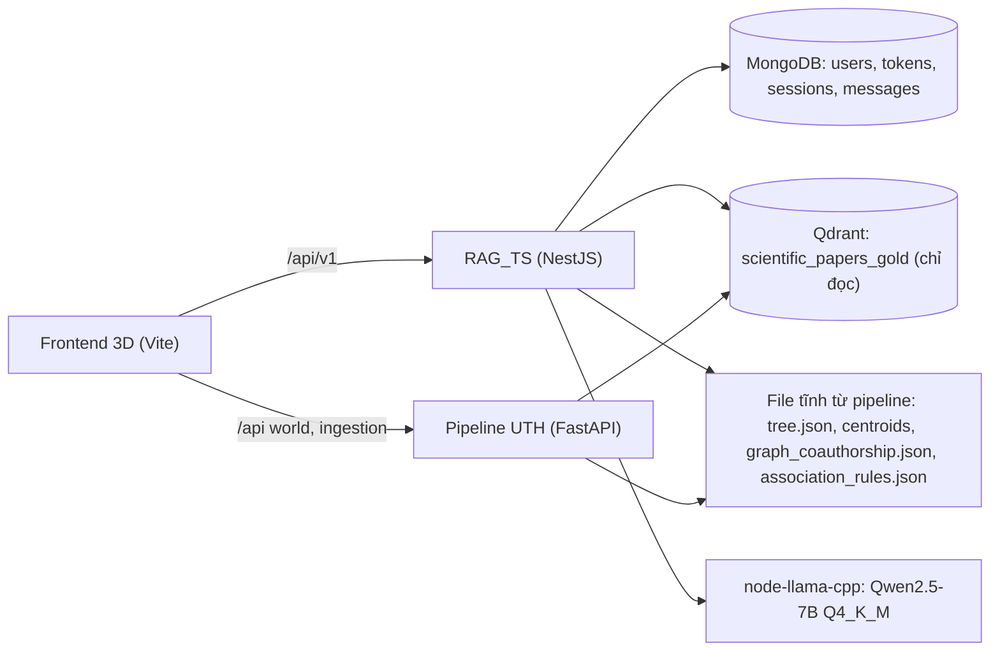
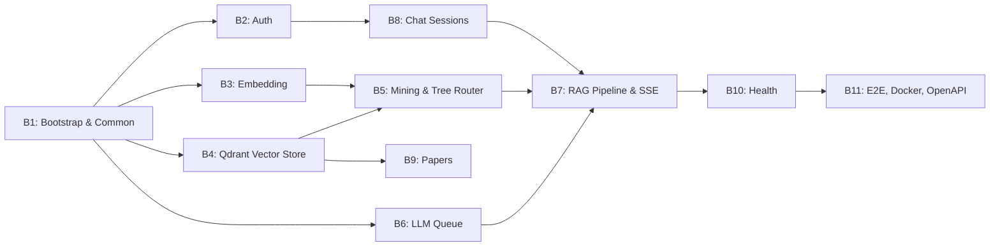

# Kế hoạch & Danh mục Prompt Phát triển Backend RAG_TS (Monolith NestJS)

Tài liệu này theo đúng nguyên tắc và cấu trúc của `docs/lesson_2.md`, `prompt.md` và `prompt_fe_3d.md`:
- **Phân rã chức năng (Decomposition)**: Mỗi tính năng là 1 module NestJS (`controller` + `service`), đơn nhiệm.
- **Quy trình chuẩn**: `Yêu cầu ➔ Đặc tả (Input/Output/Edge case) ➔ Pseudocode (Hợp đồng) ➔ Prompt có cấu trúc ➔ Kiểm chứng (Test, Verification)`.
- **Cấu trúc Prompt chuẩn**:
  - **Ngữ cảnh**: Công nghệ, môi trường runtime.
  - **Nhiệm vụ**: Tên module, class, hàm cần triển khai.
  - **Ràng buộc**: Type, xử lý lỗi, validation, quy tắc dữ liệu không suy diễn bừa bãi.
  - **Ví dụ / Pseudocode**: Minh họa luồng thực thi.
  - **Output mong muốn**: Code sạch + unit test + danh sách giả định.

**Nguồn chân lý:** `API_DESIGN.md` (hợp đồng API) và `prompt_fe_3d.md` Mục 3 (hợp đồng dữ liệu FE). Khi hai tài liệu khác nhau, theo bảng **Phụ lục A — Đồng bộ với FE 3D** ở cuối file này.

---

## 🤖 Hướng dẫn dành cho AI thực thi file này

1. **Làm tuần tự từ PROMPT B1 đến B11.** Không nhảy bước.
2. **Sau mỗi prompt, chạy toàn bộ mục "Kiểm chứng".** Chỉ sang prompt tiếp theo khi đạt.
3. **Mọi giả định** ghi vào `ASSUMPTIONS.md` dạng `[B<số>] <giả định> — <lý do>`. Không bịa route, field, status code ngoài `API_DESIGN.md` và Phụ lục A.
4. **Cập nhật `PROGRESS.md`** sau mỗi prompt: module xong, test pass, vấn đề tồn tại.
5. **Không gọi dịch vụ thật trong unit test.** Mongo dùng `mongodb-memory-server`; Qdrant, model embedding và LLM được mock qua interface. Test tích hợp với Qdrant/Mongo thật chỉ ở B11 (docker compose).
6. **Không dùng `any`.** Mọi DTO có decorator `class-validator`. Mọi lỗi trả về đúng định dạng §1.2 của `API_DESIGN.md`.
7. **Không log** password, token, nội dung câu hỏi (chỉ `query_len`).
8. **RAG_TS chỉ ĐỌC Qdrant.** Không ghi, không tạo collection. Cào dữ liệu và dựng World 3D thuộc pipeline UTH.

---

## 1. Kiến trúc tổng thể



**Luồng hỏi đáp và mapping sang animation FE (`visualPhase`):**

| Bước backend | Event SSE | Giai đoạn FE |
| :--- | :--- | :--- |
| Embed câu hỏi (prefix `search_query:`) | `phase: embedding` | Quả cầu vector hình thành |
| So vector câu hỏi với centroid cành/nhánh, chọn `nprobe` | `phase: flying` + `route` | Quả cầu bay theo cành |
| Tìm kiếm Qdrant, gom theo bài báo | `phase: comparing` + `compare` | Quả cầu so với các vector ứng viên |
| Rerank (authority) + chọn top_k chunk | `phase: found` + `retrieval` | Top-k sáng, camera phóng vào vector tốt nhất |
| LLM sinh câu trả lời | `phase: generating` + `token`… | Hạt sáng chảy, chữ hiện dần |
| Trích citation, lưu message | `done` | Giữ tĩnh, citation được kiểm tra |

**Cấu trúc thư mục đích:**
```
src/
  main.ts, app.module.ts
  config/            (env schema, config service)
  common/            (request-id, logger, exception filter, guards, decorators, pagination, sse)
  types/             (scientific-rag.ts: type dùng chung, khớp FE)
  auth/              (B2)
  embedding/         (B3)
  vector-store/      (B4)
  mining/            (B5: authority, query expansion)
  tree-router/       (B5: route theo centroid)
  llm/               (B6)
  rag/               (B7)
  chat-sessions/     (B8)
  papers/            (B9)
  health/            (B10)
test/                (e2e)
```

---

## 🗺️ Bản đồ Chức năng (Feature Breakdown)



| Prompt | Module | API |
| :-- | :-- | :-- |
| B1 | Config, request-id, logger, exception filter, validation, pagination, types | — |
| B2 | `AuthModule` | 7 route `/auth/*` |
| B3 | `EmbeddingModule` | — |
| B4 | `VectorStoreModule` (Qdrant) | — |
| B5 | `MiningModule`, `TreeRouterModule` | — |
| B6 | `LlmModule` (hàng đợi, timeout, hủy) | — |
| B7 | `RagModule` | `POST /rag/chat`, `POST /rag/chat/stream` |
| B8 | `ChatSessionsModule` | 5 route `/chat-sessions/*` |
| B9 | `PapersModule` | `GET /papers/:paper_id` |
| B10 | `HealthModule` | 3 route `/health*` |
| B11 | E2E, docker compose, OpenAPI, README | — |

---

## 📝 PROMPT B1: Bootstrap & Hạ tầng dùng chung

### B1.1 Đặc tả (Specification)
- **Input**: Biến môi trường.
- **Output**: App NestJS chạy được với prefix `/api/v1`, các thành phần dùng chung cho mọi module.
- **Ràng buộc**:
  - Validate env lúc khởi động; thiếu biến bắt buộc ➔ app dừng với thông báo rõ.
  - Mọi request có `request_id` (UUID v7): lấy từ header `X-Request-Id` nếu hợp lệ, không có thì sinh mới; trả lại trong header và body lỗi.
  - Log JSON một dòng mỗi request theo §1.3 `API_DESIGN.md`: `info` 2xx, `warn` 4xx, `error` 5xx kèm `stack`.
  - Mọi lỗi (kể cả lỗi validate, lỗi không lường trước) ➔ body đúng §1.2.
  - Lỗi validate ➔ 400 với `message` dạng `query should not be empty` (câu đầu tiên của lỗi class-validator).
  - Phân trang cursor theo §1.4: cursor mờ (opaque), `limit` 1–50.

### B1.2 Pseudocode (Hợp đồng xử lý)
```
ENV_SCHEMA:
    PORT=3000, NODE_ENV, MONGO_URI (bắt buộc), QDRANT_URL (bắt buộc), QDRANT_API_KEY?,
    QDRANT_COLLECTION=scientific_papers_gold,
    JWT_ACCESS_SECRET (bắt buộc, ≥ 32 ký tự), JWT_REFRESH_SECRET (bắt buộc, ≥ 32 ký tự),
    EMBEDDING_MODEL=nomic-ai/nomic-embed-text-v1.5,
    MODEL_PATH (bắt buộc), LLM_GPU=auto, LLM_MAX_QUEUE=8, LLM_TIMEOUT_MS=60000,
    WORLD_DATA_DIR (bắt buộc): chứa tree.json, centroids_l1.json, centroids_l2.json, categories.json,
    MINING_DIR (bắt buộc): chứa graph_coauthorship.json, association_rules.json,
    CORS_ORIGINS=http://localhost:5173

function encodeCursor(obj): base64url(JSON.stringify(obj))
function decodeCursor(str):
    try: obj = JSON.parse(base64urlDecode(str)); validate shape; return obj
    catch: throw BadRequest("invalid cursor")

ExceptionFilter.catch(err, req):
    status = err is HttpException ? err.status : 500
    message = status == 500 ? "internal server error" : message của err
    body = { statusCode: status, error: reasonPhrase(status), message, request_id: req.id }
    log theo mức status
    send(status, body)
```

### B1.3 Prompt gửi AI
```markdown
### Ngữ cảnh:
Node.js 22, NestJS 11, TypeScript 5.7 strict. Thư viện: @nestjs/config + zod (validate env), nestjs-pino + pino, class-validator, class-transformer, uuid (v7), @nestjs/swagger. Hợp đồng chung ở `API_DESIGN.md` §1.

### Nhiệm vụ:
1. Khởi tạo dự án `rag-ts`, global prefix `/api/v1`, CORS theo `CORS_ORIGINS`.
2. `src/config/env.schema.ts` + `src/config/app-config.service.ts`: validate env theo pseudocode, export config có kiểu.
3. `src/common/request-id.middleware.ts`, `src/common/logger.module.ts` (nestjs-pino, log 1 dòng/request đúng §1.3, redact authorization, password, refresh_token, query).
4. `src/common/http-exception.filter.ts`: body lỗi đúng §1.2 cho MỌI loại lỗi.
5. Global `ValidationPipe` (whitelist, forbidNonWhitelisted, transform) với `exceptionFactory` trả 400 và message là lỗi đầu tiên.
6. `src/common/pagination.ts`: `encodeCursor`, `decodeCursor`, `PaginationQueryDto` (limit 1–50, mặc định 20, cursor optional).
7. `src/types/scientific-rag.ts`: GroundedChunk, Timings, RouteStep, RouteCandidate, CompareCandidate, RagPhase, RagStreamEvent, PaperDetail, Chunk, SectionType — tên field snake_case, khớp `API_DESIGN.md` §3, §5 và `prompt_fe_3d.md` Mục 3.8.
8. Tạo `.env.example`, `ASSUMPTIONS.md`, `PROGRESS.md`.

### Ràng buộc:
1. Thiếu env bắt buộc ➔ process thoát với mã ≠ 0 và liệt kê đủ các biến lỗi.
2. `X-Request-Id` từ client chỉ nhận nếu là UUID hợp lệ, ngược lại sinh mới.
3. Lỗi 500 không lộ stack ra body.
4. `RagPhase` = "embedding" | "flying" | "comparing" | "found" | "generating".

### Ví dụ:
- POST body thiếu `query` ➔ 400 `{ "statusCode": 400, "error": "Bad Request", "message": "query should not be empty", "request_id": "0199..." }`.
- decodeCursor("abc!!") ➔ 400 `invalid cursor`.

### Output mong muốn:
Mã nguồn các file trên; unit test cho env schema (thiếu biến, secret quá ngắn), exception filter (HttpException, lỗi thường ➔ 500), pagination (encode/decode vòng tròn, cursor hỏng); cập nhật ASSUMPTIONS.md.
```

### B1.4 Quy trình kiểm chứng
- [ ] `npm run start:dev` chạy; gọi route không tồn tại ➔ 404 đúng body §1.2, có header `X-Request-Id`.
- [ ] Log mỗi request đúng 1 dòng JSON, không chứa header Authorization.
- [ ] `npx tsc --noEmit` 0 lỗi, `npm test` pass.

---

## 📝 PROMPT B2: Xác thực & Tài khoản (`AuthController`)

### B2.1 Đặc tả (Specification)
- **Input/Output**: 7 route theo `API_DESIGN.md` §2.
- **Ràng buộc**:
  - Password ≥ 8 ký tự, băm bằng argon2id. Email chuẩn hóa (trim, lowercase).
  - Access token JWT 15 phút (`sub`, `roles`). Refresh token là chuỗi ngẫu nhiên 32 byte (không phải JWT), chỉ lưu `token_hash` (SHA-256) trong Mongo, hạn 7 ngày, có `family_id`.
  - **Xoay vòng refresh:** mỗi lần refresh thu hồi token cũ, cấp token mới cùng `family_id`.
  - **Phát hiện dùng lại:** refresh bằng token đã thu hồi ➔ thu hồi TẤT CẢ token cùng `family_id`, trả 401, log `REFRESH_REUSED`.
  - Đổi mật khẩu ➔ thu hồi mọi refresh token của user.
  - Đăng nhập sai: giới hạn 5 lần / 15 phút theo cặp (email, IP) ➔ 429 `too many login attempts`. Log `LOGIN_FAILED` kèm `email_hash`, không kèm email.
  - Guards: `JwtAuthGuard` (bắt buộc), `OptionalJwtAuthGuard` (có token hợp lệ thì gắn user, token sai ➔ 401, không có token ➔ cho qua), `RolesGuard` (+ decorator `@Roles('admin')` ➔ 403 `admin role required`).
  - Token hết hạn ➔ 401 `token expired`; token sai ➔ 401 `unauthorized`.

### B2.2 Pseudocode (Hợp đồng xử lý)
```
register(dto):
    email = normalize(dto.email); if exists(email): throw 409 "email already exists"
    user = insert({ email, password_hash: argon2id(dto.password), display_name, roles: ["user"] })
    return issueTokens(user, newFamilyId())

login(email, password, ip):
    if attempts(email, ip) >= 5 trong 15 phút: throw 429 "too many login attempts"
    user = find(normalize(email))
    if !user or !argon2.verify(user.password_hash, password):
        recordFailure(email, ip); log LOGIN_FAILED; throw 401 "invalid credentials"
    clearFailures(email, ip); return issueTokens(user, newFamilyId())

refresh(raw):
    rec = findByHash(sha256(raw))
    if !rec or rec.expires_at < now: throw 401 "refresh token invalid or expired"
    if rec.revoked_at: revokeFamily(rec.family_id); log REFRESH_REUSED; throw 401 "refresh token invalid or expired"
    revoke(rec)   // dùng findOneAndUpdate có điều kiện revoked_at = null để chống 2 request đồng thời
    return issueTokens(user(rec.user_id), rec.family_id)
```

### B2.3 Prompt gửi AI
```markdown
### Ngữ cảnh:
NestJS 11, TypeScript 5.7, @nestjs/mongoose + MongoDB, @nestjs/jwt, argon2, @nestjs/throttler (hoặc bộ đếm Mongo có TTL). Hợp đồng ở `API_DESIGN.md` §2, collection ở §7.

### Nhiệm vụ:
Tạo `src/auth/`: schemas `user.schema.ts`, `refresh-token.schema.ts`, `login-attempt.schema.ts` (TTL 15 phút); DTOs (RegisterDto, LoginDto, RefreshDto, UpdateProfileDto, ChangePasswordDto); `auth.service.ts`, `token.service.ts`, `auth.controller.ts`; guards `jwt-auth.guard.ts`, `optional-jwt-auth.guard.ts`, `roles.guard.ts`; decorators `@CurrentUser()`, `@Roles()`.

### Ràng buộc:
1. Đúng đặc tả B2.1 và pseudocode; status code và message đúng từng chữ như `API_DESIGN.md` §2.
2. Index: `users.email` unique; `refresh_tokens.token_hash` unique; TTL theo `expires_at`.
3. Thu hồi token dùng thao tác nguyên tử, 2 request refresh đồng thời chỉ 1 thành công.
4. Log nghiệp vụ: REGISTER_OK, REGISTER_EMAIL_TAKEN, LOGIN_OK, LOGIN_FAILED, REFRESH_OK, REFRESH_REUSED, LOGOUT_OK, PROFILE_UPDATED, PASSWORD_CHANGED.
5. Response `User` không bao giờ chứa password_hash.

### Output mong muốn:
1. Các file trên.
2. Unit/integration test (mongodb-memory-server): đăng ký trùng email 409; đăng nhập sai 5 lần thì lần 6 bị 429; refresh xoay vòng; dùng lại token cũ ➔ cả họ bị thu hồi; đổi mật khẩu thu hồi mọi refresh; token hết hạn ➔ 401 "token expired"; OptionalJwtAuthGuard 3 trường hợp; RolesGuard 403.
3. Cập nhật ASSUMPTIONS.md.
```

### B2.4 Quy trình kiểm chứng
- [ ] `npm test -- auth` pass.
- [ ] Kiểm tra trong Mongo: không có token thô, chỉ có `token_hash`.

---

## 📝 PROMPT B3: Embedding Service (Nomic v1.5)

### B3.1 Đặc tả (Specification)
- **Input**: `query: string`.
- **Output**: `number[]` 768 chiều, chuẩn hóa L2.
- **Ràng buộc**:
  - Bắt buộc prefix `search_query: ` (tài liệu trong Qdrant được pipeline embed với `search_document: `).
  - Model load một lần (`onModuleInit`); trạng thái `ready` dùng cho health.
  - Query rỗng ➔ 400. Lỗi model ➔ 503 `embedding unavailable`.
  - Câu hỏi giống hệt trong 10 phút dùng lại vector (LRU cache 500 mục) để tiết kiệm thời gian.

### B3.2 Prompt gửi AI
```markdown
### Ngữ cảnh:
NestJS 11, TypeScript 5.7, `@huggingface/transformers` (bản kế nhiệm của @xenova/transformers), model `nomic-ai/nomic-embed-text-v1.5` (768 chiều). Kiểm tra tên model ONNX thực tế khả dụng và ghi vào ASSUMPTIONS.md.

### Nhiệm vụ:
Tạo `src/embedding/embedding.service.ts` với interface `EmbeddingPort { embedQuery(q: string): Promise<number[]>; isReady(): boolean }` để module khác mock được.

### Ràng buộc:
1. Prefix `search_query: ` + trim; pooling mean; normalize true; assert đúng 768 phần tử.
2. LRU cache theo chuỗi đã chuẩn hóa, TTL 10 phút, tối đa 500 mục.
3. Đo thời gian ➔ trả kèm `embed_ms` cho RAG.

### Ví dụ:
Input "transformer self attention" ➔ mảng 768 số, tổng bình phương ≈ 1.0.

### Output mong muốn:
Service + test với pipeline giả: prefix được áp dụng; query rỗng ném 400; vector sai số chiều ném lỗi; cache hit không gọi lại pipeline.
```

### B3.3 Quy trình kiểm chứng
- [ ] Test pass; chạy thật một câu, độ dài 768, norm ≈ 1.

---

## 📝 PROMPT B4: Qdrant Vector Store (chỉ đọc)

### B4.1 Đặc tả (Specification)
- **Input**: vector 768, `limit`, `category?`, `twig_ids?`; hoặc `paper_id` khi dựng PaperDetail.
- **Output**: danh sách chunk kèm `score` (cosine similarity, 0–1); hoặc toàn bộ chunk của một bài.
- **Ràng buộc**:
  - Collection `QDRANT_COLLECTION`, metric cosine, payload theo `API_DESIGN.md` §7.
  - Lọc bằng **filter Qdrant có cấu trúc** (`must: [{ key: "primary_category", match: { value } }]`), không ghép chuỗi ➔ không có injection. `category` phải khớp regex `^[a-z\-]+(\.[A-Za-z\-]+)?$`, sai ➔ 400 `validation error`.
  - Nếu payload có `twig_id` (pipeline bổ sung, xem Phụ lục B) thì hỗ trợ lọc `twig_ids` để "comparing" đúng các nhánh đã chọn; không có thì bỏ qua lọc này và ghi cảnh báo một lần lúc khởi động.
  - `with_vector: false` (không kéo vector về).
  - `scrollByPaper(paper_id)`: lấy hết chunk của bài, giới hạn 500 chunk.
  - Qdrant không phản hồi trong 3 giây hoặc lỗi kết nối ➔ 503 `qdrant unavailable`.

### B4.2 Prompt gửi AI
```markdown
### Ngữ cảnh:
NestJS 11, TypeScript 5.7, `@qdrant/js-client-rest`. Collection do pipeline UTH tạo và ghi; RAG_TS chỉ đọc.

### Nhiệm vụ:
Tạo `src/vector-store/vector-store.service.ts` với interface `VectorStorePort`:
- `search(vector, { limit, category?, twigIds? }): Promise<ScoredChunk[]>`
- `scrollByPaper(paperId): Promise<ChunkPayload[]>`
- `hasPayloadField(field): Promise<boolean>` (kiểm tra payload index, cache kết quả)
- `ping(): Promise<boolean>`

### Ràng buộc:
1. Đúng đặc tả B4.1; không có hàm ghi nào.
2. `onModuleInit`: kiểm tra collection tồn tại và kích thước vector = 768; sai ➔ log error rõ ràng nhưng không làm crash app (health sẽ báo).
3. Map payload ➔ type có kiểu chặt chẽ; chunk thiếu field bắt buộc ➔ bỏ qua và log warn kèm chunk_id.

### Output mong muốn:
Service + test với client giả: filter category đúng cấu trúc; category sai regex ➔ 400; có/không có twig_id; timeout ➔ 503; with_vector luôn false.
```

### B4.3 Quy trình kiểm chứng
- [ ] Test pass. Chạy với Qdrant thật: search một vector bất kỳ trả về chunk đủ field.

---

## 📝 PROMPT B5: Mining Service & Tree Router

### B5.1 Đặc tả (Specification)
- **MiningService** (giữ logic từ `prompt.md` cũ, sửa các lỗi đã biết):
  - Đọc `graph_coauthorship.json` (PageRank tác giả) và `association_rules.json` (FP-Growth) từ `MINING_DIR`. Thiếu file ➔ warn, authority = 0, không mở rộng query; không crash.
  - `getAuthorityScore(authors)`: so khớp **chính xác** tên sau chuẩn hóa (lowercase, bỏ dấu, bỏ "et al.", bỏ ngoặc, gộp khoảng trắng). KHÔNG so chuỗi con. Kết quả `min(1, maxPR / globalMaxPR)`.
  - `expandQueryTerms(query)`: tách token theo ranh giới từ; antecedent khớp nguyên từ/cụm từ (không khớp "lora" trong "exploration"); trả consequents không trùng, tối đa 5 từ.
  - `rerank(chunks, useAuthority)`: `final = 0.85·sim + 0.15·authority` (nếu tắt authority thì `final = sim`), làm tròn 4 chữ số, sắp giảm dần, gán `citation_tag = "[Paper: <paper_id>]"`.
- **TreeRouterService** (để FE vẽ quả cầu bay theo cành):
  - Đọc `tree.json`, `centroids_l1.json`, `centroids_l2.json`, `categories.json` từ `WORLD_DATA_DIR` (pipeline sinh, cùng nguồn với dữ liệu World 3D của FE nên `node_id` khớp nhau).
  - `route(vector, nprobe)`: tầng 1 tính cosine với mọi centroid cành, chọn `nprobe` cao nhất; tầng 2 tính cosine với centroid các nhánh con của các cành đã chọn, chọn `nprobe` cao nhất. Trả `RouteStep[]` đúng `API_DESIGN.md` §3.1 và `route_ms`.
  - Centroid chuẩn hóa L2 lúc nạp ➔ cosine = dot product. Lưu thành `Float32Array` liền khối.
  - Thiếu file world ➔ `route` trả `[]`, event `route` vẫn gửi với `steps: []`, ghi warn; FE tự bỏ qua bước bay.
  - `categoryIndex(code)`: tra từ `categories.json`, không có ➔ chỉ số nhóm "other".

### B5.2 Pseudocode (Hợp đồng xử lý)
```
route(q, nprobe):
    s1 = for each branch b: dot(q, C1[b])
    chosen1 = topN(s1, nprobe)
    candidates2 = children(chosen1)
    s2 = for each twig t in candidates2: dot(q, C2[t])
    chosen2 = topN(s2, nprobe)
    return [
      { depth: 1, candidates: all branches with round4(score), chosen: chosen1 },
      { depth: 2, candidates: candidates2 with round4(score), chosen: chosen2 }
    ]
```

### B5.3 Prompt gửi AI
```markdown
### Ngữ cảnh:
NestJS 11, TypeScript 5.7. File mining ở `MINING_DIR`, file world ở `WORLD_DATA_DIR` (do pipeline UTH xuất, định dạng ở Phụ lục B).

### Nhiệm vụ:
Tạo `src/mining/mining.service.ts`, `src/mining/name-normalizer.ts`, `src/tree-router/tree-router.service.ts`.

### Ràng buộc:
1. Đúng đặc tả B5.1 và pseudocode B5.2.
2. Nạp file bất đồng bộ lúc khởi động; lỗi file ➔ warn + fallback an toàn.
3. route: `nprobe` ngoài 1–6 ➔ kẹp về biên; điểm làm tròn 4 chữ số; candidates tầng 1 gồm MỌI cành (FE hiện điểm trên mọi cành ứng viên).
4. Hàm thuần tách riêng để test dễ.

### Ví dụ:
- "lora fine-tuning" với luật {lora} ➔ {peft, llm} ➔ ["peft", "llm"]; "exploration strategy" ➔ [].
- Tác giả "Li" không khớp influencer "William Li".

### Output mong muốn:
Các file trên + test: authority tác giả có/không có; chuẩn hóa tên có dấu; expand theo ranh giới từ; rerank đúng thứ tự và làm tròn; route chọn đúng nprobe ở cả 2 tầng; thiếu file world ➔ [].
```

### B5.4 Quy trình kiểm chứng
- [ ] Test pass; với dữ liệu thật, `node_id` trong route tồn tại trong `tree.json` mà FE đang dùng.

---

## 📝 PROMPT B6: LLM Service (Hàng đợi, Timeout, Hủy)

### B6.1 Đặc tả (Specification)
- **Input**: system prompt, user prompt, `AbortSignal`.
- **Output**: async iterator các token (cho stream) hoặc chuỗi đầy đủ (cho `/rag/chat`).
- **Ràng buộc**:
  - Model GGUF tại `MODEL_PATH`, load một lần bằng `node-llama-cpp` (`getLlama({ gpu: LLM_GPU })` ➔ tự chọn CUDA/Metal/CPU), ghi `model_id` và `gpu` thực tế cho health.
  - **Hàng đợi:** chạy tối đa 1 lượt sinh cùng lúc (cấu hình được); hàng chờ tối đa `LLM_MAX_QUEUE`; đầy ➔ 429 `llm queue is full`.
  - **Timeout:** quá `LLM_TIMEOUT_MS` tính từ lúc bắt đầu sinh ➔ dừng sinh, 504 `llm timeout` (hoặc event error khi đang stream).
  - **Hủy:** client đóng kết nối ➔ signal abort ➔ dừng sinh ngay, giải phóng chỗ trong hàng đợi, không lưu message.
  - temperature 0.2, max tokens 1024; mỗi lượt dùng context/sequence riêng, dọn sạch sau khi xong.
  - Model chưa load được ➔ 503 `llm unavailable`.

### B6.2 Prompt gửi AI
```markdown
### Ngữ cảnh:
NestJS 11, TypeScript 5.7, `node-llama-cpp` (bản mới nhất), model `qwen2.5-7b-instruct-q4_k_m.gguf`. Chạy được trên máy có CUDA (server) và Apple Silicon (Metal, máy dev).

### Nhiệm vụ:
Tạo `src/llm/llm.service.ts` với interface `LlmPort { generate(sys, user, signal): AsyncIterable<string>; status(): { ready: boolean; model_id: string; gpu: string; queue_length: number } }` và `src/llm/llm-queue.ts` (hàng đợi thuần, không phụ thuộc node-llama-cpp).

### Ràng buộc:
1. Đúng đặc tả B6.1.
2. `llm-queue.ts` là logic thuần: acquire/release, giới hạn concurrency và độ dài hàng chờ, hủy khi đang chờ thì rời hàng ngay.
3. Lỗi trong lúc sinh luôn giải phóng slot (try/finally).

### Output mong muốn:
Service + test với model giả: hàng đầy ➔ 429; timeout ➔ 504; abort giữa chừng dừng iterator và giải phóng slot; 2 request tuần tự không chồng nhau; status trả queue_length đúng.
```

### B6.3 Quy trình kiểm chứng
- [ ] Test pass; chạy thật: gửi 10 request cùng lúc với LLM_MAX_QUEUE=8 ➔ có request nhận 429, server không treo.

---

## 📝 PROMPT B7: RAG Pipeline & SSE (`RagController`)

### B7.1 Đặc tả (Specification)
- **Input**: `ChatReq` theo `API_DESIGN.md` §3 **+ trường `nprobe`** (1–6, mặc định 2 — Phụ lục A), user (nếu có JWT).
- **Output**: `POST /rag/chat` ➔ `ChatRes`; `POST /rag/chat/stream` ➔ SSE đúng §3.1.
- **Ràng buộc**:
  - Thứ tự xử lý và event đúng bảng ở Mục 1. Gửi `phase` mỗi lần đổi giai đoạn.
  - `comparing`: Qdrant search `limit = max(40, top_k * 8)` (lọc twig nếu có), **gom theo paper_id** lấy điểm cao nhất mỗi bài ➔ event `compare` gồm tối đa 30 bài, score giảm dần, làm tròn 4 chữ số.
  - `found`: rerank chunk, lấy `top_k` chunk ➔ event `retrieval` (grounded_chunks + expanded_terms).
  - Mở rộng query (nếu `expand_query`): ghép từ mở rộng vào cuối câu trước khi embed; trả `expanded_terms`.
  - Không có chunk nào ➔ không gọi LLM; trả câu cố định "The provided literature does not contain sufficient details regarding this question." với citations rỗng.
  - **System prompt grounding** (giữ quy tắc `prompt.md` cũ): chỉ dựa vào ngữ cảnh; thiếu thì nói rõ; mọi khẳng định kỹ thuật có `[Paper: <paper_id>]`; giữ LaTeX.
  - **Trích citation:** regex `\[Paper:\s*([^\]]+)\]`, tách theo dấu phẩy, trim, bỏ trùng, giữ thứ tự xuất hiện. Không lọc bỏ citation ngoài ngữ cảnh (FE tự đánh dấu "unverified"), nhưng log số lượng `unverified_citations`.
  - `timings`: embed_ms, route_ms, search_ms, rerank_ms, llm_ms, total_ms, đo từ lúc nhận request.
  - **Phiên chat:** có JWT ➔ dùng `session_id` (kiểm tra quyền, không phải của mình ➔ 404 `session not found`) hoặc tạo phiên mới (title = 60 ký tự đầu câu hỏi); sau khi xong, lưu message user + assistant (kèm citations, grounded_chunks, timings) trong một lần ghi. Không có JWT ➔ `session_id: null`, không lưu.
  - **Stream:** header theo §3.1; `: ping` mỗi 15 giây; lỗi trước khi bắt đầu stream ➔ trả HTTP status như `/rag/chat`; lỗi giữa stream ➔ event `error` thay cho `done` rồi đóng; client đóng ➔ hủy LLM, KHÔNG lưu message, log `CHAT_STREAM_ABORTED`.
  - Log `CHAT_OK` / `CHAT_STREAM_OK` kèm `query_len`, `top_k`, `chunks`, `timings`; `CHAT_FAILED` kèm mã lỗi. Không log nội dung câu hỏi.

### B7.2 Pseudocode (Hợp đồng xử lý)
```
async function* runPipeline(req, user, signal):
    t0 = now()
    session = user ? resolveSession(req.session_id, user) : null       // 404 nếu không phải của user
    yield phase("embedding")
    text = req.query; expanded = req.expand_query ? mining.expandQueryTerms(text) : []
    q = embedding.embedQuery(expanded.length ? text + " " + expanded.join(" ") : text)
    yield phase("flying")
    { steps, route_ms } = treeRouter.route(q, req.nprobe)
    yield { type: "route", steps }
    yield phase("comparing")
    twigs = steps[depth=2]?.chosen
    hits = vectorStore.search(q, { limit: max(40, top_k*8), category: req.category, twigIds: twigs })
    yield { type: "compare", candidates: topPapers(hits, 30) }
    yield phase("found")
    grounded = mining.rerank(hits, req.use_authority_boost).slice(0, req.top_k)
    yield { type: "retrieval", grounded_chunks: grounded, expanded_terms: expanded }
    yield phase("generating")
    if grounded is empty: answer = NO_CONTEXT_ANSWER; yield token(answer)
    else: for token in llm.generate(SYSTEM_PROMPT, buildUserPrompt(grounded, text), signal): answer += token; yield token(token)
    citations = extractCitations(answer)
    ids = session ? saveMessages(session, text, answer, citations, grounded, timings) : null
    yield { type: "done", citations, timings, session_id: ids?.session_id ?? null, message_id: ids?.message_id ?? null }

POST /rag/chat: chạy runPipeline, gom token thành answer, trả ChatRes (không gửi phase/route/compare).
POST /rag/chat/stream: ghi từng event ra SSE dạng `data: <json>\n\n`.
```

### B7.3 Prompt gửi AI
```markdown
### Ngữ cảnh:
NestJS 11, TypeScript 5.7. Đã có EmbeddingPort (B3), VectorStorePort (B4), MiningService + TreeRouterService (B5), LlmPort (B6), ChatSessionsService (B8 — nếu chưa có thì tạo interface `SessionStorePort` và mock, hoàn thiện ở B8). Hợp đồng ở `API_DESIGN.md` §3 và Phụ lục A.

### Nhiệm vụ:
Tạo `src/rag/dto/chat-request.dto.ts`, `src/rag/rag.service.ts` (`runPipeline` dạng async generator), `src/rag/prompt-builder.ts` (SYSTEM_PROMPT, buildUserPrompt), `src/rag/citations.ts` (extractCitations), `src/rag/sse.ts` (ghi SSE, ping, phát hiện client đóng), `src/rag/rag.controller.ts`.

### Ràng buộc:
1. Đúng đặc tả B7.1 và pseudocode B7.2; tên event và field khớp `API_DESIGN.md` §3.1.
2. ChatRequestDto: query 1–2000 ký tự (trim), top_k 1–20 (mặc định 5), nprobe 1–6 (mặc định 2), category theo regex B4, use_authority_boost (mặc định true), expand_query (mặc định false), session_id optional (ObjectId hợp lệ).
3. Endpoint stream dùng `@Res()` ghi thẳng response (không dùng `@Sse()` vì cần POST); flush header ngay; tắt nén cho route này.
4. Lắng nghe `req.on('close')` ➔ AbortController ➔ truyền signal xuống LLM.
5. `buildUserPrompt` liệt kê ngữ cảnh dạng `--- [Paper ID: ... | Title: "..." | Section: ...] ---` rồi tới câu hỏi.

### Ví dụ:
- Câu trả lời "... [Paper: 2106.09685, 2305.14314] ... [Paper: 2106.09685]" ➔ citations ["2106.09685", "2305.14314"].
- Stream bình thường: phase(embedding) ➔ phase(flying) ➔ route ➔ phase(comparing) ➔ compare ➔ phase(found) ➔ retrieval ➔ phase(generating) ➔ token… ➔ done.

### Output mong muốn:
1. Các file trên.
2. Test với port giả: thứ tự event đúng; compare gom theo paper và ≤ 30; không có chunk thì không gọi LLM; citations tách dấu phẩy và bỏ trùng; lỗi LLM giữa stream ➔ event error, không có done, không lưu; client đóng ➔ LLM nhận abort, không lưu; session của người khác ➔ 404; không JWT ➔ session_id null.
3. Cập nhật ASSUMPTIONS.md.
```

### B7.4 Quy trình kiểm chứng
- [ ] Test pass.
- [ ] `curl -N -X POST http://localhost:3000/api/v1/rag/chat/stream -H "Content-Type: application/json" -d '{"query":"How does LoRA work?"}'` thấy event chạy đúng thứ tự.
- [ ] Bật FE với `VITE_USE_MOCK=false`, `VITE_API_BASE=/api/v1`: animation chạy đủ giai đoạn với dữ liệu thật.

---

## 📝 PROMPT B8: Phiên chat (`ChatSessionController`)

### B8.1 Đặc tả (Specification)
- **Input/Output**: 5 route theo `API_DESIGN.md` §4.
- **Ràng buộc**:
  - Tất cả cần JWT; phiên không thuộc user ➔ **404** (không phải 403).
  - `GET` danh sách: sắp `updated_at` giảm dần, cursor = (`updated_at`, `_id`) để ổn định khi trùng thời gian; `q` tìm không phân biệt hoa thường theo tiêu đề (escape ký tự regex).
  - `PATCH` title trim 1–120 ký tự.
  - `DELETE` xóa phiên và mọi message; gọi lặp vẫn 204.
  - `appendExchange(session, userMsg, assistantMsg)` (dùng ở B7): ghi 2 message, tăng `message_count` 2, cập nhật `updated_at` — trong một transaction nếu Mongo hỗ trợ (replica set), không thì ghi message trước rồi cập nhật phiên.

### B8.2 Prompt gửi AI
```markdown
### Ngữ cảnh:
NestJS 11, TypeScript 5.7, @nestjs/mongoose. Collection `chat_sessions`, `chat_messages` theo `API_DESIGN.md` §7. Pagination ở `src/common/pagination.ts`.

### Nhiệm vụ:
Tạo `src/chat-sessions/` gồm schemas, DTOs, `chat-sessions.service.ts` (CRUD + `resolveForUser`, `createFromQuery`, `appendExchange`), `chat-sessions.controller.ts`; thay mock `SessionStorePort` ở B7 bằng service thật.

### Ràng buộc:
1. Đúng đặc tả B8.1 và `API_DESIGN.md` §4.
2. Index `user_id + updated_at` và `session_id + created_at`.
3. Log SESSION_CREATED, SESSION_RENAMED, SESSION_DELETED.
4. `GET /chat-sessions/:id` trả messages theo thời gian tăng dần, tối đa 200 message gần nhất.

### Output mong muốn:
Các file + test (mongodb-memory-server): phân trang qua 3 trang không trùng không sót; q có ký tự đặc biệt; phiên người khác ➔ 404; delete lặp ➔ 204; appendExchange tăng message_count đúng.
```

### B8.3 Quy trình kiểm chứng
- [ ] Test pass; hỏi 2 câu cùng session qua `/rag/chat` có JWT ➔ `message_count` = 4.

---

## 📝 PROMPT B9: Paper (`PaperController`)

### B9.1 Đặc tả (Specification)
- Theo `API_DESIGN.md` §5: dựng `PaperDetail` từ `scrollByPaper`; không lưu Mongo.
- `paper_id` đã URL-decode (hỗ trợ `.` và `:`), độ dài 1–200; không có chunk ➔ 404 `paper not found`.
- Thứ tự chunk: abstract trước, sau đó theo thứ tự xuất hiện (`chunk_index` nếu payload có, không thì theo `chunk_id`).
- `category_index` tra qua `TreeRouterService.categoryIndex` (cùng bảng `categories.json` với FE để màu khớp).
- Cache LRU 1.000 bài, 10 phút.

### B9.2 Prompt gửi AI
```markdown
### Ngữ cảnh:
NestJS 11, TypeScript 5.7, VectorStorePort (B4), TreeRouterService (B5).

### Nhiệm vụ:
Tạo `src/papers/papers.service.ts`, `src/papers/papers.controller.ts`.

### Ràng buộc:
1. Đúng đặc tả B9.1.
2. Route dùng tham số có thể chứa `:` — đảm bảo router NestJS không hiểu nhầm (dùng wildcard hoặc kiểm tra bằng test thật).
3. Qdrant lỗi ➔ 503 `qdrant unavailable`.

### Output mong muốn:
Service + controller + test: id có dấu chấm; id `openalex:W2594538354` (URL-encode); không có chunk ➔ 404; abstract đứng đầu; has_fulltext đúng; cache hit không gọi Qdrant.
```

### B9.3 Quy trình kiểm chứng
- [ ] `curl http://localhost:3000/api/v1/papers/openalex%3AW2594538354` trả đúng bài.

---

## 📝 PROMPT B10: Health (`HealthController`)

### B10.1 Đặc tả (Specification)
- 3 route theo `API_DESIGN.md` §6.
- `status`: `ok` khi mọi component sống; `degraded` khi chỉ LLM chết (vẫn xem paper được); `down` khi Mongo hoặc Qdrant chết.
- Kiểm tra component chạy định kỳ 10 giây (không gọi Qdrant/Mongo mỗi request health); đổi trạng thái ➔ log `HEALTH_CHANGED` (warn) kèm component, from, to.
- Thêm `world: boolean` trong `components` (file world đã nạp) — FE dùng để biết có vẽ route được không (Phụ lục A).

### B10.2 Prompt gửi AI
```markdown
### Ngữ cảnh:
NestJS 11, TypeScript 5.7, các port ở B3–B6, Mongo connection.

### Nhiệm vụ:
Tạo `src/health/health.service.ts` (bộ kiểm tra định kỳ, giữ trạng thái gần nhất) và `src/health/health.controller.ts`.

### Ràng buộc:
1. Đúng đặc tả B10.1; `/health` luôn 200; `/health/ready` 503 khi down.
2. `llm` gồm model_id, gpu, queue_length từ LlmPort.
3. `version` lấy từ package.json, `uptime_s` từ process.

### Output mong muốn:
Service + controller + test: 3 trạng thái ok/degraded/down; HEALTH_CHANGED chỉ log khi thật sự đổi.
```

### B10.3 Quy trình kiểm chứng
- [ ] Tắt Qdrant ➔ `/health/ready` 503, log HEALTH_CHANGED; bật lại ➔ 200.

---

## 📝 PROMPT B11: E2E, Docker Compose, OpenAPI & README

### B11.1 Đặc tả (Specification)
- `docker-compose.yml`: mongo (replica set 1 node để có transaction), qdrant, app; volume cho model và dữ liệu world/mining.
- Script `scripts/seed-qdrant.ts` CHỈ dùng cho môi trường test: tạo collection test nhỏ (200 chunk ngẫu nhiên 768 chiều, payload đúng §7) — không bao giờ chạy với collection thật.
- OpenAPI tại `/api/v1/docs`, có đủ DTO và mã lỗi.
- E2E (supertest) chạy với LLM giả.

### B11.2 Prompt gửi AI
```markdown
### Ngữ cảnh:
NestJS 11, TypeScript 5.7, supertest, Docker Compose. Toàn bộ module B1–B10 đã xong.

### Nhiệm vụ:
Tạo `docker-compose.yml`, `Dockerfile` (multi-stage), `scripts/seed-qdrant.ts`, `test/*.e2e-spec.ts`, cấu hình Swagger, `README.md`.

### Ràng buộc:
1. seed-qdrant từ chối chạy nếu tên collection không có hậu tố `_test`.
2. E2E bao phủ: đăng ký ➔ đăng nhập ➔ hỏi stream có JWT ➔ danh sách phiên có 1 phiên ➔ xem phiên có 2 message ➔ xem paper được trích dẫn ➔ refresh ➔ dùng lại refresh cũ bị 401 ➔ logout; hỏi không JWT ➔ session_id null; health ok.
3. README: cách chạy dev (máy Mac M-series dùng Metal), chạy bằng docker, biến môi trường, liên kết `API_DESIGN.md`, `prompt_fe_3d.md`, bảng đồng bộ Phụ lục A.

### Output mong muốn:
Các file trên; `docker compose up` chạy được; `npm run test:e2e` pass; cập nhật ASSUMPTIONS.md và PROGRESS.md lần cuối.
```

### B11.3 Quy trình kiểm chứng
- [ ] `docker compose up` ➔ `/api/v1/health` trả ok (hoặc degraded nếu không có model).
- [ ] `npm run test:e2e` pass.
- [ ] Mở `/api/v1/docs` thấy đủ 18 route.

---

## 📎 Phụ lục A: Đồng bộ với FE 3D (`prompt_fe_3d.md`)

| # | Điểm cần đồng bộ | FE đang làm | Quyết định |
| :-- | :-- | :-- | :-- |
| A1 | Base URL | `VITE_API_BASE=/api` | FE đổi thành `/api/v1`. Vite proxy `/api/v1` ➔ `http://localhost:3000` |
| A2 | Tham số `nprobe` | FE gửi `nprobe` (1–6) | Backend THÊM `nprobe` vào ChatReq (mặc định 2). Cập nhật `API_DESIGN.md` §3 |
| A3 | Event SSE | phase, route, compare, retrieval, token, done, error | Khớp `API_DESIGN.md` §3.1. `done` có thêm `session_id`, `message_id` — FE thêm 2 field optional vào type, không ảnh hưởng animation |
| A4 | Event `: ping` | Parser SSE bỏ qua dòng comment | Đã khớp |
| A5 | Health | FE chờ `{ lancedb, llm, world }` | Backend trả `components: { mongo, qdrant, llm, world }`. FE sửa `getHealth()` và HealthBanner đọc `components` |
| A6 | PaperDetail | FE chờ `category_index`, `chunks` | Khớp. Backend thêm `primary_category` (FE bỏ qua được) |
| A7 | `node_id` trong route | FE tra `nodesById` từ `tree.json` của World | Backend đọc CÙNG `tree.json` + centroid do pipeline xuất ➔ id khớp. Pipeline và RAG_TS phải dùng cùng một phiên bản file (ghi `world_version` trong `tree.json`, backend trả trong health) |
| A8 | `compare` thuộc nhánh đã chọn | Mock FE đảm bảo điều này | Thật: chỉ đảm bảo khi Qdrant có payload `twig_id` (Phụ lục B). Chưa có thì FE vẫn chạy (bỏ qua bài không tìm thấy, chỉ cảnh báo) |
| A9 | Endpoint World 3D | FE gọi `/world/*` | KHÔNG thuộc RAG_TS. FE thêm biến `VITE_PIPELINE_BASE` (pipeline UTH, prefix `/api`) cho `/world/*` |
| A10 | Luồng cào (P12, P14 FE) | FE chờ `crawl_status`, `crawl_batch`, `crawl_vectors` | KHÔNG thuộc RAG_TS. FE viết lớp map trong `crawlClient.ts` từ event pipeline (`SNAPSHOT` ➔ crawl_status, `PAPER_INGESTED` ➔ crawl_batch/crawl_vectors) |
| A11 | Đăng nhập | FE chưa có | Chat không JWT vẫn chạy (không lưu lịch sử). Thêm màn hình đăng nhập và danh sách phiên ở FE là việc tiếp theo, không chặn demo 3D |
| A12 | Tên giai đoạn | FE: embedding, flying, comparing, found, generating | Khớp `API_DESIGN.md` §3.1 |

## 📎 Phụ lục B: Yêu cầu gửi nhóm Pipeline UTH

| # | Hạng mục | Lý do |
| :-- | :-- | :-- |
| P1 | Xuất `tree.json`, `centroids_l1.json`, `centroids_l2.json`, `categories.json` (cùng phiên bản với `vectors.bin` của World 3D) vào thư mục dùng chung `WORLD_DATA_DIR`; `tree.json` có `world_version` | TreeRouter cần centroid để sinh event `route` khớp với cây FE vẽ |
| P2 | Thêm payload `twig_id` (integer, có payload index) cho mỗi chunk trong Qdrant | `compare` lọc đúng các nhánh quả cầu đã bay vào |
| P3 | Thêm payload `chunk_index` (thứ tự đoạn trong bài) | PaperDetail sắp chunk đúng thứ tự |
| P4 | Embed tài liệu bằng Nomic v1.5 với prefix `search_document:` | Đồng bộ với `search_query:` ở B3 |
| P5 | Xuất `graph_coauthorship.json`, `association_rules.json` vào `MINING_DIR` | MiningService |
| P6 | Cung cấp endpoint World 3D (`/api/world/*`) và tọa độ 3D theo `prompt_fe_3d.md` Mục 3 | Hiện pipeline chỉ có tọa độ 2D |

---

## 🎯 Bảng Checklist Quyết Định & Dò Vết (Theo Lesson 2)

| Bước | Tiêu chí kiểm chứng | Trạng thái | Quyết định |
| :--- | :--- | :---: | :---: |
| **B1** | Env validate, request_id, log JSON, body lỗi §1.2, pagination | [ ] | Chấp nhận / Sửa / Từ chối |
| **B2** | 7 route auth, xoay vòng refresh, phát hiện dùng lại, 429 đăng nhập | [ ] | Chấp nhận / Sửa / Từ chối |
| **B3** | Prefix `search_query:`, 768 chiều, cache | [ ] | Chấp nhận / Sửa / Từ chối |
| **B4** | Qdrant chỉ đọc, filter có cấu trúc, 503 khi lỗi | [ ] | Chấp nhận / Sửa / Từ chối |
| **B5** | Authority so khớp chính xác, expand theo ranh giới từ, route đúng nprobe | [ ] | Chấp nhận / Sửa / Từ chối |
| **B6** | Hàng đợi 429, timeout 504, hủy giải phóng slot | [ ] | Chấp nhận / Sửa / Từ chối |
| **B7** | Thứ tự event SSE đúng, citations đúng, lưu phiên, hủy không lưu | [ ] | Chấp nhận / Sửa / Từ chối |
| **B8** | CRUD phiên, cursor ổn định, 404 phiên người khác | [ ] | Chấp nhận / Sửa / Từ chối |
| **B9** | PaperDetail từ Qdrant, id có `:` và `.` | [ ] | Chấp nhận / Sửa / Từ chối |
| **B10** | ok / degraded / down, HEALTH_CHANGED | [ ] | Chấp nhận / Sửa / Từ chối |
| **B11** | Docker chạy, E2E pass, OpenAPI đủ route | [ ] | Chấp nhận / Sửa / Từ chối |