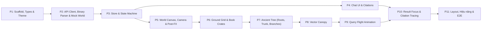

# prompt_fe_3d.md — Initial P1-P11 Frontend 3D Knowledge Tree Prompts (Archived)

- **Motivation/Background**: Step-by-step decomposition prompts (P1 through P11) and Appendices A & B used to bootstrap the 3D Vector Knowledge Tree frontend (`frontend_rag`) following the Lesson 2 methodology (`Requirement -> Spec -> Pseudocode -> Prompt -> Verification`).
- **Purpose**: Historical record of the initial P1-P11 frontend 3D world and chat implementation and its verification checklist. The UI token and glassmorphism rules in this file have been superseded by [`FE_DESIGN_SYSTEM.md`](FE_DESIGN_SYSTEM.md) and [`FE3d_prompt_v2.md`](FE3d_prompt_v2.md).
- **Overview Pipeline**: P1 Types/Theme -> P2 Binary/SSE/Mock -> P3 Zustand Store -> P4 Chat/Citations -> P5 World Canvas/PostFX -> P6 Ground/Crates -> P7 Ancient Tree -> P8 Vector Canopy -> P9 Query Flight -> P10 Result Card/Paper Panel -> P11 Layout/Perf/E2E.
- **Detailed Plan**: Preserves original P1-P11 prompt specifications, Appendices A & B, and the completed P1-P11 verification & decision traceability checklist.
- **References**: [../AGENTS.md](../AGENTS.md), [INDEX.md](INDEX.md), [../frontend_rag/AGENTS.md](../frontend_rag/AGENTS.md), [../frontend_rag/PROGRESS.md](../frontend_rag/PROGRESS.md), [FE_DESIGN_AUDIT.md](FE_DESIGN_AUDIT.md), [FE_DESIGN_SYSTEM.md](FE_DESIGN_SYSTEM.md), [FE3d_prompt_v2.md](FE3d_prompt_v2.md).
- **Created**: 2026-10-18T10:00:00+07:00
- **Last Updated**: 2026-10-30T06:11:00+07:00

[STATUS: ARCHIVED]

> [!WARNING]
> **Archived Bootstrap Prompt**: All modules `P1`-`P11` have been implemented and verified (`210/210` Vitest unit tests, `6/6` Playwright E2E tests). For active UI design tokens, Liquid Glass rules, and P15-P23 upgrades, consult [`FE_DESIGN_SYSTEM.md`](FE_DESIGN_SYSTEM.md), [`FE3d_prompt_v2.md`](FE3d_prompt_v2.md), and [`frontend_rag/AGENTS.md`](../frontend_rag/AGENTS.md).

---

lide 

# Kế hoạch & Danh mục Prompt Phát triển Frontend 3D "Cây Tri Thức Vector" cho Hệ thống RAG

Tài liệu này theo đúng nguyên tắc và cấu trúc của `docs/lesson_2.md` và file `prompt.md` (Backend):

- **Phân rã chức năng (Decomposition)**: Chia FE thành các module độc lập, đơn nhiệm.
- **Quy trình chuẩn**: `Yêu cầu ➔ Đặc tả (Input/Output/Edge case) ➔ Pseudocode (Hợp đồng) ➔ Prompt có cấu trúc ➔ Kiểm chứng (Test, Verification)`.
- **Cấu trúc Prompt chuẩn**:
  - **Ngữ cảnh**: Công nghệ, môi trường runtime.
  - **Nhiệm vụ**: Tên component, hook, module cần triển khai.
  - **Ràng buộc**: Type, xử lý lỗi, hiệu năng, không suy diễn dữ liệu bừa bãi.
  - **Ví dụ / Pseudocode**: Minh họa luồng thực thi.
  - **Output mong muốn**: Code sạch + unit test + danh sách giả định.

---

## 🤖 Hướng dẫn dành cho AI thực thi file này

Bạn (AI coding agent) sẽ đọc file này và xây dựng toàn bộ Frontend. Tuân thủ tuyệt đối:

1. **Làm tuần tự từ PROMPT 1 đến PROMPT 11.** Không nhảy bước. Mỗi prompt phụ thuộc vào output của các prompt trước.
2. **Sau mỗi prompt, chạy toàn bộ mục "Kiểm chứng" của prompt đó.** Chỉ chuyển sang prompt tiếp theo khi kiểm chứng đạt. Nếu không đạt, sửa rồi chạy lại.
3. **Mọi giả định** (field không rõ, hành vi chưa được đặc tả) ghi vào `ASSUMPTIONS.md` ở gốc dự án, dạng: `[P<số prompt>] <giả định> — <lý do>`. Không bịa tên field ngoài **Hợp đồng dữ liệu (Mục 3)**.
4. **Backend có thể chưa sẵn sàng.** Toàn bộ FE phải chạy được ở chế độ mock (`VITE_USE_MOCK=true`). Dữ liệu mock phải đúng y hệt định dạng ở Mục 3.
5. **Logic tách khỏi rendering.** Mọi tính toán (parse binary, đường bay, layout, reducer, màu) viết thành hàm thuần trong `src/utils/` hoặc `src/store/` và có unit test. Component 3D chỉ đọc kết quả.
6. **Cuối mỗi prompt**, cập nhật `PROGRESS.md`: prompt nào xong, test nào pass, vấn đề còn tồn tại.
7. Không dùng `any`. Không dùng `dangerouslySetInnerHTML` với nội dung từ LLM hoặc tài liệu.
8. **Mọi màu sắc lấy từ theme token (Mục 2)**, không hard-code màu trong component.

---

## 1. Ý tưởng tổng thể

Một **cây cổ thụ tri thức** mọc lên từ kho tài liệu, mô tả đúng cách RAG hoạt động:

| Thành phần                          | Vị trí                        | Ý nghĩa trong RAG                                                                                                                                                            |
| :------------------------------------ | :------------------------------ | :----------------------------------------------------------------------------------------------------------------------------------------------------------------------------- |
| **Thùng sách** (hộp khối)   | Dưới mặt đất               | Kho tài liệu gốc. Mỗi thùng chứa một nhóm bài báo cùng loại (cùng category).                                                                                      |
| **Mặt đất lưới ô vuông** | y = 0                           | Mỗi ô nằm ngay trên một thùng, **màu theo loại bài báo** của thùng. Các ô cùng loại đứng cạnh nhau tạo thành từng mảng màu.                      |
| **Rễ cây**                    | Từ thùng sách lên gốc cây | Tài liệu được "hút" lên và biến thành vector (quá trình embedding). Rễ mang màu loại bài báo của thùng, càng lên càng hòa vào thân.                   |
| **Thân & cành**               | Trên mặt đất                | Cấu trúc index: cây được dựng bằng **hierarchical k-means** trên embedding (mô phỏng ý tưởng index IVF của LanceDB). Mỗi ngã rẽ là một tâm cụm.    |
| **Lá & ngọn**                 | Tán cây                       | **Mỗi điểm sáng là một vector** (một bài báo). Nơi vector dày đặc tạo thành tán lá và ngọn. Màu điểm = màu loại bài báo, giống màu ô đất. |

**Luồng hỏi đáp (animation chính):**

1. Câu hỏi được gõ ➔ chữ "tan" thành một **quả cầu vector** phát sáng phía trên tán cây.
2. Quả cầu **bay theo cành**: tại mỗi ngã rẽ, hiện điểm cosine của câu hỏi với từng cành con; chỉ bay tiếp vào `nprobe` cành có điểm cao nhất.
3. Vào vùng lá: quả cầu lượn qua các vector ứng viên, mỗi lần so thì có sợi sáng nối kèm điểm số nhấp nháy.
4. Top-k vector sáng rực lên. **Camera phóng to vào vector tốt nhất**, điểm sáng nở thành quả cầu có quầng sáng, **thẻ kết quả** hiện cạnh nó.
5. LLM sinh câu trả lời trong khung chat. Click trích dẫn ➔ camera bay tới đúng điểm sáng của bài đó.

**Khác biệt với các nhóm khác:** không vẽ "đám mây điểm embedding" tĩnh (nhóm 6) hay "đồ thị cộng đồng" (nhóm 5). Trọng tâm là **cho thấy RAG đi tìm tri thức như thế nào**, từ kho tài liệu tới câu trả lời.

---

## 2. Phong cách hình ảnh & Theme

**Tinh thần:** công nghệ (lưới, đường sáng, số liệu nổi) + thần tiên (cây phát sáng nhiều màu, đom đóm, hạt bụi sáng). Có **2 theme Light / Dark**, chuyển đổi tức thì, mặc định theo hệ điều hành.

| Token                       | Dark                                                    | Light                                                                          |
| :-------------------------- | :------------------------------------------------------ | :----------------------------------------------------------------------------- |
| `bg` (nền trời)         | Xanh đêm rất đậm, gradient tím than               | Trắng ngà, gradient tím lavender rất nhạt                                 |
| `fog`                     | Tím than                                               | Lavender nhạt                                                                 |
| `groundBase` (khe lưới) | Gần đen, đường lưới phát sáng mảnh            | Xám rất nhạt, đường lưới xám bạc                                     |
| `tileSaturation`          | Màu neon, độ sáng vừa                              | Màu pastel                                                                    |
| `trunk`                   | Gỗ tối, **gân sáng** chạy dọc (nhựa sống) | Gỗ sáng màu kem, gân màu nhạt                                            |
| `vectorGlow`              | Điểm sáng mạnh, bloom rõ                           | Điểm sáng dịu, bloom nhẹ, có viền tối mảnh để nổi trên nền sáng |
| `queryOrb`                | Trắng xanh lóe sáng                                  | Xanh ngọc đậm                                                               |
| `bloomIntensity`          | Cao                                                     | Thấp                                                                          |
| `uiSurface`               | Kính mờ tối (glassmorphism)                          | Kính mờ trắng                                                               |

- **Bảng màu loại bài báo:** 12 màu phân biệt rõ, mỗi màu có 2 biến thể (neon cho dark, pastel cho light). Category ngoài 12 loại chính dùng màu "khác" (xám tím).
- **Hiệu ứng:** bloom (`@react-three/postprocessing`), đom đóm bay quanh tán, hạt sáng li ti chạy dọc gân thân cây từ rễ lên, lá (điểm vector) nhấp nháy rất nhẹ theo nhịp khác nhau.
- **Font:** chữ giao diện dạng sans hiện đại; số liệu (điểm cosine, ms) dùng font monospace để có chất tech.
- Tôn trọng `prefers-reduced-motion`: tắt nhấp nháy, đom đóm đứng yên, camera chuyển tức thì.

---

## 3. Hợp đồng dữ liệu (Data Contract) — NGUỒN CHÂN LÝ DUY NHẤT

Tên field giữ snake_case như backend.

### 3.1 Hệ tọa độ thế giới

- Mặt đất: `y = 0`, lưới ô vuông nằm trên mặt phẳng XZ, tâm tại gốc tọa độ.
- Thùng sách: `y` từ `-14` tới `-2`.
- Thân cây: từ `y = 0` tới `y = 35`. Tán cây: `y` từ `35` tới `110`.
- Điểm xuất hiện của quả cầu câu hỏi: `(0, 125, 0)`.

### 3.2 Loại bài báo: `GET /api/world/categories` ➔ `Category[]`

```
Category { index: number; code: string; name: string; paper_count: number }
// vd { index: 0, code: "cs.LG", name: "Machine Learning", paper_count: 21034 }
```

Màu do FE gán theo `index` từ bảng màu theme (Mục 2), không lấy từ backend.

### 3.3 Mặt đất & thùng sách: `GET /api/world/ground` ➔ `GroundLayout`

```
GroundLayout {
  tile_size: number                 // cạnh ô vuông
  grid_size: [cols, rows]
  crates: { id: number; category_index: number; cell: [col, row]; paper_count: number }[]
  roots:  { crate_id: number; path: [x,y,z][] }[]   // polyline từ đỉnh thùng lên gốc thân (0,0,0)
}
```

- Mỗi thùng chiếm đúng 1 ô. Ô không có thùng vẫn được vẽ (màu nền trung tính).
- Chiều cao thùng tỉ lệ `paper_count`.

### 3.4 Cây: `GET /api/world/tree` ➔ `TreeNode[]`

```
TreeNode {
  id: number                  // 0 là gốc (đỉnh thân)
  parent_id: number | null
  depth: 0 | 1 | 2            // 1 = cành chính, 2 = nhánh con
  label: string               // vd "transformer · attention · llm"
  leaf_count: number
  dominant_category: number   // category chiếm đa số trong cụm, dùng tô màu cành
  position: [x, y, z]         // điểm ngã rẽ
  path: [x, y, z][]           // polyline từ node cha tới node này (cành cong)
  radius: number
}
```

### 3.5 Vector (lá): `GET /api/world/vectors.bin` ➔ binary little-endian

- **Header 16 byte:** `magic` 4 byte ASCII `"VTRE"`, `version: u32` (= 2), `count: u32`, `stride: u32` (= 32).
- **Mỗi bản ghi 32 byte:**

| Offset | Kiểu   | Field          | Ý nghĩa                         |
| :----- | :------ | :------------- | :-------------------------------- |
| 0      | f32 ×3 | x, y, z        | Vị trí điểm sáng trong tán  |
| 12     | u32     | twig_id        | Nhánh con (depth 2) chứa điểm |
| 16     | u32     | crate_id       | Thùng sách chứa bài này      |
| 20     | u16     | category_index | Loại bài báo                   |
| 22     | u16     | year           | Năm xuất bản                   |
| 24     | f32     | authority      | PageRank chuẩn hóa [0, 1]       |
| 28     | u8      | flags          | bit0 = có full text              |
| 29     | u8 ×3  | —             | padding                           |

### 3.6 ID bài báo: `GET /api/world/vector-ids` ➔ `string[]`

Mảng `paper_id` cùng thứ tự với `vectors.bin`.

### 3.7 Chi tiết bài báo: `GET /api/papers/:paper_id` ➔ `PaperDetail`

```
PaperDetail {
  paper_id, title, authors: string[], category_index, year, abstract, has_fulltext: boolean,
  chunks: { chunk_id: string; section_title: string; section_type: SectionType; text: string }[]
}
SectionType = "abstract" | "introduction" | "method" | "experiment" | "discussion" | "other"
```

### 3.8 Hỏi đáp: `POST /api/rag/chat/stream` (SSE)

Body:

```
{ query: string, top_k?: number (1–20, mặc định 5), nprobe?: number (1–6, mặc định 2),
  category?: string, use_authority_boost?: boolean (mặc định true), expand_query?: boolean (mặc định false) }
```

Các event (`data` là JSON có field `type`):

```
{ type: "phase", phase: "embedding" | "flying" | "comparing" | "found" | "generating" }
{ type: "route", steps: { depth: 1 | 2; candidates: { node_id: number; score: number }[]; chosen: number[] }[] }
{ type: "compare", candidates: { paper_id: string; score: number }[] }   // 20–40 ứng viên trong các nhánh đã chọn, score giảm dần
{ type: "retrieval", grounded_chunks: GroundedChunk[], expanded_terms?: string[] }
{ type: "token", text: string }
{ type: "done", citations: string[], timings: { embed_ms, route_ms, search_ms, rerank_ms, llm_ms, total_ms } }
{ type: "error", message: string, status?: number }

GroundedChunk {
  chunk_id, paper_id, title, section_title, section_type, text,
  similarity_score, authority_score, final_score, citation_tag    // "[Paper: 2310.00297]"
}
```

**Lưu ý trung thực:** mọi điểm số hiển thị trong animation là số thật từ backend, không tự bịa ở FE.

### 3.9 Sức khỏe: `GET /api/rag/health` ➔ `{ lancedb: boolean, llm: boolean, world: boolean }`

---

## 🗺️ Bản đồ Chức năng Frontend (Feature Breakdown)



| Prompt | Module                                                                   |
| :----- | :----------------------------------------------------------------------- |
| P1     | Khởi tạo dự án, types, theme token Light/Dark                        |
| P2     | API client, parser SSE, parser `vectors.bin`, sinh thế giới mock     |
| P3     | Zustand store, máy trạng thái pipeline, kiểm tra citation            |
| P4     | Giao diện chat, Markdown + LaTeX, chip trích dẫn                      |
| P5     | Canvas, camera, bloom, đổi theme trong 3D                              |
| P6     | Lưới ô vuông theo màu loại bài báo, thùng sách dưới đất    |
| P7     | Cây cổ thụ: rễ mọc từ thùng, thân có gân sáng, cành          |
| P8     | Tán lá: 150k điểm sáng vector, hover/click                          |
| P9     | Quả cầu câu hỏi bay, so sánh, tìm thấy, phóng to                 |
| P10    | Thẻ kết quả tại điểm sáng, panel chi tiết, truy vết trích dẫn |
| P11    | Ghép layout, cài đặt, tối ưu, test E2E                             |

---

## 📝 PROMPT 1: Khởi tạo dự án, Types & Theme

### 1.1 Đặc tả (Specification)

- **Input**: Không.
- **Output**: Dự án Vite chạy được, cấu trúc thư mục, toàn bộ types theo Mục 3, hệ thống theme theo Mục 2.
- **Ràng buộc**:
  - Types là pure TypeScript, tên field khớp 100% Mục 3, giữ snake_case.
  - Theme dùng chung cho UI (CSS variables) và 3D (object JS), một nguồn duy nhất.
  - Mặc định theo `prefers-color-scheme`; người dùng đổi tay thì lưu localStorage (bọc try/catch).

### 1.2 Prompt gửi AI

```markdown
### Ngữ cảnh:
Node.js 22, Vite (bản ổn định mới nhất, template react-ts), React 19, TypeScript 5.7 strict. Thư viện: three, @react-three/fiber, @react-three/drei, @react-three/postprocessing, zustand, react-markdown, remark-math, rehype-katex, katex, tailwindcss. Test: vitest, @testing-library/react, jsdom, @playwright/test.

### Nhiệm vụ:
1. Khởi tạo dự án `rag-knowledge-tree` và cài các thư viện trên.
2. Tạo thư mục: src/types, src/api, src/api/mock, src/store, src/utils, src/theme, src/components/chat, src/components/world, src/components/world/ground, src/components/world/tree, src/components/world/canopy, src/components/world/fx, src/components/result, src/components/layout, e2e.
3. Tạo types: `src/types/world.ts` (Vec3, Category, GroundLayout, Crate, Root, TreeNode, VectorTable, PaperDetail, Chunk, SectionType), `src/types/rag.ts` (RagRequest, GroundedChunk, RouteStep, RouteCandidate, CompareCandidate, PipelinePhase, PipelineTimings, RagStreamEvent, CitationCheck).
4. Tạo `src/theme/tokens.ts`: hai object `darkTheme`, `lightTheme` cùng kiểu `ThemeTokens` theo bảng Mục 2, gồm `categoryPalette` 12 màu + màu "other".
5. Tạo `src/theme/applyCssVars.ts` (ghi token ra CSS variables trên :root) và `src/theme/useTheme.ts` (hook đọc theme hiện tại).
6. Tạo `.env.example` (VITE_API_BASE=/api, VITE_USE_MOCK=true), `ASSUMPTIONS.md`, `PROGRESS.md`.

### Ràng buộc:
1. `Vec3` = readonly [number, number, number].
2. `VectorTable` dạng cột: positions Float32Array(count*3), twigIds Uint32Array, crateIds Uint32Array, categories Uint16Array, years Uint16Array, authority Float32Array, flags Uint8Array, count.
3. `PipelinePhase` = "idle" | "embedding" | "flying" | "comparing" | "found" | "generating" | "done" | "error".
4. Màu trong token ở dạng hex string; 12 màu category phải phân biệt rõ trên cả nền sáng lẫn nền tối.
5. Hàm thuần `categoryColor(index: number, theme: ThemeTokens): string`, index ngoài bảng ➔ màu "other".
6. Không dùng `any`, mỗi type có comment một dòng.

### Ví dụ:
- categoryColor(0, darkTheme) ➔ màu neon của cs.LG; categoryColor(0, lightTheme) ➔ màu pastel tương ứng.
- RouteStep: { depth: 1, candidates: [{ node_id: 3, score: 0.82 }, { node_id: 7, score: 0.64 }], chosen: [3] }

### Output mong muốn:
Dự án chạy bằng `npm run dev`, nút đổi theme tạm thời trên trang đổi được màu nền; unit test `src/theme/tokens.test.ts` (hai theme có đủ cùng các key; categoryColor với index hợp lệ và index vượt bảng); cập nhật ASSUMPTIONS.md.
```

### 1.3 Quy trình kiểm chứng

- [x] `npm run dev` chạy, đổi theme thấy màu nền đổi.
- [x] `npx tsc --noEmit` 0 lỗi; `npx vitest run src/theme` pass.
- [x] Đối chiếu field types với Mục 3.

---

## 📝 PROMPT 2: API Client, Binary Parser & Thế giới Mock

### 2.1 Đặc tả (Specification)

- **Input**: `RagRequest`, `AbortSignal`, các endpoint ở Mục 3.
- **Output**: `parseVectors`, `encodeVectors`, `loadWorld`, `getPaper`, `getHealth`, `streamChat`, bộ sinh thế giới mock.
- **Ràng buộc**:
  - `EventSource` không hỗ trợ POST ➔ `fetch` + `ReadableStream`, tự parse SSE, có buffer cho event bị cắt giữa 2 gói.
  - `parseVectors`: kiểm tra magic, version, stride, độ dài; sai ➔ throw lỗi rõ ràng.
  - HTTP lỗi ➔ yield event `error` kèm status. AbortError ➔ kết thúc êm.
  - Mock sinh ra binary đúng Mục 3.5 rồi đi qua cùng `parseVectors`.

### 2.2 Pseudocode (Hợp đồng xử lý)

```
function parseVectors(buffer):
    assert ascii(buffer[0..4]) == "VTRE"
    version = u32(4); assert version == 2
    count = u32(8); stride = u32(12); assert stride == 32
    assert byteLength >= 16 + count * stride
    for i in 0..count-1:
        o = 16 + i * 32
        positions[3i..3i+2] = f32(o), f32(o+4), f32(o+8)
        twigIds[i] = u32(o+12); crateIds[i] = u32(o+16)
        categories[i] = u16(o+20); years[i] = u16(o+22)
        authority[i] = f32(o+24); flags[i] = u8(o+28)
    return VectorTable

function generateMockWorld(seed, categoryCount=10, branchCount=14, twigsPerBranch=14, vectorCount=30000):
    rng = mulberry32(seed)
    categories: 10 loại arXiv thật (cs.LG, cs.CL, cs.CV, cs.AI, stat.ML, cs.IR, cs.RO, math.OC, q-bio.QM, physics.comp-ph)
    ground: lưới 24x24; đặt thùng theo từng mảng liền nhau cho mỗi category (flood fill từ một ô hạt giống), mỗi thùng ~ vectorCount / số thùng bài
    roots: mỗi thùng một polyline cong từ đỉnh thùng (y=-2) gom dần về (0,0,0); rễ của thùng gần nhau đi gần nhau
    tree: gốc (0,35,0); cành depth 1 tỏa đều quanh trục y, y ∈ [55,80]; nhánh depth 2 tỏa từ cành, y ∈ [75,105]; path cong Bezier bậc 2
    mỗi nhánh có dominant_category; vector của nhánh 70% thuộc dominant_category, 30% ngẫu nhiên
    vector đặt trong ellipsoid quanh đầu nhánh, mật độ dày ở tâm, thưa ở rìa (tạo cảm giác tán lá)
    crate_id của vector = một thùng có cùng category
    encode thành ArrayBuffer đúng Mục 3.5
```

### 2.3 Prompt gửi AI

```markdown
### Ngữ cảnh:
Dự án `rag-knowledge-tree` (Vite + React 19 + TypeScript 5.7). Types ở `src/types/`. Hợp đồng dữ liệu ở Mục 3.

### Nhiệm vụ:
Tạo:
- `src/api/vectorParser.ts`: `parseVectors(buffer): VectorTable`, `encodeVectors(table): ArrayBuffer`.
- `src/api/sseParser.ts`: class `SseBuffer` và `parseSseBlock<T>(block): T | null`.
- `src/api/client.ts`: `loadWorld()` (tải song song categories, ground, tree, vectors.bin, vector-ids), `getPaper(paperId)` có cache, `getHealth()`, `streamChat(req, signal)`.
- `src/api/mock/rng.ts`, `src/api/mock/mockWorld.ts`, `src/api/mock/mockChat.ts`.

### Ràng buộc:
1. `parseVectors` đúng pseudocode; lỗi magic/version/stride/độ dài ➔ throw Error có thông điệp cụ thể.
2. `streamChat` dùng fetch + ReadableStream (KHÔNG dùng EventSource).
3. HTTP lỗi ➔ yield `{ type: "error", status, message }`; JSON hỏng ➔ console.warn và bỏ qua; AbortError ➔ return.
4. `VITE_USE_MOCK=true` ➔ client trả dữ liệu mock với độ trễ giống thật (world 400ms, mỗi token 25ms, giữa các phase 300–600ms).
5. `mockChat` sinh dữ liệu NHẤT QUÁN với mock world: route chọn nhánh có thật; `compare` gồm 30 vector thuộc các nhánh đã chosen, score giảm dần; grounded_chunks là top_k của compare; citations gồm 2–3 paper_id có trong grounded_chunks và 1 paper_id KHÔNG có (để test cảnh báo).
6. Mock world xác định theo seed.

### Ví dụ:
Chuỗi mạng nhận 2 lần: "data: {\"type\":\"token\",\"te" và "xt\":\"LoRA\"}\n\n" ➔ đúng 1 event { type: "token", text: "LoRA" }.

### Output mong muốn:
1. Các file trên.
2. Unit test: `vectorParser.test.ts` (encode rồi parse đúng; magic/version sai; thiếu byte), `sseParser.test.ts` (event cắt đôi; nhiều event một gói; data nhiều dòng; comment ":"; JSON hỏng), `mockWorld.test.ts` (cùng seed cùng kết quả; mọi twig_id và crate_id tồn tại; thùng không trùng ô; thùng cùng category liền mạch), `mockChat.test.ts` (vector trong compare thuộc nhánh chosen; grounded là top_k của compare).
3. Cập nhật ASSUMPTIONS.md.
```

### 2.4 Quy trình kiểm chứng

- [x] `npx vitest run src/api` pass 100%.

---

## 📝 PROMPT 3: Store & Máy trạng thái Pipeline

### 3.1 Đặc tả (Specification)

- **Input**: Hành động người dùng và các `RagStreamEvent`.
- **Output**: State toàn cục cho Chat UI và thế giới 3D.
- **Ràng buộc**:
  - Thứ tự phase: `idle ➔ embedding ➔ flying ➔ comparing ➔ found ➔ generating ➔ done`. Mọi phase ➔ `error`. `done | error ➔ embedding` khi gửi câu mới.
  - Event sai thứ tự ➔ bỏ qua, log cảnh báo.
  - Gửi câu mới khi đang chạy ➔ abort câu cũ.
  - Logic là hàm thuần `reduceEvent(state, event)`.
  - **Tách dữ liệu và hình ảnh:** `phase` là dữ liệu đã nhận; `visualPhase` là giai đoạn animation đang hiển thị. `visualPhase` chỉ tiến khi animation báo xong (`advanceVisual()`) và không vượt `phase`.

### 3.2 Pseudocode (Hợp đồng xử lý)

```
ORDER = [idle, embedding, flying, comparing, found, generating, done]

function isValidTransition(from, to):
    if to == "error": return true
    if from in [done, error] and to == "embedding": return true
    return index(to) > index(from)

function reduceEvent(state, event):
    "phase":     if isValidTransition(state.phase, event.phase): state.phase = event.phase
    "route":     state.current.route = event.steps
    "compare":   state.current.compare = event.candidates
    "retrieval": state.current.grounded_chunks = event.grounded_chunks; state.current.expanded_terms = event.expanded_terms
    "token":     state.current.answer += event.text
    "done":      state.current.citations = event.citations
                 state.current.citationChecks = checkCitations(event.citations, state.current.grounded_chunks)
                 state.current.timings = event.timings; state.phase = "done"
    "error":     state.phase = "error"; state.current.error = event.message

function checkCitations(citations, chunks):
    ids = set(chunks.map(c => c.paper_id))
    return citations.map(id => { paper_id: id, status: ids.has(id) ? "verified" : "unverified" })
```

### 3.3 Prompt gửi AI

```markdown
### Ngữ cảnh:
Vite + React 19 + TypeScript 5.7, zustand. Client ở `src/api/client.ts`, types ở `src/types/`.

### Nhiệm vụ:
Tạo `src/store/pipeline.ts` (hàm thuần), `src/store/worldStore.ts`, `src/store/ragStore.ts`, `src/store/uiStore.ts`.

### Ràng buộc:
1. `pipeline.ts`: export `PHASE_ORDER`, `isValidTransition`, `reduceEvent`, `checkCitations`, `advanceVisual`; không import React/zustand.
2. `worldStore`: `status`, `categories`, `ground`, `tree`, `nodesById`, `childrenById`, `vectors`, `vectorIds`, `vectorIndexByPaperId` (Map), action `load()`.
3. `ragStore`: `messages`, `phase`, `visualPhase`, `current` (route, compare, grounded_chunks, expanded_terms, answer, citations, citationChecks, timings, error), actions `send(text)`, `stop()`, `advanceVisual()`, `skipAnimation()`.
4. `uiStore`: `theme` ("dark" | "light"), `cameraMode` ("overview" | "canopy" | "ground" | "follow" | "focus"), `cameraTarget` (Vec3 | null), `focusedPaperId`, `hoveredVectorIndex`, `highlights` (Uint32Array các vector đang sáng), `settings` (top_k, nprobe, category, use_authority_boost, expand_query, reduceMotion), các action tương ứng. Theme và settings lưu localStorage, bọc try/catch.
5. `send`: trim, rỗng thì bỏ qua; abort câu cũ; reset current; for-await `streamChat` và dispatch qua `reduceEvent`.
6. Component chỉ subscribe phần state cần thiết bằng selector.

### Output mong muốn:
1. Các file trên.
2. Unit test `src/store/pipeline.test.ts`: chuyển phase hợp lệ/không hợp lệ; cộng dồn token; citation verified/unverified; visualPhase không vượt phase; event error.
3. Cập nhật ASSUMPTIONS.md.
```

### 3.4 Quy trình kiểm chứng

- [x] `npx vitest run src/store` pass 100%.

---

## 📝 PROMPT 4: Chat UI & Chip Trích dẫn

### 4.1 Đặc tả (Specification)

- **Input**: State từ `ragStore`, `uiStore`.
- **Output**: `ChatPanel`, `MessageList`, `MessageBubble`, `ChatInput`, `CitationChip`, `PipelineStatus`.
- **Ràng buộc**:
  - Giao diện kính mờ (glassmorphism) theo token `uiSurface`, đúng cả 2 theme.
  - Markdown + LaTeX bằng react-markdown + remark-math + rehype-katex.
  - `[Paper: id]` ➔ `CitationChip` có chấm màu loại bài báo; hỗ trợ `[Paper: a, b]`.
  - Chip `unverified`: viền cảnh báo, tooltip "Bài này không nằm trong ngữ cảnh đã truy xuất".
  - `PipelineStatus`: 6 bước (Vector hóa câu hỏi, Bay theo cành, So sánh vector, Tìm thấy, Sinh câu trả lời, Xong); số liệu ms dùng font monospace; có nút "Bỏ qua animation".

### 4.2 Pseudocode (Hợp đồng xử lý)

```
function splitCitations(answer):
    regex = /\[Paper:\s*([^\]]+)\]/g
    parts = []
    for match in answer:
        parts.push({ kind: "text", value: phần trước match })
        for id in match[1].split(","): parts.push({ kind: "citation", paperId: id.trim() })
    parts.push({ kind: "text", value: phần còn lại })
    return parts (bỏ phần text rỗng)
```

### 4.3 Prompt gửi AI

```markdown
### Ngữ cảnh:
Vite + React 19 + TypeScript 5.7, zustand stores ở `src/store/`, Tailwind CSS đọc CSS variables từ theme, react-markdown, remark-math, rehype-katex.

### Nhiệm vụ:
Tạo `src/utils/citations.ts` (`splitCitations`) và các component trong `src/components/chat/`: ChatPanel, MessageList, MessageBubble, ChatInput, CitationChip, PipelineStatus.

### Ràng buộc:
1. Trích dẫn render qua remark plugin hoặc custom component của react-markdown; KHÔNG dangerouslySetInnerHTML; không làm vỡ LaTeX.
2. `CitationChip` là `<button>` có aria-label; chấm màu lấy từ `categoryColor` của bài (tra qua vectorIndexByPaperId). Click ➔ `uiStore.focusPaper(paperId)`.
3. Streaming: tự cuộn xuống cuối trừ khi người dùng đang cuộn lên.
4. ChatInput: Enter gửi, Shift+Enter xuống dòng, nút Dừng khi đang chạy.
5. PipelineStatus dựa trên `visualPhase` để khớp animation.
6. Hiện `expanded_terms` (nếu có) dạng tag nhỏ dưới câu hỏi.

### Output mong muốn:
1. Các file trên.
2. Test: `citations.test.ts` (1 id; nhiều id; không có citation; citation cạnh LaTeX); test RTL cho CitationChip (click gọi focusPaper; chip unverified có tooltip).
3. Cập nhật ASSUMPTIONS.md.
```

### 4.4 Quy trình kiểm chứng

- [x] `$$L = \sum_i x_i$$` hiển thị đúng.
- [x] `[Paper: 2310.00297, 2401.12345]` ra 2 chip.
- [x] `<script>alert(1)</script>` trong câu trả lời không thực thi.
- [x] Đổi theme, chat vẫn dễ đọc ở cả 2 chế độ.

---

## 📝 PROMPT 5: World Canvas, Camera & Hiệu ứng hậu kỳ

### 5.1 Đặc tả (Specification)

- **Input**: `worldStore`, `uiStore` (theme, cameraMode, cameraTarget).
- **Output**: `WorldCanvas`, `SkyBackground`, `Lighting`, `PostFX`, `CameraDirector`, `Fireflies`.
- **Ràng buộc**:
  - Một `<Canvas>` duy nhất cho toàn bộ thế giới.
  - Nền trời gradient theo theme; fog theo theme; đổi theme cập nhật tức thì, không tải lại scene.
  - Bloom (`@react-three/postprocessing`) với cường độ theo `bloomIntensity`.
  - Camera mode (dùng `CameraControls.setLookAt(..., true)`):
    - `overview`: thấy toàn bộ cây và mặt đất, góc nghiêng 30°.
    - `canopy`: nhìn tán cây từ cao.
    - `ground`: camera thấp, nghiêng nhìn xuyên mặt đất thấy thùng và rễ.
    - `follow`: bám theo `cameraTarget` (P9 cập nhật).
    - `focus`: phóng sát vào một điểm vector (P9, P10 dùng).
  - Fireflies: vài trăm hạt sáng bay chậm quanh tán, một draw call.
  - Reduce motion: camera chuyển tức thì, đom đóm đứng yên.

### 5.2 Prompt gửi AI

```markdown
### Ngữ cảnh:
Vite + React 19 + TypeScript 5.7, three, @react-three/fiber, @react-three/drei (CameraControls), @react-three/postprocessing (EffectComposer, Bloom). Theme token ở `src/theme/tokens.ts`. Hệ tọa độ ở Mục 3.1.

### Nhiệm vụ:
Tạo `src/components/world/WorldCanvas.tsx`, `SkyBackground.tsx`, `Lighting.tsx`, `PostFX.tsx`, `CameraDirector.tsx`, `fx/Fireflies.tsx`, và hàm thuần `src/utils/cameraPresets.ts`, `src/utils/lod.ts`.

### Ràng buộc:
1. `cameraPresets.ts`: `getPreset(mode, context): { position: Vec3; target: Vec3 }`; mode "focus" nhận vị trí điểm và đặt camera cách điểm một khoảng nhỏ cố định, lệch góc để không bị che bởi cành.
2. `CameraDirector`: lắng nghe cameraMode/cameraTarget, gọi setLookAt có transition; người dùng vẫn xoay/zoom tự do sau khi tới nơi.
3. `lod.ts`: `lodLevel(distance, thresholds): number`.
4. `WorldCanvas`: `dpr={[1, 2]}`, tách các group "ground", "tree", "canopy", "fx" để P6–P9 gắn vào.
5. Fireflies dùng `Points` + shader đơn giản, vị trí tính 1 lần, chuyển động trong shader theo thời gian.
6. Nút điều hướng nhanh (HTML overlay): Toàn cảnh / Tán cây / Dưới đất.

### Output mong muốn:
1. Các file trên; thấy nền trời, đom đóm, bloom, đổi theme và chuyển camera hoạt động.
2. Unit test `cameraPresets.test.ts` (ground có y thấp gần mặt đất; canopy có y > 35; focus cách điểm đúng khoảng cách) và `lod.test.ts`.
3. Cập nhật ASSUMPTIONS.md.
```

### 5.3 Quy trình kiểm chứng

- [x] Đổi theme: nền, fog, bloom đổi ngay.
- [x] 3 nút điều hướng chuyển camera mượt; reduce motion thì chuyển tức thì.

---

## 📝 PROMPT 6: Mặt đất lưới ô vuông & Thùng sách

### 6.1 Đặc tả (Specification)

- **Input**: `ground: GroundLayout`, `categories`, theme.
- **Output**: `GroundGrid`, `BookCrates`, `CategoryLegend`.
- **Ràng buộc**:
  - Lưới `grid_size` ô vuông, mỗi ô là một tấm mỏng có khe hở nhỏ giữa các ô (chất tech).
  - Ô có thùng: màu `categoryColor(crate.category_index)`; ô không có thùng: màu `groundBase`.
  - Mặt đất bán trong suốt để nhìn xuyên thấy thùng và rễ khi camera ở mode `ground`; ở mode khác ô gần như đặc.
  - Viền ô phát sáng nhẹ (dark) hoặc viền bạc (light).
  - Thùng sách: hộp khối ngay dưới ô của nó, chiều cao tỉ lệ `paper_count`, mặt bên có vân "gáy sách" (texture vẽ bằng canvas hoặc shader sọc), màu theo category nhưng tối hơn ô.
  - Toàn bộ ô một `InstancedMesh`; toàn bộ thùng một `InstancedMesh`.
  - Hover ô/thùng ➔ tooltip: tên loại bài báo, số bài. Click ➔ lọc: chỉ làm sáng các vector thuộc thùng đó trên tán (đặt `highlights`).
  - `CategoryLegend` (HTML overlay): danh sách loại bài báo có chấm màu, click để lọc theo loại.
  - Khi đang có câu hỏi, ô của các thùng chứa bài trong grounded_chunks nhấp sáng (P9 dùng).

### 6.2 Pseudocode (Hợp đồng xử lý)

```
function cellToWorld(cell, gridSize, tileSize):
    x = (cell.col - (gridSize.cols - 1) / 2) * tileSize
    z = (cell.row - (gridSize.rows - 1) / 2) * tileSize
    return (x, 0, z)

function crateHeight(paperCount, maxCount, minH=2, maxH=12):
    return minH + (maxH - minH) * sqrt(paperCount / maxCount)

function vectorsOfCrate(crateId, vectors):   // tính 1 lần, cache Map<crateId, Uint32Array>
    return các index i có vectors.crateIds[i] == crateId
```

### 6.3 Prompt gửi AI

```markdown
### Ngữ cảnh:
Vite + React 19 + TypeScript 5.7, three, @react-three/fiber, @react-three/drei. Dữ liệu `worldStore.ground`, `worldStore.categories`, `worldStore.vectors`. Theme từ `useTheme()`. Group "ground" trong WorldCanvas.

### Nhiệm vụ:
Tạo `src/components/world/ground/GroundGrid.tsx`, `BookCrates.tsx`, `src/components/layout/CategoryLegend.tsx` và hàm thuần `src/utils/groundLayout.ts` (`cellToWorld`, `crateHeight`, `groupVectorsByCrate`, `groupVectorsByCategory`).

### Ràng buộc:
1. Đúng đặc tả 6.1; ô và thùng mỗi loại một InstancedMesh, dùng instanceColor.
2. Độ trong suốt mặt đất phụ thuộc cameraMode, chuyển dần trong 400ms.
3. Vân gáy sách tạo bằng CanvasTexture sinh 1 lần hoặc shader sọc, không tải ảnh ngoài.
4. Đổi theme cập nhật màu instance, không dựng lại geometry.
5. Click ô/thùng hoặc legend ➔ đặt `uiStore.highlights`; click lần nữa hoặc Esc ➔ bỏ lọc.

### Output mong muốn:
1. Các file trên; mặt đất hiện các mảng màu theo loại bài báo, thùng sách nhìn thấy khi chuyển sang mode "ground".
2. Unit test `groundLayout.test.ts`: cellToWorld ở góc và ở tâm; crateHeight ở 0 và max; groupVectorsByCrate đủ số vector.
3. Cập nhật ASSUMPTIONS.md.
```

### 6.4 Quy trình kiểm chứng

- [x] Mặt đất thấy rõ các mảng màu liền nhau theo loại bài báo, đúng màu với legend.
- [x] Mode "ground": nhìn xuyên thấy thùng sách.
- [x] Đổi theme: màu neon ➔ pastel.

---

## 📝 PROMPT 7: Cây cổ thụ (Rễ, Thân, Cành)

### 7.1 Đặc tả (Specification)

- **Input**: `ground.roots`, `tree: TreeNode[]`, `categories`, theme.
- **Output**: `AncientTree` gồm `Roots`, `Trunk`, `Branches`, `BranchLabels`, `SapFlow`.
- **Ràng buộc**:
  - **Rễ:** mọc từ đỉnh mỗi thùng sách, đi xuyên mặt đất, gom về gốc thân. Rễ mảnh ở đầu thùng, dày dần khi các rễ gộp lại gần thân. Màu rễ chuyển dần từ màu category của thùng sang màu thân cây (gradient theo chiều dài, dùng vertex color).
  - **Thân:** to, xù xì kiểu cổ thụ (bán kính lớn ở gốc, nhỏ dần lên trên, có nhiễu bề mặt), có **gân sáng** chạy dọc.
  - **Cành:** TubeGeometry theo `path`, bán kính theo `radius`; màu cành pha nhẹ màu `dominant_category` để tán cây có nhiều màu (thần tiên).
  - **SapFlow:** các hạt sáng nhỏ chạy theo rễ từ thùng lên thân rồi tỏa ra cành (thể hiện tài liệu được biến thành vector). Một draw call, chuyển động trong shader.
  - Gộp geometry: toàn bộ rễ thành 1 mesh, thân + cành thành 1 mesh.
  - Nhãn: cành depth 1 luôn hiện; depth 2 chỉ hiện khi camera đủ gần.

### 7.2 Pseudocode (Hợp đồng xử lý)

```
function rootRadiusAt(t, baseRadius=0.15, trunkRadius=1.2):
    // t = 0 tại thùng, t = 1 tại gốc thân
    return lerp(baseRadius, trunkRadius * 0.35, t^2)

function rootVertexColor(t, crateColor, trunkColor):
    return mix(crateColor, trunkColor, smoothstep(0.3, 0.9, t))

function buildSapParticles(paths, particlesPerPath):
    // mỗi hạt lưu: chỉ số path, offset pha ngẫu nhiên; shader nội suy vị trí theo (time + phase) % 1
    ...
```

### 7.3 Prompt gửi AI

```markdown
### Ngữ cảnh:
Vite + React 19 + TypeScript 5.7, three, @react-three/fiber, @react-three/drei, `three/examples/jsm/utils/BufferGeometryUtils` (mergeGeometries). Dữ liệu `worldStore.ground.roots`, `worldStore.tree`. Theme từ `useTheme()`. Group "tree" trong WorldCanvas.

### Nhiệm vụ:
Tạo `src/components/world/tree/AncientTree.tsx`, `Roots.tsx`, `Trunk.tsx`, `Branches.tsx`, `BranchLabels.tsx`, `SapFlow.tsx` và hàm thuần `src/utils/treeGeometry.ts` (`rootRadiusAt`, `rootVertexColor`, `tubeAlongPath`, `buildSapParticles`).

### Ràng buộc:
1. Đúng đặc tả 7.1.
2. Rễ: TubeGeometry theo CatmullRomCurve3 của `path`, bán kính thay đổi theo `rootRadiusAt` (tự dựng tube có bán kính biến thiên trong `tubeAlongPath`), vertex color theo `rootVertexColor`; gộp tất cả thành 1 mesh.
3. Thân: hình trụ thuôn có nhiễu bề mặt; gân sáng làm bằng emissive map sinh bằng CanvasTexture hoặc shader, cường độ theo theme.
4. Cành: gộp chung với thân thành 1 mesh nếu cùng vật liệu.
5. SapFlow: Points + ShaderMaterial, vị trí hạt nội suy dọc path trong vertex shader theo uniform time; reduce motion ➔ hạt đứng yên.
6. Có highlight: một cành/nhánh được đánh dấu (P9 dùng) sáng lên mà không dựng lại geometry (dùng vertex attribute "branchId" + uniform).
7. Dispose geometry/material khi unmount.

### Output mong muốn:
1. Các file trên; thấy cây cổ thụ mọc từ các thùng sách, rễ đổi màu dần, hạt sáng chạy từ thùng lên cành.
2. Unit test `treeGeometry.test.ts`: rootRadiusAt tăng dần theo t; rootVertexColor tại t=0 bằng màu thùng, t=1 bằng màu thân; tubeAlongPath trả đúng số đỉnh.
3. Cập nhật ASSUMPTIONS.md.
```

### 7.4 Quy trình kiểm chứng

- [x] Mode "ground": thấy rõ rễ mọc từ từng thùng, màu rễ khớp màu ô đất phía trên.
- [x] Số draw call của rễ + thân + cành + hạt nhựa ≤ 4.

---

## 📝 PROMPT 8: Tán lá Vector (Vector Canopy)

### 8.1 Đặc tả (Specification)

- **Input**: `vectors: VectorTable`, `vectorIds`, `highlights`, theme.
- **Output**: `VectorCanopy` vẽ toàn bộ vector thành điểm sáng.
- **Ràng buộc**:
  - **Một `THREE.Points` duy nhất** + `ShaderMaterial`: mỗi điểm là sprite tròn có lõi sáng và quầng mờ (tự vẽ trong fragment shader, không cần texture).
  - Màu theo `category_index`, kích thước theo `authority` (bài uy tín to hơn), nhấp nháy rất nhẹ với pha ngẫu nhiên theo index.
  - Light theme: thêm viền tối mảnh quanh điểm để nổi trên nền sáng.
  - Trạng thái điểm qua attribute `state` (0 = bình thường, 1 = mờ khi đang lọc, 2 = ứng viên đang so, 3 = top-k, 4 = điểm được focus); chỉ cập nhật index thay đổi.
  - Hover ➔ tooltip (title lấy lazy, loại bài, năm); click ➔ `focusPaper(paper_id)`.
  - Raycast dùng `params.Points.threshold`, throttle 30ms.
  - Thanh trượt năm (tùy chọn hiển thị): vector có year > năm chọn bị ẩn ➔ thấy cây "mọc lá" theo thời gian.
  - Ngân sách: ≥ 50 FPS với 150.000 điểm trên laptop GPU tích hợp.

### 8.2 Pseudocode (Hợp đồng xử lý)

```
function buildCanopyAttributes(vectors, theme):
    for i in 0..count-1:
        color[i] = hexToRgb(categoryColor(vectors.categories[i], theme))
        size[i] = lerp(0.6, 1.8, sqrt(vectors.authority[i]))
        phase[i] = hash(i)
        state[i] = 0
    return { position: vectors.positions, color, size, phase, state }

function applyStates(stateAttr, changes):   // changes: Map<index, state>
    for (i, s) in changes: stateAttr[i] = s
    mark update range tối thiểu
```

### 8.3 Prompt gửi AI

```markdown
### Ngữ cảnh:
Vite + React 19 + TypeScript 5.7, three, @react-three/fiber, @react-three/drei. Dữ liệu `worldStore.vectors`, `worldStore.vectorIds`, `uiStore.highlights`. Theme từ `useTheme()`. Group "canopy" trong WorldCanvas.

### Nhiệm vụ:
Tạo `src/components/world/canopy/VectorCanopy.tsx`, `canopyShader.ts` (vertex + fragment GLSL), `VectorTooltip.tsx`, `src/components/layout/YearSlider.tsx` và hàm thuần `src/utils/canopy.ts` (`buildCanopyAttributes`, `applyStates`, `hash01`, `hexToRgb`).

### Ràng buộc:
1. Đúng đặc tả 8.1; MỘT Points cho toàn bộ vector.
2. Shader: kích thước điểm theo khoảng cách camera (size attenuation) có giới hạn min/max; state 1 giảm alpha, state 2 tăng sáng vừa, state 3 tăng sáng mạnh + to hơn, state 4 to nhất + nhịp đập.
3. Đổi theme chỉ cập nhật attribute color và uniform, không dựng lại geometry.
4. Tooltip lấy title qua `getPaper` có cache, chỉ gọi khi hover giữ ≥ 300ms.
5. YearSlider đặt uniform `maxYear` trong shader (không cập nhật từng điểm).
6. Highlights từ store (lọc theo thùng/loại ở P6) ➔ điểm không thuộc highlight có state 1.

### Output mong muốn:
1. Các file trên; tán cây hiện thành đám điểm sáng nhiều màu, dày ở tâm cụm.
2. Unit test `canopy.test.ts`: độ dài các mảng; size tăng theo authority; hexToRgb đúng; applyStates chỉ đổi đúng index.
3. Cập nhật ASSUMPTIONS.md.
```

### 8.4 Quy trình kiểm chứng

- [x] Mock 150.000 vector: FPS ≥ 50 ở mode overview (`?perf`).
- [x] Click một ô đất ➔ chỉ vector của thùng đó sáng, còn lại mờ.
- [x] Kéo thanh năm thấy tán lá thưa/dày theo thời gian.

---

## 📝 PROMPT 9: Animation Câu hỏi Bay & Tìm vector (Query Flight)

### 9.1 Đặc tả (Specification)

- **Input**: `visualPhase`, `phase`, `current.route`, `current.compare`, `current.grounded_chunks`.
- **Output**: `QueryFlight` điều khiển animation và gọi `advanceVisual()` khi xong mỗi giai đoạn.
- **Ràng buộc** (theo `visualPhase`):

| visualPhase    | Hình ảnh                                                                                                                                                                                                                                                                     | Camera       |
| :------------- | :----------------------------------------------------------------------------------------------------------------------------------------------------------------------------------------------------------------------------------------------------------------------------- | :----------- |
| `embedding`  | Chữ câu hỏi hiện lơ lửng tại (0, 125, 0), các ký tự tan thành hạt và co lại thành **quả cầu vector** phát sáng, xung quanh hiện dải số "[0.023, -0.045, …] 768 chiều" chạy vòng                                                                | canopy       |
| `flying`     | Quả cầu bay theo các ngã rẽ của `route`. Tại mỗi ngã rẽ: hiện điểm cosine trên **mọi** cành ứng viên (nhãn monospace), cành `chosen` sáng lên, cành bị loại mờ đi. Nếu chosen > 1, quả cầu tách thành nhiều quả nhỏ bay song song | follow       |
| `comparing`  | Quả cầu lượn qua các vector trong `compare` theo thứ tự score giảm dần: mỗi lần so, một sợi sáng nối quả cầu với vector đó kèm điểm số; vector được so chuyển state 2. Tốc độ tăng dần để 30 ứng viên không quá lâu                  | follow       |
| `found`      | Top-k vector (grounded) chuyển state 3, có sợi sáng nối về quả cầu, độ dày sợi theo `final_score`. Vector tốt nhất chuyển state 4; **camera phóng to vào nó**; ô đất của thùng chứa các bài này nhấp sáng                                 | focus        |
| `generating` | Hạt sáng chảy từ các vector top-k về quả cầu trong khi chữ hiện ở chat                                                                                                                                                                                              | focus        |
| `done`       | Giữ tĩnh; vector được trích dẫn sáng, vector top-k không được trích dẫn dịu đi                                                                                                                                                                                 | giữ nguyên |

- Thời lượng mỗi giai đoạn cấu hình trong `src/utils/animationConfig.ts`. Dữ liệu giai đoạn sau chưa có ➔ quả cầu lơ lửng nhịp thở, không nhảy bước.
- "Bỏ qua animation" ➔ `skipAnimation()`, hiện ngay trạng thái cuối.
- Câu hỏi mới ➔ dọn sạch hiệu ứng cũ, trả state các vector về 0.
- Reduce motion ➔ không bay, hiện trạng thái cuối từng giai đoạn.
- Animation bằng ref + `useFrame`, không setState mỗi frame.

### 9.2 Pseudocode (Hợp đồng xử lý)

```
function buildFlightPaths(route, nodesById):
    paths = []
    for b in route[depth=1].chosen:
        for t in route[depth=2].chosen where parent(t) == b:
            paths.push([QUERY_ORIGIN, nodesById[0].position + (0,10,0), nodesById[b].position, nodesById[t].position])
    return paths

function buildCompareTour(startPos, candidates, vectors, indexByPaperId):
    // điểm dừng theo thứ tự score; bỏ paper_id không tìm thấy (console.warn)
    stops = candidates.map(c => position(indexByPaperId[c.paper_id])).filter(exists)
    return smoothPath([startPos, ...stops])

function compareDwell(i, total, first=0.35s, last=0.06s):
    return lerp(first, last, i / max(1, total-1))      // so chậm lúc đầu, nhanh dần

function samplePolyline(points, t): nội suy theo độ dài cung, t ∈ [0,1]
```

### 9.3 Prompt gửi AI

```markdown
### Ngữ cảnh:
Vite + React 19 + TypeScript 5.7, three, @react-three/fiber, @react-three/drei (Line, Html, Trail, Text). Stores ở `src/store/`. Highlight cành ở `Branches` (P7), state vector ở `VectorCanopy` (P8), ô đất ở `GroundGrid` (P6).

### Nhiệm vụ:
Tạo `src/components/world/fx/QueryFlight.tsx`, `QueryText.tsx`, `QueryOrb.tsx`, `VectorDigits.tsx`, `RouteScores.tsx`, `CompareThreads.tsx`, `TopKThreads.tsx`, `EssenceFlow.tsx`, và hàm thuần `src/utils/flight.ts` (`buildFlightPaths`, `buildCompareTour`, `compareDwell`, `samplePolyline`, `polylineLength`), `src/utils/animationConfig.ts`.

### Ràng buộc:
1. Đúng bảng hành vi ở đặc tả 9.1; gọi `advanceVisual()` khi giai đoạn hiện tại xong VÀ dữ liệu giai đoạn sau đã có.
2. Mọi điểm số hiển thị lấy từ route/compare/grounded_chunks, hiển thị 3 chữ số thập phân, font monospace.
3. Nhiều grounded_chunks cùng một paper ➔ một vector, ghi số đoạn khớp.
4. Paper_id không có trong `vectorIndexByPaperId` ➔ bỏ qua hiệu ứng của nó, console.warn, không làm hỏng animation.
5. Đặt `uiStore.cameraMode` và `cameraTarget` đúng bảng; giai đoạn found đặt `focusedPaperId` là bài có final_score cao nhất.
6. `skipAnimation`, reduce motion và câu hỏi mới hoạt động như đặc tả.
7. Đúng cả 2 theme (màu quả cầu, sợi sáng theo token).

### Output mong muốn:
1. Các file trên.
2. Unit test `flight.test.ts`: samplePolyline tại t=0, 0.5, 1; route 2 cành chosen ra đúng số path; compareTour bỏ paper_id không tồn tại; compareDwell giảm dần.
3. Cập nhật ASSUMPTIONS.md.
```

### 9.4 Quy trình kiểm chứng

- [x] Chạy mock: thấy đủ 6 giai đoạn đúng thứ tự, PipelineStatus khớp hình.
- [x] Đổi `nprobe` từ 1 lên 3: quả cầu tách và đi vào nhiều cành hơn.
- [x] Giai đoạn found: camera phóng vào đúng vector có final_score cao nhất.
- [x] Gửi 2 câu liên tiếp nhanh: không còn hiệu ứng thừa.

---

## 📝 PROMPT 10: Thẻ Kết quả & Truy vết Trích dẫn

### 10.1 Đặc tả (Specification)

- **Input**: `focusedPaperId`, `citationChecks`, `grounded_chunks`.
- **Output**: `ResultCard` (nổi trong 3D cạnh điểm được focus) + `PaperPanel` (panel HTML bên phải).
- **Ràng buộc**:
  - **ResultCard** (drei `<Html>` gắn vào vị trí vector): tiêu đề rút gọn, chấm màu loại bài, điểm similarity / authority / final dạng thanh nhỏ, đoạn văn khớp rút gọn 2–3 dòng, nút "Xem chi tiết". Kính mờ theo theme, luôn quay về phía camera, không che điểm sáng.
  - **PaperPanel**: title, authors, năm, loại bài, link arXiv (nếu đúng định dạng), abstract, danh sách đoạn (chunk) theo section; đoạn được dùng làm ngữ cảnh có dải "Đã dùng cho câu trả lời" và điểm số. Render Markdown + KaTeX.
  - 3 trường hợp:
    1. Bài có trong grounded_chunks ➔ đầy đủ như trên.
    2. Bài click từ tán cây, không thuộc câu trả lời ➔ ghi "Không được dùng cho câu trả lời này".
    3. Citation unverified ➔ không bay camera; panel cảnh báo "LLM trích dẫn một bài không có trong ngữ cảnh đã truy xuất", vẫn hiện metadata nếu tải được.
  - Click chip trích dẫn ở chat ➔ camera bay tới vector của bài đó (mode focus), ResultCard hiện.
  - Các vector top-k khác có nhãn số nhỏ (#2, #3…); click để chuyển focus.
  - `Esc` hoặc nút X ➔ đóng panel và card, camera về mode trước.

### 10.2 Prompt gửi AI

```markdown
### Ngữ cảnh:
Vite + React 19 + TypeScript 5.7, @react-three/drei (Html), stores ở `src/store/`, `getPaper` ở `src/api/client.ts`, Markdown + KaTeX như Chat UI, theme token.

### Nhiệm vụ:
Tạo `src/components/result/ResultCard.tsx`, `PaperPanel.tsx`, `ChunkList.tsx`, `ScoreBars.tsx`, `TopKBadges.tsx`, và hàm thuần `src/utils/arxiv.ts` (`toArxivUrl`), `src/utils/resultCase.ts` (`resolveResultCase(paperId, citationChecks, groundedChunks)` trả "grounded" | "browse" | "unverified").

### Ràng buộc:
1. Đúng đặc tả 10.1 và 3 trường hợp.
2. `toArxivUrl`: chấp nhận `YYMM.NNNN` hoặc `YYMM.NNNNN`, có thể kèm `vN`; sai trả null.
3. `getPaper` có cache; skeleton khi tải, thông báo khi lỗi.
4. ResultCard dùng `<Html>` có `occlude` hợp lý và `distanceFactor` để không quá to khi zoom sát.
5. Panel có focus trap cơ bản; đóng thì trả focus về phần tử đã mở.
6. Đúng cả 2 theme.

### Output mong muốn:
1. Các file trên.
2. Unit test `arxiv.test.ts`, `resultCase.test.ts` (3 trường hợp) và test RTL cho PaperPanel ở 3 trường hợp.
3. Cập nhật ASSUMPTIONS.md.
```

### 10.3 Quy trình kiểm chứng

- [x] Sau khi tìm thấy: ResultCard hiện cạnh điểm sáng, đúng bài có final_score cao nhất.
- [x] Click chip trích dẫn ➔ camera bay tới đúng vector, card và panel đúng bài.
- [x] Click chip unverified ➔ không bay, panel cảnh báo.
- [x] Click một vector bất kỳ ➔ panel ghi "Không được dùng cho câu trả lời này".

---

## 📝 PROMPT 11: Layout, Cài đặt, Hiệu năng & Kiểm thử End-to-End

### 11.1 Đặc tả (Specification)

- **Input**: Toàn bộ component P4–P10.
- **Output**: `App.tsx` hoàn chỉnh, `vite.config.ts`, test E2E, README.
- **Ràng buộc**:
  - Desktop: thế giới 3D toàn màn hình làm nền; Chat là panel kính mờ nổi bên trái (~32% chiều rộng, thu gọn được); PaperPanel trượt ra bên phải; thanh trên cùng có tên dự án, nút đổi theme (mặt trời/mặt trăng), nút cài đặt, nút điều hướng camera; legend loại bài báo góc dưới.
  - Mobile (< 768px): 3D phía trên, chat là bottom sheet kéo lên được.
  - `SettingsPanel`: top_k (1–20), nprobe (1–6), category, use_authority_boost, expand_query, reduce motion, nút "Đặt lại".
  - `HealthBanner`: gọi `getHealth()` lúc khởi động và mỗi 30 giây.
  - WorldCanvas lazy-load; màn hình chờ là cây nhỏ phát sáng vẽ bằng CSS/SVG.
  - Ngân sách: ≥ 50 FPS ở overview với 150.000 vector; tải thế giới < 3 giây trong mạng nội bộ.

### 11.2 Prompt gửi AI

```markdown
### Ngữ cảnh:
Vite + React 19 + TypeScript 5.7, Tailwind CSS, toàn bộ component ở `src/components/`. Backend NestJS chạy ở cổng 3000.

### Nhiệm vụ:
Hoàn thiện `src/App.tsx`, `src/components/layout/AppShell.tsx`, `TopBar.tsx`, `ThemeToggle.tsx`, `SettingsPanel.tsx`, `HealthBanner.tsx`, `LoadingTree.tsx`, `vite.config.ts`, test E2E `e2e/knowledge-tree.spec.ts` và `README.md`.

### Ràng buộc:
1. Layout đúng đặc tả 11.1, đúng cả 2 theme.
2. `vite.config.ts`: proxy `/api` tới `http://localhost:3000`; tách chunk `three`, `@react-three/*`, `@react-three/postprocessing`.
3. Overlay hiệu năng `r3f-perf` chỉ bật khi DEV và có query `?perf`.
4. Test E2E Playwright (VITE_USE_MOCK=true):
   a. Thế giới tải xong, legend hiện đủ loại bài báo.
   b. Đổi theme ➔ thuộc tính data-theme trên html đổi.
   c. Gửi câu hỏi ➔ chữ hiện dần ➔ PipelineStatus tới "Xong" ➔ ResultCard hiện.
   d. Click chip verified ➔ PaperPanel mở đúng paper_id, có dải "Đã dùng cho câu trả lời".
   e. Click chip unverified ➔ PaperPanel hiện cảnh báo.
   f. Đặt top_k = 0 ➔ bị chặn bởi validation.
5. README: cách chạy dev, chạy mock, chạy test, cấu trúc thư mục, liên kết hợp đồng dữ liệu.

### Output mong muốn:
1. Các file trên.
2. `npm run build` thành công; `npx vitest run` và `npx playwright test` pass.
3. Cập nhật ASSUMPTIONS.md và PROGRESS.md lần cuối.
```

### 11.3 Quy trình kiểm chứng

- [x] `npm run build` thành công, three tách chunk riêng.
- [x] `npx vitest run` và `npx playwright test` pass.
- [x] `?perf`: FPS ≥ 50 ở overview với 150.000 vector, cả 2 theme.
- [ ] Chạy với backend thật: cùng câu hỏi, kết quả trên giao diện khớp `curl`.

---

## 📎 Phụ lục A: Yêu cầu cho Backend (NestJS)

Bổ sung cho `prompt.md` hiện tại, cần thống nhất với nhóm backend:

| #  | Hạng mục                                                                                                                                                                            | Ghi chú                                                                                                                                                                 |
| :- | :------------------------------------------------------------------------------------------------------------------------------------------------------------------------------------ | :----------------------------------------------------------------------------------------------------------------------------------------------------------------------- |
| A1 | `GET /api/world/categories`, `/world/ground`, `/world/tree`, `/world/vectors.bin`, `/world/vector-ids`                                                                      | Phục vụ file tĩnh do pipeline Python (Phụ lục B) sinh ra; bật gzip; cache lâu                                                                                     |
| A2 | `GET /api/papers/:paper_id`                                                                                                                                                         | Lấy metadata + chunks từ LanceDB/Parquet                                                                                                                               |
| A3 | `POST /api/rag/chat/stream` (SSE) với đủ event ở Mục 3.8, thêm tham số `nprobe`                                                                                            |                                                                                                                                                                          |
| A4 | Event `route`: so vector câu hỏi với centroid cành (depth 1), chọn `nprobe` cành cao nhất; trong đó so với centroid nhánh (depth 2), chọn `nprobe` nhánh cao nhất | Centroid do Phụ lục B sinh                                                                                                                                             |
| A5 | Event `compare`: 20–40 bài có similarity cao nhất trong các nhánh đã chọn, kèm score thật                                                                                |                                                                                                                                                                          |
| A6 | Kết quả top-k **thật** vẫn lấy từ LanceDB                                                                                                                                 | Cây là mô phỏng trực quan của IVF. Ghi rõ trong báo cáo; có thể làm thực nghiệm đo tỉ lệ trùng giữa "đi theo cây" và LanceDB khi thay đổi nprobe |
| A7 | `timings` đủ 6 trường, đo từ đầu pipeline                                                                                                                                   |                                                                                                                                                                          |
| A8 | Citation `[Paper: a, b]` tách theo dấu phẩy                                                                                                                                      |                                                                                                                                                                          |

---

## 📎 Phụ lục B: Pipeline Python dựng Thế giới (chạy offline)

Do thành viên phụ trách dữ liệu thực hiện, xuất file đúng Mục 3.

1. **Dữ liệu:** 100–150k bài từ bộ arXiv metadata (Kaggle, Cornell), dùng abstract cho toàn bộ; 5–10k bài full text trong một mảng hẹp để có nhiều chunk. Không tự cào trực tiếp website arXiv.
2. **Embedding:** Nomic v1.5, prefix `search_document:`; vector bài báo = vector abstract (hoặc trung bình các chunk).
3. **Loại bài báo:** lấy `primary_category`; giữ 12 loại nhiều bài nhất, còn lại gộp "other".
4. **Phân cụm phân cấp:** k-means (vector chuẩn hóa L2) tầng 1 với k ≈ 14–16, trong mỗi cụm k-means tầng 2 với k ≈ 14–16. Lưu centroid cả 2 tầng. `dominant_category` = loại chiếm đa số trong cụm.
5. **Nhãn cụm:** top 3 từ khóa theo c-TF-IDF.
6. **Hình dáng cây:** chiếu centroid tầng 1 xuống 2D bằng PCA, lấy góc làm hướng cành (centroid gần nhau thì cành gần nhau); độ dài, độ cao cành theo `leaf_count`; `path` là Bezier bậc 2 lấy 8–12 điểm.
7. **Vị trí vector:** UMAP 3D cục bộ trong mỗi nhánh, co vào ellipsoid quanh đầu nhánh, bán kính tỉ lệ căn bậc ba số vector, dày ở tâm.
8. **Mặt đất & thùng:** chia bài theo loại, mỗi thùng ~300–500 bài; xếp thùng trên lưới sao cho cùng loại liền thành mảng (flood fill hoặc treemap trên lưới); loại có nhiều bài nằm gần tâm.
9. **Rễ:** polyline từ đỉnh mỗi thùng (y = -2) về (0, 0, 0); gom rễ theo mảng (edge bundling đơn giản: rễ cùng loại đi qua một điểm trung gian chung).
10. **Xuất file:** `categories.json`, `ground.json`, `tree.json`, `vectors.bin` (Mục 3.5, little-endian), `vector_ids.json`, `centroids.npy`.
11. **Kiểm tra:** đọc lại `vectors.bin`; mọi twig_id, crate_id tồn tại; thùng không trùng ô; mọi paper_id có trong LanceDB.

---

## 🎯 Bảng Checklist Quyết Định & Dò Vết (Theo Lesson 2)

| Bước        | Tiêu chí kiểm chứng                                                              | Trạng thái |         Quyết định         |
| :------------ | :----------------------------------------------------------------------------------- | :----------: | :----------------------------: |
| **P1** | Dự án chạy, types khớp Mục 3, theme Light/Dark hoạt động | [x] | **Chấp nhận** (Đã kiểm chứng: Vitest 210/210, Playwright E2E 6/6) |
| **P2** | Parser binary + SSE đúng, mock world nhất quán, xác định | [x] | **Chấp nhận** (Đã kiểm chứng: Vitest 210/210, Playwright E2E 6/6) |
| **P3** | Reducer thuần, phase/visualPhase đúng, phát hiện citation unverified | [x] | **Chấp nhận** (Đã kiểm chứng: Vitest 210/210, Playwright E2E 6/6) |
| **P4** | Markdown + LaTeX, chip trích dẫn có màu loại bài, không XSS | [x] | **Chấp nhận** (Đã kiểm chứng: Vitest 210/210, Playwright E2E 6/6) |
| **P5** | Một canvas, bloom, đổi theme tức thì, camera 5 mode | [x] | **Chấp nhận** (Đã kiểm chứng: Vitest 210/210, Playwright E2E 6/6) |
| **P6** | Lưới ô màu theo loại bài liền mảng, thùng sách nhìn xuyên được | [x] | **Chấp nhận** (Đã kiểm chứng: Vitest 210/210, Playwright E2E 6/6) |
| **P7** | Rễ mọc từ thùng, đổi màu dần, thân cổ thụ có gân sáng, ≤ 4 draw call | [x] | **Chấp nhận** (Đã kiểm chứng: Vitest 210/210, Playwright E2E 6/6) |
| **P8** | 150k vector một Points, ≥ 50 FPS, lọc theo thùng/loại, thanh năm | [x] | **Chấp nhận** (Đã kiểm chứng: Vitest 210/210, Playwright E2E 6/6) |
| **P9** | Đủ 6 giai đoạn, điểm số thật, nprobe có tác dụng, phóng to đúng vector | [x] | **Chấp nhận** (Đã kiểm chứng: Vitest 210/210, Playwright E2E 6/6) |
| **P10** | ResultCard đúng bài, panel 3 trường hợp, truy vết trích dẫn đúng | [x] | **Chấp nhận** (Đã kiểm chứng: Vitest 210/210, Playwright E2E 6/6) |
| **P11** | Build OK, responsive, Vitest + Playwright pass, đạt ngân sách hiệu năng | [x] | **Chấp nhận** (Đã kiểm chứng: Vitest 210/210, Playwright E2E 6/6) |
