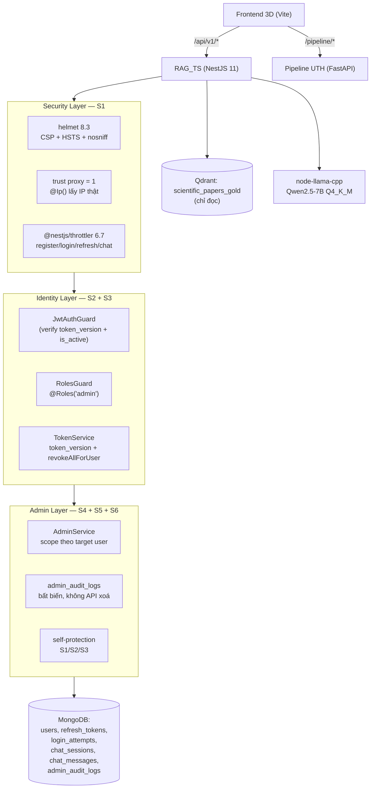
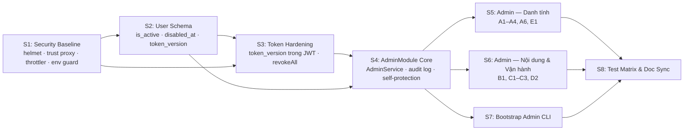

# prompt_security.md — Security Hardening & RBAC (admin/user) Scaffolding Prompts

- **Motivation/Background**: `backend_rag` đã có nền tảng xác thực vững (`Argon2id 64 MB`, JWT access 15 phút, refresh token xoay vòng 1-RTT có phát hiện tái sử dụng, khoá tiến trình 5 lần/15 phút), nhưng khả năng phân quyền mới chỉ là "vỏ": `RolesGuard` + `@Roles('admin')` tồn tại trong `src/auth/guards/roles.guard.ts` nhưng **chưa được dùng ở bất kỳ route production nào**, `users.roles` luôn là `['user']` khi đăng ký, và không tồn tại bất kỳ API quản trị nào. Song song đó, điều tra bảo mật phát hiện các lỗ hổng cụ thể: user enumeration qua timing attack (`argon2.verify` bị bỏ qua khi email không tồn tại), credential MongoDB plaintext nằm trong `README.md` và `benchmark/seed_prod_auth_data.js`, không có rate limit trên `POST /auth/register`, `trust proxy` chưa bật nên `@Ip()` trả IP proxy khiến mọi người dùng dùng chung một bucket lockout, Swagger bật cả ở production, và `/rag/chat` công khai có thể chiếm hết hàng đợi LLM (concurrency 1, queue 8).
- **Purpose**: Đặc tả chuẩn, tuần tự và có thể kiểm chứng cho toàn bộ công trình **Security Hardening + RBAC hai vai trò `admin` / `user`** của `backend_rag`, gồm: hạ tầng bảo mật cơ sở, vòng đời tài khoản, làm cứng token, `AdminModule` với audit log bất biến, bộ API quản trị, CLI bootstrap admin đầu tiên và ma trận kiểm thử.
- **Overview Pipeline**: `Yêu cầu ➔ Đặc tả (Input/Output/Edge case) ➔ Pseudocode (Hợp đồng) ➔ Prompt có cấu trúc ➔ Kiểm chứng (Test, Verification)` — cùng nguyên tắc phân rã của [`prompt_backend.md`](prompt_backend.md) và [`prompt_fe_3d.md`](prompt_fe_3d.md), áp dụng cho miền bảo mật.
- **Detailed Plan**: §1 Kiến trúc tổng thể & luồng bảo mật 3 lớp; §2 Bản đồ chức năng S1–S8; §3 Quyền Admin (nhóm A–E) và quy tắc tự bảo vệ; §4 PROMPT S1 Security Baseline; §5 PROMPT S2 User Schema & Account Lifecycle; §6 PROMPT S3 Token Hardening; §7 PROMPT S4 AdminModule Core & Audit Log; §8 PROMPT S5 Admin — Quản lý danh tính; §9 PROMPT S6 Admin — Nội dung & Vận hành; §10 PROMPT S7 Admin Bootstrap CLI; §11 PROMPT S8 Test Matrix & Doc Sync; §12 Phụ lục A đồng bộ FE & Golden Invariants; §13 Phụ lục B bảng quyền đầy đủ; §14 Checklist Quyết Định & Dò Vết; §15 Báo cáo triển khai (Implementation Report).
- **References**: [../AGENTS.md](../AGENTS.md), [../docs/INDEX.md](INDEX.md), [../backend_rag/AGENTS.md](../backend_rag/AGENTS.md), [../backend_rag/docs/AUTH_AND_SECURITY_ARCHITECTURE.md](../backend_rag/docs/AUTH_AND_SECURITY_ARCHITECTURE.md), [../backend_rag/docs/MONGODB_SCHEMA_DESIGN.md](../backend_rag/docs/MONGODB_SCHEMA_DESIGN.md), [../backend_rag/docs/PERFORMANCE_AND_CACHING.md](../backend_rag/docs/PERFORMANCE_AND_CACHING.md), [../docs/API_DESIGN.md](API_DESIGN.md), [../agents/rules/MD_CONVENTION.md](../agents/rules/MD_CONVENTION.md), [../agents/rules/COMMIT_CONVENTION.md](../agents/rules/COMMIT_CONVENTION.md), [../docs/AI_chat_log/Vuong_chat_logs.md](AI_chat_log/Vuong_chat_logs.md), [prompt_backend.md](prompt_backend.md).
- **Created**: 2026-11-02T10:05:00+07:00
- **Last Updated**: 2026-11-02T11:30:00+07:00

[STATUS: ACTIVE]

> [!NOTE]
> **Toàn bộ PROMPT S1–S8 đã được triển khai** (2026-11-02). Xem [§ Báo cáo triển khai](#-báo-cáo-triển-khai-implementation-report) ở cuối file để đối chiếu đặc tả với mã nguồn thật.
> File này giữ vai trò **đặc tả gốc (source of truth)** cho công trình bảo mật: khi sửa mã nguồn, cập nhật mục tương ứng trong file này và `backend_rag/ASSUMPTIONS.md` + `backend_rag/PROGRESS.md`.

---

## 🤖 Hướng dẫn dành cho AI thực thi file này

1. **Làm tuần tự từ PROMPT S1 đến S8.** Không nhảy bước.
2. **Sau mỗi prompt, chạy toàn bộ mục "Kiểm chứng".** Chỉ sang prompt tiếp theo khi đạt.
3. **Mọi giả định** ghi vào `backend_rag/ASSUMPTIONS.md` dạng `[S<số>] <giả định> — <lý do>`. Không bịa route, field, status code ngoài §3 của file này.
4. **Cập nhật `backend_rag/PROGRESS.md`** sau mỗi prompt: module xong, test pass, vấn đề tồn tại.
5. **Không gọi dịch vụ thật trong unit test.** Mongo dùng `mongodb-memory-server`; Qdrant, model embedding và LLM được mock qua interface.
6. **Không dùng `any`.** Mọi DTO có decorator `class-validator`. Mọi lỗi trả về đúng định dạng §1.2 của [`API_DESIGN.md`](API_DESIGN.md).
7. **Không log** password, token, nội dung câu hỏi, hay nội dung chat của user (chỉ log `query_len`, `message_count`, `session_id`).
8. **RAG_TS chỉ ĐỌC Qdrant.** Không ghi, không tạo collection. Admin cũng **không** có quyền này.
9. **Không phá vỡ 7 Golden Invariant** của [`../AGENTS.md`](../AGENTS.md) §3 — đặc biệt Invariant 2 (không N+1 query MongoDB qua Cloudflare tunnel), Invariant 3 (không nới lỏng `Argon2id`), Invariant 5 (UUIDv7 + soft-delete + ownership trả `404`).
10. **Mọi route admin bắt buộc qua 3 lớp**: `JwtAuthGuard` → `RolesGuard` → scope trong service. Guard không bao giờ đủ.

---

## 1. Kiến trúc tổng thể



**Luồng bảo mật 3 lớp cho mọi route admin** (mỗi lớp một lý do riêng):

| Lớp | Thành phần | Chặn cái gì | Nếu thiếu lớp này |
| :--- | :--- | :--- | :--- |
| ① Guard | `JwtAuthGuard` → `RolesGuard` | Token rác / user không phải admin | Ai cũng gọi được `/admin/*` |
| ② Service | Mọi query admin scope theo `user_id` / `deleted_at` | Truy cập chéo dữ liệu giữa các user | Admin đọc được session của user khác ngoài ý muốn |
| ③ Cache | `userCache` / `userByEmailCache` invalidate khi đổi quyền / khoá | Đọc cache cũ sau khi quyền đã đổi | Admin bị thu quyền vẫn hành xử như admin tới hết TTL |

**Bảng lỗi chuẩn (§1.2 `API_DESIGN.md`) áp dụng cho toàn bộ route admin:**

| Code | Khi nào | `message` mẫu (mã máy) |
| :--- | :--- | :--- |
| 400 | Sai validate / cursor hỏng | `invalid cursor`, `validation error` |
| 401 | Thiếu / sai / hết hạn token, tài khoản bị khoá | `unauthorized`, `token expired` |
| 403 | Đã đăng nhập nhưng không đủ quyền | `admin role required` |
| 404 | Không tồn tại / không thuộc phạm vi quyền | `user not found`, `session not found` |
| 409 | Xung đột trạng thái hợp lệ | `email already exists`, `SELF_LOCKOUT_FORBIDDEN`, `LAST_ADMIN_PROTECTED` |
| 429 | Vượt giới hạn tần suất | `too many requests`, `too many login attempts` |
| 500 | Lỗi không lường trước | `internal server error` |

---

## 2. Bản đồ chức năng (Feature Breakdown)



| Prompt | Module / Hạng mục | API mới | Phụ thuộc |
| :-- | :-- | :-- | :-- |
| S1 | `common/security`, `common/throttler`, `config/env.schema` | — | — |
| S2 | `auth/schemas/user.schema.ts` | — | S1 |
| S3 | `auth/token.service.ts`, `auth/guards/jwt-auth.guard.ts` | — | S2 |
| S4 | `admin/` (module, service, audit schema, self-protection) | — | S2, S3 |
| S5 | `admin/admin.controller.ts` — nhóm danh tính | 7 route `/admin/users*` | S4 |
| S6 | `admin/admin.controller.ts` — nhóm nội dung & vận hành | 6 route `/admin/*` | S4, S5 |
| S7 | `scripts/create-admin.ts` | — | S4 |
| S8 | `admin/admin.spec.ts` + đồng bộ tài liệu | — | S1–S7 |

**Tổng: 13 route admin mới.**

---

## 3. Quyền Admin — hợp đồng nghiệp vụ

> Nguồn chân lý cho toàn bộ phần còn lại của file này. `API_DESIGN.md` §9 sẽ được cập nhật để khớp.

### 3.1 Nhóm A — Quản lý danh tính (Identity & Access)

| Mã | Quyền | Endpoint | Ghi chú |
| :-- | :-- | :-- | :-- |
| A1 | Xem danh sách user | `GET /admin/users` | cursor + `?q=` (email/display_name) + `?role=` + `?active=` |
| A2 | Chi tiết user | `GET /admin/users/:id` | kèm đếm session / message / token đang hoạt động |
| A3 | Gán / thu quyền | `PATCH /admin/users/:id/roles` | `user ⇄ admin`; `token_version` tăng, refresh token bị thu hồi |
| A4 | Khoá / mở khoá tài khoản | `POST /admin/users/:id/disable` · `POST /admin/users/:id/enable` | `is_active` + `disabled_at`; khoá ⇒ thu hồi ngay mọi refresh token |
| A6 | Force logout 1 user | `POST /admin/users/:id/revoke-tokens` | thu hồi toàn bộ refresh token, `token_version` tăng |

### 3.2 Nhóm B — Nội dung (Content, chỉ đọc)

| Mã | Quyền | Endpoint | Ghi chú |
| :-- | :-- | :-- | :-- |
| B1 | Xem session của user khác | `GET /admin/users/:id/sessions` | cursor + `?q=`; filter `deleted_at: null` |
| B1b | Xem chi tiết session + message | `GET /admin/sessions/:id` | tối đa 200 message gần nhất, `deleted_at: null` |

> **Không có quyền xoá.** Nhóm đã thống nhất: admin chỉ **xem** nội dung vi phạm để điều tra; xoá session / message là quyết định của vận hành ngoài phạm vi hệ thống.

### 3.3 Nhóm C — Giám sát vận hành (Operations)

| Mã | Quyền | Endpoint | Nguồn dữ liệu |
| :-- | :-- | :-- | :-- |
| C1 | Dashboard thống kê | `GET /admin/stats` | đếm `users` / `chat_sessions` / `chat_messages` + `LLM_PORT.status()` |
| C2 | Theo dõi brute-force | `GET /admin/login-attempts` | collection `login_attempts` |
| C3 | Health chi tiết | `GET /admin/health` | `HealthService.health()` (đầy đủ, khác `/health` public) |

### 3.4 Nhóm D — Audit (bắt buộc)

| Mã | Quyền | Endpoint | Ghi chú |
| :-- | :-- | :-- | :-- |
| D1 | Ghi audit log mọi hành động admin | *(tự động)* | collection `admin_audit_logs`; **không có API xoá / sửa** |
| D2 | Xem audit log | `GET /admin/audit-logs` | filter `actor_id` / `action` / khoảng thời gian |

### 3.5 Nhóm E — Điều tra token

| Mã | Quyền | Endpoint | Ghi chú |
| :-- | :-- | :-- | :-- |
| E1 | Xem token family đang hoạt động | `GET /admin/users/:id/tokens` | chỉ metadata (`family_id`, `created_at`, `expires_at`), **không** trả `token_hash` |

### 3.6 Quy tắc tự bảo vệ (self-protection)

| Mã | Quy tắc | HTTP | `message` |
| :-- | :-- | :-- | :-- |
| S1 | Admin **không** tự thu quyền hoặc tự khoá chính mình | 409 | `SELF_LOCKOUT_FORBIDDEN` |
| S2 | Không thu quyền admin nếu hệ thống chỉ còn **1 admin đang active** | 409 | `LAST_ADMIN_PROTECTED` |
| S3 | Không khoá admin khác nếu hệ thống chỉ còn **1 admin đang active** | 409 | `LAST_ADMIN_PROTECTED` |
| S4 | Mọi hành động admin ghi audit log bất biến | — | — |

### 3.7 Những gì admin **KHÔNG** có quyền (cố ý)

| Không có | Lý do |
| :-- | :-- |
| Ghi / xoá collection Qdrant | Golden Invariant #1 — Qdrant chỉ đọc, pipeline UTH ghi |
| Bật/tắt tính năng hệ thống, sửa `CORS_ORIGINS`, `JWT_*_SECRET` | Vượt phạm vi RBAC; secret phải rotate qua quy trình deploy |
| Xoá cứng user / session / message | Phá vỡ soft-delete invariant + mất audit trail |
| Xoá hoặc sửa `admin_audit_logs` | S4 — audit log bất biến |
| Admin reset mật khẩu của user | Được loại bỏ do rủi ro tiềm tàng (admin đọc lời gọi thoại của user) |
| Thống kê doanh thu / giới hạn quota theo user | Nhóm chưa thống nhất được yêu cầu |

---

## 📝 PROMPT S1: Security Baseline — Hạ tầng bảo mật

### S1.1 Đặc tả (Specification)

- **Input**: biến môi trường + HTTP request.
- **Output**: app khởi động an toàn, mọi response có security header, request vượt ngưỡng bị `429`.
- **Ràng buộc**:
  - **Helmet**: `helmet` 8.3.0, `contentSecurityPolicy` bật (mặc định của helmet là đủ: `default-src 'self'`), `hsts` bật khi `NODE_ENV=production` (maxAge 31536000, `includeSubDomains`), `frameguard: { action: 'deny' }`, `noSniff: true`, `referrerPolicy: { policy: 'no-referrer' }`, `crossOriginEmbedderPolicy: false` (SSE + WASM/GGUF không cần).
  - **`trust proxy`**: `app.set('trust proxy', 1)` khi `NODE_ENV=production` (1 hop = reverse proxy của nhóm). `NODE_ENV=test` ⇒ `'loopback'`. Không bật khi dev để `@Ip()` lấy IP thật của client.
  - **Rate limit** (`@nestjs/throttler` 6.7.1): `register` 5 req/60s, `login` 10 req/60s, `refresh` 30 req/60s, `change-password` 5 req/60s, `POST /rag/chat` + `/rag/chat/stream` 20 req/60s theo IP. Trả `429` với body chuẩn §1.2 (`message: "too many requests"`). Throttle theo IP cho endpoint public, theo `userId` cho endpoint đã đăng nhập.
  - **Env guard**: ở `NODE_ENV=production`, `JWT_ACCESS_SECRET` / `JWT_REFRESH_SECRET` **không được** chứa chuỗi `change-me` và phải khác nhau. `MONGO_URI` không được chứa `mongodb://` không có thông tin đăng nhập. Sai ⇒ `EnvValidationError` ⇒ `process.exit(1)`.
  - **Bỏ credential plaintext**: `README.md` và `backend_rag/benchmark/seed_prod_auth_data.js` không được chứa mật khẩu MongoDB thật; thay bằng biến môi trường `${MONGO_URI}`.
  - **Swagger**: chỉ bật `/api/v1/docs` khi `NODE_ENV !== 'production'`.
  - **`/health` public**: ở production chỉ trả `{ status }`; `/health/ready` vẫn trả `503` khi `down` nhưng không kèm chi tiết component. Chi tiết đầy đủ chỉ ở `GET /admin/health` (C3).
  - **Sửa user enumeration**: `AuthService.login()` khi email không tồn tại vẫn phải chạy `argon2.verify` với một **dummy hash** hợp lệ ⇒ thời gian phản hồi đều ~2.6 s. Dummy hash được sinh 1 lần lúc module init (`argon2.hash` của chuỗi ngẫu nhiên 32 byte, `memoryCost/timeCost/parallelism` giống hash thật).

### S1.2 Pseudocode (Hợp đồng xử lý)

```text
# --- app.setup.ts ---
configureApp(app):
    if NODE_ENV == "production":
        app.set("trust proxy", 1)
    else if NODE_ENV == "test":
        app.set("trust proxy", "loopback")
    app.use(helmet({
        contentSecurityPolicy: { directives: { defaultSrc: ["'self'"], ... } },
        hsts: NODE_ENV == "production" ? { maxAge: 31536000, includeSubDomains: true } : false,
        frameguard: { action: "deny" },
        noSniff: true,
        referrerPolicy: { policy: "no-referrer" },
        crossOriginEmbedderPolicy: false
    }))
    app.enableCors({ origin: corsOrigins, exposedHeaders: [REQUEST_ID_HEADER] })
    app.useGlobalPipes(createValidationPipe())
    app.useGlobalFilters(new HttpExceptionFilter())
    if NODE_ENV != "production":
        SwaggerModule.setup("/api/v1/docs", app, createDocument(app, doc))

# --- env.schema.ts ---
envSchema = z.object({...}).superRefine((v, ctx) => {
    if (v.NODE_ENV == "production"):
        for s in [v.JWT_ACCESS_SECRET, v.JWT_REFRESH_SECRET]:
            if s.includes("change-me"): ctx.addIssue("placeholder secret forbidden in production")
        if v.JWT_ACCESS_SECRET == v.JWT_REFRESH_SECRET: ctx.addIssue("secrets must differ")
    if v.NODE_ENV == "production" and v.MONGO_URI startsWith "mongodb://" and not includes "@":
        ctx.addIssue("MONGO_URI must contain credentials in production")
})

# --- common/throttler.ts ---
ThrottlerModule.forRoot([{ ttl: 60000, limit: 100 }])   # mặc định
# trên controller dùng @Throttle({ default: { limit: 5, ttl: 60000 } })

# --- auth.service.ts: chống user enumeration ---
DUMMY_HASH = await argon2.hash(randomBytes(32).toString("base64url"), ARGON2_OPTIONS)  # module init, 1 lần

login(dto, ip):
    user = lookup(dto.email)
    hash = user ? user.password_hash : DUMMY_HASH
    ok = await argon2.verify(hash, dto.password)      # luôn chạy, kể cả khi user không tồn tại
    if !user or !ok:
        recordFailure(email, ip); log LOGIN_FAILED; throw 401 "invalid credentials"
    ...
```

### S1.3 Prompt gửi AI

```markdown
### Ngữ cảnh:
NestJS 11, TypeScript 5.7 strict, Node 22+. Thêm 2 dependency: `helmet` 8.3.0 và `@nestjs/throttler` 6.7.1
(`npm i helmet@^8.3.0 @nestjs/throttler@^6.7.1`). App đang chạy sau reverse proxy của nhóm; MongoDB đi qua
Cloudflare TCP tunnel nên mọi query phải song song (`Promise.all`), không tuần tự.
Hợp đồng chung ở `docs/API_DESIGN.md` §1; hạ tầng hiện tại ở `backend_rag/src/app.setup.ts`,
`backend_rag/src/config/env.schema.ts`, `backend_rag/src/auth/auth.service.ts`.

### Nhiệm vụ:
1. `backend_rag/src/app.setup.ts`: thêm `helmet` + `app.set('trust proxy', ...)`, tắt Swagger ở production.
2. `backend_rag/src/config/env.schema.ts`: thêm `superRefine` chặn secret placeholder / secret trùng nhau /
   MONGO_URI không có credential ở production.
3. `backend_rag/src/common/throttler.ts`: `ThrottlerModule.forRoot` + helper decorator `@Throttle({...})`; gắn
   limit cho register / login / refresh / change-password / rag chat.
4. `backend_rag/src/auth/auth.service.ts`: sinh `DUMMY_HASH` lúc module init và luôn chạy `argon2.verify`
   khi email không tồn tại (chống user enumeration qua timing).
5. `backend_rag/src/health/health.controller.ts`: ở production `/health` chỉ trả `{ status }`, `/health/ready`
   không kèm chi tiết component.
6. `README.md` + `backend_rag/benchmark/seed_prod_auth_data.js`: bỏ mật khẩu MongoDB plaintext, dùng env.

### Ràng buộc:
1. KHÔNG nới lỏng tham số Argon2id: `memoryCost: 65536`, `timeCost: 3`, `parallelism: 4`. `DUMMY_HASH` dùng
   ĐÚNG bộ tham số này, nếu không thì timing attack mở lại.
2. `UV_THREADPOOL_SIZE = '4'` trong `main.ts` giữ nguyên (`D-022`).
3. `DUMMY_HASH` sinh 1 lần ở module init, KHÔNG hash lại mỗi request login.
4. Rate limit trả đúng body §1.2: `{"statusCode":429,"error":"Too Many Requests","message":"too many requests","request_id":"..."}`.
5. `NODE_ENV=test` phải bypass guard production (secret test trong `src/testing/test-app.ts` dài ≥ 32 ký tự và
   khác nhau, nên vẫn hợp lệ; nhưng MONGO_URI test là `mongodb://127.0.0.1:PORT/...` không có credential ⇒
   guard phải chỉ chạy ở `NODE_ENV=production`).
6. Không đụng `D-021`/`D-022`: không thêm query tuần tự vào `login()`.
7. Không log mật khẩu, token, `MONGO_URI`.

### Ví dụ:
- `POST /api/v1/auth/register` 6 lần trong 60s từ cùng IP ➔ lần 6 trả 429 `too many requests`.
- `login()` với email không tồn tại và với email tồn tại sai mật khẩu ➔ thời gian phản hồi chênh lệch < 10%.
- `NODE_ENV=production` với `JWT_ACCESS_SECRET=change-me-...` ➔ app exit code ≠ 0, log liệt kê đủ biến lỗi.

### Output mong muốn:
1. Các file trên.
2. Unit test (`src/config/env.schema.spec.ts` mở rộng + `src/common/security.spec.ts`): env production với secret
   placeholder bị reject; secret trùng bị reject; `helmet` trả đúng header (`x-content-type-options`,
   `x-frame-options`, `referrer-policy`); Swagger route không tồn tại ở production.
3. Cập nhật `backend_rag/ASSUMPTIONS.md` (`[S1]…`) và `.env.example`.
```

### S1.4 Quy trình kiểm chứng

- [ ] `npm run build` sạch; `npx jest src/config/env.schema.spec.ts src/common/security.spec.ts --runInBand` pass.
- [ ] `npm test` không regression (146 test cũ vẫn xanh).
- [ ] `curl -i http://localhost:3000/api/v1/health` có header `x-content-type-options: nosniff`, `x-frame-options: DENY`, `referrer-policy: no-referrer`.
- [ ] `NODE_ENV=production npm run start:prod` ⇒ `curl http://localhost:3000/api/v1/docs` trả 404.
- [ ] `NODE_ENV=production` với `JWT_ACCESS_SECRET=change-me-x...` ⇒ process exit ≠ 0 và log đủ biến lỗi.
- [ ] 6 lần `POST /api/v1/auth/register` trong 60s ⇒ lần 6 trả 429 `too many requests`.
- [ ] `grep -rn "YqihzvCaDSkqGQEoR8xWwVZ3" .` ⇒ **không** còn kết quả nào.

---

## 📝 PROMPT S2: User Schema & Vòng đời Tài khoản

### S2.1 Đặc tả (Specification)

- **Input**: collection `users` hiện có (`email`, `password_hash`, `display_name`, `roles`, `created_at`, `updated_at`).
- **Output**: schema `users` mở rộng để hỗ trợ vòng đời tài khoản + vô hiệu token tức thời.
- **Ràng buộc**:
  - Thêm field (mặc định tương thích ngược, không cần migrate dữ liệu cũ):
    | Field | Kiểu | Mặc định | Ý nghĩa |
    | :-- | :-- | :-- | :-- |
    | `is_active` | `boolean` | `true` | tài khoản còn hoạt động |
    | `disabled_at` | `Date \| null` | `null` | thời điểm bị khoá |
    | `disabled_by` | `ObjectId \| null` | `null` | admin đã khoá (audit trỏ về) |
    | `disabled_reason` | `string \| null` | `null` | lý do khoá (tối đa 200 ký tự) |
    | `token_version` | `number` | `0` | tăng mỗi lần đổi quyền / khoá / thu hồi token |
    | `last_login_at` | `Date \| null` | `null` | lần đăng nhập thành công gần nhất |
  - `roles` mặc định `['user']`; giá trị hợp lệ chỉ `'user' | 'admin'` (`Role` type hiện có ở `src/types/auth-user.ts`).
  - **Password policy** (áp dụng cho `register` và `change-password`): tối thiểu **10** ký tự, tối đa 200; **không chứa** chuỗi email (case-insensitive, bỏ ký tự `.`/`-`/`_`); **không nằm trong** top-1000 mật khẩu phổ biến (danh sách rút gọn 200 mục nhúng sẵn trong `src/auth/common-passwords.ts`). Sai ⇒ `400` với message `password too short` / `password too common` / `password contains email`.
  - `display_name` 1–60 ký tự (giữ nguyên).
  - **Index**: `users.email` unique (đã có), thêm `users.roles` + `users.is_active` phục vụ truy vấn admin A1.
  - `toUserDto()` **không** được trả `is_active` / `disabled_at` / `token_version` cho client tự nhiên — chỉ `AdminUserDto` (S5) mới có các field này.

### S2.2 Pseudocode (Hợp đồng xử lý)

```text
# --- user.schema.ts ---
class User:
    email: string                  # unique, lowercase, trim
    password_hash: string
    display_name: string
    roles: Role[]                  # default ['user']
    is_active: boolean = true
    disabled_at: Date | null = null
    disabled_by: ObjectId | null = null
    disabled_reason: string | null = null
    token_version: number = 0
    last_login_at: Date | null = null

# --- password policy ---
validatePassword(password, email):
    if length(password) < 10: throw 400 "password too short"
    if length(password) > 200: throw 400 "password too long"
    if COMMON_PASSWORDS.has(lower(password)): throw 400 "password too common"
    normalizedEmail = lower(email).replace(/[.\-_]/g, "")
    if normalizedEmail.length >= 3 and lower(password).replace(/[.\-_]/g, "").includes(normalizedEmail):
        throw 400 "password contains email"

# --- disable / enable ---
disableUser(actorId, targetId, reason):
    if targetId == actorId: throw 409 "SELF_LOCKOUT_FORBIDDEN"
    target = users.findById(targetId); if !target: throw 404 "user not found"
    activeAdmins = users.countDocuments({ roles: "admin", is_active: true })
    if target.roles includes "admin" and activeAdmins <= 1: throw 409 "LAST_ADMIN_PROTECTED"
    users.updateOne({_id: targetId}, {
        $set: { is_active: false, disabled_at: now, disabled_by: actorId, disabled_reason: reason },
        $inc: { token_version: 1 }
    })
    tokens.revokeAllForUser(targetId)      # token cũ vô hiệu ngay
    authCache.invalidate(targetId, target.email)

enableUser(actorId, targetId):
    if targetId == actorId: throw 409 "SELF_LOCKOUT_FORBIDDEN"
    target = users.findById(targetId); if !target: throw 404 "user not found"
    users.updateOne({_id: targetId}, {
        $set: { is_active: true, disabled_at: null, disabled_by: null, disabled_reason: null },
        $inc: { token_version: 1 }
    })
    authCache.invalidate(targetId, target.email)
```

### S2.3 Prompt gửi AI

```markdown
### Ngữ cảnh:
NestJS 11, @nestjs/mongoose 11, mongoose 8. Schema hiện tại: `backend_rag/src/auth/schemas/user.schema.ts`.
`Role` type ở `backend_rag/src/types/auth-user.ts`. Mật khẩu băm bằng `argon2` với
`{ type: argon2id, memoryCost: 65536, timeCost: 3, parallelism: 4 }` — KHÔNG đổi.
Quy ước DTO: `backend_rag/src/auth/dto/auth.dto.ts`.

### Nhiệm vụ:
1. Mở rộng `UserSchema` với `is_active`, `disabled_at`, `disabled_by`, `disabled_reason`, `token_version`,
   `last_login_at`; thêm index `{ roles: 1, is_active: 1 }`.
2. Tạo `backend_rag/src/auth/common-passwords.ts`: tập `Set<string>` 200 mật khẩu phổ biến + hàm
   `validatePassword(password, email): void` ném `BadRequestException` với message đúng ở S2.1.
3. Áp `validatePassword` vào `RegisterDto` ( qua service `register()`) và `ChangePasswordDto` (qua
   `changePassword()`); message lỗi theo đặc tả.
4. Cập nhật `AuthService.register()` set `is_active: true`, `token_version: 0`, `last_login_at: null`.
5. `AuthService.login()` set `last_login_at = now` khi thành công.
6. Thêm method `AuthService.setActiveState(...)` / `incrementTokenVersion(...)` hoặc tương đương để S5 dùng,
   kèm invalidate `userCache` + `userByEmailCache`.

### Ràng buộc:
1. `toUserDto()` (DTO trả về cho client) KHÔNG được chứa `is_active`, `disabled_at`, `token_version`,
   `password_hash`. Chỉ `AdminUserDto` ở S5 mới có.
2. Mặc định mới phải tương thích ngược: user cũ không có field ⇒ coi như `is_active: true`, `token_version: 0`.
3. Không đổi `MAX_LOGIN_FAILURES`, không đổi cơ chế `login_attempts`.
4. Password tối thiểu 10 (nâng từ 8) — cập nhật `RegisterDto`/`ChangePasswordDto` decorator `MinLength` và
   message `password too short`.
5. `updateProfile()` (S2, `PATCH /auth/me`) KHÔNG được sửa `display_name` thành rỗng — giữ validate 1–60.
6. Không dùng `any`.

### Ví dụ:
- `register({ email: 'a@b.co', password: '1234567890', display_name: 'x' })` ➔ 201.
- `register({ email: 'a@b.co', password: 'password', display_name: 'x' })` ➔ 400 `password too common`.
- `register({ email: 'a@b.co', password: 'a@b.co-pass', display_name: 'x' })` ➔ 400 `password contains email`.
- `register({ email: 'a@b.co', password: 'short', display_name: 'x' })` ➔ 400 `password too short`.

### Output mong muốn:
1. Các file trên.
2. Unit test `src/auth/password-policy.spec.ts`: 6 trường hợp ở "Ví dụ" + mật khẩu hợp lệ.
3. Integration test trong `src/auth/auth.spec.ts`: register trả `roles: ['user']` và KHÔNG có `is_active` trong body;
   login cập nhật `last_login_at`; khoá user ⇒ `POST /auth/refresh` trả 401.
4. Cập nhật `backend_rag/ASSUMPTIONS.md` (`[S2]…`).
```

### S2.4 Quy trình kiểm chứng

- [ ] `npm run build` sạch; `npx jest src/auth --runInBand` pass.
- [ ] `npm test` không regression.
- [ ] Mongo: `db.users.findOne({}, {email:1, is_active:1, token_version:1})` — user cũ có `is_active` lấy giá trị mặc định `true` khi đọc qua Mongoose.
- [ ] `POST /api/v1/auth/register` với `password: "123456"` ⇒ 400 `password too common`.
- [ ] Response `GET /api/v1/auth/me` **không** chứa `is_active`, `token_version`, `password_hash`.

---

## 📝 PROMPT S3: Làm Cứng Token & Thu Hồi

### S3.1 Đặc tả (Specification)

- **Input**: access token JWT hiện có (`{ sub, roles }`), refresh token trong `refresh_tokens`.
- **Output**: access token **vô hiệu được tức thời** khi quyền của user thay đổi hoặc tài khoản bị khoá.
- **Ràng buộc**:
  - Thêm claim `ver` (số nguyên) vào access token = `users.token_version` tại thời điểm cấp. TTL 15 phút giữ nguyên.
  - `JwtAuthGuard` **phải** đối chiếu `ver` với `users.token_version` hiện tại. Vì JWT là stateless, việc này cần **1 truy vấn MongoDB mỗi request** — chấp nhận được vì `token_version` chỉ đổi khi có hành động quản trị; để giữ hiệu năng, dùng cache `LRUCache` (`tokenVersionCache`, TTL 60 s, `updateAgeOnGet: true`) trong `AuthService`, invalidate khi `token_version` thay đổi.
    > **Ghi chú hiệu năng (D-021, D-002):** truy vấn này chạy **song song** với phần còn lại của guard, không tuần tự. Cache 60 s ⇒ tối đa 1 truy vấn/60s/user.
  - Tài khoản `is_active: false` ⇒ `JwtAuthGuard` trả `401 unauthorized` (không phải 403) vì token không còn hợp lệ.
  - `AuthService.refresh()`: nếu user không tồn tại hoặc `is_active: false` ⇒ `401 refresh token invalid or expired` **và** thu hồi cả family token (ngăn refresh tiếp).
  - `TokenService.issue()` nhận `ver` và ghi vào claims. `TokenService.verifyAccess()` trả về `{ id, roles, ver }`.
  - `RolesGuard` dùng `roles` **từ claim** (đã được guard kiểm tra đúng với DB) — không cần truy vấn thêm.
  - **Refresh rotation giữ nguyên** 1-RTT atomic `findOneAndUpdate({ token_hash, revoked_at: null })` (`D-021`) — **không** được viết lại thành 2 truy vấn tuần tự.
  - `revokeAllForUser(userId)` tăng `token_version` **và** set `revoked_at` cho mọi refresh token còn hiệu lực.

### S3.2 Pseudocode (Hợp đồng xử lý)

```text
# --- token.service.ts ---
issue(user, familyId):
    claims = { sub: user.id, roles: user.roles, ver: user.tokenVersion }
    access_token = jwt.sign(claims, secret, { expiresIn: 900 })
    refresh_tokens.create({ user_id, token_hash, family_id, expires_at })   # song song Promise.all
    return { access_token, refresh_token, token_type: "Bearer", expires_in: 900 }

verifyAccess(token) -> AuthUser { id, roles, ver }      # giữ nguyên logic hiện tại, thêm `ver`

# --- jwt-auth.guard.ts ---
canActivate(ctx):
    token = bearerToken(req); if !token: throw 401 UNAUTHORIZED
    claims = tokens.verifyAccess(token)                 # { id, roles, ver }
    u = await authService.getActiveUser(claims.id)      # cache 60s; trả null nếu user không tồn tại
    if !u: throw 401 UNAUTHORIZED                       # user đã bị xoá
    if !u.is_active: throw 401 UNAUTHORIZED             # bị khoá
    if u.token_version != claims.ver: throw 401 UNAUTHORIZED   # token cũ sau khi đổi quyền
    req.user = { id: u.id, roles: u.roles }
    return true

# --- auth.service.ts ---
getActiveUser(id):                      # cache 60s, updateAgeOnGet
    cached = tokenVersionCache.get(id); if cached: return cached
    u = await users.findById(id).lean()
    if !u: return null
    tokenVersionCache.set(id, u)
    return u

revokeAllForUser(userId):
    await refresh_tokens.updateMany({ user_id: userId, revoked_at: null }, { $set: { revoked_at: now } })
    await users.updateOne({ _id: userId }, { $inc: { token_version: 1 } })
    tokenVersionCache.delete(userId)
```

### S3.3 Prompt gửi AI

```markdown
### Ngữ cảnh:
NestJS 11, @nestjs/jwt 11. `TokenService` ở `backend_rag/src/auth/token.service.ts` hiện ký claims
`{ sub, roles }`. `JwtAuthGuard` ở `backend_rag/src/auth/guards/jwt-auth.guard.ts`. MongoDB đi qua Cloudflare
TCP tunnel (~15–25 ms RTT) — mọi truy vấn phải song song hoặc cache, không tuần tự.
Quyết định D-021 (`1-RTT atomic refresh rotation`) và D-022 (`UV_THREADPOOL_SIZE=4`) là bất biến.

### Nhiệm vụ:
1. `AccessClaims` thêm `ver: number`. `TokenService.issue()` nhận `ver` và ghi vào claims.
2. `AuthUser` (src/types/auth-user.ts) thêm `ver?: number` (optional để không phá test cũ).
3. `JwtAuthGuard`: sau khi verify JWT, gọi `AuthService.getActiveUser(id)` để đối chiếu `is_active` và
   `token_version` với claim `ver`. Không có token ⇒ 401; token hết hạn ⇒ 401 `token expired`.
4. `AuthService`: thêm `tokenVersionCache` (LRUCache, max 5000, ttl 60_000, updateAgeOnGet) + `getActiveUser()`.
5. `AuthService.revokeAllForUser()` → chuyển sang `TokenService.revokeAllForUser()` (đã có) **và** tăng
   `token_version` của user + invalidate `tokenVersionCache`.
6. `AuthService.refresh()`: user không tồn tại hoặc `is_active === false` ⇒ 401 `refresh token invalid or expired`
   và thu hồi family token.

### Ràng buộc:
1. GIỮ NGUYÊN 1-RTT atomic rotation của `consume()` — không được thêm truy vấn tuần tự.
2. `verifyAccess()` không được gọi DB (giữ stateless) — việc đối chiếu `ver`/`is_active` nằm ở guard.
3. Cache `tokenVersionCache` phải invalidate khi `token_version` thay đổi (admin đổi quyền, khoá, đổi mật khẩu).
4. Tài khoản bị khoá trả **401** (không phải 403) vì access token không còn hợp lệ.
5. `changePassword()` phải gọi `revokeAllForUser` ⇒ mọi refresh token cũ chết ngay.
6. Test cũ trong `src/auth/auth.spec.ts` ký JWT thủ công (`sign({ sub, roles })`) — cần cập nhật để kèm `ver`,
   hoặc cho phép `ver` thiếu ⇒ coi như `0` (tương thích ngược), `token_version` mặc định 0.
7. Không log token, `ver` hay `password_hash`.

### Ví dụ:
- User A có `token_version = 0`, đăng nhập ⇒ access token có `ver: 0`.
- Admin đổi quyền A ⇒ `token_version = 1`, refresh token bị thu hồi.
- Access token cũ của A (`ver: 0`) gọi `GET /auth/me` ⇒ 401 `unauthorized`.
- `POST /auth/refresh` với refresh token cũ của A ⇒ 401 `refresh token invalid or expired`.

### Output mong muốn:
1. Các file trên.
2. Integration test trong `src/auth/auth.spec.ts`: token cũ sau khi `token_version` tăng ⇒ 401; user `is_active: false`
   ⇒ 401 ở `GET /auth/me` và `POST /auth/refresh`; refresh rotation vẫn 1 lượt thành công khi 2 request đồng thời.
3. Cập nhật `backend_rag/ASSUMPTIONS.md` (`[S3]…`).
```

### S3.4 Quy trình kiểm chứng

- [ ] `npm run build` sạch; `npx jest src/auth --runInBand` pass; `npm test` không regression.
- [ ] Đăng nhập ⇒ decode access token thấy claim `ver`; đổi `token_version` trong Mongo ⇒ request kế tiếp 401.
- [ ] Khoá user (`is_active: false`) ⇒ `GET /api/v1/auth/me` trả 401 `unauthorized`.
- [ ] Benchmark nhẹ: `GET /api/v1/auth/me` liên tục vẫn P95 < 50 ms (cache 60 s, không 1 query/request sau lần đầu).

---

## 📝 PROMPT S4: `AdminModule` — Lõi & Audit Log

### S4.1 Đặc tả (Specification)

- **Input**: các endpoint admin (S5, S6) cần một lớp service chung + audit log bất biến.
- **Output**: `backend_rag/src/admin/` gồm module, controller (rỗng ở S4), service, DTO và schema audit log.
- **Ràng buộc**:
  - **Schema `admin_audit_logs`** (collection `admin_audit_logs`, `versionKey: false`):
    | Field | Kiểu | Ý nghĩa |
    | :-- | :-- | :-- |
    | `_id` | `ObjectId` | Mongo tự sinh |
    | `actor_id` | `ObjectId` | admin thực hiện |
    | `actor_email` | `string` | snapshot email lúc hành động (admin có thể bị đổi email sau) |
    | `action` | `string` | mã hành động, ví dụ `USER_ROLE_CHANGE` |
    | `target_type` | `string` | `user` \| `session` \| `system` |
    | `target_id` | `string \| null` | id đích (string để chứa cả UUIDv7) |
    | `before` | `Mixed \| null` | trạng thái trước |
    | `after` | `Mixed \| null` | trạng thái sau |
    | `ip` | `string \| null` | IP người gọi |
    | `request_id` | `string \| null` | `req.id` |
    | `created_at` | `Date` | tự động |
    - Index: `{ actor_id: 1, created_at: -1 }`, `{ action: 1, created_at: -1 }`, `{ created_at: -1 }`.
    - **Không có** controller/service nào cho phép xoá hoặc sửa `admin_audit_logs`. TTL: **không** đặt (giữ vĩnh viễn).
  - **Mã hành động audit** (chuẩn, dùng để filter):
    `USER_LIST_VIEW`, `USER_VIEW`, `USER_ROLE_CHANGE`, `USER_DISABLE`, `USER_ENABLE`, `USER_TOKENS_REVOKE`,
    `USER_TOKENS_VIEW`, `USER_SESSIONS_VIEW`, `SESSION_VIEW`, `STATS_VIEW`, `LOGIN_ATTEMPTS_VIEW`,
    `HEALTH_VIEW`, `AUDIT_LOG_VIEW`.
  - **`AdminService`**: đây là **service dùng chung** cho S5 và S6. Trách nhiệm:
    - `writeAudit(actor, action, targetType, targetId, before, after, req)` — **bất biến**, không có đường xoá.
    - `assertAdmin(actor)` — ném `403 admin role required` nếu actor không có role `admin` (defense in depth, không thay thế `RolesGuard`).
    - `assertNotSelf(actor, targetId)` — ném `409 SELF_LOCKOUT_FORBIDDEN`.
    - `countActiveAdmins()` — `users.countDocuments({ roles: 'admin', is_active: true })`.
    - `assertNotLastAdmin(target)` — ném `409 LAST_ADMIN_PROTECTED` nếu target là admin đang active và `countActiveAdmins() <= 1`.
    - `resolveUser(id)` — `404 user not found` nếu không tồn tại.
    - `invalidateAuthCaches(userId, email)` — xoá `userCache` + `userByEmailCache` + `tokenVersionCache`.
  - **`AdminModule`** phải `import` `AuthModule` (để dùng `TokenService`, `AuthService`) và `ChatSessionsModule` (để đọc session/message) — hoặc tự khai báo `MongooseModule.forFeature` cho các model cần dùng. `AuthModule` đang `@Global()` nên `TokenService` sẵn có sẵn.
  - **`RolesGuard` phải chạy SAU `JwtAuthGuard`**: `@UseGuards(JwtAuthGuard, RolesGuard)`.
  - `AdminController` đặt `@ApiBearerAuth()`, `@ApiTags('Admin')`, `@UseGuards(JwtAuthGuard, RolesGuard)` ở cấp class; `@Roles('admin')` ở cấp method (để Swagger hiển thị rõ).
  - **Mọi query admin** dùng `.lean()`; truy vấn độc lập chạy `Promise.all` (Cloudflare tunnel, Invariant 2).

### S4.2 Pseudocode (Hợp đồng xử lý)

```text
writeAudit(actor, action, targetType, targetId, before, after, req):
    await adminAuditLogs.create({
        actor_id: actor.id,
        actor_email: actor.email,          # lấy từ users.findById(actor.id).lean() hoặc truyền vào
        action, target_type: targetType, target_id: targetId,
        before: before ?? null, after: after ?? null,
        ip: req?.ip ?? null, request_id: req?.id ?? null
    })                                   # best-effort: lỗi audit KHÔNG được làm hỏng request chính

assertNotSelf(actor, targetId):
    if actor.id == targetId: throw 409 "SELF_LOCKOUT_FORBIDDEN"

assertNotLastAdmin(target):
    if not target.roles.includes("admin"): return
    if not target.is_active: return
    n = await users.countDocuments({ roles: "admin", is_active: true })
    if n <= 1: throw 409 "LAST_ADMIN_PROTECTED"

applyRoleChange(actor, targetId, nextRoles, req):
    assertNotSelf(actor, targetId) if nextRoles lacks "admin"
    target = await users.findById(targetId).lean(); if !target: throw 404 "user not found"
    assertNotLastAdmin(target) if target.roles has "admin" and nextRoles lacks "admin"
    before = target.roles
    await users.updateOne({ _id: targetId }, { $set: { roles: nextRoles }, $inc: { token_version: 1 } })
    await tokens.revokeAllForUser(targetId)          # token cũ chết ngay
    invalidateAuthCaches(targetId, target.email)
    writeAudit(actor, "USER_ROLE_CHANGE", "user", targetId, { roles: before }, { roles: nextRoles }, req)
    return updatedUser
```

### S4.3 Prompt gửi AI

```markdown
### Ngữ cảnh:
NestJS 11, @nestjs/mongoose 11. `RolesGuard` + decorator `@Roles()` đã có ở
`backend_rag/src/auth/guards/roles.guard.ts` (chưa dùng ở route production nào). `AuthModule` là `@Global()`,
`TokenService` và các guard đã export. `AuthService` giữ 3 cache: `userCache`, `userByEmailCache`,
`attemptCountCache` (S3 thêm `tokenVersionCache`). Mongo đi qua Cloudflare tunnel (~15–25 ms RTT) — luôn
`.lean()` + `Promise.all` cho truy vấn độc lập.

### Nhiệm vụ:
1. Tạo `backend_rag/src/admin/schemas/admin-audit-log.schema.ts` (schema theo S4.1, 3 index).
2. Tạo `backend_rag/src/admin/admin.service.ts` với các method:
   `writeAudit`, `assertAdmin`, `assertNotSelf`, `countActiveAdmins`, `assertNotLastAdmin`,
   `resolveUser`, `invalidateAuthCaches`.
3. Tạo `backend_rag/src/admin/admin.module.ts` (`@Module` import `MongooseModule.forFeature([AdminAuditLog])`,
   import `AuthModule` nếu cần, khai báo `AdminService`, export `AdminService`).
4. Tạo `backend_rag/src/admin/admin.controller.ts` — class-level `@UseGuards(JwtAuthGuard, RolesGuard)`,
   `@Roles('admin')`, `@ApiBearerAuth()`, `@ApiTags('Admin')`. Ở S4 controller **chưa có route** (S5/S6 thêm vào).
5. Tạo `backend_rag/src/admin/admin.dto.ts` — khai báo sẵn các DTO dùng chung (không route nào dùng tới ở S4).
6. Đăng ký `AdminModule` trong `backend_rag/src/app.module.ts`.

### Ràng buộc:
1. `writeAudit` là **best-effort**: lỗi ghi audit log KHÔNG được làm hỏng request chính, nhưng PHẢI log warn.
2. Không được tạo bất kỳ endpoint nào xoá / sửa `admin_audit_logs`.
3. `assertAdmin` là defense-in-depth: `RolesGuard` đã chặn ở tầng HTTP, `assertAdmin` chặn lại ở tầng service.
4. Mọi truy vấn Mongo trong `AdminService` dùng `.lean()`; truy vấn độc lập dùng `Promise.all`.
5. Không log `password_hash`, không log nội dung message của user.
6. Không dùng `any`.
7. Schema audit log KHÔNG đặt TTL index (giữ vĩnh viễn).

### Ví dụ:
- Admin gọi `GET /admin/users` mà không có role `admin` ⇒ 403 `admin role required` (do `RolesGuard`).
- Admin gọi `GET /admin/users` không có token ⇒ 401 `unauthorized` (do `JwtAuthGuard`).
- `assertNotLastAdmin` khi hệ thống chỉ còn 1 admin active ⇒ 409 `LAST_ADMIN_PROTECTED`.

### Output mong muốn:
1. Các file trên.
2. Integration test `src/admin/admin.spec.ts`: guard chain (401 / 403 / 200); `writeAudit` ghi đúng field;
   `assertNotLastAdmin` ném 409; `assertNotSelf` ném 409.
3. Cập nhật `backend_rag/ASSUMPTIONS.md` (`[S4]…`).
```

### S4.4 Quy trình kiểm chứng

- [ ] `npm run build` sạch; `npx jest src/admin --runInBand` pass.
- [ ] Mongo: `db.admin_audit_logs.countDocuments()` tăng sau mỗi lần gọi route admin.
- [ ] `grep -rn "admin_audit_logs" backend_rag/src` không có route nào có `delete`/`update` trên collection này.
- [ ] `npm test` không regression.

---

## 📝 PROMPT S5: Admin — Quản lý Danh tính (A1–A4, A6, E1)

### S5.1 Đặc tả (Specification)

| Route | Guard | Request | Response | Status · message | Log |
| :-- | :-- | :-- | :-- | :-- | :-- |
| `GET /admin/users` | JWT+Admin | `?limit&cursor&q&role&active` | `{ items: AdminUserDto[], next_cursor, has_more }` | 200 · 400 `invalid cursor` | `USER_LIST_VIEW` |
| `GET /admin/users/:id` | JWT+Admin | — | `AdminUserDetailDto` | 200 · 404 `user not found` | `USER_VIEW` |
| `PATCH /admin/users/:id/roles` | JWT+Admin | `{ roles: Role[] }` | `AdminUserDto` | 200 · 400 `validation error` · 404 · 409 `SELF_LOCKOUT_FORBIDDEN` / `LAST_ADMIN_PROTECTED` | `USER_ROLE_CHANGE` |
| `POST /admin/users/:id/disable` | JWT+Admin | `{ reason? }` | `AdminUserDto` | 200 · 404 · 409 `SELF_LOCKOUT_FORBIDDEN` / `LAST_ADMIN_PROTECTED` | `USER_DISABLE` |
| `POST /admin/users/:id/enable` | JWT+Admin | — | `AdminUserDto` | 200 · 404 · 409 `SELF_LOCKOUT_FORBIDDEN` | `USER_ENABLE` |
| `POST /admin/users/:id/revoke-tokens` | JWT+Admin | — | `{ revoked_count }` | 200 · 404 | `USER_TOKENS_REVOKE` |
| `GET /admin/users/:id/tokens` | JWT+Admin | — | `{ items: TokenFamilyDto[] }` | 200 · 404 | `USER_TOKENS_VIEW` |

- **Ràng buộc**:
  - **A1** — `q` tìm trong `email` hoặc `display_name`, không phân biệt hoa thường; dùng `escapeRegex` (đã có ở `src/chat-sessions/chat-sessions.service.ts` — **đổi sang import từ `src/common/sanitize.ts`** để dùng chung, hoặc tạo file mới `src/common/sanitize.ts` và sửa chat-sessions import; **không** nhân bản logic). `role` ∈ `user|admin`; `active` ∈ `true|false`. Cursor = (`created_at`, `_id`) giảm dần, mờ (opaque). `limit` 1–50, mặc định 20.
  - **A2** — `AdminUserDetailDto` gồm thông tin user + `session_count`, `message_count`, `active_token_count`, `last_login_at`.
  - **A3** — `roles` phải là mảng khác rỗng, mỗi phần tử ∈ `{'user','admin'}`, **không trùng lặp**, và **phải chứa `'user'`** (mọi tài khoản đều là `user` ít nhất). Sai ⇒ `400 validation error`. `token_version` tăng 1, refresh token bị thu hồi.
  - **A4** — `reason` tối đa 200 ký tự. Khoá ⇒ `is_active: false`, `disabled_at`, `disabled_by` (admin đang hành động), `disabled_reason`; `token_version` tăng; **thu hồi toàn bộ refresh token**.
  - **A6** — `revoke-tokens` thu hồi refresh token + tăng `token_version` (vô hiệu access token đang cầm) ⇒ trả `{ revoked_count }`.
  - **E1** — `GET /admin/users/:id/tokens` trả metadata của refresh token **đang hiệu lực** (`revoked_at: null`): `family_id`, `created_at`, `expires_at`. **Không** trả `token_hash`.
  - Mọi thao tác ghi (A3, A4, A6) ⇒ `writeAudit` với `before`/`after`.
  - Mọi thao tác đọc (A1, A2, E1) ⇒ `writeAudit` với `before: null, after: null` (ghi nhận "admin đã xem").
  - **Không** có endpoint trả `password_hash` hay `token_hash`.
  - `id` trong path phải là `ObjectId` hợp lệ ⇒ sai ⇒ `404 user not found` (không phải 400, để không lộ định dạng).

### S5.2 Pseudocode (Hợp đồng xử lý)

```text
listUsers(actor, q, limit, cursor, role, active, req):
    filter = {}
    if q: filter.$or = [ { email: {$regex: escapeRegex(q), $options: "i"} },
                         { display_name: {$regex: escapeRegex(q), $options: "i"} } ]
    if role: filter.roles = role
    if active !== undefined: filter.is_active = active
    if cursor: { m, id } = decodeCursor(cursor, isCursor); filter.$or += [
        { created_at: {$lt: m} }, { created_at: m, _id: {$lt: id} } ]
    rows = await users.find(filter).sort({ created_at: -1, _id: -1 }).limit(limit + 1).lean()
    page = rows.slice(0, limit)
    writeAudit(actor, "USER_LIST_VIEW", "user", null, null, null, req)
    return { items: page.map(toAdminUserDto), next_cursor: ..., has_more: ... }

changeRoles(actor, targetId, nextRoles, req):
    if not nextRoles.includes("user"): throw 400 "validation error"
    if targetId == actor.id and not nextRoles.includes("admin"): throw 409 "SELF_LOCKOUT_FORBIDDEN"
    target = await users.findById(targetId).lean(); if !target: throw 404 "user not found"
    if target.roles.includes("admin") and not nextRoles.includes("admin"): assertNotLastAdmin(target)
    before = { roles: target.roles }
    users.updateOne({_id: targetId}, { $set: { roles: nextRoles }, $inc: { token_version: 1 } })
    await tokens.revokeAllForUser(targetId)
    invalidateAuthCaches(targetId, target.email)
    writeAudit(actor, "USER_ROLE_CHANGE", "user", targetId, before, { roles: nextRoles }, req)
    return toAdminUserDto(updated)
```

### S5.3 Prompt gửi AI

```markdown
### Ngữ cảnh:
NestJS 11, @nestjs/mongoose 11. `AdminService` (S4) đã có: `writeAudit`, `assertAdmin`, `assertNotSelf`,
`countActiveAdmins`, `assertNotLastAdmin`, `resolveUser`, `invalidateAuthCaches`. `AuthService` giữ cache
`userCache` / `userByEmailCache` / `tokenVersionCache`; `TokenService` có `revokeAllForUser(userId)`.
Cursor helper ở `backend_rag/src/common/pagination.ts` (`encodeCursor` / `decodeCursor`).
Escape regex: đang nằm trong `src/chat-sessions/chat-sessions.service.ts` — hãy TÁCH ra `src/common/sanitize.ts`
và sửa import ở chat-sessions (giữ nguyên hành vi), dùng chung cho admin.

### Nhiệm vụ:
Tạo route trong `backend_rag/src/admin/admin.controller.ts` + method trong `admin.service.ts`:
A1 `GET /admin/users` · A2 `GET /admin/users/:id` · A3 `PATCH /admin/users/:id/roles` ·
A4 `POST /admin/users/:id/disable` + `POST /admin/users/:id/enable` · A6 `POST /admin/users/:id/revoke-tokens` ·
E1 `GET /admin/users/:id/tokens`.
Kèm DTO trong `admin.dto.ts`: `AdminUserDto`, `AdminUserDetailDto`, `ListAdminUsersQueryDto`,
`UpdateRolesDto`, `DisableUserDto`, `TokenFamilyDto`.

### Ràng buộc:
1. Đúng đặc tả S5.1 (bảng route) và pseudocode S5.2.
2. `roles` trong `UpdateRolesDto`: `@IsArray()`, `@ArrayMinSize(1)`, mỗi phần tử `@IsIn(['user','admin'])`,
   `@ArrayUnique()`, và phải chứa `'user'` (kiểm trong service ⇒ `400 validation error`).
3. `id` không phải ObjectId hợp lệ ⇒ `404 user not found` (KHÔNG 400).
4. Mọi query dùng `.lean()`; các truy vấn độc lập dùng `Promise.all`.
5. A3/A4/A6 tăng `token_version` và gọi `tokens.revokeAllForUser(targetId)`; cache phải invalidate.
6. Mọi route (kể cả route chỉ đọc) phải gọi `writeAudit`.
7. KHÔNG route nào trả `password_hash` hoặc `token_hash`.
8. `GET /admin/users/:id/tokens` chỉ trả refresh token còn hiệu lực (`revoked_at: null`).
9. Không dùng `any`; không log nội dung chat.

### Ví dụ:
- `GET /admin/users?q=manh&role=user&active=true&limit=20` ⇒ 200, `items` lọc đúng.
- `PATCH /admin/users/<admin-me>/roles` với `{ roles: ["user"] }` ⇒ 409 `SELF_LOCKOUT_FORBIDDEN`.
- `PATCH /admin/users/<only-admin>/roles` với `{ roles: ["user"] }` ⇒ 409 `LAST_ADMIN_PROTECTED`.
- `POST /admin/users/<u2>/disable` với `{ reason: "spam" }` ⇒ 200, `is_active: false`; `POST /auth/refresh` của u2 ⇒ 401.
- `GET /admin/users/not-an-objectid` ⇒ 404 `user not found`.

### Output mong muốn:
1. Các file trên.
2. Integration test `src/admin/admin.spec.ts` (mở rộng): 401 (không token), 403 (user thường), 404 (id sai),
   A1 lọc + cursor 2 trang không trùng/sót, A3 đổi quyền ⇒ token cũ 401, A3 `SELF_LOCKOUT_FORBIDDEN`,
   A3/A4 `LAST_ADMIN_PROTECTED`, A4 khoá ⇒ refresh 401, A6 revoke ⇒ refresh 401, E1 không có `token_hash`.
3. Cập nhật `backend_rag/ASSUMPTIONS.md` (`[S5]…`).
```

### S5.4 Quy trình kiểm chứng

- [ ] `npm run build` sạch; `npx jest src/admin --runInBand` pass; `npm test` không regression.
- [ ] `curl -H "Authorization: Bearer <user-token>" http://localhost:3000/api/v1/admin/users` ⇒ 403 `admin role required`.
- [ ] `curl http://localhost:3000/api/v1/admin/users` ⇒ 401 `unauthorized`.
- [ ] Đổi quyền 1 user qua `PATCH /admin/users/:id/roles` ⇒ access token cũ của user đó gọi `/auth/me` trả 401.
- [ ] Khoá user ⇒ `POST /api/v1/auth/refresh` của user đó trả 401 `refresh token invalid or expired`.
- [ ] Mongo `db.admin_audit_logs.find({ action: "USER_ROLE_CHANGE" })` có bản ghi với `before`/`after`.

---

## 📝 PROMPT S6: Admin — Nội dung & Vận hành (B1, C1–C3, D2)

### S6.1 Đặc tả (Specification)

| Route | Guard | Request | Response | Status · message | Log |
| :-- | :-- | :-- | :-- | :-- | :-- |
| `GET /admin/users/:id/sessions` | JWT+Admin | `?limit&cursor&q` | `{ items: AdminSessionDto[], next_cursor, has_more }` | 200 · 400 `invalid cursor` · 404 `user not found` | `USER_SESSIONS_VIEW` |
| `GET /admin/sessions/:id` | JWT+Admin | — | `AdminSessionDetailDto` (kèm message) | 200 · 404 `session not found` | `SESSION_VIEW` |
| `GET /admin/stats` | JWT+Admin | — | `AdminStatsDto` | 200 | `STATS_VIEW` |
| `GET /admin/login-attempts` | JWT+Admin | `?limit` | `{ items: LoginAttemptDto[] }` | 200 | `LOGIN_ATTEMPTS_VIEW` |
| `GET /admin/health` | JWT+Admin | — | `Health` (đầy đủ) | 200 | `HEALTH_VIEW` |
| `GET /admin/audit-logs` | JWT+Admin | `?limit&cursor&actor_id&action` | `{ items: AuditLogDto[], next_cursor, has_more }` | 200 · 400 `invalid cursor` | `AUDIT_LOG_VIEW` |

- **Ràng buộc**:
  - **B1** — session của user: filter `user_id: targetId` **và** `deleted_at: null`. `q` tìm trong `title` (escape regex). Cursor = (`last_message_at` hoặc `created_at`, `_id`) giảm dần. Trả `message_count`, `title`, `created_at`, `last_message_at`.
  - **B1b** — `GET /admin/sessions/:id`: `id` phải là UUIDv7 hợp lệ (`isUuid` ở `src/common/uuid.ts`) ⇒ sai ⇒ `404 session not found`. Trả tối đa **200 message** gần nhất, `deleted_at: null`, sắp `created_at` tăng dần. **Chỉ đọc** — không có route xoá.
  - **C1** — `AdminStatsDto`: `users_total`, `users_active`, `users_disabled`, `admins_active`, `sessions_total`, `messages_total`, `llm` (`model_id`, `gpu`, `queue_length`, `running`), `uptime_s`. Đếm bằng `countDocuments` — chạy **song song** (`Promise.all`).
  - **C2** — `login_attempts`: đọc collection `login_attempts`, sắp `created_at` giảm dần, `limit` 1–200 (mặc định 50). Trả `key` đã hash (đã là hash sẵn, an toàn), `created_at`. **Không** có endpoint xoá.
  - **C3** — `GET /admin/health` trả `HealthService.health()` đầy đủ (khác `/health` public ở production chỉ trả `{status}`).
  - **D2** — `GET /admin/audit-logs`: filter `actor_id` (ObjectId hợp lệ) và `action` (chuỗi, escape regex nếu dùng regex — dùng **so khớp chính xác** cho `action`). Cursor = (`created_at`, `_id`) giảm dần. Trả `id`, `actor_id`, `actor_email`, `action`, `target_type`, `target_id`, `before`, `after`, `ip`, `request_id`, `created_at`.
  - Tất cả route trong S6 ⇒ `writeAudit` (kể cả route chỉ đọc).
  - **Bảo mật dữ liệu**: `before`/`after` trong audit log của `USER_ROLE_CHANGE` chỉ chứa `roles` — không chứa `password_hash`.

### S6.2 Pseudocode (Hợp đồng xử lý)

```text
listUserSessions(actor, userId, q, limit, cursor, req):
    target = await users.findById(userId).lean(); if !target: throw 404 "user not found"
    filter = { user_id: new Types.ObjectId(userId), deleted_at: null }
    if q: filter.title = { $regex: escapeRegex(q), $options: "i" }
    if cursor: { m, id } = decodeCursor(cursor, isCursor); filter.$or = [
        { last_message_at: {$lt: m} }, { last_message_at: m, _id: {$lt: id} } ]
    rows = await sessions.find(filter).sort({ last_message_at: -1, _id: -1 }).limit(limit + 1).lean()
    writeAudit(actor, "USER_SESSIONS_VIEW", "user", userId, null, null, req)
    return page(rows)

getSession(actor, sessionId, req):
    if not isUuid(sessionId): throw 404 "session not found"
    s = await sessions.findOne({ _id: sessionId, deleted_at: null }).lean()
    if !s: throw 404 "session not found"
    msgs = await messages.find({ session_id: sessionId, deleted_at: null })
                 .sort({ created_at: -1, _id: -1 }).limit(200).lean()
    writeAudit(actor, "SESSION_VIEW", "session", sessionId, null, null, req)
    return { ...toSessionDto(s), messages: msgs.reverse().map(toMessageDto) }
```

### S6.3 Prompt gửi AI

```markdown
### Ngữ cảnh:
NestJS 11, @nestjs/mongoose 11. Schema `chat_sessions` / `chat_messages` ở
`backend_rag/src/chat-sessions/schemas/`. Cursor helper `src/common/pagination.ts`.
`HealthService.health()` ở `backend_rag/src/health/health.service.ts` trả `Health` đầy đủ.
`LlmPort.status()` trả `{ ready, model_id, gpu, queue_length }` — xem `backend_rag/src/llm/llm.service.ts`.
`AdminService` (S4) đã có `writeAudit`, `resolveUser`.

### Nhiệm vụ:
Thêm vào `backend_rag/src/admin/admin.controller.ts` + `admin.service.ts`:
B1 `GET /admin/users/:id/sessions` · B1b `GET /admin/sessions/:id` ·
C1 `GET /admin/stats` · C2 `GET /admin/login-attempts` · C3 `GET /admin/health` · D2 `GET /admin/audit-logs`.
Kèm DTO: `AdminSessionDto`, `AdminSessionDetailDto`, `AdminStatsDto`, `LoginAttemptDto`, `AuditLogDto`.

### Ràng buộc:
1. Đúng đặc tả S6.1 và pseudocode S6.2.
2. Mọi query phải filter `deleted_at: null` cho `chat_sessions` / `chat_messages`.
3. `GET /admin/sessions/:id` chỉ trả message của session đó, tối đa 200, `created_at` tăng dần.
4. KHÔNG tạo route xoá/sửa session hoặc message.
5. `GET /admin/stats` chạy các `countDocuments` **song song** (`Promise.all`).
6. `GET /admin/audit-logs` lọc `action` bằng so khớp chính xác; `actor_id` phải là ObjectId hợp lệ.
7. Mọi route gọi `writeAudit`.
8. Dùng `.lean()` cho mọi truy vấn đọc.
9. Không dùng `any`.

### Ví dụ:
- `GET /admin/sessions/not-a-uuid` ⇒ 404 `session not found`.
- `GET /admin/users/<u2>/sessions` ⇒ chỉ trả session của `u2`, không trả session của user khác.
- `GET /admin/stats` ⇒ `users_total >= users_active + users_disabled`.

### Output mong muốn:
1. Các file trên.
2. Integration test `src/admin/admin.spec.ts` (mở rộng): B1 chỉ thấy session của đúng user; B1b 404 với id không hợp lệ;
   C1 số liệu khớp dữ liệu seed; C2 trả danh sách attempt; C3 trả `status`; D2 lọc theo `action`/`actor_id`;
   audit log ghi đủ 13 mã hành động sau khi gọi hết route.
3. Cập nhật `backend_rag/ASSUMPTIONS.md` (`[S6]…`).
```

### S6.4 Quy trình kiểm chứng

- [ ] `npm run build` sạch; `npx jest src/admin --runInBand` pass; `npm test` không regression.
- [ ] `GET /api/v1/admin/sessions/<uuid-của-user-khác>` trả nội dung (admin đọc được) nhưng `GET /api/v1/admin/users` vẫn chỉ trả user thật.
- [ ] `GET /api/v1/admin/stats` trả đủ 8 trường thống kê, số khớp với `countDocuments` thủ công.
- [ ] `GET /api/v1/admin/audit-logs?action=USER_ROLE_CHANGE` lọc đúng.
- [ ] Mongo `db.admin_audit_logs.countDocuments()` ≥ 13 sau khi gọi hết 13 route.

---

## 📝 PROMPT S7: CLI Bootstrap Admin Đầu Tiên

### S7.1 Đặc tả (Specification)

- **Input**: email + mật khẩu do người vận hành nhập.
- **Output**: tạo (hoặc nâng quyền) tài khoản admin đầu tiên trong collection `users`.
- **Ràng buộc**:
  - Script `backend_rag/scripts/create-admin.ts`, chạy bằng `npm run create:admin` (`ts-node scripts/create-admin.ts`).
  - **Không** nhận mật khẩu qua tham số dòng lệnh (lộ trong `ps`/shell history). Cơ chế: đọc từ `ADMIN_EMAIL` + `ADMIN_PASSWORD` trong `.env`, hoặc nhập tay khi script yêu cầu (stdin, chế độ ẩn nếu TTY hỗ trợ).
  - Script **từ chối** chạy nếu `NODE_ENV=production` mà không có cờ `--force` tường minh (tránh tạo admin ngoài ý muốn trên production).
  - Email chuẩn hoá (trim, lowercase); mật khẩu phải qua `validatePassword` (S2) — lỗi ⇒ exit ≠ 0 với thông báo rõ.
  - Nếu user đã tồn tại: **không** ghi đè mật khẩu. Script in cảnh báo và hỏi (hoặc yêu cầu cờ `--promote`) để **chỉ nâng quyền** thêm `admin`, giữ nguyên mật khẩu.
  - Script dùng `AppConfigService` + `MongooseModule`/driver `mongoose` kết nối trực tiếp `MONGO_URI` (không khởi động cả Nest app — nhẹ và nhanh).
  - Hash bằng **đúng** bộ tham số Argon2id của production: `{ type: argon2id, memoryCost: 65536, timeCost: 3, parallelism: 4 }`.
  - Không log mật khẩu. In ra email, user id, roles, `is_active`.
  - Không ghi file nào trong repo chứa mật khẩu.
  - Script **không** tạo audit log (không phải hành động admin qua API) — nhưng in cảnh báo khuyến nghị ghi lại thủ công.

### S7.2 Pseudocode (Hợp đồng xử lý)

```text
main():
    if NODE_ENV == "production" and not argv.includes("--force"):
        print("Refusing to run in production without --force"); exit(1)
    email = env.ADMIN_EMAIL or prompt("Admin email: ")
    password = env.ADMIN_PASSWORD or promptHidden("Admin password: ")
    validatePassword(password, email)          # ném lỗi ⇒ exit(1) với message
    connect(MONGO_URI)
    email = normalize(email)
    existing = await users.findOne({ email }).lean()
    if existing:
        if not argv.includes("--promote"):
            print("User already exists. Re-run with --promote to grant the admin role (password unchanged).")
            exit(1)
        await users.updateOne({_id: existing._id}, { $addToSet: { roles: "admin" }, $inc: { token_version: 1 } })
        print("Promoted to admin:", existing._id)
    else:
        hash = await argon2.hash(password, ARGON2_OPTIONS)
        u = await users.create({ email, password_hash: hash, display_name: argv display_name or "Admin",
                                 roles: ["user","admin"], is_active: true, token_version: 0 })
        print("Created admin:", u._id)
    exit(0)
```

### S7.3 Prompt gửi AI

```markdown
### Ngữ cảnh:
NestJS 11 + TypeScript 5.7, `mongoose` 8, `argon2` 0.45. `MONGO_URI` và các secret đọc qua
`backend_rag/src/config/env.schema.ts` (`AppConfigService`). Schema `User` ở
`backend_rag/src/auth/schemas/user.schema.ts` — đã có `is_active`, `disabled_at`, `token_version` (S2).
`validatePassword` ở `backend_rag/src/auth/common-passwords.ts`. Script khác trong repo dùng `ts-node`
(ví dụ `backend_rag/scripts/seed-qdrant.ts`, `npm run migrate:qdrant`).

### Nhiệm vụ:
1. Tạo `backend_rag/scripts/create-admin.ts`.
2. Thêm script `create:admin` vào `backend_rag/package.json`.

### Ràng buộc:
1. Mật khẩu KHÔNG nhận qua argv; đọc `ADMIN_EMAIL` / `ADMIN_PASSWORD` từ env, hoặc prompt (ẩn nếu TTY hỗ trợ).
2. `NODE_ENV=production` mà không có `--force` ⇒ exit(1) với thông báo rõ.
3. Argon2id đúng tham số production: `memoryCost: 65536, timeCost: 3, parallelism: 4` — KHÔNG dùng tham số mặc định khác.
4. User đã tồn tại ⇒ KHÔNG ghi đè mật khẩu; chỉ nâng quyền khi có `--promote`, và tăng `token_version`.
5. `validatePassword` lỗi ⇒ exit(1) + in message.
6. Kết nối Mongo trực tiếp bằng `mongoose` (không khởi động Nest app).
7. Không log mật khẩu; không ghi secret ra file trong repo.
8. Script idempotent về mặt an toàn: chạy 2 lần với email mới không tạo user trùng.

### Ví dụ:
- `npm run create:admin` với `ADMIN_EMAIL=admin@x.com`, `ADMIN_PASSWORD="Str0ng!Pass99"` ⇒ in `Created admin: <id>`.
- Chạy lại lần 2 ⇒ in cảnh báo "user already exists", exit ≠ 0, không đổi mật khẩu.
- `NODE_ENV=production npm run create:admin` ⇒ exit(1), không kết nối Mongo.
- `ADMIN_PASSWORD=password` ⇒ exit(1) với `password too common`.

### Output mong muốn:
1. Script + cập nhật `package.json`.
2. Test: `src/admin/create-admin.spec.ts` chạy script với Mongo memory server và env riêng, assert user tạo có
   `roles: ["user","admin"]` và `is_active: true`; chạy lần 2 không tạo user trùng.
3. Cập nhật `backend_rag/README.md` (mục bootstrap admin) và `backend_rag/ASSUMPTIONS.md` (`[S7]…`).
```

### S7.4 Quy trình kiểm chứng

- [ ] `npm run build` sạch; `npx jest src/admin --runInBand` pass.
- [ ] `cd backend_rag && npm run create:admin` (với env) ⇒ in `Created admin: <id>`; đăng nhập được bằng tài khoản đó.
- [ ] Tài khoản tạo có `roles: ["user","admin"]` trong Mongo.
- [ ] `grep -rn "ADMIN_PASSWORD=" backend_rag/.env.example` ⇒ chỉ có dòng giải thích, **không** có giá trị thật.

---

## 📝 PROMPT S8: Ma Trận Kiểm Thử & Đồng Bộ Tài Liệu

### S8.1 Đặc tả (Specification)

- **Input**: toàn bộ code S1–S7.
- **Output**: bộ test tích hợp đầy đủ + tài liệu đồng bộ.
- **Ràng buộc**:
  - **`backend_rag/src/admin/admin.spec.ts`** — dùng `mongodb-memory-server` + `createTestApp` (`src/testing/test-app.ts`).
    - Ma trận RBAC (bắt buộc đủ): không token ⇒ 401; user thường ⇒ 403; admin ⇒ 200.
    - Ma trận self-protection: `SELF_LOCKOUT_FORBIDDEN`, `LAST_ADMIN_PROTECTED` (cả 2 biến thể thu quyền và khoá).
    - Ma trận vòng đời: khoá ⇒ refresh 401; mở khoá ⇒ đăng nhập lại được; đổi quyền ⇒ token cũ 401.
    - Ma trận audit: mỗi route ghi đúng `action`; `before`/`after` đúng ở `USER_ROLE_CHANGE`.
    - Ma trận phân trang: 2 trang không trùng/sót (dùng 25 user).
    - Ma trận rò rỉ: `GET /admin/users/:id/tokens` không có `token_hash`; `GET /admin/users/:id` không có `password_hash`.
  - **Ma trận kiểm thử bảo mật bổ sung** (đưa vào `src/admin/admin.spec.ts` hoặc file riêng `src/common/security.spec.ts`):
    - Env production với secret placeholder ⇒ `EnvValidationError`.
    - `helmet` trả đủ header.
    - Swagger không mount ở production.
    - Rate limit `register` ⇒ 429.
    - User enumeration: thời gian `login()` email không tồn tại vs email tồn tại sai mật khẩu — chênh lệch < 30% (test có thể flaky trên CI ⇒ ghi chú, cho phép bỏ qua bằng `it.skip` nếu môi trường chậm, NHƯNG phải có test).
  - **Đồng bộ tài liệu** (bắt buộc):
    | File | Nội dung cập nhật |
    | :-- | :-- |
    | `backend_rag/ASSUMPTIONS.md` | `[S1]…[S8]` — mọi giả định đã dùng |
    | `backend_rag/PROGRESS.md` | Bảng trạng thái S1–S8 kèm số test |
    | `backend_rag/AGENTS.md` | Thêm `admin/` vào Module Map; thêm invariant về audit log bất biến + self-protection |
    | `docs/API_DESIGN.md` | §9 mới: hợp đồng Admin API (bảng route) |
    | `docs/INDEX.md` | Thêm `docs/prompt_security.md` vào §2, trạng thái `ACTIVE` |
    | `AGENTS.md` | Thêm 1 dòng vào Progressive-Disclosure Routing Table (task bảo mật / RBAC) |
    | `docs/AI_chat_log/Vuong_chat_logs.md` | Decision log `D-039`+ theo `agents/template/DECISION_LOG_TEMPLATE.md` |
    | `backend_rag/README.md` | Mục bootstrap admin + danh sách route admin |

### S8.2 Pseudocode (Hợp đồng xử lý)

```text
# --- admin.spec.ts: cấu trúc ---
describe("Admin (integration)"):
    beforeAll: startMongo(); createTestApp(mongo, { imports: [AdminModule, AuthModule, ChatSessionsModule] })
    helpers:
        registerUser() -> { accessToken, refreshToken, user }
        promoteToAdmin(userId) -> updateOne({_id}, {$addToSet: { roles: "admin" }})
        signAdmin() -> token có roles: ["user","admin"]

    describe("RBAC matrix"):
        it("401 khi không có token")
        it("403 khi user thường gọi /admin/users")
        it("200 khi admin gọi /admin/users")
    describe("self-protection"):
        it("SELF_LOCKOUT_FORBIDDEN khi admin tự thu quyền")
        it("LAST_ADMIN_PROTECTED khi thu quyền admin cuối")
        it("LAST_ADMIN_PROTECTED khi khoá admin cuối")
    describe("vòng đời tài khoản"):
        it("khoá user => refresh 401")
        it("mở khoá user => đăng nhập lại được")
        it("đổi quyền => access token cũ 401")
    describe("audit log"):
        it("mỗi route ghi đúng action")
        it("USER_ROLE_CHANGE có before/after")
    describe("rò rỉ dữ liệu"):
        it("GET /admin/users/:id/tokens không có token_hash")
        it("GET /admin/users/:id không có password_hash")
```

### S8.3 Prompt gửi AI

```markdown
### Ngữ cảnh:
Toàn bộ S1–S7 đã triển khai trong `backend_rag`. Test hiện có dùng `mongodb-memory-server` +
`createTestApp` từ `backend_rag/src/testing/test-app.ts` (xem `src/auth/auth.spec.ts` làm mẫu).
Quy ước tài liệu: `agents/rules/MD_CONVENTION.md` (header 7 field + `[STATUS]`),
`agents/rules/COMMIT_CONVENTION.md` (commit + trailer `Companion-Doc:`),
`agents/template/DECISION_LOG_TEMPLATE.md` (decision log 12 dòng).

### Nhiệm vụ:
1. Hoàn thiện `backend_rag/src/admin/admin.spec.ts` theo ma trận S8.1.
2. Bổ sung test bảo mật vào `src/common/security.spec.ts` và `src/config/env.schema.spec.ts`.
3. Cập nhật **toàn bộ** tài liệu trong bảng S8.1 (8 file).
4. Cập nhật `docs/AI_chat_log/Vuong_chat_logs.md` với `D-039`+ theo template 12 dòng.

### Ràng buộc:
1. Test phải **tự chứa** (không phụ thuộc môi trường ngoài): Mongo memory server, không Qdrant thật, không LLM.
2. Mọi file `.md` sửa đều phải cập nhật trường `Last Updated` theo ISO 8601 `+07:00` và giữ nguyên header 7 field.
3. `docs/AI_chat_log/Vuong_chat_logs.md` phải có **mục Index** cập nhật cùng lúc với entry mới.
4. Không bỏ qua file nào trong bảng S8.1.
5. `ASSUMPTIONS.md` dùng đúng định dạng `[S<số>] <giả định> — <lý do>`.
6. Không dùng `any` trong test (eslint có rule riêng cho file test — giữ nguyên cấu hình hiện có).

### Ví dụ:
- `npx jest src/admin --runInBand` ⇒ toàn bộ test xanh, in ra số test đã chạy.
- `npm test` ⇒ không regression so với baseline (146 test cũ).
- `npm run build` ⇒ 0 lỗi.

### Output mong muốn:
1. File test + 8 file tài liệu đã cập nhật.
2. Output lệnh kiểm chứng kèm số liệu thật (số test pass, số file doc cập nhật).
3. Danh sách decision log `D-039`+ để người dùng xác nhận attribution.
```

### S8.4 Quy trình kiểm chứng

- [ ] `npm run build` sạch (0 lỗi TypeScript).
- [ ] `npx jest src/admin src/auth src/common --runInBand` pass.
- [ ] `npm test` pass, **không** regression so với baseline 146 test.
- [ ] `npx eslint "src/**/*.ts"` sạch.
- [ ] Cả 8 file tài liệu trong bảng S8.1 đã cập nhật, mỗi file có `Last Updated` mới.
- [ ] `docs/INDEX.md` có dòng `prompt_security.md` với trạng thái `ACTIVE`.
- [ ] `AGENTS.md` có dòng trỏ tới `docs/prompt_security.md` trong Routing Table.
- [ ] `git log -1 --format=%B` có trailer `Companion-Doc: docs/prompt_security.md`.

---

## 📎 Phụ lục A: Đồng bộ với FE 3D & Golden Invariants

| # | Điểm cần đồng bộ | FE hiện tại | Quyết định |
| :-- | :-- | :-- | :-- |
| A1 | Access token trong `localStorage` | `frontend_rag/src/store/authStore.ts` persist `accessToken` + `refreshToken` | **Ngoài phạm vi S1–S8.** Ghi backlog: chuyển refresh token sang httpOnly cookie + CSRF. Được chấp nhận rủi ro tạm thời vì backend dùng Bearer token không cookie ⇒ không có CSRF. |
| A2 | IndexedDB không scope theo user | `frontend_rag/src/store/sessionStore.ts` nạp **toàn bộ** session từ `chatDb` | **Ngoài phạm vi S1–S8** (task chọn backend-only). Ghi backlog: lọc theo `userId`, xoá khi logout. |
| A3 | FE không tự refresh token | `frontend_rag/src/api/client.ts` không có logic 401 → refresh | **Ngoài phạm vi S1–S8.** Ghi backlog. Hệ quả: user phải đăng nhập lại mỗi 15 phút. |
| A4 | FE chưa có UI admin | Chưa có route/UI nào cho admin | **Ngoài phạm vi S1–S8** (task chọn backend-only). FE chỉ cần hiểu `user.roles` để ẩn/hiện UI sau này. |
| A5 | `roles` trong `UserDto` | FE đọc `user.roles` (kiểu `string[]`) | Giữ nguyên `UserDto.roles: Role[]` — **không** thêm `is_active`/`token_version` vào DTO công khai (xem S2.1). |
| A6 | Golden Invariant #1 (Qdrant chỉ đọc) | Admin **không** có quyền ghi/xoá Qdrant | Giữ nguyên; admin API không được import `QDRANT_CLIENT` ở chế độ ghi. |
| A7 | Golden Invariant #2 (không N+1 MongoDB) | Cloudflare tunnel ~15–25 ms RTT | Mọi truy vấn admin độc lập phải `Promise.all`; các truy vấn phụ thuộc nhau mới tuần tự. |
| A8 | Golden Invariant #3 (Argon2id) | `memoryCost: 65536, timeCost: 3, parallelism: 4` | `DUMMY_HASH` (S1) và script bootstrap (S7) dùng **đúng** bộ tham số này. |
| A9 | Golden Invariant #5 (UUIDv7 + soft-delete + 404) | `chat_sessions._id` là UUIDv7 | Admin đọc session ⇒ validate `isUuid`, không đổi sang ObjectId; session không thuộc scope ⇒ 404. |

---

## 📎 Phụ lục B: Bảng quyền Admin đầy đủ

| Nhóm | Mã | Quyền | Endpoint | Ghi audit |
| :-- | :-- | :-- | :-- | :-- |
| A | A1 | Xem danh sách user | `GET /admin/users` | `USER_LIST_VIEW` |
| A | A2 | Chi tiết user | `GET /admin/users/:id` | `USER_VIEW` |
| A | A3 | Gán / thu quyền | `PATCH /admin/users/:id/roles` | `USER_ROLE_CHANGE` |
| A | A4 | Khoá tài khoản | `POST /admin/users/:id/disable` | `USER_DISABLE` |
| A | A4b | Mở khoá tài khoản | `POST /admin/users/:id/enable` | `USER_ENABLE` |
| A | A6 | Force logout | `POST /admin/users/:id/revoke-tokens` | `USER_TOKENS_REVOKE` |
| B | B1 | Xem session của user | `GET /admin/users/:id/sessions` | `USER_SESSIONS_VIEW` |
| B | B1b | Xem chi tiết session | `GET /admin/sessions/:id` | `SESSION_VIEW` |
| C | C1 | Dashboard thống kê | `GET /admin/stats` | `STATS_VIEW` |
| C | C2 | Theo dõi brute-force | `GET /admin/login-attempts` | `LOGIN_ATTEMPTS_VIEW` |
| C | C3 | Health chi tiết | `GET /admin/health` | `HEALTH_VIEW` |
| D | D1 | Ghi audit log | *(tự động)* | — |
| D | D2 | Xem audit log | `GET /admin/audit-logs` | `AUDIT_LOG_VIEW` |
| E | E1 | Xem token family | `GET /admin/users/:id/tokens` | `USER_TOKENS_VIEW` |

**Đã loại bỏ có chủ đích:** A5 (admin reset password — rủi ro), B2/B3 (xoá session/message — nhóm chọn chỉ xem),
quota / doanh thu theo user (nhóm chưa thống nhất).

---

## 🎯 Bảng Checklist Quyết Định & Dò Vết (Theo Lesson 2)

| Bước | Tiêu chí kiểm chứng | Trạng thái | Quyết định |
| :--- | :--- | :--: | :-- |
| **S1** | helmet + trust proxy + throttler + env guard + chống user enumeration | [x] | Chấp nhận — `helmet` 8.3, `trust proxy` qua `express.set()`, 1 throttler `default` + `APP_GUARD`, `DUMMY_HASH`, Swagger tắt ở production, `/health` mask ở production |
| **S2** | Schema `is_active` / `disabled_at` / `token_version` + password policy 10 ký tự | [x] | Chấp nhận — 6 field mới trên `users`, blacklist 200 mật khẩu, chặn mật khẩu chứa local-part email |
| **S3** | Claim `ver` trong JWT + đối chiếu `is_active` / `token_version` + revoke tức thời | [x] | Chấp nhận — guard tra DB (cache LRU 5 s + invalidate tức thì), `revokeAllForUser` bump `token_version` |
| **S4** | `admin_audit_logs` bất biến + `AdminService` + self-protection | [x] | Chấp nhận — audit append-only, tách 3 service, self-protection ở tầng service |
| **S5** | 7 route danh tính (A1–A4, A6, E1) + đủ ràng buộc 404/409 | [x] | Chấp nhận — không có A5 (reset password) theo quyết định của nhóm |
| **S6** | 6 route nội dung & vận hành (B1, B1b, C1–C3, D2) | [x] | Chấp nhận — chỉ đọc, không có endpoint xoá nội dung |
| **S7** | CLI bootstrap admin, không lộ mật khẩu, Argon2id đúng tham số | [x] | Chấp nhận — `npm run create:admin`, idempotent, không có đường nâng quyền qua HTTP |
| **S8** | Ma trận test đầy đủ + 8 file tài liệu đồng bộ | [x] | Chấp nhận — 193 test pass (16 suite), `npm run build` + `eslint` sạch |

---

## 📋 Báo cáo triển khai (Implementation Report)

> Bộ phận này được ghi **sau khi** S1–S8 hoàn tất, để agent tiếp theo đối chiếu đặc tả với mã nguồn thật.

### File đã tạo mới

| File | Vai trò |
| :--- | :--- |
| `backend_rag/src/common/security.ts` | `helmet` config + `trustProxySetting(nodeEnv)` |
| `backend_rag/src/common/throttler.ts` | Bảng `RATE_LIMITS` + decorator `@RateLimit(name)` |
| `backend_rag/src/common/sanitize.ts` | `escapeRegex` dùng chung (chống ReDoS) |
| `backend_rag/src/auth/common-passwords.ts` | Policy mật khẩu + blacklist 200 mật khẩu phổ biến |
| `backend_rag/src/auth/common-passwords.spec.ts` | 7 unit test cho policy |
| `backend_rag/src/admin/admin.controller.ts` | 13 route admin, `@Roles('admin')` + `JwtAuthGuard` + `RolesGuard` |
| `backend_rag/src/admin/admin-audit.service.ts` | Audit trail append-only |
| `backend_rag/src/admin/admin-identity.service.ts` | A1–A4, A6, E1 + self-protection |
| `backend_rag/src/admin/admin-ops.service.ts` | B1, B1b, C1–C3 (chỉ đọc) |
| `backend_rag/src/admin/admin.dto.ts` | DTO có `class-validator` cho toàn bộ query/body |
| `backend_rag/src/admin/admin.module.ts` | Module + đăng ký schema `admin_audit_logs` |
| `backend_rag/src/admin/admin.spec.ts` | 22 integration test |
| `backend_rag/src/admin/schemas/admin-audit-log.schema.ts` | Schema audit log |
| `backend_rag/scripts/create-admin.ts` | CLI bootstrap admin (S7) |

### File đã sửa

| File | Thay đổi |
| :--- | :--- |
| `backend_rag/src/app.setup.ts` | `trust proxy`, `helmet`, Swagger chỉ ở non-production |
| `backend_rag/src/app.module.ts` | `ThrottlerModule.forRoot([...])` + `APP_GUARD` → `ThrottlerGuard` |
| `backend_rag/src/config/env.schema.ts` | `superRefine` chặn secret placeholder / secret trùng / URI thiếu credential ở production |
| `backend_rag/src/auth/auth.service.ts` | `DUMMY_HASH` chống timing attack, `token_version` cache, `revokeAllForUser`, `invalidateUserCaches` |
| `backend_rag/src/auth/token.service.ts` | Claim `ver` trong access token |
| `backend_rag/src/auth/guards/jwt-auth.guard.ts` | Đối chiếu `is_active` + `token_version` |
| `backend_rag/src/auth/schemas/user.schema.ts` | 6 field mới (`is_active`, `disabled_at`, `disabled_by`, `disabled_reason`, `token_version`, `last_login_at`) |
| `backend_rag/src/auth/auth.controller.ts` | `@RateLimit` trên register / login / refresh / change-password |
| `backend_rag/src/auth/dto/auth.dto.ts` | Ràng buộc độ dài mật khẩu 10–200 |
| `backend_rag/src/health/health.controller.ts` | Mask chi tiết ở production |
| `backend_rag/src/llm/llm.service.ts` | `LlmStatus.running` |
| `backend_rag/src/testing/test-app.ts` | `seedUser()` + `SEED_PASSWORD` |
| `backend_rag/src/chat-sessions/chat-sessions.service.ts` | Dùng `escapeRegex` dùng chung |
| `README.md`, `backend_rag/benchmark/seed_prod_auth_data.js` | Dọn credential plaintext |

### Endpoint admin đã triển khai (13 route)

| Method | Path | Mã |
| :-- | :-- | :-- |
| `GET` | `/api/v1/admin/users` | A1 |
| `GET` | `/api/v1/admin/users/:id` | A2 |
| `PATCH` | `/api/v1/admin/users/:id/roles` | A3 |
| `POST` | `/api/v1/admin/users/:id/disable` | A4 |
| `POST` | `/api/v1/admin/users/:id/enable` | A4b |
| `POST` | `/api/v1/admin/users/:id/revoke-tokens` | A6 |
| `GET` | `/api/v1/admin/users/:id/tokens` | E1 |
| `GET` | `/api/v1/admin/users/:id/sessions` | B1 |
| `GET` | `/api/v1/admin/sessions/:sessionId` | B1b |
| `GET` | `/api/v1/admin/stats` | C1 |
| `GET` | `/api/v1/admin/login-attempts` | C2 |
| `GET` | `/api/v1/admin/health` | C3 |
| `GET` | `/api/v1/admin/audit-logs` | D2 |

### Lệnh kiểm chứng

```powershell
cd backend_rag
npm run build                        # nest build — sạch
npx jest --runInBand                 # 193 test / 16 suite — pass
npx eslint "src/**/*.ts"             # sạch
npm run create:admin -- --email admin@example.com --password 'a strong password'
```

> **Lưu ý về `npx eslint`**: `npm run lint` chỉ quét `{src,apps,libs,test}/**/*.ts`.
> `scripts/download-model.ts` có 5 lỗi Prettier/`no-misused-promises` **có sẵn từ trước**
> và nằm ngoài phạm vi S1–S8; `scripts/create-admin.ts` (file mới của S7) đã được
> `eslint --fix` và hiện sạch.

### Tài liệu đã đồng bộ

| File | Nội dung cập nhật |
| :--- | :--- |
| `docs/AI_chat_log/Vuong_chat_logs.md` | D-039 → D-046 (RBAC, token versioning, password policy, audit log, bootstrap CLI) |
| `docs/API_SPECIFICATION.md` | Bảng endpoint admin + auth, mã lỗi `401/403/404/409/429`, prefix `api/v1` chuẩn hoá |
| `AGENTS.md` (root) | Invariant #8 "Security Baseline & RBAC", routing table trỏ tới `prompt_security.md` |
| `backend_rag/AGENTS.md` | §2.1 Security & RBAC Invariants (15 → đánh số lại 8–15), sửa link `src/common/utils/*` sai |
| `docs/INDEX.md` | Mục `docs/prompt_security.md` (ACTIVE) |
| `.gitignore` | Khôi phục rule `.env` + `.env.*` (bản sửa tạm đã vô hiệu hoá việc ignore `.env`) |

### Phần còn lại (backlog, đã chốt)

- FE chuyển access token sang cookie `HttpOnly` + `SameSite=Lax` (hiện vẫn dùng Bearer token trong bộ nhớ JS).
- Thống kê doanh thu / quota theo user (nhóm chưa thống nhất yêu cầu).
- Admin xoá nội dung vi phạm (hiện chỉ xem).
- Rate-limit theo tài khoản thay vì theo IP (cần identity trước khi xác thực).
- Admin reset password (A5) — cần kênh giao mail mà nhóm chưa thống nhất.
- Hash-chained audit log (nếu có yêu cầu tuân thủ chống sửa đổi).
