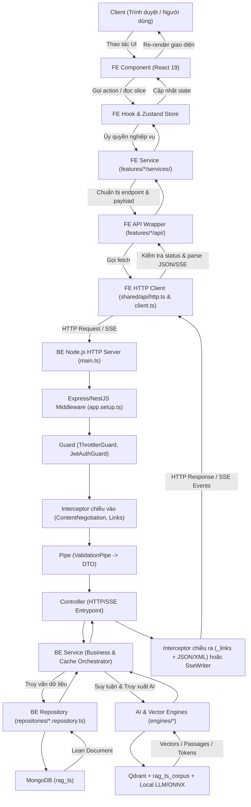

# Kế Hoạch Đặc Tả 7 Luồng Request–Response Trọng Yếu End-to-End (`RAG_TS`)

- **Motivation/Background**: Giảng viên hướng dẫn yêu cầu dự án phải chứng minh tối thiểu 5 luồng nghiệp vụ khép kín đi xuyên suốt từ `Client → FE (Component → Hook → Service → API → HTTP Client) → HTTP Request → BE (Node HTTP → Middleware → Guard → Interceptor [In] → Pipe → Controller → Service → Repository / AI Engine → Database) → BE Return (Repository → Service → Controller → Interceptor [Out] → HTTP Response) → FE Return (HTTP Client → API → Service → Hook/Store → Component) → Client`. Dù `RAG_TS` vừa hoàn tất chuẩn hóa tầng theo [quyết định D-063](../AI_chat_log/Vuong_chat_logs.md), hệ thống cần bộ tài liệu chi tiết từng bước (file, ký hiệu, Input/Output, sơ đồ Mermaid) làm bằng chứng kiến trúc.
- **Purpose**: Chốt 7 luồng FE ↔ BE quan trọng nhất của `RAG_TS`, phân công song song cho 7 subagent độc lập biên soạn 7 file `.md` tiếng Việt chuẩn mực (giữ thuật ngữ tiếng Anh phổ biến), kèm khuôn mẫu thống nhất và quy trình kiểm chứng tự động.
- **Overview Pipeline**: Lựa chọn 7 luồng đại diện đủ `POST`/`GET`/`PATCH`/`DELETE`/`SSE` → Ghi đặc tả kế hoạch (`plan_7_request_response_flows.md`) → Điều phối 7 subagent đọc mã nguồn thật và xuất [`docs/architecture/flows/01_*.md`](../architecture/flows/01_user_registration_flow.md)..[`07_*.md`](../architecture/flows/07_paper_citation_inspection_flow.md) → Tổng hợp [`docs/architecture/flows/README.md`](../architecture/flows/README.md) + cập nhật [`docs/INDEX.md`](../INDEX.md) → Kiểm chứng link và cú pháp Mermaid.
- **Detailed Plan**: §1 Chuẩn hóa luồng Request–Response mục tiêu; §2 Danh sách 7 luồng trọng yếu; §3 Ma trận phân chia 7 subagent; §4 Khuôn mẫu `.md` bắt buộc (bảng 4 giai đoạn + 2 sơ đồ Mermaid); §5 Quy trình tổng hợp & kiểm chứng.
- **References**: [AGENTS.md](../../AGENTS.md), [backend_rag/AGENTS.md](../../backend_rag/AGENTS.md), [frontend_rag/AGENTS.md](../../frontend_rag/AGENTS.md), [agents/rules/MD_CONVENTION.md](../../agents/rules/MD_CONVENTION.md), [docs/api/API_DESIGN.md](../api/API_DESIGN.md), [docs/architecture/ARCHITECTURE_OVERVIEW.md](../architecture/ARCHITECTURE_OVERVIEW.md).
- **Created**: 2026-11-26T10:11:00+07:00
- **Last Updated**: 2026-11-26T10:11:00+07:00

[STATUS: ACTIVE]

---

## 1. Bối Cảnh & Luồng Kiến Trúc Mục Tiêu

Mỗi luồng trong `RAG_TS` được ánh xạ trực tiếp vào xương sống Request–Response nhiều tầng sau (trong đó các AI/Vector Engine ở `backend_rag/src/engines/` đứng ngang hàng với tầng `Repository`, chịu sự điều phối của `Service`):

---

## 2. Danh Sách 7 Luồng Trọng Yếu Được Chọn

Thay vì phải chẻ nhỏ gượng ép cho đủ 5 luồng, `RAG_TS` sở hữu sẵn **7 luồng end-to-end hoàn chỉnh (`FE ↔ BE ↔ DB/AI`)**, bao phủ đầy đủ các phương thức `POST`, `GET`, `PATCH`, `DELETE`, `SSE` và mọi điểm nhấn bảo mật, hiệu năng, AI:

| STT | Tên Luồng | Endpoint Chính | Tầng Hạ Tầng Đích | Điểm Nhấn Kỹ Thuật Bảo Vệ Trước Hội Đồng |
| :---: | :--- | :--- | :--- | :--- |
| **01** | **Đăng ký Tài khoản & Chính sách Mật khẩu** | `POST /api/v1/users` | MongoDB (`users`, `refresh_tokens`) | Chặn 200 mật khẩu phổ biến + trùng local-part email, `Argon2id` (`64 MB`, `UV_THREADPOOL_SIZE=4`), `409` email trùng |
| **02** | **Đăng nhập & Chống Brute-Force** | `POST /api/v1/auth/tokens` | MongoDB (`login_attempts`, `users`, `refresh_tokens`) | Anti-enumeration bằng `DUMMY_HASH`, khóa brute-force theo `sha256(email\|ip)` TTL 15 phút, `LRUCache`, `mapAuthError` tiếng Việt ở FE |
| **03** | **Tự động Xoay vòng Token `401` & Phát hiện Replay** | `POST /api/v1/auth/token-rotations` | MongoDB (`refresh_tokens`, `users`) | Tự động chặn `401` trong `apiFetch`, khóa đa tab `navigator.locks`, 1-RTT atomic `findOneAndUpdate`, thu hồi cả `family_id` khi replay |
| **04** | **Hỏi đáp Khoa học RAG & Streaming LLM qua SSE** | `POST /api/v1/rag/chat/stream` *(đối chiếu `/rag/chat`)* | MongoDB (`chat_requests`, `chat_sessions`, `chat_messages`) + Qdrant + Laya + Qwen 2.5-7B | Vị trí tầng AI ngang hàng `Repository`, `Idempotency-Key` resume `180s`, `SseWriter`, Evidence/Groundedness Gate, `useDeferredValue` KaTeX & 3D |
| **05** | **Đồng bộ Lịch sử Offline-First & Cursor UUIDv7** | `GET /api/v1/chat-sessions` & `/:id/messages` | IndexedDB (`Dexie.js`) + MongoDB (`chat_sessions`, `chat_messages`) | Offline-first Dexie Cache-First, phân trang keyset cursor UUIDv7, `LRUCache` phân phiên bản (`userGen`) + `Singleflight` gánh `400 CUs` |
| **06** | **Đổi tên & Xóa mềm Idempotent Phiên Chat** | `PATCH` & `DELETE /api/v1/chat-sessions/:id` | IndexedDB (`Dexie.js`) + MongoDB (`chat_sessions`, `chat_messages`) | `DELETE` idempotent `204`, xóa mềm TTL 3 ngày (`deleted_at`), `bumpUserGen` `O(1)`, ẩn quyền sở hữu (`404` thay vì `403`) |
| **07** | **Đối chiếu Trích dẫn & Tra cứu Bài báo** | `GET /api/v1/papers/:paper_id` & `?ids=...` | Qdrant (`scientific_papers_gold`) + MongoDB (`rag_ts_corpus`) | FE batch-coalescing `10ms` (tối đa `20` bài), `PapersService` `LRUCache`, phân loại `grounded` / `browse` / `unverified`, hạ tầng đọc-chỉ (`read-only`) |

---

## 3. Kế Hoạch Phân Chia Công Việc Cho 7 Subagents

Mỗi subagent chỉ đọc các file thuộc phạm vi luồng mình phụ trách và **chỉ xuất duy nhất 1 file `.md`** vào thư mục `docs/architecture/flows/` để tránh xung đột ghi đè:

| Subagent | File Đầu Ra | Đường dẫn Mã Nguồn FE Chính | Đường dẫn Mã Nguồn BE Chính |
| :--- | :--- | :--- | :--- |
| **Agent 1** | [`01_user_registration_flow.md`](../architecture/flows/01_user_registration_flow.md) | `features/auth/{AuthOverlay.tsx,hooks/useAuth.ts,authStore.ts,services/authService.ts,api/authApi.ts}`, `shared/api/{http.ts,errors.ts,config.ts}` | `main.ts`, `app.setup.ts`, `app.module.ts`, `common/{security/throttler.ts,http/validation.ts,http/hateoas.ts,http/xml.ts,http/http-exception.filter.ts}`, `modules/auth/{users.controller.ts,auth.service.ts,common-passwords.ts,token.service.ts,dto/auth.dto.ts,repositories/}` |
| **Agent 2** | [`02_auth_login_flow.md`](../architecture/flows/02_auth_login_flow.md) | `features/auth/{AuthOverlay.tsx,hooks/useAuth.ts,authStore.ts,services/authService.ts,api/authApi.ts}`, `features/chat/components/ChatPanel.tsx`, `shared/api/{http.ts,errors.ts}` | `main.ts`, `app.setup.ts`, `common/{security/throttler.ts,http/validation.ts,http/hateoas.ts,http/xml.ts,http/http-exception.filter.ts}`, `modules/auth/{auth.controller.ts,auth.service.ts,token.service.ts,dto/auth.dto.ts,repositories/}` |
| **Agent 3** | [`03_auth_token_rotation_flow.md`](../architecture/flows/03_auth_token_rotation_flow.md) | `shared/api/http.ts`, `features/auth/{authStore.ts,services/authService.ts,api/authApi.ts,hooks/useAuth.ts}` | `modules/auth/{guards/jwt-auth.guard.ts,auth.controller.ts,auth.service.ts,token.service.ts,dto/auth.dto.ts,repositories/}`, `common/{security/throttler.ts,http/hateoas.ts,http/http-exception.filter.ts}` |
| **Agent 4** | [`04_rag_llm_streaming_flow.md`](../architecture/flows/04_rag_llm_streaming_flow.md) | `features/chat/{components/ChatInput.tsx,PipelineStatus.tsx,MessageList.tsx,MessageBubble.tsx,Markdown.tsx,hooks/useChatWorkspace.ts,store/ragStore.ts,store/pipeline.ts,services/ragChatService.ts,services/chatSessionService.ts,api/chatApi.ts}`, `shared/api/{client.ts,http.ts,sseParser.ts}` | `modules/rag/{rag.controller.ts,rag.service.ts,dto/chat-request.dto.ts,transport/sse.ts,transport/client-slots.ts,pipeline/}`, `modules/auth/guards/jwt-auth.guard.ts`, `modules/chat-sessions/{chat-sessions.service.ts,chat-requests.service.ts,repositories/}`, `engines/{mining,embedding,tree-router,vector-store,corpus,judge,llm}/*` |
| **Agent 5** | [`05_chat_history_sync_flow.md`](../architecture/flows/05_chat_history_sync_flow.md) | `features/chat/{components/ChatPanel.tsx,HistoryDrawer.tsx,hooks/useChatWorkspace.ts,store/sessionStore.ts,services/chatSessionService.ts,api/chatApi.ts,db/chatDb.ts,lib/messageMapping.ts}`, `shared/api/http.ts` | `modules/chat-sessions/{chat-sessions.controller.ts,chat-sessions.service.ts,chat-session.mapper.ts,dto/chat-session.dto.ts,repositories/}`, `modules/auth/guards/jwt-auth.guard.ts`, `common/{pagination/pagination.ts,security/sanitize.ts,http/hateoas.ts}` |
| **Agent 6** | [`06_chat_session_mutation_flow.md`](../architecture/flows/06_chat_session_mutation_flow.md) | `features/chat/{components/HistoryDrawer.tsx,hooks/useChatWorkspace.ts,store/sessionStore.ts,store/ragStore.ts,services/chatSessionService.ts,api/chatApi.ts,db/chatDb.ts}`, `shared/api/http.ts` | `modules/chat-sessions/{chat-sessions.controller.ts,chat-sessions.service.ts,chat-session.mapper.ts,dto/chat-session.dto.ts,repositories/,schemas/chat-session.schema.ts}`, `modules/auth/guards/jwt-auth.guard.ts`, `common/http/hateoas.ts` |
| **Agent 7** | [`07_paper_citation_inspection_flow.md`](../architecture/flows/07_paper_citation_inspection_flow.md) | `features/chat/components/CitationChip.tsx`, `features/result/{PaperPanel.tsx,ResultCard.tsx,TopKBadges.tsx,usePaper.ts,hooks/usePaperInspector.ts,services/resultService.ts,api/resultApi.ts,lib/resultCase.ts,lib/arxiv.ts}`, `shared/api/{client.ts,http.ts}` | `modules/papers/{papers.controller.ts,papers.service.ts,dto/paper-detail.dto.ts}`, `engines/{vector-store,corpus,tree-router}/*`, `common/{pagination/pagination.ts,security/throttler.ts,http/hateoas.ts}` |

---

## 4. Khuôn Mẫu Chuẩn Cho Từng File `.md`

Mỗi file `docs/architecture/flows/0X_*.md` bắt buộc tuân thủ các quy tắc sau:

1. **Header 7 trường + Badge Trạng thái** (theo [`agents/rules/MD_CONVENTION.md`](../../agents/rules/MD_CONVENTION.md)):
   - Gồm `Motivation/Background`, `Purpose`, `Overview Pipeline`, `Detailed Plan`, `References`, `Created` (`+07:00`), `Last Updated` (`+07:00`), và dòng `[STATUS: ACTIVE]`.
2. **Văn phong Việt–Anh (Vietnamese-Oriented)**:
   - Diễn giải, tiêu đề mục, mô tả nghiệp vụ viết bằng **tiếng Việt Unicode NFC chuẩn**.
   - Giữ nguyên thuật ngữ kỹ thuật tiếng Anh thông dụng (`Component`, `Hook`, `Service`, `API`, `HTTP Client`, `Middleware`, `Guard`, `Interceptor`, `Pipe`, `Controller`, `Repository`, `Database`, `DTO`, `JWT`, `SSE`, `LRUCache`, `Singleflight`, `Idempotency-Key`, `.lean()`).
3. **2 Sơ đồ Mermaid Bắt buộc**:
   - **Sơ đồ 1 (`flowchart LR` hoặc `flowchart TB`)**: Ánh xạ trực quan từng hộp trong luồng của giảng viên vào đúng tên file/hàm thực tế của `RAG_TS`.
   - **Sơ đồ 2 (`sequenceDiagram`)**: Mô tả trình tự gọi hàm chi tiết theo chiều đi + chiều về kèm nhánh `alt` (lỗi / cache hit / offline fallback).
   - **An toàn cú pháp Mermaid**: Mọi nhãn node chứa `()`, `[]`, `:`, `/`, `@` phải bọc trong ngoặc kép `id["Label (...)"]`; tuyệt đối **không** dùng thẻ HTML (` `, `<b>`, ``).
4. **Bảng Chi Tiết 4 Giai Đoạn (`Input → Xử lý → Output`) + HTTP Wire Payload**:
   - Tách rõ 4 bảng: `Giai đoạn 1: Client → FE → HTTP Request`, `Giai đoạn 2: HTTP Request → BE → Repository/AI Engine → Database`, `Giai đoạn 3: Database → BE → HTTP Response`, `Giai đoạn 4: HTTP Response → FE → Client`.
   - Cột chuẩn: `Bước | Tầng (Layer) | File & Ký hiệu | Đầu vào (Input) | Xử lý Nghiệp vụ & Kỹ thuật | Đầu ra (Output)`.
   - Mọi đường dẫn code phải là **relative markdown link** tính từ `docs/architecture/flows/` (`../../../frontend_rag/...#L..` hoặc `../../../backend_rag/...#L..`) đã kiểm tra đúng số dòng trên file thật.
   - Kèm khối code minh họa **HTTP Request** và **HTTP Response** (hoặc **SSE events**) thực tế.
5. **Mục Nhánh Lỗi & Bất biến Hệ thống (Error Paths & Invariants)**:
   - Liệt kê các mã lỗi HTTP (`400`, `401`, `404`, `409`, `429`, `503`/`504`) đi qua `HttpExceptionFilter`, cách FE xử lý, và các bất biến liên quan.

---

## 5. Quy Trình Tổng Hợp & Kiểm Chứng

1. Kích hoạt đồng thời 7 subagent qua `invoke_subagent` để xuất `01_*.md`..`07_*.md`.
2. Tạo [`docs/architecture/flows/README.md`](../architecture/flows/README.md) làm mục lục tổng hợp cho toàn bộ 7 luồng.
3. Cập nhật [`docs/INDEX.md`](../INDEX.md) đăng ký kế hoạch này, thư mục `flows/README.md` và cả 7 tài liệu luồng.
4. Chạy script kiểm tra tự động: xác nhận đủ 7 trường header, không có link tương đối gãy (`0` broken links), đủ `>= 2` khối Mermaid hợp lệ mỗi luồng và `0` thẻ HTML bên trong khối Mermaid.
