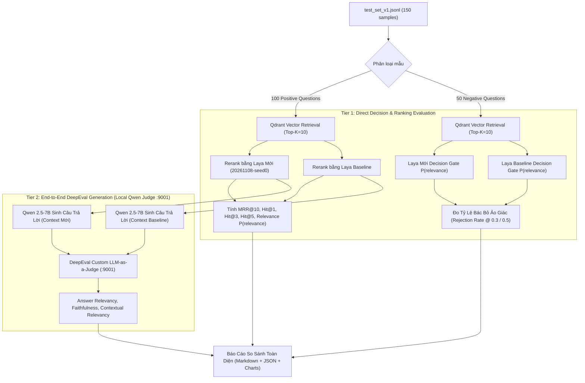

# Kế Hoạch Benchmark: Laya Mới (20261108-seed0) vs Laya Baseline

- **Motivation/Background**: Người dùng đã cung cấp checkpoint mới `laya_onnx_20261108-2053_seed0` (được huấn luyện với loss `soft-ce` ngày 08/11/2026, cải thiện AUC từ 0.6848 lên 0.8928 và MRR từ 0.707 lên 0.9546 trên tập dev) và yêu cầu đối đầu với Laya Pretrained Baseline trên tập kiểm thử chuẩn `test_set_v1.jsonl` (150 câu: 100 positive + 50 negative) sử dụng DeepEval với Local Qwen 2.5-7B Judge qua cổng 9001 ($0.00 chi phí).
- **Purpose**: Thiết lập quy trình benchmark hai tầng (Tier 1: Direct Decision & Ranking; Tier 2: End-to-End DeepEval Generation) để chứng minh định lượng bước nhảy vọt về khả năng triệt tiêu ảo giác, lọc câu hỏi ngoài chủ đề, và độ chuẩn xác ranking của mô hình mới.
- **Overview Pipeline**: Preflight Checks (Qdrant, Qwen 9001 Server, Datasets) → Pilot Run (15 cases: 10 pos + 5 neg) → Full Run (150 cases) → Metric Aggregation & Delta Comparison → Báo cáo trực quan (Tables, Graphs, Markdown report).
- **Detailed Plan**: 
  - §1 Mục tiêu & Phạm vi đánh giá hai tầng (Two-Tier Evaluation Scope).
  - §2 Kiến trúc & Thiết lập môi trường (Qdrant, Local Qwen 7B on port 9001, ONNX Runtime).
  - §3 Triển khai script đánh giá chuyên biệt `benchmarks/evaluate_laya_ab_testset.py`.
  - §4 Kế hoạch chạy thử nghiệm (Pilot 15 câu $\rightarrow$ Full 150 câu).
  - §5 Định dạng báo cáo & Kiểm tra tính hợp lệ.
- **References**: [test_set_v1.jsonl](file:///C:/Users/TDV/Downloads/test_set_v1.jsonl), [models/laya_onnx_20261108-2053_seed0](file:///C:/document/Study%20documents/backend_rag/RAG_TS/models/laya_onnx_20261108-2053_seed0), [models/laya](file:///C:/document/Study%20documents/backend_rag/RAG_TS/models/laya), [custom_judge.py](file:///C:/document/Study%20documents/Uth-Data-Mining/benchmarks/judges/custom_judge.py).
- **Created**: 2026-11-09T17:45:00+07:00
- **Last Updated**: 2026-11-09T17:51:00+07:00

[STATUS: ACTIVE]

---

## 1. Mục Tiêu & Phạm Vi Đánh Giá Hai Tầng (Two-Tier Evaluation)

Dựa trên thống nhất trong phiên `/grill-me`, benchmark sẽ triển khai cấu trúc **2 tầng toàn diện** để không chỉ đo lường khả năng xếp hạng văn bản mà còn đánh giá toàn diện trải nghiệm sinh câu trả lời của người dùng:



### Chi Tiết Chỉ Số Từng Tầng:
1. **Tier 1 — Đánh giá Reranking & Decision Gate (Chất lượng lõi của Laya)**:
   - **Positive Queries (100 câu)**:
     - `MRR@10` (Mean Reciprocal Rank so với `gold_chunk`).
     - `Hit@1` (Độ chính xác Top 1).
     - `Hit@3` và `Hit@5`.
     - `Mean Relevance Confidence`: Điểm số xác suất $P(\text{relevance})$ gán cho `gold_chunk`.
     - `Latency`: Thời gian suy luận trung bình trên mỗi lượt rerank (ms).
   - **Negative Queries (50 câu off-topic/adversarial)**:
     - `False Acceptance Rate @ 0.5`: Tỷ lệ chấp nhận nhầm câu hỏi ngoài chủ đề (thấp hơn là tốt hơn).
     - `True Rejection Rate @ 0.5 & @ 0.3`: Tỷ lệ bác bỏ chính xác (chặn đứng hallucination từ vòng gửi xe).
2. **Tier 2 — Đánh giá Chất lượng Sinh Câu Trả Lời (DeepEval Local Qwen)**:
   - `Answer Relevancy`: Mức độ bám sát câu hỏi người dùng của câu trả lời do LLM sinh ra.
   - `Faithfulness`: Mức độ trung thực với tài liệu tham chiếu (không tự suy diễn hoặc bịa số liệu).
   - `Contextual Relevancy`: Tỷ lệ câu/từ thực sự hữu ích trong ngữ cảnh mà Laya chọn lọc đưa cho LLM.

---

## 2. Thiết Lập Môi Trường & Preflight Verification

Trước khi bắt đầu bất kỳ vòng chạy nào, script phải tự động kiểm tra nghiêm ngặt 3 tiền điều kiện:

1. **Kiểm tra Qdrant Server**:
   - Endpoint: `https://qdrant.minio-quangmanh.io.vn` (Collection: `scientific_papers_gold`).
   - Gửi yêu cầu HTTP health/telemetry để xác nhận Qdrant đang online (vì server local của máy khác không hoạt động 24/7). Nếu Qdrant offline, script lập tức dừng lại và thông báo rõ ràng, **tuyệt đối không âm thầm fallback sang LanceDB hay sinh mock data**.
2. **Kiểm tra Local Qwen Judge Server (Port 9001)**:
   - Endpoint: `http://localhost:9001/v1/chat/completions`.
   - Khởi chạy nền máy chủ `node-llama-cpp server`:
     ```powershell
     npx --prefix backend_rag node-llama-cpp server --model models/qwen2.5-7b-instruct-q4_k_m/qwen2.5-7b-instruct-q4_k_m.gguf --port 9001
     ```
   - Thử gửi 1 payload chat completion kiểm tra kết nối với timeout ngắn.
3. **Kiểm tra 2 Checkpoint Laya**:
   - **Laya Mới**: `models/laya_onnx_20261108-2053_seed0` (ONNX FP32 weights 1.68GB, nạp qua ONNX Runtime).
   - **Laya Baseline**: `models/laya/model.safetensors` (Pretrained Laya, nạp qua PyTorch/Transformers hoặc ONNX baseline).

---

## 3. Các Thay Đổi & File Đề Xuất (Proposed Implementation)

### 3.1 Script Benchmark Mới: `benchmarks/evaluate_laya_ab_testset.py`
Tạo script Python độc lập và tự chứa trong thư mục `C:\document\Study documents\Uth-Data-Mining\benchmarks\evaluate_laya_ab_testset.py` với các tính năng:
- **Nạp tập dữ liệu**: Đọc trực tiếp `C:\Users\TDV\Downloads\test_set_v1.jsonl`.
- **Preflight Checkers**:
  - `check_qdrant_online()`: Kết nối Qdrant client, kiểm tra collection `scientific_papers_gold`.
  - `check_qwen_judge_online()`: Ping cổng 9001.
- **Bộ tải Model kép**:
  - `LayaNew`: Sử dụng ONNX Runtime nạp `models/laya_onnx_20261108-2053_seed0` (chạy trên CUDA Provider hoặc CPU fallback).
  - `LayaBase`: Nạp baseline Laya gốc.
- **Xử lý 2 Tầng**:
  - Tầng 1: Lấy Top-10 từ Qdrant cho mỗi câu hỏi, chạy rerank song song với cả 2 model Laya, tính toán MRR, Hit@1, Hit@3, Hit@5 và xác suất $P(\text{relevance})$.
  - Tầng 2: Gọi Qwen 7B sinh câu trả lời cho context của từng model, sau đó chạy DeepEval metrics (`AnswerRelevancyMetric`, `FaithfulnessMetric`, `ContextualRelevancyMetric`) sử dụng `CustomDeepEvalJudge(mode="local")`.
- **Hỗ trợ cờ `--pilot`**:
  - Cho phép chạy 15 mẫu (10 pos + 5 neg) trước khi chạy toàn bộ 150 mẫu.
- **Xuất kết quả chi tiết**:
  - JSON kết quả lưu tại `logs/benchmarks/laya_ab_benchmark_results.json`.
  - Markdown report so sánh lưu tại `docs/reports/LAYA_AB_BENCHMARK_REPORT.md`.

---

## 4. Kế Hoạch Kiểm Thử & Thực Thi Từng Bước

### Giai đoạn 1: Preflight & Khởi Chạy Local Qwen Judge
1. Khởi chạy `node-llama-cpp server` trên cổng 9001 với `qwen2.5-7b-instruct-q4_k_m.gguf`.
2. Chạy lệnh ping kiểm tra `curl http://localhost:9001/v1/models`.
3. Kiểm tra kết nối Qdrant HTTPS.

### Giai đoạn 2: Vòng Chạy Pilot Kiểm Chứng (15 Mẫu)
1. Thực thi:
   ```bash
   python -m benchmarks.evaluate_laya_ab_testset --pilot --limit-pos 10 --limit-neg 5
   ```
2. Xác nhận:
   - Cả 2 model Laya nạp và tính toán không lỗi.
   - DeepEval Local Qwen trả về điểm số hợp lệ trên cả 3 metrics (không bị JSONDecodeError hay crash).
   - Tầng 1 và Tầng 2 in kết quả đối chiếu sơ bộ.

### Giai đoạn 3: Vòng Chạy Toàn Bộ (Full 150 Mẫu)
1. Thực thi benchmark đầy đủ:
   ```bash
   python -m benchmarks.evaluate_laya_ab_testset --full
   ```
2. Ghi nhận logs liên tục, lưu cache checkpoint sau mỗi 10 câu để chống mất mát dữ liệu nếu gặp sự cố mạng.

### Giai đoạn 4: Tổng Hợp & Lập Báo Cáo Đối Đầu
1. Xuất file báo cáo Markdown chuẩn `MD_CONVENTION.md` với bảng so sánh Delta (+/- %) chi tiết:
   - MRR Delta.
   - Hit@1 / Hit@5 Delta.
   - Tỷ lệ giảm Hallucination (False Acceptance Reduction).
   - Điểm số DeepEval Answer Relevancy & Faithfulness.
2. Đăng ký tài liệu mới vào `docs/INDEX.md`.
