# TECHNICAL_PRESENTATION_CHECKLIST.md — Checklist Thuyết Trình Kỹ Thuật Hệ Thống `RAG_TS`

- **Motivation/Background**: Trước buổi thuyết trình kỹ thuật dự án `RAG_TS` (Scientific Literature RAG + 3D Knowledge Tree), kỹ sư và giảng viên phản biện thường đi thẳng vào 3 nhóm câu hỏi cốt lõi: số liệu thực nghiệm (latency, cost, quy mô chịu tải), luồng xử lý lỗi và điều kiện đo thực tế. Tài liệu này tổng hợp cô đọng, chính xác toàn bộ 10 hạng mục của checklist thuyết trình kỹ thuật từ mã nguồn, cấu hình và báo cáo benchmark hiện có trong repository.
- **Purpose**: Cung cấp một tài liệu tham chiếu đầy đủ (single-page technical reference) trả lời toàn bộ 10 nhóm câu hỏi thuyết trình kỹ thuật với 100% số liệu, endpoint, schema, thông số model, độ phủ test và nguồn kiểm chứng `[S1]–[S27]` trong `RAG_TS` (kèm bản rút gọn dạng slide tại [TECHNICAL_PRESENTATION_COMPACT.md](TECHNICAL_PRESENTATION_COMPACT.md)).
- **Overview Pipeline**: Đối chiếu trực tiếp mã nguồn (`backend_rag/src/`, `frontend_rag/src/`), cấu hình đóng gói (`Dockerfile`, `docker-compose.yml`, `env.schema.ts`), đặc tả API/DB/Design System (`docs/api/`, `backend_rag/docs/`, `docs/design/`) và báo cáo/JSON gốc (k6, DeepEval/Laya, Grafana RUM, Lighthouse, Vitest/Jest, security audit).
- **Detailed Plan**: Bao gồm 10 mục tương ứng 1:1 với checklist thuyết trình kỹ thuật: (1) Bài toán & yêu cầu; (2) Luồng hệ thống; (3) Module AI; (4) Backend; (5) Frontend; (6) Cấu trúc project; (7) Test; (8) Đóng gói & triển khai; (9) Bảo mật; (10) Performance với k6 — kèm Phụ lục phản biện nhanh và Bảng đối chiếu Nguồn `[S1]–[S27]` ở cuối tài liệu.
- **References**: [TECHNICAL_PRESENTATION_COMPACT.md](TECHNICAL_PRESENTATION_COMPACT.md), [AGENTS.md](../../AGENTS.md), [ARCHITECTURE_OVERVIEW.md](../architecture/ARCHITECTURE_OVERVIEW.md), [API_DESIGN.md](../api/API_DESIGN.md), [API-compare.md](../api/API-compare.md), [API_SPECIFICATION.md](../api/API_SPECIFICATION.md), [MONGODB_SCHEMA_DESIGN.md](../../backend_rag/docs/MONGODB_SCHEMA_DESIGN.md), [PERFORMANCE_AND_CACHING.md](../../backend_rag/docs/PERFORMANCE_AND_CACHING.md), [BOTTLENECK_ANALYSIS_AND_OPTIMIZATION.md](../../backend_rag/benchmark/BOTTLENECK_ANALYSIS_AND_OPTIMIZATION.md), [VECTOR_VS_LAYA_BENCHMARK_REPORT.md](VECTOR_VS_LAYA_BENCHMARK_REPORT.md), [laya-jev.md](../research/laya-jev.md), [GRAFANA_MONITORING_ANALYSIS.md](../grafana_analysis/GRAFANA_MONITORING_ANALYSIS.md), [FE_DESIGN_SYSTEM.md](../design/FE_DESIGN_SYSTEM.md), [prompt_security.md](../prompts/prompt_security.md), [agent-sec.md](../security/agent-sec.md), [MD_CONVENTION.md](../../agents/rules/MD_CONVENTION.md).
- **Created**: 2026-11-17T16:45:00+07:00
- **Last Updated**: 2026-11-18T09:20:00+07:00

[STATUS: ACTIVE]

---

## Mục lục

- [1. Bài toán &amp; Yêu cầu](#1-bài-toán--yêu-cầu)
- [2. Luồng Hệ thống](#2-luồng-hệ-thống)
- [3. Module AI](#3-module-ai)
- [4. Backend (`backend_rag`)](#4-backend-backend_rag)
- [5. Frontend (`frontend_rag`)](#5-frontend-frontend_rag)
- [6. Cấu trúc Project, Lint, CI/CD &amp; Branching](#6-cấu-trúc-project-lint-cicd--branching)
- [7. Kiểm thử (Test &amp; AI Eval)](#7-kiểm-thử-test--ai-eval)
- [8. Đóng gói &amp; Triển khai](#8-đóng-gói--triển-khai-s19s26)
- [9. Bảo mật](#9-bảo-mật-s18s19)
- [10. Performance với k6 &amp; RUM](#10-performance-với-k6--rum)
- [Phụ lục — Bảng nhớ nhanh khi phản biện (Số liệu · Luồng lỗi · Điều kiện đo)](#phụ-lục--bảng-nhớ-nhanh-khi-phản-biện-số-liệu--luồng-lỗi--điều-kiện-đo)
- [Nguồn Tham chiếu &amp; Đối chiếu Số liệu (Source Ledger `[S1]`–`[S27]`)](#nguồn-tham-chiếu--đối-chiếu-số-liệu-source-ledger-s1s27)

---

## 1. Bài toán & Yêu cầu

### 1.1 Bối cảnh, người dùng & mục tiêu đo được

- **Bối cảnh**: Số lượng bài báo khoa học (arXiv AI/ML/CV/NLP như `cs.LG`, `cs.CL`, `cs.CV`, `cs.AI`, `stat.ML`) tăng nhanh, việc tổng hợp thủ công dễ bỏ sót ngữ cảnh, còn chatbot thuần text dễ **ảo giác trích dẫn** (hallucination) và không cho thấy bức tranh cấu trúc tri thức liên ngành.
- **Người dùng mục tiêu**:
  - **Nhà nghiên cứu / Sinh viên (`role: 'user'`)**: Đặt câu hỏi khoa học, nhận câu trả lời có trích dẫn `[Paper: id]` và công thức toán (`KaTeX`), khám phá trực quan trên Cây Tri Thức Vector 3D (~150k điểm tán lá), quản lý nhiều phiên hội thoại cả khi offline.
  - **Quản trị viên hệ thống (`role: 'admin'`)**: Giám sát trạng thái MongoDB/Qdrant/LLM/Corpus, thống kê hệ thống, khóa/mở khóa/đổi quyền user, theo dõi brute-force và truy vết `admin_audit_logs`.
- **Mục tiêu đo được (Verified Metrics)**:
  - **Chất lượng RAG**: `0` bài báo bịa (`100%` citation trích từ context trên bộ kiểm thử `[S17]`); dùng **Laya Mới (`20261108-seed0`)** trên `150` mẫu `test_set_v1.jsonl` đạt `MRR = 0.8939`, `Hit@1 = 82.0%`, `Hit@5 = 98.0%`, `Reject @0.5 = 100.0%` (`0.0%` False Accept trên câu lạc đề vs `8.0%` ở Pure Vector) `[S15]`; DeepEval trên `105` mẫu `gold` hydrated đạt `Contextual Recall@5 = 0.900`, `Citation Grounding GEval = 0.762` `[S16]`.
  - **Hiệu năng Backend**: Chứng nhận **`400 CUs (250 RPS)`** trong 3 phút Hold-Out trên 6 endpoints CRUD+Auth qua tunnel (`48,874` reqs, `P95 = 265.55 ms < 500 ms`, `P99 = 475.12 ms < 1,000 ms`, `0.00%` error) `[S8][S9]`; Stateless Fast API đạt **`1,600 CUs (3,958.53 RPS)`** trong 5 phút soak (`1,187,560` reqs, `P95 = 379.48 ms`) `[S11]`.
  - **Hiệu năng Frontend**: Lighthouse **Performance `97/100`**, **Accessibility `100/100`**, **Best Practices `100/100`**, `FCP = 0.9 s`, `LCP = 1.0 s`, `TBT = 40 ms`, `CLS = 0.002` `[S20]`; render 3D `150k` vectors khi stream chat đạt **`57.1 ± 1.3 FPS`** (`frameTime median = 17.5 ms`, `p95 = 18.2 ms`, **`0 Long Tasks`** sau tối ưu `D-005`) `[S21]`.

### 1.2 Phạm vi hệ thống (Làm gì / Không làm gì)

| Làm gì (In-Scope)                                                                                                                                                                                                                                                                                                                                                                                                                                                                                                                                               | Không làm gì (Out-of-Scope)                                                                                                                                                                                                                                                                                                                                                                                                                                                                                                                                                        |
| :---------------------------------------------------------------------------------------------------------------------------------------------------------------------------------------------------------------------------------------------------------------------------------------------------------------------------------------------------------------------------------------------------------------------------------------------------------------------------------------------------------------------------------------------------------------- | :------------------------------------------------------------------------------------------------------------------------------------------------------------------------------------------------------------------------------------------------------------------------------------------------------------------------------------------------------------------------------------------------------------------------------------------------------------------------------------------------------------------------------------------------------------------------------------ |
| • Xác thực `Argon2id` + JWT, RBAC `admin`/`user`, audit log bất biến `[S18]`.• Hỏi đáp RAG thời gian thực (REST & SSE streaming) với định tuyến cây 3D + Qdrant + PageRank/FP-Growth + Laya Judge + Local LLM `[S1][S3][S4]`.• Trực quan hóa Cây Tri Thức Vector 3D (`React Three Fiber`) + `PaperPanel` đọc chi tiết chunk `[S1][S24]`.• Lưu trữ lịch sử chat **Offline-First** (`Dexie.js` IndexedDB + MongoDB UUIDv7) `[S1][S24]`.• Giám sát Prometheus `/api/v1/metrics` & Grafana RUM `[S14]`. | • **Không cào data, không tạo embedding hàng loạt, không ghi Qdrant/`rag_ts_corpus`**: backend chỉ **đọc** từ kho tri thức (`scientific_papers_gold` và `rag_ts_corpus`); pipeline Datamining riêng (FastAPI `/pipeline/*` cổng `8000`) phụ trách ingest `[S5]`.• **Admin không có API xóa nội dung chat hoặc sửa/xóa `admin_audit_logs`** (bảo toàn chứng cứ điều tra) `[S18]`.• **Không hỗ trợ đăng nhập mới khi backend chết** (bắt buộc backend xác minh `Argon2id` và ký JWT) `[S18]`. |

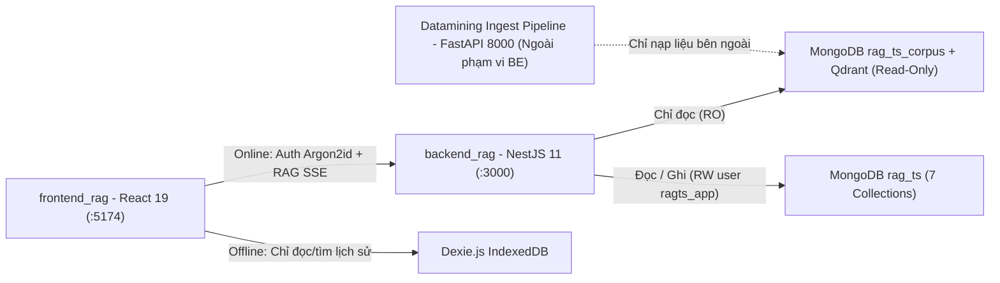

### 1.3 Yêu cầu chức năng (5 Use Case chính)

1. **UC-01 — Xác thực & Vòng đời tài khoản**: Đăng ký (`POST /users`), đăng nhập (`POST /auth/tokens`), tự động xoay vòng refresh token (`POST /auth/token-rotations`), đăng xuất (`POST /auth/token-revocations`), đổi mật khẩu (`PUT /users/me/password`) `[S2][S18]`.
2. **UC-02 — Hỏi đáp RAG Streaming đồng bộ 3D**: Gửi câu hỏi (`POST /rag/chat/stream`), theo dõi tiến trình 5 pha (`embedding` → `flying` → `comparing` → `found` → `generating`), stream token, đối chiếu trích dẫn `[Paper: id]` và công thức LaTeX `[S1][S3][S24]`.
3. **UC-03 — Khám phá Cây Tri Thức 3D & Chi tiết bài báo**: Bay camera theo nhánh định tuyến (`TreeRouter`), highlight cụm bài báo Top-K (`TopKThreads`), bấm citation để xem metadata/chunks (`GET /papers/:paper_id` hoặc batch `GET /papers?ids=`) `[S1][S2][S24]`.
4. **UC-04 — Quản lý phiên hội thoại Offline-First**: Tự động tạo phiên UUIDv7 khi gửi câu đầu, phân trang cursor 10 phiên/trang, tìm kiếm `?q=`, đổi tên (`PATCH`), xóa mềm (`DELETE` 2 bước xác nhận, MongoDB TTL tự xóa cứng sau 3 ngày), xem lại toàn bộ lịch sử khi mất kết nối backend `[S2][S6][S24]`.
5. **UC-05 — Quản trị & Kiểm toán RBAC (`/admin/*`)**: Xem thống kê, khóa/mở khóa tài khoản, đổi role `user ↔ admin`, thu hồi phiên, giám sát `login_attempts`, xem health chi tiết và tra cứu `admin_audit_logs` `[S2][S18]`.

### 1.4 Yêu cầu phi chức năng & Quy mô

| Hạng mục                                   | Chỉ tiêu (SLA / Target)                     | Kết quả đo thực tế trong repo                                                                                                                                                                                                                                                                                                                                                                                                           |
| :------------------------------------------- | :-------------------------------------------- | :------------------------------------------------------------------------------------------------------------------------------------------------------------------------------------------------------------------------------------------------------------------------------------------------------------------------------------------------------------------------------------------------------------------------------------------- |
| **Latency P95 (REST CRUD/Auth)**       | `< 500 ms` (Fast API `< 300 ms`) `[S7]` | **`265.55 ms`** @ `250 RPS` k6 `[S9]`; **`41.96 – 66.75 ms`** ở Grafana RUM `[S14]`                                                                                                                                                                                                                                                                                                                                  |
| **Latency P99 (REST CRUD/Auth)**       | `< 1,000 ms` `[S7]`                       | **`475.12 ms`** @ `250 RPS` k6 `[S9]`; **`41.95 – 95.00 ms`** ở Grafana RUM `[S14]`                                                                                                                                                                                                                                                                                                                                  |
| **Latency RAG (End-to-End LLM)**       | Turnaround client `≤ 60,000 ms` `[S3]`   | Không tải: **`~8.1 – 14.2 s`** (`8.1–11.8 s` bản đơn luồng `[S20]`); hàng đợi GPU thật `16` VUs: slots 1–3 **`30.53 s`**, 4–6 **`55.59 s`**, 7–9 **`79.18 s`** `[S13]`                                                                                                                                                                                                                |
| **Throughput**                         | Tối đa không vi phạm SLA 3 phút `[S7]` | **`250 RPS`** (Auth+Session CRUD 3m hold-out `[S9]`, Stage A tới **`300 RPS`** 30s `[S8]`) / **`3,958.53 RPS`** (`/health` 5m soak `[S11]`)                                                                                                                                                                                                                                                                 |
| **Uptime / Availability**              | `< 1%` error rate khi chịu tải `[S7]`   | `0.00%` error rate trong k6 hold-out `250 RPS` `[S9]`; Grafana RUM ghi nhận LLM `100% UP` (Window 1) và `99.54% UP` (Window 2 — 10s restart tại `20:20:50`) `[S14]`                                                                                                                                                                                                                                                        |
| **Quy mô thực nghiệm (DAU / Peak)** | Chịu tải nhóm nghiên cứu + load test     | **Grafana RUM thật**: Peak **`11` active users (5m)**, **`9` concurrent users (1m)**, **`3` SSE streams đồng thời** `[S14]`.**Năng lực tối đa đo bằng k6**: **`400 CUs`** CRUD/Session `[S9]`; **`1,600 CUs`** Gateway `[S11]`; **`1 active + 8 queue`** trên 1 GPU RTX 4060 8 GB `[S4][S13]` *(chưa vận hành production công cộng quy mô DAU lớn)*. |

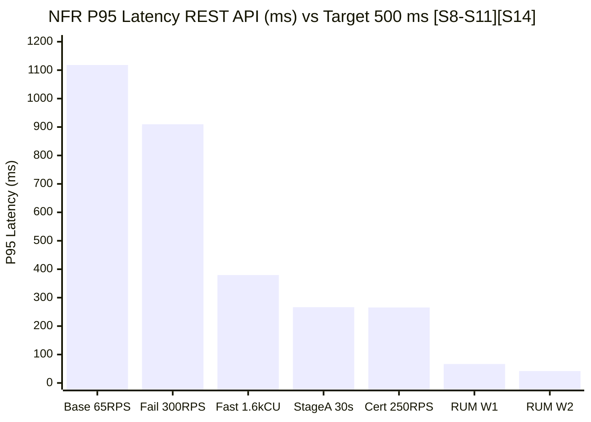

---

## 2. Luồng Hệ thống

### 2.1 Sequence Diagram cho luồng chính (`POST /api/v1/rag/chat/stream`) `[S1][S3][S24]`

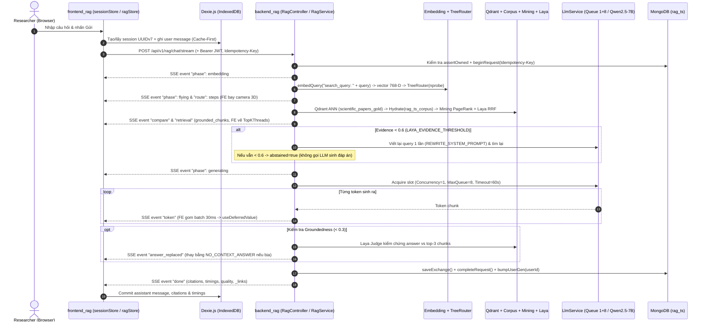

### 2.2 Luồng dữ liệu: Nguồn → Xử lý → Lưu → Output

1. **Nguồn (Data Sources)**:
   - **Qdrant (`scientific_papers_gold`, chỉ đọc)**: `913,205` vector `768-D` L2-normalized kèm `paper_id`, `chunk_id`, `primary_category`, `twig_id`, `year` *(thay thế LanceDB prototype ban đầu)* `[S5]`.
   - **MongoDB `rag_ts_corpus` (chỉ đọc via `CORPUS_MONGO_URI`)**: Nguồn chân lý chứa toàn văn `text`, `section_title`, `title`, `authors` (`CorpusService.hydrate`, timeout `5,000 ms`) `[S5]`.
   - **Tài nguyên tĩnh (`data/gold/mining/`, `data/world/`)**: `graph_coauthorship.json` (`29,523` tác giả có PageRank `[S16]`), `association_rules.json` (`30` luật FP-Growth `[S1]`), `tree.json` (tọa độ & centroids cây 3D `[S1]`).
2. **Xử lý (Processing)**:
   - Chuẩn hóa query (`normalizeQuery`), tiền tố `search_query: `, tùy chọn mở rộng từ khóa FP-Growth → vector 768-D → định tuyến `TreeRouter` → truy vấn Qdrant → hydrate `rag_ts_corpus` → rerank `0.85 * sim + 0.15 * authority` + RRF (`k = 60`) với Laya → Evidence Gate (`0.6`) → Prompt grounded + LLM stream (`temp = 0.2`) → Groundedness Gate (`0.3`) → `extractCitations` `[S3][S4][S15]`.
3. **Lưu (Storage)**:
   - **Backend (`MongoDB rag_ts`)**: `chat_sessions`, `chat_messages` (UUIDv7, soft-delete TTL 3 ngày), `chat_requests` (`Idempotency-Key`, TTL 24h), cùng `LRUCache` in-memory (300s sliding TTL) với bộ đếm `userListGen` $O(1)$ invalidation `[S6][S7]`.
   - **Frontend (`Dexie.js IndexedDB`)**: Bảng `sessions` và `messages` khóa UUIDv7 làm nguồn chân lý hiển thị tức thời (`< 15 ms`) `[S24]`.
4. **Output**:
   - REST `ChatResponseDto` (JSON/XML kèm `_links`) hoặc SSE `text/event-stream` (`phase`, `route`, `compare`, `retrieval`, `token`, `answer_replaced`, `done`, `error`, `: ping` mỗi `15 s`) `[S2][S3]`.

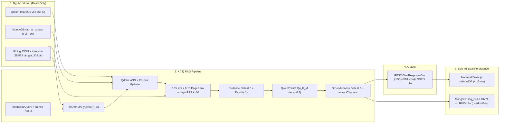

### 2.3 Luồng lỗi: Timeout, Retry, Fallback & Mã lỗi chuẩn

- **Timeout theo từng chặng**:

  - `QDRANT_TIMEOUT_MS = 15,000 ms` → `503 qdrant unavailable` `[S3]`.
  - `CORPUS_TIMEOUT_MS = 5,000 ms` → `503 corpus unavailable` `[S5]`.
  - `LAYA_TIMEOUT_MS = 30,000 ms` → không sập request; trả `null` để fallback `[S4]`.
  - `LLM_TIMEOUT_MS = 60,000 ms` → abort sinh token, giải phóng slot và trả `504 llm timeout` `[S3][S4]`.
  - Frontend health probe `/api/v1/health`: timeout `2,000 ms` → chuyển badge `Ngoại tuyến` `[S24]`.
- **Retry & Idempotency**:

  - Client `apiFetch` ([`http.ts`](../../frontend_rag/src/shared/api/http.ts)) tự động **rotate token 1 lần khi gặp `401`** (điều phối bằng Web Lock giữa các tab) `[S24]`.
  - `POST /rag/chat*` **không auto-retry mù** ở backend để tránh làm tràn hàng đợi GPU; thay vào đó client gửi **`Idempotency-Key: <uuid>`** (hợp lệ 24h): nếu lần trước đã xong → replay kết quả (`Idempotent-Replayed: true`); đang chạy → `409`; body khác → `409`; worker crash → `locked_until` hết hạn sau `5 phút` cho phép chạy lại `[S2][S3][S6]`.
  - Trong nội bộ RAG: nếu Evidence Gate `< 0.6`, thực hiện tối đa **1 lượt** rewrite query (`REWRITE_SYSTEM_PROMPT`) và search lại `[S3]`.
- **Fallback**:

  - Laya Judge tắt (`LAYA_MODEL_DIR` trống), quá hàng đợi (`MAX_PENDING = 8`), hoặc lỗi ONNX → trả `null`, hệ thống **degrade mềm** về Vector + PageRank mà vẫn trả lời bình thường `[S4]`.
  - Không đủ bằng chứng hoặc LLM bịa (`groundedScore < 0.3`) → trả chuẩn `NO_CONTEXT_ANSWER` `[S3]`.
  - MongoDB standalone không hỗ trợ replica-set transaction (lỗi code `20`) → [`ChatSessionsService`](../../backend_rag/src/modules/chat-sessions/chat-sessions.service.ts) tự động chuyển sang **ghi tuần tự** (ghi messages trước, cộng `message_count` sau) để không bao giờ phồng số đếm ảo `[S25]`.
  - Backend ngừng hoạt động → FE vẫn đọc/tìm/duyệt toàn bộ lịch sử từ `Dexie.js` `[S24]`.
- **Mã lỗi chuẩn (`HttpExceptionFilter`) `[S2]`**:

  ```json
  {
    "statusCode": 429,
    "error": "Too Many Requests",
    "message": "llm queue is full",
    "request_id": "0199f0c2-...",
    "timestamp": "2026-11-17T09:45:00.000Z",
    "path": "/api/v1/rag/chat/stream"
  }
  ```

  Hỗ trợ đồng bộ `X-Request-Id` và format XML khi client gửi `Accept: application/xml`.

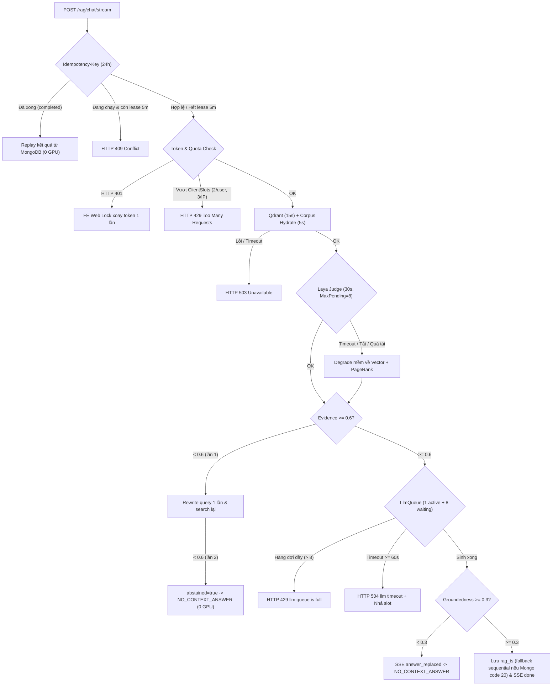

---

## 3. Module AI

### 3.1 Vai trò AI: Input → Output

- **Input**: `{ query (1–2000 chars), top_k (1–20, default 5), nprobe (1–6, default 2), category?, use_authority_boost (true), expand_query (false), session_id? }` `[S2][S3]`.
- **Chuỗi tác vụ AI**:
  1. **Query Embedding**: Sinh vector `768-D` cho câu hỏi bằng `nomic-embed-text-v1.5` `[S1]`.
  2. **Semantic Judge & Evidence Gate**: Dùng cross-attention `@receptron/laya` chấm điểm từng passage (relevance) trước khi gọi LLM, viết lại câu hỏi 1 lần nếu thiếu bằng chứng, và kiểm tra trung thực (groundedness) sau khi LLM sinh xong `[S3][S4]`.
  3. **Grounded Synthesis**: Sinh câu trả lời học thuật tiếng Anh/đa ngữ kèm trích dẫn `[Paper: {paper_id}]` và công thức toán LaTeX bằng `Qwen2.5-7B-Instruct` `[S3][S4]`.
- **Output**: Chuỗi token stream / JSON `ChatResponseDto` gồm `answer`, `citations[]`, `grounded_chunks[]`, `expanded_terms[]`, `quality` (`evidence_score`, `refined_query`, `grounded_score`, `abstained`), `timings` `[S2][S3]`.

### 3.2 Dữ liệu, Tiền xử lý & Xử lý PII

- **Nguồn dữ liệu**: `913,205` chunks bài báo khoa học công khai (arXiv, CVPR 2024, OpenReview) `[S5][S15]`, `40` influencer / `29,523` tác giả có chỉ số PageRank (`graph_coauthorship.json`) `[S16]`, `30` luật kết hợp FP-Growth (`association_rules.json`, `support >= 0.02`, `confidence >= 0.5`) `[S1]`.
- **Tiền xử lý**:
  - `normalizeQuery(q)`: trim + gộp khoảng trắng (`\s+` → `' '`), ghép prefix bắt buộc `search_query: ` theo chuẩn Nomic v1.5, chuẩn hóa L2 vector `[S1][S3]`.
  - Cắt ngữ cảnh truyền vào Laya (`512` token window): `MAX_PASSAGE_CHARS = 1,100`, `MAX_ANSWER_CHARS = 900` `[S4]`.
- **Xử lý PII (Quyền riêng tư)**:
  - Kho tri thức là **bài báo khoa học công khai**, không chứa PII người bệnh/khách hàng `[S5][S15]`.
  - Đối với input của người dùng: `backend_rag` **tuyệt đối không ghi nội dung `query` hay nội dung chat ra log hệ thống** (chỉ ghi `query_len`, `top_k`, `chunks`, `timings`) `[S3]`, và **không log email/mật khẩu** (chỉ log `email_hash` 16 ký tự) `[S18]`.

### 3.3 Output Schema (JSON / Stream) & Xử lý khi Output sai

- **Structured Output của Judge (`@receptron/laya`) `[S4]`**:
  ```json
  { "answers": { "q": { "noul": 0.0 } } }
  ```
- **Contract Output của RAG (`ChatResponseDto`) `[S2][S3]`**:
  - `citations`: mảng ID bài báo trích bằng regex `/\[Paper(?:\s+ID)?:\s*([^\]|]+)[^\]]*\]/g`.
  - `grounded_chunks`: mỗi chunk gồm `chunk_id`, `paper_id`, `title`, `section_title`, `section_type`, `text`, `similarity_score`, `authority_score`, `final_score`, `relevance_score?`, `citation_tag`.
- **Cơ chế xử lý khi AI output sai / ảo giác `[S3][S4]`**:
  1. **Trước sinh đáp án (Evidence Gate `< 0.6`)**: Chạy `REWRITE_SYSTEM_PROMPT` + `cleanRewrite()` (chỉ lấy dòng đầu, xóa ngoặc kép, tối đa `300` chars). Nếu tìm lại vẫn `< 0.6` → gán `abstained = true`, bỏ qua LLM, trả `NO_CONTEXT_ANSWER`.
  2. **Sau sinh đáp án (Groundedness Gate `< 0.3`)**: Laya kiểm tra câu trả lời vừa sinh đối chiếu top-3 passage (`GROUNDED_PASSAGES = 3`). Nếu `< 0.3` → ghi đè answer thành `NO_CONTEXT_ANSWER` và bắn SSE `answer_replaced`.
  3. **Trích dẫn bịa (`unverified_citations`)**: So sánh `citations` với tập `paper_id` thực sự có trong `grounded_chunks`; ghi nhận số `unverified_citations` vào log và cho phép FE gắn nhãn chưa xác minh.

### 3.4 Model, Prompt & Tham số chính `[S3][S4]`

| Thành phần               | Model / Checkpoint                                                          | Prompt / Công thức                                                                                                                           | Tham số vận hành chính                                                                                                                                                          |
| :------------------------- | :-------------------------------------------------------------------------- | :--------------------------------------------------------------------------------------------------------------------------------------------- | :---------------------------------------------------------------------------------------------------------------------------------------------------------------------------------- |
| **Embedding**        | `nomic-ai/nomic-embed-text-v1.5` (`@huggingface/transformers`)          | Prefix `search_query: `                                                                                                                      | `768-D`, L2-normalized, LRU cache `500` items / TTL `10m`                                                                                                                     |
| **Hybrid Mining**    | PageRank + FP-Growth artifacts                                              | $S = 0.85 \cdot S_{\text{sim}} + 0.15 \cdot A_{\text{PageRank}}$                                                                             | `support >= 0.02`, `confidence >= 0.5`                                                                                                                                          |
| **Reranker / Judge** | `@receptron/laya` (`models/laya_onnx_20261108-2053_seed0`, `soft-ce`) | `RELEVANCE_QUESTION`, `GROUNDEDNESS_QUESTION`                                                                                              | `RRF_K = 60`, `LAYA_EVIDENCE_THRESHOLD = 0.6`, `LAYA_GROUNDED_THRESHOLD = 0.3`, pool `min(20, max(10, top_k*2))`, `MAX_PENDING = 8`, `LAYA_TIMEOUT_MS = 30s`            |
| **Generator LLM**    | `qwen2.5-7b-instruct-q4_k_m.gguf` (`4.68 GB`, via `node-llama-cpp`)   | `SYSTEM_PROMPT` (bắt buộc `[Paper: id]`, cấm suy diễn ngoài excerpt, giữ LaTeX `$...$`) & `REWRITE_SYSTEM_PROMPT` (≤ 25 từ EN) | `TEMPERATURE = 0.2`, `MAX_TOKENS = 1024`, `contextSize = 8192`, `LLM_GPU = auto` (99 layers CUDA), `LLM_CONCURRENCY = 1`, `LLM_MAX_QUEUE = 8`, `LLM_TIMEOUT_MS = 60s` |

### 3.5 Cách đánh giá: Metric & Ngưỡng chấp nhận

1. **Đánh giá xếp hạng & lọc lạc đề trên `test_set_v1.jsonl` (`150` mẫu: `100` Pos + `50` Neg) `[S15]`**:
   - **Pure Vector (Nomic v1.5)** vs **Laya Baseline** vs **Laya Mới (`20261108-seed0`)**:
     - `MRR`: `0.8623` → `0.8853` → **`0.8939`** (`+3.16%` điểm).
     - `Hit@1`: `79.0%` → `81.0%` → **`82.0%`**; `Hit@5`: `96.0%` → `97.0%` → **`98.0%`**.
     - `Reject @0.5`: `92.0%` (lọt 4/50 câu) → `100.0%` → **`100.0%`** (**triệt tiêu 100% False Accept**).
     - Điểm lạc đề trung bình (Off-topic mean score): `0.4497` → `0.0488` → **`0.0175`**.
     - `DeepEval Faithfulness` (`test_set_v1`): `0.7956` → `0.7970` → **`0.7977`**; `Answer Relevancy`: `0.6159` → `0.6291` → **`0.6341`**.
2. **Đánh giá toàn trình DeepEval trên `gold-001`..`gold-100` (`N = 105` hydrated chunks) — Judge Local Qwen 2.5-7B `[S16]`**:
   - `Contextual Recall@5`: **`0.900`** (ngưỡng `>= 0.70`, pass `89.3%`).
   - `Contextual Precision@5`: **`0.852`** (ngưỡng `>= 0.70`, pass `83.5%`).
   - `Academic Citation Grounding [GEval]`: **`0.762`** (ngưỡng `>= 0.70`, pass `90.4%`).
   - `Faithfulness`: **`0.667`** (ngưỡng `>= 0.70`, pass `57.3%`).
   - `Answer Relevancy`: **`0.667`** (ngưỡng `>= 0.75`, pass `51.0%`; trên tập 20 mẫu chuẩn đạt `0.769`).
   - **Cổng kiểm soát**: Evidence Gate `0.6` giữ **`96.4%` (27/28)** câu đúng, chặn **`78.6%` (11/14)** câu rỗng; Groundedness Gate `0.3` giữ **`100%` (10/10)** câu đúng, chặn **`30.0%` (3/10)** câu bịa.
3. **Đánh giá sơ bộ trên adapter giả lập cục bộ (15 câu mẫu, `2026-10-23`) `[S17]`**:
   - Ghi nhận historical baseline `Recall@5 = 73.08%`, `0` bài báo bịa (`100%` từ chối câu ngoài kho), `TTFT P95 < 200 ms`, retrieval `p50 = 112 ms / p95 = 120 ms` (chạy adapter mock, trước khi tích hợp Laya `20261108-seed0` + Qdrant/Corpus đầy đủ).

```mermaid
xychart-beta
    title "So sánh Pure Vector vs Laya Mới trên test_set_v1 (150 mẫu, %) [S15]"
    x-axis ["MRR (%)", "Hit@1 (%)", "Hit@5 (%)", "Reject@0.5 (%)", "Faithfulness (%)", "Relevancy (%)"]
    y-axis "Điểm (%)" 50 --> 105
    bar [86.23, 79.0, 96.0, 92.0, 79.56, 61.59]
    bar [89.39, 82.0, 98.0, 100.0, 79.77, 63.41]
```

> Chuỗi cột 1 (trái): Pure Vector (`Nomic v1.5`); Chuỗi cột 2 (phải): Laya Mới (`20261108-seed0`). Biểu đồ Seaborn đầy đủ cả 3 biến thể và DeepEval `N = 105`:

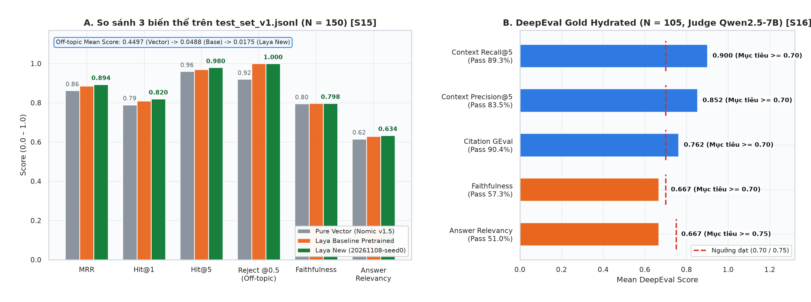

### 3.6 Chi phí inference & Điều kiện đo

- **Chi phí inference**:
  - **Chi phí API/request & API/tháng**: **`$0.00 / request` và `$0.00 / tháng`** phí gọi API LLM bên thứ 3 vì toàn bộ Embedding (`Nomic v1.5`), Judge (`Laya 421M`) và Generator (`Qwen2.5-7B Q4_K_M`) đều **tự host cục bộ (on-premise)** `[S4]`. *(Lưu ý: chi phí điện năng và khấu hao máy chủ/GPU cá nhân chưa được hạch toán trong repo)*.
  - **5 kỹ thuật giảm chi phí / tài nguyên**:
    1. Dùng mô hình lượng tử hóa **4-bit (`Q4_K_M`, `4.68 GB`)** + **Laya 421M** thay cho model thương mại lớn `[S4][S16]`.
    2. **LRU Cache tầng Embedding** (`500` truy vấn gần nhất, TTL `10 phút`) `[S4]`.
    3. **`Idempotency-Key` 24h** (`chat_requests`): lặp lại câu hỏi cùng key chỉ phát lại từ MongoDB, **0 tốn GPU** `[S3][S6]`.
    4. **Evidence Gate `0.6`**: Chặn các truy vấn ngoài miền trước bước LLM generation `[S3][S16]`.
    5. Giới hạn `MAX_TOKENS = 1,024`, `judgedPoolSize <= 20`, `GROUNDED_PASSAGES = 3` `[S3][S4]`.
- **Điều kiện đo (Measurement Environment)**:
  - **Phần cứng**: Laptop **NVIDIA GeForce RTX 4060 (`8,188 MiB` VRAM)**, Driver `581.80`, CUDA `13.0`, Windows `win32 x64`, CPU 18 nhân (Intel i7-13620H), 15–16 GB RAM `[S11][S15][S17]`.
  - **Framework**: `node-llama-cpp v3.22.1` (CUDA 99 layers), `@receptron/laya v0.2.0` (`onnxruntime-node` trong BE; và `model.safetensors 421M torch.bfloat16` CUDA batch trong nghiên cứu `[S16]`), `@huggingface/transformers v4.3.1`, DeepEval + Local Qwen 2.5-7B Judge cổng `9001` `[S4][S15][S16]`.
  - **Batch size**: LLM `LLM_CONCURRENCY = 1` (tuần tự 1 lượt/lần); Laya trong BE xử lý tuần tự theo `tail` queue (`MAX_PENDING = 8`) `[S4]`, khi đo PyTorch CUDA batch `10 chunks/query` đạt **`316.16 ms`** vs **`4,260 ms`** trên ONNX CPU `[S16]`.
  - **Độ dài Input / Output**: Query tối đa `2,000` ký tự; context LLM `contextSize = 8,192` tokens (`top_k` mặc định `5`, `2–10` khi benchmark); output tối đa `MAX_TOKENS = 1,024`; cửa sổ Laya `512` tokens (`MAX_PASSAGE_CHARS = 1,100`, `MAX_ANSWER_CHARS = 900`) `[S3][S4]`.

---

## 4. Backend (`backend_rag`)

### 4.1 ERD & Lý do chọn Database

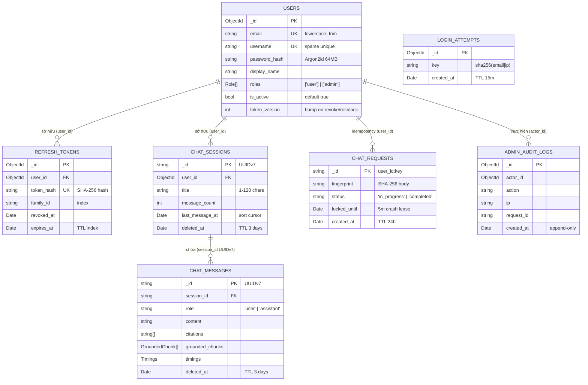

- **Kiến trúc lưu trữ 3 kho (`[S5][S6][S7][S18]`)**:
  1. **MongoDB `rag_ts` (Read/Write, user `ragts_app`)**: Quản lý danh tính, phiên chat, idempotency và audit. Chọn MongoDB vì payload `grounded_chunks`/`timings` dạng lồng bán cấu trúc, hỗ trợ sẵn **TTL Index** tự dọn `login_attempts` (15 phút), `refresh_tokens`, `chat_requests` (24 giờ), soft-delete (3 ngày) mà không cần cron job `[S6]`, và **B-tree Compound Index** `{ user_id: 1, deleted_at: 1, last_message_at: -1, _id: -1 }` khớp tự nhiên với **UUIDv7** `[S6][S7]`.
  2. **MongoDB `rag_ts_corpus` (Read-Only via `CORPUS_MONGO_URI`)**: Tách toàn văn chunk và metadata bài báo ra khỏi payload vector Qdrant (`D-058`) giúp vector index nhẹ RAM và bảo vệ source-of-truth `[S5]`.
  3. **Qdrant `scientific_papers_gold` (Read-Only)**: Chuyên dụng cho tìm kiếm láng giềng gần nhất (ANN Cosine) trên `913,205` vector `768-D` kèm bộ lọc metadata `category` và `twig_id` `[S5]`.
- **Nguyên tắc thiết kế Schema & ERD (`[S6]`)**:
  - **Hybrid Primary Key**: Dùng **`UUIDv7` (`string`)** cho `chat_sessions` & `chat_messages` để sắp xếp theo thời gian và hỗ trợ cursor pagination; giữ **`ObjectId`** cho `users` & `refresh_tokens` để tương thích với hệ thống auth ban đầu.
  - **Computed Pattern & Tránh Write-Amplification**: `title` chỉ lưu ở `chat_sessions` (không nhúng vào `chat_messages`), `message_count` cập nhật tăng dần (`+2` mỗi turn) để tránh `$lookup`; tách riêng `last_message_at` (chỉ đổi khi có tin nhắn mới) khỏi `updated_at` (đổi cả khi rename) để sidebar không bị nhảy thứ tự.
  - **Lazy Session Creation & Cascaded Soft-Delete**: Không lưu phiên rỗng (`message_count = 0`, bỏ `POST /chat-sessions`); khi xóa phiên sẽ gán đồng bộ `deleted_at` cho cả `chat_sessions` lẫn `chat_messages` để TTL Index (`259,200 s` = 3 ngày) dọn sạch mà không sinh dữ liệu mồ côi.

### 4.2 API Contract (`/api/v1`) & 8 Nguyên tắc RESTful `[S2][S27]`

- **Áp dụng 8 nguyên tắc thiết kế RESTful (`API_DESIGN.md` & `API-compare.md`) `[S2][S27]`**:
  1. **Danh từ / Domain-Driven URL**: Refactor bỏ toàn bộ `8` route động từ cũ (`/auth/login`, `/auth/register`, `/admin/.../disable`) → **`0` route động từ** trên `34` routes (`/auth/tokens`, `/auth/token-rotations`, `/auth/token-revocations`, `/users`, `/admin/users/:id/status`) `[S2][S27]`.
  2. **HTTP Methods & Sematic**: `GET` đọc, `POST` tạo / stream RAG, `PUT` thay toàn bộ tập giá trị (`roles`, `status`, `password`), `PATCH` sửa một phần (`/users/me`, `/chat-sessions/:id`), `DELETE` xóa mềm; đồng thời hỗ trợ **Idempotency** (`PUT`/`DELETE` không đổi state thì không ghi DB hay tăng audit; `POST /rag/chat*` dùng `Idempotency-Key`; riêng `POST /auth/token-rotations` cố ý không idempotent để phát hiện reuse) `[S2][S18]`.
  3. **HTTP Status Codes**: Chuẩn hóa `200`, `201`, `204`, `400`, `401`, `403`, `404` (luôn trả `404` cho tài nguyên của user khác chống đoán IDOR), `405` (kèm header `Allow`), `406` (`Accept`), `409` (conflict/in-progress), `415` (`Content-Type`), `429` (`llm queue is full`), `503`, `504` `[S2][S27]`.
  4. **Versioning trên Path**: `/api/v1` (`VITE_API_BASE=/api/v1`), nâng `/api/v2` khi có breaking change `[S2]`.
  5. **Đa định dạng & Bảo mật Parser**: Đàm phán `Content-Type` / `Accept` cho **JSON và XML** (cả error body), chặn `DOCTYPE`/`ENTITY` (max `100 KB`) chống XXE `[S2][S18]`.
  6. **Batch Processing**: Hỗ trợ thao tác lô để giảm request thừa trên UI: `GET /papers?ids=` (tối đa `20`), `GET /chat-sessions?ids=`, `DELETE /chat-sessions?ids=` `[S2][S27]`.
  7. **Query Language thống nhất (Pagination · Sort · Filter)**: Dùng chung `limit` + **`cursor`** (`{ items, next_cursor, has_more }`, chọn cursor thay `page/size` để tránh trùng/sót khi dữ liệu thay đổi liên tục), `sort=field:asc|desc` (whitelist + `_id` tie-break), `filter` `field=op:value` (`eq/ne/gt/gte/lt/lte/match`), và `?q=` `[S2]`.
  8. **Đặt tên thống nhất & Hypermedia (HATEOAS)**: Danh từ số nhiều `kebab-case`, field `snake_case`, điểm vào `GET /api/v1` và `_links` trên **`26/34`** routes `[S2][S27]`. Swagger tắt ở `production` `[S19]`.
- **Tổng quan 34 Endpoints (`[S2][S18][S27]`)**:
  - **Entry**: `GET /api/v1` (HATEOAS root).
  - **Auth & Users (7)**: `POST /users` (đăng ký), `GET/PATCH /users/me`, `PUT /users/me/password`, `POST /auth/tokens` (login), `POST /auth/token-rotations` (refresh), `POST /auth/token-revocations` (logout).
  - **RAG (2)**: `POST /rag/chat` (REST), `POST /rag/chat/stream` (SSE).
  - **Chat Sessions (6)**: `GET /chat-sessions` (`limit`, `cursor`, `q`, `ids`, `sort`, filters), `DELETE /chat-sessions?ids=`, `GET/PATCH/DELETE /chat-sessions/:id`, `GET /chat-sessions/:id/messages`. *(Không có `POST /chat-sessions` — phiên được tạo lười khi nhắn tin đầu tiên)*.
  - **Papers & Health (5)**: `GET /papers?ids=` (tối đa 20), `GET /papers/:paper_id`, `GET /health`, `/health/live`, `/health/ready`.
  - **Admin RBAC (`admin` — 13 routes)**: `GET /admin/users`, `GET /admin/users/:id`, `PUT /admin/users/:id/roles`, `PUT /admin/users/:id/status`, `GET/DELETE /admin/users/:id/tokens`, `GET /admin/users/:id/chat-sessions`, `GET /admin/chat-sessions/:id`, `GET /admin/chat-sessions/:id/messages`, `GET /admin/stats`, `GET /admin/login-attempts`, `GET /admin/health`, `GET /admin/audit-logs`.
- **Request / Response mẫu (`POST /api/v1/rag/chat`) `[S2]`**:
  ```json
  // Request
  { "query": "How does LoRA optimize large models?", "top_k": 3, "nprobe": 2, "category": "cs.LG", "use_authority_boost": true }
  // Response (200 OK)
  {
    "session_id": "019...", "message_id": "019...",
    "answer": "LoRA optimizes large models by freezing pre-trained weights... [Paper: 2106.09685]",
    "citations": ["2106.09685"],
    "grounded_chunks": [{ "chunk_id": "2106.09685_sec8", "paper_id": "2106.09685", "similarity_score": 0.5278, "authority_score": 0.3059, "final_score": 0.4945, "citation_tag": "[Paper: 2106.09685]" }],
    "timings": { "embed_ms": 35, "route_ms": 2, "search_ms": 18, "rerank_ms": 1, "llm_ms": 1600, "total_ms": 1660 }
  }
  ```
- **Error Envelope `[S2]`**: `{ "statusCode": 401, "error": "TOKEN_REUSE_DETECTED", "message": "...", "details": null, "timestamp": "...", "path": "...", "request_id": "..." }`.

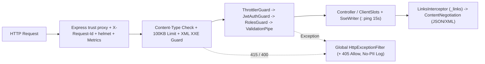

### 4.3 AI Module Design & Auth / RBAC

- **Ports & Adapters (`src/engines/` & `session-store.port.ts`)**: `RagService` chỉ phụ thuộc interface/token (`EMBEDDING_PORT`, `VECTOR_STORE_PORT`, `CORPUS_PORT`, `JUDGE_PORT`, `LLM_PORT`, `SESSION_STORE`), cho phép hoán đổi/fake hoàn toàn engine khi chạy Jest & E2E `[S3][S25]`.
- **Sync vs Queue**: HTTP streaming đồng bộ qua AsyncGenerator, nhưng tầng suy luận GPU chạy qua **`LlmQueue` in-memory semaphore** (`concurrency = 1`, `maxWaiting = 8`, hủy ngay waiter khi client abort) `[S4]` + **`ClientSlots`** (`max 2` request/user, `max 3`/IP) `[S3]`; vượt ngưỡng trả **`429 Too Many Requests`** trong vài mili-giây thay vì treo socket hay dùng queue phân tán nặng không cần thiết cho 1 GPU node `[S4][S13]`.
- **Auth & RBAC `[S18]`**:
  - `Argon2id` (`memoryCost: 65536` = 64 MB, `timeCost: 3`, `parallelism: 4`, `UV_THREADPOOL_SIZE = 4`), password `10–200` chars + kiểm tra danh sách `200` mật khẩu yếu + `DUMMY_HASH` chống timing attack.
  - Access JWT (`15m`, mang claim `ver`) + Refresh Token (`7d`, xoay vòng **1-RTT atomic** `findOneAndUpdate`, reuse → thu hồi cả `family_id` & trả `401`).
  - Bảo vệ Admin **3 lớp**: `JwtAuthGuard` (kiểm tra `is_active` & `token_version` trong DB/cache 5s) → `RolesGuard(@Roles('admin'))` → `assertAdmin()` tại service + quy tắc `assertNotSelf` (`409 SELF_LOCKOUT_FORBIDDEN`) & `assertNotLastAdmin` (`409 LAST_ADMIN_PROTECTED`). Bootstrap admin đầu tiên **chỉ chạy qua CLI** `npm run create:admin`.

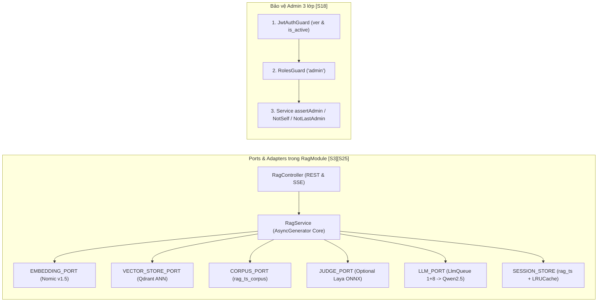

---

## 5. Frontend (`frontend_rag`)

### 5.1 Wireframe & User Flow

- **Bố cục (`AppShell`) `[S1][S24]`**: Canvas WebGL 3D toàn màn hình (`WorldCanvas`) làm nền chủ đạo; phía trên là `TopBar` (trạng thái MongoDB/Qdrant/LLM/Route, chuyển theme Dark/Light, cài đặt); bên trái là cột glass chat (`ChatPanel`, thu/mở `1500ms`) kèm `HistoryDrawer`; bên phải bật `PaperPanel` khi inspect tài liệu và `PerfHUD` (`?perf`). Ngoài ra `AppRouter` hỗ trợ `?view=shell|world|auth|chat|crawl|result` `[S24]`.
- **User Flow `[S1][S24]`**: Mở app → đọc ngay lịch sử từ `Dexie.js` (`< 15 ms`) & chạy ngầm `/health` + sync `/chat-sessions` → Đăng nhập (`AuthOverlay`) → Nhập câu hỏi → Hiện 5 pha stream đồng bộ bay camera 3D (`QueryOrb`, `TopKThreads`) → Bấm tag `[Paper: id]` để zoom vào cành bài báo và mở `PaperPanel`.

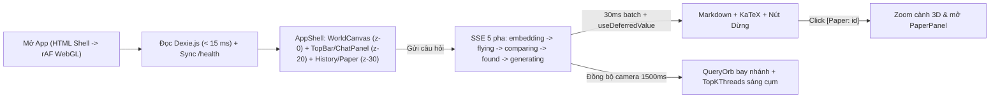

### 5.2 Design Tokens (`tokens.ts` & `index.css` `@theme`) `[S22][S23]`

Kiến trúc 3 tầng (*Primitive → Semantic → Component*) được ép kiểm tự động bằng `node scripts/check-design.cjs --strict` (cấm hex/rgba cứng và bảng màu Tailwind thô trong component `.tsx`; đạt **`0` vi phạm / `14` rule** từ P20) `[S22][S23]`:

- **Màu sắc (`tokens.ts`) `[S23]`**:
  - *Dark Theme (Default)*: `--bg: #070614`, `--ink: #ece9ff`, `--ink-muted: #a29cc4`, `--ink-faint: #64607e`, `--accent: #7fe8ff`, `--warn: #ffc145`, `--danger: #ff5d73`, `--success: #58f0a7`, `--glass-tint: #0c0a183d`, `--ui-border: #ffffff24`.
  - *Light Theme (High-Altitude Radiant)*: `--bg: #e3f0fc`, `--ink: #0b192c`, `--ink-muted: #334155`, `--accent: #0969da`, `--ui-surface: #ffffffa6`, `--glass-tint: #ffffff14`.
  - *Dữ liệu 3D*: `categoryPalette[0..11]` (12 màu riêng cho các nhóm arXiv, cấm dùng trang trí UI).
- **Typography `[S23]`**: `--font-sans: "Geist", ...`, `--font-mono: "Geist Mono", ...` (`tabular-nums`); thang cỡ `micro (10/14px)`, `caption (11/16px)`, `xs (12px)`, `control (13/18px)`, `sm (14px)`, `base (16px)`, `display (22/28px)`.
- **Radius, Blur & Motion `[S23]`**: Bo góc `--radius-xs/sm/md/lg/full` (`4 / 6 / 10 / 14 / 9999 px`); Blur `--blur-sm/md/lg` (`6 / 12 / 16 px`); Motion `120 ms` (press), `160 ms` (hover), `240 ms` (enter), `480 ms` (reveal), `1500 ms` (scene/chat slide) + Liquid Glass cấp `1–4` (`@samasante/liquid-glass`).

### 5.3 Trạng thái tương tác & UX cho AI chậm `[S20][S21][S22][S24]`

- **Hover / Focus**: Tăng fill kính (`--glass-fill` → `--glass-fill-hover`), tăng độ nét viền (`--glass-stroke-strong`), highlight nút theo thang `color-mix` chuẩn (`6% / 12% / 16% / 24% / 40% / 55%`) `[S23]`.
- **Loading**: Render khung HTML pre-rendered sẵn trong `index.html`, dời khởi tạo WebGL nặng sang `requestAnimationFrame` (**`LCP = 1.0 s`**, **`FCP = 0.9 s`**, **`CLS = 0.002`**, Lighthouse **Perf `97/100`** `[S20]`), hiển thị `PipelineStatus` theo từng pha + nút **Dừng** abort stream `[S24]`.
- **Empty**: Màn hình chờ hội thoại trống hoặc `AuthOverlay` khi chưa đăng nhập; `HistoryDrawer` khi chưa có phiên cũ `[S24]`.
- **Error & Offline**: Huy hiệu **`Ngoại tuyến`** (`--warn`) khi `/health` mất kết nối (vẫn xem 100% lịch sử & công thức toán trong `Dexie.js`), bubble lỗi hiển thị mã trạng thái `429/503/504`, nút xóa lịch sử có xác nhận 2 bước (`Xóa?` / `Huỷ`) `[S24]`.
- **Tối ưu UX cho AI chậm (`D-005`) & Hiệu năng 3D (`150k` vectors)**:
  - Streaming SSE từng token + đồng bộ 5 pha hoạt ảnh 3D ngay khi retrieval hoàn tất (`~100–350 ms`) để người dùng thấy hệ thống đang "suy nghĩ & tìm nhánh cây" trong lúc chờ GPU `[S1][S24]`.
  - **`30 ms` micro-batch buffer** trong [`ragStore.ts`](../../frontend_rag/src/features/chat/store/ragStore.ts) (~33 Hz) kết hợp **`useDeferredValue`** & lazy-load KaTeX CSS trong [`Markdown.tsx`](../../frontend_rag/src/features/chat/components/Markdown.tsx) `[S24]`: khắc phục triệt để lỗi nghẽn trước đó *(bản pre-fix đo `0.8 ms` median nhưng `p95 = 102 ms` và `23 Long Tasks` lên tới `8,549 ms` `[S21]`)*. Sau tối ưu đạt **`57.1 ± 1.3 FPS`**, **`frameTime median = 17.5 ms`**, **`p95 = 18.2 ms`**, **`p99 = 18.6 ms`**, **`0 Long Tasks`** trên Edge vsync `[S21]`; đo GPU đồng bộ (`readPixels`) trên Apple M4 giảm từ `12.7 → 8.0 ms` (Dark, `-37%`) và `13.3 → 8.9 ms` (Light, `-33%`), raycast nhanh hơn `56×`, còn unlocked-vsync rAF đạt `1.9–2.0 ms` `[S22]`.

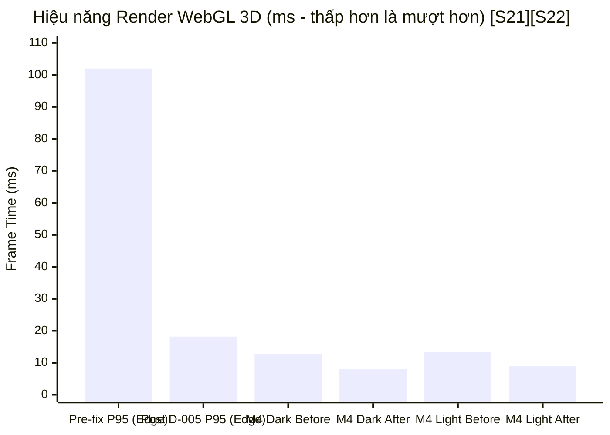

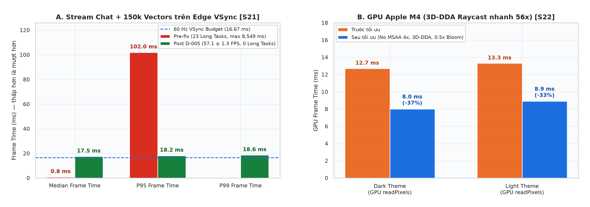

---

## 6. Cấu trúc Project, Lint, CI/CD & Branching

### 6.1 Cây thư mục Backend (NestJS 11) & Frontend (React 19 + Vite 6)

```text
RAG_TS/                                    # Monorepo Root (3 Git repos: root, backend_rag, frontend_rag)
├── agents/                                # Quy tắc MD_CONVENTION, COMMIT_CONVENTION & template Decision Log
├── docs/                                  # Tài liệu kiến trúc, API, design system, security, reports, Grafana
├── backend_rag/                           # NestJS 11 + TypeScript 5.7 (49 thư mục đều có README.md)
│   ├── benchmark/                         # 14+ k6 scripts, seeders, telemetry & v2 auto-runner
│   ├── docker/                            # Script init mongo-init-app-user.js
│   ├── docs/                              # Auth, Caching, MongoDB, Chat Sessions specs
│   ├── scripts/                           # create-admin.ts, download-model.ts, benchmark-vector-runner.mjs
│   ├── src/
│   │   ├── common/                        # http/ (filter, hateoas, xml, validation), logging/, metrics/, pagination/, security/, utils/
│   │   ├── config/                        # Zod env.schema.ts & AppConfigService
│   │   ├── engines/                       # Ports & Adapters: corpus/, embedding/, judge/, llm/, mining/, tree-router/, vector-store/
│   │   ├── modules/                       # HTTP Controllers/Services: admin/, auth/, chat-sessions/, health/, papers/, rag/
│   │   ├── testing/                       # test-app.ts & fake engines
│   │   └── types/                         # Shared backend contracts
│   └── test/                              # E2E flow.e2e-spec.ts & jest-e2e.json
└── frontend_rag/                          # React 19 + Vite 6 + Three.js (62 thư mục đều có README.md, port 5174) [S25]
    ├── e2e/                               # Playwright auth.spec.ts, knowledge-tree.spec.ts & visual.spec.ts
    ├── scripts/                           # check-design.cjs, perf-chat-benchmark.cjs, capture_ui.cjs
    └── src/
        ├── app/                           # App.tsx, AppShell.tsx, layout/, providers/, routers/
        ├── features/                      # auth/, chat/ (components, db, hooks, pages, store), crawl/, result/, world/ (scene: canopy, fx, ground, overlay, tree)
        ├── shared/                        # api/, hooks/, lib/ (rotation, uuid), store/ (uiStore), theme/, types/, ui/ (Glass, buttons, input)
        └── test/                          # setup.ts (fake-indexeddb), featureModules.test.tsx, perf.bench.ts
```

### 6.2 Lint, CI/CD & Branching

- **Lint & Quality Gates `[S22][S25]`**:
  - *Backend*: `eslint` v9 + `typescript-eslint` + `prettier` + `nest build` (TS `strict` / `noImplicitAny: true`, **`0` lỗi ESLint & build**).
  - *Frontend*: `eslint` v9 + `tsc --noEmit` + **`node scripts/check-design.cjs --strict`** (kiểm tra `14` luật design tokens, **`0` vi phạm**, **`0` lỗi typecheck/lint**).
- **CI/CD**: **Chưa thiết lập pipeline CI/CD tự động** (chưa có `.github/workflows/*.yml` trong repository); toàn bộ bước lint, typecheck, test, build và benchmark hiện chạy qua npm scripts & script kiểm định cục bộ trước khi commit/push.
- **Branching & Commit Convention**:
  - Quy ước commit bắt buộc theo [`COMMIT_CONVENTION.md`](../../agents/rules/COMMIT_CONVENTION.md) (`feat`, `fix`, `docs`, `perf`, `test`, `refactor`, `chore`).
  - Quy ước nhánh ghi nhận trong repo: `main` là nhánh chính ổn định, tách nhánh feature/benchmark khi thử nghiệm (`feat/monolith-v1`, `vuong/perf-benchmark`), cập nhật quyết định kiến trúc vào [`Vuong_chat_logs.md`](../AI_chat_log/Vuong_chat_logs.md) `[S20]`.

---

## 7. Kiểm thử (Test & AI Eval)

### 7.1 Unit, Integration & E2E Tests `[S25]`

| Hạng mục                      | Công cụ sử dụng                                           | Phạm vi & Số lượng thực tế (Verified)                                                                                                                                                                                                     | Ghi chú Coverage & Mock                                                                                                                                                                                                       |
| :------------------------------ | :------------------------------------------------------------ | :---------------------------------------------------------------------------------------------------------------------------------------------------------------------------------------------------------------------------------------------- | :----------------------------------------------------------------------------------------------------------------------------------------------------------------------------------------------------------------------------- |
| **BE Unit & Integration** | Jest 30 + `mongodb-memory-server`                           | **`29 / 29` suites, `267 / 267` tests pass** (`auth`, `admin`, `chat-sessions`, `rag`, `llm`, `judge`, `corpus`, `vector-store`, `pagination`, `xml`, `validation`, `throttler`, `barrels`, v.v.) `[S25]` | Test thật cả nhánh Replica Set transaction lẫn Standalone sequential write; fake LLM/Qdrant/Laya qua Port. Coverage: **`93.54%` Stmts / `94.72%` Lines / `85.83%` Funcs / `79.75%` Branches** `[S25]`.     |
| **BE End-to-End**         | Jest + Supertest (`test/flow.e2e-spec.ts`)                  | **`1 / 1` suite, `13 / 13` tests pass** *(verified ở phiên trước khi bổ sung unit test thuần túy)*                                                                                                                           | Kiểm tra toàn trình register → chat stream → sessions → refresh/logout → admin & **`API contract (OpenAPI)`** `[S25]`.                                                                                        |
| **FE Unit & Component**   | Vitest 3.2 + Testing Library + `jsdom` + `fake-indexeddb` | **`41 / 41` files, `327 / 327` tests pass** `[S25]`                                                                                                                                                                                 | Đạt chuẩn `@vitest/coverage-v8` ngưỡng **≥ 90%** trong [`vite.config.ts`](../../frontend_rag/vite.config.ts): **`96.58%` Stmts / `96.58%` Lines / `93.60%` Funcs / `86.94%` Branches** `[S25]`. |
| **FE E2E, Visual & Perf** | Playwright + Chromium/Edge + `perf-chat-benchmark.cjs`      | `e2e/auth.spec.ts` (đã hợp nhất từ `src/test/e2e/`), `e2e/knowledge-tree.spec.ts`, `e2e/visual.spec.ts` `[S21][S25]`                                                                                                             | Auth gate, snapshot visual Glass UI + đo FPS & `LongTask` WebGL. *(Lưu ý: máy Windows hiện tại cần `npx playwright install` để tải binary Chromium nếu chạy live E2E)*.                                      |

```mermaid
xychart-beta
    title "Độ phủ Kiểm thử Unit & Integration BE (trái) vs FE (phải) [S25]"
    x-axis ["Statements (%)", "Lines (%)", "Functions (%)", "Branches (%)"]
    y-axis "Coverage (%)" 0 --> 100
    bar [93.54, 94.72, 85.83, 79.75]
    bar [96.58, 96.58, 93.60, 86.94]
```

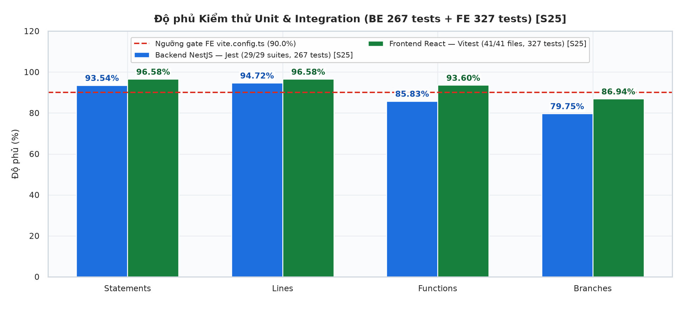

### 7.2 Test AI (Eval & Regression theo phiên bản prompt/model) `[S15][S16][S17]`

- Hệ thống có bộ script đánh giá AI tái lập được: [`eval-laya.mjs`](../../backend_rag/benchmark/eval-laya.mjs), [`eval-laya-variants.mjs`](../../backend_rag/benchmark/eval-laya-variants.mjs), [`generate_200_eval_set.mjs`](../../backend_rag/benchmark/generate_200_eval_set.mjs), [`benchmark-vector-runner.mjs`](../../backend_rag/scripts/benchmark-vector-runner.mjs).
- **Regression theo phiên bản model**: Đã so sánh đối đầu **Pure Vector (Nomic v1.5)** vs **Laya Baseline Pretrained** vs **Laya Fine-Tuned (`20261108-seed0`)** và **5 kịch bản phối hợp** (Vector / Laya / Vector+Laya RRF / Vector+PageRank / Full System) trên 2 bộ chuẩn (`test_set_v1.jsonl` 150 mẫu `[S15]` và `gold-001`..`100` 105 mẫu `[S16]`) bằng **DeepEval + Local Qwen 2.5-7B Judge** (chi tiết số liệu ở Mục [3.5](#35-cách-đánh-giá-metric--ngưỡng-chấp-nhận)).

---

## 8. Đóng gói & Triển khai `[S19][S26]`

### 8.1 Docker / Compose & Môi trường Dev / Staging / Prod

- **Backend Containerization `[S26]`**:
  - [`backend_rag/Dockerfile`](../../backend_rag/Dockerfile): Multi-stage `node:22-bookworm-slim`, `npm ci && npm run build && npm prune --omit=dev`, chạy non-root `USER node`, expose `3000`, `HEALTHCHECK` gọi `/api/v1/health/live` mỗi `15 s`.
  - [`backend_rag/docker-compose.yml`](../../backend_rag/docker-compose.yml): Khởi chạy 3 services: `mongo:7` (`--replSet rs0` + `--keyFile`, bind `127.0.0.1:27018`, init script `ragts_app`), `qdrant:v1.15.4` (profile `standalone`), `app` (bind `127.0.0.1:3000`, mount read-only `../model:/models:ro`, `../data:/data:ro`, volume `hf-cache`).
- **Frontend Containerization `[S26]`**:
  - [`frontend_rag/Dockerfile`](../../frontend_rag/Dockerfile): Multi-stage build `node:20` (`npm run build`) → serve static asset bằng `nginx:alpine`.
- **Phân tách môi trường**:
  - *Dev / Demo hiện hành*: Kho dữ liệu trung tâm (`MongoDB`, `Qdrant`, `MinIO`) host từ xa sau Cloudflare Tunnel (`*.minio-quangmanh.io.vn` + `cloudflared access tcp` cổng `27018`) `[S1][S7]`; `backend_rag` (`:3000`) & `frontend_rag` (`:5174` proxy `/api/v1`) `[S25]` chạy trên máy dev có GPU RTX 4060. *(Lưu ý: `AGENTS.md` / `ARCHITECTURE_OVERVIEW.md` từng ghi cổng `:5173`, nhưng [`vite.config.ts`](../../frontend_rag/vite.config.ts) thực tế bind `:5174`)*.
  - *Staging / Production Guard*: Khi `NODE_ENV=production`, Zod [`env.schema.ts`](../../backend_rag/src/config/env.schema.ts) tự động từ chối khởi động nếu `JWT_*_SECRET` chứa placeholder (`change-me`, `your-secret`, `replace-me`), trùng nhau, hoặc `MONGO_URI` thiếu thông tin xác thực; Swagger `/docs` bị tắt và `HSTS` được bật `[S19]`.

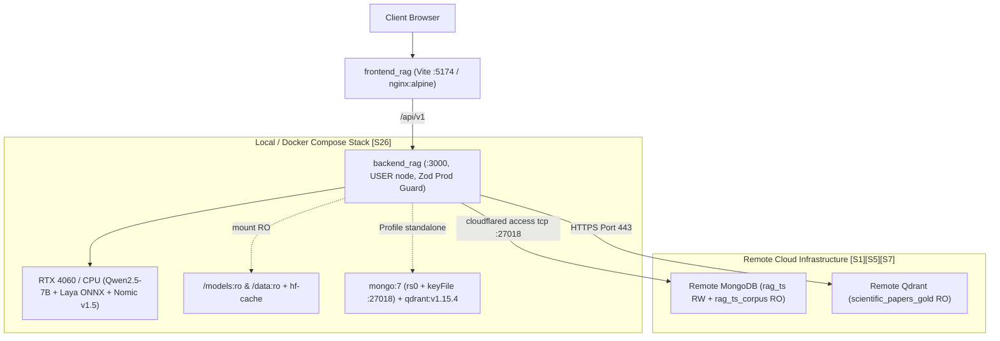

### 8.2 Chiến lược Deploy & Rollback

- **Cơ chế sẵn sàng triển khai (Operational Readiness)**: Startup fail-fast qua Zod `parseEnv()` `[S19]`, health probes tách biệt `/health/live` & `/health/ready` `[S2][S26]`, `app.enableShutdownHooks()` để đóng kết nối sạch khi restart container.
- **Chiến lược Deploy / Rollback thực tế**: Hiện hệ thống triển khai trên quy mô single-node / Compose chưa tích hợp CD tự động hay Blue-Green/Canary balancer. Rollback thực hiện bằng cách checkout commit/tag Git ổn định trước đó và chạy lại `docker compose up -d --build` (an toàn nhờ schema MongoDB thiết kế cộng dồn tương thích ngược `[S6]` và dữ liệu chat client được bảo toàn trong `Dexie.js` `[S24]`).

---

## 9. Bảo mật `[S18][S19]`

### 9.1 OWASP Top 10, Rate Limit, TLS, Secret & Quét Dependency

| Biện pháp                              | Chi tiết cài đặt trong hệ thống                                                                                                                                                                                                                                                                                                                                                                                   |
| :--------------------------------------- | :---------------------------------------------------------------------------------------------------------------------------------------------------------------------------------------------------------------------------------------------------------------------------------------------------------------------------------------------------------------------------------------------------------------------- |
| **OWASP A01 — Access Control**    | RBAC 3 lớp (`JwtAuthGuard` + `RolesGuard` + `assertAdmin`); mọi query session lọc `user_id` & `deleted_at: null`, trả **`404`** thay vì `403` để chống đoán IDOR; `assertNotSelf` + `assertNotLastAdmin`; `admin_audit_logs` chỉ cho append `[S18]`.                                                                                                                             |
| **OWASP A02/A07 — Crypto & Auth** | `Argon2id` (`64 MB`, `t=3`, `p=4`), `DUMMY_HASH` chống user enumeration, lockout `5` lần sai / `15 phút` theo `sha256(email \| ip)`, Access JWT mang `ver` (`15m`), Refresh Token `7d` xoay vòng 1-RTT + phát hiện tái sử dụng thu hồi cả `family_id` `[S6][S18]`.                                                                                                                  |
| **OWASP A03 — Injection**         | DTO `class-validator` strict, `escapeRegex()` chống ReDoS, filter/sort whitelist, XML parser chặn `DOCTYPE`/`ENTITY` (chống XXE/Billion Laughs, max `100 KB`) `[S2][S18]`.                                                                                                                                                                                                                               |
| **OWASP A05 — Misconfiguration**  | `helmet` (CSP `default-src 'self'`, `frameguard: deny`, `noSniff`, `no-referrer`), tắt Swagger ở `prod`, `TRUST_PROXY_HOPS` tường minh (`0` mặc định, chống giả mạo `X-Forwarded-For`), Mongo app bind `127.0.0.1` với user quyền hẹp `ragts_app`, `rag_ts_corpus` & Qdrant chỉ đọc `[S5][S18][S19]`.                                                                         |
| **Rate Limit**                     | `@nestjs/throttler` (`default: 120/m`), `register (5/m)`, `login (10/m)`, `refresh (30/m)`, `changePassword (5/m)`, `papersBatch (30/m)`, `ragChat (20/m có JWT, 10/m ẩn danh)` + `ClientSlots` (`max 2` in-flight/user, `3`/IP) `[S3][S19]`.                                                                                                                                                 |
| **TLS & Secrets**                  | Cloudflare Edge terminates TLS cho các dịch vụ tunnel, `cloudflared` mã hóa TCP tunnel, Qdrant port `443` tự bật HTTPS, `HSTS` bật ở prod. `.env` gitignored và được Zod kiểm tra độ dài `>= 32` chars `[S18][S19]`. *(Lưu ý mở trong `agent-sec.md`: cần xoay vòng 2 credential cũ của `app_user` Mongo và Qdrant RO từng xuất hiện trong lịch sử git cũ `[S18]`)*. |
| **Quét Dependency / Image**       | `npm audit --omit=dev` đã vá từ `11` lỗ hổng (`2` critical, `5` high) xuống **`0` lỗ hổng production** nhờ `npm audit fix` + `overrides` (`simple-git`, `multer`, `undici`) trong `backend_rag/package.json` `[S18]`. *(Chưa cấu hình quét Docker image tự động như Trivy trong CI)*.                                                                                 |

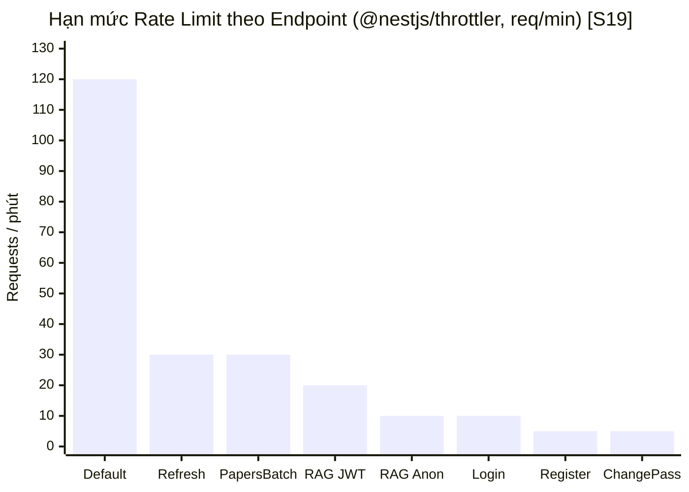

### 9.2 Bảo mật riêng cho AI

- **Chống Prompt Injection**: LLM chỉ sinh văn bản thuần túy, **không có tool-calling, không truy cập DB/shell/filesystem**, nên prompt injection không thể leo thang đặc quyền backend. Prompt hệ thống cô lập chỉ thị và bắt buộc trích `[Paper: id]`, kết hợp Groundedness Gate (`< 0.3`) thay câu trả lời bịa bằng `NO_CONTEXT_ANSWER` `[S3][S4]`. *(Frontend dùng `react-markdown` không bật raw HTML, tuy nhiên `agent-sec.md` ghi chú nhánh render FE chưa được pentest XSS chuyên sâu `[S18]`)*.
- **Chống rò rỉ dữ liệu**: Tách hoàn toàn kho tài liệu công khai (`Qdrant RO` + `rag_ts_corpus RO`) khỏi DB người dùng (`rag_ts`) `[S5]`; server logs không lưu nội dung prompt hay câu trả lời (chỉ lưu `query_len`) `[S3]`.
- **Chống lạm dụng token / DoS GPU**: Giới hạn `query <= 2,000` chars, `top_k <= 20`, `MAX_TOKENS = 1,024`, `LLM_TIMEOUT_MS = 60 s`, giới hạn đồng thời `ClientSlots` (`2/user`, `3/IP`), `RateLimitChat` (`10–20/m`), `LlmQueue` (`1 + 8` rồi `429` fail-fast) và `Idempotency-Key` chống spam lại câu giống nhau `[S3][S4][S13][S19]`.

---

## 10. Performance với k6 & RUM

### 10.1 SLO đặt trước & Kịch bản k6 (`backend_rag/benchmark/`) `[S7]`

- **SLO (Rule L1)**: Duy trì tải liên tục trong **3 phút (`180 s`)** theo **Open Workload Model (`ramping-arrival-rate`)** (chống Coordinated Omission) với `[S7]`:
  - `http_req_duration`: **`P95 < 500 ms`** (`< 300 ms` với Fast API), **`P99 < 1,000 ms`** (`< 60,000 ms` đối với RAG GPU turns).
  - `http_req_failed`: **`< 1.00%`**.
- **3 nhóm kịch bản chính `[S7][S8][S13]`**:
  1. **Load / Hold-Out (Soak)**: `k6_prod_certified_holdout.ts` (`250 RPS / 400 CUs`, `180 s`, 6-endpoint production mix trên `1,500` sessions & `15,000` messages); `k6_qualification_soak.ts` (`1,600 VUs`, `300 s` trên Fast API); `benchmark/v2/run_suite.mjs` (`3 × 180 s`).
  2. **Stress / Breakpoint**: `k6_prod_open_breakpoint.ts` (`71 → 300 RPS`), `k6_break_point_test.ts` (`500 → 3,000 VUs` trên `/health`), `k6_prod_auth_crypto.ts` (`2 → 50 VUs` Argon2id), `k6_rag_chat.ts` (`1 → 14 VUs`).
  3. **Spike / Burst**: `k6_queue_experiment.ts` (bơm burst `16` VUs vượt ngưỡng queue `1 + 8` để kiểm tra backpressure `429` và burst turnaround `[S13]`).

### 10.2 Chỉ số đo được (`http_req_duration`, `http_req_failed`, TTFT, tokens/s)

| Kịch bản                                                   | Mức tải                                                         | `http_req_duration`                                                                                                                                                  |                            `http_req_failed`                            | Ghi chú bổ sung & Đối chiếu nguồn                                                                                                                                                                                                                                                    |
| :----------------------------------------------------------- | :---------------------------------------------------------------- | :--------------------------------------------------------------------------------------------------------------------------------------------------------------------- | :------------------------------------------------------------------------: | :----------------------------------------------------------------------------------------------------------------------------------------------------------------------------------------------------------------------------------------------------------------------------------------- |
| **Auth + Session Mix (3m Hold-Out)** `[S8][S9][S10]` | **`400 CUs` (`250 RPS`)** (`48,874` reqs, `227 MB`) | **`P50 = 29.79 ms`**, **`P95 = 265.55 ms`**, **`P99 = 475.12 ms`**                                                                             |               **`0.00%`** (`83,137/83,137` checks)               | Đạt chuẩn sau tối ưu **4.0×** so với baseline `65 RPS` (`12,812` reqs, `P95 = 1,118.11 ms` fail trong `[S10]`). Stage A 30s đạt `P95 = 266.61 ms` @ `300 RPS` `[S8]`, nhưng Hold-Out 3m ở `300 RPS` gãy (`P95 = 909.87 ms`, `3.11%` fail) `[S10]`. |
| **Stateless Fast API (5m Soak)** `[S11]`             | **`1,600 CUs`** (`1,187,560` reqs, `3,958.53 RPS`)    | **`P50 = 349.70 ms`**, **`P95 = 379.48 ms`**, **`P99 = 826.29 ms`**                                                                            |                            **`0.00%`**                            | Probes 30s: **`2,000 VUs` PASS** (`P95 = 495.05 ms`), **`2,500 VUs` FAIL** (`P95 = 599.15 ms`) `[S11]`.                                                                                                                                                              |
| **Argon2id Crypto Flood** `[S12]`                    | `2 → 50 VUs` (`60 s`, `1,179` reqs)                        | Login `P50 = 2.63 s` (`min = 196.7 ms`, `p95 = 5.01 s`); Refresh `P50 = 305.7 ms`, `P95 = 536.5 ms`                                                          |              **`4.83%`** (`57/1,179` timeout login)              | Refresh rotation `374/374` passes; Event Loop probe `GET /auth/me` giữ **`P50 = 7.09 ms, P95 = 22.66 ms`** (giảm `-96%` so với baseline `566.11 ms` `[S12]`).                                                                                                         |
| **RAG / SSE & Grafana RUM** `[S13][S14][S17][S20]`   | `1–16 VUs` (k6 burst) / `9–11 users` (RUM)                  | Single GPU turn: **`~8.1–14.2 s`** `[S20]`; Burst 16 VUs: `30.53 / 55.59 / 79.18 s` `[S13]`; RUM pure REST: **`41.96–66.75 ms` P95** `[S14]` | **`9/9` `200` + `7/7` `429`** ở burst queue guard `[S13]` | **TTFT `P95 < 200 ms`** & retrieval `p50=112 ms / p95=120 ms` đo trên adapter mock 15 câu `[S17]`; **Lưu ý**: chưa đo tự động `tokens/s` riêng trong k6/Prometheus `[S14]`.                                                                               |

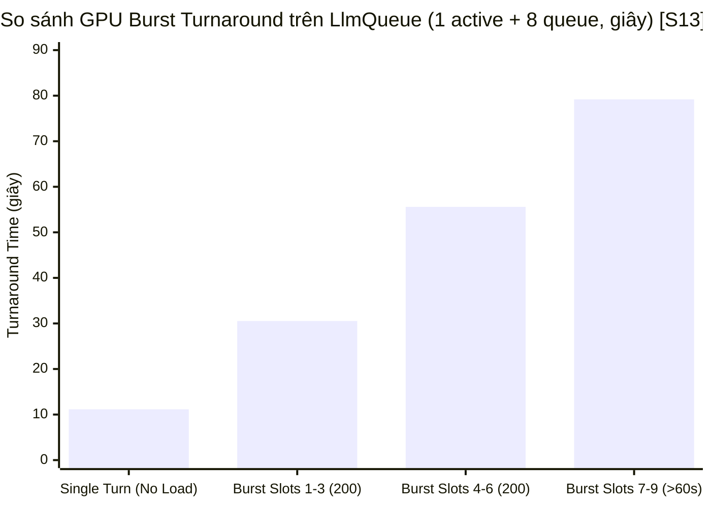

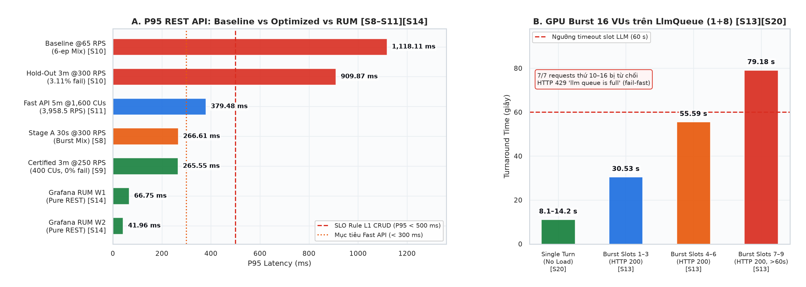

### 10.3 Môi trường đo & Điểm nghẽn tìm được

- **Môi trường đo**: Laptop Intel i7-13620H + **RTX 4060 (`8 GB VRAM`)**, `15–16 GB` RAM, Windows 11 chạy đồng thời NestJS (`node.exe`), LLM (`Qwen2.5-7B`), `cloudflared.exe` (WAN RTT tới MongoDB `~114 ms` lúc đo Stage B `[S8]` / `~15–25 ms` lúc ổn định `[S7]`) và `k6` `[S11]`.
- **5 điểm nghẽn chính đã tìm ra**:
  1. **Truy vấn tuần tự qua WAN tunnel (`GET /chat-sessions/:id` & `auth/login, refresh`)**: Gây tốn 2–4 RTT (`408.09–707.19 ms` P50) → Đã xử lý bằng `Promise.all`, 1-RTT atomic `findOneAndUpdate`, `.lean()`, `Singleflight`, Generation-Versioned `LRUCache` (`bumpUserGen`) và `maxPoolSize: 120` (**tăng 4.0× tải**) `[S7][S8][S9]`.
  2. **Bão hòa băng thông DRAM của `Argon2id`**: Thử tăng `UV_THREADPOOL_SIZE` lên `12` (`768 MB` arena) gây thrashing bộ nhớ khiến độ trễ tăng → chốt giữ `UV_THREADPOOL_SIZE = 4` (`256 MB` arena, `auth_me` giữ `P95 = 22.66 ms`) `[S8][S12]`.
  3. **Giới hạn 1 slot GPU của LLM (`Concurrency=1, MaxQueue=8`)**: Thử nghiệm burst `K=5` ghi nhận các slot `7–9` có turnaround **`79.18 ± 2.54 s`** (`mean`) với HTTP `200`, do `LLM_TIMEOUT_MS` (`60 s`) chỉ bắt đầu đếm sau khi lấy được slot GPU `[S13]`.
  4. **V8 Full GC & Cạn cổng ephemeral Windows**: Chạy `2,500+ VUs` cùng máy gây vượt ngưỡng `500 ms` (`599.15 ms` @ `2,500 VUs` `[S11]`); cấu hình `keepAliveTimeout = 65 s` giúp triệt tiêu `TIME_WAIT` churn ở `250 RPS` `[S7]`.
  5. **Trần Single-Core Node.js & WAN Write ở `300 RPS` (`450 CUs`)**: `node.exe` đạt `99.2%` CPU 1 nhân tuần tự hóa JSON và `45 RPS` lệnh `PATCH` đi qua tunnel `114 ms` khiến Hold-Out 3m ở `300 RPS` vọt lên `P95 = 909.87 ms` (`3.11%` fail) `[S8][S10]` — hướng mở rộng tiếp theo là đặt BE cùng VPC với MongoDB (`< 1.5 ms` RTT) và chạy cluster multi-worker + Redis `[S8]`.

---

## Phụ lục — Bảng nhớ nhanh khi phản biện (Số liệu · Luồng lỗi · Điều kiện đo)

| Nhóm câu hỏi kỹ sư hay hỏi nhất                   | Trả lời nhanh 15 giây (Con số & Cơ chế chính xác)                                                                                                                                                                                                                                                                                                                                                                                                                                                                                                                                                                                                                                                                                                                                                                                                                                            |
| :------------------------------------------------------- | :--------------------------------------------------------------------------------------------------------------------------------------------------------------------------------------------------------------------------------------------------------------------------------------------------------------------------------------------------------------------------------------------------------------------------------------------------------------------------------------------------------------------------------------------------------------------------------------------------------------------------------------------------------------------------------------------------------------------------------------------------------------------------------------------------------------------------------------------------------------------------------------------------- |
| **1. Số liệu cụ thể (Latency, Cost, Quy mô)** | • **CRUD/Auth API**: Certified **`400 CUs / 250 RPS`** (Hold-Out 3m, `48,874` reqs, **`P95 = 265.55 ms`**, **`P99 = 475.12 ms`**, `0%` error `[S9]`); RUM pure REST **`41.96–66.75 ms` P95** `[S14]`.• **Stateless Gateway**: **`1,600 CUs / 3,958.53 RPS`** (`P95 = 379.48 ms`, 5m `[S11]`).• **AI / RAG**: **`$0.00` chi phí API** (chạy local Qwen2.5-7B Q4_K_M + Laya + Nomic `[S4]`); E2E 1 turn **`~8.1–14.2 s`** `[S20]`; `MRR = 0.8939`, `Reject @0.5 = 100%` `[S15]`, DeepEval `Contextual Recall@5 = 0.900` `[S16]`.• **Frontend & Test**: **`57.1 ± 1.3 FPS`** (`17.5 ms` med, `0 Long Tasks` `[S21]`), Lighthouse `97` `[S20]`; **FE `96.58%` lines (`327` tests)**, **BE `94.72%` lines (`267` unit + `13` E2E)** `[S25]`. |
| **2. Luồng lỗi & Khả năng chịu lỗi**         | • **GPU quá tải (`> 1 + 8` req)**: Fail-fast **`429 llm queue is full`** (`7/7` khi vượt ngưỡng `[S13]`), chặn spam `ClientSlots` (`2/user, 3/IP`) `[S3]`.• **Timeout**: `LLM 60s (504)`, `Qdrant 15s (503)`, `Corpus 5s (503)`, `Laya 30s` (degrade mềm về Vector + PageRank) `[S3][S4][S5]`.• **Chống ảo giác & Trùng lặp**: Evidence Gate `< 0.6` rewrite 1 lần → thiếu vẫn `abstained`; Groundedness `< 0.3` → `answer_replaced` `[S3]`; `Idempotency-Key` 24h `[S6]`; Backend sập → FE đọc 100% lịch sử từ `Dexie.js` với badge `Ngoại tuyến` `[S24]`.                                                                                                                                                                                                                                      |
| **3. Điều kiện đo thực tế**                  | • **Phần cứng**: 1 máy Laptop i7-13620H + **RTX 4060 (8 GB VRAM)**, CUDA 13.0, Windows 11, 15–16 GB RAM `[S11][S15]`.• **Tải k6**: Open-Model `ramping-arrival-rate` trên **1,500 sessions + 15,000 messages** thật qua `cloudflared` tunnel (`~15–114 ms` RTT) `[S7][S8]`.• **Giới hạn công bố minh bạch**: `tokens/s` chưa đo riêng trong k6 `[S14]`; `TTFT < 200 ms` là kết quả bộ adapter mock 15 câu `[S17]`; chưa có CI/CD tự động; `agent-sec.md` nhắc cần xoay vòng 2 credential cũ từng lộ trong git history `[S18]`; Playwright E2E cần `npx playwright install` trên Windows host để chạy live `[S25]`.                                                                                                                                                                                   |

---

## Nguồn Tham chiếu & Đối chiếu Số liệu (Source Ledger `[S1]`–`[S27]`)

> Bảng dưới đây là **Source Ledger chuẩn hóa** dùng chung cho cả tài liệu này và bản slide rút gọn [`TECHNICAL_PRESENTATION_COMPACT.md`](TECHNICAL_PRESENTATION_COMPACT.md).

| Mã                 | Tài liệu / File gốc (Clickable Path)                                                                                                                                                                                                                  | Phạm vi số liệu & nội dung đã đối chiếu                                                                                                                                                  |
| :------------------ | :------------------------------------------------------------------------------------------------------------------------------------------------------------------------------------------------------------------------------------------------------- | :------------------------------------------------------------------------------------------------------------------------------------------------------------------------------------------------ |
| **`[S1]`**  | [`docs/architecture/ARCHITECTURE_OVERVIEW.md`](../architecture/ARCHITECTURE_OVERVIEW.md)                                                                                                                                                                | Kiến trúc tổng thể 3 tầng, luồng SSE RAG 7 bước, Dual Persistence, `30` luật FP-Growth, `tree.json`.                                                                                 |
| **`[S2]`**  | [`docs/api/API_DESIGN.md`](../api/API_DESIGN.md) &amp; [`API_SPECIFICATION.md`](../api/API_SPECIFICATION.md)                                                                                                                                           | Chuẩn REST `/api/v1`, JSON/XML negotiation, `_links`, cursor pagination, payload mẫu, Error Envelope.                                                                                       |
| **`[S3]`**  | [`backend_rag/src/modules/rag/rag.service.ts`](../../backend_rag/src/modules/rag/rag.service.ts) &amp; [`rag.controller.ts`](../../backend_rag/src/modules/rag/rag.controller.ts)                                                                      | Logic RAG, Evidence Gate `0.6`, Groundedness `0.3`, regex citation, `ClientSlots (2/user, 3/IP)`, SSE &amp; timeouts.                                                                       |
| **`[S4]`**  | [`backend_rag/src/engines/llm/llm-engine.ts`](../../backend_rag/src/engines/llm/llm-engine.ts), [`llm.service.ts`](../../backend_rag/src/engines/llm/llm.service.ts) &amp; [`judge.service.ts`](../../backend_rag/src/engines/judge/judge.service.ts) | `Qwen2.5-7B-Instruct Q4_K_M` (`4.68 GB`, `ctx 8192`, `temp 0.2`, `MAX_TOKENS 1024`), `LlmQueue (1+8)`, Laya (`512` tok, `MAX_PENDING 8`).                                         |
| **`[S5]`**  | [`backend_rag/src/engines/corpus/corpus.service.ts`](../../backend_rag/src/engines/corpus/corpus.service.ts) &amp; [`database-v2.md`](../architecture/database-v2.md)                                                                                  | Tách Qdrant RO (`913,205` vectors 768-D), MongoDB `rag_ts_corpus` RO (`CORPUS_TIMEOUT_MS=5000`), và MongoDB `rag_ts` RW.                                                                |
| **`[S6]`**  | [`backend_rag/docs/MONGODB_SCHEMA_DESIGN.md`](../../backend_rag/docs/MONGODB_SCHEMA_DESIGN.md)                                                                                                                                                          | 7 collections MongoDB, UUIDv7 primary keys, compound B-tree index, TTL 15m / 24h / 3d.                                                                                                            |
| **`[S7]`**  | [`backend_rag/docs/PERFORMANCE_AND_CACHING.md`](../../backend_rag/docs/PERFORMANCE_AND_CACHING.md)                                                                                                                                                      | Generation-Versioned `LRUCache`, `Singleflight`, `.lean()`, `maxPoolSize: 120`, `keepAliveTimeout: 65s`, Rule L1 SLO.                                                                   |
| **`[S8]`**  | [`backend_rag/benchmark/BOTTLENECK_ANALYSIS_AND_OPTIMIZATION.md`](../../backend_rag/benchmark/BOTTLENECK_ANALYSIS_AND_OPTIMIZATION.md)                                                                                                                  | Phân tích 4 bottleneck WAN (`114 ms` RTT), Stage A (`300 RPS` `P95=266.61 ms`), trần CPU `node.exe 99.2%`.                                                                             |
| **`[S9]`**  | [`opt_certified_holdout_250rps_summary.json`](../../backend_rag/benchmark/results/opt_certified_holdout_250rps_summary.json)                                                                                                                            | Raw JSON Hold-Out 3m (`250 RPS / 400 CUs`): `48,874` reqs, `med=29.79 ms`, `p95=265.55 ms`, `p99=475.12 ms`, `0.00%` fail, `83,137` checks.                                         |
| **`[S10]`** | [`prod_holdout_65rps_summary.json`](../../backend_rag/benchmark/results/prod_holdout_65rps_summary.json) &amp; [`opt_certified_holdout_300rps_summary.json`](../../backend_rag/benchmark/results/opt_certified_holdout_300rps_summary.json)            | Đối chứng Baseline `@65 RPS` (`12,812` reqs, `p95=1,118.11 ms` fail) &amp; Trần gãy Hold-Out 3m `@300 RPS` (`58,377` reqs, `p95=909.87 ms`, `3.11%` fail).                     |
| **`[S11]`** | [`qualification_fast_results.json`](../../backend_rag/benchmark/results/qualification_fast_results.json)                                                                                                                                                | Raw JSON Fast API 5m soak (`1,600 CUs`, `1,187,560` reqs, `3,958.53 RPS`, `p95=379.48 ms`, `0%` fail) &amp; probes (`2,000` pass / `2,500` fail).                                   |
| **`[S12]`** | [`opt_auth_crypto_summary.json`](../../backend_rag/benchmark/results/opt_auth_crypto_summary.json) &amp; [`prod_auth_crypto_summary.json`](../../backend_rag/benchmark/results/prod_auth_crypto_summary.json)                                          | Raw JSON Stage C Argon2id flood (`2→50 VUs`, `60s`): `auth_me` `p95: 566.11 → 22.66 ms`, `refresh` `374/374`, `login` `57/1,179` (`4.83%`) vượt timeout 5s.                 |
| **`[S13]`** | [`k_fold_burst_results.json`](../../backend_rag/benchmark/results/k_fold_burst_results.json) &amp; [`burst_queue8_summary.json`](../../backend_rag/benchmark/results/burst_queue8_summary.json)                                                        | Thực nghiệm burst `16` VUs vào queue GPU `1+8`: `9/9 HTTP 200` (`30.53 / 55.59 / 79.18 s`) và `7/7 HTTP 429 llm queue is full`.                                                     |
| **`[S14]`** | [`docs/grafana_analysis/GRAFANA_MONITORING_ANALYSIS.md`](../grafana_analysis/GRAFANA_MONITORING_ANALYSIS.md)                                                                                                                                            | Grafana RUM (`2026-11-08`): Window 1 (`11` users 5m, `3` SSE, `P95=66.75 ms`, LLM `100%`) &amp; Window 2 (`P95=41.96 ms`, `10s` restart).                                           |
| **`[S15]`** | [`docs/reports/VECTOR_VS_LAYA_BENCHMARK_REPORT.md`](VECTOR_VS_LAYA_BENCHMARK_REPORT.md) &amp; [`laya_ab_final_benchmark.json`](../../backend_rag/benchmark/results/laya_ab_final_benchmark.json)                                                       | Benchmark `150` mẫu `test_set_v1.jsonl` (`100` Pos + `50` Neg): `MRR 0.8939`, `Hit@1 82%`, `Hit@5 98%`, `Reject@0.5 100%`, `Faithfulness 0.7977`.                              |
| **`[S16]`** | [`docs/research/laya-jev.md`](../research/laya-jev.md)                                                                                                                                                                                                  | DeepEval (`N=105` hydrated): `Recall@5 0.900`, `Precision@5 0.852`, `Citation GEval 0.762`, `Faithfulness 0.667`, Gates &amp; Laya CUDA `316.16 ms`.                                  |
| **`[S17]`** | [`integrated-bench-run-2026-10-23T08-19-38-jjpmf-executive.md`](integrated-bench-run-2026-10-23T08-19-38-jjpmf-executive.md)                                                                                                                            | Snapshot adapter mock 15 câu (`2026-10-23`): `Recall@5 73.08%`, `TTFT p95 < 200 ms`, `p50=112 ms / p95=120 ms`, `0` citations bịa.                                                    |
| **`[S18]`** | [`AUTH_AND_SECURITY_ARCHITECTURE.md`](../../backend_rag/docs/AUTH_AND_SECURITY_ARCHITECTURE.md), [`prompt_security.md`](../prompts/prompt_security.md) &amp; [`agent-sec.md`](../security/agent-sec.md)                                               | Argon2id, 1-RTT refresh, RBAC 3 lớp, 13 route Admin, `admin_audit_logs`, `npm audit 0` prod vulns &amp; 2 credential cần xoay vòng.                                                        |
| **`[S19]`** | [`throttler.ts`](../../backend_rag/src/common/security/throttler.ts), [`app.setup.ts`](../../backend_rag/src/app.setup.ts) &amp; [`env.schema.ts`](../../backend_rag/src/config/env.schema.ts)                                                        | Hạn mức `@nestjs/throttler` theo route, `helmet` CSP, Zod fail-fast secret `>= 32` chars &amp; `TRUST_PROXY_HOPS`.                                                                      |
| **`[S20]`** | [`docs/reports/REPORT.md`](REPORT.md) &amp; [`docs/AI_chat_log/Vuong_chat_logs.md`](../AI_chat_log/Vuong_chat_logs.md)                                                                                                                                 | Lighthouse Audit (`D-018`: Perf `97`, `FCP 0.9s`, `LCP 1.0s`, `TBT 40ms`, `CLS 0.002`), Decision Log `D-001`..`D-058`, single-turn RAG `8.1–14.2 s`.                           |
| **`[S21]`** | [`perf-chat-run.json`](../../frontend_rag/docs/perf-shots/raw/perf-chat-run.json) &amp; [`perf-chat-report.md`](../../frontend_rag/docs/perf-chat-report.md)                                                                                           | Đối chứng 3D stream chat `150k` vectors: Pre-fix ❌ (`0.8 ms` med / `102 ms` p95 / `23 Long Tasks`) vs Post-fix `D-005` ✅ (`57.1 ± 1.3 FPS`, `17.5 ms` med, `0 Long Tasks`). |
| **`[S22]`** | [`perf-report.md`](../../frontend_rag/docs/perf-report.md) &amp; [`design-migration-report.md`](../../frontend_rag/docs/design-migration-report.md)                                                                                                    | Tối ưu WebGL Apple M4 (`12.7→8.0 ms` Dark, `13.3→8.9 ms` Light, raycast `56×`), `0` vi phạm `check-design` &amp; P22 rAF `1.9–2.0 ms`.                                         |
| **`[S23]`** | [`docs/design/FE_DESIGN_SYSTEM.md`](../design/FE_DESIGN_SYSTEM.md), [`tokens.ts`](../../frontend_rag/src/shared/theme/tokens.ts) &amp; [`index.css`](../../frontend_rag/src/index.css)                                                                | Design Tokens 3 tầng, Dark/Light palettes, `Geist`/`Geist Mono`, Liquid Glass cấp `1–4` &amp; `check-design.cjs`.                                                                      |
| **`[S24]`** | [`STATE_AND_STREAMING_ARCHITECTURE.md`](../../frontend_rag/docs/STATE_AND_STREAMING_ARCHITECTURE.md) &amp; [`AppRouter.tsx`](../../frontend_rag/src/app/routers/AppRouter.tsx)                                                                         | `Dexie.js` Offline-First (`< 15 ms`), `30 ms` batch + `useDeferredValue`, 5 pha 3D, badge `Ngoại tuyến`, các route `?view=`.                                                       |
| **`[S25]`** | [`vite.config.ts`](../../frontend_rag/vite.config.ts), [`frontend_rag/README.md`](../../frontend_rag/README.md) &amp; [`backend_rag/README.md`](../../backend_rag/README.md)                                                                          | Test &amp; coverage (`FE 96.58% lines / 327 tests`, `BE 94.72% lines / 267 unit + 13 E2E`), `49` BE + `62` FE directory READMEs, Vite `port 5174`.                                      |
| **`[S26]`** | [`backend_rag/Dockerfile`](../../backend_rag/Dockerfile), [`docker-compose.yml`](../../backend_rag/docker-compose.yml) &amp; [`frontend_rag/Dockerfile`](../../frontend_rag/Dockerfile)                                                               | Đóng gói multi-stage container, non-root `USER node`, `mongo:7 rs0`, `qdrant:v1.15.4`, `nginx:alpine`.                                                                                 |
| **`[S27]`** | [`docs/api/API-compare.md`](../api/API-compare.md)                                                                                                                                                                                                      | So sánh thiết kế API cũ vs mới theo 8 nguyên tắc RESTful: `34` routes, `8 → 0` động từ, `26/34` `_links`, `405 Allow`, batch `?ids=`.                                      |
