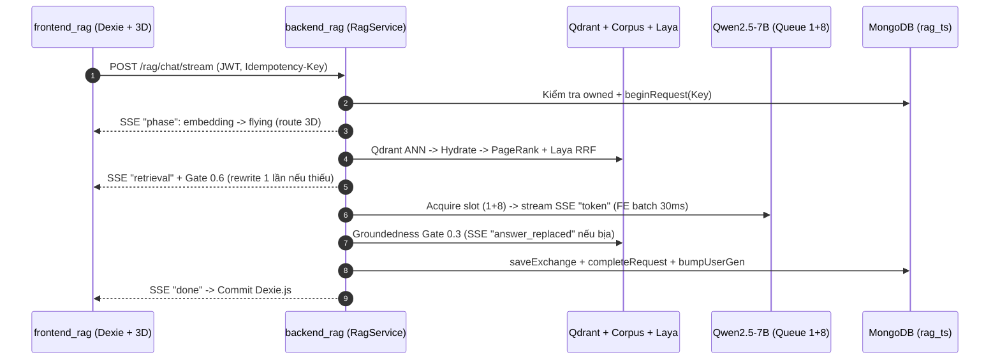
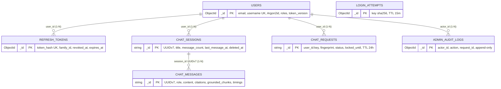

# TECHNICAL_PRESENTATION_COMPACT.md — Bộ Slide Review Kỹ Thuật Hệ Thống `RAG_TS`

- **Motivation/Background**: Trước hội đồng phản biện kỹ thuật, slide cần trình bày mạch lạc từ Yêu cầu chức năng/phi chức năng, Luồng hệ thống, Thiết kế DB Schema & ERD, Thiết kế RESTful API (8 nguyên tắc), đến Module AI, Bảo mật, Tính chịu tải/Khả năng mở rộng/Tính sẵn sàng, Frontend 3D và Kiểm thử — không nhồi chữ nhưng phải giữ nguyên số liệu kiểm chứng.
- **Purpose**: Cung cấp bộ khung **25 Slide Cards** hoàn chỉnh (Headline · 3–5 bullets · Key KPIs/Bảng · Gợi ý biểu đồ/ảnh thật trong repo) để dựng trực tiếp thành bài thuyết trình kỹ thuật `RAG_TS`.
- **Overview Pipeline**: Phân rã toàn bộ hệ thống thành 25 slide thuộc 4 phần → Gắn nguồn đối chiếu `[S1]–[S27]` trên từng con số & thiết kế → Gợi ý visual `.png` / Mermaid ERD & Sequence → Tổng hợp Q&A và Danh mục nguồn ở cuối.
- **Detailed Plan**:
  - **Phần I (Slides 01–06)**: Tổng quan, Bài toán, **Yêu cầu chức năng**, **Yêu cầu phi chức năng & Quy mô**, Kiến trúc & Lưu trữ 2 tầng.
  - **Phần II (Slides 07–12)**: **Luồng hệ thống & Xử lý lỗi**, **Xây dựng Sơ đồ Thực thể (ERD)**, **Thiết kế DB Schema & Indexing**, **Thiết kế RESTful API theo 8 nguyên tắc**.
  - **Phần III (Slides 13–19)**: Module AI, Đánh giá Laya/DeepEval, Chi phí & Điều kiện đo, Caching Backend, Bảo mật RBAC/AI, **Tính chịu tải · Khả năng mở rộng · Tính sẵn sàng (k6 & RUM)**, Điểm nghẽn.
  - **Phần IV (Slides 20–25)**: Frontend 3D WebGL, Design System & Streaming, Kiểm thử & Độ phủ, Docker & Hạng mục tồn đọng, Q&A kỹ thuật, Danh mục nguồn `[S1]–[S27]`.
- **References**: [TECHNICAL_PRESENTATION_CHECKLIST.md](TECHNICAL_PRESENTATION_CHECKLIST.md), [AGENTS.md](../../AGENTS.md), [ARCHITECTURE_OVERVIEW.md](../architecture/ARCHITECTURE_OVERVIEW.md), [API_DESIGN.md](../api/API_DESIGN.md), [API-compare.md](../api/API-compare.md), [MONGODB_SCHEMA_DESIGN.md](../../backend_rag/docs/MONGODB_SCHEMA_DESIGN.md), [BOTTLENECK_ANALYSIS_AND_OPTIMIZATION.md](../../backend_rag/benchmark/BOTTLENECK_ANALYSIS_AND_OPTIMIZATION.md), [VECTOR_VS_LAYA_BENCHMARK_REPORT.md](VECTOR_VS_LAYA_BENCHMARK_REPORT.md), [laya-jev.md](../research/laya-jev.md), [GRAFANA_MONITORING_ANALYSIS.md](../grafana_analysis/GRAFANA_MONITORING_ANALYSIS.md), [FE_DESIGN_SYSTEM.md](../design/FE_DESIGN_SYSTEM.md), [REPORT.md](REPORT.md), [MD_CONVENTION.md](../../agents/rules/MD_CONVENTION.md).
- **Created**: 2026-11-17T19:16:00+07:00
- **Last Updated**: 2026-11-17T22:36:00+07:00

[STATUS: ACTIVE]

---

## Mục lục Slide Deck (25 Slides)

- **Phần I — Yêu cầu & Kiến trúc**: [Slide 01](#slide-01--tổng-quan-hệ-thống--chỉ-số-chính) · [Slide 02](#slide-02--bài-toán-đối-tượng-sử-dụng--phạm-vi) · [Slide 03](#slide-03--yêu-cầu-chức-năng-5-use-case-chính--phân-quyền) · [Slide 04](#slide-04--yêu-cầu-phi-chức-năng--quy-mô-hệ-thống) · [Slide 05](#slide-05--kiến-trúc-hệ-thống--phân-tách-cơ-sở-dữ-liệu) · [Slide 06](#slide-06--lưu-trữ-hai-tầng-indexeddb--mongodb)
- **Phần II — Luồng hệ thống, DB Schema, ERD & API**: [Slide 07](#slide-07--luồng-hệ-thống-sequence-rag-streaming--dữ-liệu) · [Slide 08](#slide-08--luồng-lỗi-timeout-retry-idempotency--fallback) · [Slide 09](#slide-09--xây-dựng-sơ-đồ-thực-thể-cơ-sở-dữ-liệu-erd) · [Slide 10](#slide-10--thiết-kế-db-schema-indexing--ttl-retention) · [Slide 11](#slide-11--thiết-kế-restful-api-theo-8-nguyên-tắc-phần-1-tài-nguyên-method--status) · [Slide 12](#slide-12--thiết-kế-restful-api-theo-8-nguyên-tắc-phần-2-versioning-định-dạng-batch--query)
- **Phần III — AI, Backend, Bảo mật & Chịu tải**: [Slide 13](#slide-13--module-ai-truy-xuất-rerank--kiểm-soát-trích-dẫn) · [Slide 14](#slide-14--đánh-giá-chất-lượng-ai-vector-vs-laya--deepeval) · [Slide 15](#slide-15--chi-phí-vận-hành-ai--điều-kiện-đo) · [Slide 16](#slide-16--backend-tối-ưu-truy-vấn-mongodb--caching) · [Slide 17](#slide-17--bảo-mật-hệ-thống-phân-quyền-rbac--an-toàn-ai) · [Slide 18](#slide-18--tính-chịu-tải-khả-năng-mở-rộng--tính-sẵn-sàng) · [Slide 19](#slide-19--các-điểm-nghẽn-hiệu-năng--hướng-mở-rộng)
- **Phần IV — Frontend, Kiểm thử & Triển khai**: [Slide 20](#slide-20--frontend-3d-webgl-tối-ưu-render-150k-vector) · [Slide 21](#slide-21--frontend-design-system--trải-nghiệm-streaming) · [Slide 22](#slide-22--kiểm-thử-tự-động--độ-phủ-mã-nguồn-test-coverage) · [Slide 23](#slide-23--cấu-trúc-dự-án-đóng-gói-docker--các-điểm-chưa-hoàn-thiện) · [Slide 24](#slide-24--tổng-hợp-qa-kỹ-thuật-số-liệu--luồng-lỗi--điều-kiện-đo) · [Slide 25](#slide-25--danh-mục-nguồn-đối-chiếu-s1s27)

> Bản chi tiết tham số, payload mẫu và mã lệnh nằm tại [TECHNICAL_PRESENTATION_CHECKLIST.md](TECHNICAL_PRESENTATION_CHECKLIST.md).

---

### Slide 01 — Tổng quan hệ thống & Chỉ số chính

- **Headline**: `RAG_TS` là nền tảng hỏi đáp tài liệu khoa học chống ảo giác trích dẫn, kết hợp **Cây Tri Thức 3D** và vận hành hoàn toàn bằng **AI cục bộ (`$0` phí API)** `[S1][S4]`.
- **Bullets**:
  - Đồng bộ trực quan hóa không gian 3D (`150k` điểm tán lá) theo từng pha truy xuất của pipeline RAG `[S1][S21]`.
  - Kiểm soát độ trung thực trích dẫn hai tầng bằng **Laya 421M** (Evidence Gate `0.6` + Groundedness Gate `0.3`) trước và sau `Qwen2.5-7B` `[S3][S4]`.
  - Đạt chứng nhận chịu tải **Rule L1 3 phút** trên hạ tầng thực qua Cloudflare tunnel nhờ tối ưu query song song & caching `[S7][S8][S9]`.
- **Key KPIs**:
  - **AI Quality**: `MRR = 0.8939` · `Reject @0.5 = 100%` `[S15]` · `Contextual Recall@5 = 0.900` `[S16]`
  - **Backend SRE**: **`400 CUs / 250 RPS`** (`P95 = 265.55 ms`, `0.00%` lỗi `[S9]`) · Gateway **`1,600 CUs / 3,958.53 RPS`** `[S11]`
  - **Frontend & Tests**: Lighthouse **`97/100/100`** `[S20]` · **`57.1 ± 1.3 FPS`** (`0 Long Tasks` `[S21]`) · Coverage **`96.58%` FE / `94.72%` BE** `[S25]`
- **Gợi ý Visual**: Ảnh tổng quan Dark/Light UI: [new_summer_sky_ui.png](../assets/new_summer_sky_ui.png) hoặc [after-dark-overview.png](../../frontend_rag/docs/screenshots/after-dark-overview.png).

---

### Slide 02 — Bài toán, Đối tượng sử dụng & Phạm vi

- **Headline**: Giải bài toán tổng hợp bài báo khoa học (`cs.LG/CL/CV/AI`) có trích dẫn xác thực `[Paper: id]`, tách bạch phần phục vụ online khỏi pipeline nạp dữ liệu `[S1][S5]`.
- **Bullets**:
  - **Vấn đề thực tế**: Tìm kiếm thủ công dễ sót bài liên ngành, còn LLM thuần dễ bịa mã bài báo (citation hallucination) và không thấy cấu trúc cụm tri thức `[S1][S15]`.
  - **Đối tượng sử dụng**: `user` (nhà nghiên cứu / sinh viên hỏi đáp, khám phá 3D, quản lý lịch sử) và `admin` (giám sát hệ thống, quản lý user, kiểm toán audit logs) `[S18][S24]`.
  - **Ngoài phạm vi (Out-of-Scope)**: App không crawl dữ liệu, không tạo embedding hàng loạt hay ghi Qdrant/`rag_ts_corpus` (tách sang pipeline UTH cổng `8000`); Admin không có API sửa/xóa chat hay sửa/xóa `admin_audit_logs`; bắt buộc có BE khi đăng nhập mới `[S5][S18]`.
- **Key KPIs**:
  - Kho tri thức: **`913,205` chunks** (`768-D`) + **`29,523` tác giả** PageRank + **`30` luật FP-Growth** `[S1][S5][S16]`.
  - **`0` bài báo bịa đặt** trên bộ kiểm thử trích dẫn `[S17]` (`100%` citation trích từ ngữ cảnh).
- **Gợi ý Visual**: Bảng 2 cột *In-Scope vs Out-of-Scope* kèm sơ đồ 2 nhóm người dùng (`user` / `admin`).

---

### Slide 03 — Yêu cầu chức năng (5 Use Case chính & Phân quyền)

- **Headline**: Hệ thống đáp ứng trọn vẹn `5` nhóm nghiệp vụ cốt lõi (`UC-01` → `UC-05`) trải dài trên **`34` API endpoints** phân quyền chặt theo role `[S2][S18][S27]`.
- **Bullets**:
  - **UC-01 — Xác thực & Vòng đời tài khoản (`7` routes)**: Đăng ký (`POST /users`), đăng nhập (`POST /auth/tokens`), tự động xoay vòng refresh token (`POST /auth/token-rotations`), đăng xuất (`POST /auth/token-revocations`), xem/sửa hồ sơ & đổi mật khẩu `[S2][S18]`.
  - **UC-02 — Hỏi đáp RAG Streaming đồng bộ 3D (`2` routes)**: Gửi câu hỏi (`POST /rag/chat/stream`), theo dõi `5` pha thời gian thực (`embedding → flying → comparing → found → generating`), stream token, đối chiếu `[Paper: id]` và LaTeX `[S1][S3][S24]`.
  - **UC-03 — Khám phá Cây Tri Thức 3D & Bài báo (`2` routes)**: Bay camera theo nhánh (`TreeRouter`), highlight cụm `TopKThreads`, bấm citation hoặc batch `GET /papers?ids=` để mở `PaperPanel` `[S1][S2][S24]`.
  - **UC-04 — Quản lý phiên hội thoại Offline-First (`6` routes)**: Tạo lười session UUIDv7 khi nhắn tin đầu, phân trang cursor `10` phiên/trang, tìm `?q=`, đổi tên (`PATCH`), xóa mềm (`DELETE` 2 bước xác nhận, TTL 3 ngày), xem lịch sử offline `[S2][S6][S24]`.
  - **UC-05 — Quản trị & Kiểm toán RBAC (`13` routes `/admin/*`)**: Thống kê hệ thống, khóa/mở user, đổi role, thu hồi token, xem `login_attempts`, `health` chi tiết và tra cứu `admin_audit_logs` `[S2][S18]`.
- **Key KPIs**:
  - Tổng bề mặt API: **`34` routes** (`1` root + `7` Auth/User + `2` RAG + `6` Sessions + `5` Papers/Health + `13` Admin) `[S2][S27]`.
  - Guest (ẩn danh) vẫn hỏi đáp được (`10` req/phút); có JWT mới lưu session vào MongoDB (`20` req/phút) `[S19]`.
- **Gợi ý Visual**: Bảng ma trận phân quyền `5 Use Case × 3 mức truy cập (Guest / User / Admin)`.

---

### Slide 04 — Yêu cầu phi chức năng & Quy mô hệ thống

- **Headline**: Thiết lập ngưỡng SLA định lượng theo **Rule L1 (`3` phút liên tục)** và đối chiếu minh bạch giữa tải đo k6 với lưu lượng thực tế Grafana RUM `[S7][S9][S14]`.
- **Bullets**:
  - **Độ trễ (Latency)**: REST CRUD/Auth đạt **`P95 = 265.55 ms`** (`< 500 ms` SLA) & **`P99 = 475.12 ms`** (`< 1,000 ms`) ở `250 RPS` k6 `[S9]`; RUM thực tế đạt **`41.96–66.75 ms` P95** `[S14]`. RAG end-to-end GPU đạt **`8.1–14.2 s`** không hàng đợi `[S20]` (`<= 60 s` limit sau khi lấy slot `[S3]`).
  - **Thông lượng (Throughput)**: CRUD/Auth đạt **`250 RPS`** (Stage A 30s tới **`300 RPS`** `[S8]`); Stateless Gateway (`/health`) đạt **`3,958.53 RPS`** trong 5 phút `[S11]`.
  - **Độ sẵn sàng & Sai số (Availability)**: Tỷ lệ lỗi k6 **`0.00%`** (`83,137/83,137` checks `[S9]`); Grafana RUM ghi nhận LLM `100%` (W1) & `99.54%` (W2 — restart 10s `[S14]`).
  - **Quy mô thực nghiệm (DAU / Peak)**: Grafana RUM ghi nhận peak **`11` active users (5m) / `9` concurrent (1m) / `3` SSE streams** `[S14]`; k6 chứng nhận **`400 CUs`** CRUD & **`1,600 CUs`** Gateway trên GPU đơn `1 + 8` queue `[S4][S9][S11]`.
- **Key KPIs**:
  - Giao diện 3D `150k` vectors: **`57.1 ± 1.3 FPS`**, **`0 Long Tasks`**, Lighthouse **`97` Perf / `100` Acc / `100` BP**, `LCP = 1.0 s` `[S20][S21]`.
  - Lưu ý phạm vi: Hệ thống phục vụ quy mô nhóm nghiên cứu & stress test định chuẩn, chưa vận hành production công cộng quy mô DAU lớn `[S14]`.
- **Gợi ý Visual**: Thẻ 4 nhóm NFR (Latency · Throughput · Availability · Capacity vs. RUM Scale).

---

### Slide 05 — Kiến trúc hệ thống & Phân tách cơ sở dữ liệu

- **Headline**: Tách biệt hoàn toàn dữ liệu tác nghiệp người dùng khỏi kho văn bản gốc và chỉ mục vector giúp nhẹ RAM tìm kiếm và bảo vệ source-of-truth `[S5][S6]`.
- **Bullets**:
  - **Frontend (`frontend_rag`)**: React 19 + Three.js (R3F) + Zustand + `Dexie.js`, giao tiếp `/api/v1/*` qua REST & SSE (`:5174` dev proxy / `nginx` prod) `[S1][S24][S25][S26]`.
  - **Backend (`backend_rag`)**: NestJS 11 monolith (`:3000`) thiết kế Ports & Adapters, vừa điều phối tìm kiếm vừa chạy suy luận ONNX (`Laya`) + GGUF (`Qwen2.5-7B`) `[S3][S4]`.
  - **3 kho dữ liệu chuyên biệt**:
    1. `Qdrant` (**Read-Only**): `913,205` vector `768-D` + metadata lọc (`category`, `twig_id`) `[S5]`.
    2. `MongoDB rag_ts_corpus` (**Read-Only**): Hydrate toàn văn chunk/tiêu đề/tác giả qua `CORPUS_MONGO_URI` (timeout `5s`) `[S5]`.
    3. `MongoDB rag_ts` (**Read/Write**, user `ragts_app`): Lưu `7` collections nghiệp vụ người dùng, phiên chat, idempotency và audit `[S6][S18]`.
- **Key KPIs**:
  - Kết nối MongoDB từ xa qua `cloudflared` TCP tunnel (`~15–25 ms` bình thường / `114 ms` WAN lúc stress test `[S7][S8]`).
  - Việc bỏ text khỏi Qdrant sang `rag_ts_corpus` giúp vector index nhẹ RAM và tránh phình payload `[S5][S27]`.
- **Gợi ý Visual**: Sơ đồ kiến trúc 3 tầng hoặc ảnh hạ tầng Cloudflare Tunnel: [cloudflare_1_tunnels.png](../assets/cloudflare_1_tunnels.png).

---

### Slide 06 — Lưu trữ hai tầng (IndexedDB & MongoDB)

- **Headline**: Giao diện không trắng trang khi chậm hoặc mất mạng: `Dexie.js` ở trình duyệt giữ vai trò hiển thị tức thời, đồng bộ bất đồng bộ với MongoDB UUIDv7 `[S6][S24]`.
- **Bullets**:
  - **Cache-First trên trình duyệt (`< 15 ms`)**: Mở app đọc thẳng `sessions` & `messages` từ IndexedDB (`Dexie.js`), đồng thời chạy ngầm `/health` (`2s` timeout) và đồng bộ cursor `/chat-sessions` `[S24]`.
  - **Đồng bộ theo `UUIDv7` & Cursor**: Mã phiên và tin nhắn dùng cùng khóa `UUIDv7` ở cả FE và BE, hỗ trợ hợp nhất dữ liệu mà không trùng lặp `[S6][S24]`.
  - **Fallback khi DB standalone hoặc mất mạng**: Nếu MongoDB không có Replica Set (lỗi code `20`), BE tự chuyển sang ghi tuần tự (messages trước, cộng `message_count` sau) để không sai số đếm; khi BE ngừng, FE vẫn đọc `100%` lịch sử kèm badge **`Ngoại tuyến`** `[S24][S25]`.
- **Key KPIs**:
  - Tốc độ mở lịch sử local: **`< 15 ms`** `[S24]` · Xác nhận xóa 2 bước (`Xóa?`/`Huỷ`), MongoDB TTL dọn sau **`3 ngày`** `[S6][S24]`.
  - Ghi rõ giới hạn: Chỉ hỗ trợ **xem/tìm lịch sử** khi offline; không hỗ trợ login mới hoặc hỏi AI mới khi BE mất kết nối `[S18][S24]`.
- **Gợi ý Visual**: Sơ đồ luồng Cache-First (`UI <-> Dexie.js <-> sessionStore <-> REST /chat-sessions <-> MongoDB`).

---

### Slide 07 — Luồng hệ thống: Sequence RAG Streaming & Dữ liệu

- **Headline**: Pipeline `POST /api/v1/rag/chat/stream` chuyển đổi câu hỏi qua 4 chặng dữ liệu (`Nguồn → Xử lý → Lưu → Output`) và phát 5 pha SSE đồng bộ chuyển động 3D `[S1][S3][S24]`.
- **Bullets**:
  - **Nguồn → Xử lý**: Chuẩn hóa `search_query:` → `Nomic v1.5` (`768-D`) → `TreeRouter` → `Qdrant ANN` → `CorpusService.hydrate` (`rag_ts_corpus`) → Mining PageRank + Laya RRF → Evidence Gate `0.6` → `Qwen2.5-7B` stream → Groundedness Gate `0.3` `[S3][S4][S5]`.
  - **Lưu → Output**: Ghi cặp Hỏi–Đáp vào MongoDB (`chat_sessions`, `chat_messages`), `bumpUserGen` xóa cache $O(1)$, commit xuống `Dexie.js` và trả `done` (`citations`, `grounded_chunks`, `timings`) `[S3][S6][S7][S24]`.

- **Gợi ý Visual**: Đặt thẳng sơ đồ Sequence 5 participant trên lên slide kèm hộp 4 bước `Nguồn → Xử lý → Lưu → Output`.

---

### Slide 08 — Luồng lỗi: Timeout, Retry, Idempotency & Fallback

- **Headline**: Từng chặng phụ thuộc có ngưỡng timeout riêng để cắt lỗi nhanh, tránh treo socket hay kích hoạt lặp lại GPU tốn tài nguyên `[S3][S4][S5][S24]`.
- **Bullets**:
  - **Ma trận Timeout theo chặng**: `Qdrant 15,000 ms` (`503 qdrant unavailable`) `[S3]` · `Corpus 5,000 ms` (`503 corpus unavailable`) `[S5]` · `Laya 30,000 ms` (không sập request, trả `null`) `[S4]` · `LLM 60,000 ms` (`504 llm timeout`, nhả slot) `[S3][S4]` · FE health check `2,000 ms` (`Ngoại tuyến`) `[S24]`.
  - **Retry & Idempotency thông minh**: FE tự động rotate token **1 lần khi gặp `401`** (khóa Web Lock giữa các tab `[S24]`); BE **không auto-retry** LLM khi lỗi, dùng **`Idempotency-Key` (`24h`)**: đã xong → replay (`0` tốn GPU), đang chạy → `409`, body khác → `409`, crash → hết `locked_until` sau `5 phút` `[S2][S3][S6]`.
  - **Degrade mềm (Graceful Degradation)**: Laya tắt / quá hàng `8` → tự hạ về Vector + PageRank `[S4]`; Evidence `< 0.6` → rewrite tối đa `1` lần → thiếu vẫn trả `NO_CONTEXT_ANSWER` `[S3]`.
- **Key KPIs**:
  - Chuẩn Error Envelope JSON/XML: `{ statusCode, error, message, details, timestamp, path, request_id }` (`X-Request-Id`) `[S2]`.
  - Quá tải queue `1 + 8`: fail-fast **`429 llm queue is full`** ngay (`7/7` khi burst vượt ngưỡng `[S13]`).
- **Gợi ý Visual**: Bảng 4 cột `Thành phần | Timeout | Mã lỗi / Phản ứng | Fallback`.

---

### Slide 09 — Xây dựng Sơ đồ Thực thể Cơ sở Dữ liệu (ERD)

- **Headline**: Thiết kế ERD dựa trên 3 miền tách biệt (**Auth/RBAC**, **Chat/Idempotency** trong `rag_ts`, và **Corpus** trong `rag_ts_corpus`) để tối ưu vòng đời và bảo mật dữ liệu `[S5][S6][S18]`.
- **Bullets**:
  - **Xác định thực thể & Quan hệ `1-N`**: `USERS` là gốc sở hữu `REFRESH_TOKENS` (`1-N`), `CHAT_SESSIONS` (`1-N`), `CHAT_REQUESTS` (`1-N`), và `ADMIN_AUDIT_LOGS` (`1-N` theo `actor_id`); `CHAT_SESSIONS` chứa `CHAT_MESSAGES` (`1-N`); `LOGIN_ATTEMPTS` đứng độc lập theo khóa `sha256(email | ip)` để tra cứu chống brute-force không cần join `[S6][S18]`.
  - **Kiến trúc lai khóa chính (`ObjectId` vs `UUIDv7`)**: Giữ `ObjectId` ở `users` để tương thích module auth/token ban đầu; dùng **`UUIDv7` (`string`)** cho `chat_sessions` & `chat_messages` giúp nhúng timestamp vào PK phục vụ cursor pagination và đồng bộ IndexedDB `[S6]`.

- **Gợi ý Visual**: Đặt thẳng sơ đồ ERD trên lên slide kèm hộp tách biệt `rag_ts` (RW) và `rag_ts_corpus` + `Qdrant` (RO).

---

### Slide 10 — Thiết kế DB Schema, Indexing & TTL Retention

- **Headline**: Tối ưu hiệu năng đọc phân trang và chi phí dọn rác bằng Compound B-tree Index ngược chiều, Computed Pattern và TTL Index tự động của MongoDB `[S6][S7]`.
- **Bullets**:
  - **Tránh Write-Amplification & Join tốn kém**: Lưu `title` duy nhất ở `chat_sessions` (không nhúng vào `chat_messages` để tránh `updateMany` khi rename); lưu sẵn `message_count` (Computed Pattern, `+2` mỗi turn) để list không cần `$lookup` `[S6]`.
  - **Tách `last_message_at` khỏi `updated_at` & Lazy Creation**: Đổi tên chỉ sửa `updated_at` (không đẩy phiên lên đầu sidebar); bỏ `POST /chat-sessions` để không sinh phiên rỗng `message_count = 0` `[S6]`.
  - **Cascaded Soft-Delete & TTL Index**: MongoDB không tự cascade giữa collection, nên khi xóa phải gán `deleted_at` cho cả `chat_sessions` và `chat_messages` để TTL (`259,200 s` = 3 ngày) dọn đồng bộ; `login_attempts` (15m), `chat_requests` (24h), `refresh_tokens` (`expires_at`) tự hết hạn không cần cron `[S6]`.
- **Key KPIs**:
  - **Compound Index `chat_sessions`**: `{ user_id: 1, deleted_at: 1, last_message_at: -1, _id: -1 }` `[S6]`.
  - **Compound Index `chat_messages`**: `{ session_id: 1, deleted_at: 1, created_at: -1, _id: -1 }` — MongoDB duyệt xuôi (`1, 1`) hay ngược (`-1, -1`) trên cùng 1 B-tree index không cần `SORT` trong RAM `[S6][S7]`.
- **Gợi ý Visual**: Bảng 4 cột `Collection | Index chiến lược | TTL Policy | Lý do thiết kế`.

---

### Slide 11 — Thiết kế RESTful API theo 8 nguyên tắc (Phần 1: Tài nguyên, Method & Status)

- **Headline**: Áp dụng trực tiếp bộ **8 Tips for RESTful API Design** (`API_DESIGN.md` & `API-compare.md`), xóa sạch toàn bộ route động từ và chuẩn hóa Idempotency `[S2][S27]`.
- **Bullets**:
  - **Tip 1 — Domain Model & Danh từ cho URL**: Refactor từ `8` route động từ cũ (`/auth/login`, `/auth/register`, `/admin/users/:id/disable`) → **`0` route động từ** trên tổng `34` routes (`/auth/tokens`, `/auth/token-rotations`, `/auth/token-revocations`, `/users`, `/admin/users/:id/status`) `[S2][S27]`.
  - **Tip 2 — Chọn HTTP Methods & Trade-off `PATCH`**: Khác khuyến nghị bỏ `PATCH` thuần túy để tránh nhầm action, dự án tách rõ ngữ nghĩa: `PUT` thay **toàn bộ** (`roles`, `status`, `password`), **`PATCH`** sửa **một phần** (`/users/me`, `/chat-sessions/:id`), `POST` tạo/stream, `DELETE` xóa mềm `[S2]`.
  - **Tip 3 — Idempotence chuẩn nghiệp vụ**: `PUT`/`DELETE` gọi lặp mà không đổi trạng thái thì **không ghi DB, không tăng `token_version`, không sinh audit log**; `POST /rag/chat*` bảo vệ bằng `Idempotency-Key`; riêng `POST /auth/token-rotations` **cố ý không idempotent** (dùng lại token cũ → thu hồi cả family) `[S2][S18]`.
  - **Tip 4 — HTTP Status Codes chính xác**: Đủ mã `200/201/204`, `400`, `401`, `403`, **`404`** (trả cho tài nguyên user khác chống đoán IDOR), **`405`** (kèm header `Allow`), `406`, `409`, `415`, `429`, `503`, `504` `[S2][S27]`.
- **Key KPIs**:
  - Tổng routes: **`30 → 34`**, route động từ **`8 → 0`**, kiểm chứng tự động bằng test `API contract (OpenAPI)` trong `flow.e2e-spec.ts` `[S25][S27]`.
- **Gợi ý Visual**: Bảng đối chiếu 4 tips đầu (ByteByteGo Tip 1–4 vs Route/Rule thực tế trong `RAG_TS`).

---

### Slide 12 — Thiết kế RESTful API theo 8 nguyên tắc (Phần 2: Versioning, Định dạng, Batch & Query)

- **Headline**: Chuẩn hóa Path Versioning, đa định dạng JSON/XML, HATEOAS `_links`, thao tác Batch và ngôn ngữ truy vấn Cursor thống nhất cho toàn bộ danh sách `[S2][S27]`.
- **Bullets**:
  - **Tip 5 — API Versioning**: Đặt trên URL Path **`/api/v1`** (`VITE_API_BASE=/api/v1`), chỉ nâng `/api/v2` khi có breaking contract `[S2]`.
  - **Tip 6 — Semantic Paths, Định dạng & Hypermedia**: Danh từ số nhiều `kebab-case`, field `snake_case`, tách `/users/me` khỏi `/auth/*`; đàm phán **`JSON` & `XML`** qua `Accept`/`Content-Type` (kèm `_links` trên **`26/34`** routes và entry `GET /api/v1`) `[S2][S27]`.
  - **Tip 7 — Batch Processing**: Bổ sung xử lý theo lô để tránh N+1 HTTP calls trên giao diện: **`GET /papers?ids=a,b`** (tối đa `20`), **`GET /chat-sessions?ids=a,b`**, **`DELETE /chat-sessions?ids=a,b`** `[S2][S27]`.
  - **Tip 8 — Query Language (`Pagination · Sort · Filter`)**: Chọn **`limit` + `cursor`** (`{ items, next_cursor, has_more }`) thay `page`/`size` truyền thống để tránh lệch/trùng dòng khi thêm tin nhắn mới; hỗ trợ `sort=field:asc|desc` (whitelist + `_id` tie-break) và `filter` `field=op:value` (`eq, ne, gt, gte, lt, lte, match` an toàn `escapeRegex`) `[S2]`.
- **Key KPIs**:
  - Khắc phục triệt để bug lệch FE/BE (`?limit=50` từng trả `400`) và cursor admin `ObjectId` ở trang 2 `[S27]`.
  - XML parser chặn `DOCTYPE`/`ENTITY` (max `100 KB`), bảo vệ trước XXE/Billion Laughs `[S2][S18]`.
- **Gợi ý Visual**: Bảng đối chiếu Tips 5–8 + minh họa query `GET /chat-sessions?limit=20&sort=title:asc&created_at=gte:...`.

---

### Slide 13 — Module AI: Truy xuất, Rerank & Kiểm soát trích dẫn

- **Headline**: Kết hợp truy xuất lai (Nomic v1.5 + PageRank + FP-Growth) với Laya RRF và 2 bước kiểm định tự động trước/sau sinh đáp án để loại bỏ trả lời sai ngữ cảnh `[S3][S4][S15]`.
- **Bullets**:
  - **Embedding & Hybrid Scoring**: Chuẩn hóa `search_query: <query>` (`768-D`, LRU cache `500` items), tính điểm $S = 0.85 \cdot S_{\text{sim}} + 0.15 \cdot A_{\text{PageRank}}$ và hợp nhất hạng với Laya qua **RRF (`k = 60`)** `[S3][S4]`.
  - **Kiểm soát trước LLM (Evidence Gate `0.6`)**: Nếu điểm bằng chứng `< 0.6`, chạy `REWRITE_SYSTEM_PROMPT` tối đa `1` lần (`<= 25` từ EN), nếu vẫn `< 0.6` thì **`abstained = true`** (trả `NO_CONTEXT_ANSWER`, không tốn lượt LLM) `[S3]`.
  - **Kiểm soát sau LLM (Groundedness Gate `0.3`) & Citation Check**: Đối chiếu câu trả lời vừa sinh với top-3 passages; `< 0.3` bắn SSE **`answer_replaced`**; lọc `[Paper: id]` bằng regex và ghi nhận `unverified_citations` `[S3][S4]`.
- **Key KPIs**:
  - `Qwen2.5-7B-Instruct Q4_K_M` (`4.68 GB`): `temp = 0.2`, `contextSize = 8,192`, `MAX_TOKENS = 1,024` `[S4]`.
  - Laya (`512` tok window): `MAX_PASSAGE_CHARS = 1,100`, `MAX_ANSWER_CHARS = 900`, pool `<= 20` chunks `[S4]`.
- **Gợi ý Visual**: Sơ đồ luồng `Query -> Retrieval + Laya RRF -> Gate 0.6 -> Qwen2.5-7B -> Gate 0.3 -> Answer`.

---

### Slide 14 — Đánh giá chất lượng AI (Vector vs. Laya & DeepEval)

- **Headline**: Fine-tune Laya (`20261108-seed0`) nâng `Hit@5` lên **`98.0%`**, giữ **`0.0%` False Accept** trên câu lạc đề, và đạt `Recall@5 = 0.900` trên tập hydrated `[S15][S16]`.
- **Bullets**:
  - **Đối đầu `test_set_v1.jsonl` (`150` mẫu: `100` Pos + `50` Neg) `[S15]`**:
    - `MRR`: `0.8623` (Pure Vector) → `0.8853` (Baseline) → **`0.8939`** (Laya Mới).
    - `Reject @0.5` (câu ngoài miền): `92.0%` (lọt `4/50`) → **`100.0%`** (Laya Mới, điểm lạc đề giảm `0.4497 -> 0.0175`).
  - **DeepEval toàn trình (`gold-001..100`, `N = 105` hydrated) `[S16]`**: `Contextual Recall@5 = 0.900`, `Precision@5 = 0.852`, `Citation Grounding GEval = 0.762`.
  - **Hiệu quả 2 Gates `[S16]`**: Evidence Gate `0.6` giữ **`96.4%`** (`27/28`) câu đúng & chặn **`78.6%`** (`11/14`) câu rỗng; Groundedness `0.3` giữ **`100%`** (`10/10`) câu đúng & chặn **`30%`** (`3/10`) câu bịa.
- **Key KPIs**:
  - `test_set_v1` Faithfulness: **`0.7977`** `[S15]` · `N=105` Faithfulness: **`0.667`** (ngưỡng `0.70`) `[S16]` · Mock baseline cũ (15 câu): `73.08% Recall@5`, `0` citations bịa `[S17]`.
- **Gợi ý Visual**: Bảng so sánh 3 cột (Pure Vector vs Laya Baseline vs Laya `20261108-seed0`) + tỷ lệ giữ/chặn của 2 Gates.

---

### Slide 15 — Chi phí vận hành AI & Điều kiện đo

- **Headline**: Toàn bộ 3 mô hình AI tự host on-premise đạt **`$0.00` phí API bên thứ 3**, đi kèm 5 cơ chế tiết kiệm GPU & công bố rõ điều kiện phần cứng khi đo `[S4][S11][S16]`.
- **Bullets**:
  - **Chi phí inference**: `$0.00 / request` và `$0.00 / tháng` chi phí API ngoài (tự host `Nomic v1.5` + `Laya 421M` + `Qwen2.5-7B Q4_K_M`; chưa hạch toán điện/khấu hao máy cá nhân) `[S4]`.
  - **5 cơ chế tiết kiệm tài nguyên**: Quantize **4-bit (`4.68 GB`)** `[S4]`, Embedding **LRU Cache (`500`, 10m)** `[S4]`, **`Idempotency-Key` 24h** replay không gọi GPU `[S3]`, **Evidence Gate `0.6`** cắt sớm câu lạc đề `[S3][S16]`, trần `MAX_TOKENS = 1,024` `[S4]`.
  - **Điều kiện đo chuẩn**: 1 Laptop **RTX 4060 (`8,188 MiB` VRAM)**, CUDA `13.0`, i7-13620H (`18` cores), `15–16 GB` RAM, Windows 11; DeepEval judge Local Qwen 2.5-7B cổng `9001` `[S11][S15][S16][S17]`.
- **Key KPIs**:
  - Laya batch `10 chunks/query`: PyTorch CUDA **`316.16 ms`** vs ONNX CPU **`4,260 ms`** `[S16]`.
  - Độ dài vận hành: `query <= 2,000` chars · `contextSize = 8,192` · `output <= 1,024` tokens `[S3][S4]`.
- **Gợi ý Visual**: Hộp "5 lớp tiết kiệm GPU" + thẻ cấu hình testbed thực tế.

---

### Slide 16 — Backend: Tối ưu truy vấn MongoDB & Caching

- **Headline**: Triệt tiêu các truy vấn tuần tự N+1 qua Cloudflare tunnel (`15–114 ms` RTT) bằng song song hóa, `Singleflight` và `LRUCache` theo thế hệ $O(1)$, tăng công suất chịu tải lên `4.0×` `[S7][S8][S9]`.
- **Bullets**:
  - **`ChatSessionsService.get()` (`30%` lưu lượng)**: Gộp kiểm tra ownership + lấy messages qua **`Promise.all`**, `.lean()` (bỏ `~35%` CPU hydration) và **`Singleflight`** (`inflightDetail`) chống thundering herd `[S7][S8]`.
  - **Generation-Versioned `LRUCache`**: Key chứa bộ đếm `userListGen`; khi ghi (`saveExchange`/`remove`) gọi `bumpUserGen(userId)` vô hiệu hóa cache trong **$O(1)$**, `rename` cập nhật write-through `[S7][S8]`.
  - **Optimistic 1-RTT Auth & Pool**: `TokenService.consume()` xoay vòng bằng 1 lệnh atomic `findOneAndUpdate`, chốt `Mongoose maxPoolSize: 120` (tránh `250 + zlib` gây nghẽn `cloudflared`) và `keepAliveTimeout: 65s` `[S7][S8]`.
- **Key KPIs**:
  - `GET /chat-sessions/:id` `P50`: **`408.09 ms -> 23.85 ms`** (giảm mạnh ngay cả khi tải tăng gấp `3.85×`) `[S8]`.
  - `POST /auth/token-rotations` (`refresh`) `P50`: **`707.19 ms -> 305.65 ms`** (`-56.8%`) `[S8]`.
- **Gợi ý Visual**: Biểu đồ [auth_holdout_3min_comparison.png](../../backend_rag/benchmark/results/auth_holdout_3min_comparison.png) và [prod_endpoint_breakdown.png](../../backend_rag/benchmark/results/prod_endpoint_breakdown.png).

---

### Slide 17 — Bảo mật hệ thống, Phân quyền RBAC & An toàn AI

- **Headline**: Bảo vệ theo chiều sâu từ lớp mạng (`helmet`, rate-limit, TLS) tới lớp dữ liệu (`Argon2id`, RBAC 3 lớp) và cách ly hoàn toàn AI khỏi quyền ghi hay thực thi lệnh `[S3][S5][S18][S19]`.
- **Bullets**:
  - **Auth & Chống lạm dụng**: `Argon2id` (`64 MB`, `t=3, p=4`), `DUMMY_HASH` + lockout `5` lần/`15p`, JWT `15m` chứa `ver` (`token_version`), Refresh Rotation phát hiện reuse thu hồi cả `family_id`, rate limit theo từng endpoint + `ClientSlots` `[S3][S18][S19]`.
  - **RBAC 3 lớp & Chống IDOR**: `JwtAuthGuard` → `RolesGuard` → `assertAdmin()`; thêm `assertNotSelf` (`409`), `assertNotLastAdmin` (`409`); session của người khác trả **`404`** thay vì `403`; `admin_audit_logs` chỉ cho append `[S18]`.
  - **An toàn AI & Dependency**: LLM **không có tool-calling/shell/DB**, log BE không lưu nội dung prompt (`query_len` only); `npm audit --omit=dev` đạt **`0` lỗ hổng prod** *(đã ghi nhận cần xoay vòng 2 credential cũ trong git history & chưa pentest XSS chuyên sâu FE)* `[S3][S18]`.
- **Key KPIs**:
  - `13` Admin routes + bootstrap admin **duy nhất qua CLI** `npm run create:admin` `[S18]`.
  - Zod chặn khởi động production nếu secret `< 32` chars; `TRUST_PROXY_HOPS` cấu hình tường minh chống giả mạo IP `[S18][S19]`.
- **Gợi ý Visual**: Sơ đồ TLS/Cloudflare [rewriteHTTPS-TLS1.3.png](../assets/rewriteHTTPS-TLS1.3.png) + sơ đồ 3 lớp RBAC.

---

### Slide 18 — Tính chịu tải, Khả năng mở rộng & Tính sẵn sàng

- **Headline**: Kiểm chứng trực tiếp ba trụ cột vận hành: **Chịu tải thực bằng Open-Model k6 (`400 CUs`)**, **Khả năng đáp ứng (`1,600 CUs` / Queue backpressure)** và **Tính sẵn sàng (`0%` error k6 & Offline-First FE)** `[S7][S9][S11][S13][S24]`.
- **Bullets**:
  - **Tính chịu tải (Load & Stress Tolerance)**: Hold-Out 3m (`250 RPS / 400 CUs`) xử lý **`48,874` reqs (`227 MB`)** đạt `P50 = 29.79 ms`, `P95 = 265.55 ms`, `P99 = 475.12 ms`, **`0.00%` lỗi** (`83,137/83,137` checks) `[S9]`; Stateless Fast API chịu **`1,600 CUs` (`1,187,560` reqs / `3,958.53 RPS`)** trong 5 phút `[S11]`.
  - **Tính khả năng & Bảo vệ quá tải (Capacity & Backpressure)**: `Argon2id` 50 VUs làm `57/1,179` (`4.83%`) login quá 5s nhưng Event Loop `GET /auth/me` vẫn giữ **`P95 = 22.66 ms`** `[S12]`; Burst `16` VUs vào GPU queue `1+8` trả **`9/9 HTTP 200`** & **`7/7 HTTP 429`** fail-fast bảo vệ GPU `[S13]`.
  - **Tính sẵn sàng (Availability & Fault Tolerance)**: Grafana RUM ghi nhận LLM `100%` (W1) & `99.54%` (W2, tự phục hồi sau `10s` restart `[S14]`); `Singleflight`, soft-degrade khi Laya lỗi `[S4]`, fallback ghi tuần tự Mongo standalone `[S25]` và **`Dexie.js` Offline-First** khi mất backend `[S24]`.
- **Key KPIs**:
  - **Giới hạn trần 3 phút**: Stage A 30s đạt `300 RPS` (`266.61 ms` `[S8]`), Hold-Out 3m ở `300 RPS` quá ngưỡng (`P95 = 909.87 ms`, `3.11%` fail `[S10]`).
  - **Burst Turnaround thật (`K=5`) `[S13]`**: Slots 1–3 **`30.53 s`**, 4–6 **`55.59 s`**, 7–9 **`79.18 s`**.
- **Gợi ý Visual**: [prod_open_breakpoint_curve.png](../../backend_rag/benchmark/results/prod_open_breakpoint_curve.png) · [qualification_5min_sustained_throughput.png](../../backend_rag/benchmark/results/qualification_5min_sustained_throughput.png) · [empirical_k_fold_burst_turnaround.png](../../backend_rag/benchmark/results/empirical_k_fold_burst_turnaround.png).

---

### Slide 19 — Các điểm nghẽn hiệu năng & Hướng mở rộng

- **Headline**: Đo đạc Grafana RUM (`2026-11-08`) và telemetry k6 chỉ ra rõ **5 điểm nghẽn hạ tầng hiện tại** cùng lộ trình nâng cấp lên `2,500+ CUs` `[S8][S12][S13][S14]`.
- **Bullets**:
  - **Quan sát Grafana RUM thực tế `[S14]`**: Peak `11` users (5m) / `3` SSE; pure REST **`P95 = 41.96–66.75 ms`**; RSS C++ (`Qwen + Laya`) đàn hồi từ đỉnh **`2.06–2.83 GiB`** về **`58.5–65.7 MiB`**.
  - **4 nút thắt đã đo được**: (1) WAN tunnel `114 ms` + `45 RPS` lệnh `PATCH` ở `300 RPS` `[S8]`; (2) `UV_THREADPOOL_SIZE = 12` gây thrashing băng thông RAM cho `Argon2id` → chốt `4` `[S8]`; (3) Node.js 1 nhân chạm `99.2%` CPU `[S8]`; (4) GPU `Concurrency = 1` khiến slots `7–9` chờ tới `79.18 s` `[S13]`.
  - **Khoảng trống telemetry & Lộ trình scale**: Chưa xuất riêng metric `tokens/s` trên k6/Prometheus `[S14]`; để scale lên **`2,500+ CUs`** cần đưa BE vào cùng VPC với MongoDB (`< 1.5 ms` RTT) + `pm2` multi-worker cluster + Redis `[S8]`.
- **Key KPIs**:
  - Giảm RTT từ `114 ms` WAN xuống `< 1.5 ms` VPC giúp write `PATCH` từ **`193 ms` xuống `< 5 ms`** `[S8]`.
  - GPU inference cần LLM server có **continuous batching** để thoát giới hạn 1 request/lần `[S17]`.
- **Gợi ý Visual**: [prod_server_telemetry_timeline.png](../../backend_rag/benchmark/results/prod_server_telemetry_timeline.png) · [queue_depth_comparison_tradeoff.png](../../backend_rag/benchmark/results/queue_depth_comparison_tradeoff.png).

---

### Slide 20 — Frontend 3D WebGL: Tối ưu render `150k` vector

- **Headline**: Xử lý nút thắt fill-rate, raycast và React-WebGL bridge giúp giữ **`57.1 FPS`** và **`0 Long Tasks`** khi vừa stream công thức KaTeX vừa xoay cây `150k` điểm `[S21][S22]`.
- **Bullets**:
  - **Trước vs Sau khi stream chat (`150k` vectors, Edge vsync) `[S21]`**: Bản pre-fix dù median rAF `0.8 ms` nhưng vọt **`p95 = 102 ms`** và dính **`23 Long Tasks`** (đỉnh **`8,549 ms`**); sau `D-005` đạt **`57.1 ± 1.3 FPS`**, **`median 17.5 ms`**, **`p95 18.2 ms`**, **`0 Long Tasks`**.
  - **Tối ưu GPU & CPU 3D `[S22]`**: Bỏ MSAA 4× canvas/composer, `mipmapBlur` bloom ở `0.5×` res, cắt đuôi halo alpha `< 6%` (diện tích sprite còn `64%`), lưới không gian **3D-DDA** (raycast nhanh hơn **`56×`**) & mask `Uint8` (nhanh hơn **`8.6×`**).
  - **Thang chất lượng thích ứng (`AdaptiveQuality`) `[S22]`**: Tự hạ `4` bậc (`0..3`) khi `< 30 FPS` (60Hz) hoặc `< 45 FPS` (120Hz), kết hợp `AdaptiveDpr` khi kéo camera.
- **Key KPIs**:
  - Đo đồng bộ GPU (`readPixels`, Apple M4 `150k` vectors) `[S22]`: Dark **`12.7 -> 8.0 ms`** (`-37%`) · Light **`13.3 -> 8.9 ms`** (`-33%`).
  - Lighthouse Audit `[S20]`: **Perf `97`** · **Acc `100`** · **BP `100`** · `FCP 0.9s` · `LCP 1.0s` · `TBT 40ms` · `CLS 0.002`.
- **Gợi ý Visual**: So sánh 2 ảnh trước/sau 3D: [before-light-overview.png](../../frontend_rag/docs/screenshots/before-light-overview.png) vs [after-light-overview.png](../../frontend_rag/docs/screenshots/after-light-overview.png).

---

### Slide 21 — Frontend: Design System & Trải nghiệm Streaming

- **Headline**: Chuẩn hóa 3 tầng Design Tokens kiểm tra tự động `0` vi phạm, kết hợp `30 ms` micro-batch & phản hồi 3D giúp UI mượt trong khi chờ sinh token GPU `[S22][S23][S24]`.
- **Bullets**:
  - **Design Tokens 3 tầng (`tokens.ts` + `@theme`) `[S22][S23]`**: Tách Dark/Light (`--bg #070614 / #e3f0fc`), `Geist / Geist Mono`, thang blur/radius/motion chuẩn & **`categoryPalette[0..11]`** riêng cho 3D; `check-design.cjs --strict` đạt **`0/14` lỗi**.
  - **4 trạng thái UI đầy đủ `[S24]`**: Hover tăng kính/viền theo `color-mix`; Loading trì hoãn WebGL sang `rAF` + nút **Dừng** stream; Empty có `AuthOverlay`/`HistoryDrawer`; Error hiện mã `429/503/504` hoặc badge **`Ngoại tuyến`**.
  - **Xử lý độ trễ khi Streaming `[S24]`**: Bay camera & sáng nhánh Top-K ngay sau retrieval (`~100–350 ms`) trong lúc chờ GPU; gom token mỗi **`30 ms`** (~33 Hz) + **`useDeferredValue`** & lazy-load KaTeX để không khựng UI.
- **Key KPIs**:
  - P22 Liquid Glass cấp `3` trên unlocked-vsync rAF giữ **`1.9–2.0 ms`** median (`0` regression `[S22]`).
  - **`0` vi phạm** trên toàn bộ `14` rule thiết kế + `6/6` visual diff baseline pass `[S22]`.
- **Gợi ý Visual**: Ma trận so sánh theme [blue_theme_comparison_matrix.png](../assets/blue_theme_comparison_matrix.png) & [baseline_sun_horizon_preview.png](../assets/baseline_sun_horizon_preview.png).

---

### Slide 22 — Kiểm thử tự động & Độ phủ mã nguồn (Test Coverage)

- **Headline**: Mọi nhánh logic cốt lõi (kể cả MongoDB Transaction vs Standalone fallback và IndexedDB offline) đều được kiểm chứng bằng **`594` unit/integration tests** và **`13` E2E tests** với độ phủ **`> 93%`** `[S25]`.
- **Bullets**:
  - **Frontend (`Vitest 3.2` + `fake-indexeddb`) `[S25]`**: **`41 / 41` files, `327 / 327` tests pass**; độ phủ V8 đạt **`96.58%` Stmts / `96.58%` Lines / `93.60%` Funcs / `86.94%` Branches** (vượt ngưỡng cứng `90%` trong `vite.config.ts`).
  - **Backend (`Jest 30` + `mongodb-memory-server`) `[S25]`**: **`29 / 29` suites, `267 / 267` tests pass** (`auth`, `admin`, `chat-sessions`, `rag`, `llm`, `judge`, `corpus`, `xml`, `throttler`, ...); **`93.54%` Stmts / `94.72%` Lines / `85.83%` Funcs / `79.75%` Branches**.
  - **E2E, Contract & AI Eval `[S15][S16][S25]`**: BE `flow.e2e-spec.ts` **`13/13` pass** (gồm `API contract OpenAPI`); FE đã gộp toàn bộ Playwright về `e2e/` (`auth`, `knowledge-tree`, `visual`) *(máy Windows dev cần `npx playwright install` Chromium nếu chạy live)*.
- **Key KPIs**:
  - **Tổng test đã chạy & pass**: **`594` unit/integration tests** (`327` FE + `267` BE) + **`13` BE E2E** `[S25]`.
  - **AI Eval tái lập**: `eval-laya.mjs` (`150` mẫu `[S15]`), DeepEval Qwen Judge (`105` mẫu `[S16]`).
- **Gợi ý Visual**: Bảng tổng hợp 4 tầng test (BE Unit/Int · BE E2E · FE Vitest · FE Playwright/Perf) kèm thanh coverage.

---

### Slide 23 — Cấu trúc dự án, Đóng gói Docker & Các điểm chưa hoàn thiện

- **Headline**: Tổ chức monorepo có tài liệu cho từng thư mục (`111` `README.md`), đóng gói multi-stage non-root Docker và liệt kê các hạng mục chưa hoàn thiện trước production lớn `[S18][S25][S26]`.
- **Bullets**:
  - **Cấu trúc & Chuẩn mực `[S25]`**: `backend_rag` (**`49`** `README.md` thư mục) + `frontend_rag` (**`62`** `README.md` thư mục); ESLint `0` lỗi, TS strict `0` lỗi, `check-design --strict` `0` vi phạm.
  - **Đóng gói Docker Compose `[S26]`**: Backend `node:22-bookworm-slim` (`USER node`, `/health/live`), Frontend `node:20 -> nginx:alpine`, đi kèm `mongo:7` (`rs0`) + `qdrant:v1.15.4`, bind `127.0.0.1` + Zod prod guard `[S19][S26]`.
  - **Các hạng mục chưa triển khai**: Chưa có CI/CD `.github/workflows` hay Trivy image scan tự động; chưa có Blue-Green/multi-node GPU; cần xoay vòng 2 credential cũ từng xuất hiện trong git history (`agent-sec.md`) `[S18]`; cần đo `tokens/s` riêng trên Prometheus `[S14]`.
- **Key KPIs**:
  - **`111`** directory `README.md` specs (`49` BE + `62` FE) `[S25]` · Rollback git + `docker compose up -d --build` không mất lịch sử `Dexie.js` `[S24][S26]`.
- **Gợi ý Visual**: Cây monorepo rút gọn (`RAG_TS -> backend_rag / frontend_rag / docs / agents`) + hộp "Next Production Steps".

---

### Slide 24 — Tổng hợp Q&A kỹ thuật (Số liệu · Luồng lỗi · Điều kiện đo)

- **Headline**: Tóm tắt nhanh 3 nhóm câu hỏi hội đồng và kỹ sư phản biện hay chất vấn nhất: **Con số cụ thể**, **Luồng lỗi thực chiến**, và **Điều kiện đo kiểm chứng** `[S9][S13][S21][S25]`.
- **Bullets**:
  - **1. Số liệu cụ thể**:
    - API CRUD/Auth: **`400 CUs / 250 RPS`** (`P95 = 265.55 ms`, `P99 = 475.12 ms`, `0%` fail) `[S9]` · RUM pure REST **`42–67 ms` P95** `[S14]` · Gateway **`1,600 CUs / 3,958.5 RPS`** `[S11]`.
    - AI RAG: **`$0.00` API cost** `[S4]` · `1` turn GPU **`8.1–14.2 s`** `[S20]` · `MRR = 0.8939` · `Reject @0.5 = 100%` `[S15]` · `Recall@5 = 0.900` `[S16]`.
    - FE & Test: **`57.1 ± 1.3 FPS`** (`0 Long Tasks`) `[S21]` · Lighthouse `97` `[S20]` · Coverage **`96.58%` FE / `94.72%` BE** `[S25]`.
  - **2. Luồng lỗi & Khả năng chịu lỗi**:
    - Hàng đợi GPU `1 + 8` đầy → fail-fast **`429 llm queue is full`** `[S13]`; `ClientSlots (2/user, 3/IP)` `[S3]`.
    - Timeout tách tầng (`LLM 60s->504`, `Qdrant 15s->503`, `Corpus 5s->503`, `Laya 30s` degrade mềm) `[S3][S4][S5]`.
    - Kiểm soát ảo giác 2 gate (`0.6` / `0.3`), `Idempotency-Key` 24h, Mongo standalone fallback, offline `Dexie.js` `[S3][S6][S24][S25]`.
  - **3. Điều kiện đo**:
    - Laptop **RTX 4060 (`8 GB VRAM`)**, CUDA `13.0`, i7-13620H, `15–16 GB` RAM, Windows 11, Open-Model k6 qua `cloudflared` tunnel (`15–114 ms` RTT) `[S7][S8][S11][S15]`.
    - Công bố rõ: mock `TTFT < 200 ms` là trên 15 câu mock `[S17]`, `0.8 ms` pre-fix có 23 Long Tasks `[S21]`, k6 chưa đo riêng `tokens/s` `[S14]`.
- **Key KPIs**: `100%` số liệu trên slide đều ánh xạ tới file JSON/code/report nguồn `[S1]–[S27]`.
- **Gợi ý Visual**: Layout 3 cột cân đối (Cột 1: Numbers · Cột 2: Failure Paths · Cột 3: Testbed & Caveats).

---

### Slide 25 — Danh mục nguồn đối chiếu (`[S1]`–`[S27]`)

- **Headline**: Bảng ánh xạ nguồn gốc chuẩn hóa giúp giảng viên và hội đồng kiểm chứng trực tiếp mọi số liệu, schema, API rule và báo cáo benchmark trong toàn bộ bài thuyết trình.

| Mã | Nguồn gốc trong Repository | Dữ liệu trọng tâm được trích dẫn |
| :--- | :--- | :--- |
| **`[S1]`** | [`docs/architecture/ARCHITECTURE_OVERVIEW.md`](../architecture/ARCHITECTURE_OVERVIEW.md) | Kiến trúc tổng thể 3 tầng, luồng RAG 7 bước, FP-Growth `30` luật, `tree.json`. |
| **`[S2]`** | [`docs/api/API_DESIGN.md`](../api/API_DESIGN.md) &amp; [`API_SPECIFICATION.md`](../api/API_SPECIFICATION.md) | 8 nguyên tắc RESTful, `/api/v1`, JSON/XML, `_links`, cursor/sort/filter, Error Envelope. |
| **`[S3]`** | [`rag.service.ts`](../../backend_rag/src/modules/rag/rag.service.ts) &amp; [`rag.controller.ts`](../../backend_rag/src/modules/rag/rag.controller.ts) | Gates `0.6`/`0.3`, regex citation, `ClientSlots (2/user, 3/IP)`, SSE &amp; timeouts. |
| **`[S4]`** | [`llm-engine.ts`](../../backend_rag/src/engines/llm/llm-engine.ts), [`llm.service.ts`](../../backend_rag/src/engines/llm/llm.service.ts) &amp; [`judge.service.ts`](../../backend_rag/src/engines/judge/judge.service.ts) | `Qwen2.5-7B Q4_K_M` (`4.68 GB`), `LlmQueue (1+8)`, Laya (`512` tok, `MAX_PENDING 8`). |
| **`[S5]`** | [`corpus.service.ts`](../../backend_rag/src/engines/corpus/corpus.service.ts) &amp; [`database-v2.md`](../architecture/database-v2.md) | Qdrant RO (`913,205` vectors), MongoDB `rag_ts_corpus` RO (`5s`), `rag_ts` RW. |
| **`[S6]`** | [`MONGODB_SCHEMA_DESIGN.md`](../../backend_rag/docs/MONGODB_SCHEMA_DESIGN.md) | Thiết kế Schema &amp; ERD `7` collections, UUIDv7 vs ObjectId, compound index, TTL 15m/24h/3d. |
| **`[S7]`** | [`PERFORMANCE_AND_CACHING.md`](../../backend_rag/docs/PERFORMANCE_AND_CACHING.md) | `LRUCache` thế hệ (`bumpUserGen`), `Singleflight`, `.lean()`, `maxPoolSize: 120`, Rule L1. |
| **`[S8]`** | [`BOTTLENECK_ANALYSIS_AND_OPTIMIZATION.md`](../../backend_rag/benchmark/BOTTLENECK_ANALYSIS_AND_OPTIMIZATION.md) | WAN tunnel `114 ms`, `4.0×` tải, Stage A `300 RPS`, trần `node.exe 99.2%` CPU, VPC roadmap. |
| **`[S9]`** | [`opt_certified_holdout_250rps_summary.json`](../../backend_rag/benchmark/results/opt_certified_holdout_250rps_summary.json) | Raw Hold-Out 3m (`250 RPS`): `48,874` reqs, `p95=265.55 ms`, `p99=475.12 ms`, `0%` fail. |
| **`[S10]`** | [`prod_holdout_65rps_summary.json`](../../backend_rag/benchmark/results/prod_holdout_65rps_summary.json) &amp; [`opt_certified_holdout_300rps_summary.json`](../../backend_rag/benchmark/results/opt_certified_holdout_300rps_summary.json) | Đối chứng Baseline `@65 RPS` (`p95=1,118.11 ms` fail) &amp; Trần 3m `@300 RPS` (`p95=909.87 ms`, `3.11%`). |
| **`[S11]`** | [`qualification_fast_results.json`](../../backend_rag/benchmark/results/qualification_fast_results.json) | Raw 5m Fast API: `1,600 CUs`, `1,187,560` reqs, `3,958.53 RPS`, `p95=379.48 ms`, `0%` fail. |
| **`[S12]`** | [`opt_auth_crypto_summary.json`](../../backend_rag/benchmark/results/opt_auth_crypto_summary.json) &amp; [`prod_auth_crypto_summary.json`](../../backend_rag/benchmark/results/prod_auth_crypto_summary.json) | Argon2id `50` VUs: `auth_me p95=22.66 ms`, `refresh 374/374`, `login 4.83%` timeout 5s. |
| **`[S13]`** | [`k_fold_burst_results.json`](../../backend_rag/benchmark/results/k_fold_burst_results.json) &amp; [`burst_queue8_summary.json`](../../backend_rag/benchmark/results/burst_queue8_summary.json) | Burst `16` VUs vào queue `1+8`: `9/9 HTTP 200` (`30.53 / 55.59 / 79.18 s`) &amp; `7/7 HTTP 429`. |
| **`[S14]`** | [`GRAFANA_MONITORING_ANALYSIS.md`](../grafana_analysis/GRAFANA_MONITORING_ANALYSIS.md) | Grafana RUM: peak `11` users, REST `P95=41.96–66.75 ms`, RSS `2.06–2.83 GiB`, thiếu `tokens/s`. |
| **`[S15]`** | [`VECTOR_VS_LAYA_BENCHMARK_REPORT.md`](VECTOR_VS_LAYA_BENCHMARK_REPORT.md) &amp; [`laya_ab_final_benchmark.json`](../../backend_rag/benchmark/results/laya_ab_final_benchmark.json) | `150` mẫu `test_set_v1`: `MRR 0.8939`, `Hit@1 82%`, `Hit@5 98%`, `Reject 100%`, `Faithfulness 0.7977`. |
| **`[S16]`** | [`docs/research/laya-jev.md`](../research/laya-jev.md) | DeepEval (`N=105`): `Recall@5 0.900`, `Precision@5 0.852`, `GEval 0.762`, Gates &amp; CUDA `316.16 ms`. |
| **`[S17]`** | [`integrated-bench-run-2026-10-23T08-19-38-jjpmf-executive.md`](integrated-bench-run-2026-10-23T08-19-38-jjpmf-executive.md) | Adapter mock 15 câu (`2026-10-23`): `Recall@5 73.08%`, `TTFT < 200 ms`, `p95=120 ms`, `0` bịa. |
| **`[S18]`** | [`AUTH_AND_SECURITY_ARCHITECTURE.md`](../../backend_rag/docs/AUTH_AND_SECURITY_ARCHITECTURE.md), [`prompt_security.md`](../prompts/prompt_security.md) &amp; [`agent-sec.md`](../security/agent-sec.md) | Argon2id, RBAC 3 lớp, 13 route Admin, `npm audit 0` prod vulns &amp; 2 credential cần xoay vòng. |
| **`[S19]`** | [`throttler.ts`](../../backend_rag/src/common/security/throttler.ts), [`app.setup.ts`](../../backend_rag/src/app.setup.ts) &amp; [`env.schema.ts`](../../backend_rag/src/config/env.schema.ts) | Rate limits, `helmet` CSP, Zod fail-fast secret `>= 32` chars &amp; `TRUST_PROXY_HOPS`. |
| **`[S20]`** | [`docs/reports/REPORT.md`](REPORT.md) &amp; [`Vuong_chat_logs.md`](../AI_chat_log/Vuong_chat_logs.md) | Lighthouse (`97/100/100`, `LCP 1.0s`, `CLS 0.002`), Decision Log `D-001`..`D-058`, `8.1–14.2 s` RAG. |
| **`[S21]`** | [`perf-chat-run.json`](../../frontend_rag/docs/perf-shots/raw/perf-chat-run.json) &amp; [`perf-chat-report.md`](../../frontend_rag/docs/perf-chat-report.md) | Pre-fix ❌ (`0.8 ms` med / `23 Long Tasks`) vs Post-fix `D-005` ✅ (`57.1 ± 1.3 FPS`, `17.5 ms`, `0 Long Tasks`). |
| **`[S22]`** | [`perf-report.md`](../../frontend_rag/docs/perf-report.md) &amp; [`design-migration-report.md`](../../frontend_rag/docs/design-migration-report.md) | Apple M4 GPU (`12.7→8.0 ms`), raycast `56×`, `0` vi phạm `check-design --strict`, rAF `1.9–2.0 ms`. |
| **`[S23]`** | [`FE_DESIGN_SYSTEM.md`](../design/FE_DESIGN_SYSTEM.md), [`tokens.ts`](../../frontend_rag/src/shared/theme/tokens.ts) &amp; [`index.css`](../../frontend_rag/src/index.css) | Design Tokens 3 tầng, Dark/Light, `Geist`/`Geist Mono`, Liquid Glass 4 cấp. |
| **`[S24]`** | [`STATE_AND_STREAMING_ARCHITECTURE.md`](../../frontend_rag/docs/STATE_AND_STREAMING_ARCHITECTURE.md) &amp; [`AppRouter.tsx`](../../frontend_rag/src/app/routers/AppRouter.tsx) | `Dexie.js` (`< 15 ms`), `30 ms` batch + `useDeferredValue`, 5 pha 3D, badge `Ngoại tuyến`. |
| **`[S25]`** | [`vite.config.ts`](../../frontend_rag/vite.config.ts), [`frontend_rag/README.md`](../../frontend_rag/README.md) &amp; [`backend_rag/README.md`](../../backend_rag/README.md) | Test &amp; coverage (`FE 96.58%` / `BE 94.72%`, `594` unit+int + `13` E2E), `111` dir READMEs, Vite `:5174`. |
| **`[S26]`** | [`backend_rag/Dockerfile`](../../backend_rag/Dockerfile), [`docker-compose.yml`](../../backend_rag/docker-compose.yml) &amp; [`frontend_rag/Dockerfile`](../../frontend_rag/Dockerfile) | Đóng gói multi-stage non-root container, `mongo:7 rs0`, `qdrant:v1.15.4`, `nginx:alpine`. |
| **`[S27]`** | [`docs/api/API-compare.md`](../api/API-compare.md) | So sánh thiết kế API cũ vs mới theo 8 nguyên tắc RESTful: `34` routes, `8 → 0` động từ, `26/34` `_links`, `405 Allow`, batch `?ids=`. |
