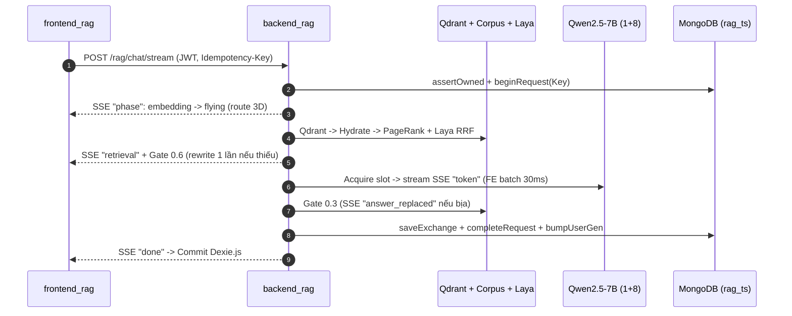
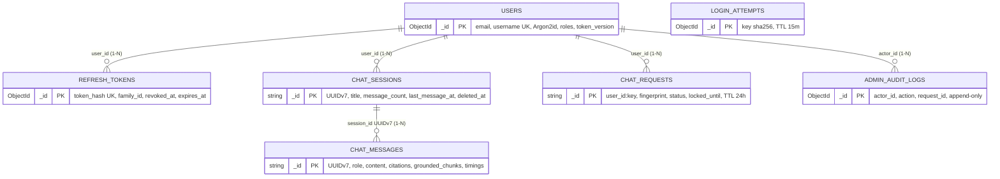

# TECHNICAL_PRESENTATION_SLIDES_V2.md — Bộ Slide Kỹ Thuật Cô Đọng (Phiên bản 2)

- **Motivation/Background**: Phiên bản slide thứ hai tập trung đúng vào 13 chủ đề trọng tâm mà giảng viên và kỹ sư thường hỏi trực tiếp: đặt vấn đề & yêu cầu, quy mô người dùng, luồng chạy/dữ liệu/lỗi, chi phí & điều kiện đo AI, đặc tả chức năng/dữ liệu/output AI, cách xây & gọi AI module, thiết kế DB/Schema/API, luồng xử lý Request/Response, thiết kế giao diện & Design Tokens, thiết lập & cấu trúc BE/FE, Test, Docker, Bảo mật và đo tải k6.
- **Purpose**: Cung cấp bộ khung **18 Slide Cards** cô đọng, bám sát từng câu hỏi kỹ thuật cụ thể với 100% số liệu, tên module/token và file kiểm chứng từ mã nguồn `RAG_TS` (`[S1]–[S28]`).
- **Overview Pipeline**: Sắp xếp 18 slide theo đúng trình tự trả lời kỹ thuật (Bài toán & Yêu cầu → Luồng → AI Spec & AI Module → DB & API → Req/Res Pipeline → UI & Tokens → Project Setup → Test, Docker, Security & k6) → Đối chiếu nguồn `[S1]–[S28]`.
- **Detailed Plan**:
  - **Slides 01–04**: Đặt vấn đề, Yêu cầu chức năng/phi chức năng, Quy mô người dùng, Luồng chạy/dữ liệu/lỗi.
  - **Slides 05–07**: Chi phí & điều kiện đo AI, Đặc tả chức năng/dữ liệu/output AI, Kiến trúc xây dựng & gọi AI Module (`RagModule` + `engines/`).
  - **Slides 08–10**: Thiết kế Schema/DB/ERD, Thiết kế API (8 nguyên tắc), Quy trình xử lý Request/Response (`app.setup.ts`).
  - **Slides 11–13**: Thiết kế UI (`AppShell`), Design Tokens (màu, chữ, khoảng cách, z-index, 4 trạng thái), Khởi tạo & Cấu trúc Project (NestJS + Vite).
  - **Slides 14–18**: Unit/Integration/E2E Test, Đóng gói Docker, Bảo mật, Đo hiệu năng k6, Danh mục nguồn `[S1]–[S28]`.
- **References**: [TECHNICAL_PRESENTATION_CHECKLIST.md](TECHNICAL_PRESENTATION_CHECKLIST.md), [TECHNICAL_PRESENTATION_COMPACT.md](TECHNICAL_PRESENTATION_COMPACT.md), [AGENTS.md](../../AGENTS.md), [ARCHITECTURE_OVERVIEW.md](../architecture/ARCHITECTURE_OVERVIEW.md), [API_DESIGN.md](../api/API_DESIGN.md), [API-compare.md](../api/API-compare.md), [MONGODB_SCHEMA_DESIGN.md](../../backend_rag/docs/MONGODB_SCHEMA_DESIGN.md), [FE_DESIGN_SYSTEM.md](../design/FE_DESIGN_SYSTEM.md), [BOTTLENECK_ANALYSIS_AND_OPTIMIZATION.md](../../backend_rag/benchmark/BOTTLENECK_ANALYSIS_AND_OPTIMIZATION.md), [rag.module.ts](../../backend_rag/src/modules/rag/rag.module.ts), [app.module.ts](../../backend_rag/src/app.module.ts), [app.setup.ts](../../backend_rag/src/app.setup.ts), [MD_CONVENTION.md](../../agents/rules/MD_CONVENTION.md).
- **Created**: 2026-11-17T23:40:00+07:00
- **Last Updated**: 2026-11-17T23:40:00+07:00

[STATUS: ACTIVE]

---

## Mục lục Slide Deck V2 (18 Slides)

- **Bài toán, Yêu cầu & Luồng hệ thống**: [Slide 01](#slide-01--đặt-vấn-đề-bối-cảnh-phạm-vi--tác-nhân) · [Slide 02](#slide-02--yêu-cầu-chức-năng--yêu-cầu-phi-chức-năng) · [Slide 03](#slide-03--quy-mô-người-dùng--mức-tải-thực-tế) · [Slide 04](#slide-04--luồng-chạy-luồng-dữ-liệu--luồng-lỗi)
- **Module AI & Hạ tầng suy luận**: [Slide 05](#slide-05--chi-phí-inference-ai-điều-kiện-đo--môi-trường-chạy) · [Slide 06](#slide-06--đặc-tả-chức-năng-ai-dữ-liệu-sử-dụng--cấu-trúc-output) · [Slide 07](#slide-07--xây-dựng--gọi-các-module-ai-ragmodule--engines)
- **Database, API & Request/Response**: [Slide 08](#slide-08--thiết-kế-cơ-sở-dữ-liệu-erd--db-schema) · [Slide 09](#slide-09--thiết-kế-restful-api-8-nguyên-tắc--nhóm-endpoint) · [Slide 10](#slide-10--quy-trình-xử-lý-request--response-trong-backend)
- **Frontend, Cấu trúc Project & Vận hành**: [Slide 11](#slide-11--thiết-kế-giao-diện-frontend--đồng-bộ-3d) · [Slide 12](#slide-12--design-token-màu-chữ-khoảng-cách--trạng-thái-tương-tác) · [Slide 13](#slide-13--khởi-tạo-thiết-lập-project--cấu-trúc-be--fe) · [Slide 14](#slide-14--kiểm-thử-unit-test-integration-e2e--ai-eval) · [Slide 15](#slide-15--đóng-gói--triển-khai-với-docker-compose) · [Slide 16](#slide-16--bảo-mật-hệ-thống-kiểm-soát-truy-cập--an-toàn-ai) · [Slide 17](#slide-17--đo-hiệu-năng-bằng-k6-load-stress-burst) · [Slide 18](#slide-18--danh-mục-nguồn-đối-chiếu-s1s28)

---

### Slide 01 — Đặt vấn đề: Bối cảnh, Phạm vi & Tác nhân

- **Headline**: `RAG_TS` giải bài toán tổng hợp bài báo khoa học có trích dẫn kiểm chứng `[Paper: id]` kết hợp khám phá cụm tri thức trên Cây Vector 3D, chạy AI cục bộ `$0` phí API `[S1][S4]`.
- **Bullets**:
  - **Bối cảnh**: Khối lượng bài báo AI/ML/CV/NLP (`cs.LG`, `cs.CL`, `cs.CV`, `cs.AI`, `stat.ML`) tăng nhanh; đọc thủ công dễ sót ngữ cảnh liên ngành còn LLM thuần dễ bịa mã bài báo `[S1][S15]`.
  - **3 Tác nhân (Actors)**:
    - **Guest (ẩn danh)**: Xem cây 3D, hỏi RAG thử nghiệm (`10 req/phút`, không lưu DB server) `[S2][S19]`.
    - **User (`role: 'user'`)**: Đăng nhập `Argon2id` + JWT, hỏi đáp RAG (`20 req/phút`), lưu lịch sử hai tầng, xem chi tiết bài báo `[S1][S18][S19]`.
    - **Admin (`role: 'admin'`)**: Quản trị tài khoản, đổi role, xem health/stats/brute-force & tra cứu `admin_audit_logs` `[S18]`.
  - **Phạm vi (In / Out-of-Scope)**: *Làm*: hỏi đáp RAG streaming, 3D tree, Auth/RBAC, chat Offline-First. *Không làm*: crawl/embed/ghi vào Qdrant hay `rag_ts_corpus` (tách sang pipeline UTH cổng `8000`); Admin không sửa/xóa nội dung chat hay audit log `[S5][S18]`.
- **Gợi ý Visual**: Sơ đồ 3 tác nhân + bảng 2 cột *In-Scope vs. Out-of-Scope*, ảnh [new_summer_sky_ui.png](../assets/new_summer_sky_ui.png).

---

### Slide 02 — Yêu cầu chức năng & Yêu cầu phi chức năng

- **Headline**: Hệ thống đáp ứng `5` Use Case cốt lõi trên `34` API endpoints và được kiểm chứng theo bộ chỉ tiêu SLA định lượng cho cả Backend, AI và Frontend `[S2][S7][S20][S27]`.
- **Bullets**:
  - **Yêu cầu chức năng (`UC-01` → `UC-05`)**:
    1. **UC-01**: Đăng ký, đăng nhập, tự xoay vòng refresh token, đăng xuất, đổi mật khẩu `[S2][S18]`.
    2. **UC-02**: Hỏi đáp RAG (`POST /rag/chat/stream`) truyền `5` pha 3D + stream token + trích `[Paper: id]` + công thức LaTeX `[S1][S3]`.
    3. **UC-03**: Bay camera theo nhánh (`TreeRouter`), highlight `TopKThreads`, xem chi tiết chunks qua `PaperPanel` `[S1][S24]`.
    4. **UC-04**: Quản lý phiên chat `UUIDv7` (tạo lười, cursor `10` phiên/trang, `?q=`, đổi tên, xóa mềm 3 ngày, xem offline `Dexie.js`) `[S2][S6][S24]`.
    5. **UC-05**: Quản trị RBAC (`13` routes `/admin/*`), khóa/mở user, thu hồi token, kiểm toán audit log `[S2][S18]`.
  - **Yêu cầu phi chức năng (SLA vs Thực đo)**:
    - **REST CRUD/Auth**: Mục tiêu `P95 < 500 ms`, `P99 < 1,000 ms`, lỗi `< 1%` `[S7]` → Đo k6 đạt **`P95 = 265.55 ms`**, **`P99 = 475.12 ms`**, **`0.00%` lỗi** (`250 RPS`) `[S9]`.
    - **RAG & FE**: `1` turn GPU `~8.1–14.2 s` (`<= 60 s` limit) `[S3][S20]`; 3D WebGL **`57.1 ± 1.3 FPS` (`0 Long Tasks`)** `[S21]`, Lighthouse **`97/100/100`** (`LCP 1.0 s`) `[S20]`.
- **Gợi ý Visual**: Bảng 2 nửa: Trái là `UC-01..UC-05`, Phải là bảng `SLA Target vs Measured`.

---

### Slide 03 — Quy mô người dùng & Mức tải thực tế

- **Headline**: Thiết kế cho quy mô nhóm nghiên cứu và phòng thí nghiệm trên 1 GPU node, được kiểm chứng tách bạch giữa lưu lượng người dùng thật (Grafana RUM) và tải cực đại (k6) `[S4][S9][S14]`.
- **Bullets**:
  - **Lưu lượng người dùng thật (Grafana RUM `2026-11-08`) `[S14]`**:
    - Window 1 (`10:20–11:40`): Peak **`11` active users (5m)**, **`9` concurrent users (1m)**, **`3` SSE streams đồng thời** (`P95 REST = 66.75 ms`, LLM `100% UP`).
    - Window 2 (`20:00–20:30`): Peak **`4` active users (5m)**, **`3` (1m)**, **`2` SSE** (`P95 REST = 41.96 ms`, LLM `99.54% UP`).
  - **Trần năng lực đo bằng k6 trên `1` máy GPU `[S9][S11][S13]`**:
    - **Auth + Session CRUD (qua WAN tunnel)**: **`400 CUs (250 RPS)`** ổn định 3 phút (`48,874` reqs, `0%` fail) `[S9]`.
    - **Stateless Fast API (`/health`)**: **`1,600 CUs (3,958.53 RPS)`** ổn định 5 phút (`1,187,560` reqs) `[S11]`.
    - **AI GPU Pipeline (`Qwen2.5-7B`)**: `LLM_CONCURRENCY = 1` + `LLM_MAX_QUEUE = 8` (`9` slot hoạt động, request thứ `10` trở đi trả `429 llm queue is full`) `[S4][S13]`.
- **Key KPIs**: Hạn mức chống spam theo người: `ClientSlots` tối đa **`2` luồng/user** và **`3` luồng/IP** `[S3]` *(chưa chạy production công cộng quy mô DAU lớn)*.
- **Gợi ý Visual**: [prod_open_breakpoint_curve.png](../../backend_rag/benchmark/results/prod_open_breakpoint_curve.png) · [empirical_k_fold_burst_turnaround.png](../../backend_rag/benchmark/results/empirical_k_fold_burst_turnaround.png).

---

### Slide 04 — Luồng chạy, Luồng dữ liệu & Luồng lỗi

- **Headline**: Luồng RAG chạy qua `5` pha SSE đồng bộ với cảnh 3D, dẫn dữ liệu qua 4 chặng và cách ly lỗi từng tầng bằng timeout, idempotency và fallback mềm `[S1][S3][S4][S24]`.
- **Bullets**:
  - **Luồng dữ liệu (`Nguồn → Xử lý → Lưu → Output`)**:
    - *Nguồn*: Qdrant `scientific_papers_gold` (`913,205` vector `768-D`), MongoDB `rag_ts_corpus` (toàn văn), `graph_coauthorship.json` & `association_rules.json` `[S1][S5]`.
    - *Xử lý*: `normalizeQuery` → `Nomic v1.5` → `TreeRouter` → `Qdrant` → `CorpusService.hydrate` → `0.85*sim + 0.15*authority` + Laya RRF (`k=60`) → Gate `0.6` → `Qwen2.5-7B` → Gate `0.3` `[S3][S4]`.
    - *Lưu & Output*: Commit MongoDB `rag_ts` (`saveExchange` + `bumpUserGen`) & `Dexie.js`; trả JSON/XML hoặc SSE (`phase`, `route`, `compare`, `retrieval`, `token`, `answer_replaced`, `done`, `: ping 15s`) `[S2][S3][S7][S24]`.
  - **Luồng lỗi (Timeout · Retry · Fallback)**:
    - *Timeout*: `Qdrant 15s (503)`, `Corpus 5s (503)`, `Laya 30s` (trả `null`), `LLM 60s (504)`, FE `/health 2s` (`Ngoại tuyến`) `[S3][S4][S5][S24]`.
    - *Retry / Chống lặp*: FE auto-rotate `401` `1` lần (Web Lock); BE dùng **`Idempotency-Key` (`24h`)** thay cho retry mù (hoàn tất → replay `0` tốn GPU, đang chạy → `409`, crash → hết `locked_until 5m`) `[S2][S3][S6][S24]`.
    - *Fallback*: Laya tắt/lỗi → Vector + PageRank; thiếu bằng chứng/ảo giác → `NO_CONTEXT_ANSWER`; Mongo standalone → ghi tuần tự `[S3][S4][S25]`.

---

### Slide 05 — Chi phí Inference AI, Điều kiện đo & Môi trường chạy

- **Headline**: Toàn bộ pipeline AI vận hành on-premise với **`$0.00` phí API ngoài**, áp dụng 5 cơ chế giảm tải GPU và công bố đầy đủ cấu hình máy đo `[S4][S11][S15][S16]`.
- **Bullets**:
  - **Chi phí Inference**: **`$0.00 / request`** và **`$0.00 / tháng`** chi phí gọi API LLM bên thứ 3 do tự host cả `Nomic v1.5`, `Laya 421M` và `Qwen2.5-7B Q4_K_M` *(chưa hạch toán điện năng và khấu hao GPU cá nhân)* `[S4]`.
  - **5 kỹ thuật tiết kiệm tài nguyên**: (1) Lượng tử hóa 4-bit `Q4_K_M` (`4.68 GB`) `[S4]`; (2) LRU Cache tầng Embedding (`500` truy vấn / TTL `10m`) `[S4]`; (3) `Idempotency-Key` `24h` replay từ DB (`0` tốn GPU) `[S3][S6]`; (4) Evidence Gate `0.6` chặn sớm câu ngoài miền `[S3][S16]`; (5) Giới hạn `MAX_TOKENS = 1,024`, pool `<= 20` chunks `[S3][S4]`.
  - **Môi trường & Điều kiện đo**:
    - *Phần cứng*: Laptop **Intel i7-13620H** (`18` cores), **15–16 GB RAM**, **RTX 4060 Laptop (`8,188 MiB` VRAM)**, Driver `581.80`, CUDA `13.0`, Windows 11 (`win32 x64`) `[S11][S15][S17]`.
    - *Framework & Batch*: `node-llama-cpp v3.22.1` (CUDA 99 layers, `LLM_CONCURRENCY=1`), `@receptron/laya v0.2.0` (`onnxruntime-node` trong BE; PyTorch `bfloat16` batch `10` chunks/query đo **`316.16 ms`** vs ONNX CPU **`4,260 ms`**), DeepEval + Local Qwen 2.5-7B Judge cổng `9001` `[S4][S15][S16]`.
    - *Độ dài Input/Output*: `query <= 2,000` chars · `contextSize = 8,192` tokens (`top_k` mặc định `5`) · `output <= 1,024` tokens · Laya `512` tokens (`MAX_PASSAGE_CHARS = 1,100`, `MAX_ANSWER_CHARS = 900`) `[S3][S4]`.

---

### Slide 06 — Đặc tả Chức năng AI, Dữ liệu sử dụng & Cấu trúc Output

- **Headline**: AI đảm nhiệm `3` tác vụ (**Embedding**, **Semantic Judge 2 cổng**, **Grounded Synthesis**) trên dữ liệu bài báo khoa học công khai và trả JSON/SSE kèm chỉ số kiểm định `[S2][S3][S4][S15]`.
- **Bullets**:
  - **Chức năng & Dữ liệu đầu vào**:
    - *Kho tri thức*: `913,205` chunks công khai (arXiv, CVPR 2024, OpenReview) `[S5][S15]`, `29,523` tác giả PageRank (`graph_coauthorship.json`) `[S16]`, `30` luật FP-Growth (`support >= 0.02`, `confidence >= 0.5`) `[S1]`.
    - *Tiền xử lý & PII*: `normalizeQuery` + prefix `search_query: `; kho bài báo không có PII, log server chỉ lưu `query_len` (cấm log prompt/email/mật khẩu) `[S3][S18]`.
  - **Cấu trúc Output (Judge & RAG)**:
    - *Laya Judge*: JSON `{ "answers": { "q": { "noul": 0.0..1.0 } } }` chấm `relevance` và `groundedness` `[S4]`.
    - *RAG Output (`ChatResponseDto`)*: `{ session_id, message_id, answer, citations[], grounded_chunks[], expanded_terms[], quality: { evidence_score, refined_query, grounded_score, abstained }, timings, _links }` `[S2][S3]`.
    - *Xử lý output sai*: Evidence `< 0.6` → rewrite 1 lần (`<= 25` từ EN) → vẫn thiếu thì `abstained = true`; Groundedness `< 0.3` → ghi đè `NO_CONTEXT_ANSWER` + SSE `answer_replaced`; trích xuất `citations` bằng regex và đếm `unverified_citations` `[S3]`.
  - **Chất lượng đo được**: `test_set_v1` (`150` mẫu): `MRR = 0.8939`, `Hit@5 = 98%`, `Reject @0.5 = 100%`, `Faithfulness = 0.7977` `[S15]`; DeepEval (`N=105`): `Contextual Recall@5 = 0.900`, `Precision@5 = 0.852`, `Citation GEval = 0.762` `[S16]`.

---

### Slide 07 — Xây dựng & Gọi các Module AI (`RagModule` & `engines/`)

- **Headline**: Tách biệt tầng điều phối (`RagModule`) khỏi tầng suy luận (`engines/`) bằng mô hình **Ports & Adapters (NestJS DI Tokens)**, cho phép thay adapter hoặc chạy giả lập khi test `[S3][S25][S28]`.
- **Bullets**:
  - **Các Engine Module trong `backend_rag/src/engines/` `[S4][S5][S28]`**:
    - `EmbeddingModule` (`EMBEDDING_PORT`): `nomic-embed-text-v1.5` (`@huggingface/transformers`) + LRU `500` items.
    - `TreeRouterModule` (`TreeRouterService`): Định tuyến theo `centroids` của `tree.json` (`nprobe = 1..6`).
    - `VectorStoreModule` (`VECTOR_STORE_PORT`) + `CorpusService`: Qdrant cosine ANN + hydrate toàn văn từ `rag_ts_corpus`.
    - `MiningModule` (`MiningService`): Tính `0.85 * sim + 0.15 * PageRank` và mở rộng từ khóa FP-Growth.
    - `JudgeModule` (`@Optional() JUDGE_PORT`): `@receptron/laya` ONNX + hàng đợi `MAX_PENDING = 8`.
    - `LlmModule` (`LLM_PORT`): `LlmEngine` (`node-llama-cpp`) bọc sau `LlmQueue` semaphore (`1 active + 8 waiting`).
  - **Cách xây & gọi module (`RagModule` → `RagService` → `RagController`) `[S3][S28]`**:
    - `RagModule` import `6` engine modules + `ChatSessionsModule`; `RagService` inject qua token `@Inject(EMBEDDING_PORT)`, `@Inject(LLM_PORT)`, v.v.
    - `RagService.run()` là một **`AsyncGenerator<PipelineEvent>`** phát tuần tự `phase → route → compare → retrieval → token → answer_replaced → done`.
    - `RagController` gọi `rag.run()`: `POST /rag/chat` gom stream thành JSON/XML `ChatResponseDto`, còn `POST /rag/chat/stream` chuyển sang RxJS `Observable<MessageEvent>` đẩy SSE `[S3]`.

---

### Slide 08 — Thiết kế Cơ sở dữ liệu (ERD & DB Schema)

- **Headline**: Tách dữ liệu thành **3 kho vật lý** (`rag_ts` RW, `rag_ts_corpus` RO, `Qdrant` RO) và dùng thiết kế **Hybrid Schema** (`ObjectId` + `UUIDv7` + TTL Index) để tối ưu truy vấn và dọn rác `[S5][S6]`.
- **Bullets**:
  - **Sơ đồ Thực thể (`7` collections trong `rag_ts`)**: `USERS` sở hữu `REFRESH_TOKENS`, `CHAT_SESSIONS`, `CHAT_REQUESTS`, `ADMIN_AUDIT_LOGS` (`1-N`); `CHAT_SESSIONS` chứa `CHAT_MESSAGES` (`1-N`); `LOGIN_ATTEMPTS` tách riêng theo `sha256(email | ip)` để tra cứu brute-force `[S6][S18]`.
  - **Quyết định thiết kế Schema (`MONGODB_SCHEMA_DESIGN.md`) `[S6]`**:
    - *Hybrid Primary Key*: Giữ `ObjectId` cho `users` (tương thích `refresh_tokens`); dùng **`UUIDv7` (`string`)** cho `chat_sessions` & `chat_messages` để nhúng thứ tự thời gian và đồng bộ `Dexie.js`.
    - *Tránh Write-Amplification & Join*: Không nhúng `title` vào `chat_messages`; dùng Computed `message_count` (`+2` mỗi turn) thay `$lookup`; tách `last_message_at` khỏi `updated_at`; tạo lười session (bỏ `POST /chat-sessions`).
    - *Compound Index & TTL*: `{ user_id: 1, deleted_at: 1, last_message_at: -1, _id: -1 }` & `{ session_id: 1, deleted_at: 1, created_at: -1, _id: -1 }`; TTL tự xóa sau `15m` (`login_attempts`), `24h` (`chat_requests`), `3 ngày` (`deleted_at` đồng bộ cả session và messages).

---

### Slide 09 — Thiết kế RESTful API (8 nguyên tắc & Nhóm Endpoint)

- **Headline**: Chuẩn hóa **`34` API endpoints** dưới `/api/v1` theo **8 nguyên tắc RESTful** (`API_DESIGN.md` & `API-compare.md`), loại bỏ toàn bộ `8` route động từ cũ `[S2][S27]`.
- **Bullets**:
  - **8 nguyên tắc áp dụng cụ thể**:
    1. *Danh từ cho URL*: Đổi `/auth/login`, `/auth/refresh` → `/auth/tokens`, `/auth/token-rotations`, `/auth/token-revocations` (`0` động từ) `[S2][S27]`.
    2. *HTTP Methods & Idempotency*: `PUT` thay toàn bộ (`roles`, `status`, `password`), `PATCH` sửa một phần (`/users/me`, `/chat-sessions/:id`); `PUT`/`DELETE` không đổi state thì không ghi DB; `POST /rag/chat*` dùng `Idempotency-Key` `[S2]`.
    3. *Status Codes*: Chuẩn `200/201/204`, `400/401/403`, `404` (thay `403` cho session người khác để chống đoán IDOR), `405` (+ `Allow`), `406`, `409`, `415`, `429`, `503`, `504` `[S2][S27]`.
    4. *Versioning*: Path `/api/v1` `[S2]`.
    5. *Đa định dạng*: Đàm phán **JSON & XML** qua `Content-Type`/`Accept` (chặn XXE `100 KB`) `[S2][S18]`.
    6. *Batch*: `GET /papers?ids=` (max `20`), `GET /chat-sessions?ids=`, `DELETE /chat-sessions?ids=` `[S2][S27]`.
    7. *Query Language*: Thống nhất `limit`, **`cursor`** (thay `page/size` để tránh lệch trang), `sort=field:asc|desc`, `filter` (`eq,ne,gt,gte,lt,lte,match`), `?q=` `[S2]`.
    8. *Naming & HATEOAS*: `kebab-case` URL, `snake_case` field, `GET /api/v1` root + `_links` (`26/34` routes) `[S2][S27]`.
- **Key KPIs**: `1` root + `7` Auth/User + `2` RAG + `6` Sessions + `5` Papers/Health + `13` Admin = **`34` routes** (khóa bởi `API contract OpenAPI` test `[S25][S27]`).

---

### Slide 10 — Quy trình xử lý Request & Response trong Backend

- **Headline**: Mọi HTTP Request/Response đi qua một pipeline thống nhất trong [`configureApp()`](../../backend_rag/src/app.setup.ts) trước và sau khi chạm tới Controller/Service `[S2][S19]`.
- **Bullets**:
  - **Luồng Request đi vào (Inbound Pipeline)**:
    1. `trust proxy` (`TRUST_PROXY_HOPS`) → `requestIdMiddleware` (`X-Request-Id`) → `helmet` CSP/HSTS → `PrometheusMetricsRegistry` `[S19]`.
    2. Kiểm tra `Content-Type` (`415` nếu không phải JSON/XML) → parse XML body (`limit: 100kb`, chặn `DOCTYPE`/`ENTITY`) `[S2][S19]`.
    3. `ThrottlerGuard` (`120/m` + `@RateLimit` theo route) → `JwtAuthGuard` / `RolesGuard` → `ValidationPipe` (`whitelist`, `forbidNonWhitelisted`, `transform`) `[S18][S19]`.
  - **Xử lý nghiệp vụ & Trả Response (Outbound Pipeline)**:
    - *Controller/Service*: Thực thi logic (hoặc `RagController` mở `ClientSlots` + SSE stream `text/event-stream` kèm `: ping 15s`) `[S3]`.
    - *Interceptors*: `LinksInterceptor` gắn `_links` trước, sau đó `ContentNegotiationInterceptor` serialize sang JSON hoặc XML theo header `Accept` (`406` nếu sai) `[S2][S19]`.
    - *Error (`HttpExceptionFilter`)*: Chuẩn hóa `{ statusCode, error, message, details, timestamp, path, request_id }`, tự sinh header `Allow` khi `405`, log 1 dòng JSON (cảnh báo `4xx`, stack `5xx`, ẩn PII) `[S2][S19]`.

---

### Slide 11 — Thiết kế Giao diện Frontend & Đồng bộ 3D

- **Headline**: Thiết kế lấy nền **Canvas WebGL 3D (`150k` vector)** làm không gian trung tâm, đặt các lớp kính UI nổi bên trên và nối thẳng trạng thái 3D vào luồng SSE chat `[S1][S21][S24]`.
- **Bullets**:
  - **Bố cục màn hình chính (`AppShell`) `[S24]`**:
    - `WorldCanvas` (`z-0`): Cây tri thức 3D, tia sáng theo nhánh định tuyến (`QueryOrb`, `TopKThreads`), hỗ trợ 2 chế độ Dark (đêm neon) & Light (ngày bầu trời xanh).
    - `TopBar` (`z-20`): Badge trạng thái MongoDB/Qdrant/LLM/Route (`Ngoại tuyến` khi mất BE), chuyển Dark/Light, Settings.
    - `ChatPanel` (trái, thu/mở `1500 ms` khớp camera) + `HistoryDrawer` (`z-30`, tìm/phân trang/xóa 2 bước) + `PaperPanel` (phải, `z-30`, xem chunks khi bấm `[Paper: id]`) + `PerfHUD` (`?perf`, `z-50`).
    - `AppRouter`: Chuyển view qua query `?view=shell|world|auth|chat|crawl|result` `[S24]`.
  - **Tối ưu hiệu năng 3D & Web Vitals `[S20][S21][S22]`**:
    - Bỏ MSAA 4×, `mipmapBlur` bloom `0.5×`, lưới không gian **3D-DDA** (raycast nhanh hơn `56×`), `AdaptiveQuality` `4` bậc & dời khởi tạo WebGL sau `rAF`.
    - Stream chat `150k` vectors giữ **`57.1 ± 1.3 FPS` (`17.5 ms` med, `0 Long Tasks`)** `[S21]`; Lighthouse **Perf `97`, Acc `100`, BP `100`, `LCP = 1.0 s`, `CLS = 0.002`** `[S20]`.
- **Gợi ý Visual**: [after-dark-overview.png](../../frontend_rag/docs/screenshots/after-dark-overview.png) · [after-light-overview.png](../../frontend_rag/docs/screenshots/after-light-overview.png).

---

### Slide 12 — Design Token: Màu, Chữ, Khoảng cách & Trạng thái tương tác

- **Headline**: Quản lý giao diện bằng **Design Token 3 tầng** (`Primitive → Semantic → Component`) giữa `tokens.ts` và `@theme` trong `index.css`, kiểm soát tự động `0` vi phạm bằng CLI `[S22][S23]`.
- **Bullets**:
  - **Mã màu (`tokens.ts`)**:
    - *Dark*: `--bg #070614`, `--ui-surface #120f2499`, `--ink #ece9ff`, `--ink-muted #a29cc4`, `--ink-faint #64607e`, `--accent #7fe8ff`, `--warn #ffc145`, `--danger #ff5d73`, `--success #58f0a7`, `--glass-tint #0c0a183d` `[S23]`.
    - *Light*: `--bg #e3f0fc`, `--ui-surface #ffffffa6`, `--ink #0b192c`, `--ink-muted #334155`, `--accent #0969da`, `--danger #b3243b`, `--success #16794b`, kèm `categoryPalette[0..11]` riêng cho dữ liệu 3D `[S23]`.
  - **Kiểu chữ, Khoảng cách, Bo góc & Lớp (`@theme` & `FE_DESIGN_SYSTEM.md`) `[S23]`**:
    - *Font*: `"Geist"` (sans) & `"Geist Mono"` (`tabular-nums`); cỡ chữ `micro (10/14)`, `caption (11/16)`, `xs (12)`, `control (13/18)`, `sm (14)`, `base (16)`, `display (22/28 px)`.
    - *Khoảng cách & Icon*: Lưới Tailwind `2px/4px` (`0.5..8` = `2 → 32 px`), padding CSS bội `2px`; icon `lucide` = `12 / 14 / 16 / 28 px` (`cỡ chữ + 2px`); lớp `z-0` (3D) → `z-10` → `z-20` → `z-30` → `z-40` → `z-50`.
    - *Bo góc, Blur & Motion*: `--radius-xs/sm/md/lg/full` (`4/6/10/14/9999 px`); `--blur-sm/md/lg` (`6/12/16 px`); `--dur-*` (`120/160/240/480/1500 ms`); Liquid Glass cấp `1–4`.
  - **4 Trạng thái tương tác + Streaming chậm `[S23][S24]`**: *Hover/Focus* tăng `--glass-fill-hover` & viền `--glass-stroke-strong`; *Loading* khung HTML sẵn + `PipelineStatus` + nút **Dừng**; *Empty* màn hình chờ/`AuthOverlay`; *Error/Offline* mã `429/503/504`, badge `Ngoại tuyến`, xóa `2` bước; gom token mỗi **`30 ms`** + **`useDeferredValue`** & lazy KaTeX.
- **Key KPIs**: `node scripts/check-design.cjs --strict` đạt **`0` vi phạm / `14` rule** `[S22][S25]`.
- **Gợi ý Visual**: [blue_theme_comparison_matrix.png](../assets/blue_theme_comparison_matrix.png) · [baseline_sun_horizon_preview.png](../assets/baseline_sun_horizon_preview.png).

---

### Slide 13 — Khởi tạo, Thiết lập Project & Cấu trúc BE / FE

- **Headline**: Monorepo chia tách `backend_rag` (NestJS 11 + TypeScript 5.7) và `frontend_rag` (React 19 + Vite 6 + Three.js), khởi tạo fail-fast bằng Zod và tài liệu hóa tới từng thư mục (`111` `README.md`) `[S19][S25][S28]`.
- **Bullets**:
  - **Khởi tạo Backend (`main.ts` → `AppModule`) `[S19][S25][S28]`**:
    - Đặt `UV_THREADPOOL_SIZE = 4` ngay dòng đầu `main.ts` (trước mọi `import`) để tối ưu luồng `Argon2id` `[S8][S28]`.
    - Gọi `parseEnv(process.env)` (Zod) để fail-fast trước khi tạo Nest app; cấu hình `server.keepAliveTimeout = 65_000`, `headersTimeout = 66_000` `[S19][S28]`.
    - `AppModule` nạp `AppConfigModule`, `LoggerModule` (`nestjs-pino`), `MongooseModule` (`maxPoolSize: 120, minPoolSize: 20`), `ThrottlerModule` + `APP_GUARD`, và `6` feature modules `[S28]`.
  - **Khởi tạo Frontend (`Vite 6` + `React 19`) `[S24][S25]`**: Chạy dev trên **port `5174`** (`vite.config.ts`), proxy `/api/v1` sang BE `:3000`, `Tailwind CSS v4`, `Zustand` + `Dexie.js`, TS `strict` + ESLint v9.
  - **Cây thư mục chuẩn hóa**:
    - `backend_rag/` (**`49`** `README.md`): `src/{modules/ (admin, api-root, auth, chat-sessions, health, papers, rag), engines/ (corpus, embedding, judge, llm, mining, tree-router, vector-store), common/, config/, testing/, types/}`, `benchmark/`, `scripts/`, `test/`.
    - `frontend_rag/` (**`62`** `README.md`): `src/{app/ (layout, providers, routers), features/ (auth, chat, crawl, result, world), shared/ (api, hooks, lib, store, theme, types, ui), test/}`, `e2e/`, `scripts/`.

---

### Slide 14 — Kiểm thử: Unit Test, Integration, E2E & AI Eval

- **Headline**: Toàn bộ logic trọng yếu được khóa bằng **`594` unit/integration tests**, **`13` BE E2E tests** và bộ AI Eval tái lập, đạt độ phủ **`96.58%` (FE)** và **`94.72%` (BE)** `[S15][S16][S25]`.
- **Bullets**:
  - **Backend (`Jest 30` + `mongodb-memory-server` + `Supertest`) `[S25]`**:
    - *Unit & Integration*: **`29 / 29` suites, `267 / 267` tests pass**; test thật cả nhánh Replica Set transaction lẫn Standalone fallback; fake AI engine qua Ports. Coverage: **`93.54%` Stmts / `94.72%` Lines / `85.83%` Funcs / `79.75%` Branches**.
    - *End-to-End (`test/flow.e2e-spec.ts`)*: **`1 / 1` suite, `13 / 13` tests pass** (chạy trọn luồng register → RAG stream → sessions → refresh/logout → admin & test `API contract OpenAPI`).
  - **Frontend (`Vitest 3.2` + `Testing Library` + `fake-indexeddb` + `Playwright`) `[S25]`**:
    - *Unit & Component*: **`41 / 41` files, `327 / 327` tests pass**; coverage V8 đạt **`96.58%` Stmts / `96.58%` Lines / `93.60%` Funcs / `86.94%` Branches** (vượt ngưỡng `90%` trong `vite.config.ts`).
    - *E2E & Visual*: Hợp nhất toàn bộ Playwright về `frontend_rag/e2e/` (`auth.spec.ts`, `knowledge-tree.spec.ts`, `visual.spec.ts`) *(trên Windows dev cần `npx playwright install` để tải Chromium binary khi chạy live)*.
  - **AI Eval Regression `[S15][S16]`**: `eval-laya.mjs` (`150` mẫu `test_set_v1`), DeepEval Qwen Judge (`105` mẫu `gold`), đối đầu Pure Vector vs Laya Baseline vs Laya `20261108-seed0`.

---

### Slide 15 — Đóng gói & Triển khai với Docker Compose

- **Headline**: Đóng gói bằng **Docker multi-stage** và **Docker Compose** (chạy non-root, gắn healthcheck và bind loopback), kết hợp `cloudflared` tunnel cho môi trường hybrid dev/demo `[S19][S25][S26]`.
- **Bullets**:
  - **Container hóa Backend (`backend_rag/Dockerfile`) `[S26]`**: Multi-stage `node:22-bookworm-slim` (`npm ci && npm run build && npm prune --omit=dev`), chạy bằng **`USER node`** (không dùng root), expose `:3000`, `HEALTHCHECK` gọi `/api/v1/health/live` mỗi `15 s`.
  - **Container hóa Frontend (`frontend_rag/Dockerfile`) `[S26]`**: Multi-stage build `node:20` (`npm run build`) → đóng gói static asset vào **`nginx:alpine`**.
  - **Điều phối `docker-compose.yml` (`backend_rag/`) `[S26]`**: Chạy `mongo:7` (`--replSet rs0` + `--keyFile`, bind `127.0.0.1:27018`, init user `ragts_app`), `qdrant:v1.15.4` (profile `standalone`), và `app` (bind `127.0.0.1:3000`, mount read-only `../model:/models:ro`, `../data:/data:ro`, volume `hf-cache`).
  - **Môi trường & Rollback**: *Ghi rõ*: Dự án dùng **Docker Compose** (không dùng VM2; `pm2` chỉ nằm trong kế hoạch scale đa tiến trình sau này `[S8]`). Khi `NODE_ENV=production`, Zod từ chối khởi động nếu secret mặc định/yếu; Swagger tắt và HSTS bật `[S19]`. Rollback bằng checkout git + `docker compose up -d --build` (an toàn nhờ `Dexie.js`) `[S24][S26]`.

---

### Slide 16 — Bảo mật hệ thống, Kiểm soát truy cập & An toàn AI

- **Headline**: Áp dụng phòng thủ nhiều lớp bám sát **OWASP Top 10**, xác thực `Argon2id` + RBAC `3` lớp và cách ly hoàn toàn LLM khỏi quyền ghi hệ thống `[S3][S5][S18][S19]`.
- **Bullets**:
  - **Access Control & Auth (`OWASP A01/A02/A07`) `[S18]`**:
    - `Argon2id` (`64 MB`, `t=3`, `p=4`) + `DUMMY_HASH` chống timing attack + khóa tạm `5` lần/`15p` theo `sha256(email | ip)`.
    - Access JWT `15m` mang `ver` (`token_version`) + Refresh `7d` xoay vòng 1-RTT atomic (tái sử dụng → thu hồi cả `family_id`); vô hiệu user là bump `ver` để token chết ngay.
    - Admin bảo vệ **3 lớp**: `JwtAuthGuard` → `RolesGuard(@Roles('admin'))` → `assertAdmin()`, kèm `assertNotSelf` / `assertNotLastAdmin`; tài nguyên user khác trả **`404`**; `admin_audit_logs` chỉ cho append; tạo admin đầu tiên chỉ qua CLI `npm run create:admin`.
  - **Injection, Misconfiguration, Rate Limit & Audit `[S18][S19]`**: `class-validator` strict, `escapeRegex()`, chặn `DOCTYPE`/`ENTITY` XML (`100 KB`), `helmet` CSP, `@nestjs/throttler` (`login 10/m`, `register 5/m`, `ragChat 10–20/m`), `npm audit --omit=dev` đạt **`0` lỗ hổng prod** *(đã ghi chú mở cần xoay vòng 2 credential cũ từng lộ trong git history & chưa quét Trivy/XSS chuyên sâu FE)*.
  - **Bảo mật riêng cho AI `[S3][S4][S5]`**: LLM **không có tool-calling, không chạm DB/shell/FS**; tách DB đọc `Qdrant/rag_ts_corpus` khỏi DB user `rag_ts`; chặn prompt injection/ảo giác bằng Gate `0.3`; chống DoS GPU bằng `ClientSlots` + queue `1 + 8` (`429`).
- **Gợi ý Visual**: [rewriteHTTPS-TLS1.3.png](../assets/rewriteHTTPS-TLS1.3.png) + Sơ đồ RBAC 3 lớp.

---

### Slide 17 — Đo hiệu năng bằng k6 (Load, Stress, Burst)

- **Headline**: Áp dụng **Open Workload Model (`ramping-arrival-rate`)** giữ tải **3 phút liên tục (`Rule L1`)** để chống Coordinated Omission, chứng nhận **`400 CUs (250 RPS)`** qua WAN tunnel `[S7][S8][S9]`.
- **Bullets**:
  - **Kịch bản kiểm thử (`backend_rag/benchmark/`) `[S7][S8][S13]`**:
    - *Load Hold-Out (3m)*: `k6_prod_certified_holdout.ts` (`250 RPS / 400 CUs` trên 6 endpoints CRUD+Auth qua `1,500` sessions & `15,000` messages) & `k6_qualification_soak.ts` (`1,600 VUs` 5m trên `/health`).
    - *Stress / Crypto Flood*: `k6_prod_open_breakpoint.ts` (`71 → 300 RPS`) & `k6_prod_auth_crypto.ts` (`2 → 50 VUs` Argon2id).
    - *Spike / GPU Burst*: `k6_queue_experiment.ts` (`16` VUs dồn đồng thời vào queue `1 + 8`).
  - **Kết quả đo (`http_req_duration` · `http_req_failed`) `[S9][S10][S11][S12][S13]`**:
    - *Hold-Out 3m (`250 RPS`)*: `48,874` reqs (`227 MB`), **`P50 = 29.79 ms`**, **`P95 = 265.55 ms`**, **`P99 = 475.12 ms`**, **`0.00%` lỗi** (gấp `4.0×` baseline `65 RPS` từng đạt `P95 = 1,118.11 ms`; trần 3m ở `300 RPS` quá ngưỡng `P95 = 909.87 ms`, `3.11%` lỗi).
    - *Fast API 5m*: **`1,600 CUs` (`3,958.53 RPS`)**, `1,187,560` reqs, **`P95 = 379.48 ms`**, `0.00%` lỗi (`2,000` pass / `2,500` fail).
    - *Crypto & Burst*: Argon2id `50` VUs làm `4.83%` (`57/1,179`) login quá 5s nhưng probe `GET /auth/me` giữ **`P95 = 22.66 ms`** (`UV_THREADPOOL_SIZE=4`); GPU Burst trả **`9/9` `200`** (`30.53 / 55.59 / 79.18 s`) và **`7/7` `429`** fail-fast *(TTFT `< 200 ms` đo ở mock 15 câu `[S17]`, k6/Prometheus chưa đo riêng `tokens/s` `[S14]`)*.
- **Gợi ý Visual**: [auth_holdout_3min_comparison.png](../../backend_rag/benchmark/results/auth_holdout_3min_comparison.png) · [qualification_5min_sustained_throughput.png](../../backend_rag/benchmark/results/qualification_5min_sustained_throughput.png) · [queue_depth_comparison_tradeoff.png](../../backend_rag/benchmark/results/queue_depth_comparison_tradeoff.png).

---

### Slide 18 — Danh mục nguồn đối chiếu (`[S1]`–`[S28]`)

- **Headline**: Bảng ánh xạ nguồn gốc chuẩn hóa trong repository cho toàn bộ số liệu, kiến trúc module, schema, token và báo cáo kiểm thử của bộ Slide V2.

| Mã | Nguồn gốc trong Repository | Dữ liệu trọng tâm được trích dẫn |
| :--- | :--- | :--- |
| **`[S1]`** | [`docs/architecture/ARCHITECTURE_OVERVIEW.md`](../architecture/ARCHITECTURE_OVERVIEW.md) | Kiến trúc tổng thể 3 tầng, luồng RAG, FP-Growth `30` luật, `tree.json`. |
| **`[S2]`** | [`docs/api/API_DESIGN.md`](../api/API_DESIGN.md) &amp; [`API_SPECIFICATION.md`](../api/API_SPECIFICATION.md) | 8 nguyên tắc RESTful, `/api/v1`, JSON/XML, `_links`, cursor/sort/filter, Error Envelope. |
| **`[S3]`** | [`rag.service.ts`](../../backend_rag/src/modules/rag/rag.service.ts) &amp; [`rag.controller.ts`](../../backend_rag/src/modules/rag/rag.controller.ts) | Gates `0.6`/`0.3`, regex citation, `ClientSlots (2/user, 3/IP)`, SSE &amp; timeouts. |
| **`[S4]`** | [`llm-engine.ts`](../../backend_rag/src/engines/llm/llm-engine.ts), [`llm.service.ts`](../../backend_rag/src/engines/llm/llm.service.ts) &amp; [`judge.service.ts`](../../backend_rag/src/engines/judge/judge.service.ts) | `Qwen2.5-7B Q4_K_M` (`4.68 GB`), `LlmQueue (1+8)`, Laya (`512` tok, `MAX_PENDING 8`). |
| **`[S5]`** | [`corpus.service.ts`](../../backend_rag/src/engines/corpus/corpus.service.ts) &amp; [`database-v2.md`](../architecture/database-v2.md) | Qdrant RO (`913,205` vectors), MongoDB `rag_ts_corpus` RO (`5s`), `rag_ts` RW. |
| **`[S6]`** | [`MONGODB_SCHEMA_DESIGN.md`](../../backend_rag/docs/MONGODB_SCHEMA_DESIGN.md) | Thiết kế Schema &amp; ERD `7` collections, UUIDv7 vs ObjectId, compound index, TTL 15m/24h/3d. |
| **`[S7]`** | [`PERFORMANCE_AND_CACHING.md`](../../backend_rag/docs/PERFORMANCE_AND_CACHING.md) | `LRUCache` thế hệ (`bumpUserGen`), `Singleflight`, `.lean()`, `maxPoolSize: 120`, Rule L1. |
| **`[S8]`** | [`BOTTLENECK_ANALYSIS_AND_OPTIMIZATION.md`](../../backend_rag/benchmark/BOTTLENECK_ANALYSIS_AND_OPTIMIZATION.md) | WAN tunnel `114 ms`, `4.0×` tải, Stage A `300 RPS`, `UV_THREADPOOL_SIZE=4`, VPC/`pm2` roadmap. |
| **`[S9]`** | [`opt_certified_holdout_250rps_summary.json`](../../backend_rag/benchmark/results/opt_certified_holdout_250rps_summary.json) | Raw Hold-Out 3m (`250 RPS`): `48,874` reqs, `p95=265.55 ms`, `p99=475.12 ms`, `0%` fail. |
| **`[S10]`** | [`prod_holdout_65rps_summary.json`](../../backend_rag/benchmark/results/prod_holdout_65rps_summary.json) &amp; [`opt_certified_holdout_300rps_summary.json`](../../backend_rag/benchmark/results/opt_certified_holdout_300rps_summary.json) | Đối chứng Baseline `@65 RPS` (`p95=1,118.11 ms` fail) &amp; Trần 3m `@300 RPS` (`p95=909.87 ms`, `3.11%`). |
| **`[S11]`** | [`qualification_fast_results.json`](../../backend_rag/benchmark/results/qualification_fast_results.json) | Raw 5m Fast API: `1,600 CUs`, `1,187,560` reqs, `3,958.53 RPS`, `p95=379.48 ms`, `0%` fail. |
| **`[S12]`** | [`opt_auth_crypto_summary.json`](../../backend_rag/benchmark/results/opt_auth_crypto_summary.json) &amp; [`prod_auth_crypto_summary.json`](../../backend_rag/benchmark/results/prod_auth_crypto_summary.json) | Argon2id `50` VUs: `auth_me p95=22.66 ms`, `refresh 374/374`, `login 4.83%` timeout 5s. |
| **`[S13]`** | [`k_fold_burst_results.json`](../../backend_rag/benchmark/results/k_fold_burst_results.json) &amp; [`burst_queue8_summary.json`](../../backend_rag/benchmark/results/burst_queue8_summary.json) | Burst `16` VUs vào queue `1+8`: `9/9 HTTP 200` (`30.53 / 55.59 / 79.18 s`) &amp; `7/7 HTTP 429`. |
| **`[S14]`** | [`GRAFANA_MONITORING_ANALYSIS.md`](../grafana_analysis/GRAFANA_MONITORING_ANALYSIS.md) | Grafana RUM (`2026-11-08`): peak `11` users, `3` SSE, REST `P95=41.96–66.75 ms`, thiếu `tokens/s`. |
| **`[S15]`** | [`VECTOR_VS_LAYA_BENCHMARK_REPORT.md`](VECTOR_VS_LAYA_BENCHMARK_REPORT.md) &amp; [`laya_ab_final_benchmark.json`](../../backend_rag/benchmark/results/laya_ab_final_benchmark.json) | `150` mẫu `test_set_v1`: `MRR 0.8939`, `Hit@1 82%`, `Hit@5 98%`, `Reject 100%`, `Faithfulness 0.7977`. |
| **`[S16]`** | [`docs/research/laya-jev.md`](../research/laya-jev.md) | DeepEval (`N=105`): `Recall@5 0.900`, `Precision@5 0.852`, `GEval 0.762`, Gates &amp; CUDA `316.16 ms`. |
| **`[S17]`** | [`integrated-bench-run-2026-10-23T08-19-38-jjpmf-executive.md`](integrated-bench-run-2026-10-23T08-19-38-jjpmf-executive.md) | Adapter mock 15 câu (`2026-10-23`): `Recall@5 73.08%`, `TTFT < 200 ms`, `p95=120 ms`. |
| **`[S18]`** | [`AUTH_AND_SECURITY_ARCHITECTURE.md`](../../backend_rag/docs/AUTH_AND_SECURITY_ARCHITECTURE.md), [`prompt_security.md`](../prompts/prompt_security.md) &amp; [`agent-sec.md`](../security/agent-sec.md) | Argon2id, RBAC 3 lớp, 13 route Admin, `npm audit 0` prod vulns &amp; 2 credential cần xoay vòng. |
| **`[S19]`** | [`app.setup.ts`](../../backend_rag/src/app.setup.ts), [`throttler.ts`](../../backend_rag/src/common/security/throttler.ts) &amp; [`env.schema.ts`](../../backend_rag/src/config/env.schema.ts) | Chuỗi middleware/interceptor/filter Req–Res, rate limits, `helmet` CSP, Zod secret guard &amp; `TRUST_PROXY_HOPS`. |
| **`[S20]`** | [`docs/reports/REPORT.md`](REPORT.md) &amp; [`Vuong_chat_logs.md`](../AI_chat_log/Vuong_chat_logs.md) | Lighthouse (`97/100/100`, `LCP 1.0s`, `CLS 0.002`), Decision Log `D-001`..`D-058`, `8.1–14.2 s` RAG. |
| **`[S21]`** | [`perf-chat-run.json`](../../frontend_rag/docs/perf-shots/raw/perf-chat-run.json) &amp; [`perf-chat-report.md`](../../frontend_rag/docs/perf-chat-report.md) | Pre-fix ❌ (`0.8 ms` med / `23 Long Tasks`) vs Post-fix `D-005` ✅ (`57.1 ± 1.3 FPS`, `17.5 ms`, `0 Long Tasks`). |
| **`[S22]`** | [`perf-report.md`](../../frontend_rag/docs/perf-report.md) &amp; [`design-migration-report.md`](../../frontend_rag/docs/design-migration-report.md) | Apple M4 GPU (`12.7→8.0 ms`), raycast `56×`, `0` vi phạm `check-design --strict`. |
| **`[S23]`** | [`FE_DESIGN_SYSTEM.md`](../design/FE_DESIGN_SYSTEM.md), [`tokens.ts`](../../frontend_rag/src/shared/theme/tokens.ts) &amp; [`index.css`](../../frontend_rag/src/index.css) | Design Tokens 3 tầng, mã màu Dark/Light, font `Geist`, lưới `2/4px`, icon, `z-0..50`, Liquid Glass 4 cấp. |
| **`[S24]`** | [`STATE_AND_STREAMING_ARCHITECTURE.md`](../../frontend_rag/docs/STATE_AND_STREAMING_ARCHITECTURE.md) &amp; [`AppRouter.tsx`](../../frontend_rag/src/app/routers/AppRouter.tsx) | `Dexie.js` (`< 15 ms`), `30 ms` batch + `useDeferredValue`, `AppShell` views, badge `Ngoại tuyến`. |
| **`[S25]`** | [`vite.config.ts`](../../frontend_rag/vite.config.ts), [`frontend_rag/README.md`](../../frontend_rag/README.md) &amp; [`backend_rag/README.md`](../../backend_rag/README.md) | Test &amp; coverage (`FE 96.58%` / `BE 94.72%`, `594` unit+int + `13` E2E), `111` dir READMEs, Vite `:5174`. |
| **`[S26]`** | [`backend_rag/Dockerfile`](../../backend_rag/Dockerfile), [`docker-compose.yml`](../../backend_rag/docker-compose.yml) &amp; [`frontend_rag/Dockerfile`](../../frontend_rag/Dockerfile) | Đóng gói multi-stage non-root container, `mongo:7 rs0`, `qdrant:v1.15.4`, `nginx:alpine`. |
| **`[S27]`** | [`docs/api/API-compare.md`](../api/API-compare.md) | Đối chiếu 8 nguyên tắc RESTful: `34` routes, `8 → 0` động từ, `26/34` `_links`, `405 Allow`, batch `?ids=`. |
| **`[S28]`** | [`rag.module.ts`](../../backend_rag/src/modules/rag/rag.module.ts), [`app.module.ts`](../../backend_rag/src/app.module.ts) &amp; [`main.ts`](../../backend_rag/src/main.ts) | Cách lắp ráp `RagModule` + `6` AI engine modules, `AppModule` imports, `UV_THREADPOOL_SIZE=4`, `keepAliveTimeout`. |
