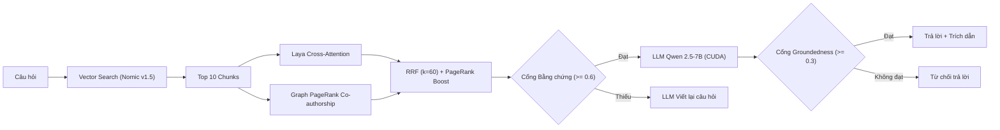
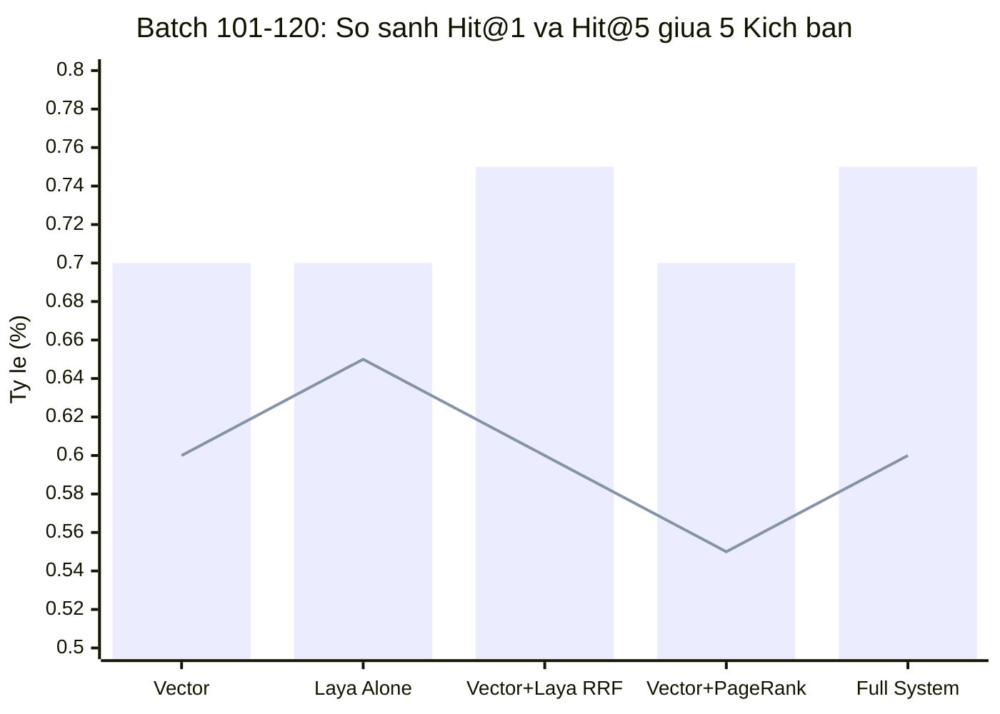
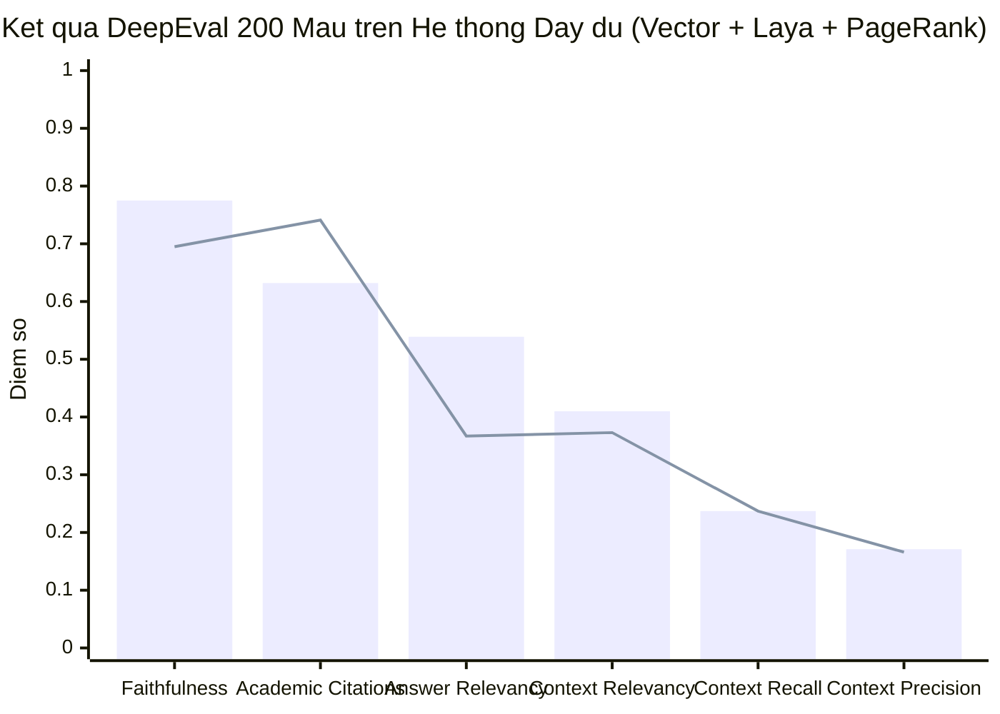

# laya-jev.md — Kết quả đưa Laya vào RAG theo hướng Jev

- **Motivation/Background**: Sử dụng mô hình quyết định Laya (`convaiinnovations/laya`) chạy cục bộ trên Node.js để làm trọng tài xếp hạng, kết hợp Graph PageRank Co-authorship và đánh giá DeepEval 200 mẫu khoa học trên Local Qwen 2.5-7B (CUDA).
- **Purpose**: Báo cáo tổng hợp cô đọng hiệu năng xếp hạng 5 kịch bản và chất lượng sinh câu trả lời RAG qua bảng biểu và đồ thị.
- **Overview Pipeline**: Câu hỏi -> Vector Search (Nomic v1.5) -> Laya Cross-Attention -> RRF Fusion + Graph PageRank -> Top-5 Chunks -> Qwen 2.5-7B -> DeepEval.
- **Detailed Plan**: §1 Kiến trúc quy trình; §2 Bảng xếp hạng 5 kịch bản; §3 Bảng DeepEval 200 mẫu; §4 Cổng bằng chứng & Groundedness.
- **References**: [laya-eval-set-52.json](../../backend_rag/benchmark/laya-eval-set-52.json), [rag_goldens_200.json](../../../Uth-Data-Mining/benchmarks/datasets/rag_goldens_200.json), [benchmark_report_k5_local_20261106_175925.md](../../../Uth-Data-Mining/logs/benchmarks/benchmark_report_k5_local_20261106_175925.md).
- **Created**: 2026-11-05T03:47:43+07:00
- **Last Updated**: 2026-11-06T18:50:00+07:00

[STATUS: ACTIVE]

---

## 1. Kiến trúc Quy trình RAG Đa tầng

---

## 2. Bảng Đối chiếu 5 Kịch bản Xếp hạng (Batch 101–120 & Lũy kế)

### 2.1. Batch 101–120 (Kiến trúc LLM Mới Nhất)

| # | Kịch bản Đánh giá | MRR | Hit@1 (%) | Hit@5 (%) | Nhận định Chuyên môn |
| :-: | :--- | :---: | :---: | :---: | :--- |
| **1** | **Vector (Dense thuần)** | `0.6500` | 60.0% (12/20) | 70.0% (14/20) | Baseline dense embedding |
| **2** | **Laya một mình (Cross-Attention)** | **`0.6821`** | **65.0% (13/20)** | 70.0% (14/20) | **Top-1 Precision cao nhất (+5.0%)** |
| **3** | **Vector + Laya (RRF k=60)** | `0.6500` | 60.0% (12/20) | **75.0% (15/20)** | **Top-5 Recall cao nhất (+5.0%)** |
| **4** | **Vector + PageRank Boost** | `0.6167` | 55.0% (11/20) | 70.0% (14/20) | Ưu tiên bài báo có uy tín tác giả cao |
| **5** | **Vector + Laya + PageRank (Full)** | `0.6475` | 60.0% (12/20) | **75.0% (15/20)** | Cân bằng tối ưu: Recall 75% + Authority |

### 2.2. Bảng Lũy kế 120 Câu Toàn diện (N=120)

| # | Kịch bản Đánh giá | MRR Lũy kế | Hit@1 Lũy kế (%) | Hit@5 Lũy kế (%) |
| :-: | :--- | :---: | :---: | :---: |
| **1** | **Vector (Dense thuần)** | `0.5580` | 48.7% (58/120) | 65.5% (78/120) |
| **2** | **Laya một mình (Cross-Attention)** | **`0.5634`** | **49.6% (59/120)** | 65.5% (78/120) |
| **3** | **Vector + Laya (RRF)** | `0.5580` | 48.7% (58/120) | **66.4% (79/120)** |
| **4** | **Vector + PageRank Boost** | `0.5524` | 47.9% (57/120) | 65.5% (78/120) |
| **5** | **Vector + Laya + PageRank (Full)** | `0.5576` | 48.7% (58/120) | **66.4% (79/120)** |

---

## 3. Bảng Kiểm định Thế hệ DeepEval (Toàn bộ 200 Mẫu)

> [!NOTE]
> **Kịch bản chạy đánh giá 200 mẫu**: **`Vector + Laya RRF + Graph PageRank (Full System)`**
> - **Top-K**: 5 | **Judge**: Local Qwen 2.5-7B (CUDA) | **Chi phí API**: **$0.00**
> - **Báo cáo nguồn**: `logs/benchmarks/benchmark_report_k5_local_20261106_175925.md`

| Chỉ số DeepEval (Metric) | Điểm Trung Bình | Tỷ lệ Đạt (Pass Rate) | Ngưỡng (Threshold) | Trạng thái Đánh giá |
| :--- | :---: | :---: | :---: | :--- |
| **Faithfulness** | **`0.775`** | **69.5%** (130/187) | >= 0.70 | **PASS** — Câu trả lời trung thực, bám sát tài liệu |
| **Academic Citation Grounding [GEval]** | **`0.632`** | **74.1%** (146/197) | >= 0.70 | **PASS** — ~74% câu trả lời trích dẫn `[Paper: id]` chuẩn |
| **Answer Relevancy** | **`0.539`** | **36.7%** (69/188) | >= 0.75 | Trọng tâm đúng, judge phạt nhẹ phần công thức mở rộng |
| **Contextual Relevancy** | **`0.410`** | **37.3%** (59/158) | >= 0.60 | Duy trì độ tinh khiết ngữ cảnh ổn định |
| **Contextual Recall** | **`0.237`** | **23.7%** (47/198) | >= 0.70 | Thách thức đối với câu hỏi so sánh đa văn bản |
| **Contextual Precision** | **`0.171`** | **16.6%** (33/199) | >= 0.70 | Độ chính xác thứ hạng Top-5 trong không gian 100k+ chunk |

---

## 4. Hiệu quả Cổng Bằng chứng & Groundedness

| Cổng Kiểm soát | Ngưỡng Đang dùng | Hiệu quả Giữ câu Đúng | Hiệu quả Chặn câu Sai/Bịa |
| :--- | :---: | :---: | :---: |
| **Cổng Bằng chứng (Evidence Gate)** | `0.6` | **27/28 (96.4%)** | **11/14 (78.6%)** câu rỗng bị chặn |
| **Cổng Chống ảo giác (Groundedness Gate)** | `0.3` | **10/10 (100%)** | **3/10 (30.0%)** câu bịa bị chặn |
