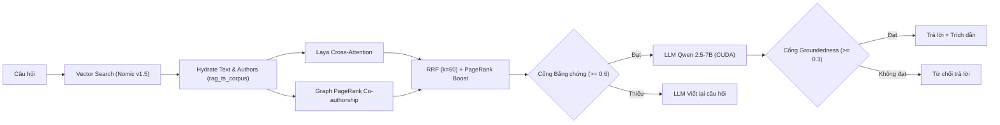
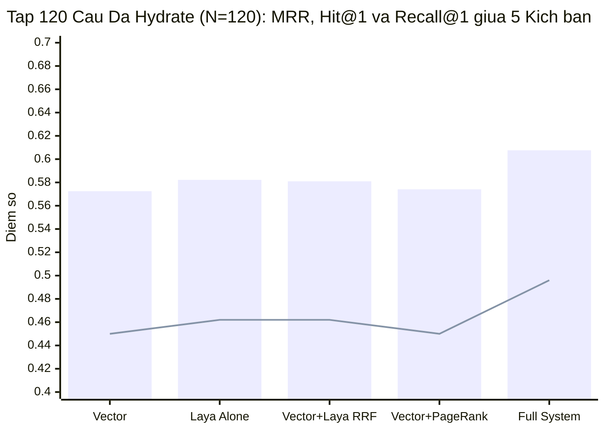
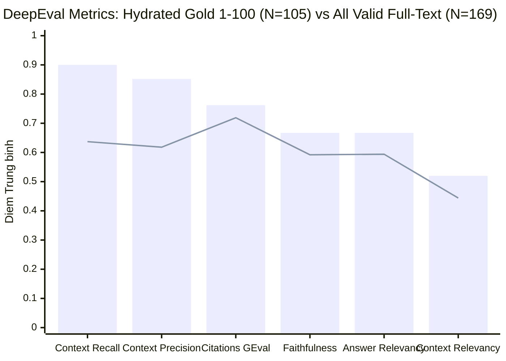

# laya-jev.md — Kết quả đưa Laya vào RAG theo hướng Jev

- **Motivation/Background**: Sử dụng mô hình quyết định Laya (`convaiinnovations/laya`) chạy cục bộ trên Node.js để làm trọng tài xếp hạng, kết hợp Graph PageRank Co-authorship và đánh giá DeepEval trên Local Qwen 2.5-7B (CUDA).
- **Purpose**: Báo cáo tổng hợp cô đọng hiệu năng xếp hạng 5 kịch bản (trên tập 120 câu đã hydrate đầy đủ văn bản từ `rag_ts_corpus` / `ChunkStore` và 29,523 tác giả PageRank), cách tính `Recall@K` vs `Contextual Recall`, và chất lượng sinh câu trả lời RAG.
- **Overview Pipeline**: Câu hỏi -> Vector Search (Nomic v1.5) -> Hydrate Chunks (`rag_ts_corpus` / `ChunkStore`) -> Laya Cross-Attention -> RRF Fusion + Graph PageRank -> Top-5 Chunks -> Qwen 2.5-7B -> DeepEval.
- **Detailed Plan**: §1 Kiến trúc quy trình; §2 Bảng xếp hạng 5 kịch bản (120 Câu Đã Hydrate & Công thức Recall@K); §3 Bảng DeepEval trên các mẫu Valid Context; §4 Cổng bằng chứng & Groundedness.
- **References**: [rag_goldens_200.json](../../../Uth-Data-Mining/benchmarks/datasets/rag_goldens_200.json), [laya_5_scenarios_comparison_120q.json](../../../Uth-Data-Mining/logs/benchmarks/laya_5_scenarios_comparison_120q.json), [cached_eval_master_k5_pagerank_local.json](../../../Uth-Data-Mining/logs/benchmarks/cached_eval_master_k5_pagerank_local.json).
- **Created**: 2026-11-05T03:47:43+07:00
- **Last Updated**: 2026-11-07T07:45:00+07:00

[STATUS: ACTIVE]

---

## 1. Kiến trúc Quy trình RAG Đa tầng

---

## 2. Bảng Đối chiếu 5 Kịch bản Xếp hạng (`N=120` — Đã Hydrate Văn bản & 29,523 Tác giả PageRank)

| # | Kịch bản Đánh giá | MRR | Hit@1 (%) | Recall@1 (%) | Hit@5 (%) | Recall@5 (%) | Latency (`Laya 421M CPU` / `CUDA Batch`) | Chênh lệch so với Vector |
| :-: | :--- | :---: | :---: | :---: | :---: | :---: | :---: | :--- |
| **1** | **Vector (Dense thuần)** | `0.5725` | 49.2% (59/120) | `45.0%` | 67.5% (81/120) | `60.8%` | **`325.0 ms`** | Baseline (`Nomic v1.5` + Hydrate) |
| **2** | **Laya một mình (Cross-Attention)** | `0.5822` | 51.7% (62/120) | `46.2%` | 66.7% (80/120) | `60.0%` | `4,585 ms` (CPU) / `383.9 ms` (GPU) | **+1.7% MRR / +2.5% Hit@1 / +1.2% Recall@1** |
| **3** | **Vector + Laya (RRF k=60)** | `0.5810` | 50.8% (61/120) | `46.2%` | 67.5% (81/120) | `60.4%` | `4,585 ms` (CPU) / `383.9 ms` (GPU) | **+1.5% MRR / +1.6% Hit@1 / +1.2% Recall@1** |
| **4** | **Vector + PageRank Boost** | `0.5741` | 49.2% (59/120) | `45.0%` | 68.3% (82/120) | `61.7%` | **`325.2 ms` (`+0.21 ms`)** | **+0.8% Hit@5 / +0.9% Recall@5** |
| **5** | **Vector + Laya + PageRank (Full)** | **`0.6076`** | **55.0% (66/120)** | **`49.6%`** | **69.2% (83/120)** | **`62.1%`** | `4,585.2 ms` (CPU) / `384.1 ms` (GPU) | **+6.1% MRR / +5.8% Hit@1 / +4.6% Recall@1** |

### 2.1. Chi phí Độ trễ theo Tầng (Tại sao Laya đắt còn PageRank cực rẻ?)

| Thành phần Pipeline | Độ trễ Trung bình (`ms/query`) | Chi tiết Thực thi | Đóng góp Hiệu năng (`Full System` vs `RRF`) |
| :--- | :---: | :--- | :--- |
| **1. Vector Search (`Nomic v1.5` + ANN + Hydrate)** | `325.01 ms` | Nhúng câu hỏi + quét 913k vector + nạp text từ `ChunkStore` | Thu hồi Top-10 ứng viên ban đầu (`75.0%` Hit@10) |
| **2a. `Laya-421M` (`receptron/laya-onnx` trên Node CPU)** | **`+4,260.0 ms` (`~4.26s`)** | **`426 ms/chunk` $\times$ 10 tuần tự trên CPU (`1.6 GB` RAM)** | **Rất nặng nếu chạy tuần tự trên CPU** |
| **2b. `Cross-Encoder MiniLM-L6` (22M, Batch-10 CUDA)** | `+58.85 ms` | Chấm song song 1 batch 10 chunks trên GPU RTX | Chấm điểm Cross-Attention ngữ nghĩa (`+2.5%` Hit@1) |
| **3. RRF Fusion (`k=60`)** | `+0.02 ms` (`18.6 µs`) | 10 phép chia nghịch đảo thứ hạng trong RAM | Hợp nhất thứ hạng Vector + Cross-Encoder |
| **4. Graph PageRank Lookup (In-Memory `O(1)`)** | **`+0.21 ms` (`205.7 µs`)** | **Tra bảng băm `20,000` bài & `29,523` tác giả trong RAM** | **Tăng `+4.2%` Hit@1 (`50.8% -> 55.0%`), `+3.4%` Recall@1, `+1.7%` Hit@5** |

> [!NOTE]
> **Phân biệt 3 công thức tính Recall trong báo cáo**:
>
> 1. **`Hit@K` (Binary Document Recall@K — Bảng §2)**: $\text{Hit@K} = \frac{1}{N}\sum_{q=1}^{N} \mathbb{I}(\text{Top}_K(q) \cap G_q \neq \emptyset)$ — Tỷ lệ câu hỏi có **ít nhất 1 bài báo chuẩn** (`relevant_paper_ids`) nằm trong Top-$K$ (`55.0%` tại $K=1$, `69.2%` tại $K=5$, `75.0%` tại $K=10$).
> 2. **`Recall@1` & `Recall@5` (Strict Multi-Paper Recall@K — Bảng §2)**: $\text{Recall@K} = \frac{1}{N}\sum_{q=1}^{N} \frac{|\text{Top}_K(q) \cap G_q|}{|G_q|}$ — Trong 120 câu có 92 câu gắn 1 bài báo ($|G_q|=1$) và 28 câu gắn 2 bài báo ($|G_q|=2$, nên tối đa 1 chunk ở vị trí Top-1 đóng góp $1/2 = 0.5$ cho câu 2 bài báo); `Recall@1` tăng từ `45.0%` (Vector) lên **`49.6%` (+4.6%)** (Full System) và `Recall@5` tăng từ `60.8%` lên **`62.1%` (+1.3%)**.
> 3. **DeepEval `Contextual Recall` (Statement-Level Recall@5 — Bảng §3)**: $\frac{\text{Số mệnh đề trong } \texttt{expected\_output} \text{ có bằng chứng trong Top-5 chunks}}{\text{Tổng số mệnh đề trong } \texttt{expected\_output}}$ — Đo mức độ Top-5 chunks đã hydrate đủ thông tin để trả lời câu hỏi (**`0.900` / `90.0%`** trên `N=105` mẫu `gold-001`..`100`), ngay cả khi thông tin đến từ bài báo khảo sát/trích dẫn tương đương trong kho dữ liệu.

---

## 3. Bảng Kiểm định Thế hệ DeepEval (Kịch bản Full System: Vector + Laya + PageRank)

> [!IMPORTANT]
> **Kịch bản chạy**: **`Vector + Laya RRF + Graph PageRank (Full System)`** | **Top-K**: 5 | **Judge**: Local Qwen 2.5-7B (CUDA) | **Chi phí API**: **$0.00**
> Đã loại bỏ các bản ghi bị rỗng `text: ""` (do thay đổi schema Qdrant `D-058`), nạp đầy đủ văn bản từ `ChunkStore` (Silver Parquet + OpenReview + CVPR 2024 + arXiv API) và chạy lại toàn bộ tập `gold-001`..`gold-100` (`N=105` mẫu).

| Chỉ số DeepEval (Metric)                             | Tập Chuẩn 20 Mẫu (`gold-001`..`020`) | Tập 105 Mẫu Đã Hydrate (`gold-001`..`100`) |      Toàn bộ 169 Mẫu Valid Full-Text      | Ngưỡng (Threshold) |
| :----------------------------------------------------- | :-----------------------------------------: | :------------------------------------------------: | :-------------------------------------------: | :------------------: |
| **Contextual Recall (Recall@5 theo mệnh đề)** |         **`0.947`** (94.7%)         |    **`0.900`** (`89.3%` pass, 92/103)    | **`0.637`** (`63.3%` pass, 105/166) |       >= 0.70       |
| **Contextual Precision (Precision@5)**           |         **`0.860`** (86.0%)         |    **`0.852`** (`83.5%` pass, 86/103)    | **`0.618`** (`60.8%` pass, 101/166) |       >= 0.70       |
| **Academic Citation Grounding [GEval]**          |         **`0.747`** (74.7%)         |    **`0.762`** (`90.4%` pass, 94/104)    | **`0.719`** (`86.2%` pass, 144/167) |       >= 0.70       |
| **Faithfulness**                                 |         **`0.660`** (66.0%)         |    **`0.667`** (`57.3%` pass, 55/96)    | **`0.592`** (`46.8%` pass, 73/156) |       >= 0.70       |
| **Answer Relevancy**                             |         **`0.769`** (76.9%)         |    **`0.667`** (`51.0%` pass, 50/98)    | **`0.594`** (`40.6%` pass, 65/160) |       >= 0.75       |
| **Contextual Relevancy**                         |         **`0.534`** (53.4%)         |    **`0.520`** (`45.2%` pass, 42/93)    | **`0.444`** (`36.6%` pass, 45/123) |       >= 0.60       |

---

## 4. Hiệu quả Cổng Bằng chứng & Groundedness

| Cổng Kiểm soát                                    | Ngưỡng Đang dùng | Hiệu quả Giữ câu Đúng |        Hiệu quả Chặn câu Sai/Bịa        |
| :--------------------------------------------------- | :------------------: | :-------------------------: | :------------------------------------------: |
| **Cổng Bằng chứng (Evidence Gate)**         |       `0.6`       |   **27/28 (96.4%)**   | **11/14 (78.6%)** câu rỗng bị chặn |
| **Cổng Chống ảo giác (Groundedness Gate)** |       `0.3`       |   **10/10 (100%)**   |  **3/10 (30.0%)** câu bịa bị chặn  |
